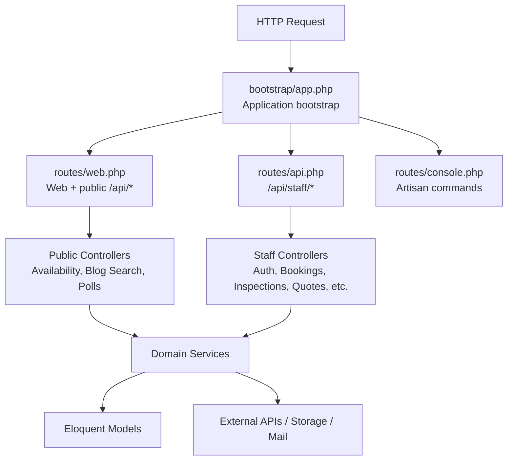
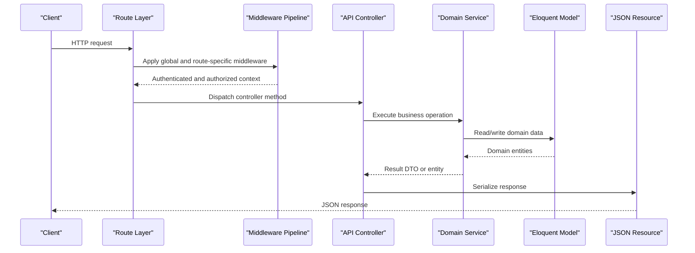
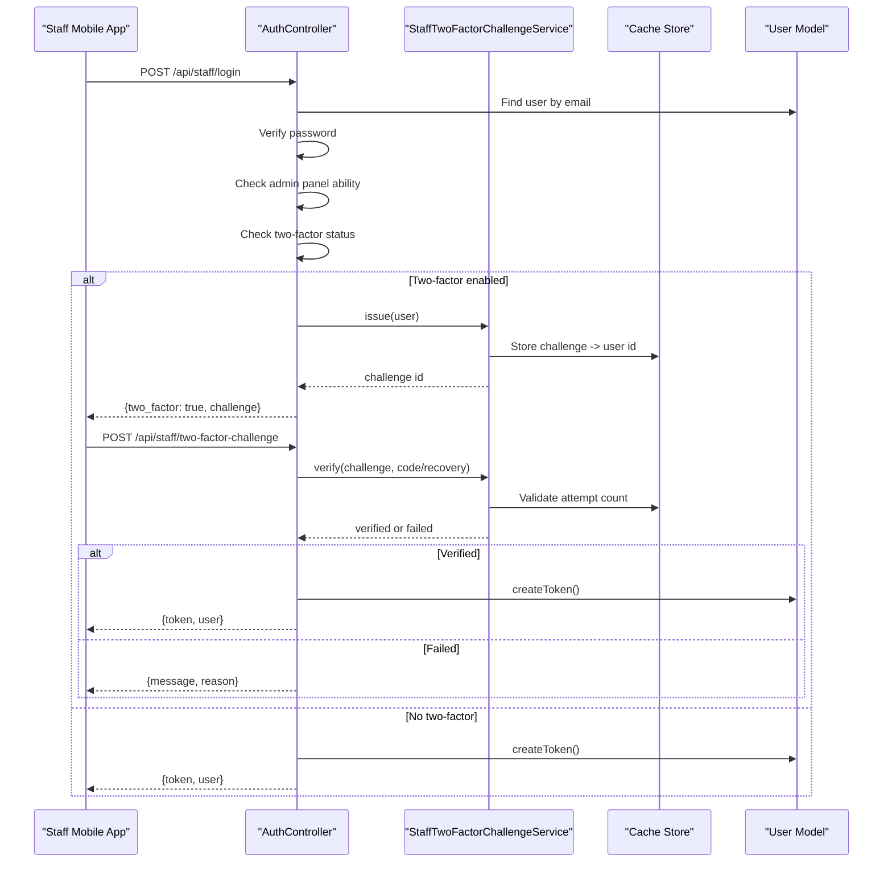
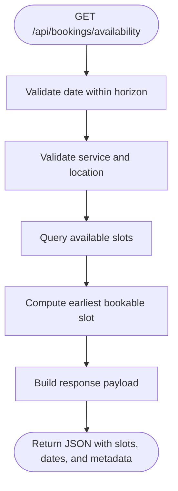
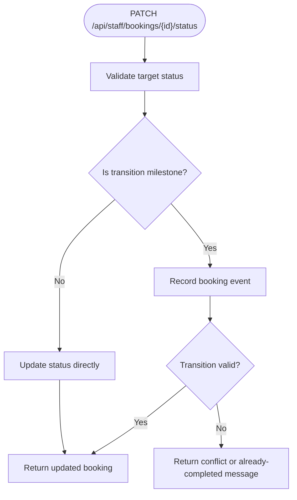
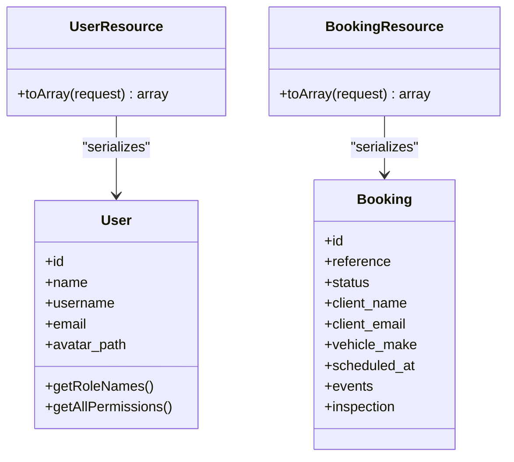
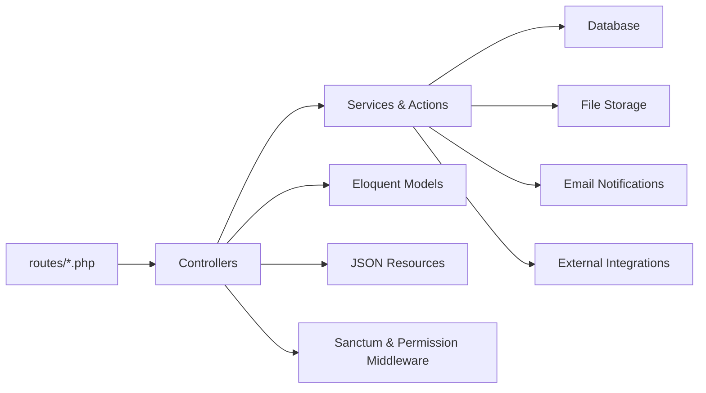

# API Architecture Overview

<cite>
**Referenced Files in This Document**   
- [routes/api.php](file://routes/api.php)
- [routes/web.php](file://routes/web.php)
- [routes/console.php](file://routes/console.php)
- [bootstrap/app.php](file://bootstrap/app.php)
- [config/sanctum.php](file://config/sanctum.php)
- [config/permission.php](file://config/permission.php)
- [app/Http/Controllers/Api/AuthController.php](file://app/Http/Controllers/Api/AuthController.php)
- [app/Http/Controllers/Api/BookingAvailabilityController.php](file://app/Http/Controllers/Api/BookingAvailabilityController.php)
- [app/Http/Controllers/Api/BlogSearchController.php](file://app/Http/Controllers/Api/BlogSearchController.php)
- [app/Http/Controllers/Api/DashboardController.php](file://app/Http/Controllers/Api/DashboardController.php)
- [app/Http/Controllers/Api/BookingController.php](file://app/Http/Controllers/Api/BookingController.php)
- [app/Http/Controllers/Api/InspectionController.php](file://app/Http/Controllers/Api/InspectionController.php)
- [app/Http/Controllers/Api/QuoteController.php](file://app/Http/Controllers/Api/QuoteController.php)
- [app/Http/Controllers/Api/ContactMessageController.php](file://app/Http/Controllers/Api/ContactMessageController.php)
- [app/Http/Controllers/Api/TestimonialController.php](file://app/Http/Controllers/Api/TestimonialController.php)
- [app/Http/Controllers/Api/PostController.php](file://app/Http/Controllers/Api/PostController.php)
- [app/Http/Controllers/Api/TaxonomyController.php](file://app/Http/Controllers/Api/TaxonomyController.php)
- [app/Http/Controllers/Api/StaffController.php](file://app/Http/Controllers/Api/StaffController.php)
- [app/Http/Controllers/Api/PartnerController.php](file://app/Http/Controllers/Api/PartnerController.php)
- [app/Http/Controllers/Api/GalleryController.php](file://app/Http/Controllers/Api/GalleryController.php)
- [app/Http/Controllers/Api/GalleryCategoryController.php](file://app/Http/Controllers/Api/GalleryCategoryController.php)
- [app/Services/StaffTwoFactorChallengeService.php](file://app/Services/StaffTwoFactorChallengeService.php)
- [app/Http/Resources/Api/UserResource.php](file://app/Http/Resources/Api/UserResource.php)
- [app/Http/Resources/Api/BookingResource.php](file://app/Http/Resources/Api/BookingResource.php)
</cite>

## Table of Contents
1. [Introduction](#introduction)
2. [Project Structure](#project-structure)
3. [Core Components](#core-components)
4. [Architecture Overview](#architecture-overview)
5. [Detailed Component Analysis](#detailed-component-analysis)
6. [Dependency Analysis](#dependency-analysis)
7. [Performance Considerations](#performance-considerations)
8. [Troubleshooting Guide](#troubleshooting-guide)
9. [Conclusion](#conclusion)

## Introduction
This document describes the Highblossom application’s API architecture. The system exposes two clearly separated API surfaces:

- **Public customer-facing endpoints** under `/api/*`: booking availability, calendar data, blog search, and content-block polling. These are unauthenticated JSON endpoints used by the public website.
- **Staff mobile-app endpoints** under `/api/staff/*`: a Sanctum token-authenticated JSON API for internal staff operations such as managing bookings, inspections, quotes, contact messages, testimonials, blog moderation, staff profiles, partners, and gallery images.

Both surfaces share the same underlying domain models and services, but they differ in authentication, authorization, rate limiting, URL conventions, and intended consumers.

## Project Structure
The routing layer is split into three files:

| File | Purpose |
|---|---|
| `routes/web.php` | Web pages, SEO endpoints, public form submissions, and public `/api/*` endpoints. |
| `routes/api.php` | Token-authenticated staff API under the `staff` prefix. |
| `routes/console.php` | Scheduled commands and background jobs. |

The bootstrap file wires web, API, console, and admin routes together and registers shared middleware aliases.

**Diagram sources**
- [bootstrap/app.php:10-36](file://bootstrap/app.php#L10-L36)
- [routes/web.php:1-76](file://routes/web.php#L1-L76)
- [routes/api.php:1-117](file://routes/api.php#L1-L117)
- [routes/console.php:1-33](file://routes/console.php#L1-L33)

**Section sources**
- [bootstrap/app.php:10-36](file://bootstrap/app.php#L10-L36)
- [routes/web.php:1-76](file://routes/web.php#L1-L76)
- [routes/api.php:1-117](file://routes/api.php#L1-L117)
- [routes/console.php:1-33](file://routes/console.php#L1-L33)

## Core Components
The dual-API design is implemented by separating route definitions rather than duplicating controllers:

- Public `/api/*` endpoints live in `routes/web.php`. They are lightweight JSON responses backed by dedicated public controllers or services.
- Staff `/api/staff/*` endpoints live in `routes/api.php`. Every data route is wrapped in `auth:sanctum` and gated with Spatie `can:` middleware that mirrors the web admin panel permissions.

Key responsibilities:

| Area | Implementation |
|---|---|
| Authentication | Sanctum personal access tokens for staff; no authentication for public endpoints. |
| Authorization | Spatie permission gates (`can:view`, `can:update`, `can:manage`) applied per route. |
| Rate limiting | Laravel built-in throttle middleware tuned per endpoint family. |
| Validation | Request-level validation using Laravel request objects or inline `Request::validate`. |
| Serialization | Dedicated `App\Http\Resources\Api\*` resources normalize model output. |
| Business logic | Services and actions encapsulate scheduling, timeline transitions, media processing, and external integrations. |

**Section sources**
- [routes/web.php:27-76](file://routes/web.php#L27-L76)
- [routes/api.php:1-117](file://routes/api.php#L1-L117)
- [bootstrap/app.php:24-45](file://bootstrap/app.php#L24-L45)

## Architecture Overview
The request lifecycle follows a consistent path from route registration to controller handling, service execution, model access, and resource serialization.

**Diagram sources**
- [bootstrap/app.php:10-45](file://bootstrap/app.php#L10-L45)
- [routes/api.php:14-117](file://routes/api.php#L14-L117)
- [routes/web.php:27-76](file://routes/web.php#L27-L76)

### Request Lifecycle Details

1. **Route registration**: Routes declare the controller, HTTP verb, URI pattern, optional parameters, middleware, and named route.
2. **Global middleware**: Proxy trust, theme sharing, session tracking, email verification enforcement, consent checks, registration gating, and Sanctum stateful domain configuration run before controller dispatch.
3. **Route-level middleware**: Sanctum authentication and Spatie `can:` gates protect staff endpoints. Throttle middleware protects high-frequency public endpoints.
4. **Controller handling**: Controllers validate input, delegate to services or actions, handle state transitions, and return JSON responses.
5. **Serialization**: Resources transform models into stable client payloads, including relationships, computed fields, and translated messages.

**Section sources**
- [bootstrap/app.php:10-71](file://bootstrap/app.php#L10-L71)
- [routes/api.php:14-117](file://routes/api.php#L14-L117)
- [routes/web.php:27-76](file://routes/web.php#L27-L76)

## Detailed Component Analysis

### Dual-API Route Separation
The public API and staff API never collide because their prefixes and authentication requirements differ:

| API Surface | Prefix | Authentication | Primary Consumers | Examples |
|---|---|---|---|---|
| Public API | `/api/*` | None | Website clients, browsers, third-party integrations | `/api/bookings/availability`, `/api/blog/search` |
| Staff API | `/api/staff/*` | Sanctum token + Spatie abilities | Mobile app and internal tools | `/api/staff/login`, `/api/staff/bookings` |

The staff route group explicitly documents this separation in its header comment: the `staff` prefix ensures collision avoidance with public endpoints, while every data route requires both Sanctum authentication and the same ability gates used by the web admin.

**Section sources**
- [routes/api.php:1-117](file://routes/api.php#L1-L117)
- [routes/web.php:27-76](file://routes/web.php#L27-L76)

### Authentication and Two-Factor Challenge Flow
Staff login does not immediately return a token when two-factor authentication is enabled. Instead, it returns a challenge object, forcing the mobile app to complete the second factor before receiving an access token.

**Diagram sources**
- [app/Http/Controllers/Api/AuthController.php:1-135](file://app/Http/Controllers/Api/AuthController.php#L1-L135)
- [app/Services/StaffTwoFactorChallengeService.php:1-197](file://app/Services/StaffTwoFactorChallengeService.php#L1-L197)
- [routes/api.php:22-36](file://routes/api.php#L22-L36)

The two-factor challenge service is stateless and cache-backed:

- A UUID challenge is stored against the user ID.
- Challenges expire after 600 seconds.
- Wrong attempts are counted.
- After five failed attempts, the challenge is burned.
- Recovery codes rotate once used.
- Secrets and submitted codes are never cached directly.

**Section sources**
- [app/Services/StaffTwoFactorChallengeService.php:1-197](file://app/Services/StaffTwoFactorChallengeService.php#L1-L197)

### Public Booking Availability API
The public booking availability endpoints answer customer questions without changing state. They accept service type and location because slot duration, capacity pools, and closing constraints depend on context.

**Diagram sources**
- [app/Http/Controllers/Api/BookingAvailabilityController.php:1-117](file://app/Http/Controllers/Api/BookingAvailabilityController.php#L1-L117)
- [routes/web.php:63-76](file://routes/web.php#L63-L76)

The controller validates:

- Date must be today or later.
- Date must fall within the configured horizon.
- Service must be one of the defined enum values.
- Location must be either mobile or workshop.

It returns structured metadata including closed status, lead time, interval duration, slot duration, available slot count, earliest slot, and the full slot grid.

**Section sources**
- [app/Http/Controllers/Api/BookingAvailabilityController.php:1-117](file://app/Http/Controllers/Api/BookingAvailabilityController.php#L1-L117)

### Public Blog Search API
The blog search endpoint powers a command palette. It rejects long queries instead of silently truncating them, which prevents expensive wildcard searches from arbitrary-length input.

**Section sources**
- [app/Http/Controllers/Api/BlogSearchController.php:1-37](file://app/Http/Controllers/Api/BlogSearchController.php#L1-L37)
- [routes/web.php:45-50](file://routes/web.php#L45-L50)

### Staff Dashboard API
The dashboard aggregates read-only counts across bookings, inspections, quotes, and contact messages. Each section is only included if the authenticated user holds the corresponding ability. This means the response shape can vary between users based on permissions.

**Section sources**
- [app/Http/Controllers/Api/DashboardController.php:1-79](file://app/Http/Controllers/Api/DashboardController.php#L1-L79)
- [routes/api.php:44-48](file://routes/api.php#L44-L48)

### Staff Booking Management
The booking controller supports listing, showing, updating editable fields, and moving bookings through their lifecycle. Status changes go through `BookingTimeline`, ensuring consistent milestone recording and preventing invalid transitions.

**Diagram sources**
- [app/Http/Controllers/Api/BookingController.php:1-122](file://app/Http/Controllers/Api/BookingController.php#L1-L122)

Pagination defaults to 15 items and is clamped between 1 and 100.

**Section sources**
- [app/Http/Controllers/Api/BookingController.php:1-122](file://app/Http/Controllers/Api/BookingController.php#L1-L122)

### Staff Inspection Management
Inspections represent appointments tied to bookings. Creation and updates reuse the same actions as the web admin, preserving scheduling and timeline behavior. Internal notes have explicit ownership checks even though route binding exposes both inspection and note IDs.

**Section sources**
- [app/Http/Controllers/Api/InspectionController.php:1-144](file://app/Http/Controllers/Api/InspectionController.php#L1-L144)
- [routes/api.php:50-66](file://routes/api.php#L50-L66)

### Staff Quote Management
Quotes are treated like bookings for authorization purposes. Status changes and deletion go through `QuoteService`, keeping business rules consistent with the web admin.

**Section sources**
- [app/Http/Controllers/Api/QuoteController.php:1-80](file://app/Http/Controllers/Api/QuoteController.php#L1-L80)
- [routes/api.php:68-76](file://routes/api.php#L68-L76)

### Staff Contact Message Triage
Contact messages use an explicit “mark as read” action so previewing a message in the mobile app does not change its inbox state, unlike the web admin where reading may be a side effect.

**Section sources**
- [app/Http/Controllers/Api/ContactMessageController.php:1-81](file://app/Http/Controllers/Api/ContactMessageController.php#L1-L81)
- [routes/api.php:78-86](file://routes/api.php#L78-L86)

### Staff Testimonial Management
Testimonials reuse admin request validation and service logic. Sorting, boolean coercion, and publish-state filtering behave consistently between web and mobile.

**Section sources**
- [app/Http/Controllers/Api/TestimonialController.php:1-91](file://app/Http/Controllers/Api/TestimonialController.php#L1-L91)
- [routes/api.php:88-98](file://routes/api.php#L88-L98)

### Staff Blog Moderation and Taxonomy
Blog post moderation is read-only on taxonomy endpoints. Post CRUD stays on the web admin; the mobile app can list posts, show individual posts, update status, and delete posts. Publishing is blocked if required fields are missing.

**Section sources**
- [app/Http/Controllers/Api/PostController.php:1-92](file://app/Http/Controllers/Api/PostController.php#L1-L92)
- [app/Http/Controllers/Api/TaxonomyController.php:1-35](file://app/Http/Controllers/Api/TaxonomyController.php#L1-L35)
- [routes/api.php:100-110](file://routes/api.php#L100-L110)

### Staff Team and Partner Management
Team members and partners are managed through REST-like endpoints. Both support ordered positioning via `SortOrderRules`, optional image upload, and deletion cleanup of associated storage files. Partners require a logo on creation but allow optional logos on update.

**Section sources**
- [app/Http/Controllers/Api/StaffController.php:1-115](file://app/Http/Controllers/Api/StaffController.php#L1-L115)
- [app/Http/Controllers/Api/PartnerController.php:1-133](file://app/Http/Controllers/Api/PartnerController.php#L1-L133)
- [routes/api.php:112-117](file://routes/api.php#L112-L117)

### Staff Gallery Management
Gallery management is scoped to curated gallery images. Uploads reuse the admin’s gallery request and service, ensuring webp conversion, media registry tracking, and gallery-source scoping. Category management remains web-admin-only.

**Section sources**
- [app/Http/Controllers/Api/GalleryController.php:1-92](file://app/Http/Controllers/Api/GalleryController.php#L1-L92)
- [app/Http/Controllers/Api/GalleryCategoryController.php:1-28](file://app/Http/Controllers/Api/GalleryCategoryController.php#L1-L28)
- [routes/api.php:112-117](file://routes/api.php#L112-L117)

### Response Serialization
All staff responses are normalized through dedicated JSON resources. Representative examples include:

- `UserResource`: exposes identity, avatar URL, role names, and the full ability list used by the mobile app for client-side UI gating.
- `BookingResource`: exposes summary fields, structured client and vehicle data, scheduled times, prices, media URLs, inspection data, and timeline events.

**Diagram sources**
- [app/Http/Resources/Api/UserResource.php:1-35](file://app/Http/Resources/Api/UserResource.php#L1-L35)
- [app/Http/Resources/Api/BookingResource.php:1-60](file://app/Http/Resources/Api/BookingResource.php#L1-L60)

**Section sources**
- [app/Http/Resources/Api/UserResource.php:1-35](file://app/Http/Resources/Api/UserResource.php#L1-L35)
- [app/Http/Resources/Api/BookingResource.php:1-60](file://app/Http/Resources/Api/BookingResource.php#L1-L60)

## Dependency Analysis
The API layer depends on several infrastructure layers:

**Diagram sources**
- [routes/api.php:1-117](file://routes/api.php#L1-L117)
- [routes/web.php:1-76](file://routes/web.php#L1-L76)
- [bootstrap/app.php:10-45](file://bootstrap/app.php#L10-L45)

### Middleware Chain
The application registers shared middleware aliases and applies framework-provided middleware groups. Relevant pieces include:

| Middleware | Purpose | Applied To |
|---|---|---|
| `auth:sanctum` | Authenticates requests using Sanctum tokens | Staff API routes inside the staff group |
| `can:*` | Checks Spatie permissions | Individual staff data routes |
| `throttle:*` | Limits requests per time window | Login, two-factor challenge, public availability, blog search, polls |
| `role`, `permission`, `role_or_permission` | Alias mappings to Spatie permission middleware | Admin and policy-gated areas |
| `verified.if_required` | Enforces email verification when required | Web flow |
| `consent.required` | Ensures consent is recorded | Web flow |
| `registration.enabled` | Prevents registration when disabled | Web flow |

**Section sources**
- [bootstrap/app.php:24-45](file://bootstrap/app.php#L24-L45)
- [config/sanctum.php:1-87](file://config/sanctum.php#L1-L87)
- [config/permission.php:1-200](file://config/permission.php#L1-L200)

### Naming Conventions
The codebase follows clear naming patterns:

| Area | Convention | Example |
|---|---|---|
| Controllers | `FeatureController` with pluralized resource names | `BookingController`, `InspectionController` |
| Resources | `FeatureResource` mapping to API payloads | `BookingResource`, `UserResource` |
| Services | `FeatureService` for reusable business logic | `QuoteService`, `GalleryService` |
| Requests | Feature-scoped request classes for validation | `StoreInspectionRequest`, `UpdateBookingRequest` |
| Routes | Descriptive named routes with module prefixes | `api.staff.bookings.index`, `api.blog.search` |
| Models | Singular domain nouns | `Booking`, `Inspection`, `Quote` |
| Enums | PascalCase domain values | `BookingServiceType`, `BookingDamageType` |

**Section sources**
- [routes/api.php:14-117](file://routes/api.php#L14-L117)
- [routes/web.php:27-76](file://routes/web.php#L27-L76)

### URL Patterns
| Pattern | Meaning |
|---|---|
| `/api/bookings/availability` | Public booking slot availability |
| `/api/bookings/calendar` | Public monthly calendar view |
| `/api/blog/search` | Public blog search term lookup |
| `/api/content-blocks/poll/{poll}` | Public poll submission |
| `/api/content-blocks/poll/{poll}/results` | Public poll results |
| `/api/glass-types/{glassType}/sub-categories` | Public glass type hierarchy |
| `/api/staff/login` | Staff authentication |
| `/api/staff/two-factor-challenge` | Staff second-factor verification |
| `/api/staff/{resource}` | Staff CRUD over bounded resources |

Numeric route segments are constrained with `whereNumber` where appropriate, especially for polymorphic-style bindings like `{post:id}`.

**Section sources**
- [routes/web.php:45-76](file://routes/web.php#L45-L76)
- [routes/api.php:22-117](file://routes/api.php#L22-L117)

### HTTP Status Code Standards
Observed standards include:

| Status | Usage |
|---|---|
| 200 | Successful GET and PATCH/PUT updates returning modified data. |
| 201 | Successful creation responses, including inspections, testimonials, and team/partner records. |
| 403 | Forbidden access, such as an account without admin panel ability. |
| 404 | Not found, including unauthorized note access and missing credentials. |
| 409 | Conflict when a terminal booking state blocks a requested transition. |
| 422 | Validation failure, including wrong credentials, expired challenges, invalid codes, and blocked publishing. |

**Section sources**
- [app/Http/Controllers/Api/AuthController.php:28-135](file://app/Http/Controllers/Api/AuthController.php#L28-L135)
- [app/Http/Controllers/Api/BookingController.php:70-122](file://app/Http/Controllers/Api/BookingController.php#L70-L122)
- [app/Http/Controllers/Api/InspectionController.php:66-144](file://app/Http/Controllers/Api/InspectionController.php#L66-L144)
- [app/Http/Controllers/Api/PostController.php:60-92](file://app/Http/Controllers/Api/PostController.php#L60-L92)

## Performance Considerations
- **Rate limiting**: High-frequency public endpoints use stricter throttles. Blog search uses a higher limit appropriate for interactive keystroke-driven search.
- **Pagination**: List endpoints clamp page size between 1 and 100 to prevent excessive payloads.
- **Eager loading**: Controllers eager-load relationships such as inspections, staff, notes, events, categories, and tags to avoid N+1 queries.
- **Read-only aggregation**: Dashboard counts are scoped by ability so unnecessary sections are omitted.
- **Image processing fallback**: Partner logo processing falls back to plain storage when image manipulation fails, preventing upload failures from blocking the entire request.
- **Scheduled maintenance**: Console commands clean orphaned uploads, prune sessions, and warm heavy overview probes to reduce runtime cost.

**Section sources**
- [routes/web.php:45-76](file://routes/web.php#L45-L76)
- [app/Http/Controllers/Api/BookingController.php:104-122](file://app/Http/Controllers/Api/BookingController.php#L104-L122)
- [app/Http/Controllers/Api/PartnerController.php:97-133](file://app/Http/Controllers/Api/PartnerController.php#L97-L133)
- [routes/console.php:10-33](file://routes/console.php#L10-L33)

## Troubleshooting Guide
Common operational issues and where to investigate:

| Symptom | Likely Cause | Where to Inspect |
|---|---|---|
| Staff login returns a challenge instead of a token | Account has two-factor authentication enabled | `AuthController.login`, `StaffTwoFactorChallengeService.issue` |
| Two-factor challenge fails repeatedly | Wrong code, expired challenge, or challenge burned after too many attempts | `StaffTwoFactorChallengeService.verify`, `StaffTwoFactorChallengeService.registerFailure` |
| Guest cannot access staff endpoints | Missing Sanctum token or insufficient permissions | `routes/api.php` staff group, Spatie `can:` middleware |
| Blog search is slow or rejected | Long query string exceeds maximum length | `BlogSearchController.MAX_QUERY_LENGTH` |
| Booking status update returns conflict | Attempting to move past a cancelled booking | `BookingController.updateStatus` |
| Publishing a blog post is blocked | Required publish fields are missing | `PostController.updateStatus` |
| Gallery or partner upload fails | Image processing exception or missing file validation | `PartnerController.storeLogo`, gallery-related requests and services |
| Unexpected JSON validation message | Passkey-related validation exceptions are rendered as structured JSON | `bootstrap/app.php` exception renderer |

**Section sources**
- [app/Http/Controllers/Api/AuthController.php:28-135](file://app/Http/Controllers/Api/AuthController.php#L28-L135)
- [app/Services/StaffTwoFactorChallengeService.php:1-197](file://app/Services/StaffTwoFactorChallengeService.php#L1-L197)
- [app/Http/Controllers/Api/BlogSearchController.php:1-37](file://app/Http/Controllers/Api/BlogSearchController.php#L1-L37)
- [app/Http/Controllers/Api/BookingController.php:70-122](file://app/Http/Controllers/Api/BookingController.php#L70-L122)
- [app/Http/Controllers/Api/PostController.php:60-92](file://app/Http/Controllers/Api/PostController.php#L60-L92)
- [app/Http/Controllers/Api/PartnerController.php:97-133](file://app/Http/Controllers/Api/PartnerController.php#L97-L133)
- [bootstrap/app.php:47-71](file://bootstrap/app.php#L47-L71)

## Conclusion
Highblossom’s API architecture cleanly separates public customer-facing endpoints from token-authenticated staff endpoints while reusing the same domain models, services, and permission model. The staff API enforces Sanctum authentication and Spatie permissions at the route level, mirroring the web admin’s security posture. Public endpoints focus on read-heavy, rate-limited operations such as availability lookups and blog search. Controllers remain thin, delegating business logic to services and actions, and serialize responses through dedicated JSON resources. This structure makes the API predictable, secure, maintainable, and scalable across both web and mobile consumers.