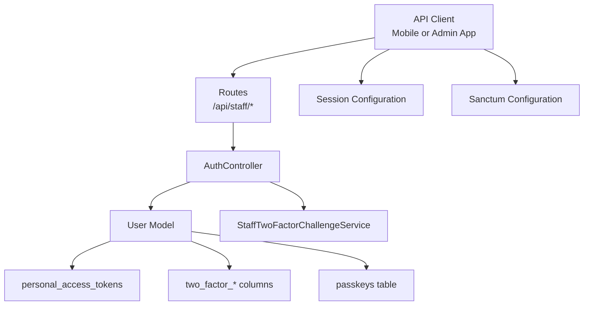
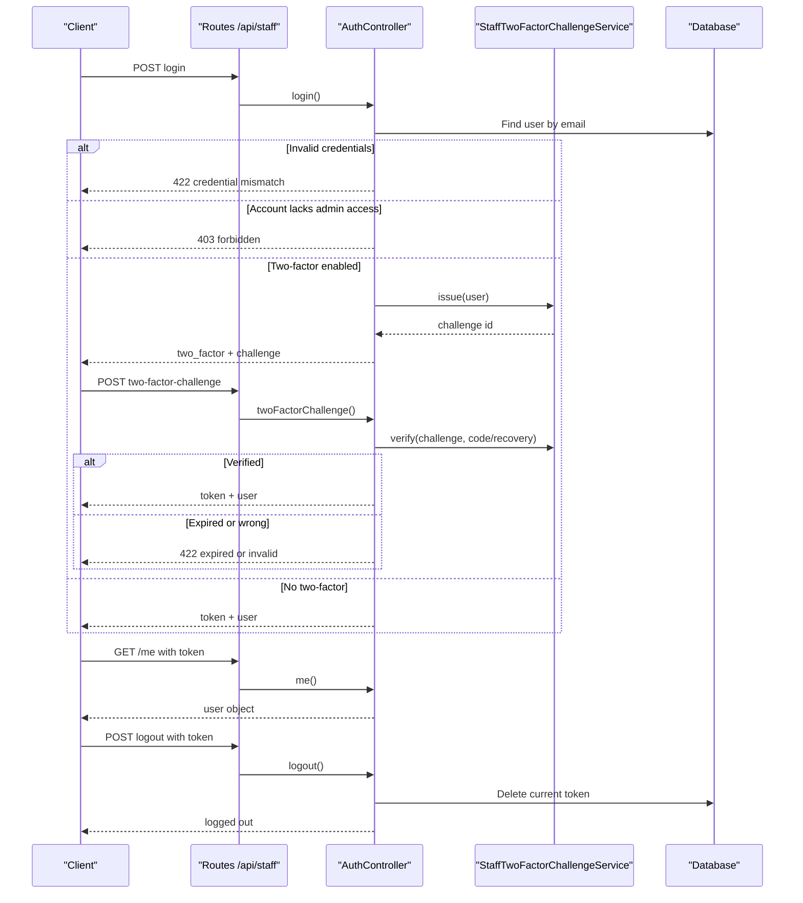
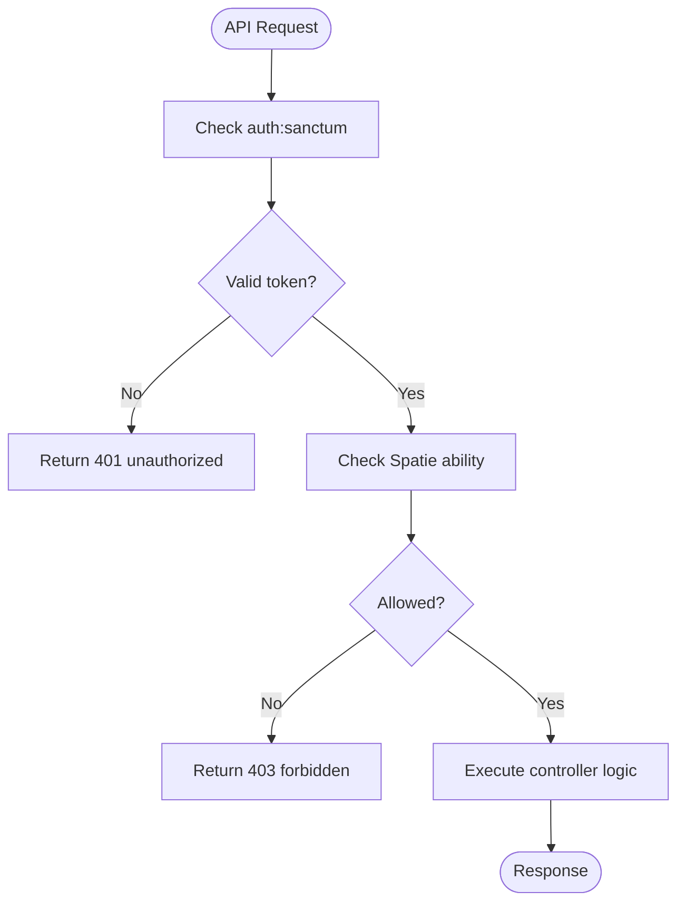
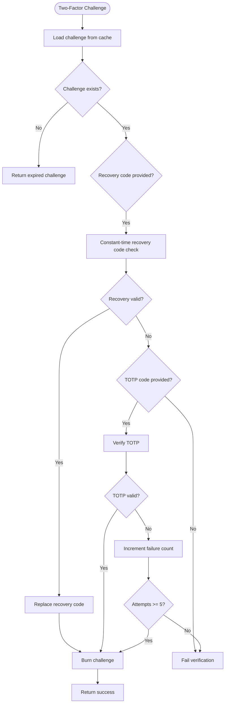
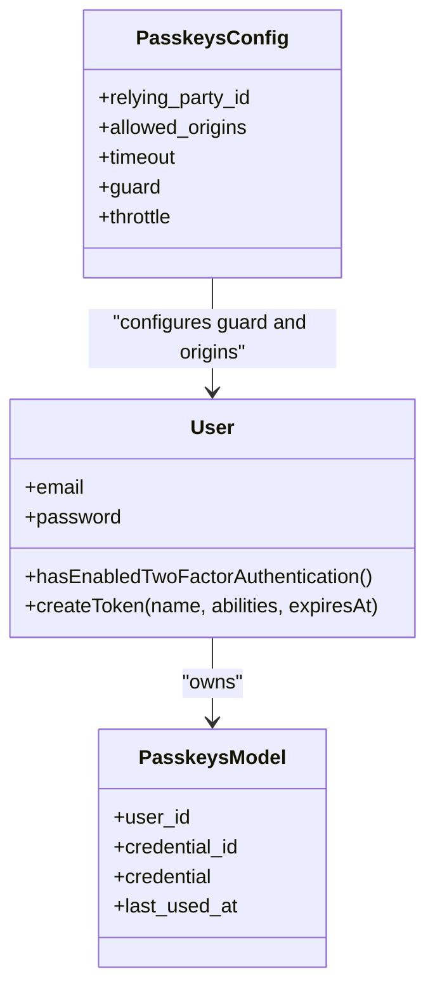
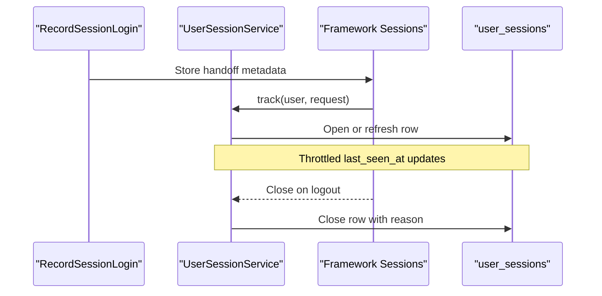
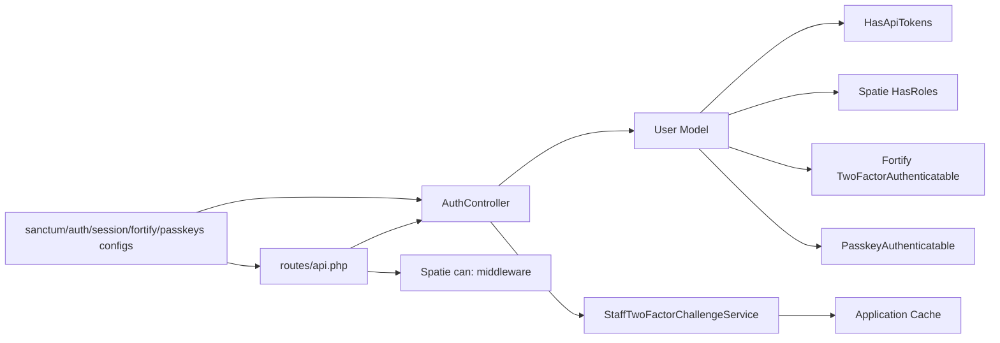

# API Authentication and Security

<cite>
**Referenced Files in This Document**
- [routes/api.php](file://routes/api.php)
- [app/Http/Controllers/Api/AuthController.php](file://app/Http/Controllers/Api/AuthController.php)
- [config/sanctum.php](file://config/sanctum.php)
- [config/auth.php](file://config/auth.php)
- [config/session.php](file://config/session.php)
- [config/fortify.php](file://config/fortify.php)
- [config/passkeys.php](file://config/passkeys.php)
- [app/Models/User.php](file://app/Models/User.php)
- [database/migrations/2026_10_22_103941_create_personal_access_tokens_table.php](file://database/migrations/2026_10_22_103941_create_personal_access_tokens_table.php)
- [database/migrations/2025_08_14_170933_add_two_factor_columns_to_users_table.php](file://database/migrations/2025_08_14_170933_add_two_factor_columns_to_users_table.php)
- [database/migrations/2026_06_08_113028_create_passkeys_table.php](file://database/migrations/2026_06_08_113028_create_passkeys_table.php)
- [app/Services/StaffTwoFactorChallengeService.php](file://app/Services/StaffTwoFactorChallengeService.php)
- [app/Support/CanonicalLoginRateLimiter.php](file://app/Support/CanonicalLoginRateLimiter.php)
- [docker/nginx.conf](file://docker/nginx.conf)
- [app/Listeners/RecordSessionLogin.php](file://app/Listeners/RecordSessionLogin.php)
- [app/Listeners/EndSessionOnLogout.php](file://app/Listeners/EndSessionOnLogout.php)
- [app/Listeners/RevokeSessionsOnPasswordReset.php](file://app/Listeners/RevokeSessionsOnPasswordReset.php)
- [app/Models/UserSession.php](file://app/Models/UserSession.php)
- [app/Services/UserSessionService.php](file://app/Services/UserSessionService.php)
- [config/user-sessions.php](file://config/user-sessions.php)
</cite>

## Table of Contents
1. [Introduction](#introduction)
2. [Project Structure](#project-structure)
3. [Core Components](#core-components)
4. [Architecture Overview](#architecture-overview)
5. [Detailed Component Analysis](#detailed-component-analysis)
6. [Dependency Analysis](#dependency-analysis)
7. [Performance Considerations](#performance-considerations)
8. [Security Best Practices](#security-best-practices)
9. [Troubleshooting Guide](#troubleshooting-guide)
10. [Conclusion](#conclusion)

## Introduction
This document explains how the application secures its API, with a focus on Sanctum token-based authentication for the staff mobile app, stateful versus stateless modes, two-factor authentication integration, passkey support, session handling, and broader security practices. It also covers rate limiting, abuse prevention, secure header configuration, input validation, SQL injection prevention, and patterns for protecting sensitive data in transit and at rest.

The API is split into public endpoints under `/api` and a protected staff API under `/api/staff`. All staff routes are guarded by Sanctum and Spatie permissions so that tokens do not bypass the same authorization checks used by the web admin panel.

## Project Structure
The authentication-related surface area consists of:

- API route definitions under the `staff` prefix.
- An API authentication controller issuing and revoking personal access tokens.
- Sanctum, Fortify, Passkeys, and framework session configuration.
- A user model implementing Sanctum, Fortify two-factor, and Passkeys capabilities.
- A stateless two-factor challenge service for the mobile API.
- A custom login rate limiter keyed on the canonical sign-in identifier.
- A session ledger system recording device sessions.
- Database migrations for tokens, two-factor fields, and passkeys.
- Nginx configuration constraining request size and denying hidden files.

**Diagram sources**
- [routes/api.php:1-117](file://routes/api.php#L1-L117)
- [app/Http/Controllers/Api/AuthController.php:1-135](file://app/Http/Controllers/Api/AuthController.php#L1-L135)
- [app/Models/User.php:1-141](file://app/Models/User.php#L1-L141)
- [app/Services/StaffTwoFactorChallengeService.php:1-197](file://app/Services/StaffTwoFactorChallengeService.php#L1-L197)
- [database/migrations/2026_10_22_103941_create_personal_access_tokens_table.php:1-33](file://database/migrations/2026_10_22_103941_create_personal_access_tokens_table.php#L1-L33)
- [database/migrations/2025_08_14_170933_add_two_factor_columns_to_users_table.php:1-34](file://database/migrations/2025_08_14_170933_add_two_factor_columns_to_users_table.php#L1-L34)
- [database/migrations/2026_06_08_113028_create_passkeys_table.php:1-35](file://database/migrations/2026_06_08_113028_create_passkeys_table.php#L1-L35)

**Section sources**
- [routes/api.php:1-117](file://routes/api.php#L1-L117)
- [config/sanctum.php:1-87](file://config/sanctum.php#L1-L87)
- [config/auth.php:1-117](file://config/auth.php#L1-L117)
- [config/session.php:1-233](file://config/session.php#L1-L233)

## Core Components
- **Sanctum**: Issues short-lived personal access tokens for the staff API. The default guard is `web`, and Sanctum can work with either stateful cookies or bearer tokens depending on the client.
- **Fortify**: Provides login, registration, password reset, email verification, two-factor authentication, and passkeys for the web layer.
- **Passkeys**: WebAuthn-based passwordless login bound to an application relying party ID and allowed origins.
- **User Model**: Implements Sanctum tokens, Spatie roles, Fortify two-factor, and Passkeys. Sensitive attributes such as password and two-factor secrets are hidden.
- **API Authentication Controller**: Handles login, optional two-factor challenge completion, current user retrieval, and token logout.
- **Stateless Two-Factor Challenge Service**: Stores only a user id and failure counter in cache for mobile two-factor flows.
- **Custom Login Rate Limiter**: Prevents separate brute-force buckets for usernames and emails by keying on a normalized sign-in identifier plus IP.
- **Session Ledger**: Records device sessions, activity, revocation, and lifecycle events separately from the framework session store.

**Section sources**
- [config/sanctum.php:1-87](file://config/sanctum.php#L1-L87)
- [config/fortify.php:1-162](file://config/fortify.php#L1-L162)
- [config/passkeys.php:1-117](file://config/passkeys.php#L1-L117)
- [app/Models/User.php:1-141](file://app/Models/User.php#L1-L141)
- [app/Http/Controllers/Api/AuthController.php:1-135](file://app/Http/Controllers/Api/AuthController.php#L1-L135)
- [app/Services/StaffTwoFactorChallengeService.php:1-197](file://app/Services/StaffTwoFactorChallengeService.php#L1-L197)
- [app/Support/CanonicalLoginRateLimiter.php:1-37](file://app/Support/CanonicalLoginRateLimiter.php#L1-L37)
- [app/Services/UserSessionService.php:1-272](file://app/Services/UserSessionService.php#L1-L272)
- [app/Models/UserSession.php:1-257](file://app/Models/UserSession.php#L1-L257)

## Architecture Overview
The staff API follows this flow:

1. A client requests `/api/staff/login`.
2. If credentials are invalid, the response is `422`.
3. If the account lacks admin-panel access, the response is `403`.
4. If two-factor is enabled, the server returns a challenge instead of a token.
5. The client calls `/api/staff/two-factor-challenge` with a TOTP code or recovery code.
6. On success, a three-month personal access token is issued.
7. Protected routes require `auth:sanctum` and Spatie abilities.
8. Logout deletes the current token.

**Diagram sources**
- [routes/api.php:1-117](file://routes/api.php#L1-L117)
- [app/Http/Controllers/Api/AuthController.php:1-135](file://app/Http/Controllers/Api/AuthController.php#L1-L135)
- [app/Services/StaffTwoFactorChallengeService.php:1-197](file://app/Services/StaffTwoFactorChallengeService.php#L1-L197)

## Detailed Component Analysis

### Sanctum Token-Based Authentication
The staff API uses Laravel Sanctum personal access tokens. The migration creates a `personal_access_tokens` table with unique token values, abilities, last-used timestamps, and expiration. Tokens are created through the user model with a three-month lifetime and wildcard abilities; authorization is enforced afterward by Spatie permissions on each route.

Key behaviors:
- Token issuance occurs only after successful credential validation and role checks.
- Two-factor-enabled accounts receive a challenge rather than a token during login.
- Logout deletes the current token immediately.
- Tokens are stored as hashed values by Sanctum and validated per request.

**Diagram sources**
- [routes/api.php:1-117](file://routes/api.php#L1-L117)
- [database/migrations/2026_10_22_103941_create_personal_access_tokens_table.php:1-33](file://database/migrations/2026_10_22_103941_create_personal_access_tokens_table.php#L1-L33)
- [app/Http/Controllers/Api/AuthController.php:1-135](file://app/Http/Controllers/Api/AuthController.php#L1-L135)

**Section sources**
- [config/sanctum.php:1-87](file://config/sanctum.php#L1-L87)
- [database/migrations/2026_10_22_103941_create_personal_access_tokens_table.php:1-33](file://database/migrations/2026_10_22_103941_create_personal_access_tokens_table.php#L1-L33)
- [app/Http/Controllers/Api/AuthController.php:1-135](file://app/Http/Controllers/Api/AuthController.php#L1-L135)
- [routes/api.php:1-117](file://routes/api.php#L1-L117)

### Stateful vs Stateless Authentication Modes
Sanctum supports both stateful cookie-based authentication for first-party SPAs and stateless bearer-token authentication for APIs.

- **Stateful mode**: Requests from domains listed in the Sanctum `stateful` configuration receive session cookies. Sanctum middleware includes CSRF protection and encrypted cookies.
- **Stateless mode**: The staff API uses bearer tokens. There is no session requirement for authenticated API calls beyond the token itself.
- **Guard configuration**: The default guard is `web`, using the session driver and Eloquent user provider.

Operational implications:
- For SPA clients on trusted domains, stateful cookies may be preferred to avoid storing long-lived tokens in JavaScript.
- For native mobile apps, bearer tokens are appropriate and should be transmitted over HTTPS and stored securely.

**Section sources**
- [config/sanctum.php:1-87](file://config/sanctum.php#L1-L87)
- [config/auth.php:1-117](file://config/auth.php#L1-L117)
- [config/session.php:1-233](file://config/session.php#L1-L233)

### Token Lifecycle Management
Token lifecycle stages in this application:

1. **Creation**: After successful login and optional two-factor verification, a token is created with a three-month expiration and wildcard abilities.
2. **Usage**: Sanctum updates the last-used timestamp when the token validates a request.
3. **Expiration**: Tokens expire according to the configured expiration or the creation time offset.
4. **Revocation**: Logout deletes the current token. Administrators can revoke other tokens through permission-gated UIs if implemented elsewhere.
5. **Scanning and rotation**: The token prefix setting exists to help secret-scanning tools detect leaked tokens.

Recommended operational practices:
- Rotate tokens periodically.
- Revoke tokens on suspicious activity.
- Store tokens outside source control.
- Use environment variables for token prefixes.
- Monitor `last_used_at` for stale tokens.

**Section sources**
- [app/Http/Controllers/Api/AuthController.php:1-135](file://app/Http/Controllers/Api/AuthController.php#L1-L135)
- [config/sanctum.php:1-87](file://config/sanctum.php#L1-L87)
- [database/migrations/2026_10_22_103941_create_personal_access_tokens_table.php:1-33](file://database/migrations/2026_10_22_103941_create_personal_access_tokens_table.php#L1-L33)

### Two-Factor Authentication Integration
Two-factor authentication is enabled through Fortify. The database adds two-factor secret, recovery codes, and confirmation timestamp columns to the users table. The user model uses Fortify’s two-factor traits and hides the secret and recovery codes.

For the staff API:
- Login returns a challenge when two-factor is enabled.
- The challenge is a UUID stored in cache with a ten-minute TTL.
- Wrong attempts are counted and burn the challenge after five failures.
- Recovery codes are compared in constant time and rotated on use.
- Successful verification issues the Sanctum token.

**Diagram sources**
- [app/Services/StaffTwoFactorChallengeService.php:1-197](file://app/Services/StaffTwoFactorChallengeService.php#L1-L197)
- [database/migrations/2025_08_14_170933_add_two_factor_columns_to_users_table.php:1-34](file://database/migrations/2025_08_14_170933_add_two_factor_columns_to_users_table.php#L1-L34)
- [app/Models/User.php:1-141](file://app/Models/User.php#L1-L141)

**Section sources**
- [config/fortify.php:1-162](file://config/fortify.php#L1-L162)
- [database/migrations/2025_08_14_170933_add_two_factor_columns_to_users_table.php:1-34](file://database/migrations/2025_08_14_170933_add_two_factor_columns_to_users_table.php#L1-L34)
- [app/Services/StaffTwoFactorChallengeService.php:1-197](file://app/Services/StaffTwoFactorChallengeService.php#L1-L197)
- [app/Models/User.php:1-141](file://app/Models/User.php#L1-L141)

### Passkey Support
Passkeys are configured through the Passkeys package and Fortify features. The configuration binds passkeys to an application URL-derived relying party ID and restricts allowed origins to the application URL.

Implementation highlights:
- The user model implements the Passkeys user contract.
- The passkeys table stores credential metadata, credential identifiers, usage timestamps, and user references.
- WebAuthn operations have a configurable timeout.
- Passkey routes use the web guard and throttle middleware by default.
- Successful passkey verification redirects to the dashboard.

**Diagram sources**
- [app/Models/User.php:1-141](file://app/Models/User.php#L1-L141)
- [database/migrations/2026_06_08_113028_create_passkeys_table.php:1-35](file://database/migrations/2026_06_08_113028_create_passkeys_table.php#L1-L35)
- [config/passkeys.php:1-117](file://config/passkeys.php#L1-L117)

**Section sources**
- [config/passkeys.php:1-117](file://config/passkeys.php#L1-L117)
- [database/migrations/2026_06_08_113028_create_passkeys_table.php:1-35](file://database/migrations/2026_06_08_113028_create_passkeys_table.php#L1-L35)
- [config/fortify.php:1-162](file://config/fortify.php#L1-L162)

### Session Handling
The application tracks sessions through both the framework session store and a dedicated `user_sessions` ledger.

Framework session behavior:
- Driver defaults to the database.
- Lifetime defaults to 120 minutes.
- Cookies can be secure, HTTP-only, and SameSite-aware.
- Session encryption is configurable.

Ledger behavior:
- A login listener records login method and remember state.
- The session service opens a new ledger row on first request, refreshes activity with throttled writes, and closes rows on logout.
- Password resets trigger revocation of other sessions.
- Orphaned and stale sessions are detected relative to the framework session lifetime.
- Revocation works by deleting framework session rows, making sessions unreadable on their next request.

**Diagram sources**
- [app/Listeners/RecordSessionLogin.php:1-56](file://app/Listeners/RecordSessionLogin.php#L1-L56)
- [app/Listeners/EndSessionOnLogout.php:1-30](file://app/Listeners/EndSessionOnLogout.php#L1-L30)
- [app/Services/UserSessionService.php:1-272](file://app/Services/UserSessionService.php#L1-L272)
- [app/Models/UserSession.php:1-257](file://app/Models/UserSession.php#L1-L257)
- [config/user-sessions.php:1-42](file://config/user-sessions.php#L1-L42)

**Section sources**
- [config/session.php:1-233](file://config/session.php#L1-L233)
- [app/Listeners/RecordSessionLogin.php:1-56](file://app/Listeners/RecordSessionLogin.php#L1-L56)
- [app/Listeners/EndSessionOnLogout.php:1-30](file://app/Listeners/EndSessionOnLogout.php#L1-L30)
- [app/Listeners/RevokeSessionsOnPasswordReset.php:1-40](file://app/Listeners/RevokeSessionsOnPasswordReset.php#L1-L40)
- [app/Services/UserSessionService.php:1-272](file://app/Services/UserSessionService.php#L1-L272)
- [app/Models/UserSession.php:1-257](file://app/Models/UserSession.php#L1-L257)
- [config/user-sessions.php:1-42](file://config/user-sessions.php#L1-L42)

## Dependency Analysis
The authentication subsystem depends on several layers:

**Diagram sources**
- [routes/api.php:1-117](file://routes/api.php#L1-L117)
- [app/Http/Controllers/Api/AuthController.php:1-135](file://app/Http/Controllers/Api/AuthController.php#L1-L135)
- [app/Models/User.php:1-141](file://app/Models/User.php#L1-L141)
- [app/Services/StaffTwoFactorChallengeService.php:1-197](file://app/Services/StaffTwoFactorChallengeService.php#L1-L197)
- [config/sanctum.php:1-87](file://config/sanctum.php#L1-L87)
- [config/auth.php:1-117](file://config/auth.php#L1-L117)
- [config/session.php:1-233](file://config/session.php#L1-L233)
- [config/fortify.php:1-162](file://config/fortify.php#L1-L162)
- [config/passkeys.php:1-117](file://config/passkeys.php#L1-L117)

**Section sources**
- [routes/api.php:1-117](file://routes/api.php#L1-L117)
- [app/Http/Controllers/Api/AuthController.php:1-135](file://app/Http/Controllers/Api/AuthController.php#L1-L135)
- [app/Models/User.php:1-141](file://app/Models/User.php#L1-L141)
- [app/Services/StaffTwoFactorChallengeService.php:1-197](file://app/Services/StaffTwoFactorChallengeService.php#L1-L197)

## Performance Considerations
- **Token validation overhead**: Sanctum loads and validates tokens per request. Keep token payloads small and rely on abilities for fine-grained authorization.
- **Two-factor caching**: The challenge service uses cache with a ten-minute TTL. Ensure the cache backend is fast and durable.
- **Session ledger writes**: Activity updates are throttled to reduce database churn. Tune `touch_throttle_seconds` based on expected request volume.
- **Orphan detection**: Orphan grace minutes prevent premature session closure during prune operations. Adjust based on deployment cadence.
- **Route-level throttling**: Login and two-factor challenge routes are throttled at six requests per minute. This protects against brute force but may need tuning for high-volume environments.

[No sources needed since this section provides general guidance]

## Security Best Practices

### CSRF Protection
- Sanctum’s stateful middleware stack includes CSRF validation and encrypted cookies for first-party SPAs.
- Stateless API calls authenticate via bearer tokens and do not rely on CSRF cookies.
- For cross-origin stateful SPAs, configure Sanctum’s stateful domains carefully and ensure proper CORS settings at the proxy or application level.

**Section sources**
- [config/sanctum.php:1-87](file://config/sanctum.php#L1-L87)

### XSS Prevention
- Output escaping is handled by the templating layer; never trust unvalidated input.
- Avoid embedding raw user content into scripts or HTML without sanitization.
- Use Content-Security-Policy headers where possible.

[No sources needed since this section provides general guidance]

### Input Validation
- API login uses strongly typed request classes and explicit string extraction.
- Route parameters are constrained to numeric IDs where appropriate.
- Always validate, cast, and sanitize inputs before persistence.

**Section sources**
- [app/Http/Controllers/Api/AuthController.php:1-135](file://app/Http/Controllers/Api/AuthController.php#L1-L135)
- [routes/api.php:1-117](file://routes/api.php#L1-L117)

### SQL Injection Prevention
- Use parameterized queries through Eloquent and query builders.
- Avoid raw SQL unless absolutely necessary, and then bind all parameters.
- Disable destructive commands in production where possible.

**Section sources**
- [app/Providers/AppServiceProvider.php:1-110](file://app/Providers/AppServiceProvider.php#L1-L110)

### Secure Header and Server Configuration
- Nginx limits request body size and denies access to hidden files except well-known paths.
- Ensure HTTPS termination at the reverse proxy or load balancer.
- Configure secure cookie flags, strict transport security, referrer policy, and content type sniffing controls at the server or framework level.

**Section sources**
- [docker/nginx.conf:1-20](file://docker/nginx.conf#L1-L20)

### Rate Limiting and Abuse Prevention
- Login routes use global throttling.
- Two-factor challenge routes are independently throttled.
- Passkeys routes are throttled by default.
- The custom login rate limiter keys on a canonical sign-in identifier and IP, preventing separate brute-force buckets for username and email variants.

**Section sources**
- [routes/api.php:1-117](file://routes/api.php#L1-L117)
- [config/fortify.php:1-162](file://config/fortify.php#L1-L162)
- [config/passkeys.php:1-117](file://config/passkeys.php#L1-L117)
- [app/Support/CanonicalLoginRateLimiter.php:1-37](file://app/Support/CanonicalLoginRateLimiter.php#L1-L37)

### Protecting Sensitive Data in Transit and at Rest
- In transit: Serve API traffic over HTTPS and avoid exposing tokens in logs or URLs.
- At rest:
  - Passwords are hashed.
  - Two-factor secrets and recovery codes are hidden from serialization.
  - Personal access tokens are stored securely by Sanctum.
  - Passkey credentials are stored in a dedicated table with foreign-key constraints.

**Section sources**
- [app/Models/User.php:1-141](file://app/Models/User.php#L1-L141)
- [database/migrations/2026_10_22_103941_create_personal_access_tokens_table.php:1-33](file://database/migrations/2026_10_22_103941_create_personal_access_tokens_table.php#L1-L33)
- [database/migrations/2025_08_14_170933_add_two_factor_columns_to_users_table.php:1-34](file://database/migrations/2025_08_14_170933_add_two_factor_columns_to_users_table.php#L1-L34)
- [database/migrations/2026_06_08_113028_create_passkeys_table.php:1-35](file://database/migrations/2026_06_08_113028_create_passkeys_table.php#L1-L35)

### Implementing Secure API Endpoints
Patterns demonstrated by the staff API:
- Prefix sensitive routes under a dedicated group.
- Apply `auth:sanctum` to all data routes.
- Gate each route with Spatie abilities.
- Validate inputs explicitly.
- Return minimal error information to clients.
- Revoke tokens on logout.

**Section sources**
- [routes/api.php:1-117](file://routes/api.php#L1-L117)
- [app/Http/Controllers/Api/AuthController.php:1-135](file://app/Http/Controllers/Api/AuthController.php#L1-L135)

### Handling Authentication Failures
- Invalid credentials return `422` with a neutral message.
- Missing or expired two-factor challenges return `422` with a clear reason.
- Accounts without admin access return `403`.
- Unauthenticated requests to protected routes return standard framework responses.
- Failed two-factor attempts increment counters and eventually burn the challenge.

**Section sources**
- [app/Http/Controllers/Api/AuthController.php:1-135](file://app/Http/Controllers/Api/AuthController.php#L1-L135)
- [app/Services/StaffTwoFactorChallengeService.php:1-197](file://app/Services/StaffTwoFactorChallengeService.php#L1-L197)

## Troubleshooting Guide

### Common Authentication Issues
- **Sanctum stateful domains missing**: First-party SPAs may fail cookie-based authentication if the domain is not listed in Sanctum’s stateful configuration.
- **Two-factor challenge expired**: The challenge has a ten-minute TTL. Clients must submit within the window.
- **Too many two-factor attempts**: Five failed attempts burn the challenge; the client must restart login.
- **Token not revoked**: Logout deletes the current token; ensure the client sends the correct token and does not reuse it after logout.
- **Session ledger inconsistencies**: Orphan grace minutes prevent premature closure; allow prune jobs time to reconcile.

**Section sources**
- [config/sanctum.php:1-87](file://config/sanctum.php#L1-L87)
- [app/Services/StaffTwoFactorChallengeService.php:1-197](file://app/Services/StaffTwoFactorChallengeService.php#L1-L197)
- [app/Services/UserSessionService.php:1-272](file://app/Services/UserSessionService.php#L1-L272)
- [app/Models/UserSession.php:1-257](file://app/Models/UserSession.php#L1-L257)

### Debugging Recommendations
- Enable debug mode temporarily in non-production environments.
- Inspect Sanctum tokens through audit logs or token tables in development.
- Review session ledger entries for device history and revocation reasons.
- Check cache availability for two-factor challenge storage.
- Validate Nginx and TLS configuration for HTTPS-only traffic.

**Section sources**
- [config/app.php:1-126](file://config/app.php#L1-L126)
- [docker/nginx.conf:1-20](file://docker/nginx.conf#L1-L20)
- [app/Services/UserSessionService.php:1-272](file://app/Services/UserSessionService.php#L1-L272)

## Conclusion
The application combines Sanctum tokens, Fortify two-factor authentication, Passkeys, Spatie permissions, and a detailed session ledger to provide layered security for both web and API clients. The staff API enforces two-factor challenges without relying on server-side sessions, uses rate limiting and challenge burning to prevent abuse, and delegates authorization to the same permission system used by the web admin panel. Operators should configure HTTPS, tune rate limits, rotate tokens, monitor session ledgers, and apply server-level hardening to keep the authentication surface secure.