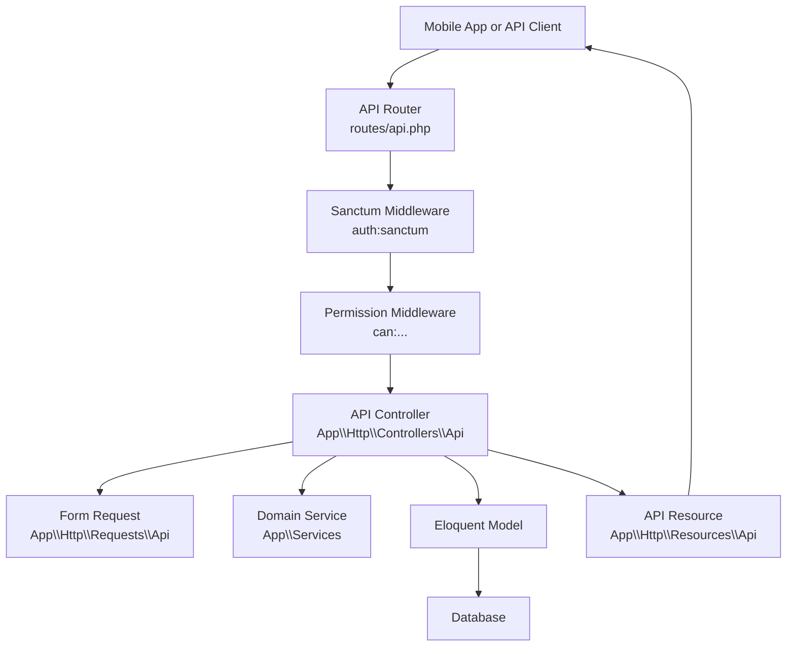
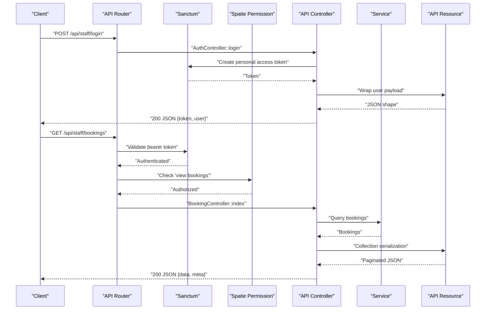
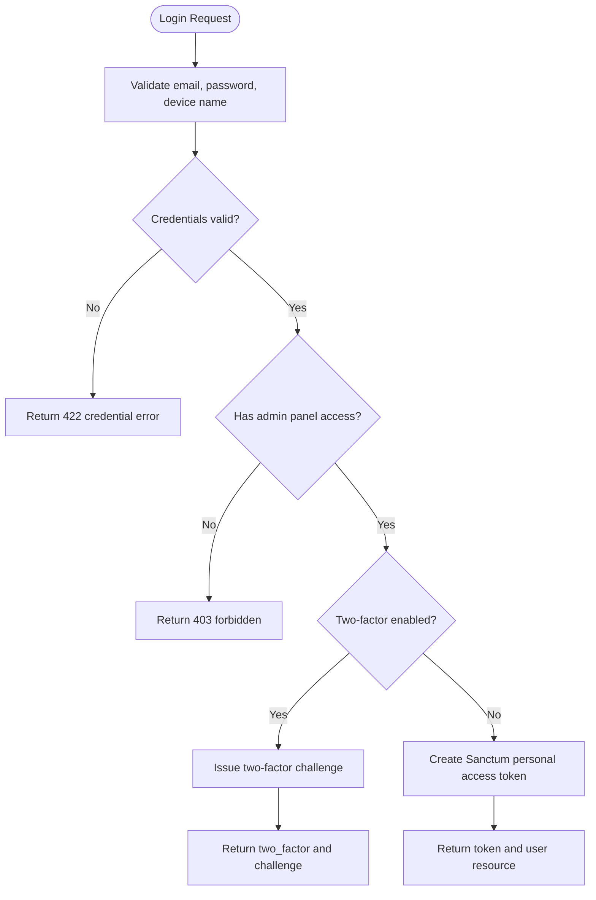
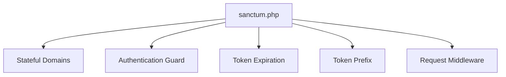
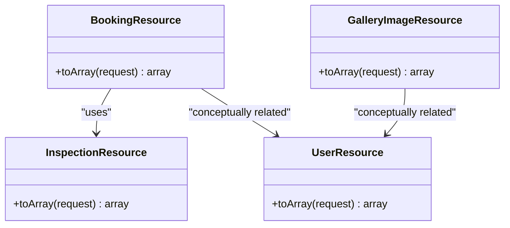
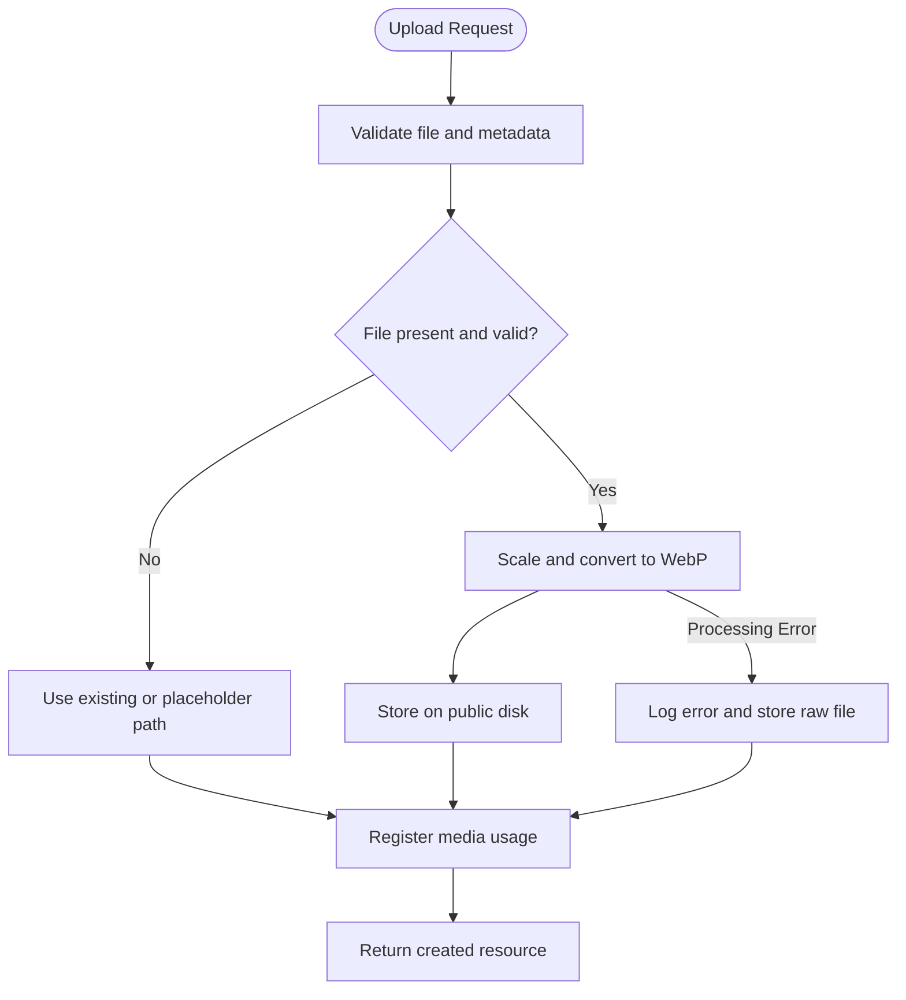
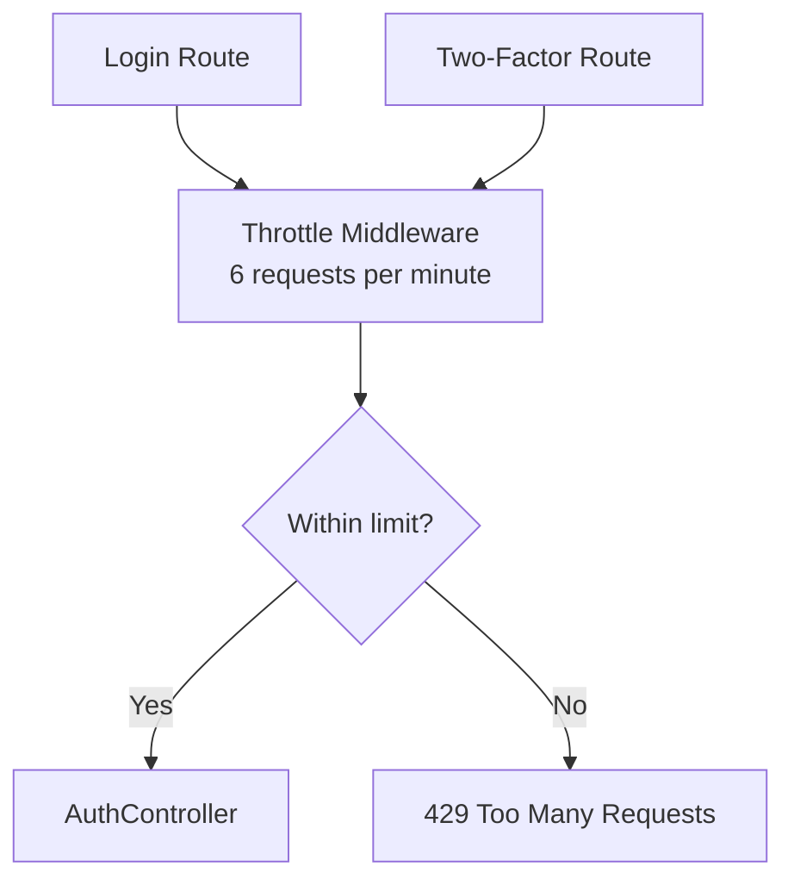
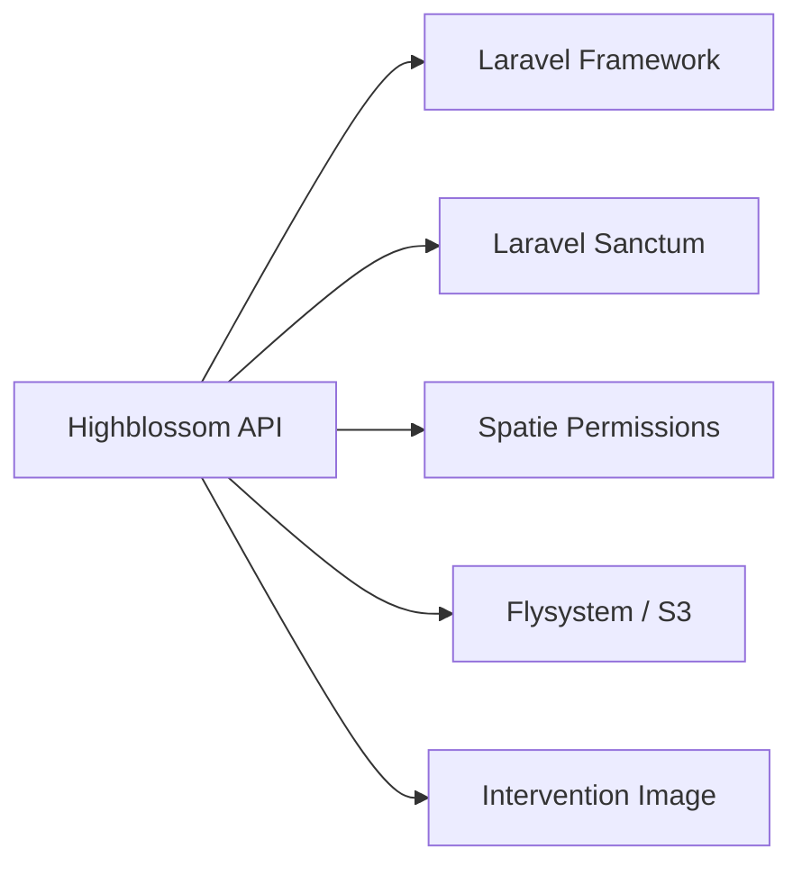

# API Development

<cite>
**Referenced Files in This Document**
- [routes/api.php](file://routes/api.php)
- [config/sanctum.php](file://config/sanctum.php)
- [composer.json](file://composer.json)
- [app/Http/Controllers/Api/AuthController.php](file://app/Http/Controllers/Api/AuthController.php)
- [app/Http/Controllers/Api/BookingController.php](file://app/Http/Controllers/Api/BookingController.php)
- [app/Http/Controllers/Api/GalleryController.php](file://app/Http/Controllers/Api/GalleryController.php)
- [app/Http/Requests/Api/LoginRequest.php](file://app/Http/Requests/Api/LoginRequest.php)
- [app/Http/Requests/Api/TwoFactorChallengeRequest.php](file://app/Http/Requests/Api/TwoFactorChallengeRequest.php)
- [app/Http/Resources/Api/UserResource.php](file://app/Http/Resources/Api/UserResource.php)
- [app/Http/Resources/Api/BookingResource.php](file://app/Http/Resources/Api/BookingResource.php)
- [app/Http/Resources/Api/InspectionResource.php](file://app/Http/Resources/Api/InspectionResource.php)
- [app/Http/Resources/Api/GalleryImageResource.php](file://app/Http/Resources/Api/GalleryImageResource.php)
- [app/Services/GalleryService.php](file://app/Services/GalleryService.php)
- [app/Support/CanonicalLoginRateLimiter.php](file://app/Support/CanonicalLoginRateLimiter.php)
</cite>

## Table of Contents
1. [Introduction](#introduction)
2. [Project Structure](#project-structure)
3. [Core Components](#core-components)
4. [Architecture Overview](#architecture-overview)
5. [Detailed Component Analysis](#detailed-component-analysis)
6. [Dependency Analysis](#dependency-analysis)
7. [Performance Considerations](#performance-considerations)
8. [Troubleshooting Guide](#troubleshooting-guide)
9. [Conclusion](#conclusion)

## Introduction
This document explains how to extend the Highblossom application with additional RESTful endpoints for the staff mobile app. The API is a Laravel 13 application that uses Sanctum for token-based authentication, Spatie permissions for authorization, Laravel API Resources for JSON serialization, and Laravel request validation classes for input handling.

The current API lives under the `staff` prefix so it never collides with public web routes. Authentication endpoints are throttled, and every data endpoint requires a valid Sanctum personal access token plus a Spatie permission. Responses are structured as plain JSON objects suitable for mobile clients.

## Project Structure
The API is organized by HTTP layer conventions:

- **Routes**: All staff API endpoints are declared in one route group.
- **Controllers**: Controllers live under `App\Http\Controllers\Api`.
- **Requests**: Validation requests live under `App\Http\Requests\Api`.
- **Resources**: JSON payloads are shaped by classes under `App\Http\Resources\Api`.
- **Services**: Business logic such as gallery image processing lives under `App\Services`.
- **Configuration**: Sanctum behavior is configured under `config/sanctum.php`.

**Diagram sources**
- [routes/api.php:20-116](file://routes/api.php#L20-L116)
- [app/Http/Controllers/Api/AuthController.php:1-135](file://app/Http/Controllers/Api/AuthController.php#L1-L135)
- [app/Http/Controllers/Api/BookingController.php:1-122](file://app/Http/Controllers/Api/BookingController.php#L1-L122)
- [app/Http/Controllers/Api/GalleryController.php:1-92](file://app/Http/Controllers/Api/GalleryController.php#L1-L92)

**Section sources**
- [routes/api.php:1-117](file://routes/api.php#L1-L117)
- [composer.json:1-138](file://composer.json#L1-L138)

## Core Components
The API has four main building blocks:

| Layer | Responsibility | Typical Location | Example |
|---|---|---|---|
| Route definition | Maps URL, HTTP method, middleware, controller action, and named route | `routes/api.php` | Staff login, bookings, gallery, testimonials |
| Controller | Handles request lifecycle, applies authorization, calls services/models, returns JSON | `app/Http/Controllers/Api/*` | `AuthController`, `BookingController`, `GalleryController` |
| Request validator | Validates and authorizes incoming data before the controller runs | `app/Http/Requests/Api/*` | `LoginRequest`, `TwoFactorChallengeRequest` |
| Resource serializer | Converts models into stable JSON shapes for the mobile client | `app/Http/Resources/Api/*` | `UserResource`, `BookingResource`, `GalleryImageResource` |

Key architectural patterns already present in the codebase:

- Token issuance and two-factor challenge flow through `AuthController`.
- Data mutations go through domain services where appropriate, such as `GalleryService`.
- Models are serialized through dedicated API resources instead of inline arrays.
- Authorization uses Spatie permissions via `can:` middleware on each route.
- Pagination is applied to list endpoints with bounded page sizes.

**Section sources**
- [routes/api.php:20-116](file://routes/api.php#L20-L116)
- [app/Http/Controllers/Api/AuthController.php:1-135](file://app/Http/Controllers/Api/AuthController.php#L1-L135)
- [app/Http/Controllers/Api/BookingController.php:1-122](file://app/Http/Controllers/Api/BookingController.php#L1-L122)
- [app/Http/Controllers/Api/GalleryController.php:1-92](file://app/Http/Controllers/Api/GalleryController.php#L1-L92)

## Architecture Overview
The staff API follows a layered request pipeline:

1. The router selects the controller based on HTTP method and path.
2. Unauthenticated endpoints use rate limiting.
3. Protected endpoints require a valid Sanctum personal access token.
4. Each protected route checks a Spatie permission.
5. The controller validates input through Form Requests when available.
6. The controller delegates business operations to models or services.
7. Responses are returned as JSON, using API Resources for model data.

**Diagram sources**
- [routes/api.php:20-116](file://routes/api.php#L20-L116)
- [app/Http/Controllers/Api/AuthController.php:1-135](file://app/Http/Controllers/Api/AuthController.php#L1-L135)
- [app/Http/Controllers/Api/BookingController.php:1-122](file://app/Http/Controllers/Api/BookingController.php#L1-L122)
- [app/Http/Resources/Api/UserResource.php:1-35](file://app/Http/Resources/Api/UserResource.php#L1-L35)
- [app/Http/Resources/Api/BookingResource.php:1-60](file://app/Http/Resources/Api/BookingResource.php#L1-L60)

## Detailed Component Analysis

### API Routing and Namespace Strategy
The API is grouped under the `staff` prefix. This keeps it separate from public `/api/*` endpoints and allows independent versioning or expansion later.

Important routing characteristics:

- Login and two-factor challenge routes are throttled at six requests per minute.
- Every data route sits inside an `auth:sanctum` group.
- Each resource route adds a `can:` middleware matching the same abilities used by the web admin panel.
- Numeric route parameters use `whereNumber(...)` to avoid ambiguity with slug-bound routes.
- Named routes follow a consistent `api.staff.<resource>.<action>` pattern.

Recommended extension pattern:

1. Add a new controller under `app/Http/Controllers/Api`.
2. Register the route under the existing `Route::prefix('staff')` group.
3. Apply `auth:sanctum` through the group.
4. Add a specific `can:` permission for the new operation.
5. Use a Form Request for mutation endpoints.
6. Return data through an API Resource.

**Section sources**
- [routes/api.php:20-116](file://routes/api.php#L20-L116)

### Authentication Flow with Sanctum and Two-Factor Challenge
The authentication controller handles three primary outcomes:

- Invalid credentials return a 422 response.
- Accounts without admin panel access return a 403 response.
- Accounts with two-factor enabled receive a challenge object instead of a token.
- Successful first-factor or second-factor flows issue a personal access token with a three-month expiration and wildcard abilities.
- The `me` endpoint returns the authenticated user and their computed abilities.
- The `logout` endpoint revokes the current token.

**Diagram sources**
- [app/Http/Controllers/Api/AuthController.php:24-135](file://app/Http/Controllers/Api/AuthController.php#L24-L135)
- [app/Http/Requests/Api/LoginRequest.php:1-35](file://app/Http/Requests/Api/LoginRequest.php#L1-L35)

For two-factor verification, the controller resolves the stored challenge, verifies the authenticator code or recovery code, and issues a token if successful. Failed challenges return 422 responses with a reason field when the challenge expired.

**Section sources**
- [app/Http/Controllers/Api/AuthController.php:24-135](file://app/Http/Controllers/Api/AuthController.php#L24-L135)
- [app/Http/Requests/Api/TwoFactorChallengeRequest.php:1-65](file://app/Http/Requests/Api/TwoFactorChallengeRequest.php#L1-L65)

### Sanctum Configuration
Sanctum configuration controls:

- Stateful domains for cookie-based SPA authentication.
- The guard used during Sanctum authentication.
- Token expiration.
- Token prefix for secret-scanning safety.
- Middleware used while processing stateful requests.

For most mobile-token workflows, clients send a `Bearer` token rather than rely on stateful cookies. The `stateful` array remains important for first-party SPAs accessing the same site.

**Diagram sources**
- [config/sanctum.php:1-87](file://config/sanctum.php#L1-L87)

**Section sources**
- [config/sanctum.php:1-87](file://config/sanctum.php#L1-L87)

### Authorization Pattern
Authorization is not handled by role-only logic in the API. Instead, each route is guarded by a Spatie permission through the `can:` middleware. This ensures the mobile app cannot reach functionality unavailable in the web admin.

Examples of existing permission gates:

- Dashboard: `can:view dashboard`
- Bookings: `can:view bookings`, `can:update bookings`
- Inspections: `can:view inspections`, `can:update inspections`
- Testimonials: `can:manage testimonials`
- Blog posts: `can:view blog`, `can:update blog`, `can:delete blog`
- Team and partners: `can:manage settings`
- Gallery: `can:view gallery`, `can:manage gallery`

When adding a new endpoint, create a corresponding permission and attach it directly to the route.

**Section sources**
- [routes/api.php:49-116](file://routes/api.php#L49-L116)

### Request Validation Patterns
The API uses Laravel Form Request classes for explicit validation rules. Existing examples include:

- `LoginRequest`: Requires email, password, and optional device name.
- `TwoFactorChallengeRequest`: Requires a UUID challenge and enforces that exactly one of authenticator code or recovery code is provided.

Validation rules are centralized, allowing controllers to assume validated input. Custom validation logic can be added through the `withValidator` hook, as demonstrated by the two-factor challenge request.

Best practices demonstrated by this project:

- Keep validation close to the boundary.
- Separate authorization from validation.
- Use typed, final request classes.
- Provide human-readable messages through localized strings when possible.

**Section sources**
- [app/Http/Requests/Api/LoginRequest.php:1-35](file://app/Http/Requests/Api/LoginRequest.php#L1-L35)
- [app/Http/Requests/Api/TwoFactorChallengeRequest.php:1-65](file://app/Http/Requests/Api/TwoFactorChallengeRequest.php#L1-L65)

### Resource Serialization with Laravel API Resources
All model responses are wrapped in API Resources. This provides:

- Stable contract between backend and mobile frontend.
- Conditional relationship loading.
- Controlled exposure of sensitive fields.
- Consistent timestamp formatting.
- Separation of persistence shape from API shape.

Representative resources:

- `UserResource`: Returns user identity, roles, and abilities.
- `BookingResource`: Returns booking summary, client details, vehicle details, scheduled times, inspection, and milestone events.
- `InspectionResource`: Returns appointment details, staff, booking, and notes.
- `GalleryImageResource`: Returns curated image metadata, category, flags, sort order, and timestamps.

**Diagram sources**
- [app/Http/Resources/Api/BookingResource.php:1-60](file://app/Http/Resources/Api/BookingResource.php#L1-L60)
- [app/Http/Resources/Api/InspectionResource.php:1-43](file://app/Http/Resources/Api/InspectionResource.php#L1-L43)
- [app/Http/Resources/Api/UserResource.php:1-35](file://app/Http/Resources/Api/UserResource.php#L1-L35)
- [app/Http/Resources/Api/GalleryImageResource.php:1-42](file://app/Http/Resources/Api/GalleryImageResource.php#L1-L42)

**Section sources**
- [app/Http/Resources/Api/UserResource.php:1-35](file://app/Http/Resources/Api/UserResource.php#L1-L35)
- [app/Http/Resources/Api/BookingResource.php:1-60](file://app/Http/Resources/Api/BookingResource.php#L1-L60)
- [app/Http/Resources/Api/InspectionResource.php:1-43](file://app/Http/Resources/Api/InspectionResource.php#L1-L43)
- [app/Http/Resources/Api/GalleryImageResource.php:1-42](file://app/Http/Resources/Api/GalleryImageResource.php#L1-L42)

### File Upload Handling
File uploads are handled through services rather than ad hoc controller logic. The gallery upload path demonstrates:

- Input validation through `GalleryItemRequest`.
- Image processing through Laravel's image component.
- WebP conversion with controlled scaling and quality.
- Storage on the public disk.
- Media registry tracking for ownership and cleanup.
- Fallback behavior when image processing fails.

**Diagram sources**
- [app/Http/Controllers/Api/GalleryController.php:24-92](file://app/Http/Controllers/Api/GalleryController.php#L24-L92)
- [app/Services/GalleryService.php:1-139](file://app/Services/GalleryService.php#L1-L139)

**Section sources**
- [app/Http/Controllers/Api/GalleryController.php:1-92](file://app/Http/Controllers/Api/GalleryController.php#L1-L92)
- [app/Services/GalleryService.php:1-139](file://app/Services/GalleryService.php#L1-L139)

### Status Codes and Response Shapes
The API uses meaningful status codes:

| Situation | Status Code | Response Shape |
|---|---:|---|
| Successful mutation returning updated data | 200 or 201 | `{ data, message }` or resource collection |
| Authentication failure | 422 | `{ message }` |
| Unauthorized account type | 403 | `{ message }` |
| Conflict due to terminal booking state | 409 | `{ message }` |
| Validation failure | 422 | Standard Laravel validation errors |
| Not found | 404 | Laravel default API error format |

List endpoints return paginated collections through API Resource collections. Detail endpoints return a single resource object. Mutations may return both the updated resource and a user-facing message.

**Section sources**
- [app/Http/Controllers/Api/AuthController.php:33-135](file://app/Http/Controllers/Api/AuthController.php#L33-L135)
- [app/Http/Controllers/Api/BookingController.php:34-122](file://app/Http/Controllers/Api/BookingController.php#L34-L122)
- [app/Http/Controllers/Api/GalleryController.php:49-92](file://app/Http/Controllers/Api/GalleryController.php#L49-L92)

### Rate Limiting
There are two relevant rate-limiting approaches:

1. **API-level throttle middleware**: Login and two-factor challenge routes use `throttle:6,1`.
2. **Fortify canonical login limiter**: The `CanonicalLoginRateLimiter` overrides Fortify’s login key so failed attempts are keyed by resolved identity rather than raw input strings.

For new API endpoints, apply explicit throttle middleware to authentication-sensitive routes. For read-heavy endpoints, consider caching or database indexing rather than broad rate limits.

**Diagram sources**
- [routes/api.php:33-43](file://routes/api.php#L33-L43)
- [app/Support/CanonicalLoginRateLimiter.php:1-37](file://app/Support/CanonicalLoginRateLimiter.php#L1-L37)

**Section sources**
- [routes/api.php:33-43](file://routes/api.php#L33-L43)
- [app/Support/CanonicalLoginRateLimiter.php:1-37](file://app/Support/CanonicalLoginRateLimiter.php#L1-L37)

### Error Handling Strategy
The codebase mixes several error-handling styles:

- Explicit JSON responses for business failures such as invalid credentials, forbidden accounts, expired challenges, and booking conflicts.
- Laravel’s default validation exception handling for malformed requests.
- Logging for non-fatal image processing failures.

Recommendations for consistent error handling:

- Use validation requests to centralize input errors.
- Return structured error objects with machine-readable keys and human-readable messages.
- Avoid exposing stack traces or internal identifiers in production responses.
- Use appropriate HTTP status codes consistently.
- Log actionable errors but keep log entries safe for secrets.

**Section sources**
- [app/Http/Controllers/Api/AuthController.php:33-118](file://app/Http/Controllers/Api/AuthController.php#L33-L118)
- [app/Http/Controllers/Api/BookingController.php:64-122](file://app/Http/Controllers/Api/BookingController.php#L64-L122)
- [app/Services/GalleryService.php:77-139](file://app/Services/GalleryService.php#L77-L139)

### Testing Approach
The repository includes PHPUnit and development testing tools. Existing test infrastructure supports unit tests, feature tests, and command tests. For API extensions:

- Write feature tests against `routes/api.php` endpoints.
- Authenticate test requests with Sanctum tokens.
- Assert JSON structure through API Resources.
- Test authorization by assigning and removing Spatie permissions.
- Test rate-limited endpoints with short time windows.
- Mock storage and image processing when testing uploads.
- Verify pagination boundaries and search filters.

Relevant composer scripts include `test`, `ci:check`, and development task runners.

**Section sources**
- [composer.json:1-138](file://composer.json#L1-L138)

### Documentation Generation
The repository does not include an automatic OpenAPI/Swagger generator in its dependencies. Current API documentation should therefore be maintained alongside the code:

- Treat `routes/api.php` as the source of truth for endpoint paths, methods, and names.
- Document request bodies in Form Request classes.
- Document response shapes in API Resource classes.
- Document permissions required by each route.
- Maintain a living API reference that mirrors controller responsibilities.

If automatic documentation becomes necessary, introduce an OpenAPI tool and bind it to the existing route, request, and resource contracts.

[No sources needed since this section provides general guidance]

### Versioning Strategy
The current API uses a single `staff` namespace without a semantic version segment. Recommended strategies for future evolution:

- **Namespace versioning**: Introduce `/api/v1/staff` and `/api/v2/staff` groups.
- **Header versioning**: Accept a version header while keeping the URL flat.
- **Backward-compatible changes only**: Prefer additive changes to resources and endpoints.
- **Deprecation headers**: Signal deprecated fields or endpoints.
- **Migration guides**: Document breaking changes before releasing a new major API version.

Until a versioned group exists, treat all `/api/staff/*` routes as part of the current API contract.

**Section sources**
- [routes/api.php:20-116](file://routes/api.php#L20-L116)

## Dependency Analysis
The API depends on Laravel framework components and third-party packages:

- Laravel Sanctum for personal access tokens.
- Spatie Laravel Permission for fine-grained ability checks.
- Laravel Framework for routing, validation, Eloquent, and JSON responses.
- Optional image processing and storage integrations for media handling.

**Diagram sources**
- [composer.json:12-44](file://composer.json#L12-L44)
- [routes/api.php:20-116](file://routes/api.php#L20-L116)
- [app/Http/Controllers/Api/AuthController.php:1-135](file://app/Http/Controllers/Api/AuthController.php#L1-L135)

**Section sources**
- [composer.json:12-44](file://composer.json#L12-L44)
- [routes/api.php:20-116](file://routes/api.php#L20-L116)

## Performance Considerations
The API already applies several performance-conscious patterns:

- List endpoints paginate results.
- Page size is clamped to a maximum value.
- Relationships are eager-loaded only where needed.
- Image processing uses fixed dimensions and WebP conversion.
- Services encapsulate expensive operations outside the controller.

Additional recommendations:

- Index frequently queried columns such as status, reference, and timestamps.
- Cache read-only aggregates like dashboard counts when appropriate.
- Use query scopes for repeated filters.
- Avoid N+1 queries by loading relationships in controllers or resources.
- Offload heavy image processing to background jobs if latency becomes an issue.
- Monitor slow queries using Laravel debugging tools included in the project.

[No sources needed since this section provides general guidance]

## Troubleshooting Guide
Common API issues and resolutions:

| Symptom | Likely Cause | Resolution |
|---|---|---|
| Login returns a challenge instead of a token | Account has two-factor authentication enabled | Complete the two-factor challenge endpoint |
| Login returns 422 for wrong credentials | Email or password mismatch | Verify credentials; do not expose exact failure reasons in security-sensitive contexts |
| Login returns 403 | Account lacks admin panel access | Assign the required permission or use a different account |
| Two-factor challenge returns expired error | Challenge no longer valid | Restart the login flow |
| New endpoint returns 401 | Missing or invalid Sanctum token | Ensure bearer token is sent |
| New endpoint returns 403 | Missing Spatie permission | Grant the required ability |
| Upload fails silently | Image processing error | Check logs and storage configuration |
| Listing endpoint is slow | Missing indexes or unbounded queries | Add database indexes and verify pagination |

**Section sources**
- [app/Http/Controllers/Api/AuthController.php:33-118](file://app/Http/Controllers/Api/AuthController.php#L33-L118)
- [app/Http/Controllers/Api/BookingController.php:64-122](file://app/Http/Controllers/Api/BookingController.php#L64-L122)
- [app/Services/GalleryService.php:77-139](file://app/Services/GalleryService.php#L77-L139)

## Conclusion
The Highblossom staff API is a clean, permission-gated Laravel API designed for a mobile client. It combines Sanctum tokens, Spatie permissions, Form Request validation, API Resources, and service-layer business logic. To extend it safely:

1. Add endpoints under the existing `staff` route group.
2. Require Sanctum authentication and a specific Spatie permission.
3. Validate input with Form Request classes.
4. Serialize output with dedicated API Resources.
5. Handle errors with consistent status codes and structured JSON.
6. Protect sensitive endpoints with rate limiting.
7. Test authentication, authorization, validation, serialization, and uploads.
8. Plan API versioning before introducing breaking changes.

This approach keeps the API secure, maintainable, and aligned with the existing web admin experience.