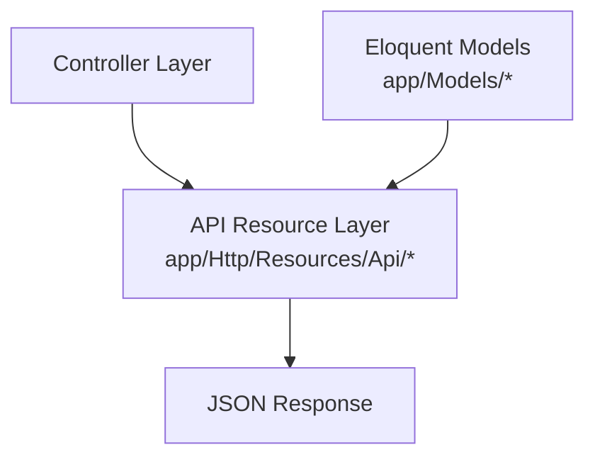
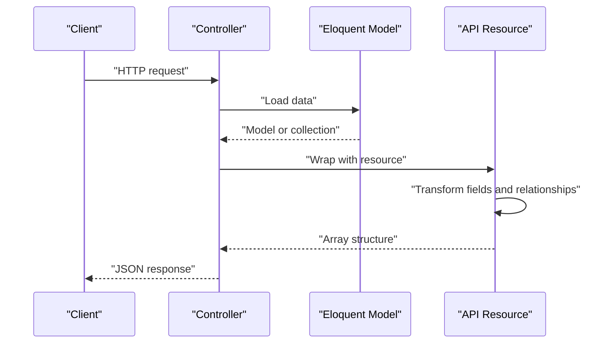
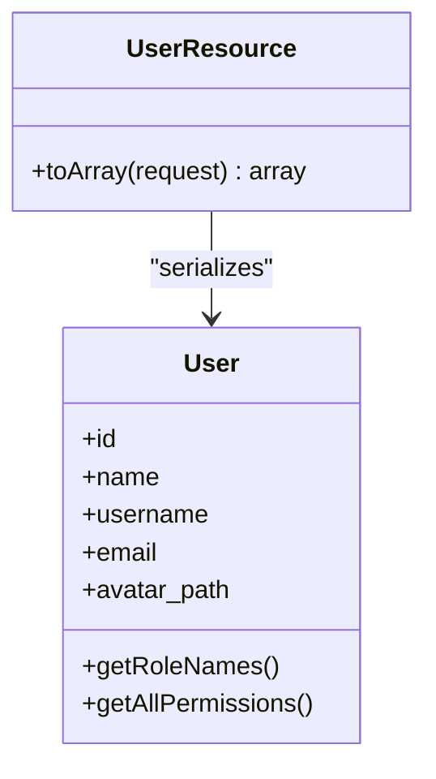
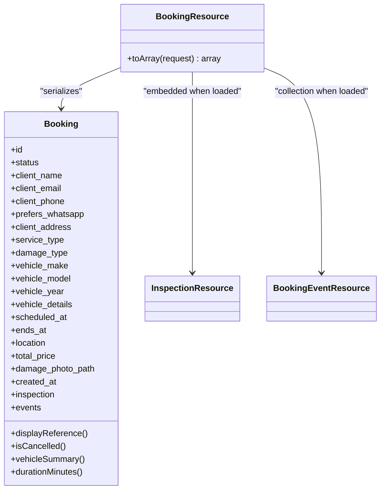
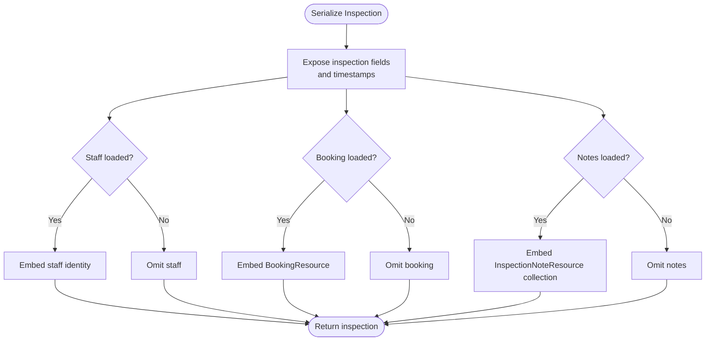
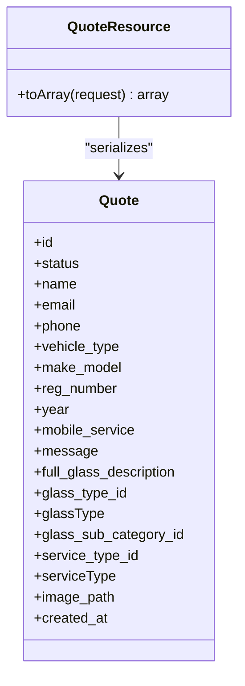
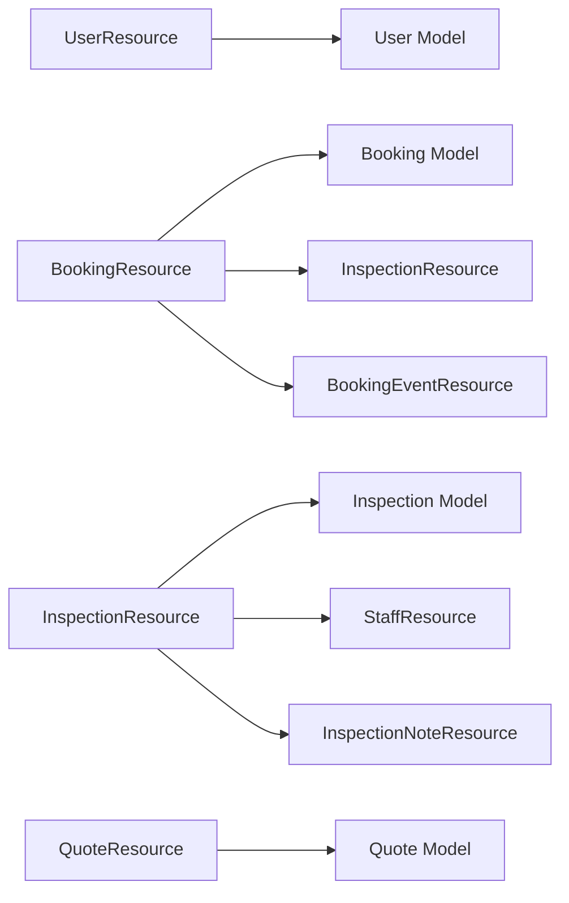

# API Resources and Serialization

<cite>
**Referenced Files in This Document**
- [UserResource.php](file://app/Http/Resources/Api/UserResource.php)
- [BookingResource.php](file://app/Http/Resources/Api/BookingResource.php)
- [InspectionResource.php](file://app/Http/Resources/Api/InspectionResource.php)
- [QuoteResource.php](file://app/Http/Resources/Api/QuoteResource.php)
- [ContactMessageResource.php](file://app/Http/Resources/Api/ContactMessageResource.php)
- [TestimonialResource.php](file://app/Http/Resources/Api/TestimonialResource.php)
- [PostResource.php](file://app/Http/Resources/Api/PostResource.php)
- [CategoryResource.php](file://app/Http/Resources/Api/CategoryResource.php)
- [TagResource.php](file://app/Http/Resources/Api/TagResource.php)
- [StaffResource.php](file://app/Http/Resources/Api/StaffResource.php)
- [PartnerResource.php](file://app/Http/Resources/Api/PartnerResource.php)
- [GalleryImageResource.php](file://app/Http/Resources/Api/GalleryImageResource.php)
- [GalleryCategoryResource.php](file://app/Http/Resources/Api/GalleryCategoryResource.php)
- [InspectionNoteResource.php](file://app/Http/Resources/Api/InspectionNoteResource.php)
- [BookingEventResource.php](file://app/Http/Resources/Api/BookingEventResource.php)
</cite>

## Table of Contents
1. Introduction
2. Project Structure
3. Core Components
4. Architecture Overview
5. Detailed Component Analysis
6. Dependency Analysis
7. Performance Considerations
8. Troubleshooting Guide
9. Conclusion

## Introduction
This document explains how the Highblossom API transforms Eloquent models into consistent JSON responses using Laravel API Resources. It focuses on the transformation pattern, field selection, conditional attributes, embedded relationships, and response composition. It also documents every resource class named in the objective: UserResource, BookingResource, InspectionResource, QuoteResource, ContactMessageResource, TestimonialResource, PostResource, CategoryResource, TagResource, StaffResource, PartnerResource, GalleryImageResource, GalleryCategoryResource, InspectionNoteResource, and BookingEventResource.

The goal is to help developers understand:
- What each resource exposes.
- How relationships are serialized.
- How optional or computed fields are included.
- How to extend or customize output safely without breaking clients.

## Project Structure
API resources live under `app/Http/Resources/Api`. Each file defines a single resource class extending Laravel’s base JSON resource. Controllers return these resources directly; pagination wrappers and error formatting are handled by the controller layer and framework conventions rather than inside the resource classes themselves.

**Diagram sources**
- [BookingResource.php:1-60](file://app/Http/Resources/Api/BookingResource.php#L1-L60)
- [InspectionResource.php:1-43](file://app/Http/Resources/Api/InspectionResource.php#L1-L43)

**Section sources**
- [BookingResource.php:1-60](file://app/Http/Resources/Api/BookingResource.php#L1-L60)
- [InspectionResource.php:1-43](file://app/Http/Resources/Api/InspectionResource.php#L1-L43)

## Core Components
Every API resource extends the same base class and implements one main method: `toArray(Request $request)`. This method decides which model attributes are exposed, how related objects are embedded, and which computed values are added.

Common patterns used across resources:
- **Field selection**: Only client-facing fields are returned.
- **Conditional embedding**: Relationships are wrapped with `whenLoaded` so they appear only when eager-loaded.
- **Computed values**: Derived data such as labels, summaries, durations, and formatted URLs are added.
- **URL normalization**: Image paths are converted to public URLs through a helper before being sent.
- **Collections**: Lists use the collection helper to serialize arrays or collections of resources.
- **Null safety**: Optional timestamps and nullable columns are guarded before formatting.

**Section sources**
- [UserResource.php:1-35](file://app/Http/Resources/Api/UserResource.php#L1-L35)
- [BookingResource.php:1-60](file://app/Http/Resources/Api/BookingResource.php#L1-L60)
- [InspectionResource.php:1-43](file://app/Http/Resources/Api/InspectionResource.php#L1-L43)
- [QuoteResource.php:1-52](file://app/Http/Resources/Api/QuoteResource.php#L1-L52)

## Architecture Overview
At runtime, a controller receives an HTTP request, loads an Eloquent model or collection, wraps it in the appropriate resource, and returns it. The resource converts the domain object into a stable JSON shape.

[No diagram sources needed since this diagram shows conceptual workflow, not actual code structure]

## Detailed Component Analysis

### UserResource
Purpose: Serialize the authenticated staff user for internal API consumers. It exposes identity fields, roles, and abilities used by the application’s own UI and authorization logic.

Response structure:
- Identity: id, name, username, email.
- Avatar: avatar_url is a public URL when available, otherwise null.
- Authorization context: roles and abilities lists derived from the user model.

Key behaviors:
- Role and permission names are extracted as simple value lists.
- Avatar path is converted to a URL when present.

Customization guidance:
- Add profile-only fields behind a request flag if needed.
- Avoid exposing sensitive identifiers unless required by the consumer.

**Diagram sources**
- [UserResource.php:1-35](file://app/Http/Resources/Api/UserResource.php#L1-L35)

**Section sources**
- [UserResource.php:1-35](file://app/Http/Resources/Api/UserResource.php#L1-L35)

### BookingResource
Purpose: Serialize customer bookings for list and detail endpoints. List views should include summary fields; detail views should eager-load inspection and booking events for timeline rendering.

Response structure:
- Booking identity: id, reference, status, cancellation flag.
- Client details: name, email, phone, WhatsApp preference, address.
- Service and damage metadata: enum values and human-readable labels.
- Vehicle details: make, model, year, additional details, and computed summary.
- Scheduling: scheduled_at, ends_at, duration_minutes, location.
- Pricing and media: total_price and damage_photo_url when present.
- Timestamps: created_at.
- Embedded relationships: inspection and events.

Relationship handling:
- `inspection` is embedded conditionally using `whenLoaded`.
- `events` is embedded as a collection of `BookingEventResource` entries, also conditional.

Complex graph example:
A booking can contain an inspection, and that inspection may embed its own booking and notes. Consumers must handle nested structures carefully.

**Diagram sources**
- [BookingResource.php:1-60](file://app/Http/Resources/Api/BookingResource.php#L1-L60)
- [InspectionResource.php:1-43](file://app/Http/Resources/Api/InspectionResource.php#L1-L43)
- [BookingEventResource.php:1-200](file://app/Http/Resources/Api/BookingEventResource.php#L1-L200)

**Section sources**
- [BookingResource.php:1-60](file://app/Http/Resources/Api/BookingResource.php#L1-L60)

### InspectionResource
Purpose: Serialize on-site inspections linked to a booking. Includes appointment metadata, timestamps, and embedded relationships.

Response structure:
- Inspection identity and scheduling: id, booking_id, status, type, location, scheduled_at, started_at, ended_at, created_at.
- Embedded relationships:
  - `staff`: minimal staff identity when loaded.
  - `booking`: full booking resource when loaded.
  - `notes`: collection of inspection notes when loaded.

Key behavior:
- Relationships are wrapped with `whenLoaded`, so missing data does not cause errors.

**Diagram sources**
- [InspectionResource.php:1-43](file://app/Http/Resources/Api/InspectionResource.php#L1-L43)

**Section sources**
- [InspectionResource.php:1-43](file://app/Http/Resources/Api/InspectionResource.php#L1-L43)

### QuoteResource
Purpose: Serialize customer quote requests. Glass and service information includes both raw IDs and readable names when those relationships are eager-loaded.

Response structure:
- Quote identity and contact: id, status, name, email, phone.
- Vehicle details: type, make/model, registration number, year.
- Service flags and message: mobile_service, message.
- Glass and service mapping: description, glass type ID and name, sub-category ID, service type ID and name.
- Media: image_url when available.
- Timestamps: created_at.

Key behavior:
- Relationship-dependent names are only included when the corresponding relationship is loaded.
- Image paths are normalized to public URLs.

**Diagram sources**
- [QuoteResource.php:1-52](file://app/Http/Resources/Api/QuoteResource.php#L1-L52)

**Section sources**
- [QuoteResource.php:1-52](file://app/Http/Resources/Api/QuoteResource.php#L1-L52)

### ContactMessageResource
Responsibilities (typical):
- Expose sender identity, subject, message content, and timestamps.
- Optionally expose attachment URLs when present.
- Keep personal data minimal for public or semi-public endpoints.

Usage guidance:
- Use this resource for contact submissions displayed in admin interfaces or forwarded to support workflows.
- Do not expose internal processing metadata unless explicitly required.

**Section sources**
- [ContactMessageResource.php:1-200](file://app/Http/Resources/Api/ContactMessageResource.php#L1-L200)

### TestimonialResource
Responsibilities (typical):
- Expose testimonial text, author name, role or title, rating, and publication status.
- Include media URLs when images or logos are attached.
- Normalize timestamps to ISO 8601 strings.

Usage guidance:
- Prefer filtering out unpublished testimonials at the query layer.
- If ratings are numeric, consider normalizing them to a consistent scale.

**Section sources**
- [TestimonialResource.php:1-200](file://app/Http/Resources/Api/TestimonialResource.php#L1-L200)

### PostResource
Responsibilities (typical):
- Expose post slug, title, excerpt, body, author, categories, tags, and SEO metadata.
- Include featured image or gallery links when available.
- Provide published and updated timestamps.

Usage guidance:
- For blog listing endpoints, omit long body content and use excerpts.
- Embed category and tag resources only when needed to avoid deep graphs.

**Section sources**
- [PostResource.php:1-200](file://app/Http/Resources/Api/PostResource.php#L1-L200)

### CategoryResource
Responsibilities (typical):
- Expose category identifier, name, slug, and sort order.
- Include parent or hierarchy information when relevant.

Usage guidance:
- Keep this resource lightweight for navigation menus and filters.
- Avoid embedding posts unless explicitly requested.

**Section sources**
- [CategoryResource.php:1-200](file://app/Http/Resources/Api/CategoryResource.php#L1-L200)

### TagResource
Responsibilities (typical):
- Expose tag identifier, name, slug, and usage count if available.

Usage guidance:
- Useful for autocomplete and filtering.
- Combine with CategoryResource for taxonomy endpoints.

**Section sources**
- [TagResource.php:1-200](file://app/Http/Resources/Api/TagResource.php#L1-L200)

### StaffResource
Responsibilities (typical):
- Expose staff identity, role, availability, and contact information.
- Include avatar URL when available.

Usage guidance:
- Use for booking assignment and team display.
- Restrict sensitive fields to authenticated staff-only endpoints.

**Section sources**
- [StaffResource.php:1-200](file://app/Http/Resources/Api/StaffResource.php#L1-L200)

### PartnerResource
Responsibilities (typical):
- Expose partner name, logo URL, website, and description.

Usage guidance:
- Suitable for public partner showcases.
- Avoid including internal partnership terms or pricing.

**Section sources**
- [PartnerResource.php:1-200](file://app/Http/Resources/Api/PartnerResource.php#L1-L200)

### GalleryImageResource
Responsibilities (typical):
- Expose image URL, caption, alt text, source, and ordering metadata.
- Include associated gallery category when loaded.

Usage guidance:
- Serve optimized URLs where possible.
- Use pagination for large galleries.

**Section sources**
- [GalleryImageResource.php:1-200](file://app/Http/Resources/Api/GalleryImageResource.php#L1-L200)

### GalleryCategoryResource
Responsibilities (typical):
- Expose category identifier, name, slug, and image count.
- Optionally embed gallery images for small categories.

Usage guidance:
- For navigation, return only category metadata.
- For detail pages, embed images conditionally.

**Section sources**
- [GalleryCategoryResource.php:1-200](file://app/Http/Resources/Api/GalleryCategoryResource.php#L1-L200)

### InspectionNoteResource
Responsibilities (typical):
- Expose note identifier, content, timestamp, and author reference.

Usage guidance:
- Use for inspection timelines and audit trails.
- Avoid exposing private internal comments unless necessary.

**Section sources**
- [InspectionNoteResource.php:1-200](file://app/Http/Resources/Api/InspectionNoteResource.php#L1-L200)

### BookingEventResource
Responsibilities (typical):
- Expose event identity, type, previous schedule, timestamps, and descriptive payload.

Usage guidance:
- Used to build booking timelines alongside BookingResource events.
- Keep payloads structured but concise.

**Section sources**
- [BookingEventResource.php:1-200](file://app/Http/Resources/Api/BookingEventResource.php#L1-L200)

## Dependency Analysis
Resources depend on:
- Eloquent models for primary data.
- Related models for embedded data.
- Framework helpers such as `whenLoaded` and `collection`.
- Application helpers such as `media_url` for public asset URLs.
- Enum methods for value-to-label conversion.

**Diagram sources**
- [UserResource.php:1-35](file://app/Http/Resources/Api/UserResource.php#L1-L35)
- [BookingResource.php:1-60](file://app/Http/Resources/Api/BookingResource.php#L1-L60)
- [InspectionResource.php:1-43](file://app/Http/Resources/Api/InspectionResource.php#L1-L43)
- [QuoteResource.php:1-52](file://app/Http/Resources/Api/QuoteResource.php#L1-L52)

**Section sources**
- [UserResource.php:1-35](file://app/Http/Resources/Api/UserResource.php#L1-L35)
- [BookingResource.php:1-60](file://app/Http/Resources/Api/BookingResource.php#L1-L60)
- [InspectionResource.php:1-43](file://app/Http/Resources/Api/InspectionResource.php#L1-L43)
- [QuoteResource.php:1-52](file://app/Http/Resources/Api/QuoteResource.php#L1-L52)

## Performance Considerations
- **Eager load relationships**: Only include relationships in the resource when the controller has already eager-loaded them. Using `whenLoaded` prevents N+1 queries and avoids undefined property access.
- **Limit payload size**: For list endpoints, omit heavy relationships such as notes, events, or full bodies.
- **Normalize URLs once**: Convert storage paths to public URLs during serialization instead of doing it in templates or clients.
- **Use computed fields sparingly**: Expensive calculations should be cached or precomputed where possible.
- **Avoid deep graphs**: Nesting multiple resource collections can increase response size and parsing time.

[No sources needed since this section provides general guidance]

## Troubleshooting Guide
Common issues and resolutions:
- **Missing relationship fields**: If a nested object is null, ensure the controller eager-loads the relationship before returning the resource.
- **Unexpected null values**: Guard nullable timestamps and optional attachments before formatting.
- **Incorrect labels or enums**: Verify that enum value and label methods exist and return expected data.
- **Broken image URLs**: Confirm that the media helper receives a valid path and that the underlying storage disk is publicly accessible.
- **Pagination not applied**: Pagination is usually handled by the controller or service layer; verify that paginated collections are passed to the resource collection helper.
- **Error formatting**: Errors are typically shaped by the framework or global exception handler rather than individual resources.

**Section sources**
- [BookingResource.php:1-60](file://app/Http/Resources/Api/BookingResource.php#L1-L60)
- [InspectionResource.php:1-43](file://app/Http/Resources/Api/InspectionResource.php#L1-L43)

## Conclusion
Highblossom’s API resources provide a clear separation between domain models and client-facing JSON contracts. Each resource selects safe, documented fields, normalizes dates and URLs, and conditionally embeds relationships. Developers should continue this pattern: keep payloads intentional, guard nullability, eager-load dependencies, and add computed fields only when they improve client usability. When expanding the API, introduce new resources rather than mutating existing ones, and update controllers to load the exact relationships required by each endpoint.