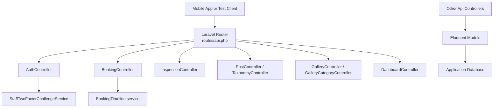
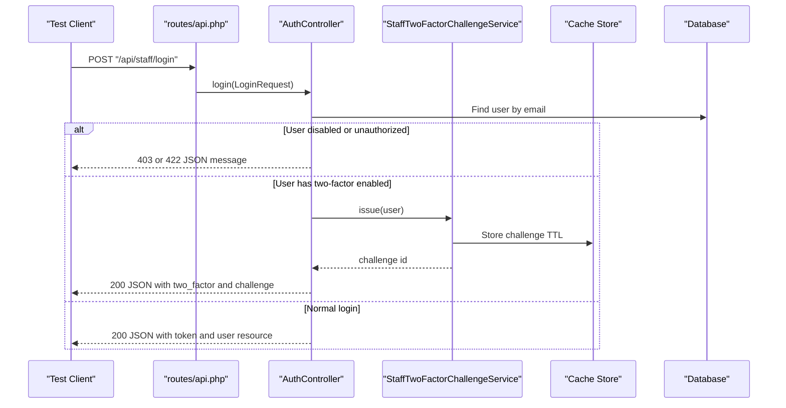
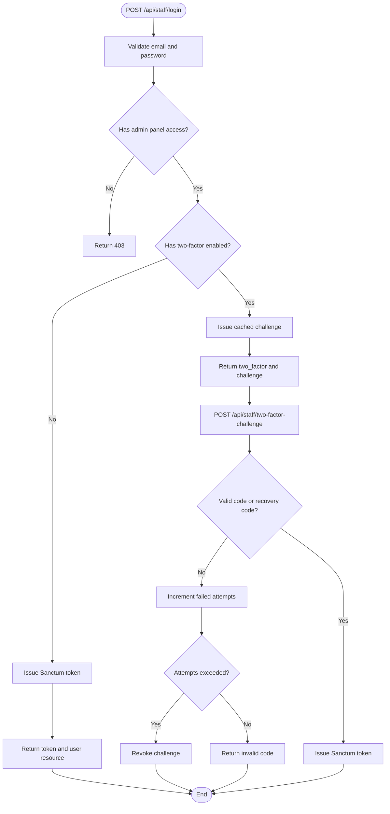
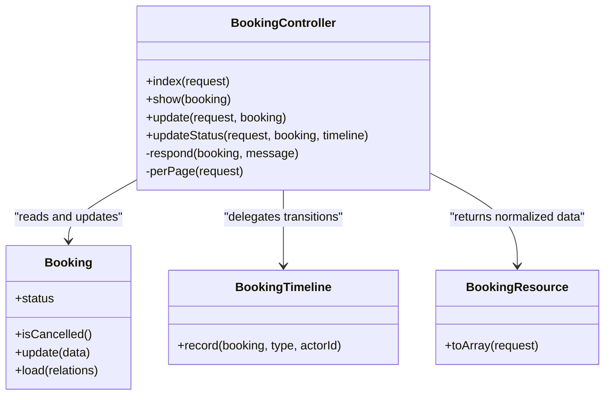
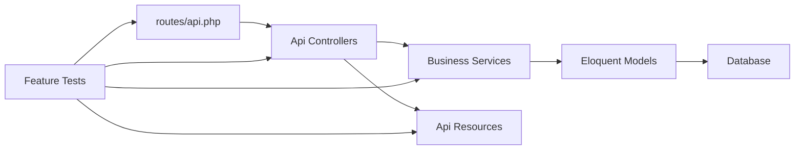

# API Testing and Documentation

<cite>
**Referenced Files in This Document**
- [routes/api.php](file://routes/api.php)
- [bootstrap/app.php](file://bootstrap/app.php)
- [composer.json](file://composer.json)
- [app/Http/Controllers/Api/AuthController.php](file://app/Http/Controllers/Api/AuthController.php)
- [app/Http/Controllers/Api/BookingController.php](file://app/Http/Controllers/Api/BookingController.php)
- [app/Services/StaffTwoFactorChallengeService.php](file://app/Services/StaffTwoFactorChallengeService.php)
- [app/Http/Resources/Api/UserResource.php](file://app/Http/Resources/Api/UserResource.php)
- [app/Http/Resources/Api/BookingResource.php](file://app/Http/Resources/Api/BookingResource.php)
- [database/factories/UserFactory.php](file://database/factories/UserFactory.php)
- [database/factories/BookingFactory.php](file://database/factories/BookingFactory.php)
- [tests/Feature/Api/AuthTest.php](file://tests/Feature/Api/AuthTest.php)
- [tests/Feature/Api/BookingApiTest.php](file://tests/Feature/Api/BookingApiTest.php)
- [tests/Feature/Api/DashboardApiTest.php](file://tests/Feature/Api/DashboardApiTest.php)
- [tests/Feature/Api/InspectionApiTest.php](file://tests/Feature/Api/InspectionApiTest.php)
- [tests/Feature/Api/BlogApiTest.php](file://tests/Feature/Api/BlogApiTest.php)
- [tests/Feature/Api/GalleryApiTest.php](file://tests/Feature/Api/GalleryApiTest.php)
</cite>

## Table of Contents
1. Introduction
2. Project Structure
3. Core Components
4. Architecture Overview
5. Detailed Component Analysis
6. Dependency Analysis
7. Performance Considerations
8. Troubleshooting Guide
9. Conclusion

## Introduction
This document explains how to test and document the Highblossom staff API. The API is a token-authenticated JSON surface used by the staff mobile application. It lives under the `/api/staff` prefix, uses Laravel Sanctum personal access tokens, and reuses the same Spatie permission abilities as the web admin panel.

The testing strategy covers:
- Unit testing for controllers and services
- Integration testing for full request cycles through routing, middleware, authorization, validation, persistence, and responses
- Feature testing for end-to-end user workflows such as login with two-factor authentication, booking status transitions, inspection scheduling, gallery uploads, and blog moderation

It also documents how to generate API documentation using OpenAPI/Swagger, maintain manual API contracts, validate response schemas, and extend testing into continuous integration, performance testing, and load testing.

## Project Structure
The staff API is registered at `routes/api.php`, while the application bootstrap wires it into the Laravel router. Tests are located under `tests/Feature/Api` and use PHPUnit, Laravel’s `RefreshDatabase` trait, and Sanctum helpers for stateless token authentication.

**Diagram sources**
- [routes/api.php:18-117](file://routes/api.php#L18-L117)
- [bootstrap/app.php:14-27](file://bootstrap/app.php#L14-L27)

**Section sources**
- [routes/api.php:18-117](file://routes/api.php#L18-L117)
- [bootstrap/app.php:14-27](file://bootstrap/app.php#L14-L27)

## Core Components
The staff API has several tightly coupled components that should be tested together:

| Component | Responsibility | Testing Focus |
|---|---|---|
| API routes | Define endpoints, prefixes, throttling, Sanctum authentication, and Spatie ability gates | Route existence, names, middleware behavior, authorization |
| Controllers | Validate input, delegate to services, return API resources | Input validation, business logic delegation, response shape |
| Services | Encapsulate complex operations such as two-factor challenges and booking timeline transitions | State changes, cache usage, error conditions |
| API resources | Normalize Eloquent models into stable JSON structures | Response schema, field presence, nullability, relationships |
| Factories | Generate realistic test data for users, bookings, inspections, and related entities | Factory defaults, custom states, relationships |
| Tests | Exercise controllers and services through HTTP-like requests | Status codes, database assertions, mail assertions, authorization, side effects |

**Section sources**
- [routes/api.php:18-117](file://routes/api.php#L18-L117)
- [app/Http/Controllers/Api/AuthController.php:16-135](file://app/Http/Controllers/Api/AuthController.php#L16-L135)
- [app/Http/Controllers/Api/BookingController.php:16-122](file://app/Http/Controllers/Api/BookingController.php#L16-L122)
- [app/Services/StaffTwoFactorChallengeService.php:16-197](file://app/Services/StaffTwoFactorChallengeService.php#L16-L197)
- [app/Http/Resources/Api/UserResource.php:14-35](file://app/Http/Resources/Api/UserResource.php#L14-L35)
- [app/Http/Resources/Api/BookingResource.php:14-60](file://app/Http/Resources/Api/BookingResource.php#L14-L60)
- [database/factories/UserFactory.php:10-78](file://database/factories/UserFactory.php#L10-L78)
- [database/factories/BookingFactory.php:10-32](file://database/factories/BookingFactory.php#L10-L32)

## Architecture Overview
The staff API follows a layered controller-service-resource architecture backed by Sanctum tokens and Spatie permissions. Authentication happens first; authorization is enforced per route using the same abilities as the web admin. Business logic is delegated to services, and responses are normalized through API resources.

**Diagram sources**
- [routes/api.php:26-40](file://routes/api.php#L26-L40)
- [app/Http/Controllers/Api/AuthController.php:35-86](file://app/Http/Controllers/Api/AuthController.php#L35-L86)
- [app/Services/StaffTwoFactorChallengeService.php:56-76](file://app/Services/StaffTwoFactorChallengeService.php#L56-L76)

**Section sources**
- [routes/api.php:26-40](file://routes/api.php#L26-L40)
- [app/Http/Controllers/Api/AuthController.php:35-135](file://app/Http/Controllers/Api/AuthController.php#L35-L135)
- [app/Services/StaffTwoFactorChallengeService.php:56-197](file://app/Services/StaffTwoFactorChallengeService.php#L56-L197)

## Detailed Component Analysis

### Staff API Authentication Workflow
The authentication workflow protects the API from being bypassed by stateless clients. A normal login returns a Sanctum token. When two-factor authentication is enabled, login returns a short-lived challenge, and the client must complete a second step before receiving a token.

Key behaviors:
- Login validates credentials and checks admin-panel access.
- Two-factor-enabled accounts receive a challenge instead of a token.
- The challenge is stored in cache with a time-to-live and an attempt counter.
- Wrong codes increment attempts; too many failures revoke the challenge.
- Recovery codes are supported and rotated after successful use.
- Successful authentication issues a three-month Sanctum token with wildcard abilities.
- The `/api/staff/me` endpoint returns the authenticated user and their roles and abilities.
- Logout revokes the current token.

**Diagram sources**
- [app/Http/Controllers/Api/AuthController.php:35-135](file://app/Http/Controllers/Api/AuthController.php#L35-L135)
- [app/Services/StaffTwoFactorChallengeService.php:78-197](file://app/Services/StaffTwoFactorChallengeService.php#L78-L197)

#### Recommended Tests for Authentication
- Login with valid credentials returns a token and user resource.
- Login rejects wrong credentials.
- Login rejects accounts without admin-panel access.
- Login asks for two factors when enabled.
- Valid two-factor code completes sign-in.
- Invalid two-factor code is rejected.
- Multiple invalid attempts eventually burn the challenge.
- Recovery code signs in once and is replaced.
- Expired or unknown challenge is rejected.
- `/api/staff/me` requires a token.
- Logout revokes the current token.

These scenarios already appear in the repository’s authentication feature tests. They demonstrate token issuance, two-factor flows, authorization, and Sanctum-based authentication in integration tests.

**Section sources**
- [app/Http/Controllers/Api/AuthController.php:35-135](file://app/Http/Controllers/Api/AuthController.php#L35-L135)
- [app/Services/StaffTwoFactorChallengeService.php:56-197](file://app/Services/StaffTwoFactorChallengeService.php#L56-L197)
- [tests/Feature/Api/AuthTest.php:41-281](file://tests/Feature/Api/AuthTest.php#L41-L281)

### Booking Controller and Status Transitions
The booking controller provides listing, detail, update, and status transition endpoints. Status transitions go through `BookingTimeline`, which records milestones and prevents invalid transitions. For example, cancelling a booking is terminal until it is manually reset to pending.

Key testing concerns:
- Listing supports optional status filtering and search.
- Detail loads inspection, notes, and event timeline.
- Update validates and persists editable fields.
- Status updates enforce allowed values and lifecycle rules.
- Responses include normalized booking resources and messages.

**Diagram sources**
- [app/Http/Controllers/Api/BookingController.php:16-122](file://app/Http/Controllers/Api/BookingController.php#L16-L122)
- [app/Http/Resources/Api/BookingResource.php:14-60](file://app/Http/Resources/Api/BookingResource.php#L14-L60)

#### Recommended Tests for Bookings
- List bookings with filters and pagination.
- Show a booking with inspection and events.
- Update editable booking fields.
- Transition between valid booking statuses.
- Reject invalid status values.
- Prevent transitions from cancelled bookings.
- Assert response structure and messages.
- Assert database state after transitions.
- Assert authorization via Spatie abilities.

Existing booking tests cover authentication, factory setup, mail assertions where relevant, and response assertions.

**Section sources**
- [app/Http/Controllers/Api/BookingController.php:16-122](file://app/Http/Controllers/Api/BookingController.php#L16-L122)
- [app/Http/Resources/Api/BookingResource.php:14-60](file://app/Http/Resources/Api/BookingResource.php#L14-L60)
- [tests/Feature/Api/BookingApiTest.php:22-200](file://tests/Feature/Api/BookingApiTest.php#L22-L200)

### Inspection Controller and Notes Workflow
The inspection controller manages appointments, notes, and note completion. Tests verify listing, creation, showing, updating, deleting, note attachment, and authorization. Mail assertions can be used when scheduling an inspection triggers notifications.

Recommended inspection tests:
- List inspections.
- Show an inspection with its notes.
- Schedule an inspection and confirm related booking behavior.
- Validate inspection creation payload.
- Start an inspection and record milestone state.
- Add and complete a note.
- Delete a note.
- Deny access to users without inspection abilities.
- Require a Sanctum token.

**Section sources**
- [tests/Feature/Api/InspectionApiTest.php:21-120](file://tests/Feature/Api/InspectionApiTest.php#L21-L120)

### Dashboard, Blog, Gallery, and Other Staff Endpoints
The dashboard aggregates counts and respects per-section authorization. The blog endpoints list posts, filter by status, show taxonomy and author, publish, archive, delete, and expose categories and tags. The gallery endpoints manage curated images, categories, and multipart uploads.

Recommended coverage:
- Dashboard sections are omitted for users without required abilities.
- Blog status changes and deletions are validated and authorized.
- Gallery uploads create files and persist metadata.
- Gallery updates preserve existing media when no file is provided.
- Gallery deletion removes persisted resources.
- All protected endpoints return `401` without a token and `403` without the correct ability.

**Section sources**
- [tests/Feature/Api/DashboardApiTest.php:24-104](file://tests/Feature/Api/DashboardApiTest.php#L24-L104)
- [tests/Feature/Api/BlogApiTest.php:21-174](file://tests/Feature/Api/BlogApiTest.php#L21-L174)
- [tests/Feature/Api/GalleryApiTest.php:23-158](file://tests/Feature/Api/GalleryApiTest.php#L23-L158)

### Test Data Setup and Factories
Test factories provide deterministic, realistic data for API tests.

| Factory | Default Behavior | Useful Custom States |
|---|---|---|
| `UserFactory` | Unique email, hashed default password, verified email, consent timestamps, empty two-factor fields | `unverified()`, `withoutConsent()`, `withTwoFactor()` |
| `BookingFactory` | Pending booking with client details, vehicle fields, and price | Can be combined with inspection factories and status overrides |

For API tests, prefer creating a user with the appropriate role and then authenticating through Sanctum. Use `RefreshDatabase` so each test runs against a clean schema and database state.

**Section sources**
- [database/factories/UserFactory.php:10-78](file://database/factories/UserFactory.php#L10-L78)
- [database/factories/BookingFactory.php:10-32](file://database/factories/BookingFactory.php#L10-L32)
- [tests/Feature/Api/AuthTest.php:35-40](file://tests/Feature/Api/AuthTest.php#L35-L40)
- [tests/Feature/Api/BookingApiTest.php:22-36](file://tests/Feature/Api/BookingApiTest.php#L22-L36)
- [tests/Feature/Api/InspectionApiTest.php:21-36](file://tests/Feature/Api/InspectionApiTest.php#L21-L36)

### Mocking Strategies for External Dependencies
Use mocking when a test should not touch real external systems:

| Dependency | Suggested Strategy |
|---|---|
| Cache store for two-factor challenges | Mock `Illuminate\Support\Facades\Cache` to assert challenge storage, attempt counting, and revocation |
| Email delivery | Use Laravel’s mail fake or assertion helpers to avoid sending real emails |
| Filesystem or cloud storage for gallery uploads | Mock filesystem interactions or use Laravel’s local storage fake depending on configuration |
| Third-party APIs | Replace service implementations with test doubles through dependency injection |
| Queued jobs | Use Laravel job fakes or disable queues during fast tests |

For the two-factor challenge service, unit tests should verify:
- Challenge issuance stores a user identifier.
- Challenge lookup returns the user only while cached.
- Valid TOTP or recovery code succeeds and revokes the challenge.
- Wrong codes increment attempts and eventually revoke the challenge.
- Recovery codes are rotated after use.

**Section sources**
- [app/Services/StaffTwoFactorChallengeService.php:56-197](file://app/Services/StaffTwoFactorChallengeService.php#L56-L197)
- [tests/Feature/Api/InspectionApiTest.php:12-13](file://tests/Feature/Api/InspectionApiTest.php#L12-L13)
- [tests/Feature/Api/BookingApiTest.php:12-14](file://tests/Feature/Api/BookingApiTest.php#L12-L14)

### Writing API Tests
A good API test should express one user goal or contract rule. Use the following pattern:

1. Set up domain data through factories.
2. Authenticate as a user with the required abilities.
3. Send an HTTP-like request to the API route.
4. Assert the HTTP status.
5. Assert the JSON response structure and key values.
6. Assert database changes, file system changes, or queued jobs when relevant.
7. Assert authorization behavior separately from happy-path behavior.

Example patterns found in the repository:
- Authenticating with Sanctum using `Sanctum::actingAs`.
- Using `assertJsonStructure`, `assertJsonPath`, and `assertJsonCount` to validate response shapes.
- Using `assertStatus`, `assertOk`, and `assertDatabaseMissing` to validate outcomes.
- Using `assertJsonValidationErrors` for validation failure cases.
- Using `RefreshDatabase` for isolated database state.

**Section sources**
- [tests/Feature/Api/BlogApiTest.php:59-174](file://tests/Feature/Api/BlogApiTest.php#L59-L174)
- [tests/Feature/Api/GalleryApiTest.php:53-158](file://tests/Feature/Api/GalleryApiTest.php#L53-L158)
- [tests/Feature/Api/DashboardApiTest.php:54-104](file://tests/Feature/Api/DashboardApiTest.php#L54-L104)

### API Documentation Generation with OpenAPI and Swagger
There is no OpenAPI generator package visible in the project dependencies. To generate API documentation automatically:

1. Add an OpenAPI generation tool compatible with Laravel, such as `darkaonline/l5-swagger` or `swagger-api/swagger-php`.
2. Annotate controllers, request classes, and API resources with OpenAPI attributes describing paths, parameters, headers, request bodies, responses, and security schemes.
3. Configure the generator to scan `routes/api.php`, controllers, request classes, and API resources.
4. Serve the generated OpenAPI spec and Swagger UI locally and in preview environments.
5. Treat the generated spec as a living artifact that fails CI when route contracts change unexpectedly.

If you prefer manual documentation, maintain a separate OpenAPI YAML or JSON file that mirrors `routes/api.php`. Use GitHub Actions or a pre-commit hook to diff the spec against actual routes and reject drift.

**Section sources**
- [routes/api.php:18-117](file://routes/api.php#L18-L117)
- [composer.json:20-58](file://composer.json#L20-L58)

### Manual Documentation Maintenance
Manual API documentation should capture:

| Area | What to Document |
|---|---|
| Authentication | Sanctum token flow, two-factor challenge flow, token lifetime, logout behavior |
| Authorization | Spatie abilities mapped to routes |
| Request contracts | Path, method, headers, path parameters, query parameters, request body, validation rules |
| Response contracts | Success structure, error structure, pagination, nullability, enums |
| Side effects | Database mutations, emails, file uploads, scheduled jobs |
| Error semantics | Validation errors, forbidden access, expired challenges, conflicting state |
| Rate limits | Throttle configuration for login and two-factor endpoints |

The existing route comments already describe the intent of the staff API, including token authentication, ability gating, throttling, and two-factor protection. Keep this comment block synchronized with route changes.

**Section sources**
- [routes/api.php:18-40](file://routes/api.php#L18-L40)
- [app/Http/Controllers/Api/AuthController.php:16-34](file://app/Http/Controllers/Api/AuthController.php#L16-L34)

### Automated Schema Validation
Automated schema validation should protect both consumers and producers:

- In tests, assert the response structure returned by API resources rather than fragile exact payloads.
- Centralize expected response shapes in reusable test helpers or schema fixtures.
- If an OpenAPI generator is added, run schema validation in CI and fail when responses do not match the spec.
- For API resources like `UserResource` and `BookingResource`, write dedicated tests that assert every public field, relationship, and nullable case.

**Section sources**
- [app/Http/Resources/Api/UserResource.php:14-35](file://app/Http/Resources/Api/UserResource.php#L14-L35)
- [app/Http/Resources/Api/BookingResource.php:14-60](file://app/Http/Resources/Api/BookingResource.php#L14-L60)
- [tests/Feature/Api/BlogApiTest.php:67-68](file://tests/Feature/Api/BlogApiTest.php#L67-L68)
- [tests/Feature/Api/GalleryApiTest.php:61-62](file://tests/Feature/Api/GalleryApiTest.php#L61-L62)

### Maintaining API Contracts
Treat the API contract as a shared agreement between the mobile app and backend:

- Prefer stable route names and explicit parameter constraints.
- Avoid changing response field names without a migration plan.
- Deprecate old fields before removal.
- Keep route-level comments and API documentation aligned.
- Fail CI when tests assert new response shapes that break downstream consumers.
- Record breaking changes in release notes and coordinate them with the mobile team.

**Section sources**
- [routes/api.php:26-117](file://routes/api.php#L26-L117)
- [app/Http/Resources/Api/UserResource.php:14-35](file://app/Http/Resources/Api/UserResource.php#L14-L35)
- [app/Http/Resources/Api/BookingResource.php:14-60](file://app/Http/Resources/Api/BookingResource.php#L14-L60)

## Dependency Analysis
The staff API depends on routing, authentication, authorization, services, models, resources, and test infrastructure.

**Diagram sources**
- [routes/api.php:18-117](file://routes/api.php#L18-L117)
- [app/Http/Controllers/Api/AuthController.php:16-135](file://app/Http/Controllers/Api/AuthController.php#L16-L135)
- [app/Http/Controllers/Api/BookingController.php:16-122](file://app/Http/Controllers/Api/BookingController.php#L16-L122)
- [app/Services/StaffTwoFactorChallengeService.php:16-197](file://app/Services/StaffTwoFactorChallengeService.php#L16-L197)
- [app/Http/Resources/Api/UserResource.php:14-35](file://app/Http/Resources/Api/UserResource.php#L14-L35)
- [app/Http/Resources/Api/BookingResource.php:14-60](file://app/Http/Resources/Api/BookingResource.php#L14-L60)

**Section sources**
- [routes/api.php:18-117](file://routes/api.php#L18-L117)
- [app/Http/Controllers/Api/AuthController.php:16-135](file://app/Http/Controllers/Api/AuthController.php#L16-L135)
- [app/Http/Controllers/Api/BookingController.php:16-122](file://app/Http/Controllers/Api/BookingController.php#L16-L122)
- [app/Services/StaffTwoFactorChallengeService.php:16-197](file://app/Services/Services/StaffTwoFactorChallengeService.php#L16-L197)
- [app/Http/Resources/Api/UserResource.php:14-35](file://app/Http/Resources/Api/UserResource.php#L14-L35)
- [app/Http/Resources/Api/BookingResource.php:14-60](file://app/Http/Resources/Api/BookingResource.php#L14-L60)

## Performance Considerations
Performance testing for the API should distinguish between:

- **Unit tests**: Fast, isolated, no network or database I/O unless explicitly mocked.
- **Integration tests**: Real routing, middleware, validation, and database transactions. These should remain small and focused.
- **Load tests**: Simulate concurrent staff-app requests against critical endpoints such as login, two-factor challenge, booking listing, and dashboard aggregation.

Recommendations:
- Keep feature tests deterministic by isolating state with `RefreshDatabase`.
- Avoid heavy file uploads or real email sends in high-frequency test suites.
- Use database and cache fakes where possible.
- Benchmark paginated endpoints with realistic page sizes; the booking controller clamps `per_page` between 1 and 100.
- Measure response times for two-factor challenge issuance and verification because they depend on cache and two-factor providers.
- Run separate load tests outside the normal test suite so CI remains fast.

[No sources needed since this section provides general guidance]

## Troubleshooting Guide
Common testing problems and resolutions:

| Symptom | Likely Cause | Resolution |
|---|---|---|
| Tests fail with `401 Unauthorized` | Missing Sanctum token or missing `Sanctum::actingAs` call | Authenticate the test user before requesting protected routes |
| Tests fail with `403 Forbidden` | Missing Spatie ability for the route | Assign the correct role or permission to the test user |
| Two-factor login returns a challenge unexpectedly | User was created with two-factor enabled | Use `UserFactory::withoutTwoFactor()` or adjust the factory state |
| Two-factor challenge expires too quickly | Cache TTL or stale cache entries interfere | Clear cache between tests or mock the cache store |
| Validation tests pass but response structure differs | API resource changed fields or naming | Update response assertions to match `UserResource` or `BookingResource` |
| Upload tests fail | Storage disk or directory configuration mismatch | Use Laravel’s storage fake or configure the test filesystem |
| Mail assertions fail | Queue driver or mailer configuration differs | Use mail fake and synchronous queue in tests |

**Section sources**
- [tests/Feature/Api/AuthTest.php:41-281](file://tests/Feature/Api/AuthTest.php#L41-L281)
- [app/Http/Controllers/Api/AuthController.php:35-135](file://app/Http/Controllers/Api/AuthController.php#L35-L135)
- [app/Services/StaffTwoFactorChallengeService.php:56-197](file://app/Services/StaffTwoFactorChallengeService.php#L56-L197)
- [app/Http/Resources/Api/UserResource.php:14-35](file://app/Http/Resources/Api/UserResource.php#L14-L35)
- [app/Http/Resources/Api/BookingResource.php:14-60](file://app/Http/Resources/Api/BookingResource.php#L14-L60)

## Conclusion
The Highblossom staff API is best tested as a cohesive system: routes define the contract, controllers enforce validation and authorization, services encapsulate business rules, resources normalize responses, and tests verify the full request cycle. Existing feature tests already cover authentication, two-factor challenges, booking and inspection workflows, blog moderation, gallery management, and authorization boundaries.

To strengthen the testing and documentation posture:
- Continue writing feature tests that exercise complete user journeys.
- Add OpenAPI annotations and automated schema validation if API stability across teams is important.
- Keep route comments, API resources, and manual documentation synchronized.
- Separate fast unit/integration tests from heavier load tests.
- Treat API contracts as versioned agreements and coordinate breaking changes with the mobile app team.