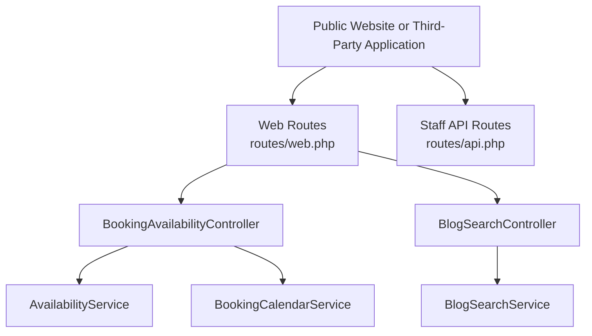
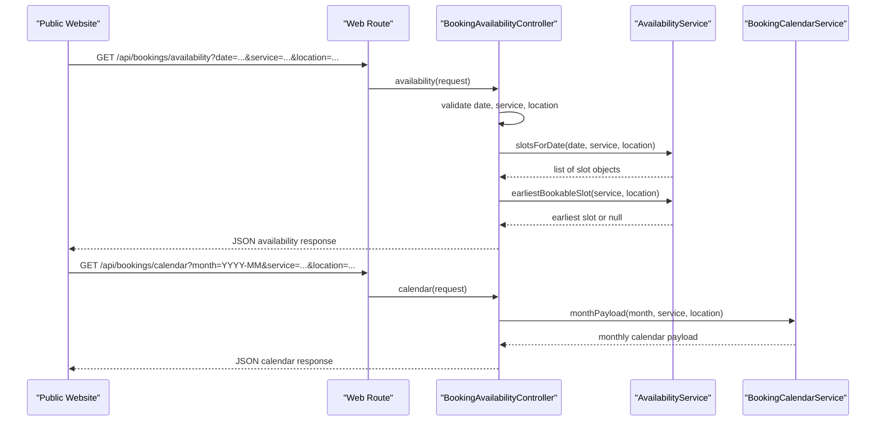
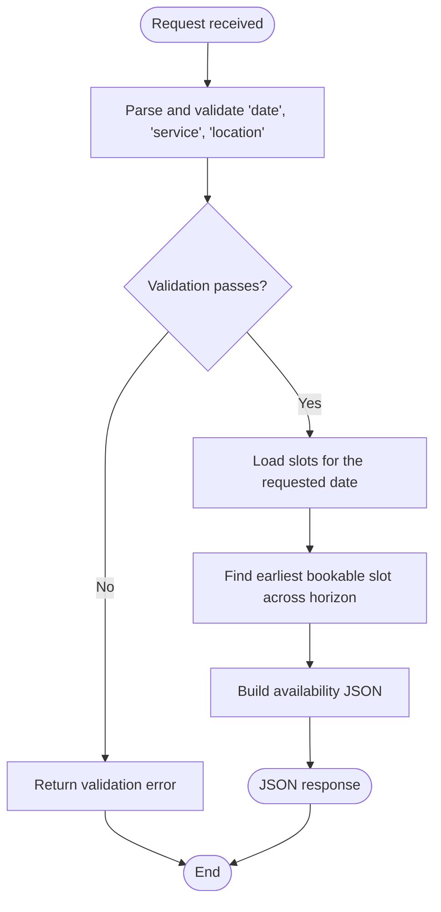
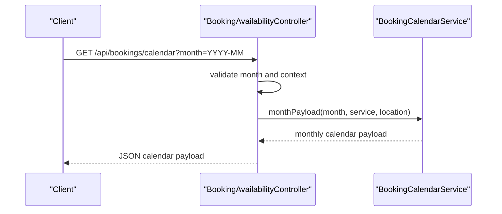
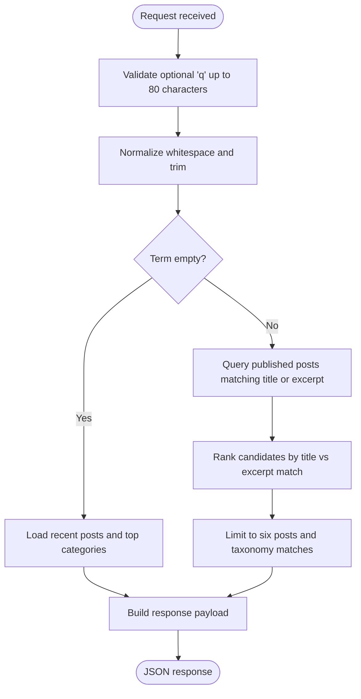
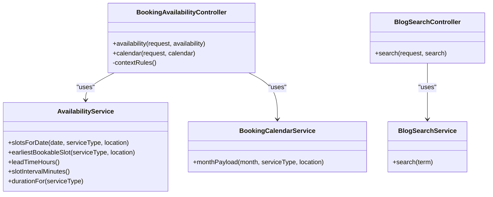

# Public API Endpoints

<cite>
**Referenced Files in This Document**   
- [routes/web.php](file://routes/web.php)
- [routes/api.php](file://routes/api.php)
- [app/Http/Controllers/Api/BookingAvailabilityController.php](file://app/Http/Controllers/Api/BookingAvailabilityController.php)
- [app/Http/Controllers/Api/BlogSearchController.php](file://app/Http/Controllers/Api/BlogSearchController.php)
- [app/Services/AvailabilityService.php](file://app/Services/AvailabilityService.php)
- [app/Services/BlogSearchService.php](file://app/Services/BlogSearchService.php)
- [app/Services/BookingCalendarService.php](file://app/Services/BookingCalendarService.php)
- [config/cache.php](file://config/cache.php)
- [config/passkeys.php](file://config/passkeys.php)
</cite>

## Table of Contents
1. [Introduction](#introduction)
2. [Project Structure](#project-structure)
3. [Core Components](#core-components)
4. [Architecture Overview](#architecture-overview)
5. [Detailed Component Analysis](#detailed-component-analysis)
6. [Dependency Analysis](#dependency-analysis)
7. [Performance Considerations](#performance-considerations)
8. [CORS and Security Configuration](#cors-and-security-configuration)
9. [Troubleshooting Guide](#troubleshooting-guide)
10. [Conclusion](#conclusion)

## Introduction
This document describes the public-facing API endpoints that do not require authentication. It focuses on:

- **Booking availability**: checking service slot availability and retrieving a calendar view.
- **Blog search**: content discovery for the blog command palette.
- **Other public endpoints**: sitemap, robots manifest, poll interactions, glass-type taxonomy, and quote/contact submission routes.

These endpoints are intended for integration with the public website and third-party applications. They use Laravel’s default JSON response behavior, request validation, and route-level rate limiting. Authentication is not required unless otherwise noted.

## Project Structure
Public endpoints are registered under the web group rather than the token-authenticated staff API group. The most relevant files are:

- `routes/web.php`: defines public GET/POST routes including `/api/bookings/availability`, `/api/bookings/calendar`, `/api/blog/search`, sitemap, robots, manifest, polls, and glass-type sub-categories.
- `routes/api.php`: documents and implements the separate, Sanctum-authenticated staff API under `/api/staff/*`. It is intentionally isolated so it cannot collide with public `/api/*` routes.
- Controllers and services implement the business logic for availability, calendar generation, and blog search.

**Diagram sources**
- [routes/web.php:34-76](file://routes/web.php#L34-L76)
- [routes/api.php:1-117](file://routes/api.php#L1-L117)
- [app/Http/Controllers/Api/BookingAvailabilityController.php:1-117](file://app/Http/Controllers/Api/BookingAvailabilityController.php#L1-L117)
- [app/Http/Controllers/Api/BlogSearchController.php:1-37](file://app/Http/Controllers/Api/BlogSearchController.php#L1-L37)
- [app/Services/AvailabilityService.php:1-200](file://app/Services/AvailabilityService.php#L1-L200)
- [app/Services/BookingCalendarService.php:25-61](file://app/Services/BookingCalendarService.php#L25-L61)
- [app/Services/BlogSearchService.php:1-200](file://app/Services/BlogSearchService.php#L1-L200)

**Section sources**
- [routes/web.php:1-76](file://routes/web.php#L1-L76)
- [routes/api.php:1-117](file://routes/api.php#L1-L117)

## Core Components
The public API surface includes three main areas:

| Area | Route | Method | Authentication | Rate Limit | Purpose |
|---|---|---|---:|---:|---|
| Booking availability | `/api/bookings/availability` | GET | No | 30 requests per minute | Returns daily slots, status, earliest bookable time, and booking context. |
| Booking calendar | `/api/bookings/calendar` | GET | No | 30 requests per minute | Returns one month of calendar data with dimmed unavailable days. |
| Blog search | `/api/blog/search` | GET | No | 60 requests per minute | Returns recent posts or ranked matching posts and taxonomy suggestions. |
| Sitemap | `/sitemap.xml` | GET | No | Default | XML sitemap for SEO crawlers. |
| Robots | `/robots.txt` | GET | No | Default | Robots directive file. |
| Manifest | `/site.webmanifest` | GET | No | Default | Web application manifest. |
| Poll vote | `/api/content-blocks/poll/{poll}` | POST | No | 10 requests per minute | Casts a poll vote. |
| Poll results | `/api/content-blocks/poll/{poll}/results` | GET | No | Default | Reads poll results. |
| Glass-type sub-categories | `/api/glass-types/{glassType}/sub-categories` | GET | No | Default | Lists sub-categories for a glass type. |
| Quote submission | `/quote` | POST | No | 3 requests per minute | Submits a quote form. |
| Contact submission | `/contact` | POST | No | 3 requests per minute | Submits a contact message. |

**Section sources**
- [routes/web.php:10-76](file://routes/web.php#L10-L76)
- [routes/api.php:1-117](file://routes/api.php#L1-L117)

## Architecture Overview
The public endpoints follow a thin-controller pattern:

1. The route registers the endpoint and applies rate limiting where appropriate.
2. The controller validates input using Laravel’s request validation.
3. The controller delegates to a service class for domain logic.
4. The service reads models and configuration, performs calculations, and returns structured arrays.
5. The controller wraps the result in a JSON response.

**Diagram sources**
- [routes/web.php:60-73](file://routes/web.php#L60-L73)
- [app/Http/Controllers/Api/BookingAvailabilityController.php:33-117](file://app/Http/Controllers/Api/BookingAvailabilityController.php#L33-L117)
- [app/Services/AvailabilityService.php:140-200](file://app/Services/AvailabilityService.php#L140-L200)
- [app/Services/BookingCalendarService.php:61-120](file://app/Services/BookingCalendarService.php#L61-L120)

## Detailed Component Analysis

### Booking Availability API
The availability API answers two questions:

- Which time slots on a given date can be booked?
- What is the earliest possible bookable slot across the booking horizon?

#### Endpoint Definition
- Path: `/api/bookings/availability`
- Method: GET
- Authentication: Not required
- Rate limit: 30 requests per minute
- Query parameters:

| Parameter | Required | Type | Allowed Values | Description |
|---|---:|---|---|---|
| `date` | Yes | Date string | Today through 90 days ahead | Target date to evaluate slots. |
| `service` | No | String | Value from `BookingServiceType` | Determines job duration and capacity rules. |
| `location` | No | String | `mobile`, `workshop` | Selects the capacity pool. |

#### Request Examples
- Check today’s slots for a workshop windscreen:
  - `GET /api/bookings/availability?date=2026-10-31&service=windscreen&location=workshop`
- Check next week’s mobile inspection slots without filtering by service:
  - `GET /api/bookings/availability?date=2026-11-07&location=mobile`
- Validate the booking horizon boundary:
  - `GET /api/bookings/availability?date=2027-02-01` (outside 90-day horizon; server-side validation rejects dates beyond the horizon).

#### Response Shape
The controller returns a JSON object containing:

| Field | Type | Meaning |
|---|---|---|
| `date` | String | ISO-style date used for the query. |
| `is_today` | Boolean | Whether the requested date is today. |
| `closed` | Boolean | Whether no slots were generated for the date. |
| `lead_time_hours` | Integer | Minimum notice hours before a slot can be booked. |
| `interval_minutes` | Integer | Slot interval in minutes. |
| `duration_minutes` | Integer | Duration associated with the selected service. |
| `available_count` | Integer | Number of slots marked available. |
| `earliest` | Object or null | First potentially bookable slot across the horizon. |
| `slots` | Array | Per-slot entries with time, label, end time, availability flag, and status. |

Each slot contains:

| Field | Type | Meaning |
|---|---|---|
| `time` | String | Start time formatted as hours and minutes. |
| `label` | String | Human-readable start time. |
| `end` | String | End time formatted as hours and minutes. |
| `end_label` | String | Human-readable end time. |
| `available` | Boolean | Whether the slot is bookable. |
| `status` | String | Status code such as available, taken, closed, or too late. |

#### Processing Logic

**Diagram sources**
- [app/Http/Controllers/Api/BookingAvailabilityController.php:33-86](file://app/Http/Controllers/Api/BookingAvailabilityController.php#L33-L86)
- [app/Services/AvailabilityService.php:140-200](file://app/Services/AvailabilityService.php#L140-L200)

#### Error Handling Patterns
- Missing or invalid `date`:
  - The route requires a valid date at least today and no later than 90 days ahead.
- Invalid `service`:
  - Must match the `BookingServiceType` enum.
- Invalid `location`:
  - Must be `mobile` or `workshop`.
- Closed date or no generated slots:
  - The response marks `closed` as true and returns an empty `slots` array.
- Past the minimum notice window:
  - Slots may carry a `too_late` status instead of being silently omitted.

**Section sources**
- [routes/web.php:66-70](file://routes/web.php#L66-L70)
- [app/Http/Controllers/Api/BookingAvailabilityController.php:33-86](file://app/Http/Controllers/Api/BookingAvailabilityController.php#L33-L86)
- [app/Services/AvailabilityService.php:60-200](file://app/Services/AvailabilityService.php#L60-L200)
- [app/Services/AvailabilityService.php:303-331](file://app/Services/AvailabilityService.php#L303-L331)
- [app/Services/AvailabilityService.php:657-740](file://app/Services/AvailabilityService.php#L657-L740)

### Booking Calendar API
The calendar endpoint provides a monthly view suitable for a booking picker. It highlights which days have no free slot, allowing the UI to dim those days.

#### Endpoint Definition
- Path: `/api/bookings/calendar`
- Method: GET
- Authentication: Not required
- Rate limit: 30 requests per minute
- Query parameters:

| Parameter | Required | Type | Allowed Values | Description |
|---|---|---|---|---|
| `month` | Yes | Date string in `YYYY-MM` format | Up to the current month plus the booking horizon | Month to render. |
| `service` | No | String | Value from `BookingServiceType` | Affects capacity and duration calculations. |
| `location` | No | String | `mobile`, `workshop` | Selects the capacity pool. |

#### Request Examples
- Render October 2026 for workshop jobs:
  - `GET /api/bookings/calendar?month=2026-10&location=workshop`
- Render the latest allowed month when a future month is requested:
  - `GET /api/bookings/calendar?month=2027-03` (server clamps to the horizon boundary).

#### Response Shape
The controller delegates to `BookingCalendarService::monthPayload`, returning a monthly payload structure. The exact field names are produced by that service method; conceptually it represents:

| Concept | Meaning |
|---|---|
| Month metadata | Year, month, and related calendar navigation values. |
| Days | Each day indicates whether any bookable slot exists. |
| Context | Service type and location used for capacity evaluation. |

#### Processing Logic

**Diagram sources**
- [routes/web.php:72-73](file://routes/web.php#L72-L73)
- [app/Http/Controllers/Api/BookingAvailabilityController.php:88-117](file://app/Http/Controllers/Api/BookingAvailabilityController.php#L88-L117)
- [app/Services/BookingCalendarService.php:61-120](file://app/Services/BookingCalendarService.php#L61-L120)

**Section sources**
- [routes/web.php:72-73](file://routes/web.php#L72-L73)
- [app/Http/Controllers/Api/BookingAvailabilityController.php:88-117](file://app/Http/Controllers/Api/BookingAvailabilityController.php#L88-L117)
- [app/Services/BookingCalendarService.php:25-61](file://app/Services/BookingCalendarService.php#L25-L61)

### Blog Search API
The blog search API supports the blog command palette. It returns either recent published posts or ranked matching posts based on the supplied term.

#### Endpoint Definition
- Path: `/api/blog/search`
- Method: GET
- Authentication: Not required
- Rate limit: 60 requests per minute
- Query parameters:

| Parameter | Required | Type | Constraints | Description |
|---|---:|---|---|---|
| `q` | No | String | Maximum 80 characters | Search term. Empty or whitespace-only returns the recent mode. |

#### Request Examples
- Recent mode:
  - `GET /api/blog/search`
- Match a title or excerpt:
  - `GET /api/blog/search?q=glass+repair`
- Boundary test:
  - `GET /api/blog/search?q=` followed by more than 80 characters (validation rejects the request).

#### Response Shape
Two modes are returned:

**Recent mode:**
| Field | Type | Meaning |
|---|---|---|
| `mode` | String | Always `recent`. |
| `term` | String | Empty string. |
| `posts` | Array | Up to six newest published posts. |
| `categories` | Array | Top categories by post count with labels, meta text, and href. |
| `tags` | Array | Empty array in recent mode. |

**Search mode:**
| Field | Type | Meaning |
|---|---|---|
| `mode` | String | Always `search`. |
| `term` | String | Normalized search term. |
| `posts` | Array | Up to six ranked matching posts. |
| `categories` | Array | Matching category suggestions. |
| `tags` | Array | Matching tag suggestions. |

Each post contains:
| Field | Type | Meaning |
|---|---|---|
| `id` | String | Stable identifier prefixed with `post-`. |
| `type` | String | `post`. |
| `label` | String | Post title. |
| `snippet` | String | Truncated excerpt. |
| `category` | String or null | Primary category name. |
| `date` | String or null | Formatted publication date. |
| `thumbnail` | String or null | Featured image URL. |
| `href` | String | Blog post URL. |

#### Processing Logic

**Diagram sources**
- [routes/web.php:48-53](file://routes/web.php#L48-L53)
- [app/Http/Controllers/Api/BlogSearchController.php:17-37](file://app/Http/Controllers/Api/BlogSearchController.php#L17-L37)
- [app/Services/BlogSearchService.php:34-200](file://app/Services/BlogSearchService.php#L34-L200)

#### Error Handling Patterns
- Query exceeds 80 characters:
  - Validation fails with a custom message indicating the character limit.
- Empty or whitespace-only query:
  - Returns recent posts and category suggestions rather than an error.
- No matching posts:
  - Returns a search response with an empty `posts` array but still includes taxonomy suggestions.

**Section sources**
- [routes/web.php:48-53](file://routes/web.php#L48-L53)
- [app/Http/Controllers/Api/BlogSearchController.php:17-37](file://app/Http/Controllers/Api/BlogSearchController.php#L17-L37)
- [app/Services/BlogSearchService.php:34-200](file://app/Services/BlogSearchService.php#L34-L200)

### Other Public Endpoints

#### Sitemap, Robots, and Manifest
| Endpoint | Method | Purpose |
|---|---|---|
| `/sitemap.xml` | GET | Generates an XML sitemap. |
| `/robots.txt` | GET | Provides robots directives. |
| `/site.webmanifest` | GET | Provides the web application manifest. |

These are SEO-related public routes and do not require authentication.

**Section sources**
- [routes/web.php:10-13](file://routes/web.php#L10-L13)

#### Poll API
| Endpoint | Method | Rate Limit | Purpose |
|---|---|---:|---|
| `/api/content-blocks/poll/{poll}` | POST | 10 per minute | Submit a poll vote. |
| `/api/content-blocks/poll/{poll}/results` | GET | Default | Read poll results. |

**Section sources**
- [routes/web.php:75-76](file://routes/web.php#L75-L76)

#### Glass-Type Sub-Categories
| Endpoint | Method | Purpose |
|---|---|---|
| `/api/glass-types/{glassType}/sub-categories` | GET | Return sub-categories for a glass type. |

**Section sources**
- [routes/web.php:78](file://routes/web.php#L78)

## Dependency Analysis
The public endpoints depend on controllers, services, models, and configuration:

**Diagram sources**
- [app/Http/Controllers/Api/BookingAvailabilityController.php:1-117](file://app/Http/Controllers/Api/BookingAvailabilityController.php#L1-L117)
- [app/Http/Controllers/Api/BlogSearchController.php:1-37](file://app/Http/Controllers/Api/BlogSearchController.php#L1-L37)
- [app/Services/AvailabilityService.php:1-200](file://app/Services/AvailabilityService.php#L1-L200)
- [app/Services/BookingCalendarService.php:25-61](file://app/Services/BookingCalendarService.php#L25-L61)
- [app/Services/BlogSearchService.php:1-200](file://app/Services/BlogSearchService.php#L1-L200)

**Section sources**
- [app/Http/Controllers/Api/BookingAvailabilityController.php:1-117](file://app/Http/Controllers/Api/BookingAvailabilityController.php#L1-L117)
- [app/Http/Controllers/Api/BlogSearchController.php:1-37](file://app/Http/Controllers/Api/BlogSearchController.php#L1-L37)
- [app/Services/AvailabilityService.php:1-200](file://app/Services/AvailabilityService.php#L1-L200)
- [app/Services/BlogSearchService.php:1-200](file://app/Services/BlogSearchService.php#L1-L200)

## Performance Considerations
- **Rate limiting protects public endpoints:**
  - Booking availability and calendar: 30 requests per minute.
  - Blog search: 60 requests per minute.
  - Poll voting: 10 requests per minute.
  - Quote and contact submissions: 3 requests per minute.
- **Availability calculations avoid per-slot database queries:**
  - The availability service loads occupancy in one pass per window and compares intervals rather than asking whether a single instant is free.
  - This design reduces round trips when generating half-hourly slots over multiple months.
- **Horizon guard prevents unbounded slot lists:**
  - The booking horizon is fixed at 90 days.
  - The controller also clamps calendar requests to this horizon.
- **Blog search limits candidate size:**
  - Candidate posts are limited before PHP ranking.
  - Final results are capped at six posts.
- **Cache configuration:**
  - The default cache store is configured via `CACHE_STORE`.
  - Serializable classes include Eloquent collections and some domain models, which can affect caching behavior if those models are cached directly.

[No sources needed since this section provides general guidance]

## CORS and Security Configuration
- **Authentication model:**
  - Public endpoints do not use Sanctum tokens.
  - The staff API under `/api/staff/*` uses `auth:sanctum` and Spatie abilities.
- **Passkey configuration:**
  - The passkeys configuration exposes an `allowed_origins` setting derived from the application URL. This is specific to WebAuthn passkey flows and does not define general CORS headers for all public APIs.
- **Framework-level CORS:**
  - No explicit global CORS middleware or CORS configuration was found in the analyzed files.
  - Public endpoints therefore rely on the framework’s default handling unless additional middleware or reverse-proxy configuration adds CORS headers.
- **Recommendation for third-party integrations:**
  - If external domains must call these endpoints, configure a proper CORS policy at the application level or at the reverse proxy/load balancer.
  - Restrict allowed origins to known public domains.
  - Avoid wildcard origins for sensitive endpoints.

**Section sources**
- [routes/api.php:1-33](file://routes/api.php#L1-L33)
- [config/passkeys.php:21-35](file://config/passkeys.php#L21-L35)

## Troubleshooting Guide

### Booking Availability Issues
| Symptom | Likely Cause | Resolution |
|---|---|---|
| Empty slot list | Date is outside trading hours, closed, or has no valid starts | Check whether the date falls within open hours and is not a closed day. |
| All slots show `too_late` | Requested time is before the minimum notice cutoff | Move the booking further into the future according to `lead_time_hours`. |
| Slots exist but none are available | Capacity is fully booked for the selected service and location | Try another service, another location, or another date. |
| Horizon error | Requested date is beyond 90 days | Reduce the date to today plus 90 days. |
| Calendar shows unexpected month | Future month was requested | The server clamps to the horizon boundary; use the returned month. |

**Section sources**
- [app/Http/Controllers/Api/BookingAvailabilityController.php:33-117](file://app/Http/Controllers/Api/BookingAvailabilityController.php#L33-L117)
- [app/Services/AvailabilityService.php:303-331](file://app/Services/AvailabilityService.php#L303-L331)
- [app/Services/AvailabilityService.php:657-740](file://app/Services/AvailabilityService.php#L657-L740)

### Blog Search Issues
| Symptom | Likely Cause | Resolution |
|---|---|---|
| Validation error on `q` | Query exceeds 80 characters | Shorten the search term. |
| No posts returned | No published posts match the term | Try a shorter or broader term, or check the recent mode. |
| Unexpected category or tag suggestions | Name-based `LIKE` matching | Refine the term; exact matches are prioritized. |
| Slow responses | Repeated keystroke calls without client-side debouncing | Implement debounce on the frontend; the endpoint allows 60 requests per minute but should still be throttled by the caller. |

**Section sources**
- [app/Http/Controllers/Api/BlogSearchController.php:17-37](file://app/Http/Controllers/Api/BlogSearchController.php#L17-L37)
- [app/Services/BlogSearchService.php:34-200](file://app/Services/BlogSearchService.php#L34-L200)

### Integration Notes for Public Website and Third-Party Applications
- **Public website:**
  - The availability and calendar endpoints power the booking flow by providing the same server-side truth the backend uses to confirm bookings.
  - The blog search endpoint powers the command palette without re-rendering heavy page components.
- **Third-party applications:**
  - Treat these endpoints as read-only public APIs.
  - Respect rate limits and debounce rapid searches.
  - If cross-origin access is required, ensure the deployment environment permits the calling origin through application or proxy-level CORS configuration.
  - Do not assume Sanctum authentication applies to these routes; only the `/api/staff/*` routes require tokens.

[No sources needed since this section provides general guidance]

## Conclusion
The public API surface centers on two high-value capabilities:

- **Booking availability and calendar**, which expose deterministic slot and calendar data backed by capacity, open hours, closures, and notice rules.
- **Blog search**, which provides a lightweight, ranked discovery experience for published posts and taxonomy terms.

Both endpoints are protected by rate limiting, validated inputs, and clear failure modes. For production deployments integrating external callers, add explicit CORS configuration and monitor rate-limit usage. The staff API remains isolated under `/api/staff/*` and should not be confused with these public routes.

[No sources needed since this section summarizes without analyzing specific files]