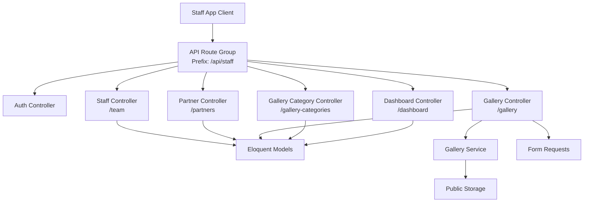
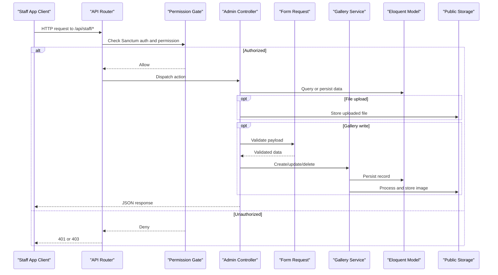
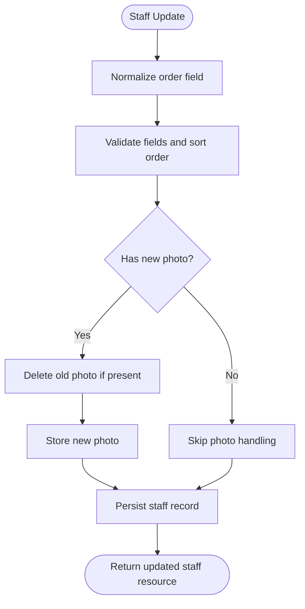
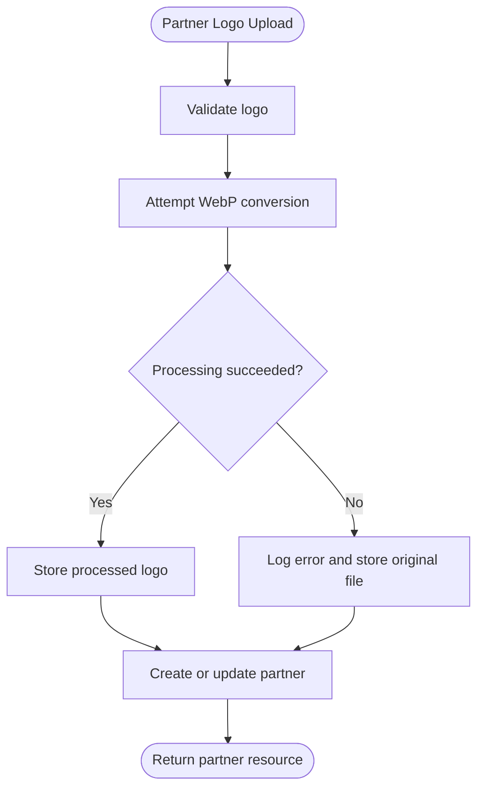
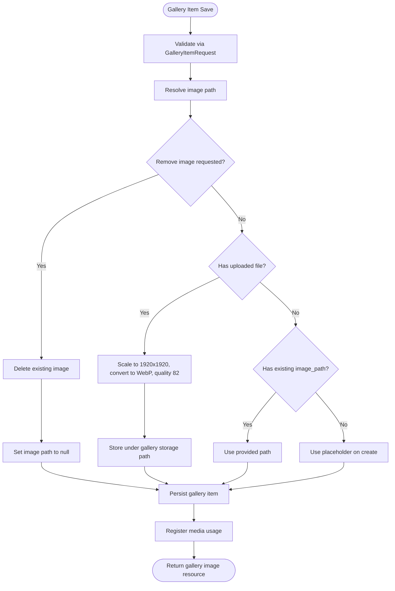
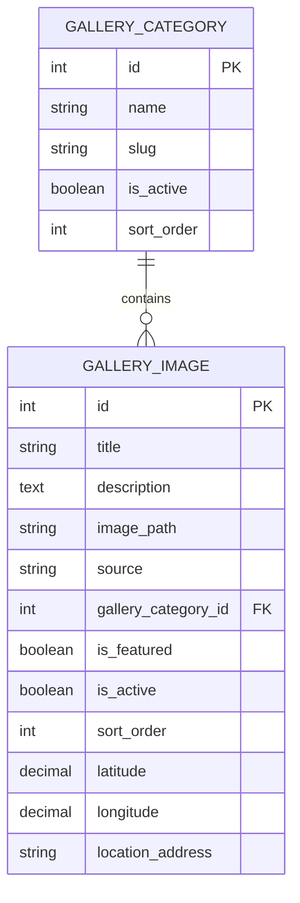
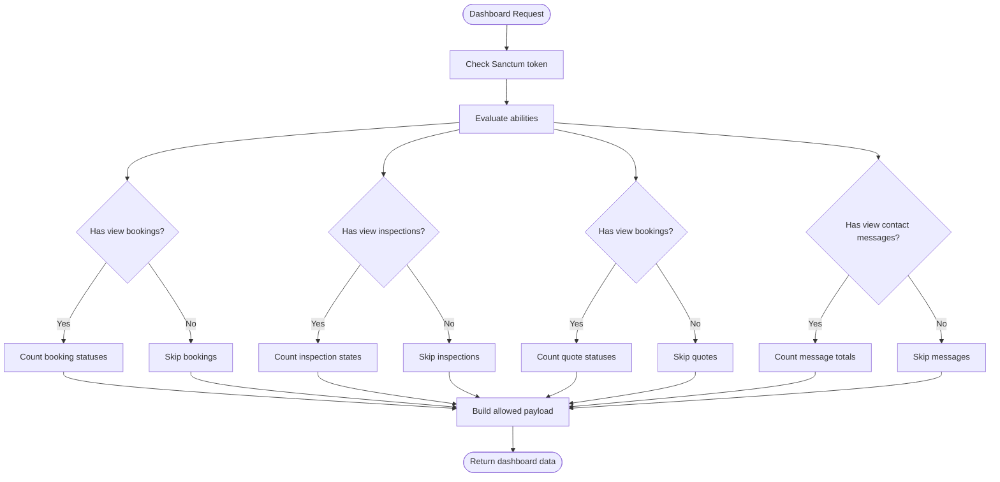
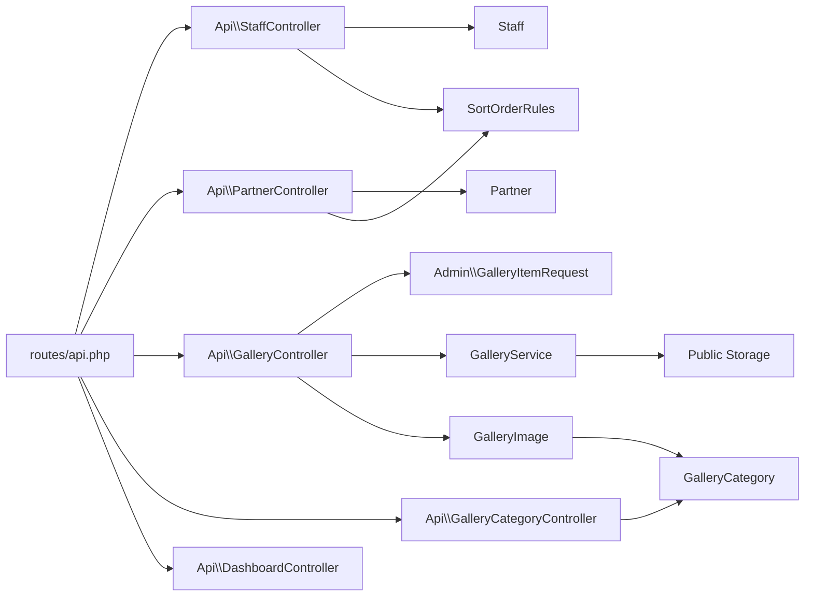

# Administration API

<cite>
**Referenced Files in This Document**   
- [routes/api.php](file://routes/api.php)
- [app/Http/Controllers/Api/StaffController.php](file://app/Http/Controllers/Api/StaffController.php)
- [app/Http/Controllers/Api/PartnerController.php](file://app/Http/Controllers/Api/PartnerController.php)
- [app/Http/Controllers/Api/GalleryController.php](file://app/Http/Controllers/Api/GalleryController.php)
- [app/Http/Controllers/Api/GalleryCategoryController.php](file://app/Http/Controllers/Api/GalleryCategoryController.php)
- [app/Http/Controllers/Api/DashboardController.php](file://app/Http/Controllers/Api/DashboardController.php)
- [app/Http/Requests/Admin/GalleryItemRequest.php](file://app/Http/Requests/Admin/GalleryItemRequest.php)
- [app/Services/GalleryService.php](file://app/Services/GalleryService.php)
- [app/Support/SortOrderRules.php](file://app/Support/SortOrderRules.php)
- [app/Models/Staff.php](file://app/Models/Staff.php)
- [app/Models/Partner.php](file://app/Models/Partner.php)
- [app/Models/GalleryImage.php](file://app/Models/GalleryImage.php)
- [app/Models/GalleryCategory.php](file://app/Models/GalleryCategory.php)
</cite>

## Table of Contents
1. [Introduction](#introduction)
2. [Project Structure](#project-structure)
3. [Core Components](#core-components)
4. [Architecture Overview](#architecture-overview)
5. [Detailed Component Analysis](#detailed-component-analysis)
6. [Dependency Analysis](#dependency-analysis)
7. [Performance Considerations](#performance-considerations)
8. [Troubleshooting Guide](#troubleshooting-guide)
9. [Conclusion](#conclusion)

## Introduction
This document describes the staff administration API endpoints for managing team members, business partners, curated gallery content, and dashboard analytics. All endpoints are token-authenticated through Sanctum under the `/api/staff` prefix and protected by Spatie permission gates such as `manage settings`, `view gallery`, and `view dashboard`. The API is designed for the staff mobile application but can be consumed by any authenticated client.

Key responsibilities:
- Staff directory management through `/team`.
- Partner relationship management through `/partners`.
- Curated gallery image operations through `/gallery`, including multipart upload support.
- Gallery category listing through `/gallery-categories`.
- Dashboard aggregate data through `/dashboard`.

The routes live under a dedicated `staff` group so they cannot collide with public or web API routes. Every data route requires authentication and an explicit ability gate.

**Section sources**
- [routes/api.php:1-117](file://routes/api.php#L1-L117)

## Project Structure
The administration API is organized around controllers that map directly to domain areas:

**Diagram sources**
- [routes/api.php:1-117](file://routes/api.php#L1-L117)
- [app/Http/Controllers/Api/StaffController.php:1-115](file://app/Http/Controllers/Api/StaffController.php#L1-L115)
- [app/Http/Controllers/Api/PartnerController.php:1-133](file://app/Http/Controllers/Api/PartnerController.php#L1-L133)
- [app/Http/Controllers/Api/GalleryController.php:1-92](file://app/Http/Controllers/Api/GalleryController.php#L1-L92)
- [app/Http/Controllers/Api/GalleryCategoryController.php:1-28](file://app/Http/Controllers/Api/GalleryCategoryController.php#L1-L28)
- [app/Http/Controllers/Api/DashboardController.php:1-79](file://app/Http/Controllers/Api/DashboardController.php#L1-L79)
- [app/Services/GalleryService.php:1-139](file://app/Services/GalleryService.php#L1-L139)
- [app/Http/Requests/Admin/GalleryItemRequest.php:1-66](file://app/Http/Requests/Admin/GalleryItemRequest.php#L1-L66)

**Section sources**
- [routes/api.php:1-117](file://routes/api.php#L1-L117)

## Core Components
The administration API exposes five primary controller groups:

| Area | Base Path | Authentication | Permissions | Purpose |
|---|---|---|---|---|
| Staff directory | `/api/staff/team` | Sanctum token | `manage settings` | Create, read, update, delete staff profiles and photos |
| Partners | `/api/staff/partners` | Sanctum token | `manage settings` | Manage partner logos, websites, and ordering |
| Gallery images | `/api/staff/gallery` | Sanctum token | `view gallery` (read), `manage gallery` (write) | Upload, curate, update, and remove public gallery images |
| Gallery categories | `/api/staff/gallery-categories` | Sanctum token | `view gallery` | List active gallery categories |
| Dashboard metrics | `/api/staff/dashboard` | Sanctum token | `view dashboard` | Return module-scoped aggregate counts |

Important characteristics:
- Sorting is normalized through a shared sort-order helper so clients can omit the order field and receive automatic ranking.
- Image uploads are validated and processed consistently across staff photos, partner logos, and gallery images.
- Gallery rows are scoped to the curated gallery source, preventing accidental mixing with library assets.
- Dashboard responses only include sections the caller has permission to view.

**Section sources**
- [routes/api.php:1-117](file://routes/api.php#L1-L117)
- [app/Support/SortOrderRules.php:1-59](file://app/Support/SortOrderRules.php#L1-L59)
- [app/Models/GalleryImage.php:1-169](file://app/Models/GalleryImage.php#L1-L169)

## Architecture Overview
The staff API follows a layered request flow:

**Diagram sources**
- [routes/api.php:1-117](file://routes/api.php#L1-L117)
- [app/Http/Controllers/Api/GalleryController.php:1-92](file://app/Http/Controllers/Api/GalleryController.php#L1-L92)
- [app/Http/Requests/Admin/GalleryItemRequest.php:1-66](file://app/Http/Requests/Admin/GalleryItemRequest.php#L1-L66)
- [app/Services/GalleryService.php:1-139](file://app/Services/GalleryService.php#L1-L139)

## Detailed Component Analysis

### Staff Directory Management

#### Endpoints
| Method | Path | Permission | Response |
|---|---|---|---|
| GET | `/api/staff/team` | `manage settings` | Collection of staff records ordered by position |
| POST | `/api/staff/team` | `manage settings` | Created staff record |
| GET | `/api/staff/team/{staff}` | `manage settings` | Single staff record |
| PUT | `/api/staff/team/{staff}` | `manage settings` | Updated staff record |
| DELETE | `/api/staff/team/{staff}` | `manage settings` | Success message |

#### Validation and Fields
- Required fields: name, role.
- Optional fields: bio, photo, is_active, order.
- Photo validation accepts images up to 2048 kilobytes.
- Order validation enforces uniqueness per model using shared sort-order rules.

#### File Handling
- On create, an optional photo is stored under the `staff` storage path.
- On update, a new photo replaces the previous one, and the old file is deleted.
- On delete, the associated photo is removed before the record is deleted.

#### Sorting Behavior
- The `order` column is normalized so blank values become the next available rank on create and preserve the existing rank on update.
- Negative or invalid ranks fail validation rather than being silently coerced.

**Diagram sources**
- [app/Http/Controllers/Api/StaffController.php:1-115](file://app/Http/Controllers/Api/StaffController.php#L1-L115)
- [app/Support/SortOrderRules.php:1-59](file://app/Support/SortOrderRules.php#L1-L59)
- [app/Models/Staff.php:1-45](file://app/Models/Staff.php#L1-L45)

#### Example Workflow: Staff Onboarding
1. Call `POST /api/staff/team` with name, role, and optional bio.
2. If needed, call `PUT /api/staff/team/{staff}` later to attach a photo.
3. Use `GET /api/staff/team` to verify the staff member appears in the directory.
4. Adjust ordering through the `order` field when repositioning entries.
5. Deactivate or remove the record through `is_active` or `DELETE`.

**Section sources**
- [routes/api.php:67-83](file://routes/api.php#L67-L83)
- [app/Http/Controllers/Api/StaffController.php:1-115](file://app/Http/Controllers/Api/StaffController.php#L1-L115)
- [app/Models/Staff.php:1-45](file://app/Models/Staff.php#L1-L45)

### Partner Relationship Management

#### Endpoints
| Method | Path | Permission | Response |
|---|---|---|---|
| GET | `/api/staff/partners` | `manage settings` | Collection of partner records ordered by position |
| POST | `/api/staff/partners` | `manage settings` | Created partner record |
| GET | `/api/staff/partners/{partner}` | `manage settings` | Single partner record |
| PUT | `/api/staff/partners/{partner}` | `manage settings` | Updated partner record |
| DELETE | `/api/staff/partners/{partner}` | `manage settings` | Success message |

#### Validation and Fields
- Required fields: name, logo.
- Optional fields: website_url, is_active, order.
- Logo validation accepts images up to 2048 kilobytes.
- Sort order uses the same normalization and uniqueness rules as staff.

#### Logo Processing
- Uploaded logos are converted to WebP at 800×800 containment with quality 82.
- If image processing fails, the original file is stored as a fallback.
- Failed processing is logged for diagnostics.
- On update, a new logo replaces the previous one; deletion removes the old logo.

**Diagram sources**
- [app/Http/Controllers/Api/PartnerController.php:1-133](file://app/Http/Controllers/Api/PartnerController.php#L1-L133)
- [app/Models/Partner.php:1-46](file://app/Models/Partner.php#L1-L46)

#### Example Workflow: Partner Relationship Management
1. Create a partner with a required logo and optional website URL.
2. Update the partner’s status, website, or ordering without changing the logo unless necessary.
3. Replace the logo to refresh branding.
4. Remove inactive or outdated partners; the system deletes their logo file.

**Section sources**
- [routes/api.php:85-95](file://routes/api.php#L85-L95)
- [app/Http/Controllers/Api/PartnerController.php:1-133](file://app/Http/Controllers/Api/PartnerController.php#L1-L133)
- [app/Models/Partner.php:1-46](file://app/Models/Partner.php#L1-L46)

### Gallery Content Management

#### Endpoints
| Method | Path | Permission | Response |
|---|---|---|---|
| GET | `/api/staff/gallery` | `view gallery` | Paginated curated gallery images |
| POST | `/api/staff/gallery` | `manage gallery` | Created gallery image |
| GET | `/api/staff/gallery/{item}` | `view gallery` | Single gallery image |
| PUT | `/api/staff/gallery/{item}` | `manage gallery` | Updated gallery image |
| DELETE | `/api/staff/gallery/{item}` | `manage gallery` | Success message |
| GET | `/api/staff/gallery-categories` | `view gallery` | Active gallery categories |

#### Query Parameters for Listing
- `category`: Filter by category slug.
- `featured`: Filter to featured images.
- `per_page`: Page size, clamped between 1 and 100, default 15.

#### Validation Rules
- Title is required and limited to 100 characters.
- Description is optional and limited to 500 characters.
- Image is optional but must be JPEG, PNG, JPG, or WebP, up to 10240 kilobytes.
- Existing `image_path` may be supplied for multipart or server-side paths.
- `remove_image` clears the current image.
- `gallery_category_id` must exist.
- `is_featured` and `is_active` are booleans.
- `sort_order` is validated for uniqueness within the gallery source.
- Location fields support latitude, longitude, and address.

#### Multipart Upload Support
The gallery endpoint accepts standard multipart form data with an `image` field. Clients should:
- Send the image through the normal `image` field in multipart requests.
- Include all other metadata fields alongside the file.
- Use pagination parameters when listing large galleries.

**Diagram sources**
- [app/Http/Controllers/Api/GalleryController.php:1-92](file://app/Http/Controllers/Api/GalleryController.php#L1-L92)
- [app/Http/Requests/Admin/GalleryItemRequest.php:1-66](file://app/Http/Requests/Admin/GalleryItemRequest.php#L1-L66)
- [app/Services/GalleryService.php:1-139](file://app/Services/GalleryService.php#L1-L139)

#### Gallery Data Model Relationships

**Diagram sources**
- [app/Models/GalleryImage.php:1-169](file://app/Models/GalleryImage.php#L1-L169)
- [app/Models/GalleryCategory.php:1-61](file://app/Models/GalleryCategory.php#L1-L61)

#### Example Workflow: Gallery Curation
1. List categories through `/api/staff/gallery-categories` to select a target category.
2. Upload a gallery image with title, description, category, and optional location data.
3. Mark the image as featured or active as appropriate.
4. Update the image later to replace the file, change metadata, or adjust ordering.
5. Delete the image when it is no longer part of the curated gallery.

**Section sources**
- [routes/api.php:97-111](file://routes/api.php#L97-L111)
- [app/Http/Controllers/Api/GalleryController.php:1-92](file://app/Http/Controllers/Api/GalleryController.php#L1-L92)
- [app/Http/Requests/Admin/GalleryItemRequest.php:1-66](file://app/Http/Requests/Admin/GalleryItemRequest.php#L1-L66)
- [app/Services/GalleryService.php:1-139](file://app/Services/GalleryService.php#L1-L139)
- [app/Models/GalleryImage.php:1-169](file://app/Models/GalleryImage.php#L1-L169)
- [app/Models/GalleryCategory.php:1-61](file://app/Models/GalleryCategory.php#L1-L61)

### Dashboard Analytics

#### Endpoint
| Method | Path | Permission | Response |
|---|---|---|---|
| GET | `/api/staff/dashboard` | `view dashboard` | Module-scoped aggregate metrics |

#### Metrics by Section
- **Bookings**: total, pending, confirmed, completed, cancelled.
- **Inspections**: total, completed, in progress, overdue, scheduled.
- **Quotes**: total, pending, contacted, completed, cancelled.
- **Contact messages**: total, unread.

#### Permission Scoping
Each section is included only when the authenticated user has the corresponding ability:
- Bookings and quotes require `view bookings`.
- Inspections require `view inspections`.
- Contact messages require `view contact messages`.

**Diagram sources**
- [app/Http/Controllers/Api/DashboardController.php:1-79](file://app/Http/Controllers/Api/DashboardController.php#L1-L79)

#### Example Workflow: Accessing System Metrics
1. Authenticate with a staff token.
2. Call `/api/staff/dashboard`.
3. Read only the sections present in the response.
4. Use the counts to populate dashboards, alerts, or summary cards.
5. Do not assume missing sections indicate zero activity; they indicate the caller lacks permission.

**Section sources**
- [routes/api.php:33-41](file://routes/api.php#L33-L41)
- [app/Http/Controllers/Api/DashboardController.php:1-79](file://app/Http/Controllers/Api/DashboardController.php#L1-L79)

## Dependency Analysis
The administration API has clear boundaries between routing, authorization, controllers, services, models, and storage:

**Diagram sources**
- [routes/api.php:1-117](file://routes/api.php#L1-L117)
- [app/Http/Controllers/Api/StaffController.php:1-115](file://app/Http/Controllers/Api/StaffController.php#L1-L115)
- [app/Http/Controllers/Api/PartnerController.php:1-133](file://app/Http/Controllers/Api/PartnerController.php#L1-L133)
- [app/Http/Controllers/Api/GalleryController.php:1-92](file://app/Http/Controllers/Api/GalleryController.php#L1-L92)
- [app/Http/Controllers/Api/GalleryCategoryController.php:1-28](file://app/Http/Controllers/Api/GalleryCategoryController.php#L1-L28)
- [app/Http/Requests/Admin/GalleryItemRequest.php:1-66](file://app/Http/Requests/Admin/GalleryItemRequest.php#L1-L66)
- [app/Services/GalleryService.php:1-139](file://app/Services/GalleryService.php#L1-L139)
- [app/Support/SortOrderRules.php:1-59](file://app/Support/SortOrderRules.php#L1-L59)
- [app/Models/Staff.php:1-45](file://app/Models/Staff.php#L1-L45)
- [app/Models/Partner.php:1-46](file://app/Models/Partner.php#L1-L46)
- [app/Models/GalleryImage.php:1-169](file://app/Models/GalleryImage.php#L1-L169)
- [app/Models/GalleryCategory.php:1-61](file://app/Models/GalleryCategory.php#L1-L61)

### Coupling and Cohesion
- Controllers are cohesive around their domain entities and delegate complex logic where appropriate.
- Gallery writes are delegated to `GalleryService`, keeping validation, persistence, media registry updates, and storage concerns separate from routing.
- Sort order logic is centralized in `SortOrderRules`, reducing duplication between staff and partner controllers.
- Gallery images are explicitly separated from library assets through a source field, improving query safety.

### External Dependencies
- Sanctum provides token authentication.
- Spatie permissions provide ability-based access control.
- Laravel image processing handles format conversion and resizing.
- Laravel storage handles persistent file management.
- Eloquent models manage database persistence and relationships.

**Section sources**
- [routes/api.php:1-117](file://routes/api.php#L1-L117)
- [app/Services/GalleryService.php:1-139](file://app/Services/GalleryService.php#L1-L139)
- [app/Support/SortOrderRules.php:1-59](file://app/Support/SortOrderRules.php#L1-L59)
- [app/Models/GalleryImage.php:1-169](file://app/Models/GalleryImage.php#L1-L169)

## Performance Considerations
- Pagination is enforced for gallery listings, with a maximum page size of 100 to prevent expensive queries.
- Gallery queries eager-load categories to reduce N+1 loading when rendering collections.
- Image processing can be expensive; fallback behavior ensures availability even when image libraries fail.
- Dashboard aggregation runs direct database counts; heavy workloads may benefit from caching at the application layer.
- Sort-order normalization avoids unnecessary numeric updates by preserving existing values when no explicit order is provided.
- Large gallery uploads are capped at 10240 kilobytes; consider client-side compression for very large images.

[No sources needed since this section provides general guidance]

## Troubleshooting Guide

### Authentication and Authorization
- A missing or invalid Sanctum token returns an authentication failure.
- Missing permissions return a denial because every route uses explicit ability gates.
- Verify that the calling user has the correct ability:
  - `manage settings` for staff and partners.
  - `view gallery` for reading gallery items and categories.
  - `manage gallery` for creating, updating, and deleting gallery items.
  - `view dashboard` for accessing aggregate metrics.

### File Upload Issues
- Staff and partner logos accept images up to 2048 kilobytes.
- Gallery images accept JPEG, PNG, JPG, or WebP files up to 10240 kilobytes.
- If image processing fails for partners or gallery images, the system logs the error and may fall back to storing the original file.
- Deleting a gallery image attempts to remove its stored file and unregister media usage.
- Ensure the public storage disk is correctly configured so uploaded files are accessible.

### Sort Order Problems
- Blank or zero order values are normalized to keep existing ranks on update and assign the next free rank on create.
- Invalid negative values do not become valid ranks.
- Duplicate sort orders are rejected by the uniqueness rule.

### Gallery Source Confusion
- Only rows with the gallery source appear in curated gallery lists.
- Library assets are intentionally separated and will not surface through gallery endpoints.
- When uploading through the gallery endpoint, the service forces the gallery source regardless of input.

### Dashboard Missing Sections
- Missing metric sections mean the caller lacks the corresponding ability, not that the count is zero.
- Always check which sections are present before displaying data.

**Section sources**
- [routes/api.php:1-117](file://routes/api.php#L1-L117)
- [app/Http/Controllers/Api/StaffController.php:1-115](file://app/Http/Controllers/Api/StaffController.php#L1-L115)
- [app/Http/Controllers/Api/PartnerController.php:1-133](file://app/Http/Controllers/Api/PartnerController.php#L1-L133)
- [app/Http/Controllers/Api/GalleryController.php:1-92](file://app/Http/Controllers/Api/GalleryController.php#L1-L92)
- [app/Services/GalleryService.php:1-139](file://app/Services/GalleryService.php#L1-L139)
- [app/Support/SortOrderRules.php:1-59](file://app/Support/SortOrderRules.php#L1-L59)
- [app/Http/Controllers/Api/DashboardController.php:1-79](file://app/Http/Controllers/Api/DashboardController.php#L1-L79)

## Conclusion
The administration API provides a secure, permission-gated interface for managing staff, partners, curated gallery content, and dashboard metrics. It emphasizes consistent validation, safe file handling, explicit authorization, and clear separation between curated gallery data and library assets. Clients should authenticate with Sanctum tokens, respect ability requirements, handle multipart uploads carefully, and rely on pagination and validation rules for predictable behavior.

[No sources needed since this section summarizes without analyzing specific files]