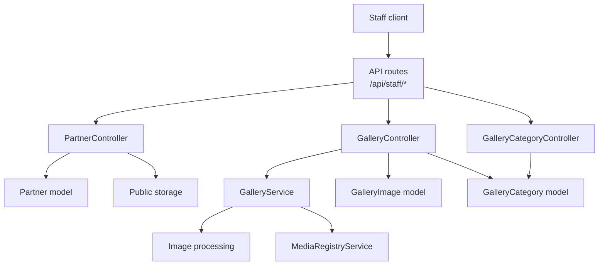
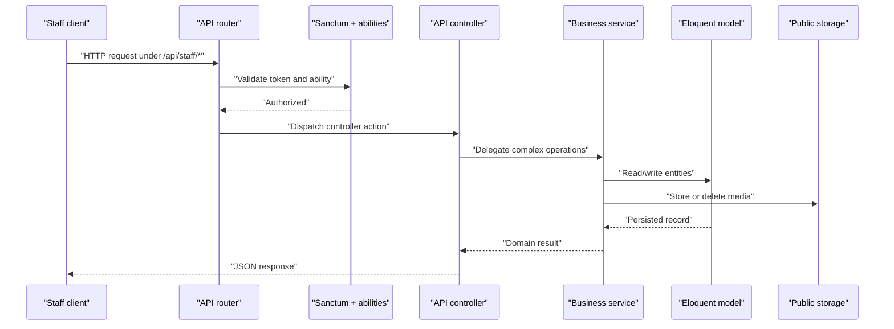
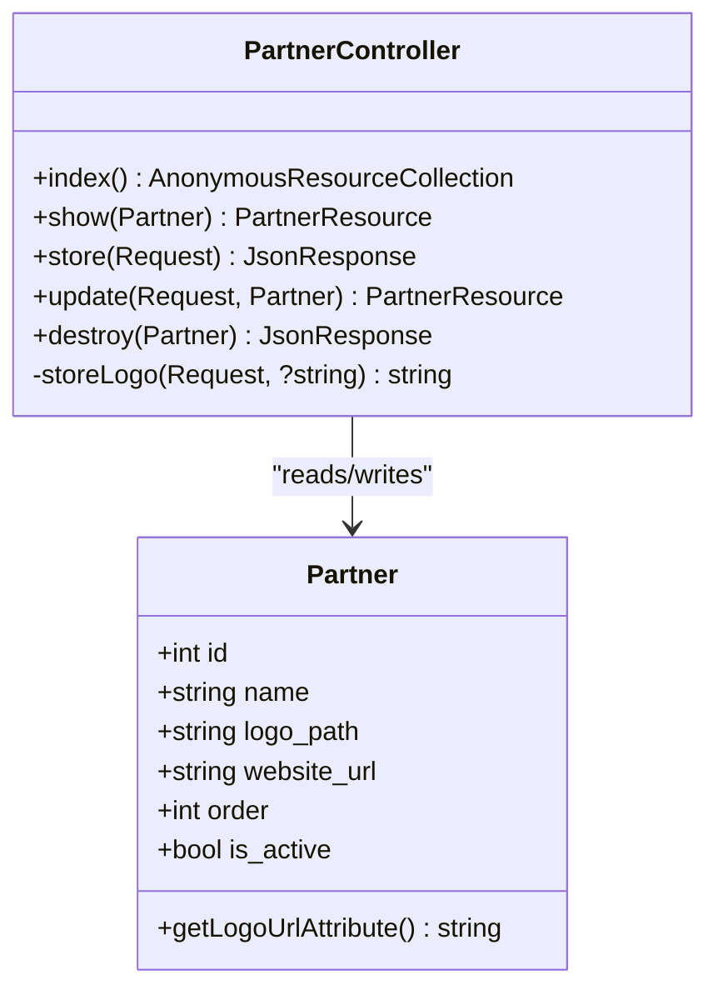
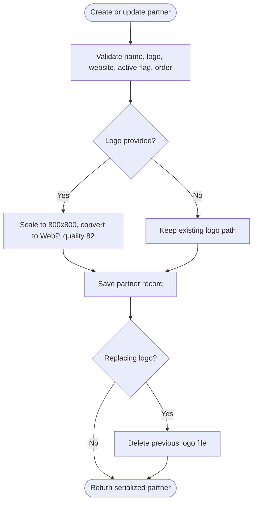
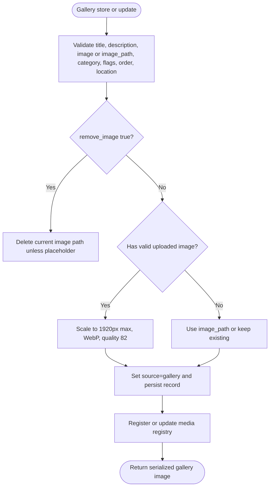
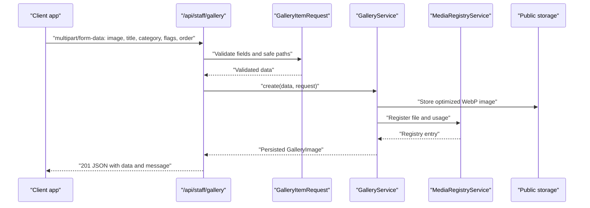
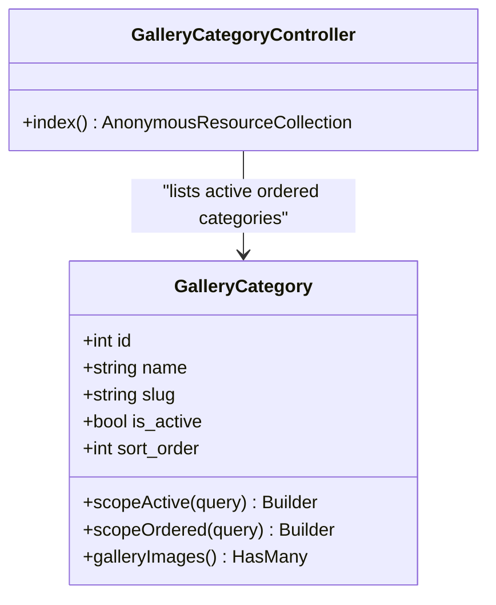
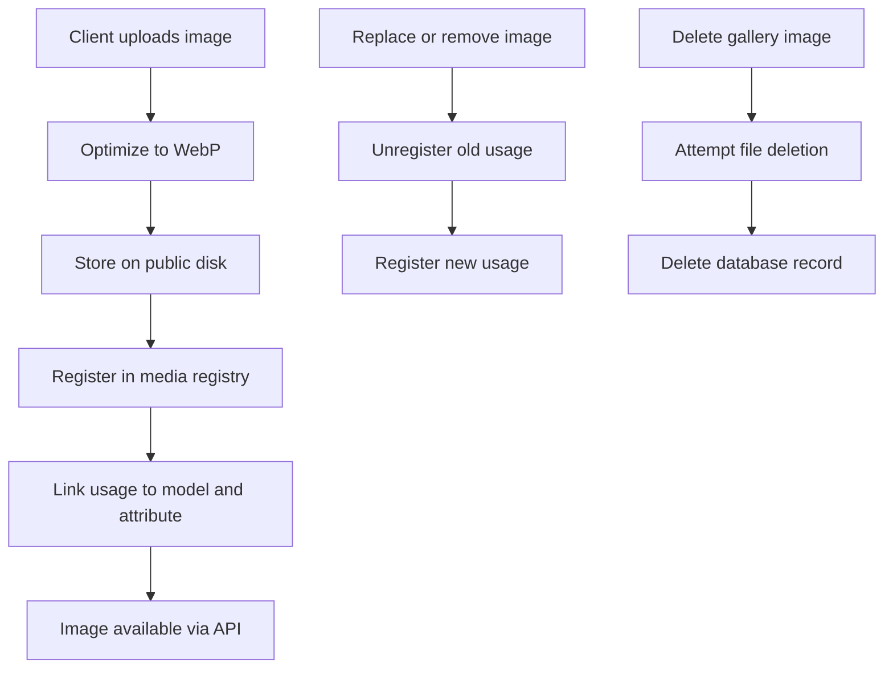
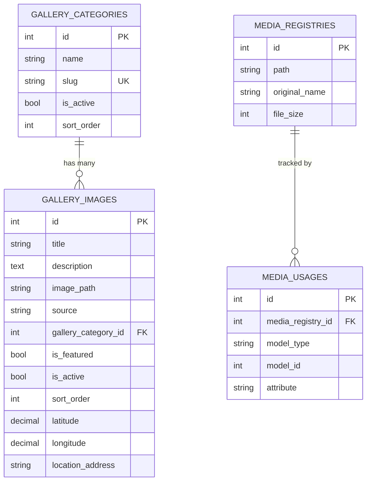
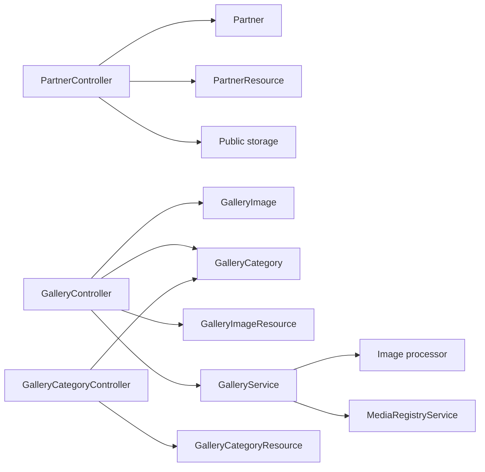

# Partners and Gallery API

<cite>
**Referenced Files in This Document**
- [routes/api.php](file://routes/api.php)
- [app/Http/Controllers/Api/PartnerController.php](file://app/Http/Controllers/Api/PartnerController.php)
- [app/Http/Controllers/Api/GalleryController.php](file://app/Http/Controllers/Api/GalleryController.php)
- [app/Http/Controllers/Api/GalleryCategoryController.php](file://app/Http/Controllers/Api/GalleryCategoryController.php)
- [app/Models/Partner.php](file://app/Models/Partner.php)
- [app/Models/GalleryImage.php](file://app/Models/GalleryImage.php)
- [app/Models/GalleryCategory.php](file://app/Models/GalleryCategory.php)
- [app/Services/GalleryService.php](file://app/Services/GalleryService.php)
- [app/Services/ImageUploadService.php](file://app/Services/ImageUploadService.php)
- [app/Services/MediaRegistryService.php](file://app/Services/MediaRegistryService.php)
- [app/Http/Requests/Admin/GalleryItemRequest.php](file://app/Http/Requests/Admin/GalleryItemRequest.php)
- [app/Http/Resources/Api/PartnerResource.php](file://app/Http/Resources/Api/PartnerResource.php)
- [app/Http/Resources/Api/GalleryImageResource.php](file://app/Http/Resources/Api/GalleryImageResource.php)
- [app/Http/Resources/Api/GalleryCategoryResource.php](file://app/Http/Resources/Api/GalleryCategoryResource.php)
- [database/migrations/2026_05_25_093322_create_partners_table.php](file://database/migrations/2026_05_25_093322_create_partners_table.php)
- [database/migrations/2026_04_17_110003_create_gallery_images_table.php](file://database/migrations/2026_04_17_110003_create_gallery_images_table.php)
- [database/migrations/2026_04_20_083027_add_location_fields_to_gallery_images_table.php](file://database/migrations/2026_04_20_083027_add_location_fields_to_gallery_images_table.php)
- [database/migrations/2026_04_22_064623_create_gallery_categories_table.php](file://database/migrations/2026_04_22_064623_create_gallery_categories_table.php)
- [database/migrations/2026_10_07_150000_add_source_to_gallery_images_table.php](file://database/migrations/2026_10_07_150000_add_source_to_gallery_images_table.php)
</cite>

## Table of Contents
1. [Introduction](#introduction)
2. [Project Structure](#project-structure)
3. [Core Components](#core-components)
4. [Architecture Overview](#architecture-overview)
5. [Detailed Component Analysis](#detailed-component-analysis)
6. [Dependency Analysis](#dependency-analysis)
7. [Performance Considerations](#performance-considerations)
8. [Troubleshooting Guide](#troubleshooting-guide)
9. [Conclusion](#conclusion)

## Introduction
This document describes the partner and gallery management APIs exposed by the staff application. The APIs are token-authenticated, live under the `/api/staff` prefix, and are gated by Spatie-style abilities on top of Laravel Sanctum authentication.

The covered endpoints include:
- Partner CRUD at `/api/staff/partners`.
- Curated gallery image management at `/api/staff/gallery`, including multipart file uploads.
- Read-only gallery category listing at `/api/staff/gallery-categories`.

Partners represent business affiliates with logos, optional websites, ordering, and active flags. Gallery images are curated public assets with titles, descriptions, categories, featured status, location metadata, and sort order. Gallery categories provide an ordered list of buckets used to organize gallery images.

## Project Structure
The partner and gallery functionality is implemented across controllers, models, services, validation requests, resources, and database migrations. Routes are defined centrally for the staff API group.

**Diagram sources**
- [routes/api.php:1-117](file://routes/api.php#L1-L117)
- [app/Http/Controllers/Api/PartnerController.php:1-133](file://app/Http/Controllers/Api/PartnerController.php#L1-L133)
- [app/Http/Controllers/Api/GalleryController.php:1-92](file://app/Http/Controllers/Api/GalleryController.php#L1-L92)
- [app/Http/Controllers/Api/GalleryCategoryController.php:1-28](file://app/Http/Controllers/Api/GalleryCategoryController.php#L1-L28)
- [app/Models/Partner.php:1-46](file://app/Models/Partner.php#L1-L46)
- [app/Models/GalleryImage.php:1-169](file://app/Models/GalleryImage.php#L1-L169)
- [app/Models/GalleryCategory.php:1-61](file://app/Models/GalleryCategory.php#L1-L61)
- [app/Services/GalleryService.php:1-139](file://app/Services/GalleryService.php#L1-L139)
- [app/Services/MediaRegistryService.php:1-67](file://app/Services/MediaRegistryService.php#L1-L67)

**Section sources**
- [routes/api.php:1-117](file://routes/api.php#L1-L117)

## Core Components
- **Partner controller**: Lists, shows, creates, updates, and deletes partners. It validates inputs, processes logo uploads to WebP, manages sort order, and removes old logo files on replacement or deletion.
- **Gallery controller**: Manages curated gallery images, delegates upload and persistence logic to `GalleryService`, and returns paginated results with optional filtering by category slug and featured status.
- **Gallery category controller**: Provides a read-only ordered list of active categories.
- **Models**: Define attributes, casts, relationships, scopes, and URL accessors for partners, gallery images, and gallery categories.
- **Services**: `GalleryService` handles image optimization, path resolution, media registry tracking, and safe deletion. `MediaRegistryService` tracks file usage and supports orphan cleanup. `ImageUploadService` normalizes admin uploads to WebP.
- **Validation request**: `GalleryItemRequest` enforces field types, MIME types, size limits, safe stored paths, category existence, and sort-order uniqueness within the gallery scope.
- **Resources**: Serialize Eloquent models into stable JSON payloads for the API responses.
- **Migrations**: Define the database schema for partners, gallery images, gallery categories, and later extensions such as source scoping and location fields.

**Section sources**
- [app/Http/Controllers/Api/PartnerController.php:1-133](file://app/Http/Controllers/Api/PartnerController.php#L1-L133)
- [app/Http/Controllers/Api/GalleryController.php:1-92](file://app/Http/Controllers/Api/GalleryController.php#L1-L92)
- [app/Http/Controllers/Api/GalleryCategoryController.php:1-28](file://app/Http/Controllers/Api/GalleryCategoryController.php#L1-L28)
- [app/Models/Partner.php:1-46](file://app/Models/Partner.php#L1-L46)
- [app/Models/GalleryImage.php:1-169](file://app/Models/GalleryImage.php#L1-L169)
- [app/Models/GalleryCategory.php:1-61](file://app/Models/GalleryCategory.php#L1-L61)
- [app/Services/GalleryService.php:1-139](file://app/Services/GalleryService.php#L1-L139)
- [app/Services/ImageUploadService.php:1-70](file://app/Services/ImageUploadService.php#L1-L70)
- [app/Services/MediaRegistryService.php:1-67](file://app/Services/MediaRegistryService.php#L1-L67)
- [app/Http/Requests/Admin/GalleryItemRequest.php:1-66](file://app/Http/Requests/Admin/GalleryItemRequest.php#L1-L66)
- [app/Http/Resources/Api/PartnerResource.php:1-36](file://app/Http/Resources/Api/PartnerResource.php#L1-L36)
- [app/Http/Resources/Api/GalleryImageResource.php:1-42](file://app/Http/Resources/Api/GalleryImageResource.php#L1-L42)
- [app/Http/Resources/Api/GalleryCategoryResource.php:1-32](file://app/Http/Resources/Api/GalleryCategoryResource.php#L1-L32)

## Architecture Overview
The staff API is organized behind a single authenticated route group. Each endpoint is protected by both Sanctum tokens and a named ability.

**Diagram sources**
- [routes/api.php:1-117](file://routes/api.php#L1-L117)
- [app/Http/Controllers/Api/PartnerController.php:1-133](file://app/Http/Controllers/Api/PartnerController.php#L1-L133)
- [app/Http/Controllers/Api/GalleryController.php:1-92](file://app/Http/Controllers/Api/GalleryController.php#L1-L92)
- [app/Services/GalleryService.php:1-139](file://app/Services/GalleryService.php#L1-L139)

## Detailed Component Analysis

### Partner Management API

#### Endpoints
- `GET /api/staff/partners`: List partners ordered by position. Requires `manage settings`.
- `POST /api/staff/partners`: Create a partner with a required logo. Requires `manage settings`.
- `GET /api/staff/partners/{partner}`: Show one partner. Requires `manage settings`.
- `PUT /api/staff/partners/{partner}`: Update partner details and optionally replace the logo. Requires `manage settings`.
- `DELETE /api/staff/partners/{partner}`: Delete a partner and its logo. Requires `manage settings`.

#### Request and Response Shape
- Creating or updating a partner accepts name, logo file, website URL, active flag, and sort order.
- Creating requires a logo; updating allows replacing it.
- Responses wrap data in a `data` envelope for create/update, and return a message for deletion.
- The resource serializes id, name, logo URL, website URL, order, active flag, and timestamps.

#### Partner Data Model
- Fields include name, logo path, website URL, integer order, and boolean active state.
- The model exposes a computed logo URL through a helper.
- Sort order uses a dedicated column called `order`, with sorting helpers applied by the controller.

**Diagram sources**
- [app/Models/Partner.php:1-46](file://app/Models/Partner.php#L1-L46)
- [app/Http/Controllers/Api/PartnerController.php:1-133](file://app/Http/Controllers/Api/PartnerController.php#L1-L133)

#### Logo Upload and Optimization
- Uploaded logos are processed through image manipulation: scaled to fit within 800×800, converted to WebP, and saved at quality 82.
- If image processing fails, the original file is stored directly under the `partners` folder.
- When updating, the previous logo is deleted before storing the new one.
- On partner deletion, the associated logo file is removed from public storage.

#### Example Workflow: Partner Relationship Management
A client can manage partners without initially attaching a logo if using the web interface that permits nulls, but the staff API currently requires a logo during creation. To establish partner relationships:
1. Create a partner with name, logo, website URL, active flag, and order.
2. Update the partner later to change visibility, reorder it, or swap its logo.
3. Delete the partner when no longer needed; this also removes the logo file.

**Diagram sources**
- [app/Http/Controllers/Api/PartnerController.php:34-133](file://app/Http/Controllers/Api/PartnerController.php#L34-L133)
- [app/Models/Partner.php:1-46](file://app/Models/Partner.php#L1-L46)

**Section sources**
- [routes/api.php:60-83](file://routes/api.php#L60-L83)
- [app/Http/Controllers/Api/PartnerController.php:1-133](file://app/Http/Controllers/Api/PartnerController.php#L1-L133)
- [app/Models/Partner.php:1-46](file://app/Models/Partner.php#L1-L46)
- [app/Http/Resources/Api/PartnerResource.php:1-36](file://app/Http/Resources/Api/PartnerResource.php#L1-L36)
- [database/migrations/2026_05_25_093322_create_partners_table.php:1-32](file://database/migrations/2026_05_25_093322_create_partners_table.php#L1-L32)

### Gallery Image Management API

#### Endpoints
- `GET /api/staff/gallery`: List curated gallery images with pagination and optional filters. Requires `view gallery`.
- `POST /api/staff/gallery`: Create a gallery image with multipart file upload. Requires `manage gallery`.
- `GET /api/staff/gallery/{item}`: Show one gallery image. Requires `view gallery`.
- `PUT /api/staff/gallery/{item}`: Update a gallery image, optionally replacing its file. Requires `manage gallery`.
- `DELETE /api/staff/gallery/{item}`: Delete a gallery image and unregister its media. Requires `manage gallery`.

#### Query Filters
- `category`: Filter by category slug.
- `featured`: Include only featured images.
- `per_page`: Pagination size, clamped between 1 and 100.

#### Multipart Upload Rules
- The uploaded image field accepts JPEG, PNG, JPG, or WebP files up to 10 MB.
- Images are scaled to a maximum long edge of 1920 pixels, converted to WebP, and stored at quality 82.
- A hidden `image_path` input can reference previously stored paths in allowed directories.
- A boolean `remove_image` flag deletes the current image and clears the path.
- Every gallery row is forced to `source=gallery`, separating curated gallery rows from library assets.

#### Validation and Ordering
- Title is required and limited to 100 characters.
- Description is optional and limited to 500 characters.
- Category must exist in `gallery_categories`.
- Featured and active flags are normalized booleans.
- Sort order is validated against uniqueness rules scoped to the gallery source.
- Latitude, longitude, and location address are optional location fields.

**Diagram sources**
- [app/Http/Requests/Admin/GalleryItemRequest.php:1-66](file://app/Http/Requests/Admin/GalleryItemRequest.php#L1-L66)
- [app/Services/GalleryService.php:1-139](file://app/Services/GalleryService.php#L1-L139)

#### Example Workflow: Uploading a Gallery Image with Progress Tracking
Because the endpoint expects multipart form data, a mobile or browser client should:
1. Prepare a form-data payload with the image file under the `image` key.
2. Include required fields such as title, gallery category ID, and active/featured flags.
3. Optionally set `remove_image=true` to clear an existing image.
4. For progress tracking, use the client’s native multipart upload progress mechanism and retry failed chunks.
5. Send the request to `POST /api/staff/gallery`.
6. On success, the server returns the created gallery image and a localized message.
7. For large galleries, paginate with `per_page` and cache category lists separately.

**Diagram sources**
- [app/Http/Controllers/Api/GalleryController.php:1-92](file://app/Http/Controllers/Api/GalleryController.php#L1-L92)
- [app/Http/Requests/Admin/GalleryItemRequest.php:1-66](file://app/Http/Requests/Admin/GalleryItemRequest.php#L1-L66)
- [app/Services/GalleryService.php:1-139](file://app/Services/GalleryService.php#L1-L139)
- [app/Services/MediaRegistryService.php:1-67](file://app/Services/MediaRegistryService.php#L1-L67)

**Section sources**
- [routes/api.php:85-100](file://routes/api.php#L85-L100)
- [app/Http/Controllers/Api/GalleryController.php:1-92](file://app/Http/Controllers/Api/GalleryController.php#L1-L92)
- [app/Http/Requests/Admin/GalleryItemRequest.php:1-66](file://app/Http/Requests/Admin/GalleryItemRequest.php#L1-L66)
- [app/Services/GalleryService.php:1-139](file://app/Services/GalleryService.php#L1-L139)
- [app/Models/GalleryImage.php:1-169](file://app/Models/GalleryImage.php#L1-L169)
- [app/Http/Resources/Api/GalleryImageResource.php:1-42](file://app/Http/Resources/Api/GalleryImageResource.php#L1-L42)

### Gallery Categories API

#### Endpoint
- `GET /api/staff/gallery-categories`: List active gallery categories in sort order. Requires `view gallery`.

Categories are managed through the web admin rather than this API. The endpoint exists so clients can present a picker for assigning gallery images.

#### Category Data Model
- Categories have name, unique slug, active flag, and sort order.
- They expose an ordered query scope and a relationship to gallery images.

**Diagram sources**
- [app/Models/GalleryCategory.php:1-61](file://app/Models/GalleryCategory.php#L1-L61)
- [app/Http/Controllers/Api/GalleryCategoryController.php:1-28](file://app/Http/Controllers/Api/GalleryCategoryController.php#L1-L28)

**Section sources**
- [routes/api.php:101-100](file://routes/api.php#L101-L100)
- [app/Http/Controllers/Api/GalleryCategoryController.php:1-28](file://app/Http/Controllers/Api/GalleryCategoryController.php#L1-L28)
- [app/Models/GalleryCategory.php:1-61](file://app/Models/GalleryCategory.php#L1-L61)
- [app/Http/Resources/Api/GalleryCategoryResource.php:1-32](file://app/Http/Resources/Api/GalleryCategoryResource.php#L1-L32)
- [database/migrations/2026_04_22_064623_create_gallery_categories_table.php:1-31](file://database/migrations/2026_04_22_064623_create_gallery_categories_table.php#L1-L31)

### Media Upload Process and Storage Handling

#### Image Optimization Pipeline
- Partner logos are constrained to 800×800 containment and saved as WebP at quality 82.
- Gallery images are scaled to a maximum dimension of 1920 pixels and saved as WebP at quality 82.
- If image processing throws an exception, the system logs the error and falls back to storing the raw uploaded file.

#### Storage Locations
- Partner logos are stored under the `partners` directory on the public disk.
- Gallery images are stored under the `gallery` directory on the public disk.
- Admin upload utilities may use folders such as `uploads`, `uploads/blog`, `uploads/images`, `uploads/videos`, and `uploads/videos/thumbnails`.

#### Media Registry and Usage Tracking
- GalleryService registers each persisted image with `MediaRegistryService`, recording the path, original filename, file size, owning model, and attribute.
- On update, the registry unregisters the old path and registers the new path when changed.
- On delete, gallery deletion unregisters usage and attempts to remove the physical file; the service includes a comment indicating that safer cleanup could use force deletion based on remaining usages.
- `MediaRegistryService.forceDelete` safely removes a file only when no usages remain.

**Diagram sources**
- [app/Services/GalleryService.php:1-139](file://app/Services/GalleryService.php#L1-L139)
- [app/Services/MediaRegistryService.php:1-67](file://app/Services/MediaRegistryService.php#L1-L67)
- [app/Services/ImageUploadService.php:1-70](file://app/Services/ImageUploadService.php#L1-L70)

**Section sources**
- [app/Services/GalleryService.php:1-139](file://app/Services/GalleryService.php#L1-L139)
- [app/Services/ImageUploadService.php:1-70](file://app/Services/ImageUploadService.php#L1-L70)
- [app/Services/MediaRegistryService.php:1-67](file://app/Services/MediaRegistryService.php#L1-L67)
- [app/Http/Requests/Admin/GalleryItemRequest.php:1-66](file://app/Http/Requests/Admin/GalleryItemRequest.php#L1-L66)

### Gallery Organization System

#### Category-Based Filtering
- Gallery images belong to a gallery category via a foreign key.
- Clients can filter the gallery index by category slug.
- The category resource provides id, name, slug, and active state for UI pickers.

#### Source Scoping
- The gallery table supports two sources: `gallery` for curated public images and `library` for content block assets.
- Only `gallery` rows are returned by the gallery index because the controller applies the `inGallery` scope.
- Sort order is scoped per source so gallery and library numbering do not collide.

#### Location Metadata
- Gallery images can include latitude, longitude, and location address.
- These fields are optional and validated numerically within geographic ranges.

**Diagram sources**
- [database/migrations/2026_04_17_110003_create_gallery_images_table.php:1-28](file://database/migrations/2026_04_17_110003_create_gallery_images_table.php#L1-L28)
- [database/migrations/2026_04_20_083027_add_location_fields_to_gallery_images_table.php:1-30](file://database/migrations/2026_04_20_083027_add_location_fields_to_gallery_images_table.php#L1-L30)
- [database/migrations/2026_04_22_064623_create_gallery_categories_table.php:1-31](file://database/migrations/2026_04_22_064623_create_gallery_categories_table.php#L1-L31)
- [database/migrations/2026_10_07_150000_add_source_to_gallery_images_table.php:1-49](file://database/migrations/2026_10_07_150000_add_source_to_gallery_images_table.php#L1-L49)
- [app/Models/GalleryImage.php:1-169](file://app/Models/GalleryImage.php#L1-L169)
- [app/Models/GalleryCategory.php:1-61](file://app/Models/GalleryCategory.php#L1-L61)

**Section sources**
- [app/Models/GalleryImage.php:1-169](file://app/Models/GalleryImage.php#L1-L169)
- [app/Models/GalleryCategory.php:1-61](file://app/Models/GalleryCategory.php#L1-L61)
- [app/Http/Controllers/Api/GalleryController.php:1-92](file://app/Http/Controllers/Api/GalleryController.php#L1-L92)
- [database/migrations/2026_10_07_150000_add_source_to_gallery_images_table.php:1-49](file://database/migrations/2026_10_07_150000_add_source_to_gallery_images_table.php#L1-L49)

## Dependency Analysis

**Diagram sources**
- [app/Http/Controllers/Api/PartnerController.php:1-133](file://app/Http/Controllers/Api/PartnerController.php#L1-L133)
- [app/Http/Controllers/Api/GalleryController.php:1-92](file://app/Http/Controllers/Api/GalleryController.php#L1-L92)
- [app/Http/Controllers/Api/GalleryCategoryController.php:1-28](file://app/Http/Controllers/Api/GalleryCategoryController.php#L1-L28)
- [app/Models/Partner.php:1-46](file://app/Models/Partner.php#L1-L46)
- [app/Models/GalleryImage.php:1-169](file://app/Models/GalleryImage.php#L1-L169)
- [app/Models/GalleryCategory.php:1-61](file://app/Models/GalleryCategory.php#L1-L61)
- [app/Services/GalleryService.php:1-139](file://app/Services/GalleryService.php#L1-L139)
- [app/Services/MediaRegistryService.php:1-67](file://app/Services/MediaRegistryService.php#L1-L67)
- [app/Http/Resources/Api/PartnerResource.php:1-36](file://app/Http/Resources/Api/PartnerResource.php#L1-L36)
- [app/Http/Resources/Api/GalleryImageResource.php:1-42](file://app/Http/Resources/Api/GalleryImageResource.php#L1-L42)
- [app/Http/Resources/Api/GalleryCategoryResource.php:1-32](file://app/Http/Resources/Api/GalleryCategoryResource.php#L1-L32)

**Section sources**
- [routes/api.php:60-100](file://routes/api.php#L60-L100)
- [app/Http/Controllers/Api/PartnerController.php:1-133](file://app/Http/Controllers/Api/PartnerController.php#L1-L133)
- [app/Http/Controllers/Api/GalleryController.php:1-92](file://app/Http/Controllers/Api/GalleryController.php#L1-L92)
- [app/Http/Controllers/Api/GalleryCategoryController.php:1-28](file://app/Http/Controllers/Api/GalleryCategoryController.php#L1-L28)

## Performance Considerations
- **Image processing cost**: Converting to WebP and scaling adds CPU time. The fallback behavior prevents total failure but can produce larger files if processing is unavailable.
- **Pagination limits**: Gallery listing caps `per_page` at 100 to avoid heavy payloads.
- **Storage writes**: Each successful upload performs at least one storage write plus registry writes. Batch operations should be avoided through the API; process images sequentially from the client.
- **Sorting**: Both partners and gallery images rely on database-level ordering with tie-breakers. Keep sort values sparse and consistent to reduce renumbering conflicts.
- **Caching**: Clients should cache category lists and static partner listings where appropriate to reduce repeated reads.

[No sources needed since this section provides general guidance]

## Troubleshooting Guide
- **Invalid or oversized image**: Ensure the multipart field is named `image` and the file size does not exceed 10 MB. Allowed formats are JPEG, PNG, JPG, and WebP.
- **Missing category**: The gallery category ID must exist in the database. Fetch categories first and require selection before submitting.
- **Sort-order conflicts**: Sort order is validated for uniqueness within the gallery source. If conflicts occur, adjust the order value or let the server normalize it through the shared rules.
- **Image processing failures**: If the image library cannot process the file, the system logs an error and stores the original file. Check application logs for processing exceptions and verify the image driver configuration.
- **Orphaned media**: Deleting a gallery image attempts to remove the file, but safest cleanup depends on registry usage counts. Use the registry service’s force-delete capability when removing unused media.
- **Authentication errors**: All endpoints require a valid Sanctum token and the corresponding ability. Verify token validity and user permissions for `manage settings`, `view gallery`, or `manage gallery`.

**Section sources**
- [app/Http/Requests/Admin/GalleryItemRequest.php:1-66](file://app/Http/Requests/Admin/GalleryItemRequest.php#L1-L66)
- [app/Services/GalleryService.php:1-139](file://app/Services/GalleryService.php#L1-L139)
- [app/Services/MediaRegistryService.php:1-67](file://app/Services/MediaRegistryService.php#L1-L67)
- [routes/api.php:60-100](file://routes/api.php#L60-L100)

## Conclusion
The staff API provides secure, role-gated endpoints for managing partners and curated gallery images. Partner endpoints focus on simple business records with logo optimization, while gallery endpoints support robust multipart uploads, WebP normalization, categorization, location metadata, and media registry tracking. Categories are read-only through the API and managed through the web admin, ensuring a clean separation between public curation and internal asset storage. Clients should handle multipart upload progress themselves, respect validation constraints, and leverage pagination and filtering to build efficient gallery experiences.

[No sources needed since this section summarizes without analyzing specific files]