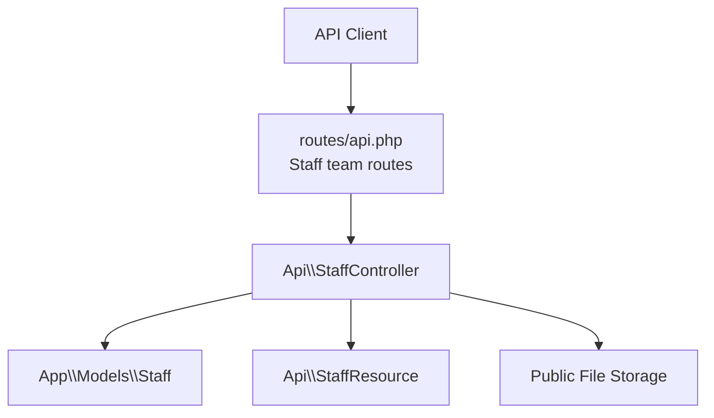
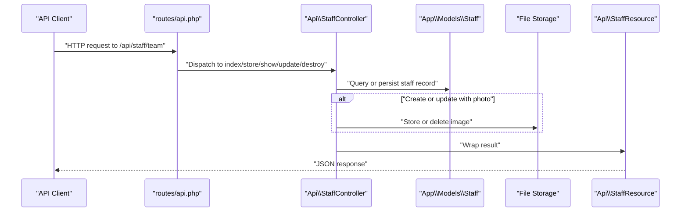
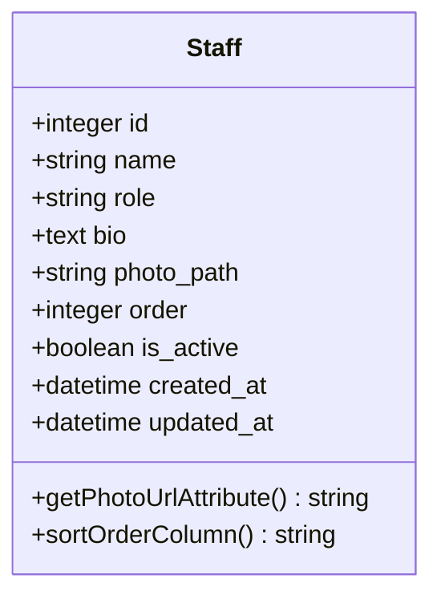
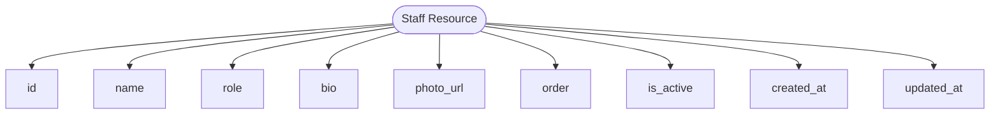
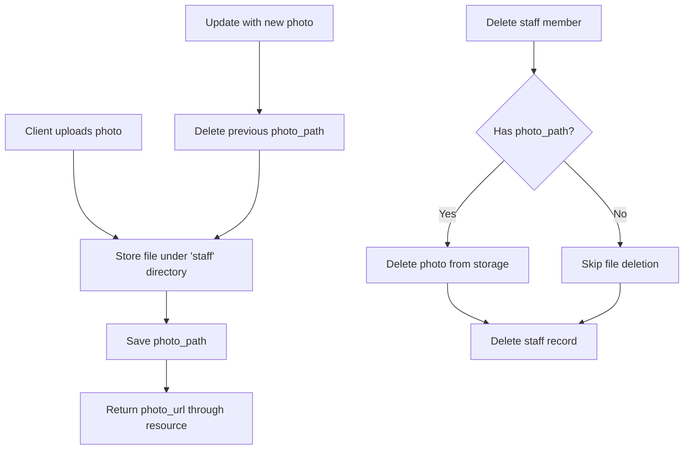
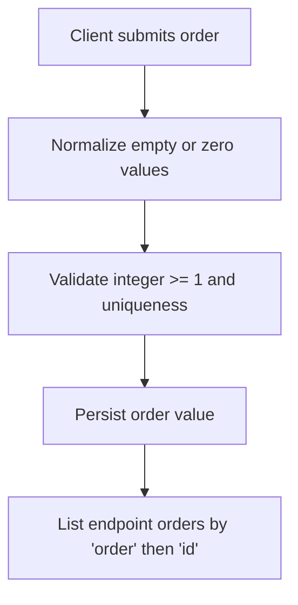
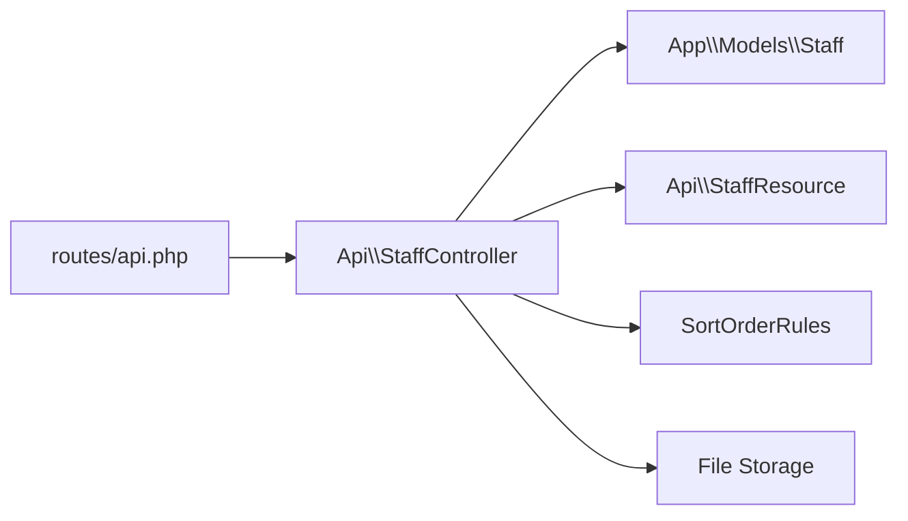

# Staff Directory API

<cite>
**Referenced Files in This Document**   
- [routes/api.php](file://routes/api.php)
- [app/Http/Controllers/Api/StaffController.php](file://app/Http/Controllers/Api/StaffController.php)
- [app/Models/Staff.php](file://app/Models/Staff.php)
- [app/Http/Resources/Api/StaffResource.php](file://app/Http/Resources/Api/StaffResource.php)
- [database/migrations/2026_05_25_102702_create_staff_table.php](file://database/migrations/2026_05_25_102702_create_staff_table.php)
- [app/Support/SortOrderRules.php](file://app/Support/SortOrderRules.php)
- [database/factories/StaffFactory.php](file://database/factories/StaffFactory.php)
</cite>

## Table of Contents
1. [Introduction](#introduction)
2. [Project Structure](#project-structure)
3. [Core Components](#core-components)
4. [Architecture Overview](#architecture-overview)
5. [Detailed Component Analysis](#detailed-component-analysis)
6. [Dependency Analysis](#dependency-analysis)
7. [Performance Considerations](#performance-considerations)
8. [Troubleshooting Guide](#troubleshooting-guide)
9. [Conclusion](#conclusion)

## Introduction
This document describes the staff directory management API used by the Highblossom staff application. The API exposes a team resource under the authenticated staff route group and provides full CRUD operations for managing staff members, including listing, creation, profile retrieval, updates, and removal.

The documented endpoints are:
- `GET /api/staff/team` — list all staff members
- `POST /api/staff/team` — create a new staff member
- `GET /api/staff/team/{staff}` — retrieve one staff member
- `PUT /api/staff/team/{staff}` — update a staff member
- `DELETE /api/staff/team/{staff}` — remove a staff member

All team endpoints are protected by the `can:manage settings` policy, meaning only staff with that permission may access them.

## Project Structure
The staff directory feature is implemented as a standard Laravel API controller backed by an Eloquent model and JSON resource. Routes are registered in the main API route file under the `staff` prefix.

**Diagram sources**
- [routes/api.php:95-100](file://routes/api.php#L95-L100)
- [app/Http/Controllers/Api/StaffController.php:1-115](file://app/Http/Controllers/Api/StaffController.php#L1-L115)
- [app/Models/Staff.php:1-45](file://app/Models/Staff.php#L1-L45)
- [app/Http/Resources/Api/StaffResource.php:1-37](file://app/Http/Resources/Api/StaffResource.php#L1-L37)

**Section sources**
- [routes/api.php:25-100](file://routes/api.php#L25-L100)

## Core Components
The staff directory consists of four core pieces:

| Component | Responsibility |
|---|---|
| Route definitions | Register `team` endpoints under `/api/staff` and attach authorization policies |
| `Api\StaffController` | Validate input, manage photos, order normalization, persistence, and responses |
| `App\Models\Staff` | Eloquent model, fillable fields, casts, ordering behavior, and photo URL accessor |
| `Api\StaffResource` | Normalized JSON response shape for single and collection responses |

Key characteristics:
- The route path is intentionally `team`, not `staff`, to avoid `/api/staff/staff`.
- All team endpoints require the `manage settings` permission.
- The `order` column uses a shared sort-order system that enforces uniqueness and supports normalized values.
- Photos are optional for this API; they are stored on the `public` storage disk under the `staff` directory.
- Contact information such as email or phone is not part of the current staff data model.

**Section sources**
- [routes/api.php:95-100](file://routes/api.php#L95-L100)
- [app/Http/Controllers/Api/StaffController.php:1-115](file://app/Http/Controllers/Api/StaffController.php#L1-L115)
- [app/Models/Staff.php:1-45](file://app/Models/Staff.php#L1-L45)
- [app/Http/Resources/Api/StaffResource.php:1-37](file://app/Http/Resources/Api/StaffResource.php#L1-L37)

## Architecture Overview
The request flow follows a layered pattern: routes delegate to the API controller, which validates input, interacts with the model and storage, and returns JSON through a resource transformer.

**Diagram sources**
- [routes/api.php:95-100](file://routes/api.php#L95-L100)
- [app/Http/Controllers/Api/StaffController.php:1-115](file://app/Http/Controllers/Api/StaffController.php#L1-L115)
- [app/Models/Staff.php:1-45](file://app/Models/Staff.php#L1-L45)
- [app/Http/Resources/Api/StaffResource.php:1-37](file://app/Http/Resources/Api/StaffResource.php#L1-L37)

## Detailed Component Analysis

### Staff Data Model
The staff entity represents a team member with name, role, biography, photo, ordering position, and active status.

| Field | Type | Nullable | Default | Description |
|---|---|---:|---:|---|
| `id` | integer primary key | No | Auto-increment | Database identifier |
| `name` | string | No | None | Staff member display name |
| `role` | string | No | None | Staff member role or title |
| `bio` | text | Yes | `null` | Optional biography or description |
| `photo_path` | string | Yes | `null` | Stored path to avatar image |
| `order` | integer | No | `0` | Display ordering position |
| `is_active` | boolean | No | `true` | Whether the staff member is active |
| `created_at` | timestamp | No | Database default | Record creation time |
| `updated_at` | timestamp | No | Database default | Record update time |

Important implementation details:
- Fillable fields include `name`, `role`, `bio`, `photo_path`, `order`, and `is_active`.
- `is_active` is cast to boolean; `order` is cast to integer.
- The model implements a sort-order trait but overrides the ordering column to `order` instead of the conventional `sort_order`.
- The `photo_url` attribute returns a full asset URL when a photo exists, otherwise it returns a placeholder image URL.

**Diagram sources**
- [app/Models/Staff.php:12-45](file://app/Models/Staff.php#L12-L45)
- [database/migrations/2026_05_25_102702_create_staff_table.php:12-26](file://database/migrations/2026_05_25_102702_create_staff_table.php#L12-L26)

**Section sources**
- [app/Models/Staff.php:12-45](file://app/Models/Staff.php#L12-L45)
- [database/migrations/2026_05_25_102702_create_staff_table.php:12-26](file://database/migrations/2026_05_25_102702_create_staff_table.php#L12-L26)

### API Endpoints

#### List Staff
- **Method:** `GET`
- **Path:** `/api/staff/team`
- **Authorization:** Requires `manage settings`
- **Response:** Array of staff resources ordered by `order`, then `id`

The list endpoint does not accept query parameters in its current implementation. It returns every staff member in the configured order.

**Section sources**
- [routes/api.php:96](file://routes/api.php#L96)
- [app/Http/Controllers/Api/StaffController.php:21-27](file://app/Http/Controllers/Api/StaffController.php#L21-L27)

#### Create Staff Member
- **Method:** `POST`
- **Path:** `/api/staff/team`
- **Authorization:** Requires `manage settings`
- **Content-Type:** `multipart/form-data`
- **Request body:**
  - `name`: required string, maximum 255 characters
  - `role`: required string, maximum 255 characters
  - `bio`: optional string
  - `photo`: optional image, maximum 2048 KB
  - `is_active`: optional boolean; defaults to `true` if omitted
  - `order`: optional integer, validated for uniqueness across existing staff records
- **Success response:** HTTP 201 with a single staff resource wrapped in `data`

On success, the photo is stored under the `staff` directory on the public storage disk. If no photo is provided, the resulting profile has a null photo path.

**Section sources**
- [routes/api.php:97](file://routes/api.php#L97)
- [app/Http/Controllers/Api/StaffController.php:29-57](file://app/Http/Controllers/Api/StaffController.php#L29-L57)

#### Get Individual Staff Profile
- **Method:** `GET`
- **Path:** `/api/staff/team/{staff}`
- **Authorization:** Requires `manage settings`
- **Path parameter:** numeric staff identifier
- **Response:** Single staff resource

The route constraint ensures `{staff}` is numeric.

**Section sources**
- [routes/api.php:98](file://routes/api.php#L98)
- [app/Http/Controllers/Api/StaffController.php:29-35](file://app/Http/Controllers/Api/StaffController.php#L29-L35)

#### Update Staff Member
- **Method:** `PUT`
- **Path:** `/api/staff/team/{staff}`
- **Authorization:** Requires `manage settings`
- **Content-Type:** `multipart/form-data`
- **Request body:**
  - `name`: required string, maximum 255 characters
  - `role`: required string, maximum 255 characters
  - `bio`: optional string
  - `photo`: optional image, maximum 2048 KB
  - `is_active`: optional boolean; defaults to the existing value if omitted
  - `order`: optional integer, validated against existing staff records and the current staff member
- **Success response:** Updated staff resource

Update behavior:
- Sort order is normalized before validation so clients can submit empty or zero values safely.
- When a new photo is uploaded, the previous photo is deleted from storage.
- Fields not supplied preserve their existing values unless explicitly overridden.

**Section sources**
- [routes/api.php:99](file://routes/api.php#L99)
- [app/Http/Controllers/Api/StaffController.php:59-93](file://app/Http/Controllers/Api/StaffController.php#L59-L93)

#### Remove Staff Member
- **Method:** `DELETE`
- **Path:** `/api/staff/team/{staff}`
- **Authorization:** Requires `manage settings`
- **Path parameter:** numeric staff identifier
- **Success response:** JSON message confirming removal

Deletion also removes the associated photo from storage when present.

**Section sources**
- [routes/api.php:100](file://routes/api.php#L100)
- [app/Http/Controllers/Api/StaffController.php:95-114](file://app/Http/Controllers/Api/StaffController.php#L95-L114)

### Staff Resource Response Shape
Every successful response includes a normalized staff object. Collection responses wrap multiple items through the same resource.

| Field | Type | Description |
|---|---|---|
| `id` | integer | Database ID |
| `name` | string | Display name |
| `role` | string | Role or job title |
| `bio` | string or null | Biography text |
| `photo_url` | string | Full URL to avatar image or placeholder |
| `order` | integer | Sorting position |
| `is_active` | boolean | Active status |
| `created_at` | ISO 8601 string or null | Creation timestamp |
| `updated_at` | ISO 8601 string or null | Last update timestamp |

Note that contact fields such as email, phone number, social links, or address are not exposed by this resource because they are not part of the staff model.

**Diagram sources**
- [app/Http/Resources/Api/StaffResource.php:17-36](file://app/Http/Resources/Api/StaffResource.php#L17-L36)

**Section sources**
- [app/Http/Resources/Api/StaffResource.php:17-36](file://app/Http/Resources/Api/StaffResource.php#L17-L36)

### Avatar Handling
Avatar handling is explicit and separate from the JSON payload:

- Clients upload an image field named `photo`.
- Accepted files must be valid images and no larger than 2048 KB.
- Uploaded files are stored under the `staff` directory on the `public` filesystem disk.
- The model converts `photo_path` into a full URL via `photo_url`.
- On update, a new photo replaces the old one and the old file is deleted.
- On deletion, any associated photo is removed before the database record is deleted.
- If no photo is set, the model returns a placeholder image URL.

**Diagram sources**
- [app/Http/Controllers/Api/StaffController.php:39-47](file://app/Http/Controllers/Api/StaffController.php#L39-L47)
- [app/Http/Controllers/Api/StaffController.php:71-82](file://app/Http/Controllers/Api/StaffController.php#L71-L82)
- [app/Http/Controllers/Api/StaffController.php:95-114](file://app/Http/Controllers/Api/StaffController.php#L95-L114)
- [app/Models/Staff.php:33-45](file://app/Models/Staff.php#L33-L45)

**Section sources**
- [app/Http/Controllers/Api/StaffController.php:39-47](file://app/Http/Controllers/Api/StaffController.php#L39-L47)
- [app/Http/Controllers/Api/StaffController.php:71-82](file://app/Http/Controllers/Api/StaffController.php#L71-L82)
- [app/Http/Controllers/Api/StaffController.php:95-114](file://app/Http/Controllers/Api/StaffController.php#L95-L114)
- [app/Models/Staff.php:33-45](file://app/Models/Staff.php#L33-L45)

### Contact Information
The current staff data model does not include contact fields. There is no email, phone, website, social media, or address column in the staff table. Therefore:

- Creating or updating a staff member cannot include contact information.
- Listing or retrieving a staff profile does not return contact fields.
- If contact data is needed, the model, migration, controller validation, and resource must be extended.

For comparison, the user account infrastructure contains separate contact-related columns such as phone and username, but those belong to the authentication/user domain rather than the public staff directory model.

**Section sources**
- [database/migrations/2026_05_25_102702_create_staff_table.php:12-26](file://database/migrations/2026_05_25_102702_create_staff_table.php#L12-L26)
- [app/Models/Staff.php:12-31](file://app/Models/Staff.php#L12-L31)
- [app/Http/Resources/Api/StaffResource.php:17-36](file://app/Http/Resources/Api/StaffResource.php#L17-L36)

### Role Assignments
The staff model stores a single `role` string. It is not currently linked to the application's permission or role system. Important implications:

- Roles are free-form strings limited to 255 characters.
- There is no built-in validation against predefined roles.
- Authorization for these endpoints is based on the `manage settings` policy, not the individual staff member's role.
- The `is_active` flag controls whether a staff member is considered active, but the controller does not filter inactive members in `index`.

If role-based access control is required, the model should be extended with role assignments tied to the permission system, and the controller logic should enforce appropriate checks.

**Section sources**
- [database/migrations/2026_05_25_102702_create_staff_table.php:12-26](file://database/migrations/2026_05_25_102702_create_staff_table.php#L12-L26)
- [app/Models/Staff.php:12-31](file://app/Models/Staff.php#L12-L31)
- [routes/api.php:96-100](file://routes/api.php#L96-L100)

### Sorting and Ordering
The `order` field determines the display sequence. Its behavior is controlled by shared sort-order utilities:

- The value must be nullable, an integer, at least `1`, and unique among other staff records.
- During updates, the current staff member is excluded from uniqueness checks.
- The controller normalizes missing or zero values before validation.
- The list endpoint orders results by `order`, then by `id`.

**Diagram sources**
- [app/Support/SortOrderRules.php:17-33](file://app/Support/SortOrderRules.php#L17-L33)
- [app/Support/SortOrderRules.php:47-55](file://app/Support/SortOrderRules.php#L47-L55)
- [app/Models/Staff.php:20-28](file://app/Models/Staff.php#L20-L28)
- [app/Http/Controllers/Api/StaffController.php:21-27](file://app/Http/Controllers/Api/StaffController.php#L21-L27)

**Section sources**
- [app/Support/SortOrderRules.php:17-33](file://app/Support/SortOrderRules.php#L17-L33)
- [app/Support/SortOrderRules.php:47-55](file://app/Support/SortOrderRules.php#L47-L55)
- [app/Models/Staff.php:20-28](file://app/Models/Staff.php#L20-L28)
- [app/Http/Controllers/Api/StaffController.php:21-27](file://app/Http/Controllers/Api/StaffController.php#L21-L27)

### Example Workflows

#### Staff Member Onboarding
Use case: Add a new staff member without a photo, mark them active, and assign a display order.

Typical request:
- Method: `POST`
- Path: `/api/staff/team`
- Body:
  - `name`: `"Jane Doe"`
  - `role`: `"Lead Designer"`
  - `bio`: `"Design lead for product experiences."`
  - `is_active`: `true`
  - `order`: `1`

Expected outcome:
- A new staff record is created.
- `photo_path` remains null.
- The response includes the generated `id`, computed `photo_url`, and persisted metadata.

#### Profile Update Without Changing Photo
Use case: Change the role and biography while keeping the existing avatar.

Typical request:
- Method: `PUT`
- Path: `/api/staff/team/1`
- Body:
  - `role`: `"Senior Product Designer"`
  - `bio`: `"Updated biography after promotion."`

Expected outcome:
- Existing photo remains unchanged.
- Only the requested fields are updated.
- The response reflects the latest state.

#### Profile Update With New Avatar
Use case: Replace an existing avatar.

Typical request:
- Method: `PUT`
- Path: `/api/staff/team/1`
- Body: multipart form with `photo` containing a valid image under 2048 KB.

Expected outcome:
- Previous photo is deleted from storage.
- New photo is stored under `storage/app/public/staff`.
- `photo_url` points to the new avatar.

#### Directory Query
Use case: Retrieve the complete staff directory.

Typical request:
- Method: `GET`
- Path: `/api/staff/team`

Expected outcome:
- An array of staff resources sorted by `order`, then `id`.
- Each item includes available fields such as name, role, bio, photo URL, order, active status, and timestamps.

#### Remove Staff Member
Use case: Remove an inactive or departing staff member.

Typical request:
- Method: `DELETE`
- Path: `/api/staff/team/1`

Expected outcome:
- Associated photo is deleted if present.
- Database record is removed.
- Response confirms removal.

[No sources needed since this section summarizes workflows without quoting specific code]

## Dependency Analysis
The following diagram shows how the API layer depends on routing, controller, model, resource, storage, and sorting utilities.

**Diagram sources**
- [routes/api.php:95-100](file://routes/api.php#L95-L100)
- [app/Http/Controllers/Api/StaffController.php:1-115](file://app/Http/Controllers/Api/StaffController.php#L1-L115)
- [app/Models/Staff.php:1-45](file://app/Models/Staff.php#L1-L45)
- [app/Http/Resources/Api/StaffResource.php:1-37](file://app/Http/Resources/Api/StaffResource.php#L1-L37)
- [app/Support/SortOrderRules.php:17-55](file://app/Support/SortOrderRules.php#L17-L55)

**Section sources**
- [routes/api.php:95-100](file://routes/api.php#L95-L100)
- [app/Http/Controllers/Api/StaffController.php:1-115](file://app/Http/Controllers/Api/StaffController.php#L1-L115)

## Performance Considerations
- The list endpoint retrieves all staff rows and applies ordering in PHP/Eloquent. For very large directories, consider pagination or server-side filtering once query parameters are added.
- Photo uploads use the public storage disk. Ensure the configured disk has sufficient capacity and proper write permissions.
- Replacing photos deletes the previous file, which avoids orphaned storage growth during updates.
- Sorting relies on the `order` column; keep it consistent to avoid unnecessary reordering queries.
- Avoid uploading oversized images; the 2048 KB limit protects both storage and processing time.

[No sources needed since this section provides general guidance]

## Troubleshooting Guide

| Symptom | Likely Cause | Resolution |
|---|---|---|
| Request fails due to authorization | Missing or insufficient `manage settings` permission | Grant the required permission to the authenticated staff token or session |
| Validation error for `order` | Value is missing, zero, non-integer, duplicate, or below minimum | Submit a positive integer; omit it to let normalization handle defaults where supported |
| Photo not saved | Invalid image, wrong field name, or exceeding size limit | Use a valid image, send it as the `photo` field, and keep it under 2048 KB |
| Old photo remains after update | Update did not include a new `photo` field | Include the replacement image in the multipart form |
| Placeholder appears for `photo_url` | `photo_path` is null | Upload a photo or check whether the profile was created without one |
| Deletion leaves a file | Unexpected storage state or permission issue | Inspect the public storage disk and verify the controller ran successfully |
| Contact fields missing | Not implemented in the staff model or resource | Extend the model, migration, controller, and resource if contact data is required |

**Section sources**
- [routes/api.php:95-100](file://routes/api.php#L95-L100)
- [app/Http/Controllers/Api/StaffController.php:29-114](file://app/Http/Controllers/Api/StaffController.php#L29-L114)
- [app/Models/Staff.php:33-45](file://app/Models/Staff.php#L33-L45)

## Conclusion
The staff directory API provides a focused, permission-gated interface for managing team members. It supports listing, creation, retrieval, updates, and deletion, with optional avatar handling and robust ordering rules. At present, it does not expose contact information or integrate staff roles with the application’s permission system. Future enhancements could add pagination, contact fields, role assignment, and stricter role validation while preserving the current simplicity of the team resource.

[No sources needed since this section summarizes without analyzing specific files]