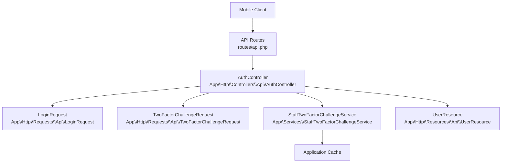
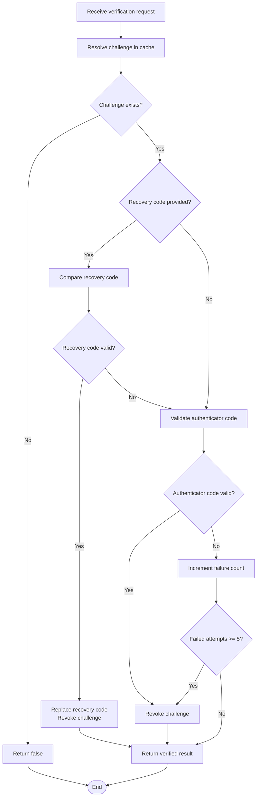
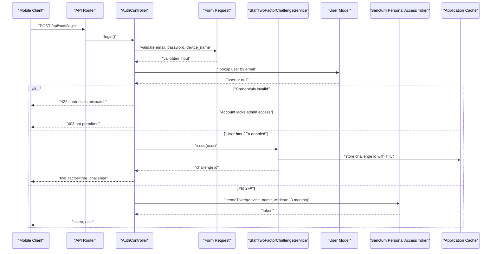
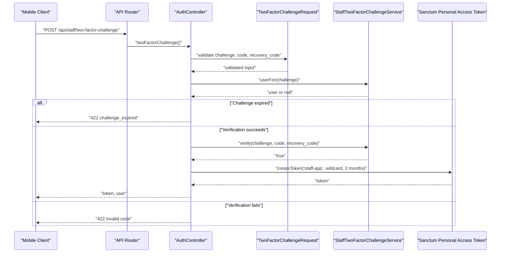
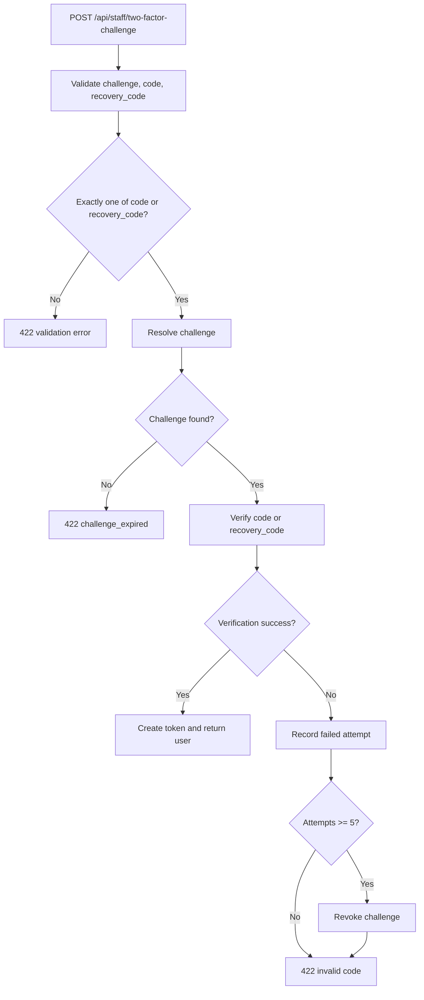
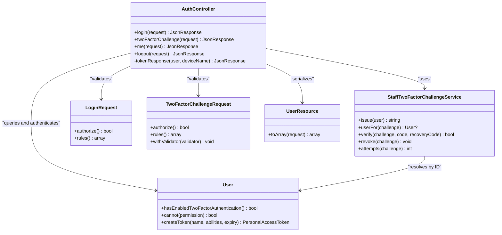

# Authentication Endpoints

<cite>
**Referenced Files in This Document**
- [routes/api.php](file://routes/api.php)
- [AuthController.php](file://app/Http/Controllers/Api/AuthController.php)
- [StaffTwoFactorChallengeService.php](file://app/Services/StaffTwoFactorChallengeService.php)
- [LoginRequest.php](file://app/Http/Requests/Api/LoginRequest.php)
- [TwoFactorChallengeRequest.php](file://app/Http/Requests/Api/TwoFactorChallengeRequest.php)
- [UserResource.php](file://app/Http/Resources/Api/UserResource.php)
</cite>

## Table of Contents
1. [Introduction](#introduction)
2. [Project Structure](#project-structure)
3. [Core Components](#core-components)
4. [Architecture Overview](#architecture-overview)
5. [Detailed Component Analysis](#detailed-component-analysis)
6. [Dependency Analysis](#dependency-analysis)
7. [Performance Considerations](#performance-considerations)
8. [Troubleshooting Guide](#troubleshooting-guide)
9. [Conclusion](#conclusion)
10. [Appendices](#appendices)

## Introduction
This document describes the staff authentication API exposed under the `/api/staff` prefix. It covers:

- Email/password login via `/api/staff/login`.
- Two-factor challenge completion via `/api/staff/two-factor-challenge`.
- Current-session profile retrieval via `/api/staff/me`.
- Token revocation and logout via `/api/staff/logout`.

The API is designed for a stateless mobile client using Laravel Sanctum personal access tokens. When an account has two-factor authentication enabled, login does not immediately issue a token; instead it returns a short-lived challenge that must be completed with either a time-based one-time code or a recovery code.

Security controls include:

- Route-level throttling at six requests per minute for both login and two-factor challenge endpoints.
- Account capability checks preventing non-admin accounts from accessing the staff app.
- Challenge expiration after ten minutes.
- Challenge revocation after five failed verification attempts.
- Recovery codes being rotated when used.
- Constant-time comparison for recovery codes.

## Project Structure
The authentication feature spans routing, controller logic, request validation, service logic, and JSON serialization.

**Diagram sources**
- [routes/api.php:27-56](file://routes/api.php#L27-L56)
- [AuthController.php:1-135](file://app/Http/Controllers/Api/AuthController.php#L1-L135)
- [LoginRequest.php:1-35](file://app/Http/Requests/Api/LoginRequest.php#L1-L35)
- [TwoFactorChallengeRequest.php:1-65](file://app/Http/Requests/Api/TwoFactorChallengeRequest.php#L1-L65)
- [StaffTwoFactorChallengeService.php:1-197](file://app/Services/StaffTwoFactorChallengeService.php#L1-L197)
- [UserResource.php:1-35](file://app/Http/Resources/Api/UserResource.php#L1-L35)

**Section sources**
- [routes/api.php:27-56](file://routes/api.php#L27-L56)

## Core Components

### API Routes
All staff endpoints are grouped under `staff`. The authentication endpoints are defined before the authenticated group so that login and two-factor challenge can be reached without a token.

| Endpoint | Method | Purpose | Middleware |
|---|---:|---|---|
| `/api/staff/login` | POST | Authenticate email/password; return token or two-factor challenge | Throttled at 6 requests per minute |
| `/api/staff/two-factor-challenge` | POST | Complete second factor using authenticator code or recovery code | Throttled at 6 requests per minute |
| `/api/staff/me` | GET | Return current user profile and abilities | Sanctum authentication |
| `/api/staff/logout` | POST | Revoke the current personal access token | Sanctum authentication |

Authenticated data routes also use Spatie permission gates through the same `can:` middleware as the web admin panel.

**Section sources**
- [routes/api.php:27-56](file://routes/api.php#L27-L56)

### Authentication Controller
`AuthController` is the single entry point for staff authentication. It handles:

- Validating credentials.
- Checking whether the account is permitted to access the admin panel.
- Returning a two-factor challenge when required.
- Completing the two-factor challenge.
- Creating and returning a Sanctum personal access token.
- Returning the authenticated user.
- Revoking the current token on logout.

Tokens are created with wildcard abilities and a three-month expiration. The device name defaults to `staff-app` when none is supplied.

**Section sources**
- [AuthController.php:1-135](file://app/Http/Controllers/Api/AuthController.php#L1-L135)

### Request Validation

#### Login Request
The login request validates:

- `email`: required, valid email, up to 255 characters.
- `password`: required string.
- `device_name`: optional label stored against the token, up to 255 characters.

If validation fails, Laravel returns a standard validation error response before the controller runs.

**Section sources**
- [LoginRequest.php:1-35](file://app/Http/Requests/Api/LoginRequest.php#L1-L35)

#### Two-Factor Challenge Request
The two-factor challenge request validates:

- `challenge`: required UUID identifying the pending second factor.
- `code`: optional six-to-eight-digit authenticator code.
- `recovery_code`: optional one-time recovery code up to 64 characters.

At least one of `code` or `recovery_code` must be present. If neither is provided, the validator adds a field-level error on `code`.

**Section sources**
- [TwoFactorChallengeRequest.php:1-65](file://app/Http/Requests/Api/TwoFactorChallengeRequest.php#L1-L65)

### User Resource
The `UserResource` serializes the authenticated user into a stable shape for the mobile client. It includes:

- Identifier, display name, username, and email.
- Avatar URL derived from the avatar path.
- Role names.
- Permission names collected as abilities.

This allows the mobile client to gate its own UI based on the abilities returned by `/api/staff/me`, while server-side authorization remains enforced by Sanctum and Spability permissions.

**Section sources**
- [UserResource.php:1-35](file://app/Http/Resources/Api/UserResource.php#L1-L35)

### Two-Factor Challenge Service
`StaffTwoFactorChallengeService` implements a stateless two-factor flow for the API. Because Sanctum requests do not share server sessions, the pending second-factor state is kept in application cache using opaque challenge identifiers.

Key behaviors:

- A new challenge stores only the user ID, never secrets, TOTP values, or submitted codes.
- Challenges expire after ten minutes.
- Wrong authenticator codes increment a failure counter.
- After five failed attempts, the challenge is revoked and cannot be replayed.
- Successful verification consumes the challenge.
- A successful recovery code replaces the used recovery code, matching web-panel behavior.
- Recovery code comparison uses constant-time hashing.

**Diagram sources**
- [StaffTwoFactorChallengeService.php:55-172](file://app/Services/StaffTwoFactorChallengeService.php#L55-L172)

**Section sources**
- [StaffTwoFactorChallengeService.php:1-197](file://app/Services/StaffTwoFactorChallengeService.php#L1-L197)

## Architecture Overview
The end-to-end authentication architecture separates concerns between HTTP boundaries, business rules, persistence, and caching.

**Diagram sources**
- [routes/api.php:27-43](file://routes/api.php#L27-L43)
- [AuthController.php:28-72](file://app/Http/Controllers/Api/AuthController.php#L28-L72)
- [StaffTwoFactorChallengeService.php:55-75](file://app/Services/StaffTwoFactorChallengeService.php#L55-L75)
- [LoginRequest.php:23-33](file://app/Http/Requests/Api/LoginRequest.php#L23-L33)

**Diagram sources**
- [routes/api.php:35-43](file://routes/api.php#L35-L43)
- [AuthController.php:74-106](file://app/Http/Controllers/Api/AuthController.php#L74-L106)
- [StaffTwoFactorChallengeService.php:92-146](file://app/Services/StaffTwoFactorChallengeService.php#L92-L146)
- [TwoFactorChallengeRequest.php:38-64](file://app/Http/Requests/Api/TwoFactorChallengeRequest.php#L38-L64)

## Detailed Component Analysis

### Login Flow
The login endpoint supports two outcomes:

1. **Direct token issuance**: For accounts without two-factor authentication enabled, the controller verifies the password, confirms admin access, and creates a Sanctum personal access token.
2. **Two-factor challenge**: For accounts with two-factor authentication enabled, the controller returns a challenge identifier. The mobile client must then call the two-factor challenge endpoint.

Error scenarios:

- Invalid email or password returns a 422 response with a credential mismatch message.
- An account that exists but cannot access the admin panel returns a 403 response indicating the account is not permitted to use the staff app.
- Missing or malformed fields return standard Laravel validation errors.

Success payloads:

- Direct login returns a token and user resource.
- Two-factor login returns a boolean flag indicating two-factor is active and a challenge identifier.

Integration guideline:

- Always send `device_name` if you want meaningful token labels in audit or session records.
- If the response contains `two_factor: true`, proceed to `/api/staff/two-factor-challenge`; otherwise treat the token as usable immediately.

**Section sources**
- [AuthController.php:28-72](file://app/Http/Controllers/Api/AuthController.php#L28-L72)
- [LoginRequest.php:23-33](file://app/Http/Requests/Api/LoginRequest.php#L23-L33)

### Two-Factor Challenge Flow
The two-factor challenge endpoint completes the second factor. Clients may submit either:

- An authenticator code generated by a TOTP provider.
- A recovery code when the authenticator device is unavailable.

Validation enforces exactly one submission method. The controller resolves the challenge to a user and delegates verification to `StaffTwoFactorChallengeService`.

Behavioral details:

- Expired or unknown challenges return a 422 response including a `reason` of `challenge_expired`.
- Invalid codes return a 422 response prompting the client to check the authenticator or use a recovery code.
- Successful verification returns a token and user resource.
- Failed attempts are counted and eventually revoke the challenge after five failures.
- Used recovery codes are rotated.

**Diagram sources**
- [AuthController.php:74-106](file://app/Http/Controllers/Api/AuthController.php#L74-L106)
- [StaffTwoFactorChallengeService.php:92-172](file://app/Services/StaffTwoFactorChallengeService.php#L92-L172)
- [TwoFactorChallengeRequest.php:38-64](file://app/Http/Requests/Api/TwoFactorChallengeRequest.php#L38-L64)

**Section sources**
- [AuthController.php:74-106](file://app/Http/Controllers/Api/AuthController.php#L74-L106)
- [TwoFactorChallengeRequest.php:1-65](file://app/Http/Requests/Api/TwoFactorChallengeRequest.php#L1-L65)
- [StaffTwoFactorChallengeService.php:92-172](file://app/Services/StaffTwoFactorChallengeService.php#L92-L172)

### Session Management
The `/api/staff/me` endpoint returns the currently authenticated user. It requires a valid Sanctum token and is protected by the `auth:sanctum` middleware.

Response structure includes:

- User identifier, name, username, and email.
- Avatar URL when available.
- Roles.
- Abilities derived from permissions.

The mobile client should use this endpoint to refresh UI state after login and optionally to verify whether the current token is still valid.

**Section sources**
- [AuthController.php:116-124](file://app/Http/Controllers/Api/AuthController.php#L116-L124)
- [UserResource.php:18-33](file://app/Http/Resources/Api/UserResource.php#L18-L33)

### Logout
The `/api/staff/logout` endpoint revokes the personal access token attached to the current request. It deletes the token through Sanctum’s token model.

After logout:

- The token is no longer valid.
- The client should clear stored credentials and redirect to login.
- Other devices holding different tokens remain unaffected unless they are explicitly revoked elsewhere.

**Section sources**
- [AuthController.php:126-135](file://app/Http/Controllers/Api/AuthController.php#L126-L135)

## Dependency Analysis
The authentication system has a small, focused dependency graph.

**Diagram sources**
- [AuthController.php:1-135](file://app/Http/Controllers/Api/AuthController.php#L1-L135)
- [StaffTwoFactorChallengeService.php:1-197](file://app/Services/StaffTwoFactorChallengeService.php#L1-L197)
- [LoginRequest.php:1-35](file://app/Http/Requests/Api/LoginRequest.php#L1-L35)
- [TwoFactorChallengeRequest.php:1-65](file://app/Http/Requests/Api/TwoFactorChallengeRequest.php#L1-L65)
- [UserResource.php:1-35](file://app/Http/Resources/Api/UserResource.php#L1-L35)

**Section sources**
- [AuthController.php:1-135](file://app/Http/Controllers/Api/AuthController.php#L1-L135)
- [StaffTwoFactorChallengeService.php:1-197](file://app/Services/StaffTwoFactorChallengeService.php#L1-L197)

## Performance Considerations
- **Throttling**: Both login and two-factor challenge endpoints are limited to six requests per minute. This protects against brute-force attacks and reduces load during repeated failed attempts.
- **Cache-backed challenges**: Challenges store only lightweight identifiers and user IDs. They avoid persistent database writes until verification succeeds.
- **Short-lived challenges**: Ten-minute TTL limits exposure of pending authentication state.
- **Attempt limiting**: Five failed attempts burn the challenge, preventing exhaustive guessing even if a challenge identifier leaks.
- **Token lifetime**: Three-month tokens reduce frequent re-authentication but should be handled securely by clients.
- **Serialization overhead**: `UserResource` collects roles and permissions; clients should cache this information locally and refresh only when needed.

[No sources needed since this section provides general guidance]

## Troubleshooting Guide

### Common Error Scenarios

| Symptom | Likely Cause | Expected Response | Recommended Action |
|---|---|---|---|
| Credentials rejected | Incorrect email or password | 422 with message about credentials | Confirm account identity and retry |
| Account blocked from staff app | User lacks admin panel access | 403 with permission message | Grant appropriate role/permission |
| Two-factor challenge expired | Challenge older than ten minutes | 422 with `challenge_expired` reason | Restart login flow |
| Invalid two-factor code | Wrong TOTP code or unused recovery code | 422 with invalid-code message | Resync authenticator or use recovery code |
| Repeatedly rejected codes | Challenge burned after five failures | 422 invalid-code response | Restart login flow |
| Validation fails on two-factor request | Neither code nor recovery_code provided | 422 validation error | Submit exactly one second-factor value |
| Me endpoint unauthorized | Missing or invalid token | Sanctum authentication error | Attach valid personal access token |
| Logout appears successful but old requests still work | Different token used elsewhere | 200 logout response | Revoke all tokens if compromise is suspected |

### Integration Guidelines for Mobile Clients

1. **Call login first.**
   - Send email, password, and an optional device name.
   - Handle 422 and 403 responses.
   - If `two_factor` is true, save the challenge and prompt the user for their authenticator code or recovery code.

2. **Complete the two-factor challenge.**
   - Send the challenge along with either `code` or `recovery_code`.
   - Do not send both simultaneously.
   - On `challenge_expired`, restart the login flow.
   - On invalid code, allow retry within the same challenge until burned.

3. **Store the token securely.**
   - Use platform-protected storage such as Android Keystore or iOS Keychain.
   - Include the token in subsequent requests using Sanctum’s expected header mechanism.
   - Treat the token as a secret equivalent to a password.

4. **Use `/api/staff/me` for UI gating.**
   - Render features based on the returned abilities.
   - Refresh the user object after login and after role changes.

5. **Handle logout properly.**
   - Call `/api/staff/logout` when the user intentionally signs out.
   - Clear local tokens afterward.
   - If the device is lost or compromised, consider revoking all tokens server-side through administrative functionality rather than relying solely on logout.

**Section sources**
- [AuthController.php:28-135](file://app/Http/Controllers/Api/AuthController.php#L28-L135)
- [StaffTwoFactorChallengeService.php:55-172](file://app/Services/StaffTwoFactorChallengeService.php#L55-L172)
- [TwoFactorChallengeRequest.php:38-64](file://app/Http/Requests/Api/TwoFactorChallengeRequest.php#L38-L64)

## Conclusion
The staff authentication API provides a secure, stateless login flow suitable for mobile applications. It enforces password authentication, optional two-factor verification, route-level throttling, challenge expiration, and attempt-based challenge revocation. Tokens are issued with a three-month lifetime and carry wildcard abilities, while actual resource access remains gated by Sanctum and Spatie permissions.

Mobile clients should implement the two-phase login flow, protect tokens in secure storage, validate responses carefully, and rely on `/api/staff/me` for capability-driven UI rendering.

[No sources needed since this section summarizes without analyzing specific files]

## Appendices

### API Endpoint Summary

| Endpoint | Method | Authentication | Throttle | Success Response | Error Responses |
|---|---|---|---|---|---|
| `/api/staff/login` | POST | None | 6 per minute | Token and user, or two-factor challenge | 422 invalid credentials, 403 unauthorized account, validation errors |
| `/api/staff/two-factor-challenge` | POST | None | 6 per minute | Token and user | 422 expired challenge, invalid code, validation errors |
| `/api/staff/me` | GET | Sanctum token | Not throttled here | User object with roles and abilities | Unauthorized if token missing or invalid |
| `/api/staff/logout` | POST | Sanctum token | Not throttled here | Logged-out message | Unauthorized if token missing or invalid |

**Section sources**
- [routes/api.php:27-56](file://routes/api.php#L27-L56)
- [AuthController.php:28-135](file://app/Http/Controllers/Api/AuthController.php#L28-L135)