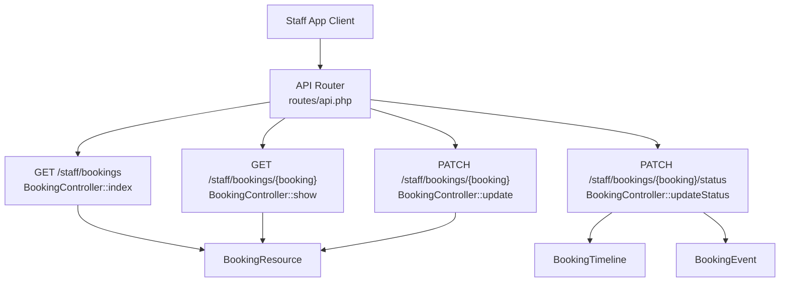
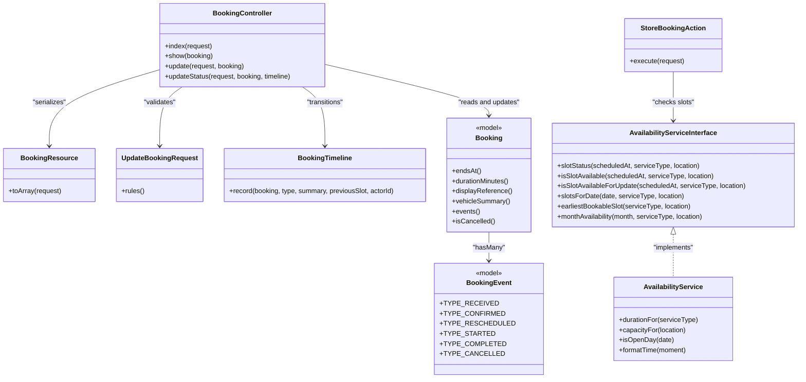
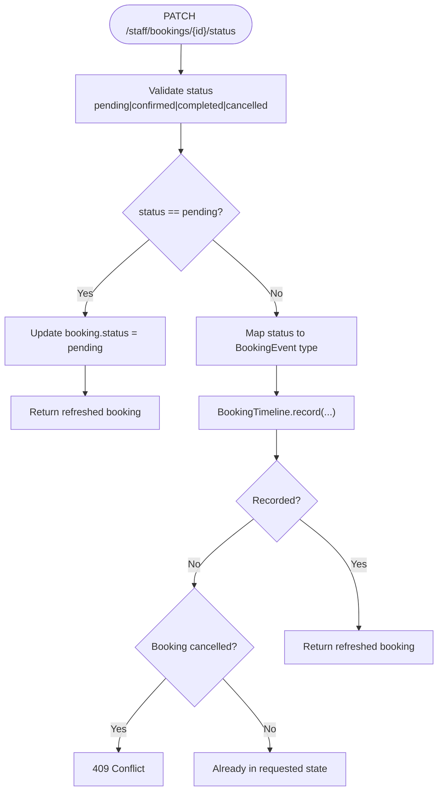
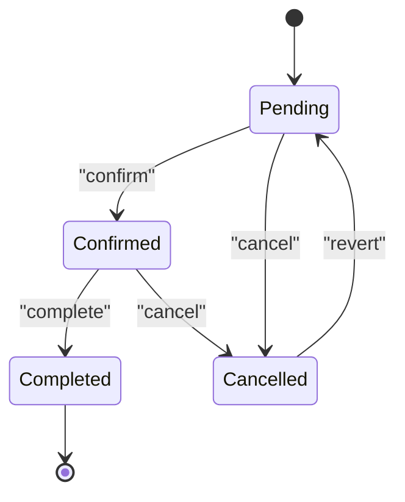
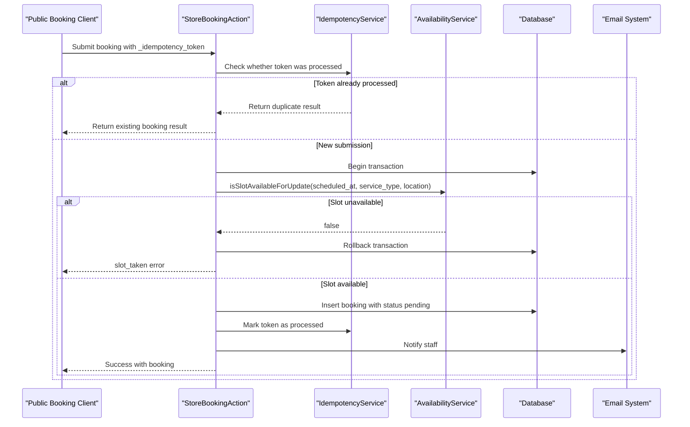
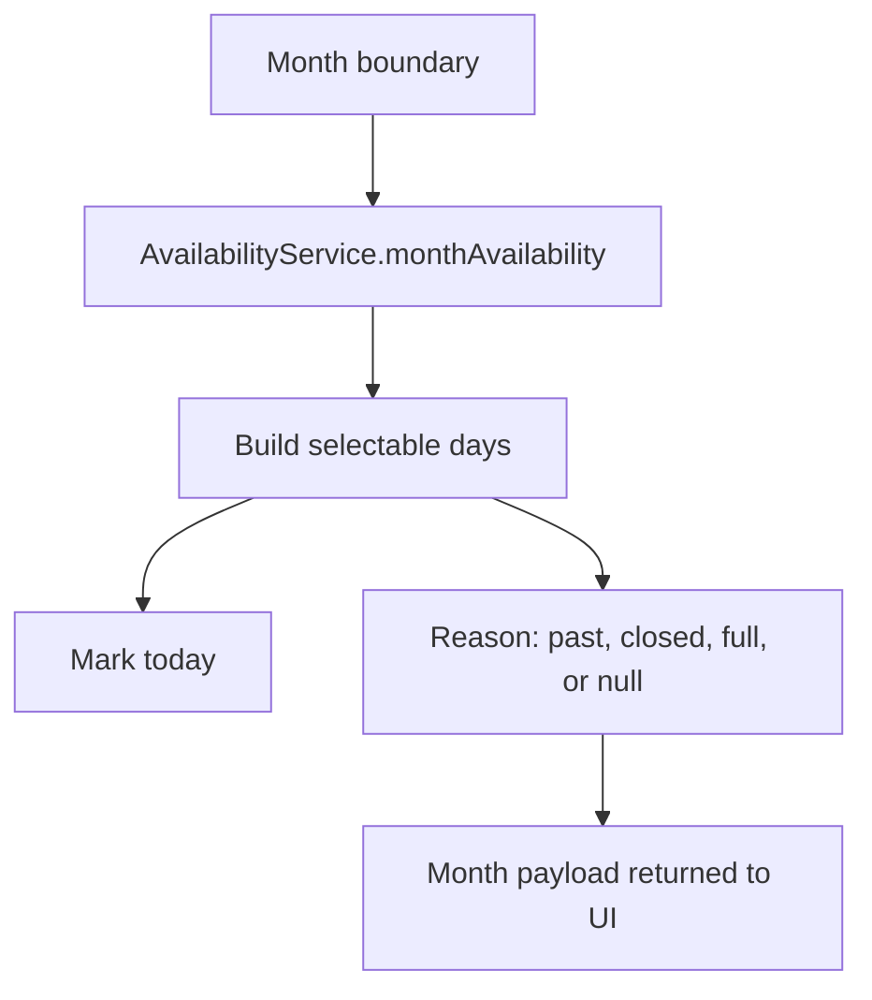
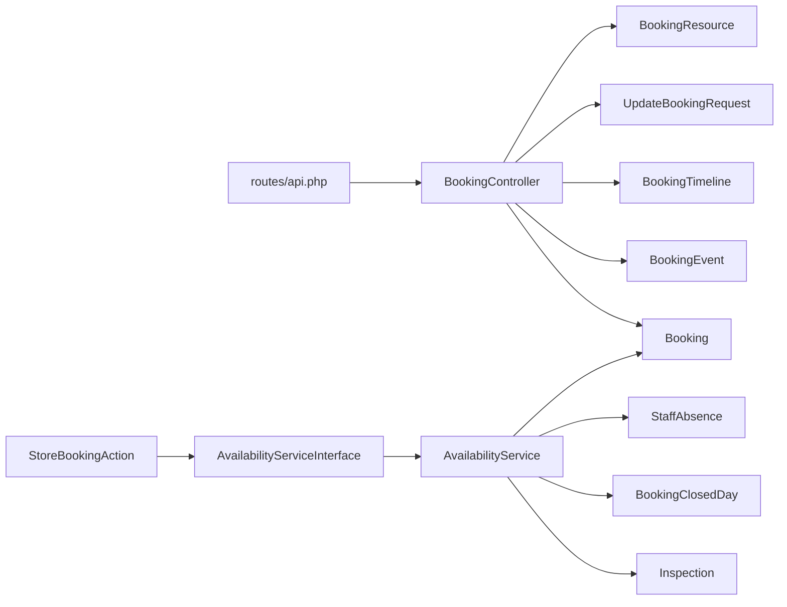

# Bookings Management API

<cite>
**Referenced Files in This Document**
- [api.php](file://routes/api.php)
- [BookingController.php](file://app/Http/Controllers/Api/BookingController.php)
- [StoreBookingAction.php](file://app/Actions/StoreBookingAction.php)
- [AvailabilityServiceInterface.php](file://app/Services/Contracts/AvailabilityServiceInterface.php)
- [AvailabilityService.php](file://app/Services/AvailabilityService.php)
- [BookingCalendarService.php](file://app/Services/BookingCalendarService.php)
- [BookingResource.php](file://app/Http/Resources/Api/BookingResource.php)
- [UpdateBookingRequest.php](file://app/Http/Requests/Admin/UpdateBookingRequest.php)
- [BookingTimeline.php](file://app/Services/BookingTimeline.php)
- [BookingEvent.php](file://app/Models/BookingEvent.php)
- [Booking.php](file://app/Models/Booking.php)
- [create_bookings_table.php](file://database/migrations/2026_04_17_093356_create_bookings_table.php)
- [add_scheduled_fields_to_bookings_table.php](file://database/migrations/2026_07_07_000000_add_scheduled_fields_to_bookings_table.php)
- [add_unique_index_to_bookings_scheduled_at.php](file://database/migrations/2026_07_07_000001_add_unique_index_on_bookings_scheduled_at.php)
- [replace_unique_index_on_bookings_scheduled_at.php](file://database/migrations/2026_10_01_000000_replace_unique_index_on_bookings_scheduled_at.php)
- [add_structured_fields_to_bookings_table.php](file://database/migrations/2026_10_18_000000_add_structured_fields_to_bookings_table.php)
- [create_booking_events_table.php](file://database/migrations/2026_10_01_150000_create_booking_events_table.php)
- [BookingServiceType.php](file://app/Enums/BookingServiceType.php)
- [BookingDamageType.php](file://app/Enums/BookingDamageType.php)
</cite>

## Table of Contents
1. [Introduction](#introduction)
2. [Project Structure](#project-structure)
3. [Core Components](#core-components)
4. [Architecture Overview](#architecture-overview)
5. [Detailed Component Analysis](#detailed-component-analysis)
6. [Dependency Analysis](#dependency-analysis)
7. [Performance Considerations](#performance-considerations)
8. [Troubleshooting Guide](#troubleshooting-guide)
9. [Conclusion](#conclusion)

## Introduction
This document describes the bookings management API used by the staff application. It covers:

- `GET /staff/bookings` — listing with status filtering and client/reference search, plus pagination.
- `GET /staff/bookings/{id}` — individual booking retrieval with inspection and timeline details.
- `PATCH /staff/bookings/{id}` — general updates, currently limited to price editing.
- `PATCH /staff/bookings/{id}/status` — lifecycle transitions between pending, confirmed, completed, and cancelled.

It also documents the booking data model, status workflow, validation rules, conflict detection, scheduling constraints, availability calculation, and integration with the calendar system.

## Project Structure
The staff API is token-authenticated and gated by Spatie abilities. Booking endpoints live under `/staff`, are protected by Sanctum, and require the `bookings` permissions that mirror the web admin panel.



**Diagram sources**
- [api.php:41-53](file://routes/api.php#L41-L53)
- [BookingController.php:27-117](file://app/Http/Controllers/Api/BookingController.php#L27-L117)
- [BookingResource.php:17-59](file://app/Http/Resources/Api/BookingResource.php#L17-L59)
- [BookingTimeline.php:25-128](file://app/Services/BookingTimeline.php#L25-L128)
- [BookingEvent.php:11-84](file://app/Models/BookingEvent.php#L11-L84)

**Section sources**
- [api.php:1-117](file://routes/api.php#L1-L117)

## Core Components
| Component | Responsibility |
|---|---|
| `BookingController` | Staff-facing REST endpoints for listing, reading, updating, and transitioning bookings. |
| `BookingResource` | Normalizes the Eloquent model into a stable API shape including client, vehicle, scheduling, pricing, inspection, and events. |
| `UpdateBookingRequest` | Validates editable fields; currently only allows non-negative total price changes. |
| `BookingTimeline` | Centralized state machine for booking milestones, status synchronization, duplicate suppression, and customer email delivery. |
| `BookingEvent` | Persistent milestone record with types such as received, confirmed, rescheduled, started, completed, and cancelled. |
| `StoreBookingAction` | Public booking submission flow with idempotency, slot reservation, conflict handling, and notification. |
| `AvailabilityService` | Availability computation, capacity checks, closed-day handling, lead time enforcement, and slot generation. |
| `BookingCalendarService` | Builds selectable months from availability so the UI cannot disagree with server-side business rules. |

**Section sources**
- [BookingController.php:17-122](file://app/Http/Controllers/Api/BookingController.php#L17-L122)
- [BookingResource.php:1-60](file://app/Http/Resources/Api/BookingResource.php#L1-L60)
- [UpdateBookingRequest.php:1-33](file://app/Http/Requests/Admin/UpdateBookingRequest.php#L1-L33)
- [BookingTimeline.php:1-128](file://app/Services/BookingTimeline.php#L1-L128)
- [BookingEvent.php:1-84](file://app/Models/BookingEvent.php#L1-L84)
- [StoreBookingAction.php:1-200](file://app/Actions/StoreBookingAction.php#L1-L200)
- [AvailabilityService.php:1-200](file://app/Services/AvailabilityService.php#L1-L200)
- [BookingCalendarService.php:1-101](file://app/Services/BookingCalendarService.php#L1-L101)

## Architecture Overview
The booking API separates concerns across controllers, resources, actions, services, models, and database tables:



**Diagram sources**
- [BookingController.php:17-122](file://app/Http/Controllers/Api/BookingController.php#L17-L122)
- [BookingResource.php:1-60](file://app/Http/Resources/Api/BookingResource.php#L1-L60)
- [UpdateBookingRequest.php:1-33](file://app/Http/Requests/Admin/UpdateBookingRequest.php#L1-L33)
- [BookingTimeline.php:1-128](file://app/Services/BookingTimeline.php#L1-L128)
- [BookingEvent.php:1-84](file://app/Models/BookingEvent.php#L1-L84)
- [StoreBookingAction.php:1-200](file://app/Actions/StoreBookingAction.php#L1-L200)
- [AvailabilityServiceInterface.php:1-133](file://app/Services/Contracts/AvailabilityServiceInterface.php#L1-L133)
- [AvailabilityService.php:300-748](file://app/Services/AvailabilityService.php#L300-L748)
- [Booking.php:1-134](file://app/Models/Booking.php#L1-L134)

## Detailed Component Analysis

### GET /staff/bookings
Lists bookings for the authenticated staff user.

- **Authentication:** Sanctum token required.
- **Authorization:** Requires the `can:view bookings` ability.
- **Query parameters:**
  - `status`: Filters by exact booking status (`pending`, `confirmed`, `completed`, `cancelled`).
  - `search`: Case-insensitive partial match against `client_name`, `client_email`, or `reference`.
  - `per_page`: Page size clamped between 1 and 100; defaults to 15.
- **Sorting:** Latest first by created timestamp.
- **Response body:** Paginated collection serialized through `BookingResource`.

Example request:
```
GET /staff/bookings?status=confirmed&search=HB-000123&per_page=20
```

Example response shape (summary):
```json
{
  "data": [
    {
      "id": 123,
      "reference": "HB-000123",
      "status": "confirmed",
      "is_cancelled": false,
      "client": {
        "name": "Client Name",
        "email": "client@example.com",
        "phone": "+1234567890",
        "prefers_whatsapp": true,
        "address": "123 Main Street"
      },
      "service_type": "windscreen",
      "service_type_label": "...",
      "damage_type": "crack",
      "damage_type_label": "...",
      "vehicle": {
        "make": "Toyota",
        "model": "Corolla",
        "year": 2020,
        "details": "Registration ABC-123",
        "summary": "2020 Toyota Corolla"
      },
      "scheduled_at": "2026-11-01T09:00:00+00:00",
      "ends_at": "2026-11-01T10:30:00+00:00",
      "duration_minutes": 90,
      "location": "workshop",
      "total_price": 150.00,
      "damage_photo_url": "https://.../public/storage/...",
      "created_at": "2026-10-25T14:00:00+00:00",
      "inspection": {},
      "events": []
    }
  ],
  "links": {},
  "meta": {}
}
```

Validation and behavior notes:
- Invalid `status` values are rejected by the query filter but do not trigger explicit validation errors because filtering is optional.
- Empty searches apply no client or reference filter.
- The response always includes an inspection payload when eager-loaded; it may be empty if none exists.

**Section sources**
- [api.php:41-53](file://routes/api.php#L41-L53)
- [BookingController.php:27-51](file://app/Http/Controllers/Api/BookingController.php#L27-L51)
- [BookingResource.php:17-59](file://app/Http/Resources/Api/BookingResource.php#L17-L59)

### GET /staff/bookings/{id}
Retrieves one booking with its inspection and customer-visible timeline.

- **Authentication:** Sanctum token required.
- **Authorization:** Requires the `can:view bookings` ability.
- **Path parameter:** Numeric `booking` identifier.
- **Eager loading:** Inspection, inspection staff, inspection notes author, and booking events with their actors.

Example request:
```
GET /staff/bookings/123
```

Example response shape:
```json
{
  "data": {
    "id": 123,
    "reference": "HB-000123",
    "status": "confirmed",
    "is_cancelled": false,
    "client": { ... },
    "service_type": "windscreen",
    "service_type_label": "...",
    "damage_type": "chip",
    "damage_type_label": "...",
    "vehicle": { ... },
    "scheduled_at": "2026-11-01T09:00:00+00:00",
    "ends_at": "2026-11-01T10:30:00+00:00",
    "duration_minutes": 90,
    "location": "workshop",
    "total_price": 150.00,
    "damage_photo_url": "https://.../public/storage/...",
    "created_at": "2026-10-25T14:00:00+00:00",
    "inspection": {
      "id": 456,
      "status": "in_progress",
      "scheduled_at": "2026-11-01T09:00:00+00:00",
      "notes": [],
      "staff": {}
    },
    "events": [
      {
        "id": 1,
        "type": "received",
        "summary": null,
        "happened_at": "2026-10-25T14:00:00+00:00",
        "actor": null
      }
    ]
  }
}
```

Notes:
- If the booking does not exist, Laravel returns a standard 404 resource-not-found response.
- The `events` array contains customer-visible milestones only; internal inspection notes are separate.

**Section sources**
- [api.php:41-53](file://routes/api.php#L41-L53)
- [BookingController.php:53-61](file://app/Http/Controllers/Api/BookingController.php#L53-L61)
- [BookingResource.php:17-59](file://app/Http/Resources/Api/BookingResource.php#L17-L59)

### PATCH /staff/bookings/{id}
Updates general booking fields.

- **Authentication:** Sanctum token required.
- **Authorization:** Requires the `can:update bookings` ability.
- **Path parameter:** Numeric `booking` identifier.
- **Validated fields:**
  - `total_price`: Nullable numeric value; must be zero or greater when provided.
- **Behavior:** Performs a direct model update and returns the refreshed booking.

Example request:
```
PATCH /staff/bookings/123
Content-Type: application/json

{
  "total_price": 175.50
}
```

Example response:
```json
{
  "data": {
    "id": 123,
    "reference": "HB-000123",
    "status": "confirmed",
    "is_cancelled": false,
    "client": { ... },
    "service_type": "windscreen",
    "service_type_label": "...",
    "damage_type": "crack",
    "damage_type_label": "...",
    "vehicle": { ... },
    "scheduled_at": "2026-11-01T09:00:00+00:00",
    "ends_at": "2026-11-01T10:30:00+00:00",
    "duration_minutes": 90,
    "location": "workshop",
    "total_price": 175.50,
    "damage_photo_url": "https://.../public/storage/...",
    "created_at": "2026-10-25T14:00:00+00:00",
    "inspection": {},
    "events": []
  },
  "message": "Booking updated."
}
```

Important constraint:
- Only `total_price` is validated for this endpoint. Other fields should not be modified here unless additional validation and authorization logic is added.

**Section sources**
- [api.php:41-53](file://routes/api.php#L41-L53)
- [BookingController.php:63-71](file://app/Http/Controllers/Api/BookingController.php#L63-L71)
- [UpdateBookingRequest.php:17-32](file://app/Http/Requests/Admin/UpdateBookingRequest.php#L17-L32)

### PATCH /staff/bookings/{id}/status
Transitions a booking through its lifecycle.

- **Authentication:** Sanctum token required.
- **Authorization:** Requires the `can:update bookings` ability.
- **Path parameter:** Numeric `booking` identifier.
- **Request body:**
  - `status`: Required; must be one of `pending`, `confirmed`, `completed`, `cancelled`.
- **Response:** JSON object containing the refreshed booking and a message.

Example request:
```
PATCH /staff/bookings/123
Content-Type: application/json

{
  "status": "confirmed"
}
```

Success responses:
```json
{
  "data": { ... },
  "message": "Booking status updated."
}
```

Conflict response when attempting to advance a cancelled booking:
```json
{
  "message": "This booking is cancelled. Set it back to pending before moving it on."
}
```
HTTP status: 409 Conflict.

Duplicate-state response:
```json
{
  "message": "Booking is already confirmed."
}
```

Status workflow rules:
- Valid transition statuses are restricted to `pending`, `confirmed`, `completed`, `cancelled`.
- Reverting to `pending` is a plain write without creating a milestone event.
- Transitioning to `confirmed`, `completed`, or `cancelled` goes through `BookingTimeline`, which records a milestone, synchronizes the coarse booking status, suppresses duplicates, and queues customer emails.
- A cancelled booking is terminal until explicitly reverted to `pending`.
- If the requested transition is invalid or blocked by the timeline, the controller returns either a 409 conflict or a success-like response indicating the current state.



**Diagram sources**
- [BookingController.php:73-117](file://app/Http/Controllers/Api/BookingController.php#L73-L117)
- [BookingTimeline.php:25-128](file://app/Services/BookingTimeline.php#L25-L128)
- [BookingEvent.php:11-84](file://app/Models/BookingEvent.php#L11-L84)

**Section sources**
- [api.php:41-53](file://routes/api.php#L41-L53)
- [BookingController.php:73-117](file://app/Http/Controllers/Api/BookingController.php#L73-L117)
- [BookingTimeline.php:25-128](file://app/Services/BookingTimeline.php#L25-L128)
- [BookingEvent.php:11-84](file://app/Models/BookingEvent.php#L11-L84)

### Booking Data Model
The `bookings` table stores customer requests for glass-related services. Its schema evolved from a simple request table into a structured scheduling entity.

#### Column Summary
| Column | Type / Constraint | Meaning |
|---|---|---|
| `id` | Primary key | Internal identifier. |
| `user_id` | Nullable foreign key to users | Optional account owner. |
| `client_name` | Required string | Customer name. |
| `client_email` | Indexed string | Contact email. |
| `client_phone` | Required string | Contact phone number. |
| `vehicle_details` | Required legacy string | Registration and free-form vehicle description. |
| `service_type` | Nullable string with index | Glass work category; enum-backed. |
| `damage_type` | Nullable string | Nature of damage; enum-backed. |
| `vehicle_make` | Nullable string | Structured vehicle make. |
| `vehicle_model` | Nullable string | Structured vehicle model. |
| `vehicle_year` | Nullable small integer | Vehicle year. |
| `damage_photo_path` | Nullable string | Path to stored damage image. |
| `scheduled_at` | Nullable timestamp with index | Booked start time. |
| `duration_minutes` | Default 60 minutes | Snapshot of job duration at booking time. |
| `location` | Nullable string | Capacity pool: `workshop` or `mobile`. |
| `client_address` | Nullable string | Customer address. |
| `status` | Enum default `pending` | Lifecycle state. |
| `total_price` | Decimal default 0.00 | Quoted price. |
| `reference` | Unique string | Customer-facing identifier, derived from ID. |
| `created_at` / `updated_at` | Timestamps | Standard audit timestamps. |

#### Derived Fields
- `ends_at`: Computed from `scheduled_at` plus `duration_minutes`; null when no slot is scheduled.
- `durationMinutes`: At least 15 minutes; falls back to 60 when unset.
- `displayReference`: Uses stored `reference`; otherwise generates `HB-` followed by a zero-padded ID.
- `vehicleSummary`: Combines year, make, and model when available, otherwise falls back to `vehicle_details`.

#### Enums
- `BookingServiceType`: `windscreen`, `side_rear`, `heavy_machinery`, `fleet`. Each has a default duration.
- `BookingDamageType`: `chip`, `crack`, `shattered`, `seal_leak`, `other`. Used for triage and quoting.

**Section sources**
- [Booking.php:1-134](file://app/Models/Booking.php#L1-L134)
- [BookingServiceType.php:1-64](file://app/Enums/BookingServiceType.php#L1-L64)
- [BookingDamageType.php:1-37](file://app/Enums/BookingDamageType.php#L1-L37)
- [create_bookings_table.php:10-35](file://database/migrations/2026_04_17_093356_create_bookings_table.php#L10-L35)
- [add_scheduled_fields_to_bookings_table.php:12-28](file://database/migrations/2026_07_07_000000_add_scheduled_fields_to_bookings_table.php#L12-L28)
- [add_structured_fields_to_bookings_table.php:17-68](file://database/migrations/2026_10_18_000000_add_structured_fields_to_bookings_table.php#L17-L68)

### Status Workflow
The booking lifecycle is controlled by `BookingTimeline` and exposed via the status endpoint.

#### Milestones
| Milestone | Effect on booking status | Customer email |
|---|---|---|
| `received` | No direct status change; represents initial receipt. | Yes |
| `confirmed` | Sets status to `confirmed`. | Yes |
| `rescheduled` | Does not change coarse status; tracks previous slot. | Yes |
| `started` | Does not change coarse status. | No |
| `completed` | Sets status to `completed`. | Yes |
| `cancelled` | Sets status to `cancelled`. | Yes |

#### Rules
- A cancelled booking blocks further advancement; revert to `pending` first.
- Duplicate milestones with the same type and summary are suppressed.
- Rescheduling preserves the previous slot in the event record.
- Email sending is tied to the event, not directly to the HTTP status field.



**Diagram sources**
- [BookingTimeline.php:25-128](file://app/Services/BookingTimeline.php#L25-L128)
- [BookingEvent.php:11-84](file://app/Models/BookingEvent.php#L11-L84)
- [Booking.php:93-134](file://app/Models/Booking.php#L93-L134)

**Section sources**
- [BookingTimeline.php:1-128](file://app/Services/BookingTimeline.php#L1-L128)
- [BookingEvent.php:1-84](file://app/Models/BookingEvent.php#L1-L84)
- [Booking.php:93-134](file://app/Models/Booking.php#L93-L134)

### Validation Rules
| Endpoint | Field | Rule |
|---|---|---|
| `PATCH /staff/bookings/{id}` | `total_price` | Nullable numeric; minimum 0. |
| `PATCH /staff/bookings/{id}/status` | `status` | Required; must be `pending`, `confirmed`, `completed`, or `cancelled`. |
| Public booking creation | See below | Idempotency, availability, schedule, capacity, and business constraints. |

Additional implicit constraints:
- Authenticated access requires a valid Sanctum token.
- Authorization uses Spatie abilities mirroring the web admin.
- Numeric route parameters ensure the booking ID is an integer.

**Section sources**
- [UpdateBookingRequest.php:17-32](file://app/Http/Requests/Admin/UpdateBookingRequest.php#L17-L32)
- [BookingController.php:73-80](file://app/Http/Controllers/Api/BookingController.php#L73-L80)
- [api.php:41-53](file://routes/api.php#L41-L53)

### Booking Creation and Scheduling Constraints
Although public booking creation is handled by `StoreBookingAction`, it is essential to the bookings API because it defines scheduling rules consumed by availability and calendar components.

#### Submission Flow


**Diagram sources**
- [StoreBookingAction.php:35-200](file://app/Actions/StoreBookingAction.php#L35-L200)
- [AvailabilityService.php:105-139](file://app/Services/AvailabilityService.php#L105-L139)

#### Conflict Detection
- **Idempotency:** Submissions using the same `_idempotency_token` return the original result instead of creating duplicates.
- **Race conditions:** Reservation re-checks availability inside a database transaction.
- **Deadlock retries:** Concurrent lock conflicts are retried up to two times; repeated failures indicate genuine contention.
- **Slot collision:** If another process takes the slot between check and insert, the caller receives a `slot_taken` failure.

#### Scheduling Constraints
- **Lead time:** Customers cannot book before the configured minimum notice window.
- **Working hours:** Slots must fit within open hours and close before closing time.
- **Closed days:** Closed dates block all slots.
- **Duration snapshot:** The booking stores `duration_minutes` at creation time; changing service settings later does not rewrite historical durations.
- **Capacity per location:** `workshop` and `mobile` pools have independent capacities; unknown locations use the smaller pool to avoid overpromising.
- **Inspection interaction:** Inspections can reschedule their associated booking; occupancy calculations prefer the inspection’s scheduled time so the same job is not counted twice.

#### Available Time Slots
Use the availability service to determine bookable slots:

- `slotStatus(scheduledAt, serviceType?, location?)` returns `available`, `closed`, `too_late`, or `taken`.
- `isSlotAvailable(scheduledAt, serviceType?, location?)` returns a boolean.
- `isSlotAvailableForUpdate(scheduledAt, serviceType?, location?)` performs a locked reservation-safe check.
- `slotsForDate(date, serviceType?, location?)` returns every candidate slot with labels and availability.
- `earliestBookableSlot(serviceType?, location?)` finds the next possible bookable moment within the horizon.
- `monthAvailability(month, serviceType?, location?)` returns selectable dates for calendar rendering.
- `upcomingOpenDays(count, serviceType?, location?)` lists future open days with their first slot.

Example availability queries:
```
// Check whether 2026-11-01 09:00 is available
availability.slotStatus("2026-11-01T09:00:00", "windscreen", "workshop")

// List today's slots
availability.slotsForDate("2026-10-28", "fleet", "mobile")

// Find earliest bookable slot
availability.earliestBookableSlot("heavy_machinery")
```

Expected results:
- `available` means the slot passes open-hours, lead-time, and capacity checks.
- `closed` means the day is fully closed.
- `too_late` means the slot is before the lead-time cutoff or outside working hours.
- `taken` means capacity would be exceeded by existing bookings, inspections, or staff absences.

**Section sources**
- [StoreBookingAction.php:35-200](file://app/Actions/StoreBookingAction.php#L35-L200)
- [AvailabilityServiceInterface.php:9-133](file://app/Services/Contracts/AvailabilityServiceInterface.php#L9-L133)
- [AvailabilityService.php:63-139](file://app/Services/AvailabilityService.php#L63-L139)
- [AvailabilityService.php:300-748](file://app/Services/AvailabilityService.php#L300-L748)

### Calendar Integration
The calendar system builds selectable months from the same availability logic used during booking.



**Diagram sources**
- [BookingCalendarService.php:26-101](file://app/Services/BookingCalendarService.php#L26-L101)
- [AvailabilityServiceInterface.php:89-110](file://app/Services/Contracts/AvailabilityServiceInterface.php#L89-L110)

Key behaviors:
- Days are laid out Monday-first.
- A day is selectable only when it has at least one bookable slot.
- Month payloads include counts of available and open days.
- Each day carries a reason explaining why it is not selectable.

**Section sources**
- [BookingCalendarService.php:1-101](file://app/Services/BookingCalendarService.php#L1-L101)

### Database Constraints and Indexes
| Migration | Purpose |
|---|---|
| `create_bookings_table` | Initial booking table with status enum and dashboard optimization indexes. |
| `add_scheduled_fields_to_bookings_table` | Adds `scheduled_at` and `location`. |
| `add_unique_index_to_bookings_scheduled_at` | Previously enforced strict uniqueness on `scheduled_at`. |
| `replace_unique_index_on_bookings_scheduled_at` | Replaced unique index with a normal index; concurrent safety moved to row-level locking inside transactions. |
| `add_structured_fields_to_bookings_table` | Adds structured vehicle fields, duration snapshot, and unique customer-facing reference. |
| `create_booking_events_table` | Stores customer-visible milestone history. |

Important constraint evolution:
- The unique `scheduled_at` index was replaced because cancelled bookings could block reusing the same instant even though availability ignores cancelled rows.
- Conflict prevention now relies on `SELECT ... FOR UPDATE` inside a transaction around the availability check and insertion.

**Section sources**
- [create_bookings_table.php:10-35](file://database/migrations/2026_04_17_093356_create_bookings_table.php#L10-L35)
- [add_scheduled_fields_to_bookings_table.php:12-28](file://database/migrations/2026_07_07_000000_add_scheduled_fields_to_bookings_table.php#L12-L28)
- [add_unique_index_to_bookings_scheduled_at.php:16-29](file://database/migrations/2026_07_07_000001_add_unique_index_to_bookings_scheduled_at.php#L16-L29)
- [replace_unique_index_on_bookings_scheduled_at.php:12-45](file://database/migrations/2026_10_01_000000_replace_unique_index_on_bookings_scheduled_at.php#L12-L45)
- [add_structured_fields_to_bookings_table.php:17-68](file://database/migrations/2026_10_18_000000_add_structured_fields_to_bookings_table.php#L17-L68)
- [create_booking_events_table.php:12-43](file://database/migrations/2026_10_01_150000_create_booking_events_table.php#L12-L43)

## Dependency Analysis
The following diagram shows how booking API endpoints depend on controllers, resources, services, models, and database tables.



**Diagram sources**
- [api.php:41-53](file://routes/api.php#L41-L53)
- [BookingController.php:17-122](file://app/Http/Controllers/Api/BookingController.php#L17-L122)
- [BookingResource.php:1-60](file://app/Http/Resources/Api/BookingResource.php#L1-L60)
- [UpdateBookingRequest.php:1-33](file://app/Http/Requests/Admin/UpdateBookingRequest.php#L1-L33)
- [BookingTimeline.php:1-128](file://app/Services/BookingTimeline.php#L1-L128)
- [BookingEvent.php:1-84](file://app/Models/BookingEvent.php#L1-L84)
- [StoreBookingAction.php:1-200](file://app/Actions/StoreBookingAction.php#L1-L200)
- [AvailabilityServiceInterface.php:1-133](file://app/Services/Contracts/AvailabilityServiceInterface.php#L1-L133)
- [AvailabilityService.php:300-748](file://app/Services/AvailabilityService.php#L300-L748)

Coupling and cohesion observations:
- `BookingController` is moderately coupled to both persistence and domain services but remains focused on HTTP concerns.
- `BookingTimeline` centralizes state-machine logic, reducing duplication across status-changing paths.
- `AvailabilityService` encapsulates complex scheduling math, making calendar and booking creation share the same rules.
- Database constraints and indexes support performance and correctness, while transactional locking handles concurrency.

**Section sources**
- [BookingController.php:17-122](file://app/Http/Controllers/Api/BookingController.php#L17-L122)
- [BookingTimeline.php:1-128](file://app/Services/BookingTimeline.php#L1-L128)
- [AvailabilityService.php:300-748](file://app/Services/AvailabilityService.php#L300-L748)

## Performance Considerations
- **Pagination:** Listing uses Laravel pagination with a safe page-size clamp. Clients should request reasonable page sizes to avoid large payloads.
- **Eager loading:** Detail endpoints load inspection, staff, notes authors, and events to reduce N+1 queries.
- **Availability survey caching:** Availability calculations cache jobs and absences per request and load padded windows to avoid thousands of round trips when generating multi-month calendars.
- **Index usage:**
  - `client_email` is indexed for contact lookups.
  - `status` and `created_at` form a dashboard optimization index.
  - `scheduled_at` is indexed rather than uniquely constrained after migration.
  - `service_type` is indexed for filtering and reporting.
  - `booking_events` indexes support timeline queries by booking and date.
- **Concurrency:** Transactional row locks prevent double-booking under contention; deadlock retries provide resilience against lost races.

[No sources needed since this section provides general guidance]

## Troubleshooting Guide
| Symptom | Likely Cause | Resolution |
|---|---|---|
| `slot_already_taken` | Another process booked the same interval. | Retry with a different slot or add retry logic with exponential backoff. |
| `slot_taken` | Availability check failed during reservation. | Verify lead time, working hours, capacity, and existing bookings. |
| 409 Conflict on status update | Attempting to advance a cancelled booking. | First set status to `pending`, then continue the workflow. |
| "Booking is already confirmed" | Duplicate or unnecessary transition. | Avoid redundant status updates; rely on idempotent client behavior. |
| Calendar shows a day as selectable but booking fails | Client-side picker state differs from server availability. | Always revalidate the selected slot before submission. |
| Historical duration changed unexpectedly | Relying on dynamic service settings instead of stored snapshot. | Use `duration_minutes` on the booking; do not assume service configuration is immutable. |
| Duplicate confirmation emails | Multiple confirmation paths firing. | Ensure all status changes go through `BookingTimeline.record`. |
| Very slow calendar pages | Excessive per-slot queries. | Use `monthAvailability` and `slotsForDate` rather than checking each instant individually. |

**Section sources**
- [StoreBookingAction.php:35-200](file://app/Actions/StoreBookingAction.php#L35-L200)
- [BookingController.php:73-117](file://app/Http/Controllers/Api/BookingController.php#L73-L117)
- [BookingTimeline.php:25-128](file://app/Services/BookingTimeline.php#L25-L128)
- [AvailabilityService.php:300-748](file://app/Services/AvailabilityService.php#L300-L748)

## Conclusion
The bookings management API provides a secure, permission-gated interface for staff to view, update, and transition bookings. Its strength lies in separating HTTP concerns from domain logic:

- Controllers handle routing, filtering, pagination, and authorization.
- Resources define a stable API contract.
- `BookingTimeline` enforces lifecycle rules and customer communication.
- `AvailabilityService` centralizes scheduling, capacity, and conflict detection.
- `StoreBookingAction` protects public submissions with idempotency and transactional reservations.
- Migrations document the evolution from a basic request table to a structured, schedulable booking entity.

When integrating with this API, clients should validate slots server-side, handle 409 conflicts for cancelled bookings, respect pagination limits, and treat availability as authoritative rather than trusting cached UI state.

[No sources needed since this section summarizes without analyzing specific files]