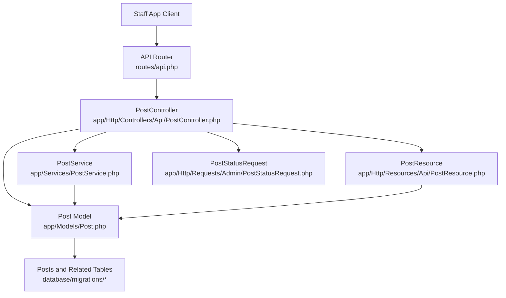
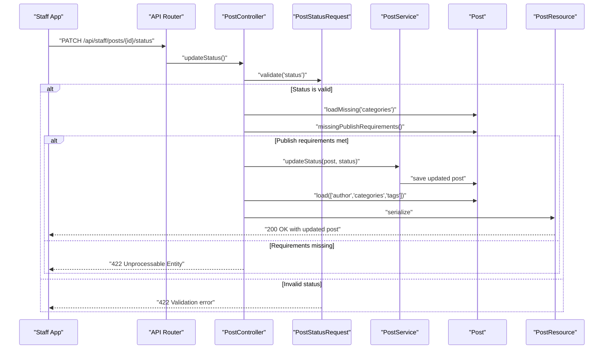
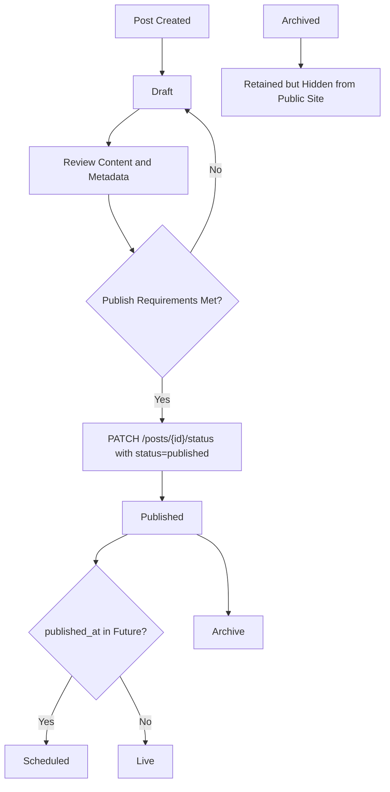
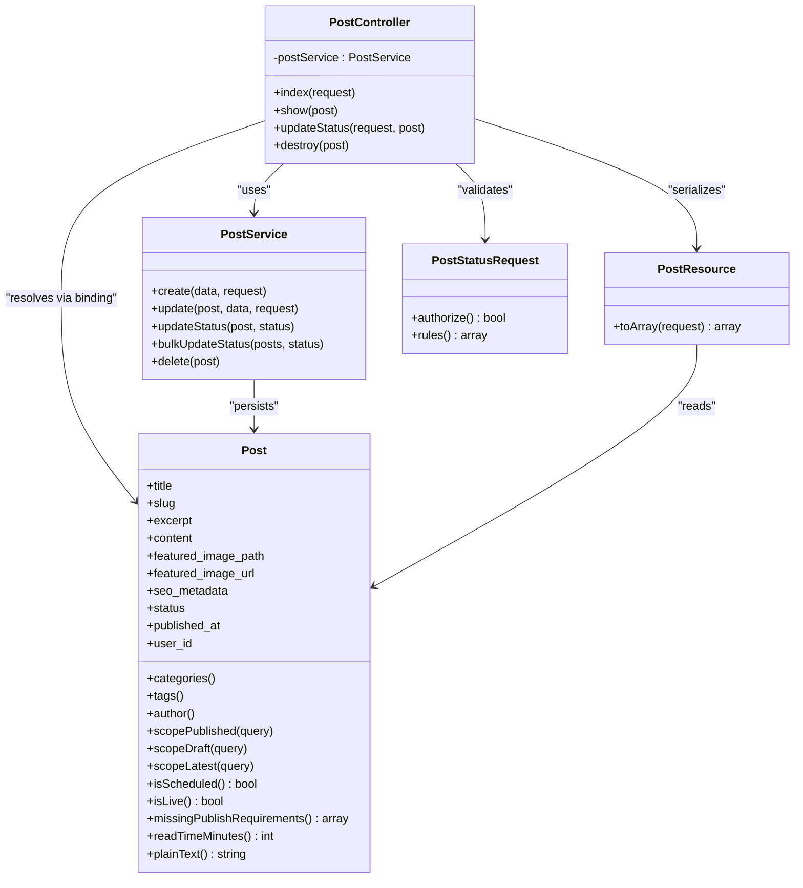

# Blog Posts API

<cite>
**Referenced Files in This Document**   
- [routes/api.php](file://routes/api.php)
- [app/Http/Controllers/Api/PostController.php](file://app/Http/Controllers/Api/PostController.php)
- [app/Services/PostService.php](file://app/Services/PostService.php)
- [app/Http/Resources/Api/PostResource.php](file://app/Http/Resources/Api/PostResource.php)
- [app/Http/Requests/Admin/PostStatusRequest.php](file://app/Http/Requests/Admin/PostStatusRequest.php)
- [app/Models/Post.php](file://app/Models/Post.php)
- [database/migrations/2026_04_22_152122_create_posts_table.php](file://database/migrations/2026_04_22_152122_create_posts_table.php)
- [database/migrations/2026_05_12_083642_add_seo_metadata_to_posts_table.php](file://database/migrations/2026_05_12_083642_add_seo_metadata_to_posts_table.php)
- [database/migrations/2026_10_17_120000_add_author_and_relax_content_limits_to_posts_table.php](file://database/migrations/2026_10_17_120000_add_author_and_relax_content_limits_to_posts_table.php)
- [database/migrations/2026_10_17_150000_add_archived_status_to_posts_table.php](file://database/migrations/2026_10_17_150000_add_archived_status_to_posts_table.php)
</cite>

## Table of Contents
1. [Introduction](#introduction)
2. [Project Structure](#project-structure)
3. [Core Components](#core-components)
4. [Architecture Overview](#architecture-overview)
5. [Detailed Component Analysis](#detailed-component-analysis)
6. [Dependency Analysis](#dependency-analysis)
7. [Performance Considerations](#performance-considerations)
8. [Troubleshooting Guide](#troubleshooting-guide)
9. [Conclusion](#conclusion)
10. [Appendices](#appendices)

## Introduction
This document describes the blog posts management API exposed to the staff application. The API is token-authenticated and operates under the `/api/staff` prefix. It provides endpoints for listing posts, retrieving an individual post by numeric ID, changing a post’s status, and deleting a post. It does not provide an endpoint for creating or editing full block-based post content; that remains on the web admin.

The documented endpoints are:
- `GET /api/staff/posts` — list and filter posts.
- `GET /api/staff/posts/{post:id}` — retrieve a single post by numeric ID.
- `PATCH /api/staff/posts/{post:id}/status` — change a post’s status.
- `DELETE /api/staff/posts/{post:id}` — delete a post.

The post data model includes SEO fields, author information, categories, tags, featured images, and a three-state publishing workflow: draft, published, and archived.

## Project Structure
The blog posts API is implemented as a standard Laravel controller backed by a service layer, Eloquent model, JSON resource, and form request validation. Routes are registered under the staff API group.



**Diagram sources**
- [routes/api.php:78-96](file://routes/api.php#L78-L96)
- [app/Http/Controllers/Api/PostController.php:1-92](file://app/Http/Controllers/Api/PostController.php#L1-L92)
- [app/Services/PostService.php:1-178](file://app/Services/PostService.php#L1-L178)
- [app/Models/Post.php:1-274](file://app/Models/Post.php#L1-L274)
- [app/Http/Resources/Api/PostResource.php:1-50](file://app/Http/Resources/Api/PostResource.php#L1-L50)
- [app/Http/Requests/Admin/PostStatusRequest.php:1-35](file://app/Http/Requests/Admin/PostStatusRequest.php#L1-L35)

**Section sources**
- [routes/api.php:78-96](file://routes/api.php#L78-L96)
- [app/Http/Controllers/Api/PostController.php:1-92](file://app/Http/Controllers/Api/PostController.php#L1-L92)

## Core Components
- **API routes**: Registered under `staff`, requiring Sanctum authentication and Spatie authorization gates.
- **PostController**: Handles listing, showing, status updates, and deletion.
- **PostService**: Encapsulates post creation, update, status transitions, bulk status changes, image handling, and relation syncing.
- **PostResource**: Serializes post data for the staff app, including computed status metadata, author data, categories, and tags.
- **PostStatusRequest**: Validates the status payload against allowed values.
- **Post model**: Defines fillable attributes, relationships, scopes, SEO defaults, publish requirements, live/scheduled logic, and slug generation.

**Section sources**
- [routes/api.php:78-96](file://routes/api.php#L78-L96)
- [app/Http/Controllers/Api/PostController.php:1-92](file://app/Http/Controllers/Api/PostController.php#L1-L92)
- [app/Services/PostService.php:1-178](file://app/Services/PostService.php#L1-L178)
- [app/Http/Resources/Api/PostResource.php:1-50](file://app/Http/Resources/Api/PostResource.php#L1-L50)
- [app/Http/Requests/Admin/PostStatusRequest.php:1-35](file://app/Http/Requests/Admin/PostStatusRequest.php#L1-L35)
- [app/Models/Post.php:1-274](file://app/Models/Post.php#L1-L274)

## Architecture Overview
The staff blog API follows a layered design:

- Routing applies authentication and policy gates before reaching the controller.
- The controller validates input and delegates business logic to the service where appropriate.
- The model encapsulates domain rules such as publish requirements, live state, and SEO behavior.
- The resource normalizes responses for the client.



**Diagram sources**
- [routes/api.php:90-92](file://routes/api.php#L90-L92)
- [app/Http/Controllers/Api/PostController.php:48-80](file://app/Http/Controllers/Api/PostController.php#L48-L80)
- [app/Services/PostService.php:44-60](file://app/Services/PostService.php#L44-L60)
- [app/Models/Post.php:200-232](file://app/Models/Post.php#L200-L232)
- [app/Http/Resources/Api/PostResource.php:18-49](file://app/Http/Resources/Api/PostResource.php#L18-L49)
- [app/Http/Requests/Admin/PostStatusRequest.php:17-34](file://app/Http/Requests/Admin/PostStatusRequest.php#L17-L34)

## Detailed Component Analysis

### API Endpoints

#### GET /api/staff/posts
Lists posts for moderation. All parameters are optional.

| Parameter | Type | Description | Default | Notes |
|---|---|---|---:|---|
| `status` | string | Filter by post status | none | Allowed values are `draft`, `published`, and `archived`. |
| `user` | integer | Filter by author user ID | none | Matches the `user_id` foreign key. |
| `search` | string | Full-text-like search across title and excerpt | none | Uses SQL `LIKE` against both fields. |
| `per_page` | integer | Number of results per page | 15 | Clamped between 1 and 100. |

Response is a paginated collection serialized by `PostResource`.

Example queries:
- List all drafts: `GET /api/staff/posts?status=draft`
- List posts authored by user 7: `GET /api/staff/posts?user=7`
- Search posts containing “glass” in title or excerpt: `GET /api/staff/posts?search=glass`
- Get up to 50 results: `GET /api/staff/posts?per_page=50`

**Section sources**
- [routes/api.php:90-92](file://routes/api.php#L90-L92)
- [app/Http/Controllers/Api/PostController.php:20-46](file://app/Http/Controllers/Api/PostController.php#L20-L46)
- [app/Http/Resources/Api/PostResource.php:18-49](file://app/Http/Resources/Api/PostResource.php#L18-L49)

#### GET /api/staff/posts/{post:id}
Returns a single post by its numeric database ID. The route explicitly binds `{post:id}` so it does not collide with the site-wide slug-bound route.

Path parameter:
| Name | Type | Description |
|---|---|---|
| `post` | integer | Numeric post ID |

Response fields include post identity, metadata, media, author, categories, tags, and computed status indicators.

Example:
- `GET /api/staff/posts/42`

**Section sources**
- [routes/api.php:91](file://routes/api.php#L91)
- [app/Http/Controllers/Api/PostController.php:48-57](file://app/Http/Controllers/Api/PostController.php#L48-L57)
- [app/Http/Resources/Api/PostResource.php:18-49](file://app/Http/Resources/Api/PostResource.php#L18-L49)

#### PATCH /api/staff/posts/{post:id}/status
Changes the publishing status of a post.

Path parameter:
| Name | Type | Description |
|---|---|---|
| `post` | integer | Numeric post ID |

Request body:
| Field | Type | Required | Allowed Values | Description |
|---|---|---:|---|---|
| `status` | string | Yes | `draft`, `published`, `archived` | New post status. |

Behavior:
- If the new status is `published`, the controller checks whether required fields are present. Missing requirements return HTTP 422.
- On success, the service sets the status and automatically assigns `published_at` when transitioning to `published` and no timestamp exists.
- The response contains the updated post and a confirmation message.

Example request:
```json
{
  "status": "published"
}
```

Success response:
```json
{
  "data": {
    "id": 42,
    "title": "...",
    "slug": "...",
    "excerpt": "...",
    "status": "published",
    "status_key": "published",
    "is_live": true,
    "read_time_minutes": 2,
    "featured_image_url": "...",
    "published_at": "2026-10-28T10:00:00Z",
    "created_at": "2026-10-28T09:00:00Z",
    "updated_at": "2026-10-28T10:00:00Z",
    "author": {
      "id": 1,
      "name": "Editor"
    },
    "categories": [],
    "tags": []
  },
  "message": "Post status updated."
}
```

Validation failure response (invalid status):
```json
{
  "message": "..."
}
```

Publish blocked response (missing requirements):
```json
{
  "message": "Content, excerpt, and category are required before publishing."
}
```

**Section sources**
- [routes/api.php:91-92](file://routes/api.php#L91-L92)
- [app/Http/Controllers/Api/PostController.php:59-80](file://app/Http/Controllers/Api/PostController.php#L59-L80)
- [app/Services/PostService.php:44-60](file://app/Services/PostService.php#L44-L60)
- [app/Http/Requests/Admin/PostStatusRequest.php:17-34](file://app/Http/Requests/Admin/PostStatusRequest.php#L17-L34)
- [app/Models/Post.php:200-232](file://app/Models/Post.php#L200-L232)

#### DELETE /api/staff/posts/{post:id}
Deletes a post permanently.

Path parameter:
| Name | Type | Description |
|---|---|---|
| `post` | integer | Numeric post ID |

Success response:
```json
{
  "message": "Post deleted."
}
```

**Section sources**
- [routes/api.php:92](file://routes/api.php#L92)
- [app/Http/Controllers/Api/PostController.php:82-91](file://app/Http/Controllers/Api/PostController.php#L82-L91)
- [app/Services/PostService.php:108-112](file://app/Services/PostService.php#L108-L112)

### Post Data Model
The post entity represents a blog article with structured content, metadata, taxonomy, authoring, and lifecycle state.

#### Database Schema Summary

| Column | Type | Nullable | Default | Notes |
|---|---|---:|---|---|
| `id` | integer auto-increment primary key | No | — | Post identifier. |
| `user_id` | integer foreign key | Yes | null | Author reference to users. |
| `title` | string | No | — | Maximum length widened to 255. |
| `slug` | string unique | No | — | Used for public URL routing. |
| `excerpt` | text | Yes | null | Short summary; widened from string. |
| `content` | JSON | Yes | null | Block-based content tree. |
| `featured_image_path` | string | Yes | null | Stored upload path. |
| `featured_image_url` | string | Yes | null | External or normalized image URL. |
| `seo_metadata` | JSON | Yes | null | SEO fields storage. |
| `status` | enum | No | `draft` | Workflow state. |
| `published_at` | timestamp | Yes | null | Scheduled or actual publish time. |
| `created_at` | timestamp | Yes | null | Row creation time. |
| `updated_at` | timestamp | Yes | null | Last update time. |

Indexes:
- Unique index on `slug`.
- Index on `status`.
- Index on `published_at`.

Relationships:
- Belongs to `User` through `user_id`.
- Belongs to many `Category` through `post_category`.
- Belongs to many `Tag` through `post_tag`.

**Section sources**
- [database/migrations/2026_04_22_152122_create_posts_table.php:10-33](file://database/migrations/2026_04_22_152122_create_posts_table.php#L10-L33)
- [database/migrations/2026_05_12_083642_add_seo_metadata_to_posts_table.php:14-23](file://database/migrations/2026_05_12_083642_add_seo_metadata_to_posts_table.php#L14-L23)
- [database/migrations/2026_10_17_120000_add_author_and_relax_content_limits_to_posts_table.php:22-37](file://database/migrations/2026_10_17_120000_add_author_and_relax_content_limits_to_posts_table.php#L22-L37)
- [database/migrations/2026_10_17_150000_add_archived_status_to_posts_table.php:20-28](file://database/migrations/2026_10_17_150000_add_archived_status_to_posts_table.php#L20-L28)
- [app/Models/Post.php:60-115](file://app/Models/Post.php#L60-L115)

#### Fillable Fields
The model exposes these attributes for mass assignment:
- `title`
- `slug`
- `excerpt`
- `content`
- `featured_image_path`
- `featured_image_url`
- `status`
- `published_at`
- `user_id`
- `seo_metadata`

#### Casts
- `content`: array
- `published_at`: datetime
- `seo_metadata`: array

#### SEO Fields
SEO data is stored as a JSON object under `seo_metadata`. The model provides default SEO values derived from post content:
- `meta_title`: taken from the post title.
- `meta_description`: taken from the post excerpt.
- `og_image`: taken from the featured image URL.

These defaults can be overridden by setting explicit values in `seo_metadata`.

#### Author Information
Each post optionally belongs to a user. When creating or updating posts through the service layer, `user_id` is set from the authenticated user. The response serializes the author as:
```json
{
  "author": {
    "id": 1,
    "name": "Author Name"
  }
}
```

#### Categories and Tags
Posts belong to zero or more categories and tags. These relations are loaded with the post and serialized into arrays of category and tag resources.

#### Featured Images
A post may have either a local uploaded path or an external URL. The model resolves a normalized asset URL from whichever field is present.

#### Publishing Lifecycle
Allowed statuses:
- `draft`
- `published`
- `archived`

Computed status metadata:
- `status_key`: `scheduled` if the post is published but has a future `published_at`; otherwise the raw status.
- `is_live`: true only when the post is published, has a non-null publish time, and is not scheduled for the future.

Publish requirements checked before allowing `published`:
- Content must be present.
- Excerpt must be non-empty after trimming.
- At least one category must be assigned.

**Section sources**
- [app/Models/Post.php:1-115](file://app/Models/Post.php#L1-L115)
- [app/Models/Post.php:116-232](file://app/Models/Post.php#L116-L232)
- [app/Models/Post.php:233-274](file://app/Models/Post.php#L233-L274)
- [app/Http/Resources/Api/PostResource.php:18-49](file://app/Http/Resources/Api/PostResource.php#L18-L49)

### Status Workflow
The status workflow supports drafting, publishing, scheduling, going live, and archiving.



Rules:
- Transitioning to `published` without meeting requirements returns HTTP 422.
- Transitioning to `published` without an existing `published_at` assigns the current time.
- `archived` posts remain in the database but are excluded from public publication.
- `scheduled` posts are marked as published but not yet visible until their publish time passes.

**Diagram sources**
- [app/Models/Post.php:24-31](file://app/Models/Post.php#L24-L31)
- [app/Models/Post.php:148-179](file://app/Models/Post.php#L148-L179)
- [app/Models/Post.php:200-232](file://app/Models/Post.php#L200-L232)
- [app/Services/PostService.php:44-60](file://app/Services/PostService.php#L44-L60)
- [app/Http/Controllers/Api/PostController.php:59-80](file://app/Http/Controllers/Api/PostController.php#L59-L80)

**Section sources**
- [app/Models/Post.php:24-31](file://app/Models/Post.php#L24-L31)
- [app/Models/Post.php:148-232](file://app/Models/Post.php#L148-L232)
- [app/Services/PostService.php:44-60](file://app/Services/PostService.php#L44-L60)
- [app/Http/Controllers/Api/PostController.php:59-80](file://app/Http/Controllers/Api/PostController.php#L59-L80)

### Example Workflows

#### Listing Posts
Use `GET /api/staff/posts` with query filters:
- By status: `?status=draft`
- By author: `?user=3`
- By search term: `?search=installation`
- With pagination: `?per_page=50`

Expected response shape uses the post resource structure described below.

#### Retrieving a Single Post
Use `GET /api/staff/posts/{id}`. Replace `{id}` with the numeric database ID.

#### Changing Post Status
Use `PATCH /api/staff/posts/{id}/status` with body:
```json
{
  "status": "published"
}
```
Valid values: `draft`, `published`, `archived`.

If publishing is blocked because required fields are missing, expect HTTP 422 with a message indicating which fields are incomplete.

#### Deleting a Post
Use `DELETE /api/staff/posts/{id}`. On success, expect a JSON message confirming deletion.

#### Creating a Post
There is no create endpoint in the staff blog API. Full post creation and block-content editing is handled by the web admin. The staff API focuses on moderation, listing, retrieval, status management, and deletion.

**Section sources**
- [routes/api.php:90-92](file://routes/api.php#L90-L92)
- [app/Http/Controllers/Api/PostController.php:20-91](file://app/Http/Controllers/Api/PostController.php#L20-L91)
- [app/Services/PostService.php:14-112](file://app/Services/PostService.php#L14-L112)

### Response Model
The `PostResource` defines the shape returned by list and show endpoints.

| Field | Type | Description |
|---|---|---|
| `id` | integer | Post ID. |
| `title` | string | Post title. |
| `slug` | string | URL-safe slug. |
| `excerpt` | string or null | Post summary. |
| `status` | string | Raw status value. |
| `status_key` | string | `scheduled`, `draft`, `published`, or `archived`. |
| `is_live` | boolean | Whether readers can currently access the post. |
| `read_time_minutes` | integer | Estimated reading time. |
| `featured_image_url` | string or null | Resolved image URL. |
| `published_at` | ISO 8601 string or null | Publish timestamp. |
| `created_at` | ISO 8601 string or null | Creation timestamp. |
| `updated_at` | ISO 8601 string or null | Update timestamp. |
| `author` | object or null | Author ID and name, when loaded. |
| `categories` | array | Category resources, when loaded. |
| `tags` | array | Tag resources, when loaded. |

The resource intentionally omits the full block-based `content` payload for the staff app.

**Section sources**
- [app/Http/Resources/Api/PostResource.php:18-49](file://app/Http/Resources/Api/PostResource.php#L18-L49)

## Dependency Analysis
The blog posts API depends on several internal components:



**Diagram sources**
- [app/Http/Controllers/Api/PostController.php:1-92](file://app/Http/Controllers/Api/PostController.php#L1-L92)
- [app/Services/PostService.php:1-178](file://app/Services/PostService.php#L1-L178)
- [app/Models/Post.php:1-274](file://app/Models/Post.php#L1-L274)
- [app/Http/Resources/Api/PostResource.php:1-50](file://app/Http/Resources/Api/PostResource.php#L1-L50)
- [app/Http/Requests/Admin/PostStatusRequest.php:1-35](file://app/Http/Requests/Admin/PostStatusRequest.php#L1-L35)

Coupling and cohesion:
- `PostController` is thin and focused on HTTP concerns, delegating persistence and workflow logic to `PostService`.
- `Post` encapsulates domain rules, making it reusable across controllers, services, and serialization layers.
- `PostResource` isolates response shape from model internals.
- Authorization is enforced at the route level, reducing duplication in controllers.

Potential risks:
- Route naming relies on numeric binding for `{post:id}`; clients must pass numeric IDs, not slugs.
- The list endpoint performs SQL `LIKE` searches; large datasets benefit from proper indexing and bounded `per_page`.

**Section sources**
- [routes/api.php:78-96](file://routes/api.php#L78-L96)
- [app/Http/Controllers/Api/PostController.php:1-92](file://app/Http/Controllers/Api/PostController.php#L1-L92)
- [app/Services/PostService.php:1-178](file://app/Services/PostService.php#L1-L178)
- [app/Models/Post.php:1-274](file://app/Models/Post.php#L1-L274)
- [app/Http/Resources/Api/PostResource.php:1-50](file://app/Http/Resources/Api/PostResource.php#L1-L50)
- [app/Http/Requests/Admin/PostStatusRequest.php:1-35](file://app/Http/Requests/Admin/PostStatusRequest.php#L1-L35)

## Performance Considerations
- Pagination limit is clamped to 1–100 to prevent excessive payloads.
- The list endpoint loads author, categories, and tags eagerly; avoid unnecessary filtering combinations that could cause expensive queries on large tables.
- Search uses SQL `LIKE` against `title` and `excerpt`; this is simple but not full-text optimized. For high-volume search, consider dedicated full-text search infrastructure.
- The public-facing blog search implementation deliberately avoids rendering heavy Livewire components and limits candidates to a small set before ranking in PHP.
- Slug generation occurs on create and when the title changes without an existing slug, avoiding redundant recomputation.

[No sources needed since this section provides general guidance]

## Troubleshooting Guide

Common issues and resolutions:

| Symptom | Likely Cause | Resolution |
|---|---|---|
| `422` when publishing a post | Missing required content, excerpt, or category | Add content, add a non-empty excerpt, and assign at least one category. |
| `422` with invalid status | Status value not in allowed set | Use `draft`, `published`, or `archived`. |
| `404` when fetching a post by slug | Staff API expects numeric ID | Use the numeric post ID, not the slug. |
| `401` or `403` on staff endpoints | Missing Sanctum token or insufficient permission | Authenticate with a valid staff token and ensure the user has the required `view blog`, `update blog`, or `delete blog` ability. |
| Empty `author` in response | Relationship not loaded | The list and show endpoints load author data; verify the client is using the correct endpoints. |
| Post not appearing publicly after setting status to `published` | `published_at` is null or in the future | Allow the service to set `published_at`, or schedule a future publish time explicitly. |

Authorization model:
- Reading posts requires `view blog`.
- Updating status requires `update blog`.
- Deleting posts requires `delete blog`.

**Section sources**
- [routes/api.php:90-92](file://routes/api.php#L90-L92)
- [app/Http/Controllers/Api/PostController.php:1-18](file://app/Http/Controllers/Api/PostController.php#L1-L18)
- [app/Http/Controllers/Api/PostController.php:59-91](file://app/Http/Controllers/Api/PostController.php#L59-L91)
- [app/Models/Post.php:200-232](file://app/Models/Post.php#L200-L232)

## Conclusion
The blog posts management API provides a focused moderation surface for the staff application. It exposes safe, validated operations for listing, retrieving, republishing, and deleting posts while keeping full content editing on the web admin. The model enforces publish requirements, computes visibility states, and supports SEO metadata. Clients should use numeric IDs for staff endpoints, respect the allowed status values, and prepare for publish-blocking validation when transitioning to published.

[No sources needed since this section summarizes without analyzing specific files]

## Appendices

### Endpoint Reference Table

| Method | Path | Authentication | Authorization | Purpose |
|---|---|---|---|---|
| `GET` | `/api/staff/posts` | Sanctum | `view blog` | List and filter posts. |
| `GET` | `/api/staff/posts/{post:id}` | Sanctum | `view blog` | Retrieve a post by numeric ID. |
| `PATCH` | `/api/staff/posts/{post:id}/status` | Sanctum | `update blog` | Change post status. |
| `DELETE` | `/api/staff/posts/{post:id}` | Sanctum | `delete blog` | Delete a post. |

**Section sources**
- [routes/api.php:90-92](file://routes/api.php#L90-L92)

### Post Status Values

| Value | Meaning | Visibility |
|---|---|---|
| `draft` | Work in progress. | Not published. |
| `published` | Ready to publish. | Visible when `published_at` is present and not in the future. |
| `archived` | Retired but retained. | Hidden from public site; preserved for history. |

**Section sources**
- [app/Models/Post.php:24-31](file://app/Models/Post.php#L24-L31)
- [app/Models/Post.php:148-179](file://app/Models/Post.php#L148-L179)
- [database/migrations/2026_10_17_150000_add_archived_status_to_posts_table.php:20-28](file://database/migrations/2026_10_17_150000_add_archived_status_to_posts_table.php#L20-L28)