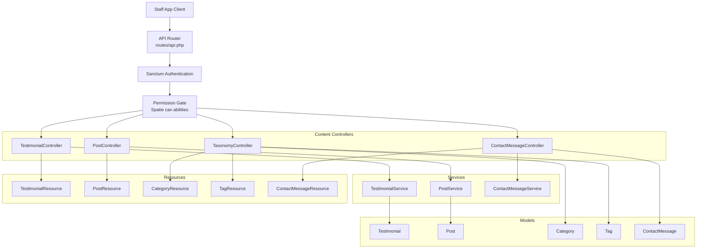
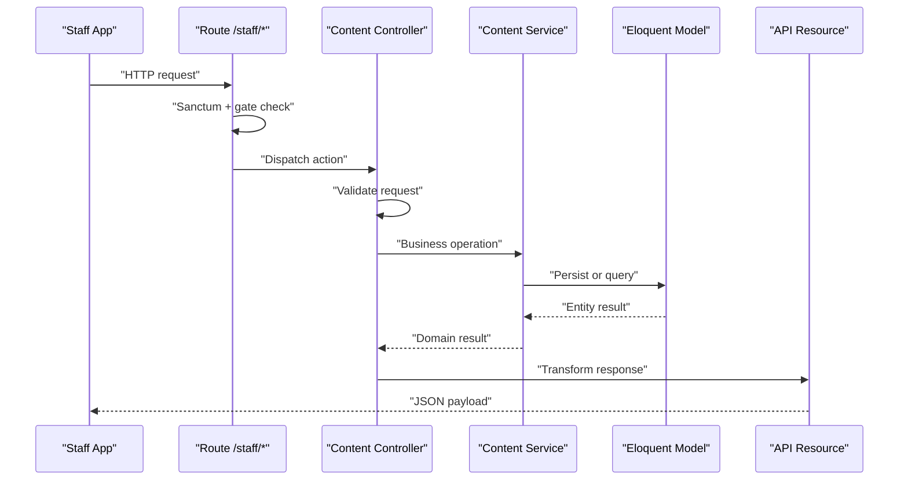
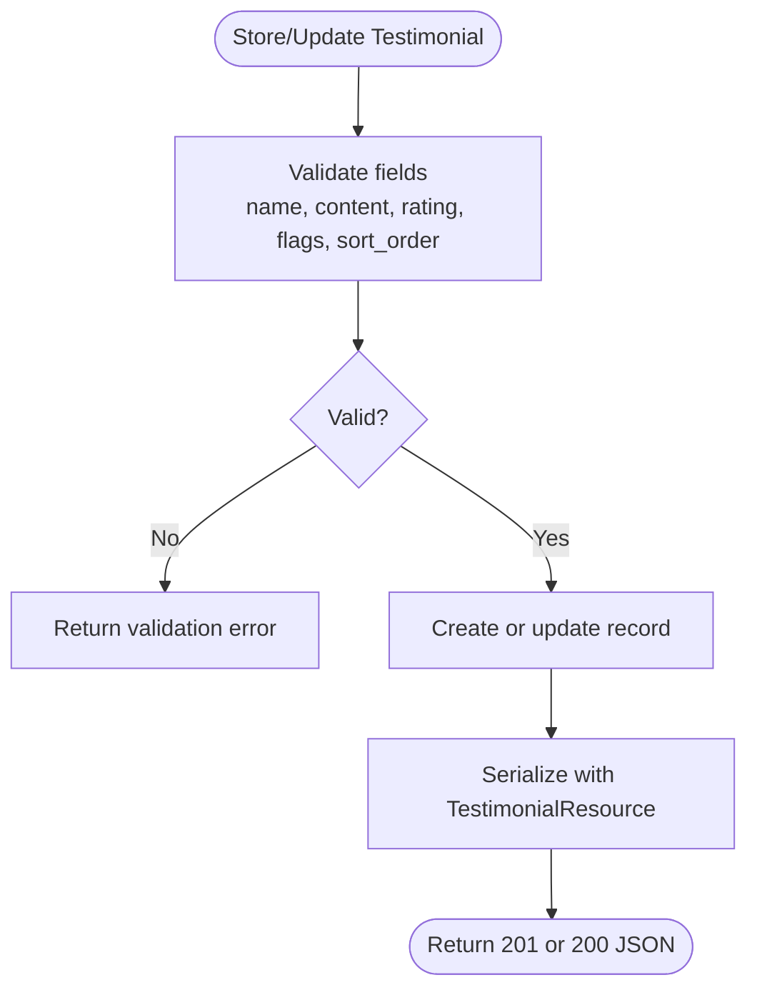
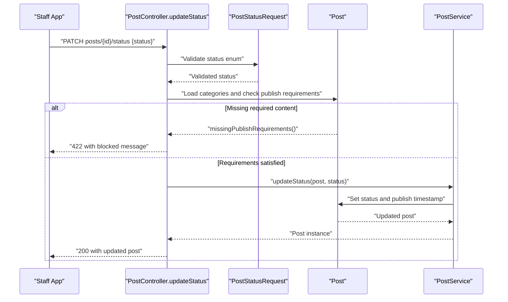
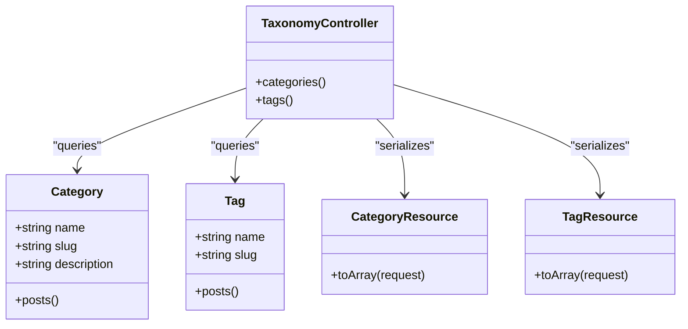
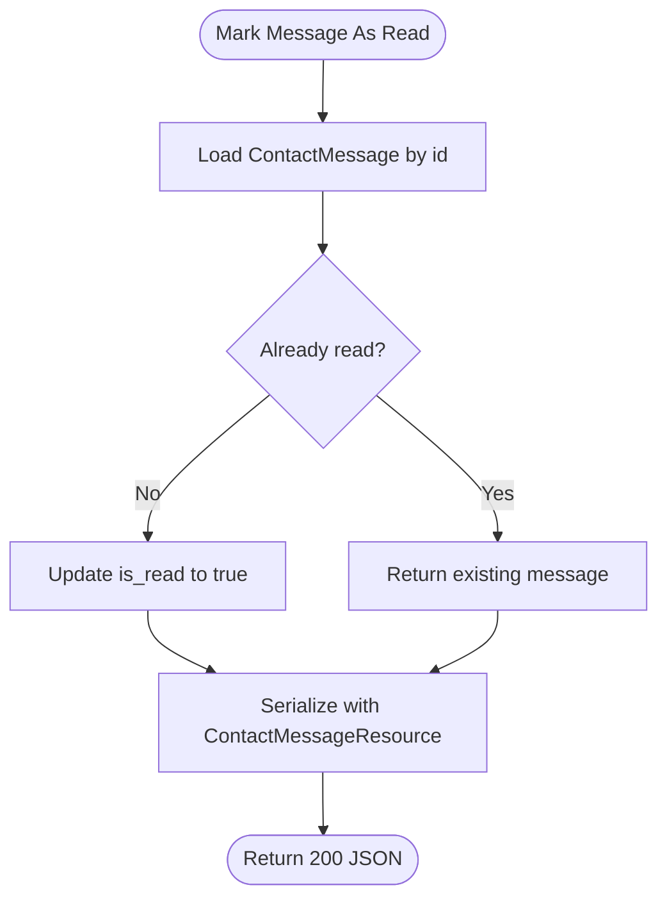
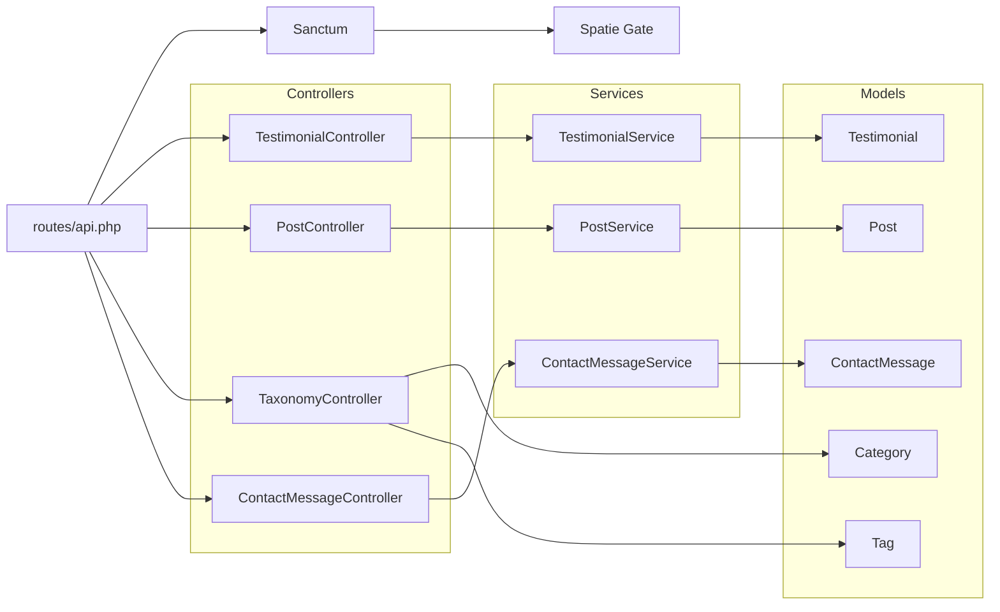

# Content Management API

<cite>
**Referenced Files in This Document**
- [api.php](file://routes/api.php)
- [TestimonialController.php](file://app/Http/Controllers/Api/TestimonialController.php)
- [PostController.php](file://app/Http/Controllers/Api/PostController.php)
- [TaxonomyController.php](file://app/Http/Controllers/Api/TaxonomyController.php)
- [ContactMessageController.php](file://app/Http/Controllers/Api/ContactMessageController.php)
- [TestimonialRequest.php](file://app/Http/Requests/Admin/TestimonialRequest.php)
- [PostStatusRequest.php](file://app/Http/Requests/Admin/PostStatusRequest.php)
- [TestimonialResource.php](file://app/Http/Resources/Api/TestimonialResource.php)
- [PostResource.php](file://app/Http/Resources/Api/PostResource.php)
- [CategoryResource.php](file://app/Http/Resources/Api/CategoryResource.php)
- [TagResource.php](file://app/Http/Resources/Api/TagResource.php)
- [ContactMessageResource.php](file://app/Http/Resources/Api/ContactMessageResource.php)
- [TestimonialService.php](file://app/Services/TestimonialService.php)
- [PostService.php](file://app/Services/PostService.php)
- [ContactMessageService.php](file://app/Services/ContactMessageService.php)
- [Testimonial.php](file://app/Models/Testimonial.php)
- [Post.php](file://app/Models/Post.php)
- [Category.php](file://app/Models/Category.php)
- [Tag.php](file://app/Models/Tag.php)
- [ContactMessage.php](file://app/Models/ContactMessage.php)
</cite>

## Table of Contents
1. [Introduction](#introduction)
2. [Project Structure](#project-structure)
3. [Core Components](#core-components)
4. [Architecture Overview](#architecture-overview)
5. [Detailed Component Analysis](#detailed-component-analysis)
6. [Dependency Analysis](#dependency-analysis)
7. [Performance Considerations](#performance-considerations)
8. [Troubleshooting Guide](#troubleshooting-guide)
9. [Conclusion](#conclusion)

## Introduction
This document describes the staff application content management API endpoints for:
- Testimonials (`/staff/testimonials`)
- Blog posts (`/staff/posts`, including status moderation)
- Taxonomy queries (`/staff/categories`, `/staff/tags`)
- Contact messages (`/staff/contact-messages`, including read-state triage)

All endpoints are under the `staff` API prefix, require a Sanctum token, and are further gated by Spatie permission abilities. The API is intended for the Highblossom staff mobile app and returns JSON through Laravel API resources.

## Project Structure
The content management API lives in the staff route group and follows a layered design:
- Routes declare paths, HTTP methods, names, and authorization abilities.
- Controllers handle request parameters, delegate to services, and return API resources.
- Services encapsulate persistence and workflow logic.
- Models define entities, casts, scopes, and relationships.
- Request classes validate input and coerce types.
- Resource classes shape outgoing JSON.

**Diagram sources**
- [api.php:1-117](file://routes/api.php#L1-L117)
- [TestimonialController.php:1-91](file://app/Http/Controllers/Api/TestimonialController.php#L1-L91)
- [PostController.php:1-92](file://app/Http/Controllers/Api/PostController.php#L1-L92)
- [TaxonomyController.php:1-35](file://app/Http/Controllers/Api/TaxonomyController.php#L1-L35)
- [ContactMessageController.php:1-81](file://app/Http/Controllers/Api/ContactMessageController.php#L1-L81)
- [TestimonialService.php:1-27](file://app/Services/TestimonialService.php#L1-L27)
- [PostService.php:1-178](file://app/Services/PostService.php#L1-L178)
- [ContactMessageService.php:1-33](file://app/Services/ContactMessageService.php#L1-L33)

**Section sources**
- [api.php:1-117](file://routes/api.php#L1-L117)

## Core Components
- Testimonials support full CRUD with search, published filtering, sort-order normalization, and boolean coercion.
- Blog posts expose read, moderation (status updates), and deletion; creation/editing stays on the web admin. Status changes enforce publish requirements before allowing publication.
- Taxonomy endpoints are read-only lists of categories and tags.
- Contact messages support inbox triage: listing with read-state filters, read-only show, explicit mark-as-read, and delete.

Authorization is enforced at the route level using Spatie abilities:
- Testimonials: `manage testimonials`
- Posts: `view blog` for read, `update blog` for status, `delete blog` for deletion
- Categories and tags: `view blog`
- Contact messages: `view contact messages`

Pagination defaults to 15 items per page, capped between 1 and 100.

**Section sources**
- [api.php:38-117](file://routes/api.php#L38-L117)
- [TestimonialController.php:1-91](file://app/Http/Controllers/Api/TestimonialController.php#L1-L91)
- [PostController.php:1-92](file://app/Http/Controllers/Api/PostController.php#L1-L92)
- [TaxonomyController.php:1-35](file://app/Http/Controllers/Api/TaxonomyController.php#L1-L35)
- [ContactMessageController.php:1-81](file://app/Http/Controllers/Api/ContactMessageController.php#L1-L81)

## Architecture Overview
Each content area follows the same pattern: controller receives authenticated requests, validates input, delegates to a service, persists data through Eloquent models, and serializes results through an API resource.

**Diagram sources**
- [api.php:1-117](file://routes/api.php#L1-L117)
- [TestimonialController.php:1-91](file://app/Http/Controllers/Api/TestimonialController.php#L1-L91)
- [PostController.php:1-92](file://app/Http/Controllers/Api/PostController.php#L1-L92)
- [ContactMessageController.php:1-81](file://app/Http/Controllers/Api/ContactMessageController.php#L1-L81)

## Detailed Component Analysis

### Testimonials API
Endpoints:
- `GET /staff/testimonials`
- `POST /staff/testimonials`
- `GET /staff/testimonials/{testimonial}`
- `PUT /staff/testimonials/{testimonial}`
- `DELETE /staff/testimonials/{testimonial}`

Authorization: `can:manage testimonials`

Query parameters for list:
- `search`: substring match against name, role, or content
- `published`: boolean filter for `is_published`
- `per_page`: integer from 1 to 100; default 15

Validation rules for create/update:
- `name`: required string, max 255
- `content`: required string
- `role`: optional string, max 255
- `rating`: required integer, 1–5
- `is_featured`: boolean
- `is_published`: boolean
- `sort_order`: normalized and uniqueness-checked through shared sort-order rules

Workflow state:
- Boolean flags control visibility and prominence rather than a formal lifecycle.
- Published scope selects only records where `is_published` is true.
- Ordered scope sorts by `sort_order`, then by descending id.

Response structure:
- Collection wraps paginated testimonial objects.
- Individual testimonial includes id, name, role, rating, content, flags, sort order, and timestamps.

Example usage patterns:
- Create a published, featured testimonial with a five-star rating.
- Update the sort order and toggle publication.
- Search testimonials by author name.
- List only published testimonials with a custom page size.

**Diagram sources**
- [TestimonialController.php:1-91](file://app/Http/Controllers/Api/TestimonialController.php#L1-L91)
- [TestimonialRequest.php:1-54](file://app/Http/Requests/Admin/TestimonialRequest.php#L1-L54)
- [TestimonialService.php:1-27](file://app/Services/TestimonialService.php#L1-L27)
- [TestimonialResource.php:1-38](file://app/Http/Resources/Api/TestimonialResource.php#L1-L38)
- [Testimonial.php:1-52](file://app/Models/Testimonial.php#L1-L52)

**Section sources**
- [api.php:66-76](file://routes/api.php#L66-L76)
- [TestimonialController.php:1-91](file://app/Http/Controllers/Api/TestimonialController.php#L1-L91)
- [TestimonialRequest.php:1-54](file://app/Http/Requests/Admin/TestimonialRequest.php#L1-L54)
- [TestimonialService.php:1-27](file://app/Services/TestimonialService.php#L1-L27)
- [TestimonialResource.php:1-38](file://app/Http/Resources/Api/TestimonialResource.php#L1-L38)
- [Testimonial.php:1-52](file://app/Models/Testimonial.php#L1-L52)

### Blog Posts API
Endpoints:
- `GET /staff/posts`
- `GET /staff/posts/{post:id}`
- `PATCH /staff/posts/{post:id}/status`
- `DELETE /staff/posts/{post:id}`

Authorization:
- Read index/show: `view blog`
- Status update: `update blog`
- Delete: `delete blog`

Query parameters for list:
- `status`: exact match against post status
- `user`: integer author id filter
- `search`: substring match against title or excerpt
- `per_page`: integer from 1 to 100; default 15

Post model states:
- `draft`
- `published`
- `archived`

Publishing rules:
- A post is considered live when its status is `published`, it has a published timestamp, and that timestamp is not in the future.
- Scheduled posts have status `published` but a future `published_at`.
- Attempting to publish a post without required content returns a 422 response listing missing fields.
- Status transitions go through the post service, which sets `published_at` when publishing if absent.

Response structure:
- Collection includes id, title, slug, excerpt, status, computed `status_key`, live indicator, estimated read time, featured image URL, published timestamp, and audit timestamps.
- Relationships include author, categories, and tags when loaded.

Example usage patterns:
- List all draft posts by a specific author.
- Show a single post with taxonomy and author.
- Move a draft to published after adding required content.
- Archive a published post.
- Delete a post after moderation.

**Diagram sources**
- [PostController.php:1-92](file://app/Http/Controllers/Api/PostController.php#L1-L92)
- [PostStatusRequest.php:1-35](file://app/Http/Requests/Admin/PostStatusRequest.php#L1-L35)
- [PostService.php:1-178](file://app/Services/PostService.php#L1-L178)
- [Post.php:1-274](file://app/Models/Post.php#L1-L274)

**Section sources**
- [api.php:78-89](file://routes/api.php#L78-L89)
- [PostController.php:1-92](file://app/Http/Controllers/Api/PostController.php#L1-L92)
- [PostStatusRequest.php:1-35](file://app/Http/Requests/Admin/PostStatusRequest.php#L1-L35)
- [PostService.php:1-178](file://app/Services/PostService.php#L1-L178)
- [PostResource.php:1-50](file://app/Http/Resources/Api/PostResource.php#L1-L50)
- [Post.php:1-274](file://app/Models/Post.php#L1-L274)

### Taxonomy API
Endpoints:
- `GET /staff/categories`
- `GET /staff/tags`

Authorization: `view blog`

Behavior:
- Both endpoints return all categories or tags ordered alphabetically by name.
- They are intentionally read-only; creation and editing remain in the web admin.
- Category and tag slugs are auto-generated from names when absent.

Response structures:
- Category resource includes id, name, slug, and description.
- Tag resource includes id, name, and slug.

Example usage patterns:
- Load available categories for post moderation UI.
- Enumerate tags for filtering or display.

**Diagram sources**
- [TaxonomyController.php:1-35](file://app/Http/Controllers/Api/TaxonomyController.php#L1-L35)
- [Category.php:1-46](file://app/Models/Category.php#L1-L46)
- [Tag.php:1-46](file://app/Models/Tag.php#L1-L46)
- [CategoryResource.php:1-32](file://app/Http/Resources/Api/CategoryResource.php#L1-L32)
- [TagResource.php:1-31](file://app/Http/Resources/Api/TagResource.php#L1-L31)

**Section sources**
- [api.php:90-91](file://routes/api.php#L90-L91)
- [TaxonomyController.php:1-35](file://app/Http/Controllers/Api/TaxonomyController.php#L1-L35)
- [Category.php:1-46](file://app/Models/Category.php#L1-L46)
- [Tag.php:1-46](file://app/Models/Tag.php#L1-L46)
- [CategoryResource.php:1-32](file://app/Http/Resources/Api/CategoryResource.php#L1-L32)
- [TagResource.php:1-31](file://app/Http/Resources/Api/TagResource.php#L1-L31)

### Contact Messages API
Endpoints:
- `GET /staff/contact-messages`
- `GET /staff/contact-messages/{message}`
- `PATCH /staff/contact-messages/{message}/read`
- `DELETE /staff/contact-messages/{message}`

Authorization: `view contact messages`

List behavior:
- Supports `status=read` or `status=unread` filtering.
- Supports substring search across name, email, and subject.
- Results are ordered by most recent and paginated.

Read-state workflow:
- `show` is read-only and does not change the message state.
- `markAsRead` explicitly marks a message as read.
- The service avoids redundant updates when the message is already read.

Response structure:
- Contact message resource includes id, sender name, email, phone, subject, message body, read flag, and created timestamp.

Example usage patterns:
- List unread messages and preview one without marking it read.
- Mark a message as read after reviewing it.
- Filter the inbox by read state.
- Remove a processed message.

**Diagram sources**
- [ContactMessageController.php:1-81](file://app/Http/Controllers/Api/ContactMessageController.php#L1-L81)
- [ContactMessageService.php:1-33](file://app/Services/ContactMessageService.php#L1-L33)
- [ContactMessage.php:1-55](file://app/Models/ContactMessage.php#L1-L55)
- [ContactMessageResource.php:1-36](file://app/Http/Resources/Api/ContactMessageResource.php#L1-L36)

**Section sources**
- [api.php:54-64](file://routes/api.php#L54-L64)
- [ContactMessageController.php:1-81](file://app/Http/Controllers/Api/ContactMessageController.php#L1-L81)
- [ContactMessageService.php:1-33](file://app/Services/ContactMessageService.php#L1-L33)
- [ContactMessage.php:1-55](file://app/Models/ContactMessage.php#L1-L55)
- [ContactMessageResource.php:1-36](file://app/Http/Resources/Api/ContactMessageResource.php#L1-L36)

## Dependency Analysis
The content management layer is cleanly separated into controllers, services, models, request validators, and resources. There are no circular dependencies among these layers. External integration points include:
- Sanctum authentication middleware for token-based access.
- Spatie permission gates for ability checks.
- Eloquent ORM for database persistence.
- Shared sort-order and SEO utilities referenced by models and services.

**Diagram sources**
- [api.php:1-117](file://routes/api.php#L1-L117)
- [TestimonialController.php:1-91](file://app/Http/Controllers/Api/TestimonialController.php#L1-L91)
- [PostController.php:1-92](file://app/Http/Controllers/Api/PostController.php#L1-L92)
- [TaxonomyController.php:1-35](file://app/Http/Controllers/Api/TaxonomyController.php#L1-L35)
- [ContactMessageController.php:1-81](file://app/Http/Controllers/Api/ContactMessageController.php#L1-L81)
- [TestimonialService.php:1-27](file://app/Services/TestimonialService.php#L1-L27)
- [PostService.php:1-178](file://app/Services/PostService.php#L1-L178)
- [ContactMessageService.php:1-33](file://app/Services/ContactMessageService.php#L1-L33)

**Section sources**
- [api.php:1-117](file://routes/api.php#L1-L117)

## Performance Considerations
- Pagination caps pages at 100 entries to avoid large payloads.
- Index endpoints use targeted where clauses and eager loading where appropriate.
- Taxonomy endpoints return lightweight collections without heavy relations.
- Post list queries order deterministically by published date and id.
- Contact message list uses latest ordering and simple string matching.
- Testimonial list applies optional boolean filtering and search before pagination.

[No sources needed since this section provides general guidance]

## Troubleshooting Guide
Common issues and resolutions:
- Unauthorized access: Ensure the Sanctum token is present and the user has the required ability for the endpoint.
- Validation failures: Check field types and limits, especially testimonial rating ranges and required fields.
- Publish blocked: When updating a post to published, ensure required content exists; otherwise, the API returns a 422 response indicating missing fields.
- Sort-order conflicts: Testimonial sort-order validation enforces uniqueness rules; adjust neighboring items carefully.
- Read-state confusion: Use PATCH `/contact-messages/{id}/read` to mark messages as read; GET `/contact-messages/{id}` does not change state.

**Section sources**
- [TestimonialRequest.php:1-54](file://app/Http/Requests/Admin/TestimonialRequest.php#L1-L54)
- [PostStatusRequest.php:1-35](file://app/Http/Requests/Admin/PostStatusRequest.php#L1-L35)
- [PostController.php:55-80](file://app/Http/Controllers/Api/PostController.php#L55-L80)
- [ContactMessageController.php:55-81](file://app/Http/Controllers/Api/ContactMessageController.php#L55-L81)

## Conclusion
The content management API provides a secure, permission-gated interface for managing testimonials, moderating blog posts, querying taxonomy, and triaging contact messages. It emphasizes clear separation of concerns, strict validation, and predictable workflow states. Clients should authenticate with Sanctum, respect ability requirements, follow validation constraints, and use pagination and filters to build efficient staff workflows.