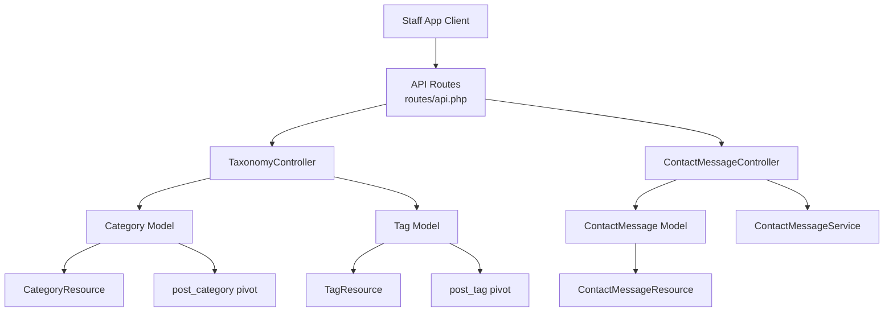
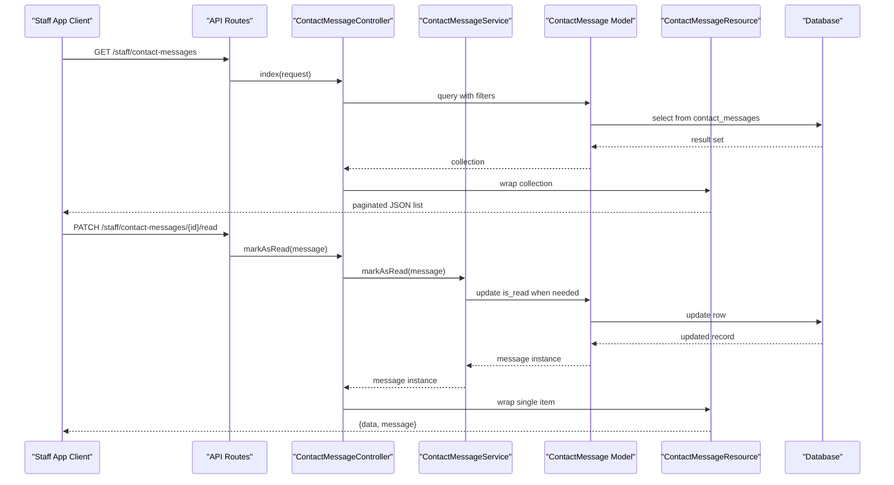
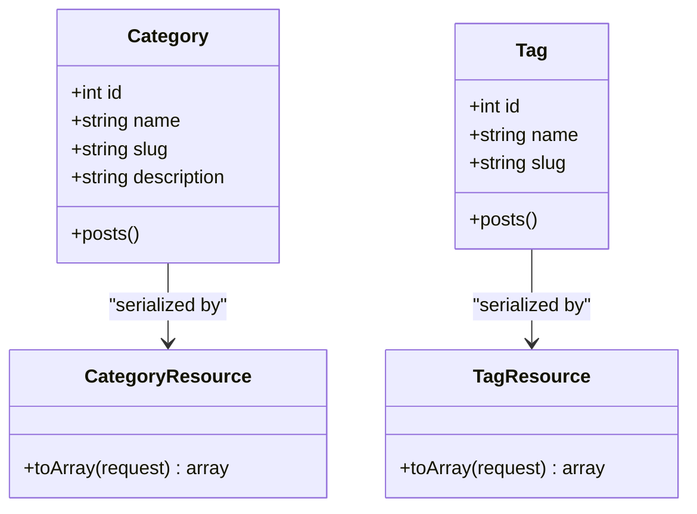
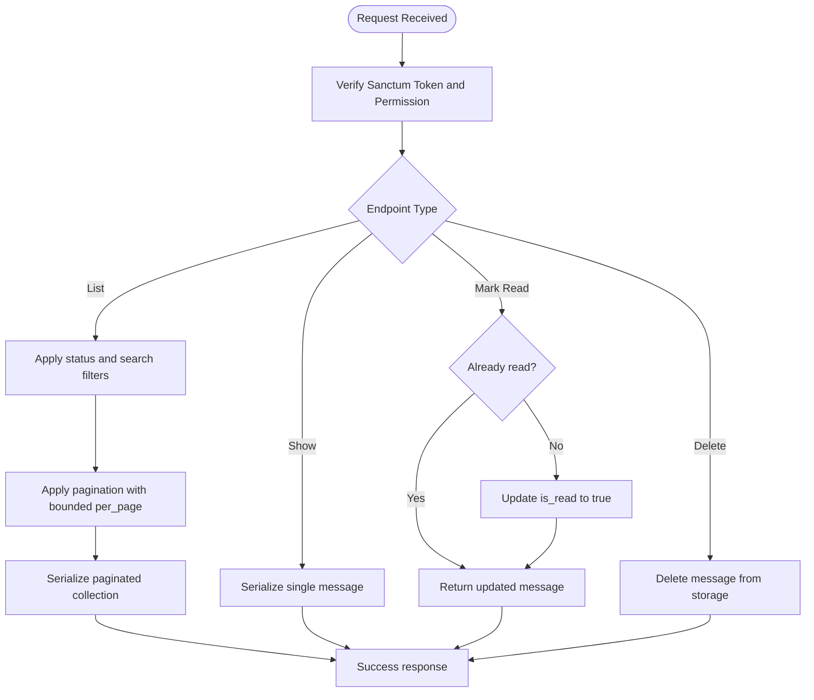
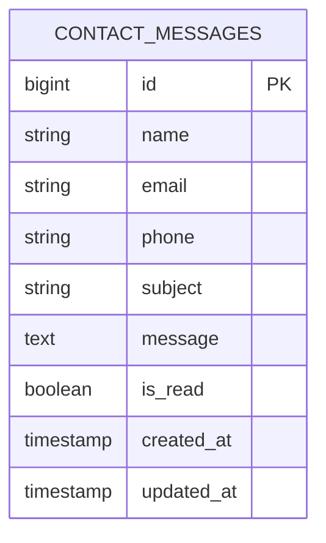
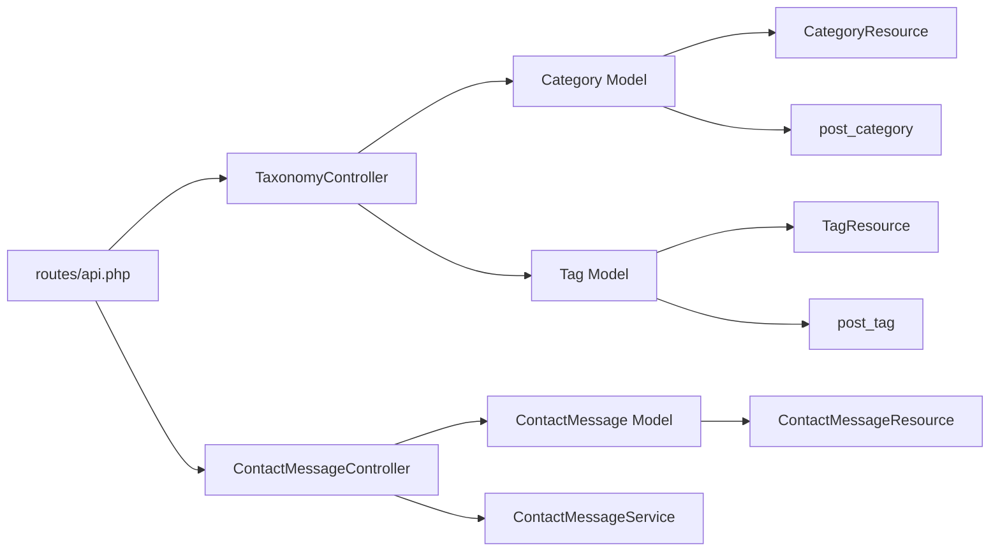

# Taxonomy and Contact Messages API

<cite>
**Referenced Files in This Document**
- [routes/api.php](file://routes/api.php)
- [app/Http/Controllers/Api/TaxonomyController.php](file://app/Http/Controllers/Api/TaxonomyController.php)
- [app/Http/Controllers/Api/ContactMessageController.php](file://app/Http/Controllers/Api/ContactMessageController.php)
- [app/Models/Category.php](file://app/Models/Category.php)
- [app/Models/Tag.php](file://app/Models/Tag.php)
- [app/Models/ContactMessage.php](file://app/Models/ContactMessage.php)
- [app/Services/ContactMessageService.php](file://app/Services/ContactMessageService.php)
- [app/Http/Resources/Api/CategoryResource.php](file://app/Http/Resources/Api/CategoryResource.php)
- [app/Http/Resources/Api/TagResource.php](file://app/Http/Resources/Api/TagResource.php)
- [app/Http/Resources/Api/ContactMessageResource.php](file://app/Http/Resources/Api/ContactMessageResource.php)
- [database/migrations/2026_04_17_110005_create_contact_messages_table.php](file://database/migrations/2026_04_17_110005_create_contact_messages_table.php)
- [database/migrations/2026_04_22_152130_create_categories_table.php](file://database/migrations/2026_04_22_152130_create_categories_table.php)
- [database/migrations/2026_04_22_152135_create_tags_table.php](file://database/migrations/2026_04_22_152135_create_tags_table.php)
- [database/migrations/2026_04_22_152139_create_post_category_table.php](file://database/migrations/2026_04_22_152139_create_post_category_table.php)
- [database/migrations/2026_04_22_152142_create_post_tag_table.php](file://database/migrations/2026_04_22_152142_create_post_tag_table.php)
</cite>

## Table of Contents
1. [Introduction](#introduction)
2. [Project Structure](#project-structure)
3. [Core Components](#core-components)
4. [Architecture Overview](#architecture-overview)
5. [Detailed Component Analysis](#detailed-component-analysis)
6. [Dependency Analysis](#dependency-analysis)
7. [Performance Considerations](#performance-considerations)
8. [Troubleshooting Guide](#troubleshooting-guide)
9. [Conclusion](#conclusion)

## Introduction
This document describes the staff app APIs for taxonomy lookup and contact message management. It covers:

- Read-only taxonomy endpoints under `/staff/categories` and `/staff/tags`.
- Contact message endpoints under `/staff/contact-messages`, including listing, individual retrieval, mark-as-read, and deletion.

These endpoints are token-authenticated through Sanctum and gated by Spatie permissions. The taxonomy endpoints expose categories and tags used to organize blog posts. The contact message endpoints provide a triage workflow where staff can list inquiries, preview them without changing state, explicitly mark messages as read, and delete processed items.

## Project Structure
The relevant code is organized around Laravel conventions:

- Routes are defined centrally and grouped under the `staff` prefix.
- Controllers handle HTTP requests and delegate business logic to services or models.
- Eloquent models represent database entities.
- JSON resources normalize model data into stable API payloads.
- Database migrations define tables and relationships.

**Diagram sources**
- [routes/api.php:1-117](file://routes/api.php#L1-L117)
- [app/Http/Controllers/Api/TaxonomyController.php:1-35](file://app/Http/Controllers/Api/TaxonomyController.php#L1-L35)
- [app/Http/Controllers/Api/ContactMessageController.php:1-81](file://app/Http/Controllers/Api/ContactMessageController.php#L1-L81)
- [app/Models/Category.php:1-46](file://app/Models/Category.php#L1-L46)
- [app/Models/Tag.php:1-46](file://app/Models/Tag.php#L1-L46)
- [app/Models/ContactMessage.php:1-55](file://app/Models/ContactMessage.php#L1-L55)
- [app/Services/ContactMessageService.php:1-33](file://app/Services/ContactMessageService.php#L1-L33)
- [app/Http/Resources/Api/CategoryResource.php:1-32](file://app/Http/Resources/Api/CategoryResource.php#L1-L32)
- [app/Http/Resources/Api/TagResource.php:1-31](file://app/Http/Resources/Api/TagResource.php#L1-L31)
- [app/Http/Resources/Api/ContactMessageResource.php:1-36](file://app/Http/Resources/Api/ContactMessageResource.php#L1-L36)
- [database/migrations/2026_04_22_152139_create_post_category_table.php:1-28](file://database/migrations/2026_04_22_152139_create_post_category_table.php#L1-L28)
- [database/migrations/2026_04_22_152142_create_post_tag_table.php:1-28](file://database/migrations/2026_04_22_152142_create_post_tag_table.php#L1-L28)

**Section sources**
- [routes/api.php:1-117](file://routes/api.php#L1-L117)

## Core Components
This section summarizes the main components involved in the taxonomy and contact message APIs.

### Taxonomy Endpoints
- `/staff/categories`: Returns all categories sorted alphabetically by name.
- `/staff/tags`: Returns all tags sorted alphabetically by name.

Both endpoints return collections of JSON objects through dedicated resources. They are read-only; creation and editing happen elsewhere in the web admin.

### Contact Message Endpoints
- `/staff/contact-messages`: Lists contact messages with optional filtering by status and search text.
- `/staff/contact-messages/{message}`: Retrieves an individual message without changing its read state.
- `/staff/contact-messages/{message}/read`: Marks a message as read and returns updated data.
- `/staff/contact-messages/{message}`: Deletes a message after confirmation.

All contact message operations are protected by the same permission gate used by the web admin panel.

**Section sources**
- [routes/api.php:1-117](file://routes/api.php#L1-L117)
- [app/Http/Controllers/Api/TaxonomyController.php:1-35](file://app/Http/Controllers/Api/TaxonomyController.php#L1-L35)
- [app/Http/Controllers/Api/ContactMessageController.php:1-81](file://app/Http/Controllers/Api/ContactMessageController.php#L1-L81)

## Architecture Overview
The API follows a layered pattern:

- Route layer defines paths, parameters, and authorization middleware.
- Controller layer parses input, delegates to services or models, and returns JSON resources.
- Service layer encapsulates mutation logic such as marking a message read or deleting it.
- Model layer represents domain data and provides scopes and behavior.
- Resource layer normalizes responses into stable shapes for clients.
- Database layer stores persistent records and relationships.

**Diagram sources**
- [routes/api.php:1-117](file://routes/api.php#L1-L117)
- [app/Http/Controllers/Api/ContactMessageController.php:1-81](file://app/Http/Controllers/Api/ContactMessageController.php#L1-L81)
- [app/Services/ContactMessageService.php:1-33](file://app/Services/ContactMessageService.php#L1-L33)
- [app/Models/ContactMessage.php:1-55](file://app/Models/ContactMessage.php#L1-L55)
- [app/Http/Resources/Api/ContactMessageResource.php:1-36](file://app/Http/Resources/Api/ContactMessageResource.php#L1-L36)
- [database/migrations/2026_04_17_110005_create_contact_messages_table.php:1-27](file://database/migrations/2026_04_17_110005_create_contact_messages_table.php#L1-L27)

## Detailed Component Analysis

### Taxonomy API

#### Endpoints
- `GET /staff/categories`
  - Authorization: requires token authentication and the `view blog` ability.
  - Response: array of category objects sorted by name.
- `GET /staff/tags`
  - Authorization: requires token authentication and the `view blog` ability.
  - Response: array of tag objects sorted by name.

#### Data Models
- Category
  - Fields include identifier, name, slug, and description.
  - Slug generation is automatic when missing.
  - Related to posts through a many-to-many relationship.
- Tag
  - Fields include identifier, name, and slug.
  - Slug generation is automatic when missing.
  - Related to posts through a many-to-many relationship.

#### Resources
- CategoryResource returns id, name, slug, and description.
- TagResource returns id, name, and slug.

**Diagram sources**
- [app/Models/Category.php:1-46](file://app/Models/Category.php#L1-L46)
- [app/Models/Tag.php:1-46](file://app/Models/Tag.php#L1-L46)
- [app/Http/Resources/Api/CategoryResource.php:1-32](file://app/Http/Resources/Api/CategoryResource.php#L1-L32)
- [app/Http/Resources/Api/TagResource.php:1-31](file://app/Http/Resources/Api/TagResource.php#L1-L31)

#### Example Queries
- List categories:
  - Request: `GET /staff/categories`
  - Use case: Populate a dropdown of available categories for posts.
- List tags:
  - Request: `GET /staff/tags`
  - Use case: Render tag clouds or filter posts by tag.

**Section sources**
- [routes/api.php:1-117](file://routes/api.php#L1-L117)
- [app/Http/Controllers/Api/TaxonomyController.php:1-35](file://app/Http/Controllers/Api/TaxonomyController.php#L1-L35)
- [app/Models/Category.php:1-46](file://app/Models/Category.php#L1-L46)
- [app/Models/Tag.php:1-46](file://app/Models/Tag.php#L1-L46)
- [app/Http/Resources/Api/CategoryResource.php:1-32](file://app/Http/Resources/Api/CategoryResource.php#L1-L32)
- [app/Http/Resources/Api/TagResource.php:1-31](file://app/Http/Resources/Api/TagResource.php#L1-L31)
- [database/migrations/2026_04_22_152130_create_categories_table.php:1-30](file://database/migrations/2026_04_22_152130_create_categories_table.php#L1-L30)
- [database/migrations/2026_04_22_152135_create_tags_table.php:1-29](file://database/migrations/2026_04_22_152135_create_tags_table.php#L1-L29)
- [database/migrations/2026_04_22_152139_create_post_category_table.php:1-28](file://database/migrations/2026_04_22_152139_create_post_category_table.php#L1-L28)
- [database/migrations/2026_04_22_152142_create_post_tag_table.php:1-28](file://database/migrations/2026_04_22_152142_create_post_tag_table.php#L1-L28)

### Contact Message API

#### Endpoints
- `GET /staff/contact-messages`
  - Authorization: requires token authentication and the `view contact messages` ability.
  - Query parameters:
    - `status`: Filter by `read` or `unread`.
    - `search`: Case-insensitive substring match against name, email, or subject.
    - `per_page`: Page size between 1 and 100; defaults to 15.
  - Response: paginated list of contact messages.
- `GET /staff/contact-messages/{message}`
  - Authorization: requires token authentication and the `view contact messages` ability.
  - Behavior: Returns a single message without changing `is_read`.
- `PATCH /staff/contact-messages/{message}/read`
  - Authorization: requires token authentication and the `view contact messages` ability.
  - Behavior: Sets `is_read` to true if not already true, then returns updated data and a success message.
- `DELETE /staff/contact-messages/{message}`
  - Authorization: requires token authentication and the `view contact messages` ability.
  - Behavior: Permanently removes the message.

**Diagram sources**
- [app/Http/Controllers/Api/ContactMessageController.php:1-81](file://app/Http/Controllers/Api/ContactMessageController.php#L1-L81)
- [app/Services/ContactMessageService.php:1-33](file://app/Services/ContactMessageService.php#L1-L33)
- [app/Models/ContactMessage.php:1-55](file://app/Models/ContactMessage.php#L1-L55)
- [app/Http/Resources/Api/ContactMessageResource.php:1-36](file://app/Http/Resources/Api/ContactMessageResource.php#L1-L36)
- [database/migrations/2026_04_17_110005_create_contact_messages_table.php:1-27](file://database/migrations/2026_04_17_110005_create_contact_messages_table.php#L1-L27)

#### Data Model and Status Tracking
The contact message model includes:

- Identifier, visitor name, email, phone, subject, message body, and timestamps.
- Boolean `is_read` field indicating whether staff have reviewed the inquiry.
- A method that marks the message as read.
- Scopes to filter by read or unread status.

**Diagram sources**
- [database/migrations/2026_04_17_110005_create_contact_messages_table.php:1-27](file://database/migrations/2026_04_17_110005_create_contact_messages_table.php#L1-L27)
- [app/Models/ContactMessage.php:1-55](file://app/Models/ContactMessage.php#L1-L55)

#### Example Workflows

##### Listing unread messages
- Request: `GET /staff/contact-messages?status=unread&per_page=20`
- Result: Paginated list containing only unread messages, newest first.
- Use case: Triage queue for new customer inquiries.

##### Searching by subject
- Request: `GET /staff/contact-messages?search=refund`
- Result: Messages whose name, email, or subject contain the search term.
- Use case: Locate inquiries related to a specific topic.

##### Reading a message without affecting state
- Request: `GET /staff/contact-messages/{id}`
- Result: Full message object including current `is_read` value.
- Use case: Preview a message before deciding whether to mark it read.

##### Marking a message as read
- Request: `PATCH /staff/contact-messages/{id}/read`
- Result: Updated message object wrapped in a data envelope plus a human-readable message.
- Use case: Explicitly acknowledge an inquiry after review.

##### Deleting a processed message
- Request: `DELETE /staff/contact-messages/{id}`
- Result: Confirmation message confirming deletion.
- Use case: Remove resolved or duplicate inquiries.

**Section sources**
- [routes/api.php:1-117](file://routes/api.php#L1-L117)
- [app/Http/Controllers/Api/ContactMessageController.php:1-81](file://app/Http/Controllers/Api/ContactMessageController.php#L1-L81)
- [app/Services/ContactMessageService.php:1-33](file://app/Services/ContactMessageService.php#L1-L33)
- [app/Models/ContactMessage.php:1-55](file://app/Models/ContactMessage.php#L1-L55)
- [app/Http/Resources/Api/ContactMessageResource.php:1-36](file://app/Http/Resources/Api/ContactMessageResource.php#L1-L36)
- [database/migrations/2026_04_17_110005_create_contact_messages_table.php:1-27](file://database/migrations/2026_04_17_110005_create_contact_messages_table.php#L1-L27)

## Dependency Analysis
The following diagram shows how controllers, services, models, and resources interact for the two feature areas.

**Diagram sources**
- [routes/api.php:1-117](file://routes/api.php#L1-L117)
- [app/Http/Controllers/Api/TaxonomyController.php:1-35](file://app/Http/Controllers/Api/TaxonomyController.php#L1-L35)
- [app/Http/Controllers/Api/ContactMessageController.php:1-81](file://app/Http/Controllers/Api/ContactMessageController.php#L1-L81)
- [app/Models/Category.php:1-46](file://app/Models/Category.php#L1-L46)
- [app/Models/Tag.php:1-46](file://app/Models/Tag.php#L1-L46)
- [app/Models/ContactMessage.php:1-55](file://app/Models/ContactMessage.php#L1-L55)
- [app/Services/ContactMessageService.php:1-33](file://app/Services/ContactMessageService.php#L1-L33)
- [app/Http/Resources/Api/CategoryResource.php:1-32](file://app/Http/Resources/Api/CategoryResource.php#L1-L32)
- [app/Http/Resources/Api/TagResource.php:1-31](file://app/Http/Resources/Api/TagResource.php#L1-L31)
- [app/Http/Resources/Api/ContactMessageResource.php:1-36](file://app/Http/Resources/Api/ContactMessageResource.php#L1-L36)
- [database/migrations/2026_04_22_152139_create_post_category_table.php:1-28](file://database/migrations/2026_04_22_152139_create_post_category_table.php#L1-L28)
- [database/migrations/2026_04_22_152142_create_post_tag_table.php:1-28](file://database/migrations/2026_04_22_152142_create_post_tag_table.php#L1-L28)

**Section sources**
- [routes/api.php:1-117](file://routes/api.php#L1-L117)
- [app/Http/Controllers/Api/TaxonomyController.php:1-35](file://app/Http/Controllers/Api/TaxonomyController.php#L1-L35)
- [app/Http/Controllers/Api/ContactMessageController.php:1-81](file://app/Http/Controllers/Api/ContactMessageController.php#L1-L81)

## Performance Considerations
- Pagination limits page sizes to a maximum of 100 entries. Clients should choose reasonable page sizes to avoid large payloads.
- Alphabetical ordering uses the default database sort on name for both categories and tags.
- Search queries use substring matching across name, email, and subject columns. For large datasets, consider adding application-level indexing or restricting searches to smaller filtered subsets.
- Mark-as-read updates only occur when necessary, avoiding redundant writes.
- Deletion is immediate and irreversible; applications should confirm destructive actions before calling delete endpoints.

[No sources needed since this section provides general guidance]

## Troubleshooting Guide

### Authentication and Authorization Errors
- All endpoints require a valid Sanctum token.
- Missing or invalid tokens typically produce authentication failures.
- Insufficient permissions cause authorization failures:
  - Taxonomy endpoints require `view blog`.
  - Contact message endpoints require `view contact messages`.

### Unexpected Read State After Show
- The show endpoint does not change the read state. If an application expects reading a message to mark it read automatically, it must call the explicit mark-as-read endpoint.

### Empty Search Results
- Search matches substrings across name, email, and subject. Verify the search term and consider removing filters to confirm whether the issue is with the query or the dataset.

### Pagination Limits
- If more than 100 results are requested, the server caps the page size at 100. Use multiple pages or refine filters to reduce result volume.

**Section sources**
- [routes/api.php:1-117](file://routes/api.php#L1-L117)
- [app/Http/Controllers/Api/ContactMessageController.php:1-81](file://app/Http/Controllers/Api/ContactMessageController.php#L1-L81)

## Conclusion
The staff API provides a clear separation between read-only taxonomy lookups and active contact message management. Categories and tags are exposed for display and organization of blog content, while contact messages support a practical triage workflow with filtering, safe preview, explicit read tracking, and deletion. Proper authentication, permission gates, and resource normalization make these endpoints predictable and integrable for mobile or external staff tools.