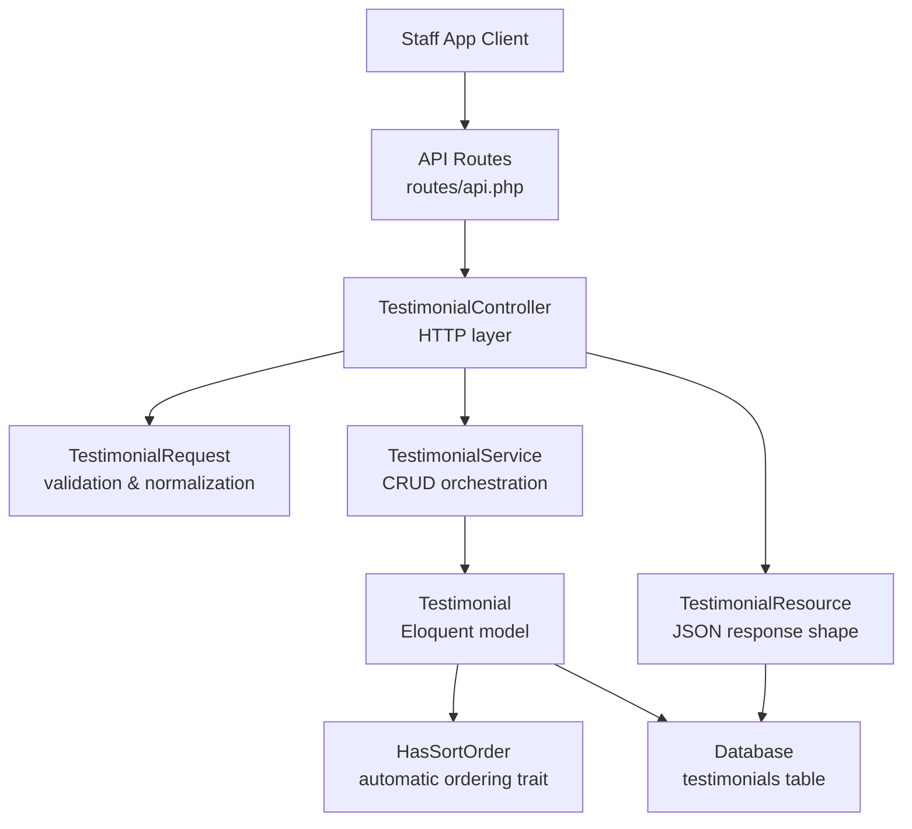
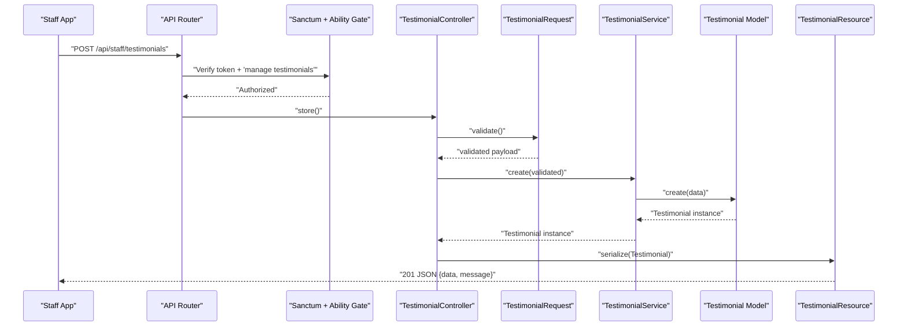
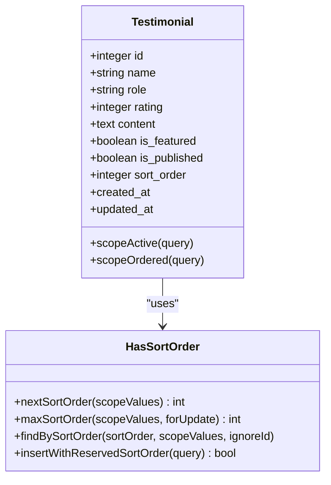
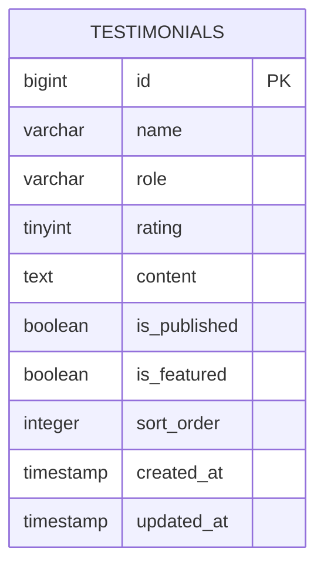
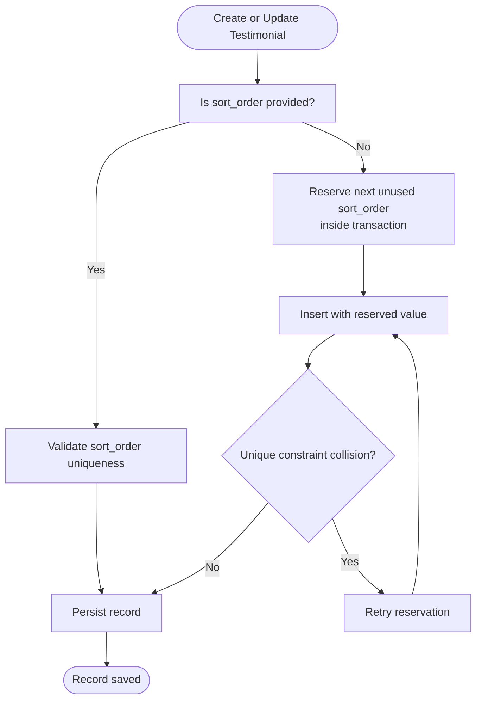
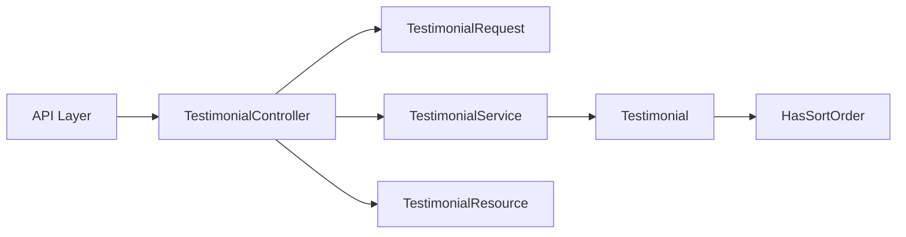

# Testimonials API

<cite>
**Referenced Files in This Document**
- [routes/api.php](file://routes/api.php)
- [app/Http/Controllers/Api/TestimonialController.php](file://app/Http/Controllers/Api/TestimonialController.php)
- [app/Http/Resources/Api/TestimonialResource.php](file://app/Http/Resources/Api/TestimonialResource.php)
- [app/Http/Requests/Admin/TestimonialRequest.php](file://app/Http/Requests/Admin/TestimonialRequest.php)
- [app/Services/TestimonialService.php](file://app/Services/TestimonialService.php)
- [app/Models/Testimonial.php](file://app/Models/Testimonial.php)
- [app/Models/Concerns/HasSortOrder.php](file://app/Models/Concerns/HasSortOrder.php)
- [database/migrations/2026_04_17_110001_create_testimonials_table.php](file://database/migrations/2026_04_17_110001_create_testimonials_table.php)
- [database/migrations/2026_04_21_090120_update_testimonials_columns_table.php](file://database/migrations/2026_04_21_090120_update_testimonials_columns_table.php)
- [database/migrations/2026_10_17_000000_drop_service_icon_and_nullable_testimonial_role.php](file://database/migrations/2026_10_17_000000_drop_service_icon_and_nullable_testimonial_role.php)
</cite>

## Table of Contents
1. [Introduction](#introduction)
2. [Project Structure](#project-structure)
3. [Core Components](#core-components)
4. [Architecture Overview](#architecture-overview)
5. [Detailed Component Analysis](#detailed-component-analysis)
6. [Dependency Analysis](#dependency-analysis)
7. [Performance Considerations](#performance-considerations)
8. [Troubleshooting Guide](#troubleshooting-guide)
9. [Conclusion](#conclusion)

## Introduction
This document describes the testimonials management API used by the staff application. It covers:
- The five CRUD endpoints under `/api/staff/testimonials`.
- The testimonial data model and database schema.
- Validation rules for creating and updating testimonials.
- Approval/workflow semantics represented by `is_published` and `is_featured`.
- Display ordering through `sort_order`, including automatic ordering behavior.
- Example workflows for creation, updates, visibility management, and deletion.

The API is token-authenticated using Sanctum and restricted to users with the `manage testimonials` permission.

## Project Structure
The testimonials feature spans routing, controller logic, request validation, resource serialization, service operations, Eloquent modeling, sorting support, and database migrations.

**Diagram sources**
- [routes/api.php:78-84](file://routes/api.php#L78-L84)
- [app/Http/Controllers/Api/TestimonialController.php:1-91](file://app/Http/Controllers/Api/TestimonialController.php#L1-L91)
- [app/Http/Requests/Admin/TestimonialRequest.php:1-54](file://app/Http/Requests/Admin/TestimonialRequest.php#L1-L54)
- [app/Services/TestimonialService.php:1-27](file://app/Services/TestimonialService.php#L1-L27)
- [app/Models/Testimonial.php:1-52](file://app/Models/Testimonial.php#L1-L52)
- [app/Models/Concerns/HasSortOrder.php:1-186](file://app/Models/Concerns/HasSortOrder.php#L1-L186)
- [app/Http/Resources/Api/TestimonialResource.php:1-38](file://app/Http/Resources/Api/TestimonialResource.php#L1-L38)
- [database/migrations/2026_04_17_110001_create_testimonials_table.php:1-27](file://database/migrations/2026_04_17_110001_create_testimonials_table.php#L1-L27)

**Section sources**
- [routes/api.php:78-84](file://routes/api.php#L78-L84)
- [app/Http/Controllers/Api/TestimonialController.php:1-91](file://app/Http/Controllers/Api/TestimonialController.php#L1-L91)

## Core Components
- **API routes**: Five endpoints under the authenticated `/api/staff` group.
- **Controller**: Handles listing, retrieval, creation, update, and deletion.
- **Validation request**: Normalizes booleans and enforces field constraints, including sort-order uniqueness.
- **Service**: Thin persistence layer delegating to the Eloquent model.
- **Model**: Defines casts, scopes, and ordering behavior.
- **Sorting trait**: Provides automatic unique `sort_order` assignment and conflict retries.
- **Resource**: Serializes the model into a stable JSON structure.
- **Migrations**: Define and evolve the `testimonials` table schema.

**Section sources**
- [routes/api.php:78-84](file://routes/api.php#L78-L84)
- [app/Http/Controllers/Api/TestimonialController.php:1-91](file://app/Http/Controllers/Api/TestimonialController.php#L1-L91)
- [app/Http/Requests/Admin/TestimonialRequest.php:1-54](file://app/Http/Requests/Admin/TestimonialRequest.php#L1-L54)
- [app/Services/TestimonialService.php:1-27](file://app/Services/TestimonialService.php#L1-L27)
- [app/Models/Testimonial.php:1-52](file://app/Models/Testimonial.php#L1-L52)
- [app/Models/Concerns/HasSortOrder.php:1-186](file://app/Models/Concerns/HasSortOrder.php#L1-L186)
- [app/Http/Resources/Api/TestimonialResource.php:1-38](file://app/Http/Resources/Api/TestimonialResource.php#L1-L38)

## Architecture Overview
The staff API uses Sanctum authentication and Spatie-style ability checks. All testimonial endpoints require the `manage testimonials` ability.

**Diagram sources**
- [routes/api.php:78-84](file://routes/api.php#L78-L84)
- [app/Http/Controllers/Api/TestimonialController.php:54-69](file://app/Http/Controllers/Api/TestimonialController.php#L54-L69)
- [app/Http/Requests/Admin/TestimonialRequest.php:17-54](file://app/Http/Requests/Admin/TestimonialRequest.php#L17-L54)
- [app/Services/TestimonialService.php:10-17](file://app/Services/TestimonialService.php#L10-L17)
- [app/Models/Testimonial.php:1-52](file://app/Models/Testimonial.php#L1-L52)
- [app/Http/Resources/Api/TestimonialResource.php:16-37](file://app/Http/Resources/Api/TestimonialResource.php#L16-L37)

## Detailed Component Analysis

### API Endpoints
All endpoints are under `/api/staff` and protected by Sanctum plus the `manage testimonials` ability.

| Method | Path | Purpose | Query Parameters | Status Codes | Notes |
|---|---|---|---|---|---|
| GET | `/api/staff/testimonials` | List testimonials | `search`, `published`, `per_page` | 200 | Paginated; sorted by `sort_order` then descending `id`. |
| POST | `/api/staff/testimonials` | Create testimonial | None | 201, 422, 401/403 | Requires valid payload and authorization. |
| GET | `/api/staff/testimonials/{testimonial}` | Retrieve one testimonial | None | 200, 404, 401/403 | Numeric route binding. |
| PUT | `/api/staff/testimonials/{testimonial}` | Update testimonial | None | 200, 422, 404, 401/403 | Partial updates supported. |
| DELETE | `/api/staff/testimonials/{testimonial}` | Remove testimonial | None | 200, 404, 401/403 | Performs hard delete. |

Authorization and route registration:
- Listing, creation, retrieval, update, and deletion all use `can:manage testimonials`.
- The `{testimonial}` parameter is constrained to numeric values.

**Section sources**
- [routes/api.php:78-84](file://routes/api.php#L78-L84)

#### GET /testimonials — Listing
- Filters:
  - `search`: case-insensitive search across `name`, `role`, and `content`.
  - `published`: boolean filter on `is_published`.
- Sorting:
  - Ordered by `sort_order` ascending, then `id` descending.
- Pagination:
  - Default page size is 15.
  - Enforced between 1 and 100 via `min(100, max(1, per_page))`.

Example query patterns:
- Search published testimonials: `/api/staff/testimonials?published=true&search=Jane`
- Fetch more results: `/api/staff/testimonials?per_page=50`

Response body:
- Array-wrapped collection returned through `TestimonialResource::collection()`.

**Section sources**
- [app/Http/Controllers/Api/TestimonialController.php:27-52](file://app/Http/Controllers/Api/TestimonialController.php#L27-L52)
- [app/Models/Testimonial.php:26-51](file://app/Models/Testimonial.php#L26-L51)
- [app/Http/Resources/Api/TestimonialResource.php:16-37](file://app/Http/Resources/Api/TestimonialResource.php#L16-L37)

#### POST /testimonials — Creation
Payload fields:
- `name`: required string, maximum 255 characters.
- `content`: required string.
- `role`: optional string, maximum 255 characters; nullable at the database level.
- `rating`: required integer from 1 to 5.
- `is_featured`: boolean.
- `is_published`: boolean.
- `sort_order`: validated and normalized by `SortOrderRules`.

Behavior:
- Boolean fields are coerced during validation preparation.
- If `sort_order` is omitted, an unused order number is automatically reserved and inserted atomically.
- Returns HTTP 201 with `data` and `message`.

Example workflow:
1. Send a POST request with `name`, `content`, and `rating`.
2. Omit `sort_order` to accept automatic ordering.
3. Set `is_published=false` if the testimonial should remain unpublished.
4. Set `is_featured=true` to mark it as featured.

**Section sources**
- [app/Http/Controllers/Api/TestimonialController.php:54-69](file://app/Http/Controllers/Api/TestimonialController.php#L54-L69)
- [app/Http/Requests/Admin/TestimonialRequest.php:17-54](file://app/Http/Requests/Admin/TestimonialRequest.php#L17-L54)
- [app/Services/TestimonialService.php:10-17](file://app/Services/TestimonialService.php#L10-L17)
- [app/Models/Concerns/HasSortOrder.php:89-186](file://app/Models/Concerns/HasSortOrder.php#L89-L186)

#### GET /testimonials/{id} — Retrieval
- Returns a single testimonial serialized by `TestimonialResource`.
- Route binding expects a numeric ID.

Use cases:
- Pre-populate an edit form.
- Inspect current visibility and ordering before changes.

**Section sources**
- [app/Http/Controllers/Api/TestimonialController.php:45-52](file://app/Http/Controllers/Api/TestimonialController.php#L45-L52)
- [app/Http/Resources/Api/TestimonialResource.php:16-37](file://app/Http/Resources/Api/TestimonialResource.php#L16-L37)

#### PUT /testimonials/{id} — Update
Payload fields are the same as creation, but partial payloads are allowed because the controller passes only validated input to the service’s update method.

Common update scenarios:
- Approve a testimonial: set `is_published=true`.
- Hide a testimonial: set `is_published=false`.
- Mark as featured: set `is_featured=true`.
- Adjust display order: set `sort_order` to a desired value.

Return:
- HTTP 200 with updated `data` and success `message`.

**Section sources**
- [app/Http/Controllers/Api/TestimonialController.php:71-84](file://app/Http/Controllers/Api/TestimonialController.php#L71-L84)
- [app/Services/TestimonialService.php:19-25](file://app/Services/TestimonialService.php#L19-L25)

#### DELETE /testimonials/{id} — Removal
- Removes the testimonial permanently.
- Returns a JSON response containing a success message.

**Section sources**
- [app/Http/Controllers/Api/TestimonialController.php:86-90](file://app/Http/Controllers/Api/TestimonialController.php#L86-L90)
- [app/Services/TestimonialService.php:27-30](file://app/Services/TestimonialService.php#L27-L30)

### Testimonial Data Model
The `Testimonial` model maps to the `testimonials` table and exposes:
- Fillable attributes: `name`, `role`, `rating`, `content`, `is_featured`, `is_published`, `sort_order`.
- Casts:
  - `rating` → integer.
  - `is_featured` → boolean.
  - `is_published` → boolean.
  - `sort_order` → integer.
- Scopes:
  - `active`: filters by `is_published = true`.
  - `ordered`: orders by `sort_order` ascending, then `id` descending.

**Diagram sources**
- [app/Models/Testimonial.php:1-52](file://app/Models/Testimonial.php#L1-L52)
- [app/Models/Concerns/HasSortOrder.php:1-186](file://app/Models/Concerns/HasSortOrder.php#L1-L186)

**Section sources**
- [app/Models/Testimonial.php:1-52](file://app/Models/Testimonial.php#L1-L52)

### Database Schema
The `testimonials` table has evolved through three migrations.

Initial schema:
- `id`: primary key.
- `name`: string.
- `company`: string.
- `rating`: unsigned tiny integer, default 5.
- `comment`: text.
- `is_active`: boolean, default true.
- `sort_order`: integer, default 0.
- Timestamps.

Column normalization:
- `company` renamed to `role`.
- `comment` renamed to `content`.
- `is_active` renamed to `is_published`.
- New column `is_featured` added, default false.

Nullable role correction:
- `role` changed to nullable to match UI labels and avoid strict-mode errors.

Final effective columns:
- `id`
- `name`
- `role` (nullable)
- `rating`
- `content`
- `is_published`
- `is_featured`
- `sort_order`
- `created_at`
- `updated_at`

**Diagram sources**
- [database/migrations/2026_04_17_110001_create_testimonials_table.php:7-21](file://database/migrations/2026_04_17_110001_create_testimonials_table.php#L7-L21)
- [database/migrations/2026_04_21_090120_update_testimonials_columns_table.php:11-24](file://database/migrations/2026_04_21_090120_update_testimonials_columns_table.php#L11-L24)
- [database/migrations/2026_10_17_000000_drop_service_icon_and_nullable_testimonial_role.php:24-31](file://database/migrations/2026_10_17_000000_drop_service_icon_and_nullable_testimonial_role.php#L24-L31)

**Section sources**
- [database/migrations/2026_04_17_110001_create_testimonials_table.php:1-27](file://database/migrations/2026_04_17_110001_create_testimonials_table.php#L1-L27)
- [database/migrations/2026_04_21_090120_update_testimonials_columns_table.php:1-34](file://database/migrations/2026_04_21_090120_update_testimonials_columns_table.php#L1-L34)
- [database/migrations/2026_10_17_000000_drop_service_icon_and_nullable_testimonial_role.php:1-38](file://database/migrations/2026_10_17_000000_drop_service_icon_and_nullable_testimonial_role.php#L1-L38)

### Validation Rules
Validation is centralized in `TestimonialRequest`, reused by both the admin web interface and the staff API.

Rules:
- `name`: required, string, maximum 255 characters.
- `content`: required, string.
- `role`: nullable, string, maximum 255 characters.
- `rating`: required, integer, minimum 1, maximum 5.
- `is_featured`: boolean.
- `is_published`: boolean.
- `sort_order`: validated by `SortOrderRules`, which ensures uniqueness within the configured scope.

Normalization:
- Boolean inputs are coerced to native booleans before validation.
- Sort-order values are normalized according to the shared rule implementation.

Error handling:
- Invalid payloads produce HTTP 422 responses.
- Authorization failures produce 401 or 403 responses because the controller routes are gated by Sanctum and the `manage testimonials` ability.

**Section sources**
- [app/Http/Requests/Admin/TestimonialRequest.php:17-54](file://app/Http/Requests/Admin/TestimonialRequest.php#L17-L54)
- [routes/api.php:78-84](file://routes/api.php#L78-L84)

### Approval Workflow and Visibility Semantics
The codebase represents approval through two boolean flags rather than a multi-stage state machine:

- `is_published`:
  - Controls whether a testimonial is considered active.
  - The model provides an `active` scope filtering by this flag.
  - The listing endpoint supports filtering by `published`.
- `is_featured`:
  - Marks a testimonial as highlighted or promoted.
  - Does not affect publication status directly.

Recommended workflow:
1. Create a testimonial with `is_published=false` so it remains hidden.
2. Review and approve by setting `is_published=true`.
3. Optionally promote with `is_featured=true`.
4. Use the list endpoint with `published=true` to retrieve only approved testimonials.

Note: There is no separate “pending” enum or audit log attached to the testimonial entity itself. Approval is modeled purely as a visibility toggle.

**Section sources**
- [app/Models/Testimonial.php:26-51](file://app/Models/Testimonial.php#L26-L51)
- [app/Http/Controllers/Api/TestimonialController.php:36-44](file://app/Http/Controllers/Api/TestimonialController.php#L36-L44)
- [app/Http/Resources/Api/TestimonialResource.php:20-33](file://app/Http/Resources/Api/TestimonialResource.php#L20-L33)

### Display Ordering
Display order is managed through `sort_order`:

- Default ordering:
  - Ascending `sort_order`.
  - Descending `id` as a tie-breaker for rows sharing the same order value.
- Automatic assignment:
  - If `sort_order` is omitted during creation, the `HasSortOrder` trait reserves a unique number inside a transaction.
  - Race conditions are handled by retrying up to a configured number of attempts when a unique constraint collision occurs.
- Manual control:
  - Clients may supply `sort_order`; it must satisfy uniqueness rules enforced by `SortOrderRules`.

**Diagram sources**
- [app/Models/Concerns/HasSortOrder.php:89-186](file://app/Models/Concerns/HasSortOrder.php#L89-L186)
- [app/Http/Requests/Admin/TestimonialRequest.php:36-54](file://app/Http/Requests/Admin/TestimonialRequest.php#L36-L54)

**Section sources**
- [app/Models/Testimonial.php:40-51](file://app/Models/Testimonial.php#L40-L51)
- [app/Models/Concerns/HasSortOrder.php:1-186](file://app/Models/Concerns/HasSortOrder.php#L1-L186)
- [app/Http/Requests/Admin/TestimonialRequest.php:36-54](file://app/Http/Requests/Admin/TestimonialRequest.php#L36-L54)

### JSON Response Shape
`TestimonialResource` serializes each testimonial consistently:

- `id`: integer.
- `name`: string.
- `role`: string or null.
- `rating`: integer.
- `content`: string.
- `is_featured`: boolean.
- `is_published`: boolean.
- `sort_order`: integer.
- `created_at`: ISO 8601 string or null.
- `updated_at`: ISO 8601 string or null.

List responses wrap multiple resources through Laravel’s resource collection mechanism.

**Section sources**
- [app/Http/Resources/Api/TestimonialResource.php:16-37](file://app/Http/Resources/Api/TestimonialResource.php#L16-L37)

## Dependency Analysis
The testimonials API follows a layered architecture:

Coupling characteristics:
- The controller depends on the request validator, service, model, and resource.
- The service isolates persistence logic behind simple create/update/delete methods.
- The model encapsulates domain behavior such as active filtering and ordering.
- The sorting trait is reusable across models and centralizes ordering complexity.
- The resource decouples internal model representation from the public JSON contract.

**Diagram sources**
- [app/Http/Controllers/Api/TestimonialController.php:1-91](file://app/Http/Controllers/Api/TestimonialController.php#L1-L91)
- [app/Services/TestimonialService.php:1-27](file://app/Services/TestimonialService.php#L1-L27)
- [app/Models/Testimonial.php:1-52](file://app/Models/Testimonial.php#L1-L52)
- [app/Models/Concerns/HasSortOrder.php:1-186](file://app/Models/Concerns/HasSortOrder.php#L1-L186)
- [app/Http/Resources/Api/TestimonialResource.php:1-38](file://app/Http/Resources/Api/TestimonialResource.php#L1-L38)

**Section sources**
- [app/Http/Controllers/Api/TestimonialController.php:1-91](file://app/Http/Controllers/Api/TestimonialController.php#L1-L91)
- [app/Services/TestimonialService.php:1-27](file://app/Services/TestimonialService.php#L1-L27)

## Performance Considerations
- Pagination:
  - Listing supports pagination with a bounded page size between 1 and 100.
  - Use `per_page` judiciously to avoid large result sets.
- Filtering:
  - `search` performs substring matching on multiple columns. Large datasets may benefit from additional database indexing strategies if performance becomes a concern.
- Ordering:
  - Ordering by `sort_order` followed by `id` is straightforward and efficient.
- Sorting conflicts:
  - Automatic sort-order reservation retries on unique constraint collisions, preventing duplicate order numbers under concurrent writes.

[No sources needed since this section provides general guidance]

## Troubleshooting Guide
Common issues and resolutions:

| Symptom | Likely Cause | Resolution |
|---|---|---|
| 401 Unauthorized | Missing or invalid Sanctum token. | Ensure the staff app authenticates and includes a valid bearer token. |
| 403 Forbidden | User lacks `manage testimonials` permission. | Assign the appropriate role or permission. |
| 422 Validation error | Missing `name`, `content`, or `rating`; invalid rating range; invalid boolean; duplicate `sort_order`. | Supply required fields, keep `rating` between 1 and 5, and ensure `sort_order` is unique. |
| Created testimonial not visible | `is_published` is false. | Update the testimonial with `is_published=true`. |
| Featured testimonial still not shown | Only `is_featured=true` was set, not `is_published=true`. | Set both flags as needed. |
| Unexpected sort order | Explicit `sort_order` supplied or race condition during auto-assignment. | Verify requested order; rely on automatic assignment if unsure. |
| Role field rejected | Legacy expectation that `role` is non-null. | The database now allows null; pass `null` or omit the field. |

**Section sources**
- [app/Http/Requests/Admin/TestimonialRequest.php:17-54](file://app/Http/Requests/Admin/TestimonialRequest.php#L17-L54)
- [database/migrations/2026_10_17_000000_drop_service_icon_and_nullable_testimonial_role.php:24-31](file://database/migrations/2026_10_17_000000_drop_service_icon_and_nullable_testimonial_role.php#L24-L31)

## Conclusion
The testimonials API provides a clear, permission-gated interface for managing customer testimonials. Its design separates concerns between routing, validation, service logic, model behavior, and JSON serialization. Approval is represented by the `is_published` flag, promotion by `is_featured`, and display order by `sort_order`. Clients can safely create, retrieve, update, and delete testimonials while relying on built-in validation, automatic ordering, and consistent response formatting.