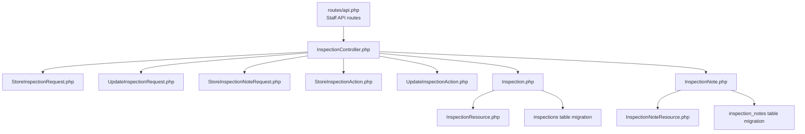
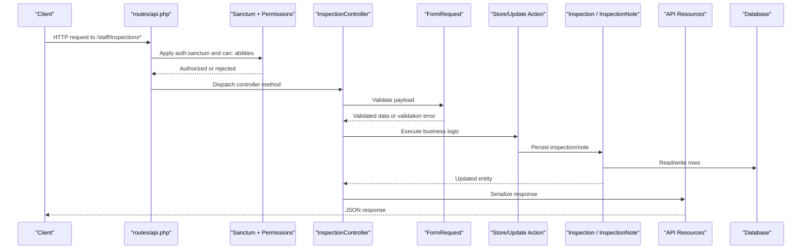
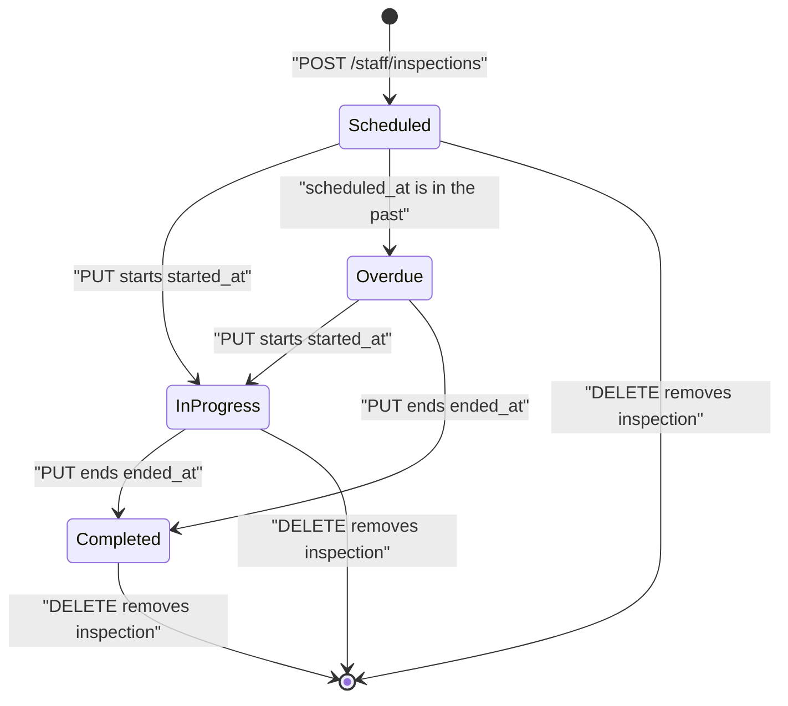
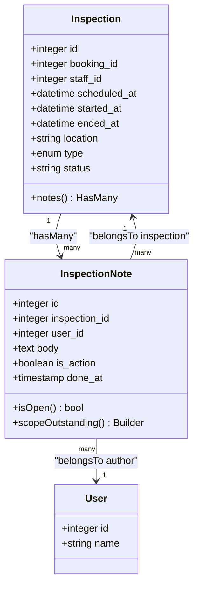
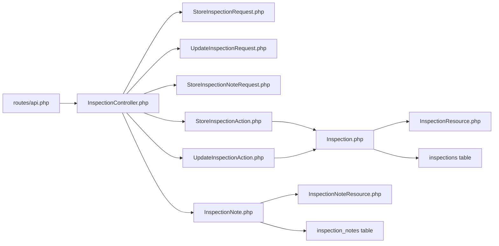

# Inspections Management API

<cite>
**Referenced Files in This Document**   
- [routes/api.php](file://routes/api.php)
- [InspectionController.php](file://app/Http/Controllers/Api/InspectionController.php)
- [StoreInspectionAction.php](file://app/Actions/StoreInspectionAction.php)
- [UpdateInspectionAction.php](file://app/Actions/UpdateInspectionAction.php)
- [Inspection.php](file://app/Models/Inspection.php)
- [InspectionNote.php](file://app/Models/InspectionNote.php)
- [StoreInspectionRequest.php](file://app/Http/Requests/Admin/StoreInspectionRequest.php)
- [UpdateInspectionRequest.php](file://app/Http/Requests/Admin/UpdateInspectionRequest.php)
- [StoreInspectionNoteRequest.php](file://app/Http/Requests/Admin/StoreInspectionNoteRequest.php)
- [InspectionResource.php](file://app/Http/Resources/Api/InspectionResource.php)
- [InspectionNoteResource.php](file://app/Http/Resources/Api/InspectionNoteResource.php)
- [2026_04_17_093358_create_inspections_table.php](file://database/migrations/2026_04_17_093358_create_inspections_table.php)
- [2026_07_09_194144_make_ended_at_nullable_on_inspections_table.php](file://database/migrations/2026_07_09_194144_make_ended_at_nullable_on_inspections_table.php)
- [2026_10_01_150100_create_inspection_notes_table.php](file://database/migrations/2026_10_01_150100_create_inspection_notes_table.php)
- [2026_10_01_150200_add_started_at_to_inspections_table.php](file://database/migrations/2026_10_01_150200_add_started_at_to_inspections_table.php)
</cite>

## Table of Contents
1. [Introduction](#introduction)
2. [Project Structure](#project-structure)
3. [Core Components](#core-components)
4. [Architecture Overview](#architecture-overview)
5. [API Reference](#api-reference)
6. [Inspection Lifecycle](#inspection-lifecycle)
7. [Notes Attachment System](#notes-attachment-system)
8. [Field Validation Rules](#field-validation-rules)
9. [Dependency Analysis](#dependency-analysis)
10. [Performance Considerations](#performance-considerations)
11. [Troubleshooting Guide](#troubleshooting-guide)
12. [Conclusion](#conclusion)

## Introduction
The inspections management API is part of the staff application backend. It exposes token-authenticated JSON endpoints under the `staff` prefix for creating, reading, updating, and deleting on-site inspection appointments, as well as managing internal inspection notes. Inspections represent scheduled or completed site visits linked to bookings, and notes provide an internal audit trail for staff actions, including optional action items that can be marked complete.

All routes are protected by Sanctum authentication and Spatie permissions middleware. Inspection CRUD requires either `view inspections` or `update inspections`, while note operations require `update inspections`.

## Project Structure
The inspections feature spans routing, controller logic, Eloquent models, HTTP request validators, API resource transformers, database migrations, and domain actions:



**Diagram sources**
- [routes/api.php:40-69](file://routes/api.php#L40-L69)
- [InspectionController.php:1-144](file://app/Http/Controllers/Api/InspectionController.php#L1-L144)
- [StoreInspectionRequest.php:1-39](file://app/Http/Requests/Admin/StoreInspectionRequest.php#L1-L39)
- [UpdateInspectionRequest.php:1-41](file://app/Http/Requests/Admin/UpdateInspectionRequest.php#L1-L41)
- [StoreInspectionNoteRequest.php:1-46](file://app/Http/Requests/Admin/StoreInspectionNoteRequest.php#L1-L46)
- [StoreInspectionAction.php:1-42](file://app/Actions/StoreInspectionAction.php#L1-L42)
- [UpdateInspectionAction.php:1-77](file://app/Actions/UpdateInspectionAction.php#L1-L77)
- [Inspection.php:1-82](file://app/Models/Inspection.php#L1-L82)
- [InspectionNote.php:1-61](file://app/Models/InspectionNote.php#L1-L61)
- [InspectionResource.php:1-43](file://app/Http/Resources/Api/InspectionResource.php#L1-L43)
- [InspectionNoteResource.php:1-38](file://app/Http/Resources/Api/InspectionNoteResource.php#L1-L38)
- [2026_04_17_093358_create_inspections_table.php:1-35](file://database/migrations/2026_04_17_093358_create_inspections_table.php#L1-L35)
- [2026_10_01_150100_create_inspection_notes_table.php:1-43](file://database/migrations/2026_10_01_150100_create_inspection_notes_table.php#L1-L43)

**Section sources**
- [routes/api.php:1-117](file://routes/api.php#L1-L117)
- [InspectionController.php:1-144](file://app/Http/Controllers/Api/InspectionController.php#L1-L144)

## Core Components
- **Routing layer**: The staff API defines inspection endpoints under `staff/inspections*`, all inside a Sanctum-authenticated group with permission-based middleware.
- **Controller**: `InspectionController` implements list, show, create, update, delete, note creation, note completion toggle, and note deletion.
- **Domain actions**: `StoreInspectionAction` creates inspections and confirms related bookings; `UpdateInspectionAction` applies updates and records booking timeline milestones such as start, completion, and rescheduling.
- **Models**: `Inspection` represents appointments; `InspectionNote` represents internal admin notes with optional action-item semantics.
- **Validation requests**: Request classes enforce field presence, types, ordering constraints, and allowed enum values.
- **Resources**: API resources serialize inspection and note entities into structured JSON payloads.
- **Database schema**: Migrations define the `inspections` and `inspection_notes` tables, including foreign keys, indexes, nullable timestamps, and status-affecting columns.

**Section sources**
- [routes/api.php:40-69](file://routes/api.php#L40-L69)
- [InspectionController.php:1-144](file://app/Http/Controllers/Api/InspectionController.php#L1-L144)
- [StoreInspectionAction.php:1-42](file://app/Actions/StoreInspectionAction.php#L1-L42)
- [UpdateInspectionAction.php:1-77](file://app/Actions/UpdateInspectionAction.php#L1-L77)
- [Inspection.php:1-82](file://app/Models/Inspection.php#L1-L82)
- [InspectionNote.php:1-61](file://app/Models/InspectionNote.php#L1-L61)
- [StoreInspectionRequest.php:1-39](file://app/Http/Requests/Admin/StoreInspectionRequest.php#L1-L39)
- [UpdateInspectionRequest.php:1-41](file://app/Http/Requests/Admin/UpdateInspectionRequest.php#L1-L41)
- [StoreInspectionNoteRequest.php:1-46](file://app/Http/Requests/Admin/StoreInspectionNoteRequest.php#L1-L46)
- [InspectionResource.php:1-43](file://app/Http/Resources/Api/InspectionResource.php#L1-L43)
- [InspectionNoteResource.php:1-38](file://app/Http/Resources/Api/InspectionNoteResource.php#L1-L38)
- [2026_04_17_093358_create_inspections_table.php:1-35](file://database/migrations/2026_04_17_093358_create_inspections_table.php#L1-L35)
- [2026_10_01_150100_create_inspection_notes_table.php:1-43](file://database/migrations/2026_10_01_150100_create_inspection_notes_table.php#L1-L43)

## Architecture Overview
The API follows a layered Laravel pattern:



**Diagram sources**
- [routes/api.php:40-69](file://routes/api.php#L40-L69)
- [InspectionController.php:1-144](file://app/Http/Controllers/Api/InspectionController.php#L1-L144)
- [StoreInspectionAction.php:1-42](file://app/Actions/StoreInspectionAction.php#L1-L42)
- [UpdateInspectionAction.php:1-77](file://app/Actions/UpdateInspectionAction.php#L1-L77)
- [InspectionResource.php:1-43](file://app/Http/Resources/Api/InspectionResource.php#L1-L43)
- [InspectionNoteResource.php:1-38](file://app/Http/Resources/Api/InspectionNoteResource.php#L1-L38)

## API Reference

### Authentication and Authorization
- All endpoints are under `/staff`.
- Authentication uses Sanctum tokens.
- Authorization uses Spatie ability gates:
  - List and show inspections: `can:view inspections`.
  - Create, update, delete inspections and manage notes: `can:update inspections`.

**Section sources**
- [routes/api.php:22-37](file://routes/api.php#L22-L37)
- [routes/api.php:40-69](file://routes/api.php#L40-L69)

### Inspection Endpoints

| Method | Path | Description | Required Ability | Success Response |
|---|---|---|---|---|
| GET | `/staff/inspections` | List inspections with pagination | `view inspections` | 200 with paginated inspection collection |
| POST | `/staff/inspections` | Schedule a new inspection against a booking | `update inspections` | 201 with created inspection |
| GET | `/staff/inspections/{id}` | Retrieve one inspection with booking, staff, and notes | `view inspections` | 200 with inspection detail |
| PUT | `/staff/inspections/{id}` | Update an inspection and record milestones | `update inspections` | 200 with updated inspection |
| DELETE | `/staff/inspections/{id}` | Delete an inspection | `update inspections` | 200 with deletion message |

#### GET /staff/inspections
- Returns inspections ordered by newest scheduled appointment first.
- Supports pagination through `per_page`; default is 15, clamped between 1 and 100.
- Loads associated `booking` and `staff` relationships.

Example request:
```
GET /staff/inspections?per_page=20
Authorization: Bearer <token>
```

Example success response shape:
```json
{
  "data": [
    {
      "id": 1,
      "booking_id": 42,
      "status": "scheduled",
      "type": "mobile",
      "location": "123 Main Street",
      "scheduled_at": "2026-11-01T10:00:00+00:00",
      "started_at": null,
      "ended_at": null,
      "created_at": "2026-10-28T12:00:00+00:00",
      "staff": {
        "id": 7,
        "name": "Jane Doe"
      },
      "booking": {
        "id": 42,
        "client_name": "Acme Corp"
      },
      "notes": []
    }
  ],
  "links": {},
  "meta": {}
}
```

#### POST /staff/inspections
Creates an inspection and confirms the related booking through the booking timeline.

Required fields:
- `booking_id`: must exist in the bookings table.
- `staff_id`: must exist in the users table.
- `scheduled_at`: required date after the current time.
- `ended_at`: optional date after `scheduled_at`.
- `location`: required string up to 255 characters.
- `type`: required enum, either `mobile` or `workshop`.

Example request body:
```json
{
  "booking_id": 42,
  "staff_id": 7,
  "scheduled_at": "2026-11-01T10:00:00+00:00",
  "location": "123 Main Street",
  "type": "mobile"
}
```

Example success response:
```json
{
  "data": {
    "id": 101,
    "booking_id": 42,
    "status": "scheduled",
    "type": "mobile",
    "location": "123 Main Street",
    "scheduled_at": "2026-11-01T10:00:00+00:00",
    "started_at": null,
    "ended_at": null,
    "created_at": "2026-10-28T12:00:00+00:00",
    "staff": {
      "id": 7,
      "name": "Jane Doe"
    },
    "booking": {
      "id": 42,
      "client_name": "Acme Corp"
    },
    "notes": []
  },
  "message": "Appointment scheduled."
}
```

#### GET /staff/inspections/{id}
Returns a single inspection with its booking, assigned staff, and internal notes. Notes include their author when loaded.

Example request:
```
GET /staff/inspections/101
Authorization: Bearer <token>
```

Example success response:
```json
{
  "id": 101,
  "booking_id": 42,
  "status": "in_progress",
  "type": "workshop",
  "location": "456 Workshop Lane",
  "scheduled_at": "2026-11-01T10:00:00+00:00",
  "started_at": "2026-11-01T10:05:00+00:00",
  "ended_at": null,
  "created_at": "2026-10-28T12:00:00+00:00",
  "staff": {
    "id": 7,
    "name": "Jane Doe"
  },
  "booking": {
    "id": 42,
    "client_name": "Acme Corp"
  },
  "notes": [
    {
      "id": 5,
      "body": "Check front glass condition.",
      "is_action": true,
      "is_open": true,
      "done_at": null,
      "created_at": "2026-10-28T12:30:00+00:00",
      "author": {
        "id": 7,
        "name": "Jane Doe"
      }
    }
  ]
}
```

#### PUT /staff/inspections/{id}
Updates an inspection and may record booking timeline events based on changes:
- Setting `started_at` triggers a started event.
- Setting `ended_at` triggers a completed event and accepts an optional `client_summary` used by the timeline notification.
- Moving `scheduled_at` without completing the inspection records a rescheduled event.

Optional fields:
- `staff_id`: existing user ID.
- `scheduled_at`: date value.
- `started_at`: nullable date.
- `ended_at`: nullable date after `scheduled_at`.
- `location`: string up to 255 characters.
- `type`: `mobile` or `workshop`.
- `client_summary`: optional free-text summary up to 500 characters; not stored on the inspection itself but passed to the booking timeline.

Example request body:
```json
{
  "started_at": "2026-11-01T10:05:00+00:00",
  "client_summary": "Front panel replaced; rear panel needs follow-up."
}
```

Example success response:
```json
{
  "id": 101,
  "booking_id": 42,
  "status": "in_progress",
  "type": "workshop",
  "location": "456 Workshop Lane",
  "scheduled_at": "2026-11-01T10:00:00+00:00",
  "started_at": "2026-11-01T10:05:00+00:00",
  "ended_at": null,
  "created_at": "2026-10-28T12:00:00+00:00",
  "staff": {
    "id": 7,
    "name": "Jane Doe"
  },
  "booking": {
    "id": 42,
    "client_name": "Acme Corp"
  },
  "notes": []
}
```

#### DELETE /staff/inspections/{id}
Deletes the inspection row.

Example request:
```
DELETE /staff/inspections/101
Authorization: Bearer <token>
```

Example success response:
```json
{
  "message": "Appointment deleted."
}
```

**Section sources**
- [routes/api.php:49-69](file://routes/api.php#L49-L69)
- [InspectionController.php:20-144](file://app/Http/Controllers/Api/InspectionController.php#L20-L144)
- [InspectionResource.php:1-43](file://app/Http/Resources/Api/InspectionResource.php#L1-L43)
- [StoreInspectionAction.php:1-42](file://app/Actions/StoreInspectionAction.php#L1-L42)
- [UpdateInspectionAction.php:1-77](file://app/Actions/UpdateInspectionAction.php#L1-L77)

### Note Management Endpoints

| Method | Path | Description | Required Ability | Success Response |
|---|---|---|---|---|
| POST | `/staff/inspections/{id}/notes` | Add an internal note | `update inspections` | 201 with created note |
| PATCH | `/staff/inspections/{id}/notes/{note}/done` | Mark an action item done or reopen it | `update inspections` | 200 with updated note |
| DELETE | `/staff/inspections/{id}/notes/{note}` | Remove an internal note | `update inspections` | 200 with removal message |

#### POST /staff/inspections/{id}/notes
Attaches an internal note to an inspection. The current authenticated staff member is recorded as the note author.

Fields:
- `body`: required text up to 2000 characters.
- `is_action`: optional boolean; indicates whether the note is an outstanding action item.

Example request body:
```json
{
  "body": "Customer requested additional glass coating.",
  "is_action": true
}
```

Example success response:
```json
{
  "data": {
    "id": 6,
    "body": "Customer requested additional glass coating.",
    "is_action": true,
    "is_open": true,
    "done_at": null,
    "created_at": "2026-10-28T13:00:00+00:00",
    "author": {
      "id": 7,
      "name": "Jane Doe"
    }
  },
  "message": "Note added."
}
```

#### PATCH /staff/inspections/{id}/notes/{note}/done
Toggles completion of an action-note. If `done_at` is null, it sets the timestamp to the current time; if already set, it clears it.

This endpoint validates that the note actually belongs to the specified inspection.

Example request:
```
PATCH /staff/inspections/101/notes/6/done
Authorization: Bearer <token>
```

Example success response:
```json
{
  "id": 6,
  "body": "Customer requested additional glass coating.",
  "is_action": true,
  "is_open": false,
  "done_at": "2026-10-28T13:05:00+00:00",
  "created_at": "2026-10-28T13:00:00+00:00",
  "author": {
    "id": 7,
    "name": "Jane Doe"
  }
}
```

#### DELETE /staff/inspections/{id}/notes/{note}
Removes an internal note. It also validates ownership of the note to the inspection before deletion.

Example request:
```
DELETE /staff/inspections/101/notes/6
Authorization: Bearer <token>
```

Example success response:
```json
{
  "message": "Note removed."
}
```

**Section sources**
- [routes/api.php:63-69](file://routes/api.php#L63-L69)
- [InspectionController.php:68-144](file://app/Http/Controllers/Api/InspectionController.php#L68-L144)
- [StoreInspectionNoteRequest.php:1-46](file://app/Http/Requests/Admin/StoreInspectionNoteRequest.php#L1-L46)
- [InspectionNoteResource.php:1-38](file://app/Http/Resources/Api/InspectionNoteResource.php#L1-L38)

## Inspection Lifecycle
An inspection lifecycle is driven by timestamps and computed status:



Computed status rules:
- If `ended_at` is present, status is `completed`.
- Otherwise, if `started_at` is present, status is `in_progress`.
- Otherwise, if `scheduled_at` is in the past, status is `overdue`.
- Otherwise, status is `scheduled`.

Booking timeline integration:
- Creating an inspection confirms the related booking.
- Updating an inspection to add `started_at` records a started milestone.
- Updating an inspection to add `ended_at` records a completed milestone and optionally includes a client summary.
- Rescheduling `scheduled_at` without completing the inspection records a rescheduled milestone with the previous slot.

**Diagram sources**
- [Inspection.php:53-82](file://app/Models/Inspection.php#L53-L82)
- [StoreInspectionAction.php:19-42](file://app/Actions/StoreInspectionAction.php#L19-L42)
- [UpdateInspectionAction.php:19-77](file://app/Actions/UpdateInspectionAction.php#L19-L77)

**Section sources**
- [Inspection.php:1-82](file://app/Models/Inspection.php#L1-L82)
- [StoreInspectionAction.php:1-42](file://app/Actions/StoreInspectionAction.php#L1-L42)
- [UpdateInspectionAction.php:1-77](file://app/Actions/UpdateInspectionAction.php#L1-L77)

## Notes Attachment System
Internal notes are separate from customer-facing booking data. They are attached to inspections and track administrative observations and action items.

Key behaviors:
- Notes belong to an inspection via `inspection_id`.
- Notes belong to a staff user via `user_id`.
- `is_action` marks whether the note represents work still pending.
- `done_at` marks when an action item was completed; clearing it reopens the item.
- `isOpen()` returns true only when the note is an action item and has no `done_at`.
- `outstanding()` scope selects action notes that are not yet done.
- Notes are returned newest first.
- Deleting an inspection cascades deletion of its notes.



**Diagram sources**
- [Inspection.php:23-82](file://app/Models/Inspection.php#L23-L82)
- [InspectionNote.php:13-61](file://app/Models/InspectionNote.php#L13-L61)

**Section sources**
- [InspectionNote.php:1-61](file://app/Models/InspectionNote.php#L1-L61)
- [InspectionController.php:84-144](file://app/Http/Controllers/Api/InspectionController.php#L84-L144)
- [2026_10_01_150100_create_inspection_notes_table.php:1-43](file://database/migrations/2026_10_01_150100_create_inspection_notes_table.php#L1-L43)

## Field Validation Rules

### Creating an Inspection
| Field | Rule | Meaning |
|---|---|---|
| `booking_id` | required, exists in bookings | Links the inspection to a valid booking. |
| `staff_id` | required, exists in users | Assigns a valid staff member. |
| `scheduled_at` | required, date, after now | Appointment must be scheduled in the future. |
| `ended_at` | nullable, date, after scheduled_at | Optional completion time; cannot precede scheduling. |
| `location` | required, string, max 255 | Site or address description. |
| `type` | required, enum mobile/workshop | Inspection visit type. |

### Updating an Inspection
| Field | Rule | Meaning |
|---|---|---|
| `staff_id` | sometimes, exists in users | Optional staff assignment change. |
| `scheduled_at` | sometimes, date | Optional reschedule. |
| `started_at` | nullable, date | Optional start timestamp. |
| `ended_at` | nullable, date, after scheduled_at | Optional completion timestamp. |
| `location` | sometimes, string, max 255 | Optional location update. |
| `type` | sometimes, enum mobile/workshop | Optional type update. |
| `client_summary` | nullable, string, max 500 | Free-text completion summary sent via timeline, not persisted on the inspection. |

### Adding an Inspection Note
| Field | Rule | Meaning |
|---|---|---|
| `body` | required, string, max 2000 | Internal note content. |
| `is_action` | sometimes, boolean | Marks the note as an actionable item. |

Custom validation message:
- Missing note body returns a human-readable message indicating that something must be written before saving.

**Section sources**
- [StoreInspectionRequest.php:23-38](file://app/Http/Requests/Admin/StoreInspectionRequest.php#L23-L38)
- [UpdateInspectionRequest.php:23-41](file://app/Http/Requests/Admin/UpdateInspectionRequest.php#L23-L41)
- [StoreInspectionNoteRequest.php:23-46](file://app/Http/Requests/Admin/StoreInspectionNoteRequest.php#L23-L46)

## Dependency Analysis
The inspection subsystem has clear separation of concerns:



Coupling characteristics:
- Routing depends only on controller class names.
- Controller depends on request validators, actions, models, and resources.
- Actions depend on models and booking timeline services.
- Models encapsulate relationships and computed attributes.
- Resources encapsulate serialization.
- Database schema enforces referential integrity and indexes.

Potential risks:
- Route binding resolves notes by their own identifier; the controller explicitly verifies ownership to prevent cross-inspection access.
- Updating inspections relies on timestamp transitions rather than an explicit state machine, so callers must send consistent timestamps.

**Diagram sources**
- [routes/api.php:40-69](file://routes/api.php#L40-L69)
- [InspectionController.php:1-144](file://app/Http/Controllers/Api/InspectionController.php#L1-L144)
- [StoreInspectionAction.php:1-42](file://app/Actions/StoreInspectionAction.php#L1-L42)
- [UpdateInspectionAction.php:1-77](file://app/Actions/UpdateInspectionAction.php#L1-L77)
- [Inspection.php:1-82](file://app/Models/Inspection.php#L1-L82)
- [InspectionNote.php:1-61](file://app/Models/InspectionNote.php#L1-L61)
- [InspectionResource.php:1-43](file://app/Http/Resources/Api/InspectionResource.php#L1-L43)
- [InspectionNoteResource.php:1-38](file://app/Http/Resources/Api/InspectionNoteResource.php#L1-L38)

**Section sources**
- [routes/api.php:40-69](file://routes/api.php#L40-L69)
- [InspectionController.php:1-144](file://app/Http/Controllers/Api/InspectionController.php#L1-L144)

## Performance Considerations
- Listing inspections uses eager loading for `booking` and `staff`, reducing N+1 queries for standard list responses.
- Single inspection lookup additionally loads `notes.author`, which is appropriate for detailed views but adds query cost.
- Pagination defaults to 15 items and caps at 100 to prevent oversized result sets.
- Database indexes include:
  - `scheduled_at`, `ended_at`, and `staff_id` composite index on inspections for availability checks.
  - `inspection_id` and `created_at` index on notes for efficient listing per inspection.
- Status computation is derived from timestamps, avoiding extra status columns.

Recommendations:
- Clients should use reasonable `per_page` values.
- When retrieving many inspections, avoid requesting full note details unless needed.
- Keep `scheduled_at`, `started_at`, and `ended_at` consistent to ensure correct status and timeline events.

**Section sources**
- [InspectionController.php:24-41](file://app/Http/Controllers/Api/InspectionController.php#L24-L41)
- [InspectionController.php:44-50](file://app/Http/Controllers/Api/InspectionController.php#L44-L50)
- [2026_04_17_093358_create_inspections_table.php:10-24](file://database/migrations/2026_04_17_093358_create_inspections_table.php#L10-L24)
- [2026_10_01_150100_create_inspection_notes_table.php:20-33](file://database/migrations/2026_10_01_150100_create_inspection_notes_table.php#L20-L33)

## Troubleshooting Guide

### Common Validation Errors
- Missing `booking_id` or invalid booking reference: ensure the booking exists and is accessible.
- Invalid `staff_id`: assign a real user ID.
- `scheduled_at` not in the future: scheduling an inspection requires a future time.
- `ended_at` before `scheduled_at`: completion cannot precede scheduling.
- Invalid `type`: use `mobile` or `workshop`.
- Empty note `body`: every note must contain text.

### Authorization Errors
- Requests without a valid Sanctum token return authentication failures.
- Requests without `view inspections` fail on list and show endpoints.
- Requests without `update inspections` fail on create, update, delete, and note operations.

### Data Consistency Issues
- If an inspection appears incorrectly overdue, check whether `scheduled_at` is in the past and whether `started_at` or `ended_at` are missing.
- If an inspection remains `in_progress` after completion, verify that `ended_at` is set.
- If a note does not appear open despite being marked as an action item, confirm that `done_at` is null.

### Ownership Errors
- Patching or deleting a note against the wrong inspection returns a not found response because the controller verifies that `note.inspection_id` matches the route’s inspection.

**Section sources**
- [StoreInspectionRequest.php:23-38](file://app/Http/Requests/Admin/StoreInspectionRequest.php#L23-L38)
- [UpdateInspectionRequest.php:23-41](file://app/Http/Requests/Admin/UpdateInspectionRequest.php#L23-L41)
- [StoreInspectionNoteRequest.php:23-46](file://app/Http/Requests/Admin/StoreInspectionNoteRequest.php#L23-L46)
- [InspectionController.php:128-144](file://app/Http/Controllers/Api/InspectionController.php#L128-L144)
- [Inspection.php:66-82](file://app/Models/Inspection.php#L66-L82)
- [InspectionNote.php:39-61](file://app/Models/InspectionNote.php#L39-L61)

## Conclusion
The inspections management API provides a controlled, permission-gated interface for managing on-site inspection appointments and internal staff notes. Its design separates routing, validation, controller orchestration, domain actions, models, resources, and database schema. The inspection lifecycle is timestamp-driven and integrated with booking timeline events, while the note system supports internal documentation and actionable task tracking. Clients should rely on the documented request fields, respect pagination limits, and handle authentication and authorization requirements consistently.