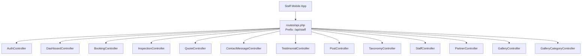
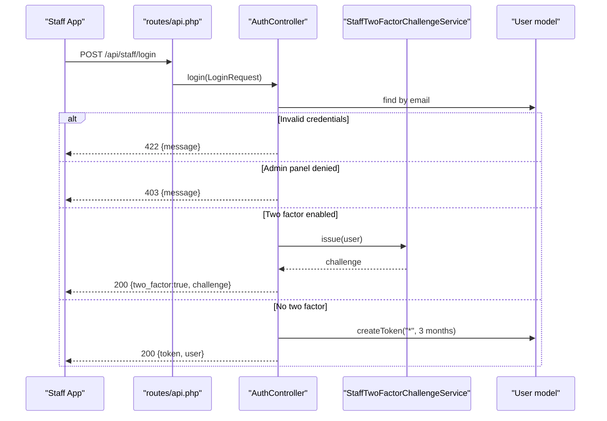

# Staff API Endpoints

<cite>
**Referenced Files in This Document**   
- [routes/api.php](file://routes/api.php)
- [AuthController.php](file://app/Http/Controllers/Api/AuthController.php)
- [DashboardController.php](file://app/Http/Controllers/Api/DashboardController.php)
- [BookingController.php](file://app/Http/Controllers/Api/BookingController.php)
- [InspectionController.php](file://app/Http/Controllers/Api/InspectionController.php)
- [QuoteController.php](file://app/Http/Controllers/Api/QuoteController.php)
- [ContactMessageController.php](file://app/Http/Controllers/Api/ContactMessageController.php)
- [TestimonialController.php](file://app/Http/Controllers/Api/TestimonialController.php)
- [PostController.php](file://app/Http/Controllers/Api/PostController.php)
- [TaxonomyController.php](file://app/Http/Controllers/Api/TaxonomyController.php)
- [StaffController.php](file://app/Http/Controllers/Api/StaffController.php)
- [PartnerController.php](file://app/Http/Controllers/Api/PartnerController.php)
- [GalleryController.php](file://app/Http/Controllers/Api/GalleryController.php)
- [GalleryCategoryController.php](file://app/Http/Controllers/Api/GalleryCategoryController.php)
- [permission.php](file://config/permission.php)
- [RolesAndPermissionsSeeder.php](file://database/seeders/RolesAndPermissionsSeeder.php)
</cite>

## Table of Contents
1. [Introduction](#introduction)
2. [Project Structure](#project-structure)
3. [Core Components](#core-components)
4. [Architecture Overview](#architecture-overview)
5. [Detailed Component Analysis](#detailed-component-analysis)
6. [Dependency Analysis](#dependency-analysis)
7. [Performance Considerations](#performance-considerations)
8. [Troubleshooting Guide](#troubleshooting-guide)
9. [Conclusion](#conclusion)

## Introduction
This document specifies the staff mobile app JSON API under `/api/staff/*`. It is a Sanctum personal access token API that shares Spatie permission-based abilities with the web admin panel. Every data route requires authentication and an explicit ability check, so the mobile client cannot bypass browser authorization simply by calling the API directly.

The API covers:
- Authentication, two-factor challenge, current user inspection, and logout.
- Dashboard aggregates for bookings, inspections, quotes, and contact messages.
- Booking listing, detail retrieval, editable field updates, and lifecycle status transitions.
- Inspection scheduling, state changes, deletion, and internal notes.
- Quote triage and deletion.
- Contact message inbox triage.
- Testimonial creation, update, and deletion.
- Blog post moderation and read-only taxonomy queries.
- Staff directory management.
- Partner administration.
- Curated gallery content management and category listing.

## Project Structure
All staff API routes are registered in one file under the `staff` prefix. Unauthenticated endpoints are login and two-factor challenge; every other endpoint is inside an `auth:sanctum` group and adds a `can:` middleware per action.



**Diagram sources**
- [routes/api.php:33-115](file://routes/api.php#L33-L115)

**Section sources**
- [routes/api.php:10-115](file://routes/api.php#L10-L115)

## Core Components
- **Authentication**: Issues three-month Sanctum personal access tokens carrying wildcard abilities. Two-factor-enabled accounts receive a temporary challenge instead of a token.
- **Authorization model**: Uses Spatie permissions through Laravel’s `can:` middleware. The same ability names protect both the web admin and this API.
- **Response shape**: Most mutating endpoints return a `{data, message}` object or just `{message}`. Listing endpoints return paginated collections through Eloquent resources.
- **Pagination**: Controllers clamp `per_page` between 1 and 100, defaulting to 15 or 20 depending on the resource.
- **Rate limiting**: Login and two-factor challenge are throttled at six attempts per minute.

### Permission Model Integration
| Area | Mechanism | Notes |
|---|---|---|
| Token scope | Wildcard abilities attached when issuing a token | Allows Spatie’s `can:` checks to work normally |
| Route gating | `can:<ability>` middleware | Mirrors the web admin exactly |
| Dashboard scoping | Controller-level `$user->can(...)` checks | Counts are only included when the caller has the corresponding ability |
| Roles and permissions | Stored by Spatie and seeded by the application seeder | Configuration uses default table names and enables capability registration |

**Section sources**
- [AuthController.php:24-135](file://app/Http/Controllers/Api/AuthController.php#L24-L135)
- [DashboardController.php:22-79](file://app/Http/Controllers/Api/DashboardController.php#L22-L79)
- [permission.php:1-206](file://config/permission.php#L1-L206)
- [RolesAndPermissionsSeeder.php:1-155](file://database/seeders/RolesAndPermissionsSeeder.php#L1-L155)

## Architecture Overview
The staff API is thin: controllers validate input, delegate business logic to actions or services, load related entities, and serialize results through API resources. Security is enforced at the routing layer rather than inside each controller.



**Diagram sources**
- [routes/api.php:33-43](file://routes/api.php#L33-L43)
- [AuthController.php:24-135](file://app/Http/Controllers/Api/AuthController.php#L24-L135)

## Detailed Component Analysis

### Authentication

#### POST `/api/staff/login`
- **Purpose**: Authenticate a staff member and return a Sanctum token, or request a two-factor challenge.
- **Authentication**: None.
- **Rate limit**: Six attempts per minute.
- **Headers**: `Accept: application/json`, plus standard CSRF/session headers if required by the environment.
- **Request body**:
  - `email`: string.
  - `password`: string.
  - `device_name`: optional string; defaults to `staff-app`.
- **Success responses**:
  - No two-factor: `200` with `{token, user}`.
  - Two-factor enabled: `200` with `{two_factor: true, challenge}`.
- **Error responses**:
  - `422`: invalid credentials.
  - `403`: account lacks admin panel access.
- **Example call**:
  ```text
  POST /api/staff/login
  Accept: application/json
  Content-Type: application/json

  {
    "email": "staff@example.com",
    "password": "correct-password",
    "device_name": "iPhone"
  }
  ```
- **Expected response without two-factor**:
  ```json
  {
    "token": "1|...sanctum-token...",
    "user": {
      "id": 1,
      "name": "Staff Member",
      "email": "staff@example.com",
      "username": null,
      "phone": null,
      "avatar_url": null,
      "roles": [],
      "abilities": ["*"],
      "created_at": "2026-01-01T00:00:00Z",
      "updated_at": "2026-01-01T00:00:00Z"
    }
  }
  ```
- **Expected two-factor response**:
  ```json
  {
    "two_factor": true,
    "challenge": "temporary-challenge-string"
  }
  ```

#### POST `/api/staff/two-factor-challenge`
- **Purpose**: Submit a verification code or recovery code to complete authentication.
- **Authentication**: None.
- **Rate limit**: Six attempts per minute.
- **Request body**:
  - `challenge`: string from the login response.
  - `code`: optional authenticator code.
  - `recovery_code`: optional recovery code used when `code` is absent.
- **Success response**: `200` with `{token, user}`.
- **Error responses**:
  - `422`: expired challenge or invalid code.
- **Example call**:
  ```text
  POST /api/staff/two-factor-challenge
  Content-Type: application/json

  {
    "challenge": "temporary-challenge-string",
    "code": "123456"
  }
  ```

#### GET `/api/staff/me`
- **Purpose**: Return the authenticated staff member and their abilities.
- **Authentication**: Required.
- **Required ability**: None beyond Sanctum authentication.
- **Response**: `200` with `{user}`.
- **Example call**:
  ```text
  GET /api/staff/me
  Authorization: Bearer 1|...sanctum-token...
  Accept: application/json
  ```

#### POST `/api/staff/logout`
- **Purpose**: Revoke the current Sanctum token.
- **Authentication**: Required.
- **Response**: `200` with `{message: "Logged out."}`.
- **Example call**:
  ```text
  POST /api/staff/logout
  Authorization: Bearer 1|...sanctum-token...
  ```

**Section sources**
- [routes/api.php:33-46](file://routes/api.php#L33-L46)
- [AuthController.php:24-135](file://app/Http/Controllers/Api/AuthController.php#L24-L135)

### Dashboard Aggregates

#### GET `/api/staff/dashboard`
- **Purpose**: Read-only aggregate counts for the staff landing screen.
- **Authentication**: Required.
- **Required ability**: `view dashboard`.
- **Response schema**:
  - `data.bookings`: present only if the caller has `view bookings`; includes `total`, `pending`, `confirmed`, `completed`, `cancelled`.
  - `data.inspections`: present only if the caller has `view inspections`; includes `total`, `completed`, `in_progress`, `overdue`, `scheduled`.
  - `data.quotes`: present only if the caller has `view bookings`; includes `total`, `pending`, `contacted`, `completed`, `cancelled`.
  - `data.contact_messages`: present only if the caller has `view contact messages`; includes `total`, `unread`.
- **Example call**:
  ```text
  GET /api/staff/dashboard
  Authorization: Bearer 1|...sanctum-token...
  ```

**Section sources**
- [routes/api.php:49](file://routes/api.php#L49)
- [DashboardController.php:22-79](file://app/Http/Controllers/Api/DashboardController.php#L22-L79)

### Bookings

#### GET `/api/staff/bookings`
- **Purpose**: List bookings with optional filtering and search.
- **Authentication**: Required.
- **Required ability**: `view bookings`.
- **Query parameters**:
  - `status`: optional booking status filter.
  - `search`: optional substring match against client name, client email, or reference.
  - `per_page`: integer clamped to 1–100, default 15.
- **Response**: Paginated collection of booking resources.
- **Example call**:
  ```text
  GET /api/staff/bookings?status=pending&search=jane&per_page=20
  Authorization: Bearer 1|...sanctum-token...
  ```

#### GET `/api/staff/bookings/{booking}`
- **Purpose**: Show a single booking with its inspection and timeline events.
- **Authentication**: Required.
- **Required ability**: `view bookings`.
- **Path parameter**: numeric `booking`.
- **Response**: Single booking resource.
- **Example call**:
  ```text
  GET /api/staff/bookings/42
  Authorization: Bearer 1|...sanctum-token...
  ```

#### PATCH `/api/staff/bookings/{booking}`
- **Purpose**: Update editable booking fields such as quoted price.
- **Authentication**: Required.
- **Required ability**: `update bookings`.
- **Path parameter**: numeric `booking`.
- **Request body**: Validated through the admin booking update request.
- **Response**: Updated booking resource.
- **Example call**:
  ```text
  PATCH /api/staff/bookings/42
  Authorization: Bearer 1|...sanctum-token...
  Content-Type: application/json
  ```

#### PATCH `/api/staff/bookings/{booking}/status`
- **Purpose**: Move a booking through pending, confirmed, completed, or cancelled.
- **Authentication**: Required.
- **Required ability**: `update bookings`.
- **Path parameter**: numeric `booking`.
- **Request body**:
  - `status`: required; one of `pending`, `confirmed`, `completed`, `cancelled`.
- **Behavior**:
  - Confirmed, completed, and cancelled go through the booking timeline and event recording.
  - Reverting to pending is a plain update.
  - Cancelling an already-cancelled booking returns `409`.
- **Response**: `{data: booking, message}`.
- **Example call**:
  ```text
  PATCH /api/staff/bookings/42/status
  Authorization: Bearer 1|...sanctum-token...
  Content-Type: application/json

  {
    "status": "confirmed"
  }
  ```

**Section sources**
- [routes/api.php:52-55](file://routes/api.php#L52-L55)
- [BookingController.php:25-122](file://app/Http/Controllers/Api/BookingController.php#L25-L122)

### Inspections

#### GET `/api/staff/inspections`
- **Purpose**: List inspections ordered by scheduled appointment time.
- **Authentication**: Required.
- **Required ability**: `view inspections`.
- **Query parameters**:
  - `per_page`: integer clamped to 1–100, default 15.
- **Response**: Paginated inspection resources.
- **Example call**:
  ```text
  GET /api/staff/inspections?per_page=20
  Authorization: Bearer 1|...sanctum-token...
  ```

#### POST `/api/staff/inspections`
- **Purpose**: Schedule a new inspection against a booking.
- **Authentication**: Required.
- **Required ability**: `update inspections`.
- **Request body**: Validated through the admin store inspection request.
- **Response**: `201` with `{data: inspection, message: "Appointment scheduled."}`.
- **Example call**:
  ```text
  POST /api/staff/inspections
  Authorization: Bearer 1|...sanctum-token...
  Content-Type: application/json
  ```

#### GET `/api/staff/inspections/{inspection}`
- **Purpose**: Show an inspection with its booking, assigned staff, and internal notes.
- **Authentication**: Required.
- **Required ability**: `view inspections`.
- **Path parameter**: numeric `inspection`.
- **Response**: Single inspection resource.
- **Example call**:
  ```text
  GET /api/staff/inspections/10
  Authorization: Bearer 1|...sanctum-token...
  ```

#### PUT `/api/staff/inspections/{inspection}`
- **Purpose**: Update an inspection and record implied milestones.
- **Authentication**: Required.
- **Required ability**: `update inspections`.
- **Path parameter**: numeric `inspection`.
- **Request body**: Validated through the admin update inspection request.
- **Response**: Updated inspection resource.
- **Example call**:
  ```text
  PUT /api/staff/inspections/10
  Authorization: Bearer 1|...sanctum-token...
  Content-Type: application/json
  ```

#### DELETE `/api/staff/inspections/{inspection}`
- **Purpose**: Delete an inspection.
- **Authentication**: Required.
- **Required ability**: `update inspections`.
- **Path parameter**: numeric `inspection`.
- **Response**: `{message: "Appointment deleted."}`.
- **Example call**:
  ```text
  DELETE /api/staff/inspections/10
  Authorization: Bearer 1|...sanctum-token...
  ```

#### POST `/api/staff/inspections/{inspection}/notes`
- **Purpose**: Add an internal note to an inspection.
- **Authentication**: Required.
- **Required ability**: `update inspections`.
- **Path parameter**: numeric `inspection`.
- **Request body**: Validated through the admin store inspection note request; the author is set from the authenticated user.
- **Response**: `201` with `{data: note, message: "Note added."}`.
- **Example call**:
  ```text
  POST /api/staff/inspections/10/notes
  Authorization: Bearer 1|...sanctum-token...
  Content-Type: application/json
  ```

#### PATCH `/api/staff/inspections/{inspection}/notes/{note}/done`
- **Purpose**: Toggle whether an action-item note is marked done.
- **Authentication**: Required.
- **Required ability**: `update inspections`.
- **Path parameters**: numeric `inspection` and numeric `note`.
- **Behavior**: If the note does not belong to the inspection, the controller aborts with `404`.
- **Response**: Updated note resource.
- **Example call**:
  ```text
  PATCH /api/staff/inspections/10/notes/3/done
  Authorization: Bearer 1|...sanctum-token...
  ```

#### DELETE `/api/staff/inspections/{inspection}/notes/{note}`
- **Purpose**: Delete an internal note.
- **Authentication**: Required.
- **Required ability**: `update inspections`.
- **Path parameters**: numeric `inspection` and numeric `note`.
- **Behavior**: Rejects notes belonging to another inspection with `404`.
- **Response**: `{message: "Note removed."}`.
- **Example call**:
  ```text
  DELETE /api/staff/inspections/10/notes/3
  Authorization: Bearer 1|...sanctum-token...
  ```

**Section sources**
- [routes/api.php:58-65](file://routes/api.php#L58-L65)
- [InspectionController.php:29-144](file://app/Http/Controllers/Api/InspectionController.php#L29-L144)

### Quotes

#### GET `/api/staff/quotes`
- **Purpose**: List quotes with optional status and client/vehicle search.
- **Authentication**: Required.
- **Required ability**: `view bookings`.
- **Query parameters**:
  - `status`: optional quote status filter.
  - `search`: optional substring match against name, email, phone, or vehicle registration number.
  - `per_page`: integer clamped to 1–100, default 20.
- **Response**: Paginated quote resources.
- **Example call**:
  ```text
  GET /api/staff/quotes?status=pending&search=ABC123&per_page=20
  Authorization: Bearer 1|...sanctum-token...
  ```

#### GET `/api/staff/quotes/{quote}`
- **Purpose**: Show a single quote with glass type, service type, and subcategory details.
- **Authentication**: Required.
- **Required ability**: `view bookings`.
- **Path parameter**: numeric `quote`.
- **Response**: Single quote resource.
- **Example call**:
  ```text
  GET /api/staff/quotes/7
  Authorization: Bearer 1|...sanctum-token...
  ```

#### PUT `/api/staff/quotes/{quote}/status`
- **Purpose**: Move a quote through pending, contacted, completed, or cancelled.
- **Authentication**: Required.
- **Required ability**: `update bookings`.
- **Path parameter**: numeric `quote`.
- **Request body**: Validated through the admin quote status request.
- **Response**: `{data: quote, message}`.
- **Example call**:
  ```text
  PUT /api/staff/quotes/7/status
  Authorization: Bearer 1|...sanctum-token...
  Content-Type: application/json

  {
    "status": "contacted"
  }
  ```

#### DELETE `/api/staff/quotes/{quote}`
- **Purpose**: Delete a quote through the shared quote service.
- **Authentication**: Required.
- **Required ability**: `update bookings`.
- **Path parameter**: numeric `quote`.
- **Response**: `{message}`.
- **Example call**:
  ```text
  DELETE /api/staff/quotes/7
  Authorization: Bearer 1|...sanctum-token...
  ```

**Section sources**
- [routes/api.php:68-71](file://routes/api.php#L68-L71)
- [QuoteController.php:23-80](file://app/Http/Controllers/Api/QuoteController.php#L23-L80)

### Contact Messages

#### GET `/api/staff/contact-messages`
- **Purpose**: Triage the contact message inbox.
- **Authentication**: Required.
- **Required ability**: `view contact messages`.
- **Query parameters**:
  - `status`: optional `read` or `unread`.
  - `search`: optional substring match against name, email, or subject.
  - `per_page`: integer clamped to 1–100, default 15.
- **Response**: Paginated contact message resources.
- **Example call**:
  ```text
  GET /api/staff/contact-messages?status=unread&search=urgent
  Authorization: Bearer 1|...sanctum-token...
  ```

#### GET `/api/staff/contact-messages/{message}`
- **Purpose**: View one contact message without changing its read state.
- **Authentication**: Required.
- **Required ability**: `view contact messages`.
- **Path parameter**: numeric `message`.
- **Response**: Single contact message resource.
- **Example call**:
  ```text
  GET /api/staff/contact-messages/12
  Authorization: Bearer 1|...sanctum-token...
  ```

#### PATCH `/api/staff/contact-messages/{message}/read`
- **Purpose**: Explicitly mark a message as read.
- **Authentication**: Required.
- **Required ability**: `view contact messages`.
- **Path parameter**: numeric `message`.
- **Response**: `{data: message, message}`.
- **Example call**:
  ```text
  PATCH /api/staff/contact-messages/12/read
  Authorization: Bearer 1|...sanctum-token...
  ```

#### DELETE `/api/staff/contact-messages/{message}`
- **Purpose**: Delete a contact message.
- **Authentication**: Required.
- **Required ability**: `view contact messages`.
- **Path parameter**: numeric `message`.
- **Response**: `{message}`.
- **Example call**:
  ```text
  DELETE /api/staff/contact-messages/12
  Authorization: Bearer 1|...sanctum-token...
  ```

**Section sources**
- [routes/api.php:74-77](file://routes/api.php#L74-L77)
- [ContactMessageController.php:23-81](file://app/Http/Controllers/Api/ContactMessageController.php#L23-L81)

### Testimonials

#### GET `/api/staff/testimonials`
- **Purpose**: List testimonials with optional search and published-state filter.
- **Authentication**: Required.
- **Required ability**: `manage testimonials`.
- **Query parameters**:
  - `search`: optional substring match across name, role, and content.
  - `published`: boolean flag filtering by `is_published`.
  - `per_page`: integer clamped to 1–100, default 15.
- **Response**: Paginated testimonial resources.
- **Example call**:
  ```text
  GET /api/staff/testimonials?published=true&per_page=20
  Authorization: Bearer 1|...sanctum-token...
  ```

#### POST `/api/staff/testimonials`
- **Purpose**: Create a testimonial.
- **Authentication**: Required.
- **Required ability**: `manage testimonials`.
- **Request body**: Validated through the admin testimonial request.
- **Response**: `201` with `{data: testimonial, message}`.
- **Example call**:
  ```text
  POST /api/staff/testimonials
  Authorization: Bearer 1|...sanctum-token...
  Content-Type: application/json
  ```

#### GET `/api/staff/testimonials/{testimonial}`
- **Purpose**: Show one testimonial.
- **Authentication**: Required.
- **Required ability**: `manage testimonials`.
- **Path parameter**: numeric `testimonial`.
- **Response**: Single testimonial resource.
- **Example call**:
  ```text
  GET /api/staff/testimonials/5
  Authorization: Bearer 1|...sanctum-token...
  ```

#### PUT `/api/staff/testimonials/{testimonial}`
- **Purpose**: Update a testimonial.
- **Authentication**: Required.
- **Required ability**: `manage testimonials`.
- **Path parameter**: numeric `testimonial`.
- **Request body**: Validated through the admin testimonial request.
- **Response**: `{data: testimonial, message}`.
- **Example call**:
  ```text
  PUT /api/staff/testimonials/5
  Authorization: Bearer 1|...sanctum-token...
  Content-Type: application/json
  ```

#### DELETE `/api/staff/testimonials/{testimonial}`
- **Purpose**: Delete a testimonial.
- **Authentication**: Required.
- **Required ability**: `manage testimonials`.
- **Path parameter**: numeric `testimonial`.
- **Response**: `{message}`.
- **Example call**:
  ```text
  DELETE /api/staff/testimonials/5
  Authorization: Bearer 1|...sanctum-token...
  ```

**Section sources**
- [routes/api.php:80-84](file://routes/api.php#L80-L84)
- [TestimonialController.php:23-91](file://app/Http/Controllers/Api/TestimonialController.php#L23-L91)

### Blog Posts

#### GET `/api/staff/posts`
- **Purpose**: List blog posts with optional status, author, and title/excerpt search.
- **Authentication**: Required.
- **Required ability**: `view blog`.
- **Query parameters**:
  - `status`: optional post status filter.
  - `user`: optional author user ID filter.
  - `search`: optional substring match against title or excerpt.
  - `per_page`: integer clamped to 1–100, default 15.
- **Response**: Paginated post resources.
- **Example call**:
  ```text
  GET /api/staff/posts?status=draft&user=3&search=glass&type=text%2Fjson
  Authorization: Bearer 1|...sanctum-token...
  ```

#### GET `/api/staff/posts/{post:id}`
- **Purpose**: Show one post with author and taxonomy.
- **Authentication**: Required.
- **Required ability**: `view blog`.
- **Path parameter**: named `post` constrained to a numeric ID.
- **Response**: Single post resource.
- **Example call**:
  ```text
  GET /api/staff/posts/23
  Authorization: Bearer 1|...sanctum-token...
  ```

#### PATCH `/api/staff/posts/{post:id}/status`
- **Purpose**: Move a post between draft, published, and archived.
- **Authentication**: Required.
- **Required ability**: `update blog`.
- **Path parameter**: named `post` constrained to a numeric ID.
- **Request body**: Validated through the admin post status request.
- **Validation rule**: Publishing a post fails with `422` if required publish requirements are missing.
- **Response**: `{data: post, message}`.
- **Example call**:
  ```text
  PATCH /api/staff/posts/23/status
  Authorization: Bearer 1|...sanctum-token...
  Content-Type: application/json

  {
    "status": "published"
  }
  ```

#### DELETE `/api/staff/posts/{post:id}`
- **Purpose**: Delete a post.
- **Authentication**: Required.
- **Required ability**: `delete blog`.
- **Path parameter**: named `post` constrained to a numeric ID.
- **Response**: `{message}`.
- **Example call**:
  ```text
  DELETE /api/staff/posts/23
  Authorization: Bearer 1|...sanctum-token...
  ```

**Section sources**
- [routes/api.php:88-91](file://routes/api.php#L88-L91)
- [PostController.php:25-92](file://app/Http/Controllers/Api/PostController.php#L25-L92)

### Blog Taxonomy

#### GET `/api/staff/categories`
- **Purpose**: List all categories alphabetically.
- **Authentication**: Required.
- **Required ability**: `view blog`.
- **Response**: Collection of category resources.
- **Example call**:
  ```text
  GET /api/staff/categories
  Authorization: Bearer 1|...sanctum-token...
  ```

#### GET `/api/staff/tags`
- **Purpose**: List all tags alphabetically.
- **Authentication**: Required.
- **Required ability**: `view blog`.
- **Response**: Collection of tag resources.
- **Example call**:
  ```text
  GET /api/staff/tags
  Authorization: Bearer 1|...sanctum-token...
  ```

**Section sources**
- [routes/api.php:92-93](file://routes/api.php#L92-L93)
- [TaxonomyController.php:18-35](file://app/Http/Controllers/Api/TaxonomyController.php#L18-L35)

### Staff Directory

#### GET `/api/staff/team`
- **Purpose**: List team members ordered by position.
- **Authentication**: Required.
- **Required ability**: `manage settings`.
- **Response**: Collection of staff resources.
- **Example call**:
  ```text
  GET /api/staff/team
  Authorization: Bearer 1|...sanctum-token...
  ```

#### POST `/api/staff/team`
- **Purpose**: Create a staff member.
- **Authentication**: Required.
- **Required ability**: `manage settings`.
- **Request body**:
  - `name`: required string, maximum 255 characters.
  - `role`: required string, maximum 255 characters.
  - `bio`: optional string.
  - `photo`: optional image file up to 2048 KB.
  - `is_active`: optional boolean, defaults to true.
  - `order`: validated sort order using the shared sort-order rules.
- **Response**: `201` with `{data: staff}`.
- **Example call**:
  ```text
  POST /api/staff/team
  Authorization: Bearer 1|...sanctum-token...
  Content-Type: multipart/form-data

  name: Jane Smith
  role: Senior Technician
  bio: Glass repair specialist
  is_active: true
  order: 10
  photo: <binary-image-file>
  ```

#### GET `/api/staff/team/{staff}`
- **Purpose**: Show one staff member.
- **Authentication**: Required.
- **Required ability**: `manage settings`.
- **Path parameter**: numeric `staff`.
- **Response**: Single staff resource.
- **Example call**:
  ```text
  GET /api/staff/team/4
  Authorization: Bearer 1|...sanctum-token...
  ```

#### PUT `/api/staff/team/{staff}`
- **Purpose**: Update a staff member.
- **Authentication**: Required.
- **Required ability**: `manage settings`.
- **Path parameter**: numeric `staff`.
- **Request body**: Same fields as creation; photo replacement deletes the previous photo.
- **Response**: Updated staff resource.
- **Example call**:
  ```text
  PUT /api/staff/team/4
  Authorization: Bearer 1|...sanctum-token...
  Content-Type: multipart/form-data
  ```

#### DELETE `/api/staff/team/{staff}`
- **Purpose**: Delete a staff member and remove their photo.
- **Authentication**: Required.
- **Required ability**: `manage settings`.
- **Path parameter**: numeric `staff`.
- **Response**: `{message: "Staff member removed."}`.
- **Example call**:
  ```text
  DELETE /api/staff/team/4
  Authorization: Bearer 1|...sanctum-token...
  ```

**Section sources**
- [routes/api.php:95-100](file://routes/api.php#L95-L100)
- [StaffController.php:23-115](file://app/Http/Controllers/Api/StaffController.php#L23-L115)

### Partners

#### GET `/api/staff/partners`
- **Purpose**: List partners ordered by position.
- **Authentication**: Required.
- **Required ability**: `manage settings`.
- **Response**: Collection of partner resources.
- **Example call**:
  ```text
  GET /api/staff/partners
  Authorization: Bearer 1|...sanctum-token...
  ```

#### POST `/api/staff/partners`
- **Purpose**: Create a partner.
- **Authentication**: Required.
- **Required ability**: `manage settings`.
- **Request body**:
  - `name`: required string, maximum 255 characters.
  - `logo`: required image file up to 2048 KB.
  - `website_url`: optional URL.
  - `is_active`: optional boolean, defaults to true.
  - `order`: validated sort order.
- **Logo processing**: Attempts WebP conversion at 800×800 pixels with quality 82; falls back to direct storage if image processing fails.
- **Response**: `201` with `{data: partner}`.
- **Example call**:
  ```text
  POST /api/staff/partners
  Authorization: Bearer 1|...sanctum-token...
  Content-Type: multipart/form-data

  name: Acme Supplier
  website_url: https://acme.example.com
  is_active: true
  order: 5
  logo: <binary-image-file>
  ```

#### GET `/api/staff/partners/{partner}`
- **Purpose**: Show one partner.
- **Authentication**: Required.
- **Required ability**: `manage settings`.
- **Path parameter**: numeric `partner`.
- **Response**: Single partner resource.
- **Example call**:
  ```text
  GET /api/staff/partners/8
  Authorization: Bearer 1|...sanctum-token...
  ```

#### PUT `/api/staff/partners/{partner}`
- **Purpose**: Update a partner.
- **Authentication**: Required.
- **Required ability**: `manage settings`.
- **Path parameter**: numeric `partner`.
- **Request body**: Logo is optional on update; replacing it deletes the previous logo.
- **Response**: Updated partner resource.
- **Example call**:
  ```text
  PUT /api/staff/partners/8
  Authorization: Bearer 1|...sanctum-token...
  Content-Type: multipart/form-data
  ```

#### DELETE `/api/staff/partners/{partner}`
- **Purpose**: Delete a partner and remove their logo.
- **Authentication**: Required.
- **Required ability**: `manage settings`.
- **Path parameter**: numeric `partner`.
- **Response**: `{message: "Partner removed."}`.
- **Example call**:
  ```text
  DELETE /api/staff/partners/8
  Authorization: Bearer 1|...sanctum-token...
  ```

**Section sources**
- [routes/api.php:103-107](file://routes/api.php#L103-L107)
- [PartnerController.php:26-133](file://app/Http/Controllers/Api/PartnerController.php#L26-L133)

### Gallery

#### GET `/api/staff/gallery`
- **Purpose**: List curated gallery images, optionally filtered by category slug and featured status.
- **Authentication**: Required.
- **Required ability**: `view gallery`.
- **Query parameters**:
  - `category`: optional category slug.
  - `featured`: optional featured filter.
  - `per_page`: integer clamped to 1–100, default 15.
- **Response**: Paginated gallery image resources.
- **Example call**:
  ```text
  GET /api/staff/gallery?category=work&featured=true&per_page=20
  Authorization: Bearer 1|...sanctum-token...
  ```

#### POST `/api/staff/gallery`
- **Purpose**: Create a gallery image, supporting multipart upload of the `image` field.
- **Authentication**: Required.
- **Required ability**: `manage gallery`.
- **Request body**: Validated through the admin gallery item request; processed by the shared gallery service.
- **Response**: `201` with `{data: image, message}`.
- **Example call**:
  ```text
  POST /api/staff/gallery
  Authorization: Bearer 1|...sanctum-token...
  Content-Type: multipart/form-data

  image: <binary-image-file>
  category_id: 2
  caption: Repaired windshield
  ```

#### GET `/api/staff/gallery/{item}`
- **Purpose**: Show one gallery image.
- **Authentication**: Required.
- **Required ability**: `view gallery`.
- **Path parameter**: numeric `item`.
- **Response**: Single gallery image resource.
- **Example call**:
  ```text
  GET /api/staff/gallery/15
  Authorization: Bearer 1|...sanctum-token...
  ```

#### PUT `/api/staff/gallery/{item}`
- **Purpose**: Update a gallery image, optionally replacing its file.
- **Authentication**: Required.
- **Required ability**: `manage gallery`.
- **Path parameter**: numeric `item`.
- **Request body**: Validated through the admin gallery item request.
- **Response**: `{data: image, message}`.
- **Example call**:
  ```text
  PUT /api/staff/gallery/15
  Authorization: Bearer 1|...sanctum-token...
  Content-Type: multipart/form-data
  ```

#### DELETE `/api/staff/gallery/{item}`
- **Purpose**: Delete a gallery image and unregister its media.
- **Authentication**: Required.
- **Required ability**: `manage gallery`.
- **Path parameter**: numeric `item`.
- **Response**: `{message}`.
- **Example call**:
  ```text
  DELETE /api/staff/gallery/15
  Authorization: Bearer 1|...sanctum-token...
  ```

#### GET `/api/staff/gallery-categories`
- **Purpose**: List active gallery categories in display order.
- **Authentication**: Required.
- **Required ability**: `view gallery`.
- **Response**: Collection of gallery category resources.
- **Example call**:
  ```text
  GET /api/staff/gallery-categories
  Authorization: Bearer 1|...sanctum-token...
  ```

**Section sources**
- [routes/api.php:110-115](file://routes/api.php#L110-L115)
- [GalleryController.php:25-92](file://app/Http/Controllers/Api/GalleryController.php#L25-L92)
- [GalleryCategoryController.php:17-28](file://app/Http/Controllers/Api/GalleryCategoryController.php#L17-L28)

## Dependency Analysis

```mermaid
flowchart TD
  Routes["routes/api.php"] --> Auth["AuthController"]
  Routes --> Dashboard["DashboardController"]
  Routes --> Bookings["BookingController"]
  Routes --> Inspections["InspectionController"]
  Routes --> Quotes["QuoteController"]
  Routes --> Messages["ContactMessageController"]
  Routes --> Testimonials["TestimonialController"]
  Routes --> Posts["PostController"]
  Routes --> Taxonomy["TaxonomyController"]
  Routes --> Team["StaffController"]
  Routes --> Partners["PartnerController"]
  Routes --> Gallery["GalleryController"]
  Routes --> GalleryCat["GalleryCategoryController"]

  Auth --> User["User model"]
  Auth --> Challenge["StaffTwoFactorChallengeService"]
  Bookings --> Timeline["BookingTimeline"]
  Inspections --> StoreAction["StoreInspectionAction"]
  Inspections --> UpdateAction["UpdateInspectionAction"]
  Quotes --> QuoteSvc["QuoteService"]
  Messages --> MsgSvc["ContactMessageService"]
  Testimonials --> TestSvc["TestimonialService"]
  Posts --> PostSvc["PostService"]
  Gallery --> GallerySvc["GalleryService"]
```



**Diagram sources**
- [routes/api.php:33-115](file://routes/api.php#L33-L115)
- [AuthController.php:24-135](file://app/Http/Controllers/Api/AuthController.php#L24-L135)
- [BookingController.php:25-122](file://app/Http/Controllers/Api/BookingController.php#L25-L122)
- [InspectionController.php:29-144](file://app/Http/Controllers/Api/InspectionController.php#L29-L144)
- [QuoteController.php:23-80](file://app/Http/Controllers/Api/QuoteController.php#L23-L80)
- [ContactMessageController.php:23-81](file://app/Http/Controllers/Api/ContactMessageController.php#L23-L81)
- [TestimonialController.php:23-91](file://app/Http/Controllers/Api/TestimonialController.php#L23-L91)
- [PostController.php:25-92](file://app/Http/Controllers/Api/PostController.php#L25-L92)
- [GalleryController.php:25-92](file://app/Http/Controllers/Api/GalleryController.php#L25-L92)

**Section sources**
- [routes/api.php:33-115](file://routes/api.php#L33-L115)

## Performance Considerations
- Pagination is enforced by controllers, but clients should request reasonable page sizes because large values are accepted up to 100.
- Dashboard aggregates query database counts directly; heavy dashboards may benefit from caching if traffic grows.
- Image-heavy endpoints (gallery, staff, partners) perform file operations and possibly image processing.
- Booking status transitions reuse the timeline service to avoid duplicate notifications and enforce valid state changes.
- Permission checks are applied per route via Spatie middleware; adding new endpoints should follow the existing pattern.

## Troubleshooting Guide
| Symptom | Likely cause | Resolution |
|---|---|---|
| Login returns `422` with credential error | Wrong email or password | Verify credentials and ensure the user exists. |
| Login returns `403` | Account lacks admin panel access | Assign the appropriate role/ability so the user can access the admin panel. |
| Login returns two-factor challenge | Account has two-factor authentication enabled | Complete `/api/staff/two-factor-challenge` with a valid code or recovery code. |
| Two-factor challenge returns `422` with expired reason | Challenge expired or invalid code | Request a new login and retry within the rate limit. |
| All endpoints return unauthorized | Missing or invalid Sanctum token | Include `Authorization: Bearer <token>` in requests after successful login. |
| Endpoint returns forbidden | Missing Spatie ability | Assign the required ability to the user’s role; abilities mirror the web admin. |
| Booking status update returns `409` | Attempting to cancel an already-cancelled booking | Reset the booking to pending before advancing again. |
| Note endpoint returns `404` | Note does not belong to the inspection | Use the correct inspection and note IDs. |
| Post publish returns `422` | Missing required publish fields | Complete the required fields before publishing. |
| Partner creation fails on logo | Image processing unavailable or invalid image | Check server image libraries; the controller falls back to storing the original file when processing fails. |

**Section sources**
- [AuthController.php:40-135](file://app/Http/Controllers/Api/AuthController.php#L40-L135)
- [BookingController.php:70-122](file://app/Http/Controllers/Api/BookingController.php#L70-L122)
- [InspectionController.php:100-144](file://app/Http/Controllers/Api/InspectionController.php#L100-L144)
- [PostController.php:56-92](file://app/Http/Controllers/Api/PostController.php#L56-L92)
- [PartnerController.php:70-133](file://app/Http/Controllers/Api/PartnerController.php#L70-L133)

## Conclusion
The staff mobile API provides a focused, ability-gated interface for staff workflows. Authentication relies on Sanctum tokens, while authorization is delegated entirely to Spatie permissions. Controllers stay small and reuse admin-facing validation, actions, services, and resources, ensuring consistent behavior between the web admin and the mobile app. New capabilities should be introduced by adding a route with an explicit `can:` middleware, validating through existing request classes where possible, and exposing results through API resources.