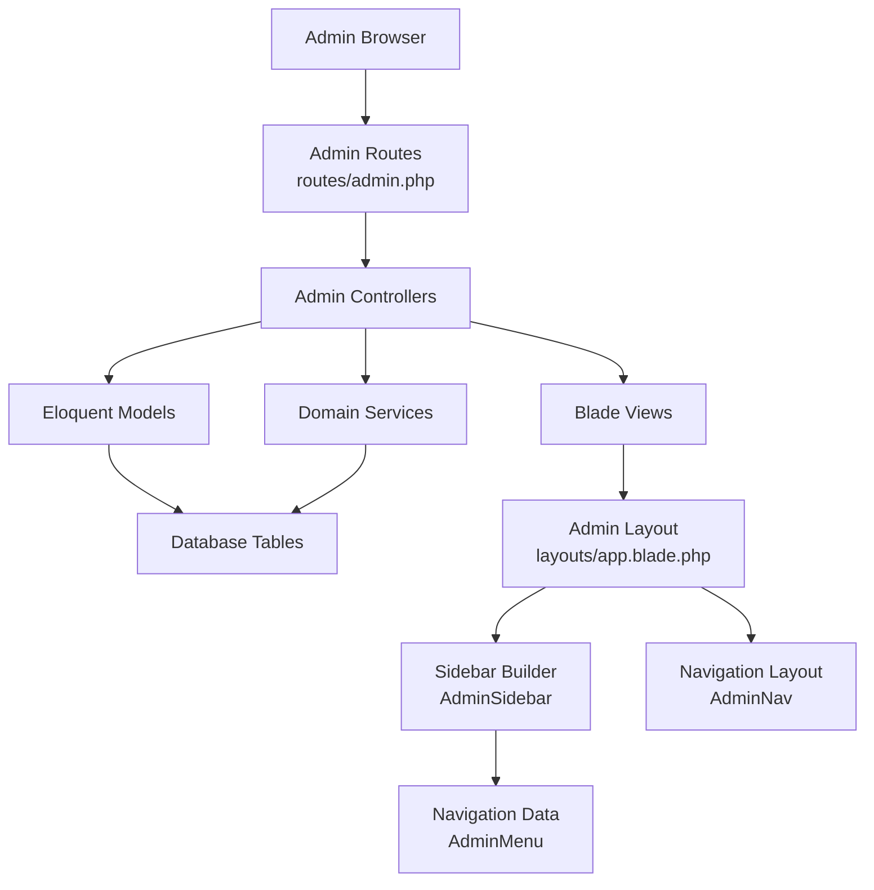
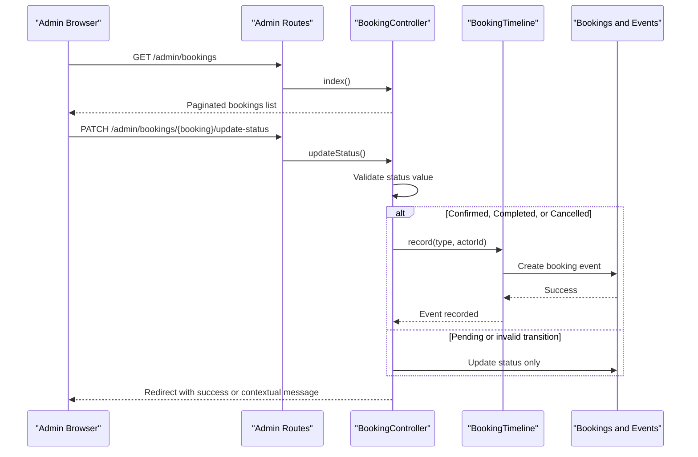
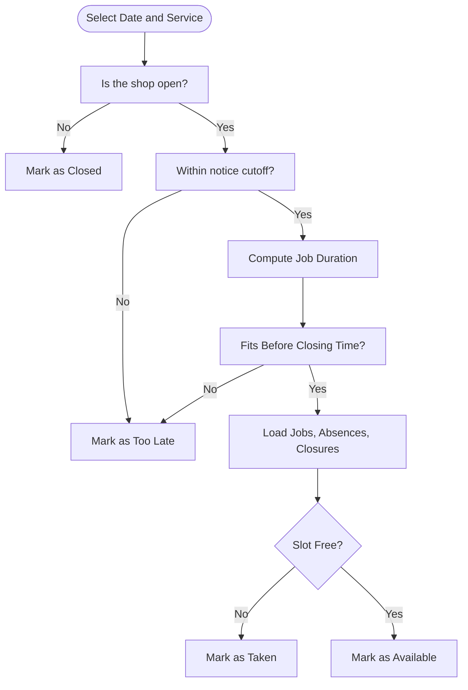
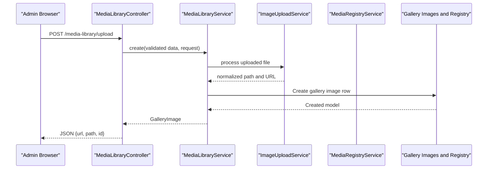
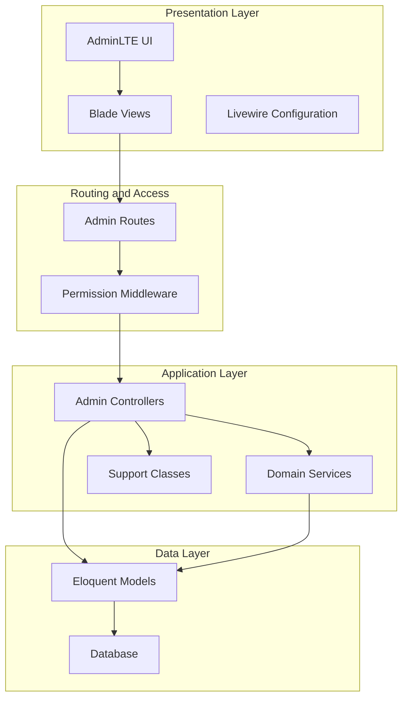
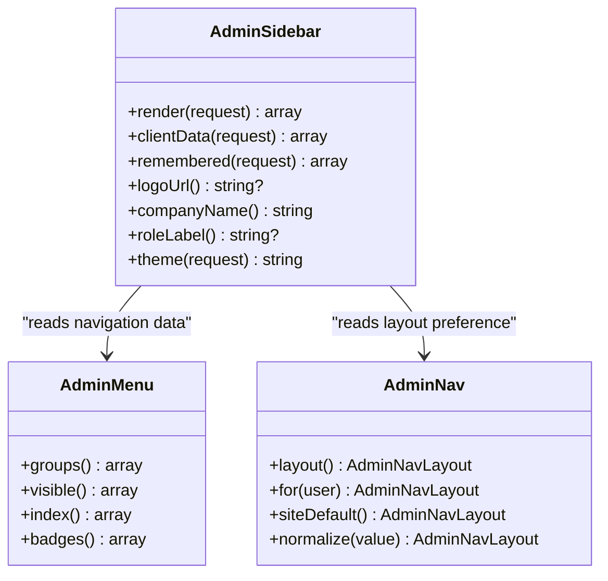
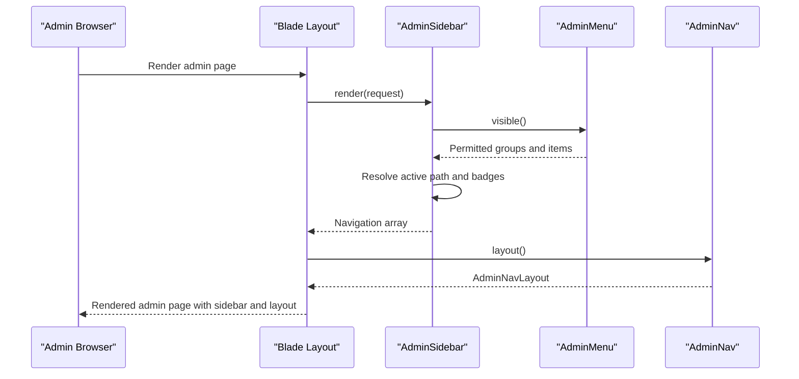
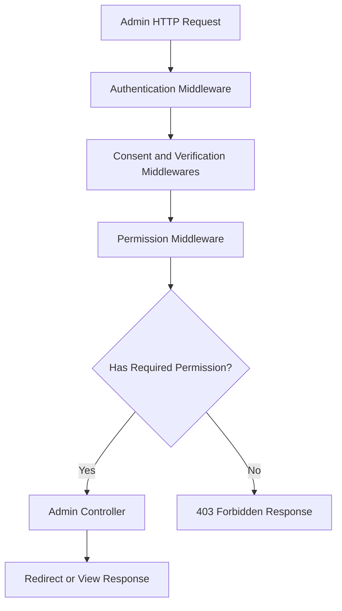
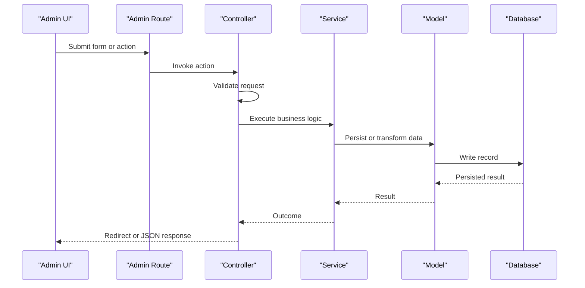
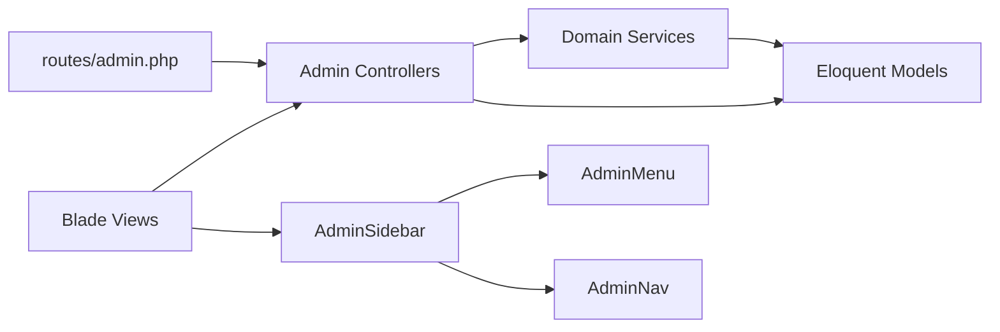

# Admin Panel

<cite>
**Referenced Files in This Document**   
- [routes/admin.php](file://routes/admin.php)
- [app/Http/Controllers/Admin/DashboardController.php](file://app/Http/Controllers/Admin/DashboardController.php)
- [app/Http/Controllers/Admin/BookingController.php](file://app/Http/Controllers/Admin/BookingController.php)
- [app/Http/Controllers/Admin/StaffController.php](file://app/Http/Controllers/Admin/StaffController.php)
- [app/Http/Controllers/Admin/GalleryController.php](file://app/Http/Controllers/Admin/GalleryController.php)
- [app/Http/Controllers/Admin/MediaLibraryController.php](file://app/Http/Controllers/Admin/MediaLibraryController.php)
- [app/Http/Controllers/Admin/UserController.php](file://app/Http/Controllers/Admin/UserController.php)
- [app/Services/AvailabilityService.php](file://app/Services/AvailabilityService.php)
- [app/Services/BookingCalendarService.php](file://app/Services/BookingCalendarService.php)
- [app/Services/ImageUploadService.php](file://app/Services/ImageUploadService.php)
- [app/Services/MediaLibraryService.php](file://app/Services/MediaLibraryService.php)
- [app/Support/AdminSidebar.php](file://app/Support/AdminSidebar.php)
- [app/Support/AdminNav.php](file://app/Support/AdminNav.php)
- [app/Support/AdminMenu.php](file://app/Support/AdminMenu.php)
- [resources/views/layouts/app.blade.php](file://resources/views/layouts/app.blade.php)
- [config/adminlte.php](file://config/adminlte.php)
- [config/permission.php](file://config/permission.php)
- [config/livewire.php](file://config/livewire.php)
- [database/migrations/2026_04_17_093356_create_bookings_table.php](file://database/migrations/2026_04_17_093356_create_bookings_table.php)
- [database/migrations/2026_04_17_110000_create_company_settings_table.php](file://database/migrations/2026_04_17_110000_create_company_settings_table.php)
- [database/migrations/2026_10_01_150000_create_booking_events_table.php](file://database/migrations/2026_10_01_150000_create_booking_events_table.php)
</cite>

## Table of Contents
1. Introduction
2. Project Structure
3. Core Components
4. Architecture Overview
5. Detailed Component Analysis
6. Dependency Analysis
7. Performance Considerations
8. Troubleshooting Guide
9. Security and Audit Logging
10. Administrative Best Practices
11. Conclusion

## Introduction
The Highblossom admin panel is a role-based administrative interface for managing bookings, staff, content, media, users, and company settings. It combines Laravel routing, controllers, services, Eloquent models, Blade layouts, Livewire configuration, and Spatie Permission for access control. The UI shell is based on AdminLTE 3, while the navigation layer is implemented as application-specific support classes that render a consistent sidebar and topbar across pages.

At a high level:
- Routes are grouped under `/admin` and protected by authentication and permission middleware.
- Controllers orchestrate user input through request validation and delegate business logic to services.
- Models represent bookings, staff, gallery images, company settings, and related entities.
- Services encapsulate scheduling availability, image processing, media registration, and calendar building.
- The sidebar and menu are generated from structured data so visibility matches route permissions.
- Livewire is configured for reactive components and temporary file uploads when needed.

## Project Structure
The admin feature spans several layers:

**Diagram sources**
- [routes/admin.php:1-171](file://routes/admin.php#L1-L171)
- [resources/views/layouts/app.blade.php:1-1](file://resources/views/layouts/app.blade.php#L1-L1)
- [app/Support/AdminSidebar.php:1-188](file://app/Support/AdminSidebar.php#L1-L188)
- [app/Support/AdminMenu.php:1-200](file://app/Support/AdminMenu.php#L1-L200)
- [app/Support/AdminNav.php:1-76](file://app/Support/AdminNav.php#L1-L76)

### Key Areas
| Area | Responsibility | Representative Files |
|---|---|---|
| Routing and Access Control | Groups routes, applies `auth`, consent, verification, and permission gates | [routes/admin.php](file://routes/admin.php) |
| Dashboard Analytics | Aggregates counts for users, bookings, inspections, and quotes | [DashboardController.php](file://app/Http/Controllers/Admin/DashboardController.php) |
| Booking Management | Lists, updates, status transitions, timeline recording, and deletion | [BookingController.php](file://app/Http/Controllers/Admin/BookingController.php), [AvailabilityService.php](file://app/Services/AvailabilityService.php), [BookingCalendarService.php](file://app/Services/BookingCalendarService.php) |
| Staff Administration | CRUD for staff profiles, photos, roles, and ordering | [StaffController.php](file://app/Http/Controllers/Admin/StaffController.php) |
| Gallery and Media Library | Image browsing, upload, metadata, registry usage, and deletion | [GalleryController.php](file://app/Http/Controllers/Admin/GalleryController.php), [MediaLibraryController.php](file://app/Http/Controllers/Admin/MediaLibraryController.php), [ImageUploadService.php](file://app/Services/ImageUploadService.php), [MediaLibraryService.php](file://app/Services/MediaLibraryService.php) |
| User Management | Admin user creation, editing, role assignment, and deletion | [UserController.php](file://app/Http/Controllers/Admin/UserController.php) |
| System Settings | Company settings, gallery settings, password policy, versions, about page | [CompanySettingController routes](file://routes/admin.php) |
| Navigation Shell | AdminLTE integration, sidebar rendering, active path detection, theme and layout preferences | [AdminSidebar.php](file://app/Support/AdminSidebar.php), [AdminMenu.php](file://app/Support/AdminMenu.php), [AdminNav.php](file://app/Support/AdminNav.php), [adminlte.php](file://config/adminlte.php), [app.blade.php](file://resources/views/layouts/app.blade.php) |

**Section sources**
- [routes/admin.php:1-171](file://routes/admin.php#L1-L171)
- [resources/views/layouts/app.blade.php:1-1](file://resources/views/layouts/app.blade.php#L1-L1)
- [config/adminlte.php:1-200](file://config/adminlte.php#L1-L200)

## Core Components
This section documents the main admin features and how they interact.

### Dashboard Analytics
The dashboard controller computes aggregate metrics such as total users, total bookings, pending inspections, and quote statuses. It passes these values to the dashboard view for display.

- Metrics include:
  - Total users
  - Total bookings
  - Pending inspections
  - Pending, contacted, completed, and cancelled quotes

This is a read-only analytics surface intended for quick operational awareness.

**Section sources**
- [DashboardController.php:1-41](file://app/Http/Controllers/Admin/DashboardController.php#L1-L41)

### Booking Management Interface
The booking subsystem supports listing, viewing, updating, status transitions, and deletion. It also records milestone events for customer-facing timelines.

Key behaviors:
- Listing supports filtering by status and searching by client name or email.
- Detail view loads associated user, inspection staff, inspection notes, and booking events.
- Status updates validate allowed states and record confirmed, completed, or cancelled milestones.
- Reverting to pending does not create a milestone event; cancellation is terminal unless restored to pending first.
- Availability and conflict checks are delegated to domain services rather than inline controller logic.

**Diagram sources**
- [routes/admin.php:12-27](file://routes/admin.php#L12-L27)
- [BookingController.php:1-103](file://app/Http/Controllers/Admin/BookingController.php#L1-L103)
- [database/migrations/2026_10_01_150000_create_booking_events_table.php:1-44](file://database/migrations/2026_10_01_150000_create_booking_events_table.php#L1-L44)

#### Scheduling and Conflict Detection
Scheduling is handled by dedicated services:

- `AvailabilityService` determines open hours, notice cutoffs, job durations, closed days, staff absences, and slot conflicts. It evaluates intervals rather than single instants so a multi-minute job blocks overlapping slots.
- `BookingCalendarService` builds monthly calendars, marking days as past, closed, full, or selectable. Selectability depends on whether at least one bookable slot exists.

**Diagram sources**
- [AvailabilityService.php:1-200](file://app/Services/AvailabilityService.php#L1-L200)
- [BookingCalendarService.php:1-101](file://app/Services/BookingCalendarService.php#L1-L101)

**Section sources**
- [BookingController.php:1-103](file://app/Http/Controllers/Admin/BookingController.php#L1-L103)
- [AvailabilityService.php:1-200](file://app/Services/AvailabilityService.php#L1-L200)
- [BookingCalendarService.php:1-101](file://app/Services/BookingCalendarService.php#L1-L101)
- [database/migrations/2026_04_17_093356_create_bookings_table.php:1-36](file://database/migrations/2026_04_17_093356_create_bookings_table.php#L1-L36)
- [database/migrations/2026_10_01_150000_create_booking_events_table.php:1-44](file://database/migrations/2026_10_01_150000_create_booking_events_table.php#L1-L44)

### Staff Administration with Role-Based Permissions
The staff controller provides full CRUD operations for staff members. It validates names, roles, bios, optional photos, and sort order. Photos are stored on the public disk, and existing photos are replaced or removed during updates and deletions.

Important points:
- Sorting uses a shared `SortOrderRules` utility.
- Photo storage is explicit and cleaned up on replacement or deletion.
- Roles displayed in the user management screen come from Spatie Permission roles, while staff entries carry their own role text field for front-end presentation.

**Section sources**
- [StaffController.php:1-116](file://app/Http/Controllers/Admin/StaffController.php#L1-L116)

### Content Management System
The admin routes expose content areas for testimonials, services, service types, glass types, glass sub-categories, blog posts, categories, tags, partners, and an About Us editor. Each area is gated by its own permission.

Representative flows:
- Testimonials: list, create, edit, update, delete.
- Services and classification tables: list, create, edit, update, delete.
- Blog posts: list, create, bulk status update, per-post status update, edit, update, delete.
- Partners: list, create, edit, update, delete.

These screens share a common pattern: route-level permission middleware, controller methods delegating to request validators and services where appropriate, and redirects with flash messages.

**Section sources**
- [routes/admin.php:60-171](file://routes/admin.php#L60-L171)

### Media Library with File Upload and Processing
The media library allows browsing, uploading, inspecting metadata, and deleting images. It integrates with the gallery system and central media registry.

Highlights:
- Browsing supports JSON responses for pickers and HTMX partial rendering.
- Uploads can be direct files or pre-selected paths.
- `ImageUploadService` normalizes uploads to WebP with a maximum long edge of 1920 pixels and quality 82, falling back to raw storage if image processing fails.
- `MediaLibraryService` creates gallery image rows, assigns category slugs, marks library assets inactive, and avoids consuming public gallery sort order.
- Deletion unregisters the file from the media registry and removes persisted storage when possible.

**Diagram sources**
- [MediaLibraryController.php:1-169](file://app/Http/Controllers/Admin/MediaLibraryController.php#L1-L169)
- [MediaLibraryService.php:1-79](file://app/Services/MediaLibraryService.php#L1-L79)
- [ImageUploadService.php:1-70](file://app/Services/ImageUploadService.php#L1-L70)

**Section sources**
- [MediaLibraryController.php:1-169](file://app/Http/Controllers/Admin/MediaLibraryController.php#L1-L169)
- [MediaLibraryService.php:1-79](file://app/Services/MediaLibraryService.php#L1-L79)
- [ImageUploadService.php:1-70](file://app/Services/ImageUploadService.php#L1-L70)
- [GalleryController.php:1-92](file://app/Http/Controllers/Admin/GalleryController.php#L1-L92)

### User Management with Profile Editing
The user controller manages admin users, including search, role association, creation, editing, and deletion. It delegates persistence to `UserService`.

Key capabilities:
- Search across user name and email.
- Load roles for forms and lists.
- Use centralized service methods for create, update, and delete operations.
- Integrate with Spatie Permission for role-based access control.

**Section sources**
- [UserController.php:1-96](file://app/Http/Controllers/Admin/UserController.php#L1-L96)

### System Settings Configuration
System settings are exposed through dedicated routes for company settings, gallery settings, security/password policy, application versions, and appearance-related navigation options. These routes enforce `view settings` or `update settings` permissions.

Typical responsibilities:
- Company settings store key/value pairs with typed values.
- Gallery settings control album behavior and visibility.
- Password policy defines rules applied to password changes.
- Application version management tracks releases and history.
- Navigation layout defaults are stored in company settings and resolved per user.

**Section sources**
- [routes/admin.php:38-59](file://routes/admin.php#L38-L59)
- [database/migrations/2026_04_17_110000_create_company_settings_table.php:1-24](file://database/migrations/2026_04_17_110000_create_company_settings_table.php#L1-L24)

## Architecture Overview
The admin panel follows a layered architecture:

**Diagram sources**
- [routes/admin.php:1-171](file://routes/admin.php#L1-L171)
- [config/permission.php:1-200](file://config/permission.php#L1-L200)
- [config/livewire.php:1-200](file://config/livewire.php#L1-L200)
- [config/adminlte.php:1-200](file://config/adminlte.php#L1-L200)

## Detailed Component Analysis

### AdminLTE Integration and Navigation Structure
AdminLTE is integrated through its configuration file and the application layout. The layout wrapper renders a sidebar component that carries title and content. AdminLTE controls branding, logo, preloader, user menu, layout options, and authentication styling.

The navigation structure is built from three cooperating classes:

- `AdminMenu`: Declares navigation groups, items, route names, permission hints, keywords, and badges. It mirrors route permissions so the menu stays honest with what a user can actually visit.
- `AdminSidebar`: Renders permitted navigation into a server-side array, resolves active paths, remembers branch state via cookie, returns client data for search and badges, and exposes logo, company name, role label, and theme information.
- `AdminNav`: Determines whether the current user should see a specific navigation layout based on personal preference or site-wide company setting.

**Diagram sources**
- [app/Support/AdminMenu.php:1-200](file://app/Support/AdminMenu.php#L1-L200)
- [app/Support/AdminSidebar.php:1-188](file://app/Support/AdminSidebar.php#L1-L188)
- [app/Support/AdminNav.php:1-76](file://app/Support/AdminNav.php#L1-L76)

#### Navigation Flow

**Diagram sources**
- [resources/views/layouts/app.blade.php:1-1](file://resources/views/layouts/app.blade.php#L1-L1)
- [app/Support/AdminSidebar.php:1-188](file://app/Support/AdminSidebar.php#L1-L188)
- [app/Support/AdminMenu.php:1-200](file://app/Support/AdminMenu.php#L1-L200)
- [app/Support/AdminNav.php:1-76](file://app/Support/AdminNav.php#L1-L76)

**Section sources**
- [config/adminlte.php:1-200](file://config/adminlte.php#L1-L200)
- [resources/views/layouts/app.blade.php:1-1](file://resources/views/layouts/app.blade.php#L1-L1)
- [app/Support/AdminSidebar.php:1-188](file://app/Support/AdminSidebar.php#L1-L188)
- [app/Support/AdminMenu.php:1-200](file://app/Support/AdminMenu.php#L1-L200)
- [app/Support/AdminNav.php:1-76](file://app/Support/AdminNav.php#L1-L76)

### Livewire Components for Reactive Interfaces
Livewire is configured to:
- Discover components from Blade component directories.
- Default to single-file components.
- Inject assets automatically.
- Provide temporary file upload handling with size limits and preview MIME types.
- Support SPA-like navigation with progress indicators.

In the admin context, Livewire can power reactive forms, filters, media pickers, and live feedback without full-page reloads. Temporary uploads are isolated under a configurable disk directory and cleanup policy.

**Section sources**
- [config/livewire.php:1-200](file://config/livewire.php#L1-L200)

### Permission-Based Access Control
Access control uses Spatie Permission with:
- Role and permission models.
- Dedicated pivot tables for roles, permissions, and model relationships.
- Optional Octane reset listener disabled by default.
- Cache expiration set to 24 hours.
- Permission check method registered with Laravel Gate.

Every admin route explicitly applies a `can:` middleware tied to named permissions such as `view bookings`, `update bookings`, `manage settings`, `manage gallery`, `view blog`, and others. The sidebar also declares permission hints so menu items appear only when the corresponding route would allow access.

**Diagram sources**
- [routes/admin.php:1-171](file://routes/admin.php#L1-L171)
- [config/permission.php:1-200](file://config/permission.php#L1-L200)
- [app/Support/AdminMenu.php:1-200](file://app/Support/AdminMenu.php#L1-L200)

**Section sources**
- [config/permission.php:1-200](file://config/permission.php#L1-L200)
- [routes/admin.php:1-171](file://routes/admin.php#L1-L171)

### Data Flow From UI to Database
A typical admin operation follows this flow:

1. User interacts with a Blade view or Livewire component.
2. A browser request reaches an admin route.
3. Middleware enforces authentication, consent, verification, and permissions.
4. A controller validates input using request classes or inline validation.
5. Business logic runs in services where applicable.
6. Eloquent models persist data to database tables.
7. Responses redirect with flash messages or return JSON for AJAX/HX requests.

**Diagram sources**
- [routes/admin.php:1-171](file://routes/admin.php#L1-L171)
- [BookingController.php:1-103](file://app/Http/Controllers/Admin/BookingController.php#L1-L103)
- [MediaLibraryController.php:1-169](file://app/Http/Controllers/Admin/MediaLibraryController.php#L1-L169)
- [StaffController.php:1-116](file://app/Http/Controllers/Admin/StaffController.php#L1-L116)

## Dependency Analysis
The admin system has clear separation between routing, controllers, services, models, and views. Dependencies generally flow downward:

- Routes depend on controllers.
- Controllers depend on models and services.
- Services depend on models and external helpers.
- Views depend on controllers and support classes for navigation.
- Navigation classes depend on menus, company settings, and user preferences.

**Diagram sources**
- [routes/admin.php:1-171](file://routes/admin.php#L1-L171)
- [app/Http/Controllers/Admin/DashboardController.php:1-41](file://app/Http/Controllers/Admin/DashboardController.php#L1-L41)
- [app/Http/Controllers/Admin/BookingController.php:1-103](file://app/Http/Controllers/Admin/BookingController.php#L1-L103)
- [app/Http/Controllers/Admin/MediaLibraryController.php:1-169](file://app/Http/Controllers/Admin/MediaLibraryController.php#L1-L169)
- [app/Support/AdminSidebar.php:1-188](file://app/Support/AdminSidebar.php#L1-L188)
- [app/Support/AdminMenu.php:1-200](file://app/Support/AdminMenu.php#L1-L200)
- [app/Support/AdminNav.php:1-76](file://app/Support/AdminNav.php#L1-L76)

**Section sources**
- [routes/admin.php:1-171](file://routes/admin.php#L1-L171)

## Performance Considerations
Several design choices improve performance in the admin panel:

- Dashboard queries use simple aggregates like `count()` for fast overview metrics.
- Booking listings paginate results and apply indexed columns for status and created time.
- Availability calculation caches jobs, absences, and closure dates within a loaded window instead of querying per slot.
- Calendar generation builds month payloads once per call, avoiding redundant availability work.
- Media uploads normalize large images to WebP at fixed dimensions and quality, reducing storage and bandwidth.
- Permission caching is enabled for 24 hours, reducing repeated role/permission resolution overhead.

Recommendations:
- Keep dashboard counters aggregated and avoid heavy joins on every page load.
- Preserve pagination on all list screens.
- Prefer service-layer calculations for complex scheduling logic.
- Monitor image processing failures and ensure storage drivers remain healthy.
- Use queue workers for expensive background tasks if future features require them.

[No sources needed since this section provides general guidance]

## Troubleshooting Guide
Common issues and where to look:

| Issue | Likely Cause | Where to Investigate |
|---|---|---|
| Admin page shows 403 | Missing permission or incorrect route middleware | [routes/admin.php](file://routes/admin.php) |
| Sidebar links do not match routes | Route name mismatch or prefix change | [app/Support/AdminMenu.php](file://app/Support/AdminMenu.php) |
| Active state flickers after navigation | Server-rendered active path vs client-side state | [app/Support/AdminSidebar.php](file://app/Support/AdminSidebar.php) |
| Booking status cannot move forward | Terminal cancellation or invalid state transition | [BookingController.php](file://app/Http/Controllers/Admin/BookingController.php) |
| Calendar day appears selectable but booking fails | Slot not available due to duration, closing time, absence, or occupancy | [AvailabilityService.php](file://app/Services/AvailabilityService.php) |
| Image upload succeeds but processing fails | Image library error or unsupported format | [ImageUploadService.php](file://app/Services/ImageUploadService.php) |
| Media library item disappears unexpectedly | Deletion unregistered registry entry and removed file | [MediaLibraryController.php](file://app/Http/Controllers/Admin/MediaLibraryController.php) |
| User cannot see menu item | Permission not granted or sidebar permission hint missing | [app/Support/AdminMenu.php](file://app/Support/AdminMenu.php) |
| Settings not saving | Invalid setting type or missing `update settings` permission | [routes/admin.php](file://routes/admin.php) |

**Section sources**
- [BookingController.php:1-103](file://app/Http/Controllers/Admin/BookingController.php#L1-L103)
- [AvailabilityService.php:1-200](file://app/Services/AvailabilityService.php#L1-L200)
- [ImageUploadService.php:1-70](file://app/Services/ImageUploadService.php#L1-L70)
- [MediaLibraryController.php:1-169](file://app/Http/Controllers/Admin/MediaLibraryController.php#L1-L169)
- [app/Support/AdminMenu.php:1-200](file://app/Support/AdminMenu.php#L1-L200)
- [routes/admin.php:1-171](file://routes/admin.php#L1-L171)

## Security and Audit Logging
Security measures present in the admin panel include:

- Authentication required for all admin routes.
- Consent and verification middlewares applied before authorization.
- Fine-grained permission checks on every admin route.
- Request validation in controllers and request classes.
- Image processing with dimension and quality limits.
- Centralized media registry for tracking file usage and safe deletion.
- Spatie Permission with cache and controlled exception messaging.

Audit logging and security logs are represented by migrations for audit action logs, activity logs, and security logs, indicating an audit infrastructure is available for broader auditing needs beyond the booking timeline.

Operational security recommendations:
- Restrict admin panel access to trusted IP ranges where possible.
- Enforce strong password policies through the security settings screen.
- Review permissions regularly and remove unused roles.
- Monitor failed image uploads and storage driver errors.
- Back up the media registry and storage together to maintain referential integrity.
- Use sessions and logout listeners to manage administrative session lifecycle.

**Section sources**
- [routes/admin.php:1-171](file://routes/admin.php#L1-L171)
- [config/permission.php:1-200](file://config/permission.php#L1-L200)
- [ImageUploadService.php:1-70](file://app/Services/ImageUploadService.php#L1-L70)
- [MediaLibraryController.php:1-169](file://app/Http/Controllers/Admin/MediaLibraryController.php#L1-L169)

## Administrative Best Practices
Recommended practices for operating the admin panel safely and efficiently:

- Assign roles and permissions using the smallest necessary scope.
- Never grant broad write permissions to low-trust accounts.
- Review booking status changes and confirm terminal cancellations before finalizing.
- Use gallery categories and active flags to control public exposure separately from internal media.
- Normalize image uploads and monitor processing fallback behavior.
- Keep company settings consistent across logo, company name, and navigation layout.
- Maintain staff photos and ordering carefully to avoid orphaned storage files.
- Audit user roles periodically and remove inactive admin accounts.
- Use the dashboard metrics to track workload trends and identify bottlenecks.

[No sources needed since this section summarizes best practices]

## Conclusion
The Highblossom admin panel provides a secure, permission-driven administration experience. Its strengths lie in clear separation of concerns, service-backed scheduling logic, structured navigation, and careful handling of media and settings. By following the documented workflows for bookings, staff, gallery images, testimonials, and company settings, administrators can manage daily operations confidently. For customization, focus on AdminLTE configuration, navigation definitions, permission assignments, and service extensions rather than mutating route-level behavior directly.

[No sources needed since this section summarizes without analyzing specific files]