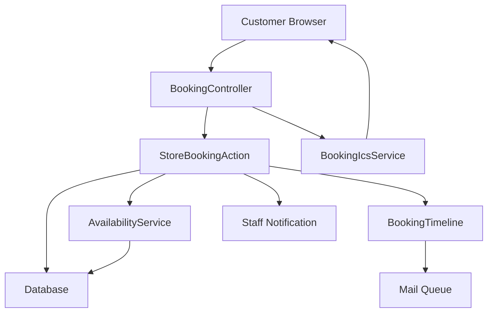
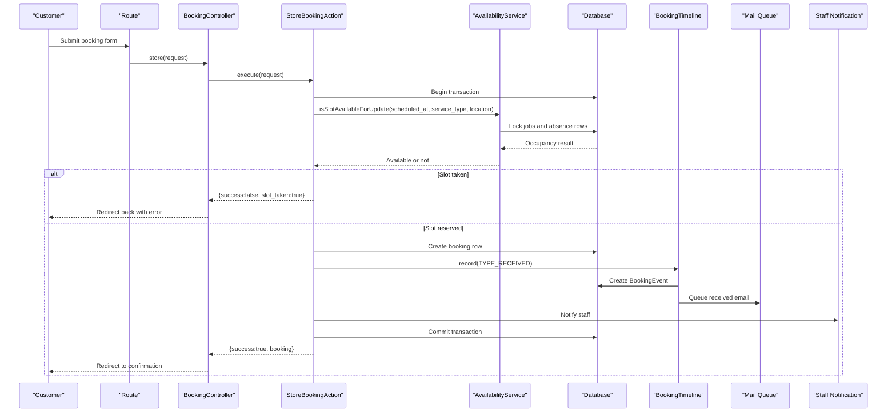
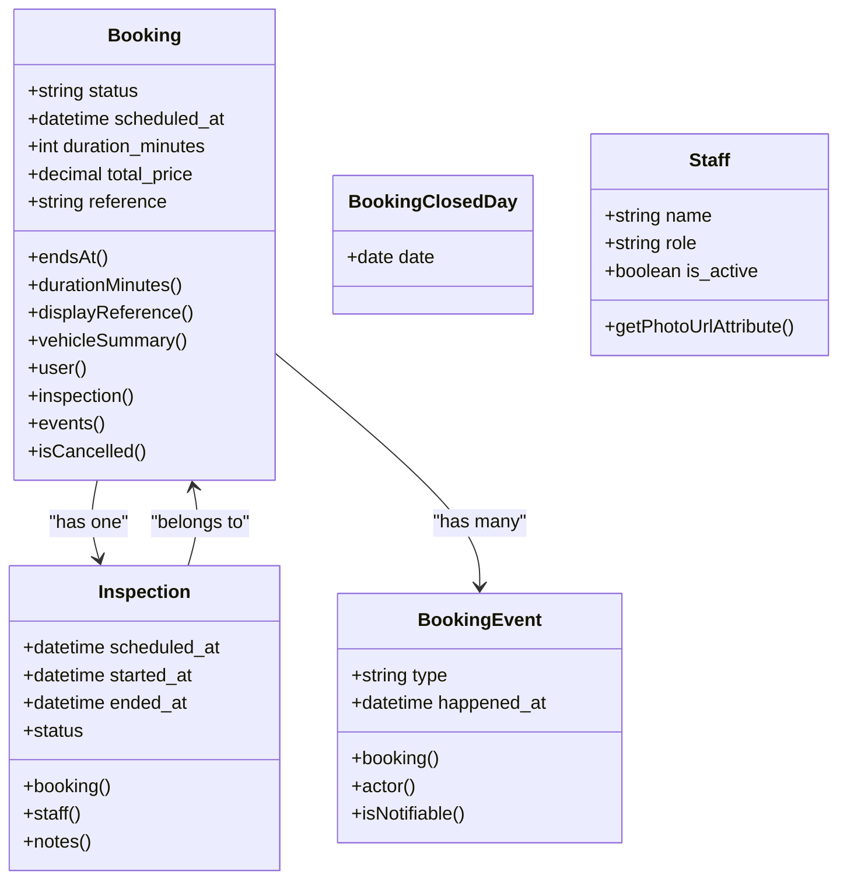
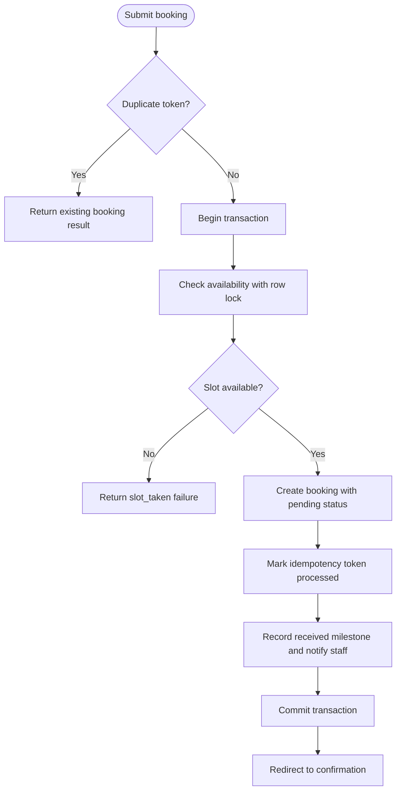
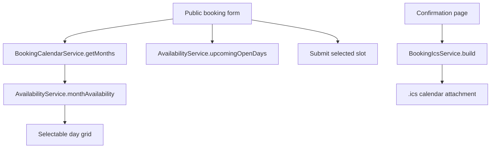
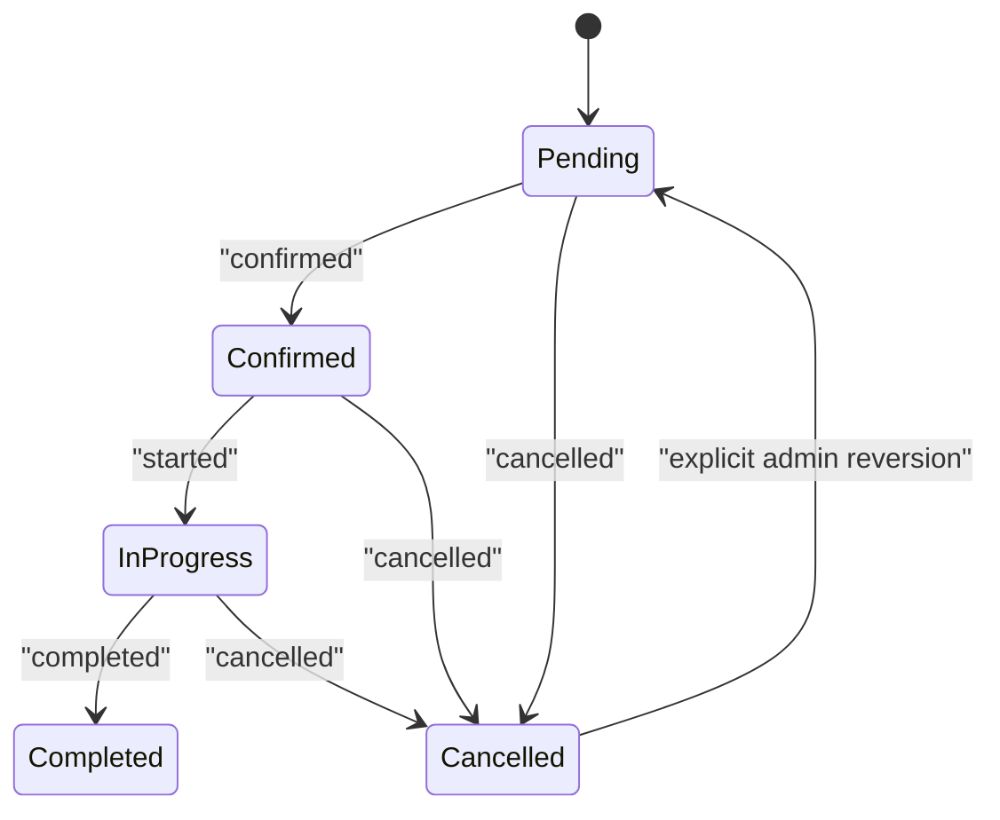
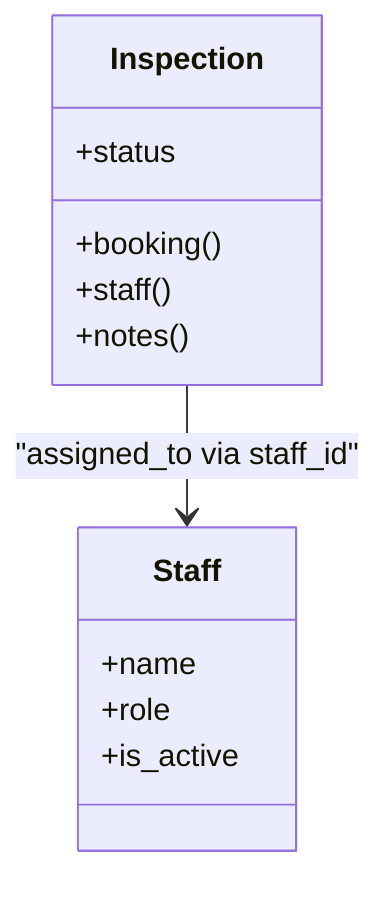
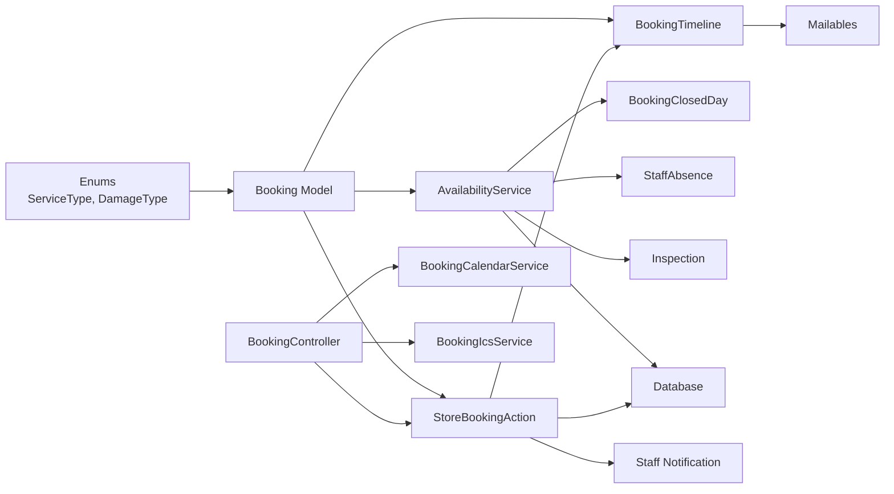

# Booking Management

<cite>
**Referenced Files in This Document**
- [Booking.php](file://app/Models/Booking.php)
- [Inspection.php](file://app/Models/Inspection.php)
- [BookingEvent.php](file://app/Models/BookingEvent.php)
- [BookingClosedDay.php](file://app/Models/BookingClosedDay.php)
- [Staff.php](file://app/Models/Staff.php)
- [StoreBookingAction.php](file://app/Actions/StoreBookingAction.php)
- [AvailabilityService.php](file://app/Services/AvailabilityService.php)
- [BookingCalendarService.php](file://app/Services/BookingCalendarService.php)
- [BookingIcsService.php](file://app/Services/BookingIcsService.php)
- [BookingTimeline.php](file://app/Services/BookingTimeline.php)
- [BookingController.php](file://app/Http/Controllers/BookingController.php)
</cite>

## Table of Contents
1. [Introduction](#introduction)
2. [Project Structure](#project-structure)
3. [Core Components](#core-components)
4. [Architecture Overview](#architecture-overview)
5. [Detailed Component Analysis](#detailed-component-analysis)
6. [Dependency Analysis](#dependency-analysis)
7. [Performance Considerations](#performance-considerations)
8. [Troubleshooting Guide](#troubleshooting-guide)
9. [Conclusion](#conclusion)

## Introduction
This document explains the Highblossom booking management system with a focus on how customer bookings are created, scheduled, validated, and tracked through their lifecycle. It covers the scheduling interface, conflict detection, status management, timeline events, calendar integration, staff assignment, automated notifications, inspection scheduling, and operational concerns for large datasets.

The system is built around:
- A public booking form that presents an availability-aware calendar.
- An action that reserves a slot under a database lock, creates the booking, records a received milestone, and notifies staff.
- A centralized timeline service that synchronizes booking status and customer email notifications.
- A concurrency-safe availability engine that models capacity by location, working hours, closures, absences, and overlapping job spans.
- Calendar export support so customers can add appointments to external calendars.

## Project Structure
The booking domain spans models, actions, services, controllers, enums, mail classes, and supporting business logic. The most relevant files are:

| Area | Responsibility |
|---|---|
| Models | Persistent data for bookings, inspections, events, closed days, and staff. |
| Actions | Transactional workflow for creating a booking safely. |
| Services | Availability calculation, calendar grid building, iCalendar export, and timeline/status synchronization. |
| Controller | Public HTTP entry points for form display, submission, confirmation, and calendar download. |
| Enums | Business values such as service type and damage type. |

**Diagram sources**
- [BookingController.php:20-146](file://app/Http/Controllers/BookingController.php#L20-L146)
- [StoreBookingAction.php:1-267](file://app/Actions/StoreBookingAction.php#L1-L267)
- [AvailabilityService.php:1-748](file://app/Services/AvailabilityService.php#L1-L748)
- [BookingTimeline.php:1-128](file://app/Services/BookingTimeline.php#L1-L128)
- [BookingIcsService.php:1-141](file://app/Services/BookingIcsService.php#L1-L141)

**Section sources**
- [BookingController.php:20-146](file://app/Http/Controllers/BookingController.php#L20-L146)
- [StoreBookingAction.php:1-267](file://app/Actions/StoreBookingAction.php#L1-L267)
- [AvailabilityService.php:1-748](file://app/Services/AvailabilityService.php#L1-L748)
- [BookingTimeline.php:1-128](file://app/Services/BookingTimeline.php#L1-L128)
- [BookingIcsService.php:1-141](file://app/Services/BookingIcsService.php#L1-L141)

## Core Components
The booking system centers on five layers:

1. **Data layer (models)**
   - `Booking` stores customer details, vehicle information, service and damage types, scheduling fields, status, pricing, and reference identifiers. It derives end time from start time plus duration, formats a human-readable vehicle summary, and exposes relationships to user, inspection, and event history.
   - `Inspection` links an on-site visit to a booking, assigns a staff member, tracks scheduled/started/ended times, and computes a computed status (`scheduled`, `in_progress`, `overdue`, or `completed`).
   - `BookingEvent` records milestones such as received, confirmed, rescheduled, started, completed, and cancelled. Only selected milestones trigger customer emails.
   - `BookingClosedDay` represents dates when no bookings are accepted.
   - `Staff` represents shop staff; it is used for presentation and ordering but is not directly linked to bookings in the examined code.

2. **Workflow layer (action)**
   - `StoreBookingAction` handles idempotent booking creation, slot reservation under a transaction, post-creation notification, and duplicate request handling.

3. **Scheduling and validation layer (services)**
   - `AvailabilityService` calculates whether a slot is available, builds day/month grids, enforces lead time, working hours, closure dates, capacity per location, and overlap rules.
   - `BookingCalendarService` converts availability into a flat monthly calendar payload suitable for server-rendered pickers and APIs.
   - `BookingTimeline` centralizes milestone recording, status updates, duplicate prevention, and customer email dispatch.
   - `BookingIcsService` exports a booking as an RFC 5545-compliant `.ics` file.

4. **HTTP layer (controller)**
   - `BookingController` renders the booking form with precomputed calendar and quick-pick days, processes submissions, shows confirmation, and serves calendar downloads.

5. **Enums and configuration**
   - Service and damage types define business categories.
   - Settings control lead time, slot intervals, durations, capacities, working hours, and display preferences.

**Section sources**
- [Booking.php:1-134](file://app/Models/Booking.php#L1-L134)
- [Inspection.php:1-82](file://app/Models/Inspection.php#L1-L82)
- [BookingEvent.php:1-84](file://app/Models/BookingEvent.php#L1-L84)
- [BookingClosedDay.php:1-35](file://app/Models/BookingClosedDay.php#L1-L35)
- [Staff.php:1-45](file://app/Models/Staff.php#L1-L45)
- [StoreBookingAction.php:1-267](file://app/Actions/StoreBookingAction.php#L1-L267)
- [AvailabilityService.php:1-748](file://app/Services/AvailabilityService.php#L1-L748)
- [BookingCalendarService.php:1-101](file://app/Services/BookingCalendarService.php#L1-L101)
- [BookingTimeline.php:1-128](file://app/Services/BookingTimeline.php#L1-L128)
- [BookingIcsService.php:1-141](file://app/Services/BookingIcsService.php#L1-L141)
- [BookingController.php:1-146](file://app/Http/Controllers/BookingController.php#L1-L146)

## Architecture Overview
The booking lifecycle flows from customer input through a concurrency-safe reservation step into persistent storage, then through a timeline that updates status and queues customer notifications.

**Diagram sources**
- [BookingController.php:54-91](file://app/Http/Controllers/BookingController.php#L54-L91)
- [StoreBookingAction.php:38-118](file://app/Actions/StoreBookingAction.php#L38-L118)
- [AvailabilityService.php:89-141](file://app/Services/AvailabilityService.php#L89-L141)
- [BookingTimeline.php:31-85](file://app/Services/BookingTimeline.php#L31-L85)

**Section sources**
- [BookingController.php:54-91](file://app/Http/Controllers/BookingController.php#L54-L91)
- [StoreBookingAction.php:38-118](file://app/Actions/StoreBookingAction.php#L38-L118)
- [AvailabilityService.php:89-141](file://app/Services/AvailabilityService.php#L89-L141)
- [BookingTimeline.php:31-85](file://app/Services/BookingTimeline.php#L31-L85)

## Detailed Component Analysis

### Booking Model Relationships and Validation Rules
The `Booking` model defines fillable fields covering customer contact, vehicle data, service and damage selection, scheduling, duration, location, client address, status, price, and reference. Important behaviors include:
- Casting scheduled time to datetime, price to decimal, duration to integer, WhatsApp preference to boolean, and enum fields to typed enums.
- Deriving `ends_at` from `scheduled_at + duration_minutes`.
- Falling back to a minimum 15-minute duration and defaulting to 60 minutes when duration is missing.
- Generating a stable customer-facing reference when none exists.
- Building a vehicle summary from structured fields, falling back to legacy free-text vehicle details.
- Exposing relationships to user, inspection, and customer-visible events.
- Providing a cancellation helper.

Validation is enforced at two levels:
- Request-level validation occurs before the action runs.
- Business validation happens inside the availability service, which rejects closed days, too-late requests, slots that do not finish before closing, and slots exceeding capacity.

**Diagram sources**
- [Booking.php:1-134](file://app/Models/Booking.php#L1-L134)
- [Inspection.php:1-82](file://app/Models/Inspection.php#L1-L82)
- [BookingEvent.php:1-84](file://app/Models/BookingEvent.php#L1-L84)
- [BookingClosedDay.php:1-35](file://app/Models/BookingClosedDay.php#L1-L35)
- [Staff.php:1-45](file://app/Models/Staff.php#L1-L45)

**Section sources**
- [Booking.php:1-134](file://app/Models/Booking.php#L1-L134)
- [Inspection.php:1-82](file://app/Models/Inspection.php#L1-L82)
- [BookingEvent.php:1-84](file://app/Models/BookingEvent.php#L1-L84)
- [BookingClosedDay.php:1-35](file://app/Models/BookingClosedDay.php#L1-L35)
- [Staff.php:1-45](file://app/Models/Staff.php#L1-L45)

### Booking Creation Workflow and Conflict Detection
The public controller delegates submission to `StoreBookingAction`. The key steps are:

1. Check an idempotency token to prevent duplicate submissions.
2. Start a transaction.
3. Call availability check with update locking.
4. If unavailable, return a slot-taken response.
5. Otherwise create the booking with pending status and derived duration.
6. Mark the token processed and commit.
7. Record a received milestone and notify staff.
8. Handle duplicate submissions gracefully.

Conflict detection uses interval-based overlap rather than instant-instant comparison. A booked slot occupies its entire duration, so a 90-minute job starting at 09:00 conflicts with any other job whose span overlaps `[09:00, 10:30]`. The locked path locks committed jobs and absence rows inside a padded range, then applies the same overlap predicate used by the picker, ensuring calendar UI and reservation logic cannot disagree.

**Diagram sources**
- [StoreBookingAction.php:38-118](file://app/Actions/StoreBookingAction.php#L38-L118)
- [AvailabilityService.php:112-141](file://app/Services/AvailabilityService.php#L112-L141)
- [AvailabilityService.php:446-522](file://app/Services/AvailabilityService.php#L446-L522)

**Section sources**
- [StoreBookingAction.php:38-118](file://app/Actions/StoreBookingAction.php#L38-L118)
- [StoreBookingAction.php:183-267](file://app/Actions/StoreBookingAction.php#L183-L267)
- [AvailabilityService.php:446-522](file://app/Services/AvailabilityService.php#L446-L522)

### Scheduling Interface and Calendar Integration
The public booking form is rendered by `BookingController.create`, which passes:
- Three months of calendar data from `BookingCalendarService`.
- Up to 14 upcoming open days from `AvailabilityService`.
- The selected service’s duration.
- The initial wizard step based on validation errors.

`BookingCalendarService.monthPayload` builds each month’s grid using Monday-first layout. A day is selectable only if `AvailabilityService.monthAvailability` reports at least one bookable slot. This prevents a fully booked day from appearing selectable until after submission, where it would fail.

The iCalendar export is handled by `BookingIcsService.build`, which produces an RFC 5545 `.ics` file using floating wall-clock times matching the naive `scheduled_at` column. The controller returns this as a downloadable attachment when the booking has a scheduled time.

**Diagram sources**
- [BookingController.php:28-52](file://app/Http/Controllers/BookingController.php#L28-L52)
- [BookingController.php:100-122](file://app/Http/Controllers/BookingController.php#L100-L122)
- [BookingCalendarService.php:22-101](file://app/Services/BookingCalendarService.php#L22-L101)
- [AvailabilityService.php:242-308](file://app/Services/AvailabilityService.php#L242-L308)
- [BookingIcsService.php:16-141](file://app/Services/BookingIcsService.php#L16-L141)

**Section sources**
- [BookingController.php:28-52](file://app/Http/Controllers/BookingController.php#L28-L52)
- [BookingController.php:100-122](file://app/Http/Controllers/BookingController.php#L100-L122)
- [BookingCalendarService.php:22-101](file://app/Services/BookingCalendarService.php#L22-L101)
- [AvailabilityService.php:242-308](file://app/Services/AvailabilityService.php#L242-L308)
- [BookingIcsService.php:16-141](file://app/Services/BookingIcsService.php#L16-L141)

### Status Management and Timeline Tracking
`BookingTimeline` is the single authority for booking milestones. Its `record` method:
- Validates the milestone type against allowed values.
- Prevents further transitions after cancellation except explicit reversion.
- Collapses back-to-back duplicate milestones.
- Creates a `BookingEvent`.
- Updates the coarse booking status for received, confirmed, completed, and cancelled milestones.
- Queues customer emails for notifiable milestones.

Allowed milestone types include received, confirmed, rescheduled, started, completed, and cancelled. Notifiable types exclude `started` to avoid noisy messages for short jobs.

**Diagram sources**
- [BookingTimeline.php:31-128](file://app/Services/BookingTimeline.php#L31-L128)
- [BookingEvent.php:16-84](file://app/Models/BookingEvent.php#L16-L84)

**Section sources**
- [BookingTimeline.php:31-128](file://app/Services/BookingTimeline.php#L31-L128)
- [BookingEvent.php:16-84](file://app/Models/BookingEvent.php#L16-L84)

### Inspection Scheduling and Staff Assignment
An inspection is tied to a booking and may be assigned to a staff member. Its computed status depends on timestamps:
- Scheduled if not started and not overdue.
- Overdue if past its scheduled time without a start.
- In progress once started.
- Completed once ended.

When computing occupancy, the availability engine prefers the inspection’s scheduled time over the booking’s scheduled time. This ensures rescheduled inspections do not double-count the original booking slot.

Staff assignment currently lives on the inspection level rather than directly on the booking. The `Staff` model provides presentation helpers and ordering but is not referenced by `Booking` in the examined code.

**Diagram sources**
- [Inspection.php:1-82](file://app/Models/Inspection.php#L1-L82)
- [Staff.php:1-45](file://app/Models/Staff.php#L1-L45)
- [AvailabilityService.php:468-522](file://app/Services/AvailabilityService.php#L468-L522)

**Section sources**
- [Inspection.php:1-82](file://app/Models/Inspection.php#L1-L82)
- [Staff.php:1-45](file://app/Models/Staff.php#L1-L45)
- [AvailabilityService.php:468-522](file://app/Services/AvailabilityService.php#L468-L522)

### Automated Notification Triggers
Notifications occur at several points:

| Trigger | Recipient | Behavior |
|---|---|---|
| Successful booking submission | Customer | Timeline records `received` and queues a confirmation-style email. |
| Successful booking submission | Staff with update permission | Sends a new-booking staff notification. |
| Event listeners | Application-wide | Dispatches a `BookingCreatedEvent`. |
| Timeline milestones | Customer | Queues appropriate emails for received, confirmed, rescheduled, completed, and cancelled milestones. |

Post-creation notifications are wrapped in exception handling so that mail or queue failures do not invalidate an already committed booking.

**Section sources**
- [StoreBookingAction.php:201-267](file://app/Actions/StoreBookingAction.php#L201-L267)
- [BookingTimeline.php:31-128](file://app/Services/BookingTimeline.php#L31-L128)

### Examples of Managing Booking Conflicts
Practical scenarios handled by the codebase:

| Scenario | System Behavior |
|---|---|
| Two customers submit the same slot concurrently | One wins the database lock; the other receives a slot-taken response after retries are exhausted. |
| A 90-minute job starts near closing | Rejected because the job must finish before closing time. |
| A fully booked day appears in the calendar | The day is marked non-selectable during the month survey. |
| Closed operating hours or closure dates | Slots are absent or rejected. |
| Capacity is exceeded | No additional jobs fit within the configured bay count. |
| Mobile vs workshop location mismatch | Jobs are counted only against compatible pools unless the booking has no location, in which case it counts against every pool. |
| Rescheduled inspection | Occupancy uses the inspection’s scheduled time so the original booking slot is not double-counted. |

**Section sources**
- [StoreBookingAction.php:60-118](file://app/Actions/StoreBookingAction.php#L60-L118)
- [AvailabilityService.php:89-141](file://app/Services/AvailabilityService.php#L89-L141)
- [AvailabilityService.php:401-522](file://app/Services/AvailabilityService.php#L401-L522)
- [AvailabilityService.php:646-748](file://app/Services/AvailabilityService.php#L646-L748)

### Bulk Operations and Export Functionality
Within the examined booking implementation:
- There is no dedicated bulk booking API or bulk status updater.
- Individual operations are exposed through the public controller and action.
- Export functionality exists as a per-booking iCalendar download.
- Database migrations show schema evolution, including event logging and inspection note tables, but no migration introduces a bulk operation endpoint.

Recommended extension pattern:
- Introduce a bulk action class similar to `StoreBookingAction`.
- Use batch transactions and idempotency keys for each item.
- Route bulk endpoints behind admin authorization.
- Add audit and timeline entries per affected booking.

**Section sources**
- [BookingController.php:100-122](file://app/Http/Controllers/BookingController.php#L100-L122)
- [StoreBookingAction.php:1-267](file://app/Actions/StoreBookingAction.php#L1-L267)

## Dependency Analysis
The booking subsystem follows a clear dependency direction:

Key coupling observations:
- `StoreBookingAction` depends on availability, idempotency, timeline, and notification infrastructure.
- `AvailabilityService` depends on settings, closed days, inspections, and absences.
- `BookingTimeline` depends on mailables and the `BookingEvent` type set.
- `BookingCalendarService` depends on availability rather than direct database queries.
- `BookingController` coordinates presentation and export without embedding scheduling logic.

Potential circular dependencies are avoided by keeping heavy scheduling logic out of models and controllers.

**Diagram sources**
- [StoreBookingAction.php:1-267](file://app/Actions/StoreBookingAction.php#L1-L267)
- [AvailabilityService.php:1-748](file://app/Services/AvailabilityService.php#L1-L748)
- [BookingCalendarService.php:1-101](file://app/Services/BookingCalendarService.php#L1-L101)
- [BookingTimeline.php:1-128](file://app/Services/BookingTimeline.php#L1-L128)
- [BookingController.php:1-146](file://app/Http/Controllers/BookingController.php#L1-L146)

**Section sources**
- [StoreBookingAction.php:1-267](file://app/Actions/StoreBookingAction.php#L1-L267)
- [AvailabilityService.php:1-748](file://app/Services/AvailabilityService.php#L1-L748)
- [BookingCalendarService.php:1-101](file://app/Services/BookingCalendarService.php#L1-L101)
- [BookingTimeline.php:1-128](file://app/Services/BookingTimeline.php#L1-L128)
- [BookingController.php:1-146](file://app/Http/Controllers/BookingController.php#L1-L146)

## Performance Considerations
The codebase includes several performance-oriented patterns for booking workloads:

| Concern | Current Approach | Recommendation |
|---|---|---|
| Large calendar rendering | `AvailabilityService` loads jobs and absences into memory for a padded window and avoids repeated per-slot queries. | Keep window caching; avoid eager-loading relations inside loops. |
| Concurrent submissions | Row-level locking with `lockForUpdate` and retry logic for deadlocks. | Monitor deadlock rates and tune retry delay and lock scope. |
| Database round trips | Batch loading of inspections and attached relations. | Preserve single-pass surveys; avoid N+1 queries in calendar pages. |
| Timezone correctness | All slot math uses application timezone because stored times are naive wall-clock. | Do not mix display timezone into availability calculations. |
| Capacity modeling | Location-aware capacity with unknown location counting across all pools. | Validate configuration so capacity never unintentionally allows overselling. |
| Idempotency | Token-based deduplication protects against double clicks and network retries. | Extend idempotency to administrative bulk operations. |
| Email delivery | Notifications are queued rather than sent synchronously. | Monitor queue health and implement retry/backoff policies. |
| Image processing | Damage photos are resized and converted asynchronously to WebP; failures are logged but do not block booking creation. | Set upload size limits and validate MIME types before image processing. |

Best practices for extending booking workflows:
- Centralize state changes through `BookingTimeline.record` instead of updating status in multiple places.
- Keep availability checks read-only outside transactions; use the update variant only inside database transactions.
- Treat `scheduled_at` as a start time and always evaluate full job spans for conflicts.
- Prefer batch operations for bulk administration.
- Add audit logs for administrative mutations beyond the customer-facing timeline.
- Test race conditions explicitly using concurrent transactions.

[No sources needed since this section provides general guidance]

## Troubleshooting Guide
Common issues and their likely causes:

| Symptom | Likely Cause | Resolution |
|---|---|---|
| Booking fails with slot already taken | Another request won the lock or the slot became unavailable. | Retry later or choose another slot; check queue and database contention. |
| Calendar shows a day as selectable but submission fails | Old cached availability or stale UI state. | Refresh the calendar; ensure server-side availability is authoritative. |
| Booking created but customer does not receive email | Mail queue down or timeline email mapping issue. | Inspect queued jobs and timeline logs; verify notifiable milestone mapping. |
| Inspection appears overdue incorrectly | `started_at` not set while past scheduled time. | Update inspection timestamps or correct timezone handling. |
| iCalendar file is empty | Booking has no scheduled time. | Schedule the booking before exporting. |
| Fully booked day looks open | Month availability was not evaluated or cache is stale. | Regenerate calendar payload and confirm `monthAvailability` marks the day as unavailable. |
| Duplicate booking submitted | Missing or reused idempotency token. | Ensure unique tokens per submission and handle duplicate results gracefully. |

**Section sources**
- [StoreBookingAction.php:60-118](file://app/Actions/StoreBookingAction.php#L60-L118)
- [StoreBookingAction.php:201-267](file://app/Actions/StoreBookingAction.php#L201-L267)
- [BookingIcsService.php:16-45](file://app/Services/BookingIcsService.php#L16-L45)
- [BookingController.php:100-122](file://app/Http/Controllers/BookingController.php#L100-L122)

## Conclusion
Highblossom’s booking system separates concerns cleanly: the controller handles HTTP flow, the action manages transactional creation and notifications, the availability service owns scheduling correctness, the timeline centralizes status and messaging, and the models express relationships and derived attributes. Concurrency is addressed through row locking and retries, calendar rendering is optimized through batched surveys, and the timeline ensures consistency between customer-visible milestones, booking status, and email notifications.

For future development, prioritize:
- Admin-focused bulk operations with idempotency and audit trails.
- Explicit staff assignment workflows aligned with inspection scheduling.
- Robust monitoring of availability locks, queue health, and duplicate submissions.
- Careful preservation of the rule that availability is authoritative both for the UI and for reservations.

[No sources needed since this section summarizes without analyzing specific files]