# Content Management

<cite>
**Referenced Files in This Document**   
- [Post.php](file://app/Models/Post.php)
- [Category.php](file://app/Models/Category.php)
- [Tag.php](file://app/Models/Tag.php)
- [PostService.php](file://app/Services/PostService.php)
- [BlogSearchService.php](file://app/Services/BlogSearchService.php)
- [GalleryImage.php](file://app/Models/GalleryImage.php)
- [GalleryCategory.php](file://app/Models/GalleryCategory.php)
- [GalleryService.php](file://app/Services/GalleryService.php)
- [MediaLibraryService.php](file://app/Services/MediaLibraryService.php)
- [Testimonial.php](file://app/Models/Testimonial.php)
- [TestimonialService.php](file://app/Services/TestimonialService.php)
- [HasSeo.php](file://app/Models/Concerns/HasSeo.php)
- [SeoService.php](file://app/Services/SeoService.php)
- [content-blocks service provider](file://packages/ContentBlocks/src/ContentBlocksServiceProvider.php)
- [media registry model](file://app/Models/MediaRegistry.php)
- [image upload service](file://app/Services/ImageUploadService.php)
- [blog posts Livewire component](file://app/Livewire/BlogPosts.php)
- [admin testimonials index view](file://resources/views/admin/testimonials/index.blade.php)
- [SEO configuration](file://config/seo.php)
</cite>

## Table of Contents
1. [Introduction](#introduction)
2. [Project Structure](#project-structure)
3. [Core Components](#core-components)
4. [Architecture Overview](#architecture-overview)
5. [Detailed Component Analysis](#detailed-component-analysis)
6. [Dependency Analysis](#dependency-analysis)
7. [Performance Considerations](#performance-considerations)
8. [Troubleshooting Guide](#troubleshooting-guide)
9. [Conclusion](#conclusion)
10. [Appendices](#appendices)

## Introduction
Highblossom is a Laravel-based content management system with dedicated administration areas for blog posts, galleries, and testimonials. It combines structured content models, a rich block-based editor, SEO metadata handling, media optimization, and an approval-oriented publication workflow.

Key capabilities covered here:
- Blog post creation and editing using a JSON block tree backed by the Highblossom Content Blocks package.
- Category and tag taxonomy management.
- Per-content and site-wide SEO configuration.
- Publication workflow including draft, published, archived, scheduled, and live states.
- Gallery image uploads, categorization, sorting, and public visibility controls.
- Testimonial entry management with publish and featured flags.
- Media library integration for reusing assets inside content blocks.
- Search, performance guidance, and troubleshooting.

## Project Structure
The content management domain spans models, services, Livewire components, admin views, and a reusable content blocks package.

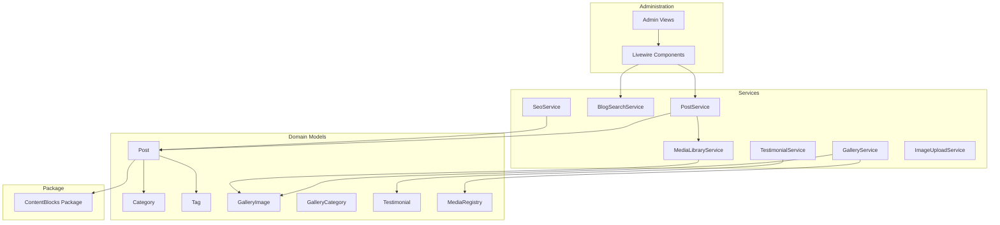

**Diagram sources**
- [Post.php:1-200](file://app/Models/Post.php#L1-L200)
- [PostService.php:1-178](file://app/Services/PostService.php#L1-L178)
- [GalleryImage.php:1-169](file://app/Models/GalleryImage.php#L1-L169)
- [GalleryService.php:1-139](file://app/Services/GalleryService.php#L1-L139)
- [MediaLibraryService.php:1-79](file://app/Services/MediaLibraryService.php#L1-L79)
- [Testimonial.php:1-52](file://app/Models/Testimonial.php#L1-L52)
- [TestimonialService.php:1-27](file://app/Services/TestimonialService.php#L1-L27)
- [BlogSearchService.php:1-200](file://app/Services/BlogSearchService.php#L1-L200)
- [ImageUploadService.php:1-70](file://app/Services/ImageUploadService.php#L1-L70)
- [HasSeo.php:1-110](file://app/Models/Concerns/HasSeo.php#L1-L110)
- [SeoService.php:1-200](file://app/Services/SeoService.php#L1-L200)
- [content-blocks service provider:1-199](file://packages/ContentBlocks/src/ContentBlocksServiceProvider.php#L1-L199)

**Section sources**
- [Post.php:1-200](file://app/Models/Post.php#L1-L200)
- [PostService.php:1-178](file://app/Services/PostService.php#L1-L178)
- [BlogSearchService.php:1-200](file://app/Services/BlogSearchService.php#L1-L200)
- [GalleryImage.php:1-169](file://app/Models/GalleryImage.php#L1-L169)
- [GalleryService.php:1-139](file://app/Services/GalleryService.php#L1-L139)
- [MediaLibraryService.php:1-79](file://app/Services/MediaLibraryService.php#L1-L79)
- [Testimonial.php:1-52](file://app/Models/Testimonial.php#L1-L52)
- [TestimonialService.php:1-27](file://app/Services/TestimonialService.php#L1-L27)
- [HasSeo.php:1-110](file://app/Models/Concerns/HasSeo.php#L1-L110)
- [SeoService.php:1-200](file://app/Services/SeoService.php#L1-L200)
- [content-blocks service provider:1-199](file://packages/ContentBlocks/src/ContentBlocksServiceProvider.php#L1-L199)

## Core Components
This section summarizes the primary content entities and their responsibilities.

| Component | Responsibility | Key Fields / Behavior |
|---|---|---|
| `Post` | Blog article entity with publishing workflow and SEO support | Title, slug, excerpt, block-tree content, status, published date, author, SEO metadata, categories, tags, featured image |
| `Category` | Blog taxonomy category | Name, auto-generated slug, many-to-many relationship to posts |
| `Tag` | Blog taxonomy tag | Name, auto-generated slug, many-to-many relationship to posts |
| `GalleryImage` | Media asset used by the gallery or media library | Title, description, image path, source, category, featured flag, active flag, sort order |
| `GalleryCategory` | Gallery grouping | Name, slug, active flag, sort order |
| `Testimonial` | Customer review | Name, role, rating, content, featured flag, published flag, sort order |
| `MediaRegistry` | Central audit record for uploaded files | Path, original filename, file size |
| `PostService` | Post creation/update/status operations | Featured image handling, temporary image relocation, poll synchronization, relation syncing |
| `GalleryService` | Public gallery image lifecycle | Upload, replace, delete, media registry tracking |
| `MediaLibraryService` | Library asset ingestion for content blocks | Upload, WebP normalization, inactive-by-default library row |
| `TestimonialService` | Simple CRUD for testimonials | Create, update, delete |
| `BlogSearchService` | Fast command-palette search | Published-only ranking, category/tag suggestions |
| `HasSeo` | Shared SEO behavior for content models | Merged metadata, canonical URL, indexing decision, sitemap fields |
| `SeoService` | Site-wide SEO settings and static route metadata | Settings form, meta image processing, static route CRUD |

**Section sources**
- [Post.php:1-200](file://app/Models/Post.php#L1-L200)
- [Category.php:1-46](file://app/Models/Category.php#L1-L46)
- [Tag.php:1-46](file://app/Models/Tag.php#L1-L46)
- [GalleryImage.php:1-169](file://app/Models/GalleryImage.php#L1-L169)
- [GalleryCategory.php:1-61](file://app/Models/GalleryCategory.php#L1-L61)
- [Testimonial.php:1-52](file://app/Models/Testimonial.php#L1-L52)
- [MediaRegistry.php:1-25](file://app/Models/MediaRegistry.php#L1-L25)
- [PostService.php:1-178](file://app/Services/PostService.php#L1-L178)
- [GalleryService.php:1-139](file://app/Services/GalleryService.php#L1-L139)
- [MediaLibraryService.php:1-79](file://app/Services/MediaLibraryService.php#L1-L79)
- [TestimonialService.php:1-27](file://app/Services/TestimonialService.php#L1-L27)
- [BlogSearchService.php:1-200](file://app/Services/BlogSearchService.php#L1-L200)
- [HasSeo.php:1-110](file://app/Models/Concerns/HasSeo.php#L1-L110)
- [SeoService.php:1-200](file://app/Services/SeoService.php#L1-L200)

## Architecture Overview
The content management architecture separates presentation, domain logic, data persistence, and reusable packages.

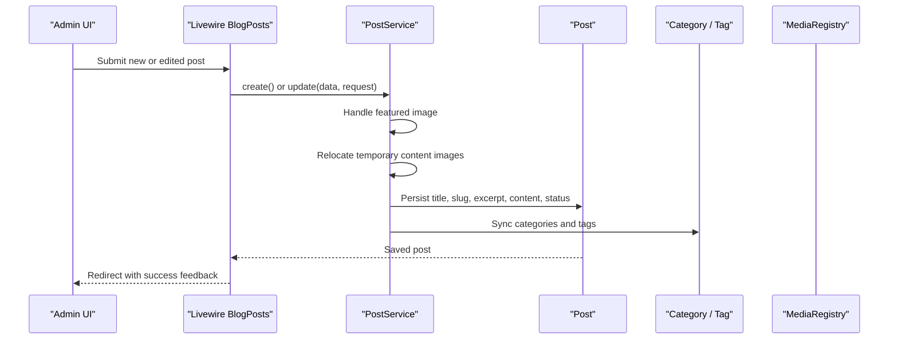

**Diagram sources**
- [PostService.php:15-70](file://app/Services/PostService.php#L15-L70)
- [Post.php:1-120](file://app/Models/Post.php#L1-L120)
- [Category.php:10-46](file://app/Models/Category.php#L10-L46)
- [Tag.php:10-46](file://app/Models/Tag.php#L10-L46)

A second flow shows gallery image upload with media registry tracking.

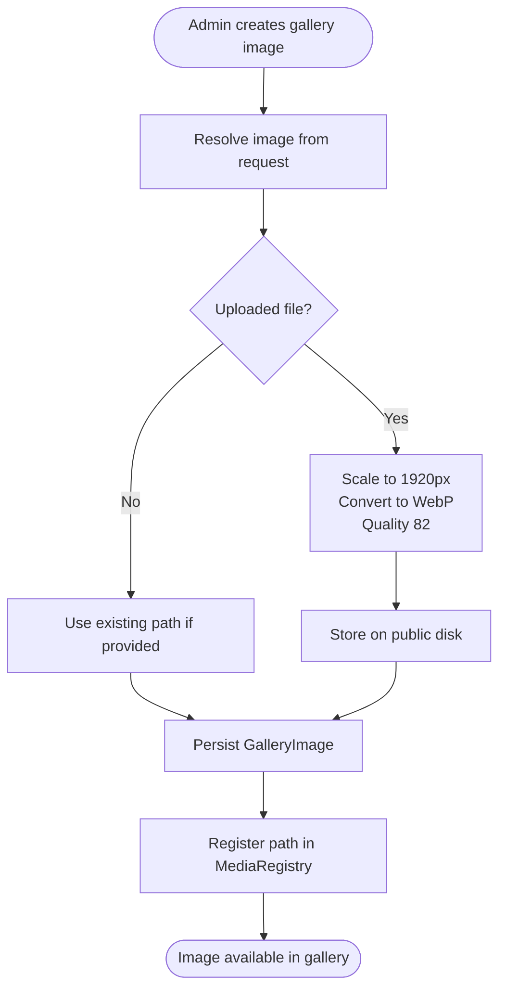

**Diagram sources**
- [GalleryService.php:24-139](file://app/Services/GalleryService.php#L24-L139)
- [MediaRegistry.php:1-25](file://app/Models/MediaRegistry.php#L1-L25)

## Detailed Component Analysis

### Blog Posts and Rich Text Block Editor
A blog post stores its body as a JSON array of content blocks rather than raw HTML. The `Post` model casts `content` to an array and exposes helpers for SEO defaults, routing, relationships, and publication state.

#### Data Model and Publishing States
- Status values include draft, published, and archived.
- Published posts must be live: they must have a non-future `published_at`.
- Scheduled posts are marked published but not yet live until their publish time passes.
- Live visibility is distinct from the published database status.

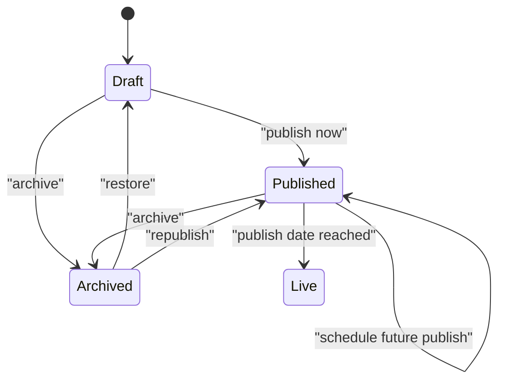

**Diagram sources**
- [Post.php:24-60](file://app/Models/Post.php#L24-L60)
- [Post.php:120-200](file://app/Models/Post.php#L120-L200)

#### Content Blocks Integration
The `Post` model uses the Highblossom Content Blocks package through its block-tree content structure. The package registers default block types such as paragraph, image, heading, quote, code, list, CTA, video, divider, alert, HTML, embed, accordion, table, gallery, form, columns, tabs, carousel, countdown, and poll. Blade directives are generated per block type, enabling rendering of serialized block arrays.

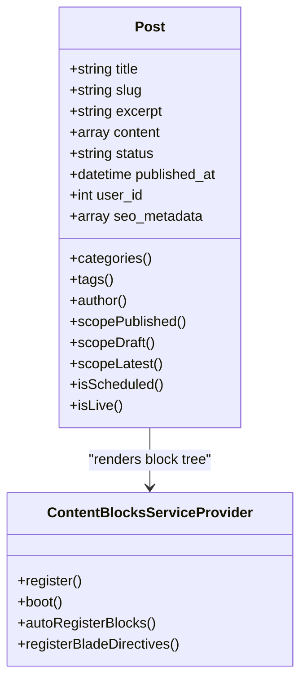

**Diagram sources**
- [Post.php:1-120](file://app/Models/Post.php#L1-L120)
- [content-blocks service provider:60-199](file://packages/ContentBlocks/src/ContentBlocksServiceProvider.php#L60-L199)

#### Creation and Editing Workflow
`PostService` coordinates post persistence:
1. Handle featured image upload or removal.
2. Relocate temporary images referenced by content blocks into permanent storage.
3. Synchronize embedded polls stored inside block attributes.
4. Assign the current administrator user as the author.
5. Persist core post fields.
6. Sync category and tag relations.

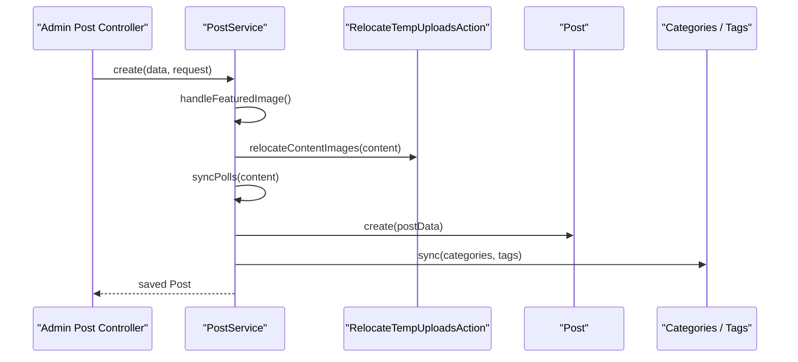

**Diagram sources**
- [PostService.php:15-70](file://app/Services/PostService.php#L15-L70)
- [PostService.php:120-178](file://app/Services/PostService.php#L120-L178)

#### SEO Metadata Configuration
Each post implements the `HasSeo` concern. Defaults come from the post’s title, excerpt, and featured image, while stored `seo_metadata` can override them. Canonical URLs resolve through the blog show route and slug.

Recommended configuration:
- Provide a clear, keyword-aware title under the enforced maximum length.
- Write a concise excerpt that doubles as the default meta description.
- Set a featured image for social sharing previews.
- Override meta title and description when needed for marketing or campaign targeting.
- Avoid marking important posts as no-index unless intentional.

**Section sources**
- [Post.php:1-120](file://app/Models/Post.php#L1-L120)
- [HasSeo.php:1-110](file://app/Models/Concerns/HasSeo.php#L1-L110)
- [PostService.php:15-178](file://app/Services/PostService.php#L15-L178)

#### Creating Engaging Blog Content
Guidance grounded in the implementation:
- Use multiple content blocks instead of one large paragraph. Short headings, paragraphs, lists, quotes, and images improve readability.
- Include at least one relevant category and a few precise tags so filtering and search work effectively.
- Add an excerpt that summarizes value without repeating the full title.
- Choose a featured image sized around 1920 pixels wide; uploads are normalized to WebP where possible.
- Schedule future publications to preview drafts before going live.

[No sources needed since this subsection provides general guidance based on previously analyzed files]

### Categories and Tags
Categories and tags are simple Eloquent models with automatic slug generation. They use many-to-many pivot tables to associate posts.

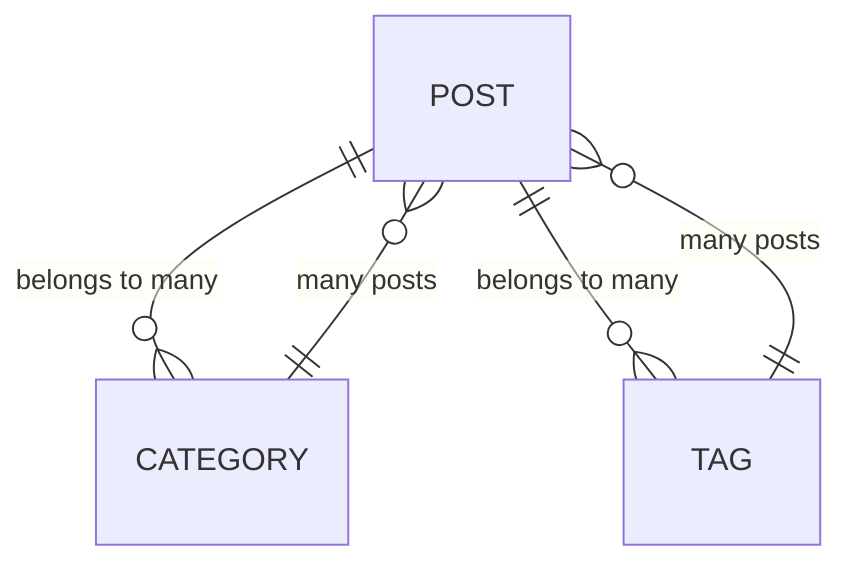

**Diagram sources**
- [Post.php:80-110](file://app/Models/Post.php#L80-L110)
- [Category.php:10-46](file://app/Models/Category.php#L10-L46)
- [Tag.php:10-46](file://app/Models/Tag.php#L10-L46)

Best practices:
- Use broad, stable categories for navigation.
- Use specific, descriptive tags for topical detail.
- Keep names short and readable because slugs are derived automatically.
- Prefer fewer, meaningful tags over excessive tagging.

**Section sources**
- [Category.php:1-46](file://app/Models/Category.php#L1-L46)
- [Tag.php:1-46](file://app/Models/Tag.php#L1-L46)
- [Post.php:80-110](file://app/Models/Post.php#L80-L110)

### Gallery Management System
Gallery images support two purposes:
- Public gallery entries with `source = gallery`.
- Media library assets with `source = library`, used by content blocks.

Gallery rows are independently sortable from library rows. Only gallery rows appear publicly; library rows are inactive by default.

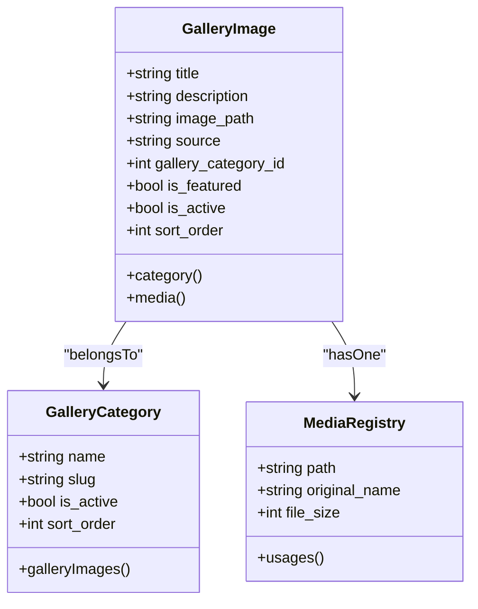

**Diagram sources**
- [GalleryImage.php:1-169](file://app/Models/GalleryImage.php#L1-L169)
- [GalleryCategory.php:1-61](file://app/Models/GalleryCategory.php#L1-L61)
- [MediaRegistry.php:1-25](file://app/Models/MediaRegistry.php#L1-L25)

#### Upload and Optimization
Both gallery and media library uploads normalize images:
- Scale long edge to 1920 pixels.
- Convert to WebP.
- Apply quality 82.
- Store on the public disk.

If image processing fails, gallery deletion still removes the database row and attempts filesystem cleanup. The media library throws a runtime exception when upload processing fails.

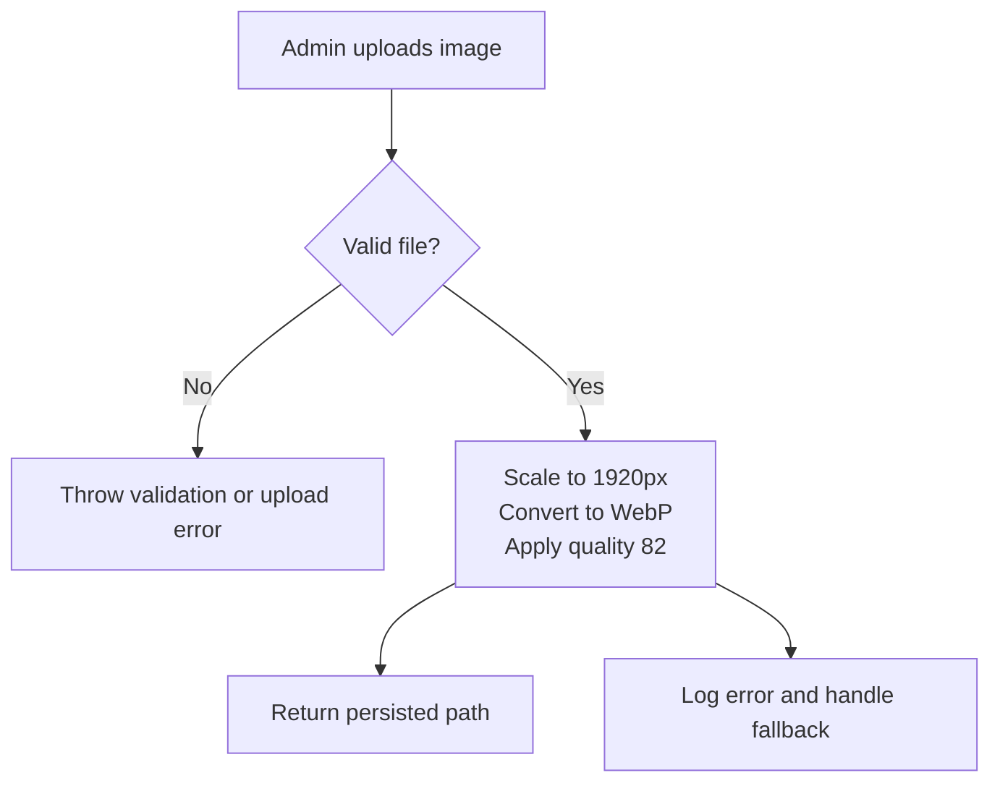

**Diagram sources**
- [GalleryService.php:88-139](file://app/Services/GalleryService.php#L88-L139)
- [MediaLibraryService.php:44-79](file://app/Services/MediaLibraryService.php#L44-L79)
- [ImageUploadService.php:30-70](file://app/Services/ImageUploadService.php#L30-L70)

#### Organizing Galleries
- Create gallery categories and mark them active when visible.
- Sort categories by assigning `sort_order`.
- For public gallery items, set `is_active`, optionally `is_featured`, and assign a category.
- For internal media library assets, leave `is_active` false and assign a category for discovery in the block builder.

Examples:
- Build a portfolio gallery with categories like “Projects,” “Before and After,” and “Team.”
- Use library assets for reusable brand images inside page builders.

**Section sources**
- [GalleryImage.php:1-169](file://app/Models/GalleryImage.php#L1-L169)
- [GalleryCategory.php:1-61](file://app/Models/GalleryCategory.php#L1-L61)
- [GalleryService.php:1-139](file://app/Services/GalleryService.php#L1-L139)
- [MediaLibraryService.php:1-79](file://app/Services/MediaLibraryService.php#L1-L79)

### Testimonial Management Interface
Testimonials are lightweight records with rating, optional role, publish state, and sort order.

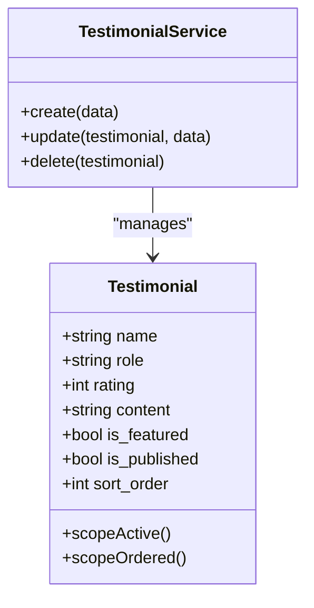

**Diagram sources**
- [Testimonial.php:1-52](file://app/Models/Testimonial.php#L1-L52)
- [TestimonialService.php:1-27](file://app/Services/TestimonialService.php#L1-L27)

#### Approval Workflow
Approval is represented by the `is_published` boolean:
- Draft testimonials have `is_published = false`.
- Approved testimonials have `is_published = true`.
- The admin index displays status clearly and supports edit actions.

Display configuration options:
- Mark testimonials as featured to highlight selected reviews.
- Adjust `sort_order` to control ordering.
- Use `active` scope to render only published testimonials.

Example workflow:
1. Create a testimonial with name, role, rating, and content.
2. Review it as a draft.
3. Approve it by setting it to published.
4. Optionally mark it as featured.
5. Arrange its position using sort order.

**Section sources**
- [Testimonial.php:1-52](file://app/Models/Testimonial.php#L1-L52)
- [TestimonialService.php:1-27](file://app/Services/TestimonialService.php#L1-L27)
- [admin testimonials index view:1-86](file://resources/views/admin/testimonials/index.blade.php#L1-L86)

### Content Block System Integration
The ContentBlocks package provides a typed block registry and Blade rendering layer. Default blocks cover common layout and interactive needs.

Important behaviors:
- Block types are auto-registered during service provider boot.
- Blade directives are generated per block type.
- A generic block directive allows dynamic rendering.
- Post content is a block array, and the service synchronizes embedded poll blocks with the poll model.

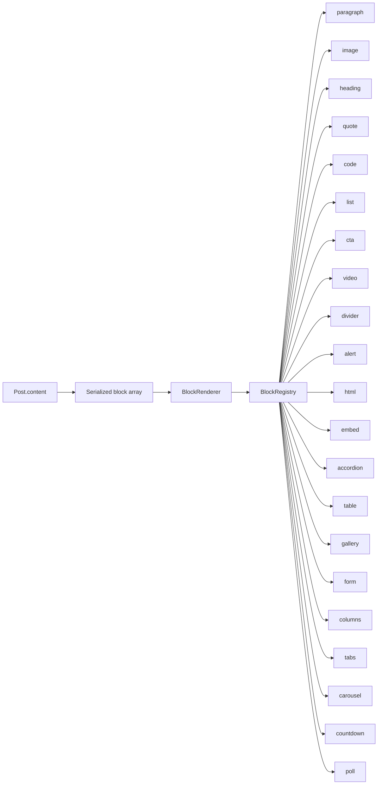

**Diagram sources**
- [content-blocks service provider:60-199](file://packages/ContentBlocks/src/ContentBlocksServiceProvider.php#L60-L199)
- [PostService.php:90-118](file://app/Services/PostService.php#L90-L118)

### Draft, Published, and Versioning Notes
- Draft state: `status = draft`.
- Published state: `status = published`.
- Scheduled state: published with a future `published_at`.
- Live state: published with a past or current `published_at`.
- Archived state: retains content but is excluded from public listing scopes.

True versioning is not implemented as a separate revision table. Changes persist directly on the model, while audit logs may exist elsewhere in the application. If strict version history is required, extend the post model with explicit revisions or leverage an auditing package configured in the application.

**Section sources**
- [Post.php:24-60](file://app/Models/Post.php#L24-L60)
- [Post.php:140-200](file://app/Models/Post.php#L140-L200)

### Search Functionality
Two search paths coexist:
- `BlogPosts` Livewire component performs front-end listing search against title and excerpt, with category and tag filters.
- `BlogSearchService` supplies a fast, ranked command-palette response limited to titles, excerpts, categories, and tags.

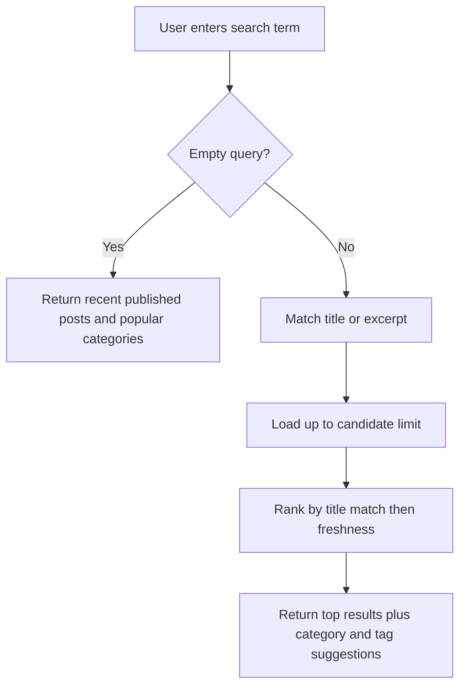

**Diagram sources**
- [BlogSearchService.php:28-120](file://app/Services/BlogSearchService.php#L28-L120)
- [blog posts Livewire component:60-120](file://app/Livewire/BlogPosts.php#L60-L120)

Recommendations:
- Keep titles concise and descriptive so exact matches rank well.
- Use excerpts as searchable summaries.
- Maintain consistent category and tag naming to improve suggestion accuracy.

**Section sources**
- [BlogSearchService.php:1-200](file://app/Services/BlogSearchService.php#L1-L200)
- [blog posts Livewire component:1-200](file://app/Livewire/BlogPosts.php#L1-L200)

## Dependency Analysis
The following diagram maps key dependencies across models, services, and the content blocks package.

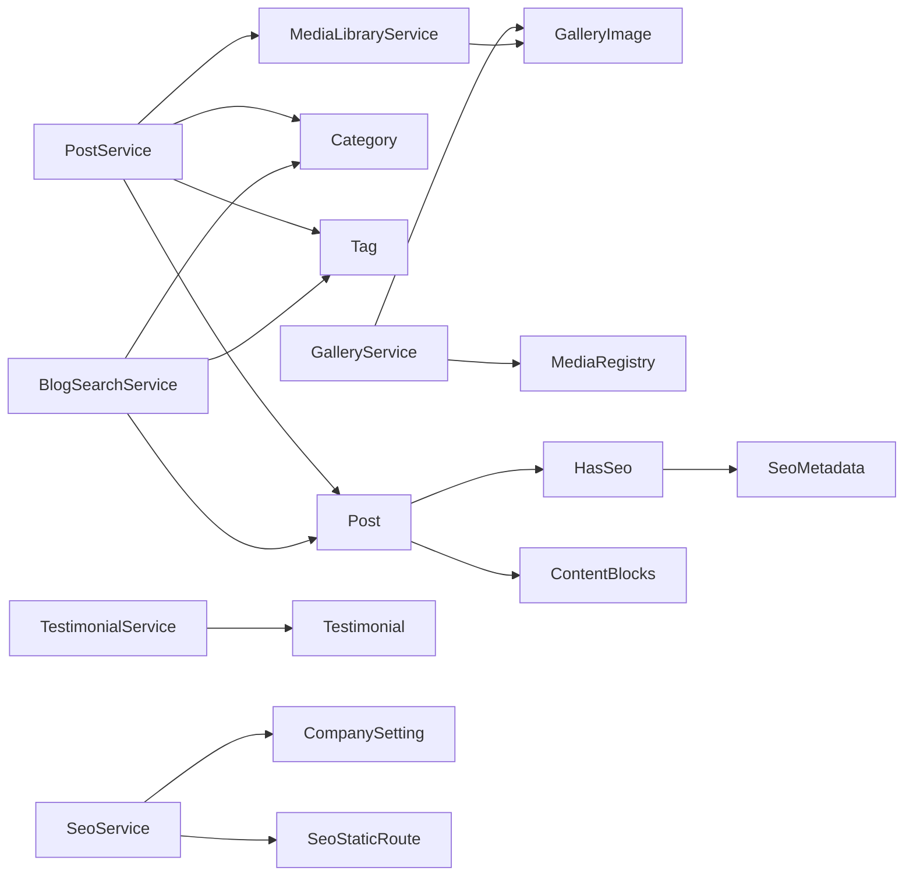

**Diagram sources**
- [PostService.php:1-178](file://app/Services/PostService.php#L1-L178)
- [GalleryService.php:1-139](file://app/Services/GalleryService.php#L1-L139)
- [MediaLibraryService.php:1-79](file://app/Services/MediaLibraryService.php#L1-L79)
- [TestimonialService.php:1-27](file://app/Services/TestimonialService.php#L1-L27)
- [BlogSearchService.php:1-200](file://app/Services/BlogSearchService.php#L1-L200)
- [HasSeo.php:1-110](file://app/Models/Concerns/HasSeo.php#L1-L110)
- [content-blocks service provider:60-199](file://packages/ContentBlocks/src/ContentBlocksServiceProvider.php#L60-L199)

**Section sources**
- [PostService.php:1-178](file://app/Services/PostService.php#L1-L178)
- [GalleryService.php:1-139](file://app/Services/GalleryService.php#L1-L139)
- [MediaLibraryService.php:1-79](file://app/Services/MediaLibraryService.php#L1-L79)
- [TestimonialService.php:1-27](file://app/Services/TestimonialService.php#L1-L27)
- [BlogSearchService.php:1-200](file://app/Services/BlogSearchService.php#L1-L200)
- [HasSeo.php:1-110](file://app/Models/Concerns/HasSeo.php#L1-L110)
- [content-blocks service provider:60-199](file://packages/ContentBlocks/src/ContentBlocksServiceProvider.php#L60-L199)

## Performance Considerations
- Prefer block-based content over monolithic HTML to keep editors focused and rendering predictable.
- Limit search payloads: the command palette caps candidate rows and returned posts.
- Avoid heavy queries in hot paths; the Livewire component already paginates and excludes the hero post when filtering.
- Normalize uploads to WebP with a fixed dimension and quality to reduce bandwidth.
- Use categories and tags consistently to enable efficient filtering.
- Monitor failed image transformations through logging rather than failing entire endpoints.

[No sources needed since this section provides general guidance]

## Troubleshooting Guide

### Blog Post Cannot Be Published
Check the following:
- Ensure content is not empty.
- Ensure excerpt is not blank if the form enforces it.
- Confirm status is set to published.
- Confirm `published_at` is not in the future if immediate publication is expected.

**Section sources**
- [Post.php:140-200](file://app/Models/Post.php#L140-L200)

### Scheduled Post Is Not Live
A scheduled post remains unpublished until its publish time arrives. Change the publish date or wait until the scheduled time passes.

**Section sources**
- [Post.php:160-180](file://app/Models/Post.php#L160-L180)

### Gallery Image Does Not Appear
Verify:
- The image belongs to the gallery source, not the library source.
- The image is active.
- The assigned category is active.
- The upload was processed successfully and the path exists.

**Section sources**
- [GalleryImage.php:20-120](file://app/Models/GalleryImage.php#L20-L120)
- [GalleryService.php:88-139](file://app/Services/GalleryService.php#L88-L139)

### Media Library Upload Fails
Common causes:
- Invalid or missing file.
- Image transformation failure.
- Storage driver issues.

Resolution steps:
- Check the exception message thrown by the media library service.
- Inspect application logs for image processing errors.
- Verify public disk configuration and permissions.

**Section sources**
- [MediaLibraryService.php:18-79](file://app/Services/MediaLibraryService.php#L18-L79)
- [ImageUploadService.php:30-70](file://app/Services/ImageUploadService.php#L30-L70)

### SEO Meta Image Not Updating
Site-wide SEO settings process meta images through a dedicated service. Check:
- Whether the old image was deleted after replacement.
- Whether the request contained a valid file or path.
- Application logs for image processing exceptions.

**Section sources**
- [SeoService.php:40-120](file://app/Services/SeoService.php#L40-L120)
- [SEO configuration:1-41](file://config/seo.php#L1-L41)

### Testimonial Shows As Draft
Ensure `is_published` is set to true before displaying testimonials publicly.

**Section sources**
- [Testimonial.php:1-52](file://app/Models/Testimonial.php#L1-L52)
- [admin testimonials index view:1-86](file://resources/views/admin/testimonials/index.blade.php#L1-L86)

## Conclusion
Highblossom’s content management system centers on structured, block-based blog posts, categorized galleries, and approval-driven testimonials. Its services standardize uploads, optimize media, track usage, and provide clear publication states. SEO is handled both at the content level and site-wide, while search remains lightweight and purpose-built. By following the recommended workflows for content creation, gallery organization, and testimonial approval, administrators can maintain high-quality, performant, and discoverable content.

[No sources needed since this section summarizes without analyzing specific files]

## Appendices

### Quick Workflows

#### Create a Blog Post
1. Enter title, excerpt, and content blocks.
2. Attach categories and tags.
3. Upload a featured image or select a library asset.
4. Configure SEO overrides if needed.
5. Save as draft, schedule, or publish immediately.

**Section sources**
- [PostService.php:15-70](file://app/Services/PostService.php#L15-L70)
- [Post.php:1-120](file://app/Models/Post.php#L1-L120)

#### Organize a Gallery
1. Create gallery categories.
2. Upload images and assign categories.
3. Activate gallery images and set featured flags.
4. Adjust sort order for display priority.

**Section sources**
- [GalleryService.php:24-87](file://app/Services/GalleryService.php#L24-L87)
- [GalleryImage.php:20-120](file://app/Models/GalleryImage.php#L20-L120)
- [GalleryCategory.php:1-61](file://app/Models/GalleryCategory.php#L1-L61)

#### Manage Testimonials
1. Create a testimonial with name, role, rating, and content.
2. Leave it as a draft while reviewing.
3. Approve by enabling publish.
4. Mark as featured and arrange sort order.

**Section sources**
- [TestimonialService.php:1-27](file://app/Services/TestimonialService.php#L1-L27)
- [Testimonial.php:1-52](file://app/Models/Testimonial.php#L1-L52)
- [admin testimonials index view:1-86](file://resources/views/admin/testimonials/index.blade.php#L1-L86)