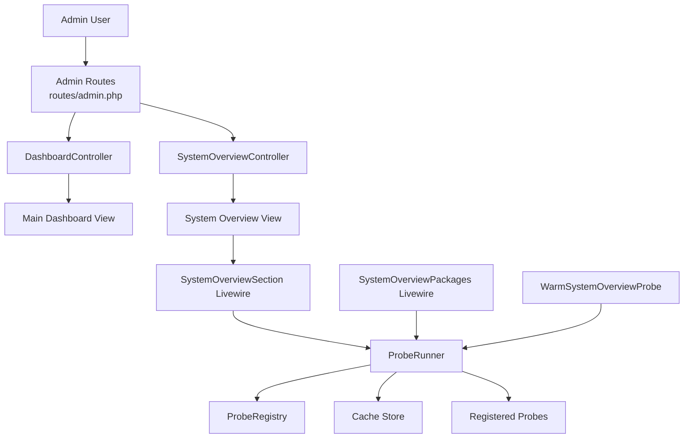
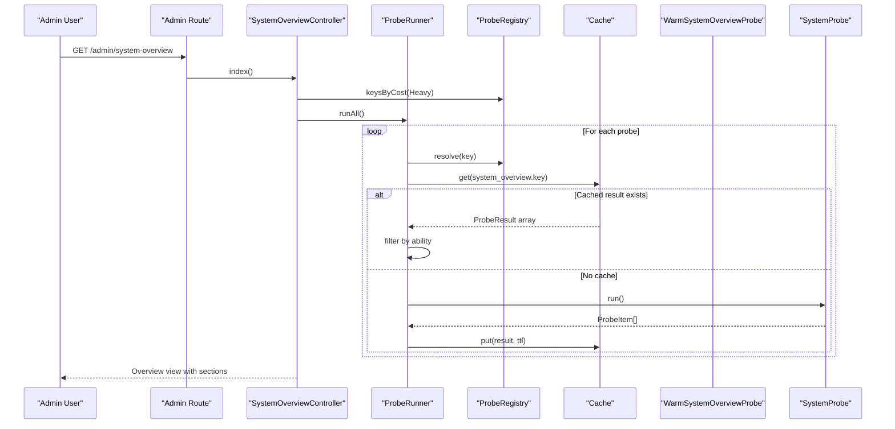
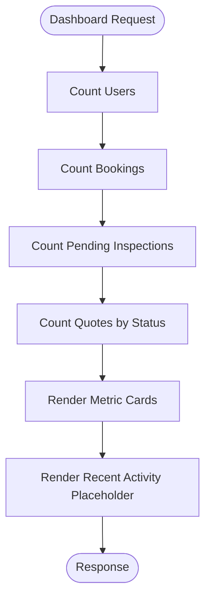
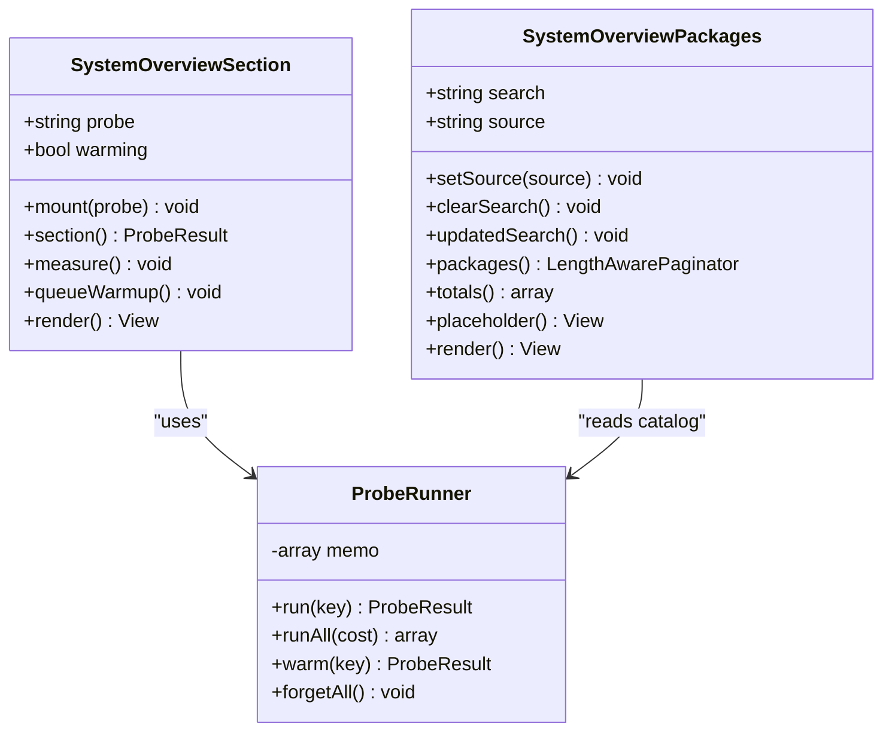
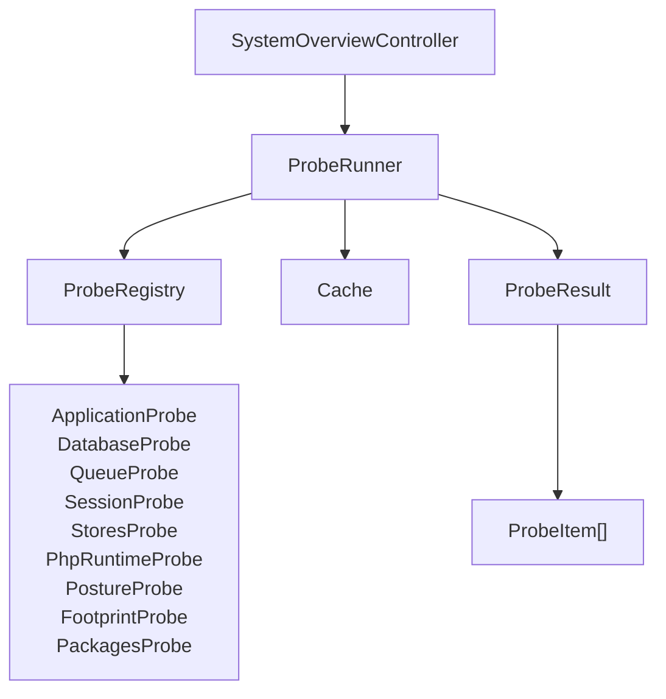
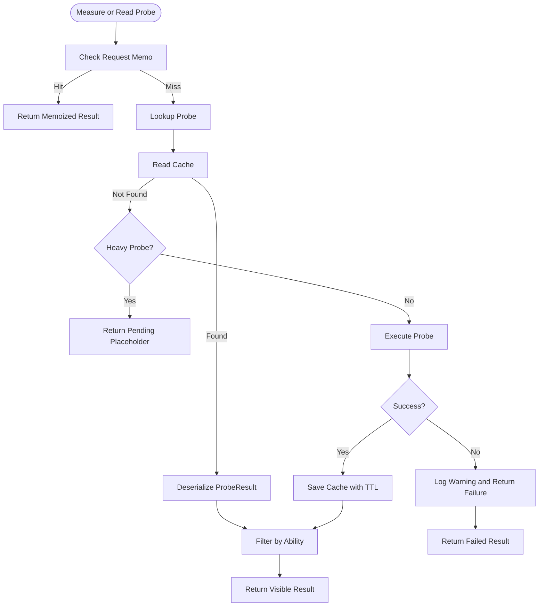
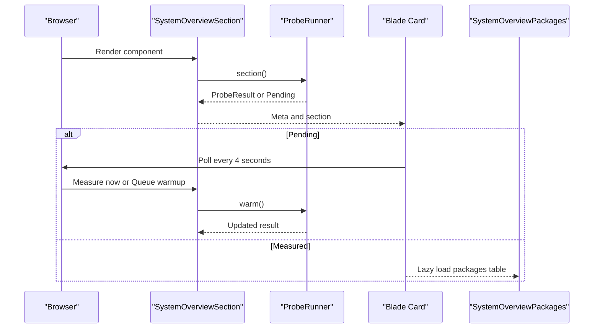
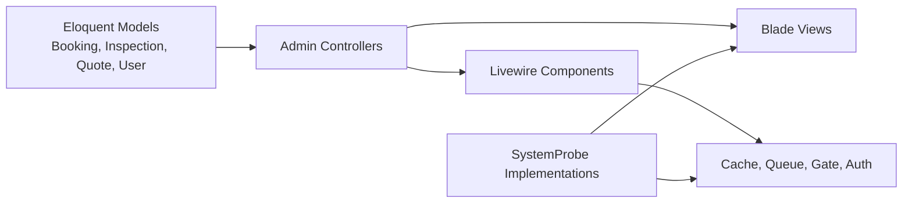
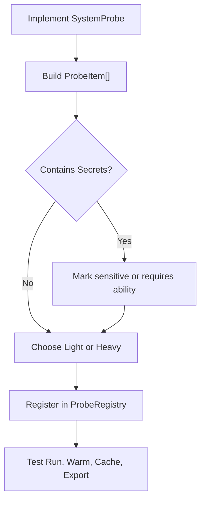

# Dashboard & Analytics

<cite>
**Referenced Files in This Document**
- [dashboard.blade.php](file://resources/views/dashboard.blade.php)
- [DashboardController.php](file://app/Http/Controllers/Admin/DashboardController.php)
- [SystemOverviewController.php](file://app/Http/Controllers/Admin/SystemOverviewController.php)
- [admin.php](file://routes/admin.php)
- [SystemOverviewSection.php](file://app/Livewire/SystemOverviewSection.php)
- [system-overview-section.blade.php](file://resources/views/livewire/system-overview-section.blade.php)
- [SystemOverviewPackages.php](file://app/Livewire/SystemOverviewPackages.php)
- [system-overview-packages.blade.php](file://resources/views/livewire/system-overview-packages.blade.php)
- [ProbeRunner.php](file://app/Support/SystemOverview/ProbeRunner.php)
- [ProbeRegistry.php](file://app/Support/SystemOverview/ProbeRegistry.php)
- [ProbeResult.php](file://app/Support/SystemOverview/ProbeResult.php)
- [ProbeItem.php](file://app/Support/SystemOverview/ProbeItem.php)
- [ProbeCost.php](file://app/Support/SystemOverview/ProbeCost.php)
- [SystemProbe.php](file://app/Support/SystemOverview/SystemProbe.php)
- [WarmSystemOverviewProbe.php](file://app/Jobs/WarmSystemOverviewProbe.php)
- [index.blade.php](file://resources/views/admin/system-overview/index.blade.php)
- [card.blade.php](file://resources/views/admin/system-overview/card.blade.php)
- [ApplicationProbe.php](file://app/Support/SystemOverview/Probes/ApplicationProbe.php)
- [DatabaseProbe.php](file://app/Support/SystemOverview/Probes/DatabaseProbe.php)
- [QueueProbe.php](file://app/Support/SystemOverview/Probes/QueueProbe.php)
- [SessionProbe.php](file://app/Support/SystemOverview/Probes/SessionProbe.php)
- [StoresProbe.php](file://app/Support/SystemOverview/Probes/StoresProbe.php)
- [PhpRuntimeProbe.php](file://app/Support/SystemOverview/Probes/PhpRuntimeProbe.php)
- [PostureProbe.php](file://app/Support/SystemOverview/Probes/PostureProbe.php)
- [FootprintProbe.php](file://app/Support/SystemOverview/Probes/FootprintProbe.php)
- [PackagesProbe.php](file://app/Support/SystemOverview/Probes/PackagesProbe.php)
- [booking.php](file://lang/en/booking.php)
</cite>

## Table of Contents
1. [Introduction](#introduction)
2. [Project Structure](#project-structure)
3. [Core Components](#core-components)
4. [Architecture Overview](#architecture-overview)
5. [Detailed Component Analysis](#detailed-component-analysis)
6. [Dependency Analysis](#dependency-analysis)
7. [Performance Considerations](#performance-considerations)
8. [Security and Permissions](#security-and-permissions)
9. [Customization Guide](#customization-guide)
10. [Troubleshooting Guide](#troubleshooting-guide)
11. [Conclusion](#conclusion)

## Introduction
This document describes the Highblossom admin dashboard and analytics system. It covers two related surfaces:

- The main admin dashboard showing key performance indicators such as bookings, inspections, users, and quote status.
- The System Overview diagnostic interface that renders real-time runtime data through lightweight Livewire components, probe-based services, background warming, and per-section caching.

The documentation explains how metrics are calculated, how the System Overview probes render live data, how service layers integrate with models, how caching keeps the dashboard responsive, and how to extend the system with new metrics, charts, or third-party analytics integrations.

## Project Structure
The dashboard and analytics features are organized by responsibility rather than by technology alone:

| Area | Responsibility | Key Files |
|---|---|---|
| Admin dashboard UI | Displays business KPIs for bookings, inspections, users, and quotes | `resources/views/dashboard.blade.php`, `app/Http/Controllers/Admin/DashboardController.php` |
| System Overview controller | Renders the overview page, refreshes cache, and exports redacted diagnostics | `app/Http/Controllers/Admin/SystemOverviewController.php`, `resources/views/admin/system-overview/index.blade.php` |
| Live sections | Loads heavy measurements lazily and supports polling, manual measurement, and background warm-up | `app/Livewire/SystemOverviewSection.php`, `resources/views/livewire/system-overview-section.blade.php` |
| Package browser | Paginates, searches, and filters installed packages from cached catalog data | `app/Livewire/SystemOverviewPackages.php`, `resources/views/livewire/system-overview-packages.blade.php` |
| Probe framework | Defines, runs, caches, filters, and exports system measurements | `app/Support/SystemOverview/*` |
| Background warming | Warms expensive probes without blocking user requests | `app/Jobs/WarmSystemOverviewProbe.php` |
| Routes and permissions | Guards admin access and attaches abilities to dashboard routes | `routes/admin.php`, database permission migrations |

**Diagram sources**
- [admin.php](file://routes/admin.php)
- [DashboardController.php](file://app/Http/Controllers/Admin/DashboardController.php)
- [SystemOverviewController.php](file://app/Http/Controllers/Admin/SystemOverviewController.php)
- [dashboard.blade.php](file://resources/views/dashboard.blade.php)
- [index.blade.php](file://resources/views/admin/system-overview/index.blade.php)
- [SystemOverviewSection.php](file://app/Livewire/SystemOverviewSection.php)
- [SystemOverviewPackages.php](file://app/Livewire/SystemOverviewPackages.php)
- [ProbeRunner.php](file://app/Support/SystemOverview/ProbeRunner.php)
- [ProbeRegistry.php](file://app/Support/SystemOverview/ProbeRegistry.php)
- [WarmSystemOverviewProbe.php](file://app/Jobs/WarmSystemOverviewProbe.php)

**Section sources**
- [dashboard.blade.php:1-67](file://resources/views/dashboard.blade.php#L1-L67)
- [admin.php](file://routes/admin.php)

## Core Components
The dashboard system has two primary entry points:

### Main Admin Dashboard
The main dashboard displays aggregate counts for users, bookings, pending inspections, and quote statuses. It is rendered by a Blade view and supplied values directly from Eloquent models in the controller.

Key responsibilities:
- Count active users.
- Count total bookings.
- Count inspections without an end time.
- Split quotes by pending, contacted, completed, and cancelled states.
- Render metric cards and recent activity placeholders.

**Section sources**
- [DashboardController.php:1-41](file://app/Http/Controllers/Admin/DashboardController.php#L1-L41)
- [dashboard.blade.php:1-67](file://resources/views/dashboard.blade.php#L1-L67)

### System Overview Diagnostics
The System Overview is a diagnostic dashboard for the running application. It does not expose secrets and instead presents measured runtime state, health signals, storage configuration, queue status, session information, PHP runtime details, application footprint, and dependency catalogs.

Key responsibilities:
- List all registered probes in order.
- Separate light probes (measured inline) from heavy probes (warmed in the background).
- Allow authorized users to refresh cache and export redacted JSON.
- Render each section as a card or lazy Livewire component.

**Section sources**
- [SystemOverviewController.php:1-84](file://app/Http/Controllers/Admin/SystemOverviewController.php#L1-L84)
- [index.blade.php:1-116](file://resources/views/admin/system-overview/index.blade.php#L1-L116)

## Architecture Overview
The architecture separates presentation, authorization, computation, caching, and background work.

**Diagram sources**
- [SystemOverviewController.php:28-46](file://app/Http/Controllers/Admin/SystemOverviewController.php#L28-L46)
- [ProbeRunner.php:39-82](file://app/Support/SystemOverview/ProbeRunner.php#L39-L82)
- [ProbeRegistry.php:44-74](file://app/Support/SystemOverview/ProbeRegistry.php#L44-L74)

## Detailed Component Analysis

### Main Dashboard Interface
The main dashboard shows three primary KPI cards and one quote summary card. It uses a responsive grid and Tailwind classes for layout and dark mode support.

#### Key Performance Indicators
| Metric | Calculation Source | Display Purpose |
|---|---|---|
| Total Bookings | Booking count | Overall booking volume |
| Pending Inspections | Inspections without an end time | Workload pressure |
| Active Users | User count | Platform usage |
| Quote Status Breakdown | Quote status counts | Sales pipeline visibility |

#### Recent Activity Feed
The current dashboard includes a placeholder for recent activity. In this implementation, the feed area renders a static empty state; it can be extended to show recent bookings, inspections, or audit events.

**Diagram sources**
- [DashboardController.php:22-39](file://app/Http/Controllers/Admin/DashboardController.php#L22-L39)
- [dashboard.blade.php:12-67](file://resources/views/dashboard.blade.php#L12-L67)

**Section sources**
- [DashboardController.php:22-39](file://app/Http/Controllers/Admin/DashboardController.php#L22-L39)
- [dashboard.blade.php:12-67](file://resources/views/dashboard.blade.php#L12-L67)

### System Overview Real-Time Rendering
The System Overview uses a hybrid rendering strategy:

- Light probes execute during the request and are cached briefly.
- Heavy probes are never executed on the normal request path.
- Unwarmed heavy sections display a pending state with polling.
- Users can measure a section immediately or dispatch a background job.
- The packages list is another lazy component that appears only after its parent section is ready.

**Diagram sources**
- [SystemOverviewSection.php:1-88](file://app/Livewire/SystemOverviewSection.php#L1-L88)
- [SystemOverviewPackages.php:1-117](file://app/Livewire/SystemOverviewPackages.php#L1-L117)
- [ProbeRunner.php:24-108](file://app/Support/SystemOverview/ProbeRunner.php#L24-L108)

**Section sources**
- [SystemOverviewSection.php:1-88](file://app/Livewire/SystemOverviewSection.php#L1-L88)
- [system-overview-section.blade.php:1-74](file://resources/views/livewire/system-overview-section.blade.php#L1-L74)
- [SystemOverviewPackages.php:1-117](file://app/Livewire/SystemOverviewPackages.php#L1-L117)
- [system-overview-packages.blade.php:1-130](file://resources/views/livewire/system-overview-packages.blade.php#L1-L130)

### Service Layer Integration for Analytics Calculations
The analytics and dashboard logic is split between simple controller queries and a dedicated probe framework:

- The main dashboard controller performs direct model queries for business KPIs.
- The System Overview delegates all runtime inspection to `SystemProbe` implementations.
- `ProbeRunner` coordinates registry lookup, caching, timing, error handling, and ability filtering.
- `ProbeRegistry` is an allowlist of probe keys, preventing arbitrary probe resolution.
- `ProbeResult` and `ProbeItem` represent structured, serializable diagnostic output.

**Diagram sources**
- [SystemOverviewController.php:28-46](file://app/Http/Controllers/Admin/SystemOverviewController.php#L28-L46)
- [ProbeRunner.php:39-108](file://app/Support/SystemOverview/ProbeRunner.php#L39-L108)
- [ProbeRegistry.php:17-118](file://app/Support/SystemOverview/ProbeRegistry.php#L17-L118)
- [ProbeResult.php](file://app/Support/SystemOverview/ProbeResult.php)
- [ProbeItem.php](file://app/Support/SystemOverview/ProbeItem.php)
- [ApplicationProbe.php](file://app/Support/SystemOverview/Probes/ApplicationProbe.php)
- [DatabaseProbe.php](file://app/Support/SystemOverview/Probes/DatabaseProbe.php)
- [QueueProbe.php](file://app/Support/SystemOverview/Probes/QueueProbe.php)
- [SessionProbe.php](file://app/Support/SystemOverview/Probes/SessionProbe.php)
- [StoresProbe.php](file://app/Support/SystemOverview/Probes/StoresProbe.php)
- [PhpRuntimeProbe.php](file://app/Support/SystemOverview/Probes/PhpRuntimeProbe.php)
- [PostureProbe.php](file://app/Support/SystemOverview/Probes/PostureProbe.php)
- [FootprintProbe.php](file://app/Support/SystemOverview/Probes/FootprintProbe.php)
- [PackagesProbe.php](file://app/Support/SystemOverview/Probes/PackagesProbe.php)

**Section sources**
- [ProbeRunner.php:1-194](file://app/Support/SystemOverview/ProbeRunner.php#L1-L194)
- [ProbeRegistry.php:1-118](file://app/Support/SystemOverview/ProbeRegistry.php#L1-L118)
- [ProbeResult.php](file://app/Support/SystemOverview/ProbeResult.php)
- [ProbeItem.php:1-127](file://app/Support/SystemOverview/ProbeItem.php#L1-L127)
- [SystemProbe.php:1-47](file://app/Support/SystemOverview/SystemProbe.php#L1-L47)

### Caching Strategy and Background Warming
Caching is central to dashboard performance:

| Aspect | Behavior |
|---|---|
| Cache scope | Per probe key under a common prefix |
| Cache content | Serialized `ProbeResult` arrays |
| TTL | 30 seconds for light probes, 1 hour for heavy probes |
| Memoization | Per-request memo prevents repeated computation within one request |
| Warm path | Only invoked explicitly via `warm()` or queued jobs |
| Failure behavior | Failed probes return a failed result and log warnings |
| Compatibility | Invalid or unreadable cache entries are discarded safely |
| Background warming | `WarmSystemOverviewProbe` coalesces concurrent warm-ups |

**Diagram sources**
- [ProbeRunner.php:39-194](file://app/Support/SystemOverview/ProbeRunner.php#L39-L194)
- [ProbeCost.php:1-36](file://app/Support/SystemOverview/ProbeCost.php#L1-L36)
- [WarmSystemOverviewProbe.php:1-76](file://app/Jobs/WarmSystemOverviewProbe.php#L1-L76)

**Section sources**
- [ProbeRunner.php:39-194](file://app/Support/SystemOverview/ProbeRunner.php#L39-L194)
- [ProbeCost.php:1-36](file://app/Support/SystemOverview/ProbeCost.php#L1-L36)
- [WarmSystemOverviewProbe.php:1-76](file://app/Jobs/WarmSystemOverviewProbe.php#L1-L76)

### Layout Structure and Responsive Design
The dashboards use modern Blade layouts and utility-first CSS rather than legacy AdminLTE templates:

- Both dashboards wrap content in an admin layout component.
- The main dashboard uses a responsive grid with mobile, tablet, and desktop breakpoints.
- Dark mode is supported through Tailwind dark variants.
- Icons are rendered through a reusable icon component.
- The System Overview uses consistent card styling, status dots, and footer metadata.

| Component | Pattern |
|---|---|
| Page wrapper | Admin layout component with title |
| Grid | One column on small screens, two on medium, four on large |
| Cards | Rounded borders, shadow, spacing, and dark-mode backgrounds |
| Status indicators | Colored dots based on severity |
| Actions | Buttons, forms, and conditional links |
| Accessibility | Labels, screen-reader-only text, and focus styles |

**Section sources**
- [dashboard.blade.php:1-67](file://resources/views/dashboard.blade.php#L1-L67)
- [index.blade.php:1-116](file://resources/views/admin/system-overview/index.blade.php#L1-L116)
- [card.blade.php:1-105](file://resources/views/admin/system-overview/card.blade.php#L1-L105)

### How System Overview Livewire Components Render Data
The `SystemOverviewSection` component is responsible for one heavy section. Its lifecycle is:

1. Mount validates the probe against the registry.
2. The computed section property asks the runner to produce or retrieve a result.
3. If no cache exists, the view shows a pending state with polling.
4. The user can trigger immediate measurement or queue warm-up.
5. The component enforces the `view system overview` ability on every render.

The `SystemOverviewPackages` component provides searchable, paginated package data after its parent section is measured.

**Diagram sources**
- [SystemOverviewSection.php:23-88](file://app/Livewire/SystemOverviewSection.php#L23-L88)
- [system-overview-section.blade.php:1-74](file://resources/views/livewire/system-overview-section.blade.php#L1-L74)
- [SystemOverviewPackages.php:1-117](file://app/Livewire/SystemOverviewPackages.php#L1-L117)

**Section sources**
- [SystemOverviewSection.php:23-88](file://app/Livewire/SystemOverviewSection.php#L23-L88)
- [system-overview-section.blade.php:1-74](file://resources/views/livewire/system-overview-section.blade.php#L1-L74)
- [SystemOverviewPackages.php:1-117](file://app/Livewire/SystemOverviewPackages.php#L1-L117)

## Dependency Analysis
The dashboard and analytics layer depends on models, Livewire, cache, queues, gate-based permissions, and blade views.

**Diagram sources**
- [DashboardController.php:1-41](file://app/Http/Controllers/Admin/DashboardController.php#L1-L41)
- [SystemOverviewController.php:1-84](file://app/Http/Controllers/Admin/SystemOverviewController.php#L1-L84)
- [SystemOverviewSection.php:1-88](file://app/Livewire/SystemOverviewSection.php#L1-L88)
- [ProbeRunner.php:1-194](file://app/Support/SystemOverview/ProbeRunner.php#L1-L194)
- [SystemProbe.php:1-47](file://app/Support/SystemOverview/SystemProbe.php#L1-L47)

**Section sources**
- [DashboardController.php:1-41](file://app/Http/Controllers/Admin/DashboardController.php#L1-L41)
- [SystemOverviewController.php:1-84](file://app/Http/Controllers/Admin/SystemOverviewController.php#L1-L84)
- [ProbeRunner.php:1-194](file://app/Support/SystemOverview/ProbeRunner.php#L1-L194)

## Performance Considerations
To keep the dashboard responsive:

- Use direct model queries for simple counts on the main dashboard.
- Avoid heavy file-system or lock-file parsing in request handlers.
- Mark expensive operations as heavy probes so they are warmed in the background.
- Keep probe outputs serializable and free of Eloquent models.
- Use short TTLs for volatile data and longer TTLs for stable runtime configuration.
- Debounce Livewire inputs and paginate large lists like the package browser.
- Prefer lazy loading for heavy sections.
- Monitor cache hit rates and warm-up job success rates.
- Avoid returning secrets even indirectly through labels, hints, or routes.

[No sources needed since this section provides general guidance]

## Security and Permissions
Sensitive dashboard data must be protected at multiple layers:

### Abilities and Gates
- Access to the admin panel requires authentication and the `access admin panel` ability.
- Viewing the System Overview requires the `view system overview` ability.
- Exporting the System Overview requires the `export system overview` ability.
- Session-specific actions require the `manage user sessions` ability.
- Line-level data can be restricted using `ProbeItem::requires()`.

### Data Redaction
- Exported payloads exclude items marked sensitive.
- Configuration is read from the running application, not from `.env`.
- Audit logs record export actions but do not include secret values.
- Unknown probe keys cannot be resolved, preventing arbitrary execution.

### Recommended Practices
- Never pass environment variables directly into probe output.
- Mask database connection strings, API tokens, and private paths.
- Restrict export endpoints behind both route guards and ability checks.
- Review probe hints for accidental leakage.
- Validate all external input before displaying it in dashboard cards.

**Section sources**
- [admin.php](file://routes/admin.php)
- [SystemOverviewSection.php:63-88](file://app/Livewire/SystemOverviewSection.php#L63-L88)
- [SystemOverviewPackages.php:94-117](file://app/Livewire/SystemOverviewPackages.php#L94-L117)
- [ProbeItem.php:24-127](file://app/Support/SystemOverview/ProbeItem.php#L24-L127)
- [SystemOverviewController.php:60-84](file://app/Http/Controllers/Admin/SystemOverviewController.php#L60-L84)

## Customization Guide

### Adding a New Business Metric to the Main Dashboard
1. Extend the dashboard controller to calculate the metric.
2. Pass the value to the dashboard view.
3. Add a new metric card in the metrics grid.
4. Add localization strings for the label and description.
5. If the metric is sensitive, add appropriate authorization logic.

Recommended pattern:
- Compute counts or aggregates in the controller or a dedicated analytics service.
- Keep views focused on presentation.
- Use consistent card structure and icons.

**Section sources**
- [DashboardController.php:22-39](file://app/Http/Controllers/Admin/DashboardController.php#L22-L39)
- [dashboard.blade.php:12-44](file://resources/views/dashboard.blade.php#L12-L44)

### Creating a Custom Chart Widget
The current dashboards do not include chart libraries. To add charts:

1. Decide whether the chart data should come from business models or system probes.
2. Create a Livewire component if the chart needs interactivity or polling.
3. Prepare chart-ready data structures in the component or service layer.
4. Integrate a charting library such as Chart.js, ApexCharts, or Recharts through Vite assets.
5. Render the chart inside a Blade component following the existing card layout.
6. Apply dark-mode styling consistently with other dashboard cards.
7. Add permissions if the chart exposes sensitive analytics.

[No sources needed since this section provides general guidance]

### Integrating Third-Party Analytics Tools
For tools such as Google Analytics, Plausible, Matomo, or Mix:

1. Add the provider configuration through environment variables.
2. Inject tracking scripts through a layout or partial.
3. Protect analytics configuration so credentials are not exposed to unauthenticated users.
4. If exposing analytics reports in the admin dashboard, treat them as another widget with their own permissions.
5. Avoid logging raw analytics payloads unless necessary.
6. Respect privacy settings and consent requirements where applicable.

[No sources needed since this section provides general guidance]

### Adding a New System Overview Probe
1. Implement `SystemProbe`.
2. Return safe, serializable `ProbeItem` values.
3. Mark sensitive values with `sensitive()`.
4. Restrict sensitive lines with `requires()`.
5. Choose `Light` or `Heavy` cost.
6. Register the probe in `ProbeRegistry`.
7. Test both inline and background warming paths.
8. Ensure the exported payload excludes sensitive lines.

**Diagram sources**
- [SystemProbe.php:1-47](file://app/Support/SystemOverview/SystemProbe.php#L1-L47)
- [ProbeItem.php:24-127](file://app/Support/SystemOverview/ProbeItem.php#L24-L127)
- [ProbeCost.php:1-36](file://app/Support/SystemOverview/ProbeCost.php#L1-L36)
- [ProbeRegistry.php:17-118](file://app/Support/SystemOverview/ProbeRegistry.php#L17-L118)

**Section sources**
- [SystemProbe.php:1-47](file://app/Support/SystemOverview/SystemProbe.php#L1-L47)
- [ProbeItem.php:24-127](file://app/Support/SystemOverview/ProbeItem.php#L24-L127)
- [ProbeCost.php:1-36](file://app/Support/SystemOverview/ProbeCost.php#L1-L36)
- [ProbeRegistry.php:17-118](file://app/Support/SystemOverview/ProbeRegistry.php#L17-L118)

## Troubleshooting Guide

### Dashboard Shows Zero or Unexpected Counts
- Verify that the underlying tables contain data.
- Check whether filters in the controller match expected statuses.
- Confirm that the dashboard route is assigned to an authenticated admin.
- Inspect model relationships and scopes if aggregation becomes more complex.

**Section sources**
- [DashboardController.php:22-39](file://app/Http/Controllers/Admin/DashboardController.php#L22-L39)

### System Overview Section Is Pending
A pending heavy section means the cache has not been warmed yet.

Resolution steps:
- Wait for background warming if a queue worker is running.
- Click “Measure now” to compute the section synchronously.
- Click “Warm in background” to enqueue a warm-up job.
- Use “Re-measure” to clear all cached sections.
- Check queue workers and cache availability.

**Section sources**
- [system-overview-section.blade.php:1-74](file://resources/views/livewire/system-overview-section.blade.php#L1-L74)
- [WarmSystemOverviewProbe.php:28-76](file://app/Jobs/WarmSystemOverviewProbe.php#L28-L76)
- [ProbeRunner.php:109-194](file://app/Support/SystemOverview/ProbeRunner.php#L109-L194)

### Export Contains Missing or Redacted Lines
Redaction is intentional. Lines marked sensitive are excluded from the export payload.

Resolution steps:
- Review probe output for fields marked sensitive.
- Confirm whether the field should be included in exports.
- Check audit logs for export records.
- Remember that exportability and visibility are separate concerns.

**Section sources**
- [ProbeItem.php:24-127](file://app/Support/SystemOverview/ProbeItem.php#L24-L127)
- [ProbeResult.php](file://app/Support/SystemOverview/ProbeResult.php)
- [SystemOverviewController.php:60-84](file://app/Http/Controllers/Admin/SystemOverviewController.php#L60-L84)

### Livewire Component Does Not Load
Possible causes:
- Missing `view system overview` ability.
- Unregistered probe key.
- Livewire asset compilation issues.
- CSRF or session problems for update requests.

Resolution steps:
- Verify the user has the required ability.
- Check the registry for allowed keys.
- Ensure Livewire assets are built.
- Inspect browser network requests for HTTP errors.

**Section sources**
- [SystemOverviewSection.php:23-88](file://app/Livewire/SystemOverviewSection.php#L23-L88)
- [SystemOverviewPackages.php:1-117](file://app/Livewire/SystemOverviewPackages.php#L1-L117)

## Conclusion
The Highblossom admin dashboard and analytics system combines straightforward business KPIs with a robust diagnostic surface. The main dashboard provides quick operational insight, while the System Overview delivers safe, cached, and permission-aware runtime data. The probe framework ensures that expensive measurements do not block user requests, while Livewire components provide real-time updates and interactive exploration. Extending the system follows clear patterns: add metrics to controllers or services, create probes for runtime diagnostics, protect sensitive data with abilities and redaction, and keep views responsive through lazy loading and caching.

[No sources needed since this section summarizes without analyzing specific files]