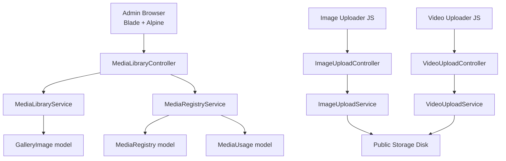
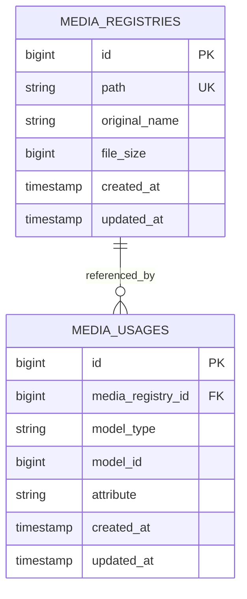
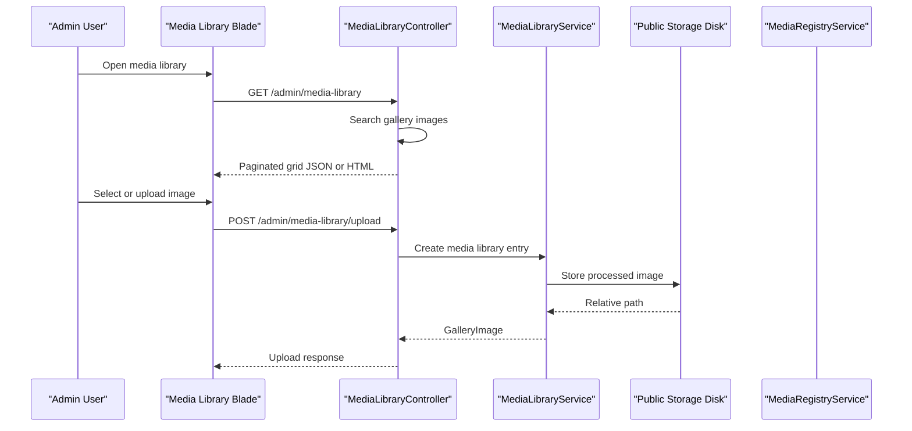
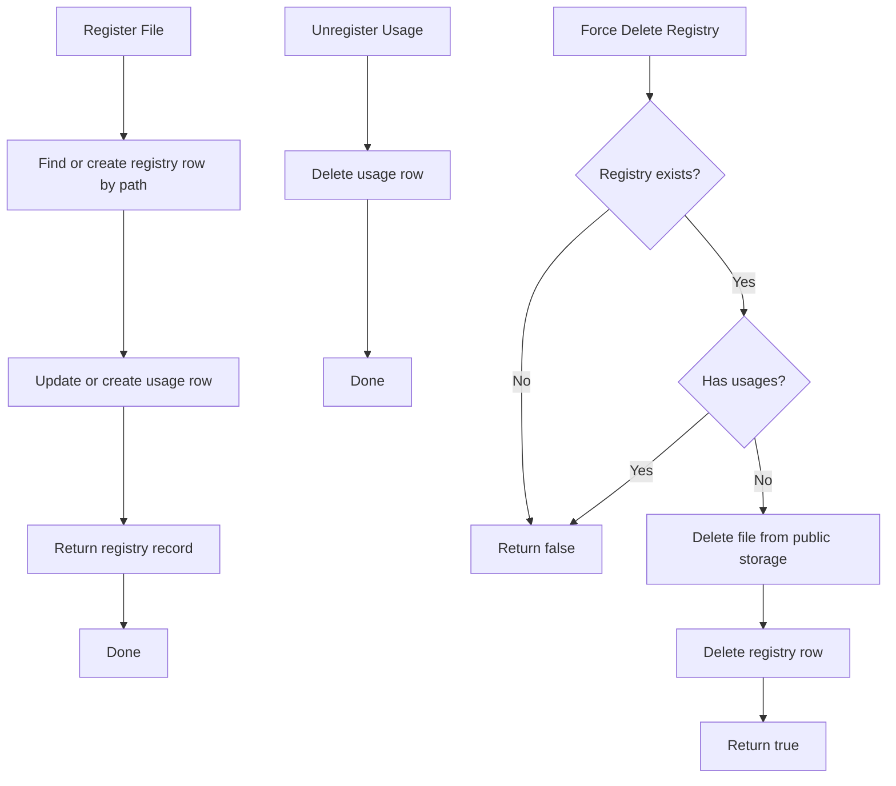
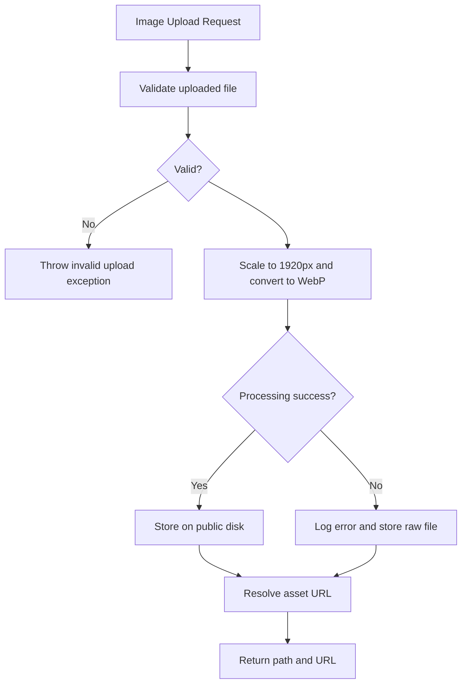
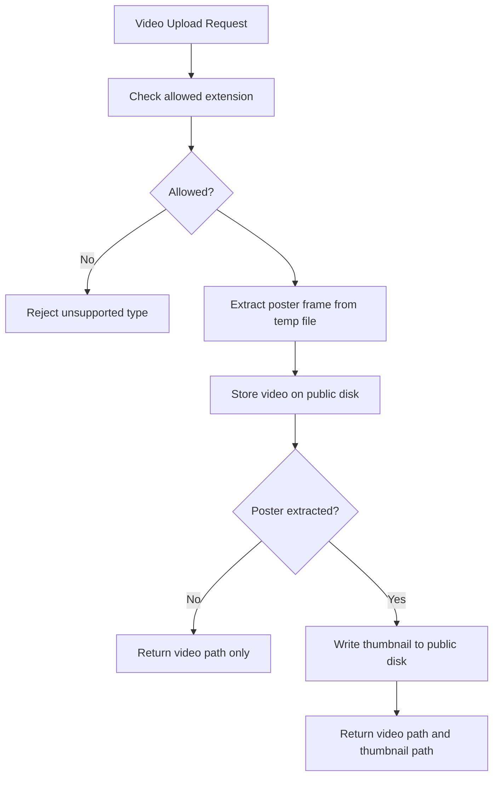
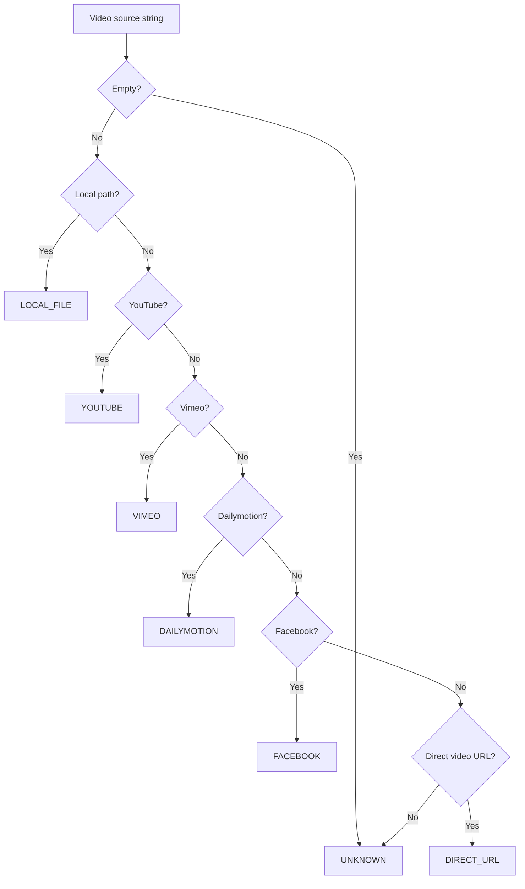
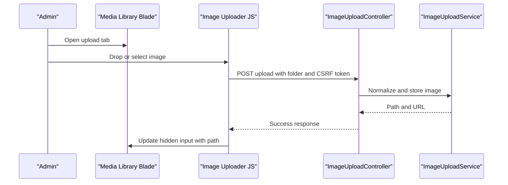
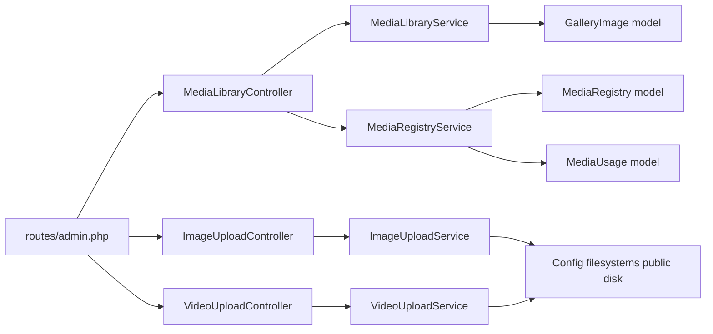

# Media Library

<cite>
**Referenced Files in This Document**
- [MediaRegistry.php](file://app/Models/MediaRegistry.php)
- [MediaUsage.php](file://app/Models/MediaUsage.php)
- [MediaLibraryService.php](file://app/Services/MediaLibraryService.php)
- [MediaRegistryService.php](file://app/Services/MediaRegistryService.php)
- [ImageUploadService.php](file://app/Services/ImageUploadService.php)
- [VideoUploadService.php](file://app/Services/VideoUploadService.php)
- [VideoSourceDetector.php](file://app/Services/VideoSourceDetector.php)
- [MediaLibraryController.php](file://app/Http/Controllers/Admin/MediaLibraryController.php)
- [ImageUploadController.php](file://app/Http/Controllers/Admin/ImageUploadController.php)
- [VideoUploadController.php](file://app/Http/Controllers/Admin/VideoUploadController.php)
- [filesystems.php](file://config/filesystems.php)
- [admin.php](file://routes/admin.php)
- [index.blade.php](file://resources/views/admin/media-library/index.blade.php)
- [image-upload.js](file://public/js/image-upload.js)
- [video-uploader.js](file://public/js/video-uploader.js)
- [2026_05_14_142832_create_media_registries_table.php](file://database/migrations/2026_05_14_142832_create_media_registries_table.php)
- [2026_05_14_142833_create_media_usages_table.php](file://database/migrations/2026_05_14_142833_create_media_usages_table.php)
- [2026_10_11_000000_normalise_persisted_media_paths.php](file://database/migrations/2026_10_11_000000_normalise_persisted_media_paths.php)
</cite>

## Table of Contents
1. [Introduction](#introduction)
2. [Project Structure](#project-structure)
3. [Core Components](#core-components)
4. [Architecture Overview](#architecture-overview)
5. [Detailed Component Analysis](#detailed-component-analysis)
6. [Dependency Analysis](#dependency-analysis)
7. [Performance Considerations](#performance-considerations)
8. [Troubleshooting Guide](#troubleshooting-guide)
9. [Conclusion](#conclusion)

## Introduction
The Highblossom media library system provides a centralized way to upload, organize, and reuse media assets across the application. It supports images, videos, and generic file references through a combination of Eloquent models, dedicated upload services, admin controllers, Blade interfaces, and JavaScript uploaders.

At its core, the system separates:
- **Asset storage**: where files live on disk or cloud storage.
- **Asset registry**: database records describing uploaded files.
- **Asset usage**: polymorphic links connecting media to content models.
- **Processing pipelines**: image resizing/conversion and video thumbnail extraction.
- **Admin interface**: browsing, uploading, previewing, selecting, and deleting media.

This document explains how these pieces fit together, how uploads are processed, how media is referenced by other parts of the system, and how to extend or secure the implementation.

## Project Structure
The media library spans several layers:

| Layer | Responsibility | Key Files |
|---|---|---|
| Models | Registry and usage data structures | `MediaRegistry.php`, `MediaUsage.php` |
| Services | Upload processing, registration, detection | `MediaLibraryService.php`, `ImageUploadService.php`, `VideoUploadService.php`, `VideoSourceDetector.php`, `MediaRegistryService.php` |
| Controllers | Admin HTTP endpoints | `MediaLibraryController.php`, `ImageUploadController.php`, `VideoUploadController.php` |
| Routes | URL mapping into admin scope | `admin.php` |
| Views | Media browser UI and upload form | `resources/views/admin/media-library/index.blade.php` |
| Frontend Scripts | Drag-and-drop, progress, AJAX upload | `public/js/image-upload.js`, `public/js/video-uploader.js` |
| Storage Configuration | Local and cloud disk configuration | `config/filesystems.php` |
| Database Migrations | Schema for registry and usage tables | `2026_05_14_..._create_media_registries_table.php`, `2026_05_14_..._create_media_usages_table.php`, `2026_10_11_..._normalise_persisted_media_paths.php` |

**Diagram sources**
- [MediaLibraryController.php](file://app/Http/Controllers/Admin/MediaLibraryController.php)
- [ImageUploadController.php](file://app/Http/Controllers/Admin/ImageUploadController.php)
- [VideoUploadController.php](file://app/Http/Controllers/Admin/VideoUploadController.php)
- [MediaLibraryService.php](file://app/Services/MediaLibraryService.php)
- [ImageUploadService.php](file://app/Services/ImageUploadService.php)
- [VideoUploadService.php](file://app/Services/VideoUploadService.php)
- [MediaRegistryService.php](file://app/Services/MediaRegistryService.php)

**Section sources**
- [MediaRegistry.php](file://app/Models/MediaRegistry.php)
- [MediaUsage.php](file://app/Models/MediaUsage.php)
- [MediaLibraryService.php](file://app/Services/MediaLibraryService.php)
- [MediaRegistryService.php](file://app/Services/MediaRegistryService.php)
- [ImageUploadService.php](file://app/Services/ImageUploadService.php)
- [VideoUploadService.php](file://app/Services/VideoUploadService.php)
- [VideoSourceDetector.php](file://app/Services/VideoSourceDetector.php)
- [MediaLibraryController.php](file://app/Http/Controllers/Admin/MediaLibraryController.php)
- [ImageUploadController.php](file://app/Http/Controllers/Admin/ImageUploadController.php)
- [VideoUploadController.php](file://app/Http/Controllers/Admin/VideoUploadController.php)
- [filesystems.php](file://config/filesystems.php)
- [admin.php](file://routes/admin.php)
- [index.blade.php](file://resources/views/admin/media-library/index.blade.php)
- [image-upload.js](file://public/js/image-upload.js)
- [video-uploader.js](file://public/js/video-uploader.js)
- [2026_05_14_142832_create_media_registries_table.php](file://database/migrations/2026_05_14_142832_create_media_registries_table.php)
- [2026_05_14_142833_create_media_usages_table.php](file://database/migrations/2026_05_14_142833_create_media_usages_table.php)
- [2026_10_11_000000_normalise_persisted_media_paths.php](file://database/migrations/2026_10_11_000000_normalise_persisted_media_paths.php)

## Core Components
The media library has five primary responsibilities:

1. **File ingestion**: accept image and video uploads through admin forms and AJAX endpoints.
2. **Processing**: normalize images to WebP with fixed dimensions and quality; extract video thumbnails.
3. **Storage persistence**: write files to the configured public storage disk.
4. **Metadata and usage tracking**: register file metadata and link it to the models using it.
5. **Browser and selection**: provide an admin UI to browse, search, preview, select, and delete media.

### Data Model Architecture
The central data model is the media registry. It stores a unique file path, original filename, and file size. A separate usage table tracks which application models reference each media file through polymorphic relations.

**Diagram sources**
- [2026_05_14_142832_create_media_registries_table.php](file://database/migrations/2026_05_14_142832_create_media_registries_table.php)
- [2026_05_14_142833_create_media_usages_table.php](file://database/migrations/2026_05_14_142833_create_media_usages_table.php)
- [MediaRegistry.php](file://app/Models/MediaRegistry.php)
- [MediaUsage.php](file://app/Models/MediaUsage.php)

The `MediaRegistry` model exposes a one-to-many relationship to `MediaUsage`. The `MediaUsage` model connects a registry entry back to a specific model instance and attribute through Laravel’s morph relation helpers.

**Section sources**
- [MediaRegistry.php](file://app/Models/MediaRegistry.php)
- [MediaUsage.php](file://app/Models/MediaUsage.php)
- [2026_05_14_142832_create_media_registries_table.php](file://database/migrations/2026_05_14_142832_create_media_registries_table.php)
- [2026_05_14_142833_create_media_usages_table.php](file://database/migrations/2026_05_14_142833_create_media_usages_table.php)

## Architecture Overview
The system uses a layered request flow:

- Browser UI sends requests through routes under `/admin`.
- Admin controllers validate input and delegate to services.
- Services process files, store them, and update registry and usage records.
- Views render paginated grids and upload forms.
- JavaScript components handle drag-and-drop, previews, progress bars, and AJAX uploads.

**Diagram sources**
- [MediaLibraryController.php](file://app/Http/Controllers/Admin/MediaLibraryController.php)
- [MediaLibraryService.php](file://app/Services/MediaLibraryService.php)
- [filesystems.php](file://config/filesystems.php)

**Section sources**
- [MediaLibraryController.php](file://app/Http/Controllers/Admin/MediaLibraryController.php)
- [MediaLibraryService.php](file://app/Services/MediaLibraryService.php)
- [filesystems.php](file://config/filesystems.php)

## Detailed Component Analysis

### Media Registry and Usage Tracking
The registry service handles three operations:

1. Register a file path with its original name and size.
2. Record which model and attribute use that file.
3. Delete unused registry entries and their stored files.

**Diagram sources**
- [MediaRegistryService.php](file://app/Services/MediaRegistryService.php)

Key behaviors:
- Registration is idempotent for the same path because the registry lookup is keyed by path.
- Usage deletion is scoped by model class, model ID, and attribute.
- Forced deletion only removes the physical file when there are no remaining usages.

Security note: forced deletion does not perform additional authorization checks inside the service itself. Authorization should be enforced at the controller or route layer before calling this method.

**Section sources**
- [MediaRegistryService.php](file://app/Services/MediaRegistryService.php)
- [MediaRegistry.php](file://app/Models/MediaRegistry.php)
- [MediaUsage.php](file://app/Models/MediaUsage.php)

### Image Upload Pipeline
Images go through a normalization pipeline designed to reduce bandwidth and improve performance:

1. Validate the uploaded file.
2. Scale the image to a maximum long edge of 1920 pixels.
3. Convert the output to WebP at a fixed quality setting.
4. Store the result on the public storage disk.
5. Return both the disk-relative path and a resolved asset URL.

If image processing fails, the service logs the error and falls back to storing the raw uploaded file. This prevents transient processing failures from taking down the upload endpoint.

**Diagram sources**
- [ImageUploadService.php](file://app/Services/ImageUploadService.php)

Frontend integration:
- The image uploader supports drag-and-drop, client-side type validation, size validation, preview generation, and an AJAX upload with a progress bar.
- It writes the returned path into a hidden input so parent forms can submit the selected asset.

**Section sources**
- [ImageUploadService.php](file://app/Services/ImageUploadService.php)
- [image-upload.js](file://public/js/image-upload.js)

### Video Upload Pipeline
Video handling differs from images because large binary files are expensive to transform server-side. The current pipeline:

1. Accepts MP4, WebM, MOV, and AVI extensions.
2. Generates a temporary poster frame from the first second of the video.
3. Stores the original video under `videos/` on the public disk.
4. Writes a generated thumbnail under `videos/thumbnails/`.
5. Returns paths for both the video and thumbnail.

Thumbnail extraction runs against the PHP upload temp file before the video is moved. This is important because the public disk may be backed by object storage without local read access.

**Diagram sources**
- [VideoUploadService.php](file://app/Services/VideoUploadService.php)

Frontend integration:
- The video uploader validates MIME types, enforces a larger default size limit than images, shows a video preview, and uploads via AJAX with a longer timeout.

**Section sources**
- [VideoUploadService.php](file://app/Services/VideoUploadService.php)
- [video-uploader.js](file://public/js/video-uploader.js)

### Video Source Detection
When videos come from external sources rather than direct uploads, `VideoSourceDetector` identifies the source type and produces embed-friendly URLs. Supported categories include:

- Local file paths
- YouTube
- Vimeo
- Dailymotion
- Facebook
- Direct video file URLs

For Facebook share and short URLs, the detector attempts to resolve redirects to a canonical watch URL before embedding.

**Diagram sources**
- [VideoSourceDetector.php](file://app/Services/VideoSourceDetector.php)

Embed behavior:
- Platform-specific embed URLs are built from extracted identifiers.
- Facebook may return the full resolved URL rather than just an identifier because its embed plugin works better with complete links.

**Section sources**
- [VideoSourceDetector.php](file://app/Services/VideoSourceDetector.php)

### Media Library Browser Interface
The media browser is implemented as a Blade view with Alpine-based state management. It provides:

- Two tabs: Browse and Upload.
- A paginated image grid.
- A title and category form for new library uploads.
- A preview modal showing image details, metadata, selection, and deletion.
- HTMX-style partial rendering support when requested.

The controller serves:
- Full HTML for normal page loads.
- Partial HTML for HTMX updates.
- JSON for programmatic browsing by the picker interface.

Search is performed by title with descending creation time and a stable ID tie-breaker.

**Diagram sources**
- [index.blade.php](file://resources/views/admin/media-library/index.blade.php)
- [image-upload.js](file://public/js/image-upload.js)
- [ImageUploadController.php](file://app/Http/Controllers/Admin/ImageUploadController.php)
- [ImageUploadService.php](file://app/Services/ImageUploadService.php)

**Section sources**
- [index.blade.php](file://resources/views/admin/media-library/index.blade.php)
- [MediaLibraryController.php](file://app/Http/Controllers/Admin/MediaLibraryController.php)
- [image-upload.js](file://public/js/image-upload.js)

### Content Management Integration
Media assets are integrated with content through two main patterns:

1. **Gallery images**: `MediaLibraryService` creates gallery entries with a library source flag and inactive status, so newly uploaded library images do not automatically appear in the public gallery.
2. **Structured media attributes**: migrations normalize absolute URLs such as `/storage/...` into disk-relative paths for columns like service images, post featured images, and about-us hero images. Content block trees are also rewritten for attributes like `src` and `poster`.

This normalization makes historical media references portable when switching between local storage and cloud buckets.

**Section sources**
- [MediaLibraryService.php](file://app/Services/MediaLibraryService.php)
- [2026_10_11_000000_normalise_persisted_media_paths.php](file://database/migrations/2026_10_11_000000_normalise_persisted_media_paths.php)

### Batch Processing and Bulk Operations
The current repository evidence does not show a dedicated batch upload controller or job queue for media processing. The available bulk-like capabilities are:

- Client-side drag-and-drop and multiple-file selection patterns in the frontend uploaders.
- Pagination in the media browser for efficient browsing of many images.
- Chunked migration updates for normalizing persisted media paths.

To add true server-side batch processing, you would typically introduce:
- A batch submission endpoint accepting multiple files.
- Queue jobs for heavy transformations such as transcoding or virus scanning.
- Progress tracking per job.
- Cleanup of temporary uploads after completion.

These are architectural recommendations rather than existing implementations.

[No sources needed since this section proposes extensions beyond the current codebase]

## Dependency Analysis

**Diagram sources**
- [admin.php](file://routes/admin.php)
- [MediaLibraryController.php](file://app/Http/Controllers/Admin/MediaLibraryController.php)
- [ImageUploadController.php](file://app/Http/Controllers/Admin/ImageUploadController.php)
- [VideoUploadController.php](file://app/Http/Controllers/Admin/VideoUploadController.php)
- [MediaLibraryService.php](file://app/Services/MediaLibraryService.php)
- [ImageUploadService.php](file://app/Services/ImageUploadService.php)
- [VideoUploadService.php](file://app/Services/VideoUploadService.php)
- [MediaRegistryService.php](file://app/Services/MediaRegistryService.php)
- [filesystems.php](file://config/filesystems.php)

### Coupling and Cohesion
- Controllers are thin: they validate input and delegate to services.
- Services encapsulate domain logic for image processing, video processing, library creation, and registry management.
- Models are simple Eloquent entities focused on relationships and fillable fields.
- Frontend scripts are reusable classes parameterized by DOM elements, upload URLs, CSRF tokens, and limits.

### External Dependencies
- Laravel filesystem abstraction for local and S3-backed storage.
- Laravel image processing component for WebP conversion.
- FFmpeg for video thumbnail extraction.
- HTTP client for resolving Facebook share URLs.

**Section sources**
- [admin.php](file://routes/admin.php)
- [filesystems.php](file://config/filesystems.php)

## Performance Considerations

### Image Optimization
- Images are scaled to a maximum dimension of 1920 pixels.
- Output is converted to WebP at a fixed quality level.
- This reduces bandwidth and improves load times while preserving acceptable visual quality.

Recommendations:
- Monitor storage growth if the fallback stores raw files after processing errors.
- Consider adding responsive variants for different screen sizes.
- Use CDN cache keys based on processed paths.

### Video Handling
- Thumbnails are extracted from the first second of the video.
- Thumbnail extraction uses a temporary file in the system temp directory and cleans up afterward.
- Upload timeouts are longer for videos due to typical file sizes.

Recommendations:
- Offload thumbnail generation to background jobs in high-throughput environments.
- Add video transcoding jobs to produce web-friendly formats and resolutions.
- Implement chunked uploads for very large videos.

### Storage and CDN
- The public disk can be local or S3, controlled by environment configuration.
- When using S3, the bucket visibility and endpoint settings are explicit.
- Normalized relative paths make media references portable across domains and storage providers.

Recommendations:
- Configure a CDN in front of the public disk or S3 bucket.
- Set appropriate cache headers for static media.
- Enable versioned or hashed filenames for cache busting when changing assets.

[No sources needed since this section provides general guidance]

## Troubleshooting Guide

### Upload Fails Immediately
Common causes:
- Invalid file type.
- File exceeds frontend or backend limits.
- Missing CSRF token.
- Public storage disk is misconfigured.

Actions:
- Verify accepted MIME types in the frontend uploader.
- Check server upload size limits and PHP configuration.
- Confirm the public storage disk is writable or accessible.
- Inspect controller responses for error messages.

**Section sources**
- [image-upload.js](file://public/js/image-upload.js)
- [video-uploader.js](file://public/js/video-uploader.js)
- [ImageUploadController.php](file://app/Http/Controllers/Admin/ImageUploadController.php)
- [VideoUploadController.php](file://app/Http/Controllers/Admin/VideoUploadController.php)

### Image Processing Fails but Upload Succeeds
The image service falls back to storing the raw file when image processing throws an exception. Logs will contain the processing error message.

Actions:
- Check application logs for failed image processing.
- Ensure the image processing backend is available.
- Review whether the fallback raw file format meets performance requirements.

**Section sources**
- [ImageUploadService.php](file://app/Services/ImageUploadService.php)

### Video Thumbnail Is Missing
Thumbnails may be missing if:
- FFmpeg is unavailable or fails to run.
- The video temp file cannot be read.
- The video format is unsupported.

Actions:
- Verify FFmpeg availability and permissions.
- Check logs for FFmpeg errors.
- Confirm the uploaded extension is in the allowed list.

**Section sources**
- [VideoUploadService.php](file://app/Services/VideoUploadService.php)

### Deleted Media Still Exists on Disk
A registry entry is only deleted when it has no usages. If a media file remains after deletion, check:
- Whether other models still reference the same registry entry.
- Whether the controller called unregister before deleting.
- Whether forced deletion was attempted on an entry with remaining usages.

**Section sources**
- [MediaRegistryService.php](file://app/Services/MediaRegistryService.php)
- [MediaLibraryController.php](file://app/Http/Controllers/Admin/MediaLibraryController.php)

### Media Links Break After Moving to Cloud Storage
Historical absolute URLs pointing to `/storage/...` were normalized to disk-relative paths by the migration. If links are broken:
- Run the normalization migration.
- Confirm the public disk URL configuration matches the deployment domain or CDN.
- Verify that media files exist under the expected storage paths.

**Section sources**
- [2026_10_11_000000_normalise_persisted_media_paths.php](file://database/migrations/2026_10_11_000000_normalise_persisted_media_paths.php)
- [filesystems.php](file://config/filesystems.php)

## Security Considerations

### File Upload Validation
Current protections include:
- Client-side MIME type checks in the JavaScript uploaders.
- Backend extension checks for video uploads.
- File validity checks before processing or storing.
- Controlled folders for uploads.

Gaps and recommendations:
- Add strict allowlists for file extensions and MIME types at the request validation layer.
- Enforce maximum file sizes through request validation and server configuration.
- Validate magic bytes or signatures, not just extensions or MIME types.
- Sanitize original filenames to prevent path traversal.
- Quarantine untrusted uploads until approved.

**Section sources**
- [image-upload.js](file://public/js/image-upload.js)
- [video-uploader.js](file://public/js/video-uploader.js)
- [VideoUploadService.php](file://app/Services/VideoUploadService.php)

### Virus Scanning
There is no virus scanning implementation in the analyzed files. Recommended additions:
- Scan uploads before moving them into the final public directory.
- Block or quarantine infected files.
- Integrate with a dedicated scanning service.
- Log scan results and failures separately from upload logs.

[No sources needed since this section proposes security improvements not present in the codebase]

### Access Control
- Admin routes are grouped under an authenticated middleware group and require permission to access the admin panel.
- Media controllers operate within that protected scope.

Recommended enhancements:
- Add fine-grained permissions for viewing, uploading, selecting, and deleting media.
- Restrict sensitive directories to authenticated users.
- Avoid exposing internal storage paths directly to unauthenticated clients.

**Section sources**
- [admin.php](file://routes/admin.php)

### Storage Configuration and Backup Strategy
- Local storage uses a private root and a public root depending on the disk.
- S3 configuration includes region, bucket, endpoint, path-style endpoint, visibility, and throw/report options.
- Symbolic links map the public storage URL to the local public directory.

Backup recommendations:
- Back up the public storage disk contents separately from the application codebase.
- Include registry and usage database tables in backups.
- Test restoration procedures for both local and cloud storage configurations.
- Consider cross-region replication or snapshotting for object storage buckets.

**Section sources**
- [filesystems.php](file://config/filesystems.php)

## Conclusion
The Highblossom media library system provides a practical foundation for managing images and videos in an admin context. Its strengths include:

- Clear separation between storage, processing, registry, and UI.
- Image normalization to WebP with fixed dimensions.
- Video thumbnail extraction from uploaded content.
- Polymorphic media usage tracking.
- A browsable, searchable media interface with preview and selection.
- Migration-based normalization of media references for portability.

Areas for future enhancement include:
- Broader document upload support.
- True server-side batch upload and background processing.
- Explicit virus scanning.
- Enhanced access control and audit logging.
- Responsive image variants and advanced CDN configuration.
- Automated cleanup of orphaned or temporary uploads.

By extending the existing services and keeping file validation, processing, and storage concerns isolated, the system can scale safely to larger media catalogs and more demanding content workflows.