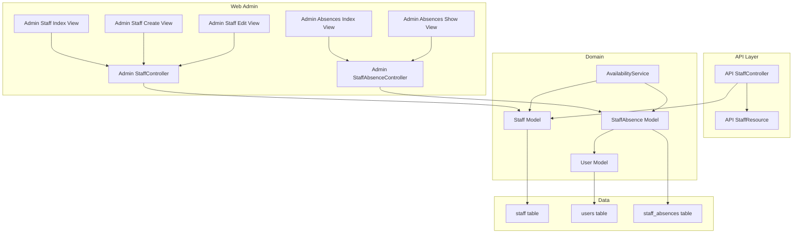
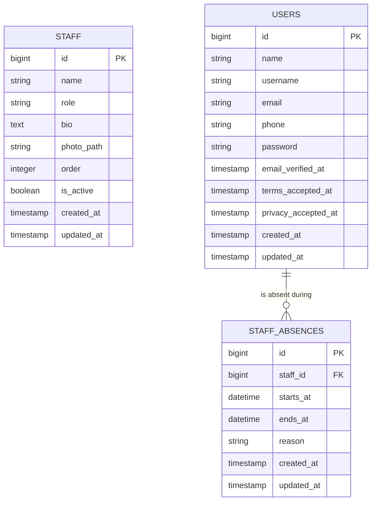
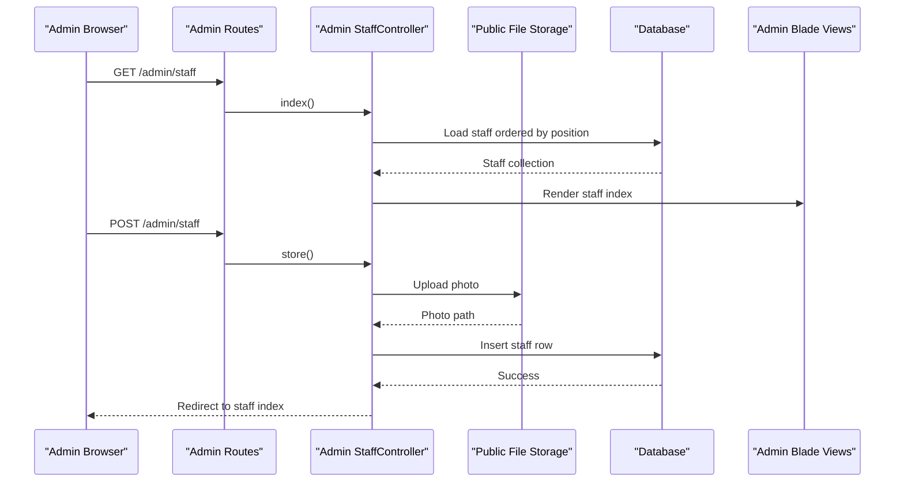
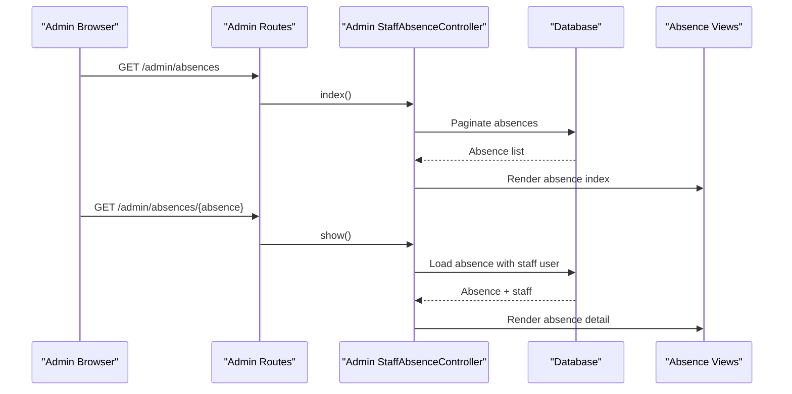
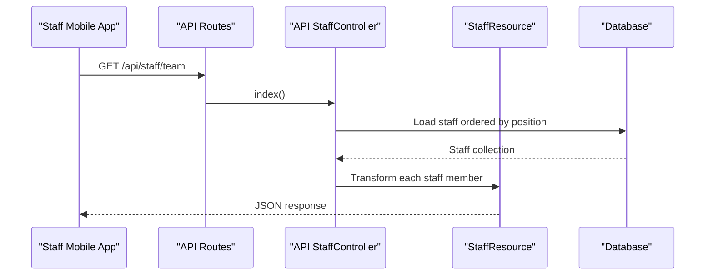
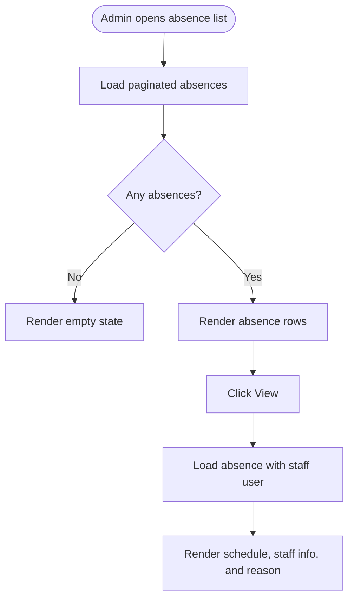
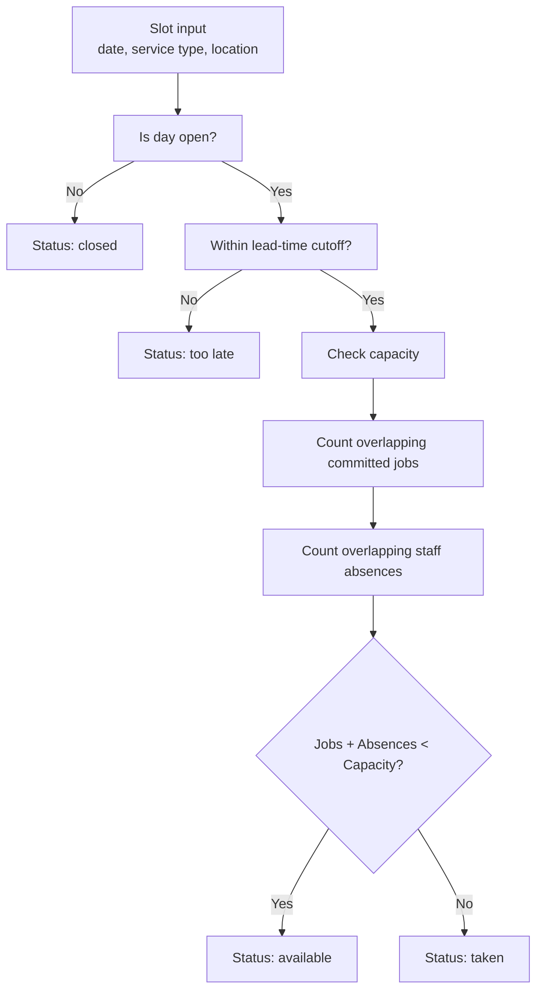
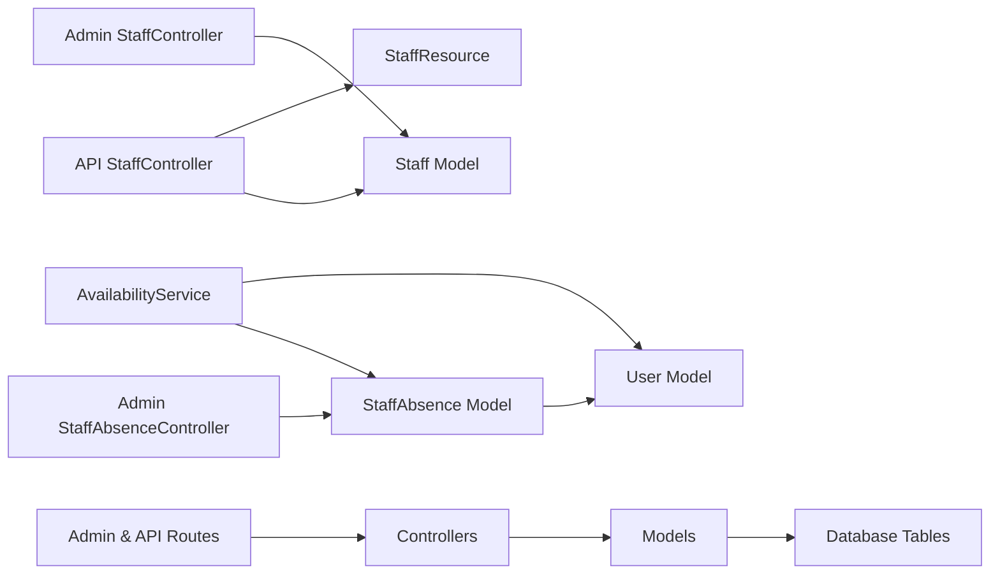

# Staff Administration

<cite>
**Referenced Files in This Document**
- [Staff.php](file://app/Models/Staff.php)
- [StaffAbsence.php](file://app/Models/StaffAbsence.php)
- [User.php](file://app/Models/User.php)
- [StaffController.php](file://app/Http/Controllers/Admin/StaffController.php)
- [StaffAbsenceController.php](file://app/Http/Controllers/Admin/StaffAbsenceController.php)
- [StaffController.php](file://app/Http/Controllers/Api/StaffController.php)
- [StaffResource.php](file://app/Http/Resources/Api/StaffResource.php)
- [AvailabilityService.php](file://app/Services/AvailabilityService.php)
- [admin.php](file://routes/admin.php)
- [api.php](file://routes/api.php)
- [2026_05_25_102702_create_staff_table.php](file://database/migrations/2026_05_25_102702_create_staff_table.php)
- [2026_04_17_093357_create_staff_absences_table.php](file://database/migrations/2026_04_17_093357_create_staff_absences_table.php)
- [index.blade.php](file://resources/views/admin/staff/index.blade.php)
- [create.blade.php](file://resources/views/admin/staff/create.blade.php)
- [edit.blade.php](file://resources/views/admin/staff/edit.blade.php)
- [absences index.blade.php](file://resources/views/admin/absences/index.blade.php)
- [absences show.blade.php](file://resources/views/admin/absences/show.blade.php)
- [settings/index.blade.php](file://resources/views/admin/settings/index.blade.php)
</cite>

## Table of Contents
1. [Introduction](#introduction)
2. [Project Structure](#project-structure)
3. [Core Components](#core-components)
4. [Architecture Overview](#architecture-overview)
5. [Detailed Component Analysis](#detailed-component-analysis)
6. [Dependency Analysis](#dependency-analysis)
7. [Performance Considerations](#performance-considerations)
8. [Troubleshooting Guide](#troubleshooting-guide)
9. [Conclusion](#conclusion)

## Introduction
This document explains the Highblossom staff administration system from an operational and technical perspective. It covers how staff profiles are managed, how absences are tracked, how absence data affects booking availability, and how the web admin and mobile staff API interact with the underlying models and services.

The system separates two concerns:
- **Staff directory**: a profile list used for display and assignment, stored in its own `staff` table.
- **Authenticatable users**: the login and permissions layer, stored in the `users` table.

Absences are recorded against authenticatable users, not directly against the staff directory entries. Availability calculations use absences to reduce effective capacity when planning bookings.

## Project Structure
The staff administration feature spans models, controllers, routes, views, migrations, and a scheduling service.

**Diagram sources**
- [StaffController.php:1-116](file://app/Http/Controllers/Admin/StaffController.php#L1-L116)
- [StaffAbsenceController.php:1-34](file://app/Http/Controllers/Admin/StaffAbsenceController.php#L1-L34)
- [StaffController.php:1-115](file://app/Http/Controllers/Api/StaffController.php#L1-L115)
- [StaffResource.php:1-37](file://app/Http/Resources/Api/StaffResource.php#L1-L37)
- [Staff.php:1-45](file://app/Models/Staff.php#L1-L45)
- [StaffAbsence.php:1-39](file://app/Models/StaffAbsence.php#L1-L39)
- [User.php:1-141](file://app/Models/User.php#L1-L141)
- [AvailabilityService.php:1-200](file://app/Services/AvailabilityService.php#L1-L200)
- [2026_05_25_102702_create_staff_table.php:1-33](file://database/migrations/2026_05_25_102702_create_staff_table.php#L1-L33)
- [2026_04_17_093357_create_staff_absences_table.php:1-33](file://database/migrations/2026_04_17_093357_create_staff_absences_table.php#L1-L33)

**Section sources**
- [StaffController.php:1-116](file://app/Http/Controllers/Admin/StaffController.php#L1-L116)
- [StaffAbsenceController.php:1-34](file://app/Http/Controllers/Admin/StaffAbsenceController.php#L1-L34)
- [StaffController.php:1-115](file://app/Http/Controllers/Api/StaffController.php#L1-L115)
- [StaffResource.php:1-37](file://app/Http/Resources/Api/StaffResource.php#L1-L37)
- [Staff.php:1-45](file://app/Models/Staff.php#L1-L45)
- [StaffAbsence.php:1-39](file://app/Models/StaffAbsence.php#L1-L39)
- [User.php:1-141](file://app/Models/User.php#L1-L141)
- [AvailabilityService.php:1-200](file://app/Services/AvailabilityService.php#L1-L200)

## Core Components

### Staff Directory Model
The `Staff` model represents a public or internal team member profile. Its fields include name, role, bio, photo path, display order, and active status. It uses a sort-order concern and exposes a photo URL accessor. The model does not define authentication or role relationships; it is primarily a presentation and assignment entity.

Key responsibilities:
- Persisting staff directory records.
- Managing display ordering through the `order` column.
- Providing a safe photo URL fallback.

**Section sources**
- [Staff.php:1-45](file://app/Models/Staff.php#L1-L45)
- [2026_05_25_102702_create_staff_table.php:1-33](file://database/migrations/2026_05_25_102702_create_staff_table.php#L1-L33)

### Authenticatable User Model
The `User` model is the authenticated identity. It supports roles, passkeys, two-factor authentication, email verification, avatar storage, and session tracking. Staff members who need system access should be created as users; the separate `Staff` profile is independent unless explicitly linked elsewhere.

Key responsibilities:
- Authentication and authorization via roles.
- Session and security metadata.
- Avatar and profile attributes.

**Section sources**
- [User.php:1-141](file://app/Models/User.php#L1-L141)

### Staff Absence Model
A `StaffAbsence` links an absence record to an authenticatable user through `staff_id`. It stores start and end timestamps plus an optional reason. The relationship points to `User`, not to `Staff`.

Key responsibilities:
- Recording time-off ranges.
- Supporting availability queries through indexed date columns.
- Loading associated user details for admin views.

**Section sources**
- [StaffAbsence.php:1-39](file://app/Models/StaffAbsence.php#L1-L39)
- [2026_04_17_093357_create_staff_absences_table.php:1-33](file://database/migrations/2026_04_17_093357_create_staff_absences_table.php#L1-L33)

### Relationship Between Staff and User Models
The current implementation treats `Staff` and `User` as separate entities:
- `Staff` is a lightweight profile with role text, bio, and photo.
- `User` is the secure account holder with authentication, roles, and sessions.
- `StaffAbsence` belongs to `User`, not `Staff`.

There is no direct Eloquent relation defined between `Staff` and `User` in the analyzed files. Administrators must therefore keep the staff directory and user accounts consistent manually when assigning work.

**Diagram sources**
- [2026_05_25_102702_create_staff_table.php:1-33](file://database/migrations/2026_05_25_102702_create_staff_table.php#L1-L33)
- [2026_04_17_093357_create_staff_absences_table.php:1-33](file://database/migrations/2026_04_17_093357_create_staff_absences_table.php#L1-L33)
- [StaffAbsence.php:1-39](file://app/Models/StaffAbsence.php#L1-L39)

## Architecture Overview

### Request Flow for Web Admin Staff Management

**Diagram sources**
- [admin.php:132-137](file://routes/admin.php#L132-L137)
- [StaffController.php:1-116](file://app/Http/Controllers/Admin/StaffController.php#L1-L116)
- [index.blade.php:1-78](file://resources/views/admin/staff/index.blade.php#L1-L78)
- [create.blade.php:1-101](file://resources/views/admin/staff/create.blade.php#L1-L101)
- [edit.blade.php:1-96](file://resources/views/admin/staff/edit.blade.php#L1-L96)

### Request Flow for Absence Management

**Diagram sources**
- [admin.php:68-69](file://routes/admin.php#L68-L69)
- [StaffAbsenceController.php:1-34](file://app/Http/Controllers/Admin/StaffAbsenceController.php#L1-L34)
- [absences index.blade.php:1-69](file://resources/views/admin/absences/index.blade.php#L1-L69)
- [absences show.blade.php:1-73](file://resources/views/admin/absences/show.blade.php#L1-L73)

### Staff API Flow

**Diagram sources**
- [api.php:95-100](file://routes/api.php#L95-L100)
- [StaffController.php:1-115](file://app/Http/Controllers/Api/StaffController.php#L1-L115)
- [StaffResource.php:1-37](file://app/Http/Resources/Api/StaffResource.php#L1-L37)

## Detailed Component Analysis

### Web Admin Staff CRUD
The admin staff controller provides full CRUD over the staff directory. Validation enforces required name and role, optional bio, image upload, and unique display ordering. Updates preserve uniqueness and replace old photos on upload. Deletion removes both the database row and the associated file.

| Operation | Route Pattern | HTTP Method | Access Control | Behavior |
|---|---|---|---|---|
| List staff | `/admin/staff` | GET | `manage settings` | Returns ordered staff list |
| Create form | `/admin/staff/create` | GET | `manage settings` | Renders create view |
| Store staff | `/admin/staff` | POST | `manage settings` | Validates, uploads photo, creates staff |
| Edit form | `/admin/staff/{staff}/edit` | GET | `manage settings` | Renders edit view |
| Update staff | `/admin/staff/{staff}` | PUT | `manage settings` | Validates, replaces photo if provided, updates |
| Delete staff | `/admin/staff/{staff}` | DELETE | `manage settings` | Deletes photo and staff record |

Validation and sorting rules are reused across creation and update. The UI includes photo preview and a shared sort-order component.

**Section sources**
- [admin.php:132-137](file://routes/admin.php#L132-L137)
- [StaffController.php:1-116](file://app/Http/Controllers/Admin/StaffController.php#L1-L116)
- [index.blade.php:1-78](file://resources/views/admin/staff/index.blade.php#L1-L78)
- [create.blade.php:1-101](file://resources/views/admin/staff/create.blade.php#L1-L101)
- [edit.blade.php:1-96](file://resources/views/admin/staff/edit.blade.php#L1-L96)

### API Staff Management
The API exposes a team endpoint under `/api/staff/team`. It mirrors the web validation but allows creating and updating without requiring a photo. Responses are normalized through `StaffResource`.

| Endpoint | Method | Description | Authorization |
|---|---|---|---|
| `/api/staff/team` | GET | List all staff by display order | Sanctum token + `manage settings` |
| `/api/staff/team` | POST | Create a staff member | Sanctum token + `manage settings` |
| `/api/staff/team/{staff}` | GET | Show one staff member | Sanctum token + `manage settings` |
| `/api/staff/team/{staff}` | PUT | Update a staff member | Sanctum token + `manage settings` |
| `/api/staff/team/{staff}` | DELETE | Remove a staff member | Sanctum token + `manage settings` |

**Section sources**
- [api.php:95-100](file://routes/api.php#L95-L100)
- [StaffController.php:1-115](file://app/Http/Controllers/Api/StaffController.php#L1-L115)
- [StaffResource.php:1-37](file://app/Http/Resources/Api/StaffResource.php#L1-L37)

### Absence Calendar System
The absence calendar consists of:
- A paginated absence index showing staff, dates, and reason.
- An absence detail page loading the related user.
- Database indexes on start/end times and composite availability indexes.
- Integration with availability calculation so that overlapping absences reduce shop capacity.

Currently, there is no admin controller method shown for creating or deleting absences in the analyzed files; the routes expose listing and viewing.

**Diagram sources**
- [StaffAbsenceController.php:1-34](file://app/Http/Controllers/Admin/StaffAbsenceController.php#L1-L34)
- [absences index.blade.php:1-69](file://resources/views/admin/absences/index.blade.php#L1-L69)
- [absences show.blade.php:1-73](file://resources/views/admin/absences/show.blade.php#L1-L73)
- [2026_04_17_093357_create_staff_absences_table.php:1-33](file://database/migrations/2026_04_17_093357_create_staff_absences_table.php#L1-L33)

**Section sources**
- [StaffAbsenceController.php:1-34](file://app/Http/Controllers/Admin/StaffAbsenceController.php#L1-L34)
- [absences index.blade.php:1-69](file://resources/views/admin/absences/index.blade.php#L1-L69)
- [absences show.blade.php:1-73](file://resources/views/admin/absences/show.blade.php#L1-L73)
- [2026_04_17_093357_create_staff_absences_table.php:1-33](file://database/migrations/2026_04_17_093357_create_staff_absences_table.php#L1-L33)

### Booking Scheduling Integration
The `AvailabilityService` determines whether a booking slot is available by combining:
- Business open hours.
- Lead-time cutoff.
- Service duration.
- Location capacity.
- Existing bookings.
- Overlapping staff absences.

Absences are treated as capacity consumers. When a staff member is absent during a time window, the availability logic counts that absence alongside existing jobs. If the number of occupied slots meets or exceeds configured capacity, the slot is marked taken.

**Diagram sources**
- [AvailabilityService.php:1-200](file://app/Services/AvailabilityService.php#L1-L200)
- [AvailabilityService.php:201-631](file://app/Services/AvailabilityService.php#L201-L631)
- [settings/index.blade.php:456-495](file://resources/views/admin/settings/index.blade.php#L456-L495)

**Section sources**
- [AvailabilityService.php:1-200](file://app/Services/AvailabilityService.php#L1-L200)
- [AvailabilityService.php:201-631](file://app/Services/AvailabilityService.php#L201-L631)
- [settings/index.blade.php:456-495](file://resources/views/admin/settings/index.blade.php#L456-L495)

### Staff Availability Management
Availability management is configuration-driven rather than per-staff-hourly scheduling:
- **Lead time** controls how far ahead customers can book.
- **Slot interval** defines recurring booking windows.
- **Service durations** set job length per service type.
- **Workshop and mobile capacities** determine concurrent job limits.
- **Staff absences** reduce effective capacity by being counted as occupied intervals.

There is no dedicated shift planner or per-staff roster in the analyzed files. Instead, absences act as negative capacity markers, while general capacity settings bound total simultaneous jobs.

**Section sources**
- [AvailabilityService.php:1-200](file://app/Services/AvailabilityService.php#L1-L200)
- [AvailabilityService.php:201-631](file://app/Services/AvailabilityService.php#L201-L631)
- [settings/index.blade.php:410-539](file://resources/views/admin/settings/index.blade.php#L410-L539)

### Shift Planning Features
Shift planning in this codebase is implicit:
- Absences remove capacity.
- Bookings occupy capacity.
- Inspections may reschedule appointments, affecting the real start time used in overlap checks.
- There is no explicit shift table or shift-controller workflow in the analyzed files.

Administrators manage shifts indirectly by:
- Adding staff profiles for visibility.
- Recording absences for unavailable users.
- Adjusting business capacity and service durations.
- Using the booking calendar to see where demand overlaps capacity.

**Section sources**
- [AvailabilityService.php:201-631](file://app/Services/AvailabilityService.php#L201-L631)
- [settings/index.blade.php:410-539](file://resources/views/admin/settings/index.blade.php#L410-L539)

### Performance Metrics Tracking
No dedicated performance metrics dashboard or KPI model was found in the analyzed files. Relevant indirect indicators include:
- Booking count and status through the booking domain.
- Inspection notes and events.
- Session activity for administrative security auditing.

For performance reporting, administrators would typically rely on external analytics, application logs, or extended reporting features beyond the currently analyzed scope.

[No sources needed since this section summarizes available evidence without analyzing specific files]

### Bulk Import/Export Capabilities
The analyzed staff administration code does not implement bulk import or export endpoints for staff or absences. Current capabilities are:
- Single-record creation and update.
- Single-record deletion.
- Listing and viewing.

Bulk operations would require additional controllers, request validation, queue workers, and possibly CSV/Excel handling.

[No sources needed since this section summarizes available evidence without analyzing specific files]

### Audit Logging for Administrative Actions
Audit logging infrastructure exists at the application level:
- The auditify package is registered in dependencies.
- Migrations exist for audit action, activity, and security log tables.
- Log viewer support is present.

However, the analyzed staff and absence controllers do not explicitly call audit logging helpers. Any audit trail for staff actions would depend on middleware, global observers, or audit integration not shown in these files.

**Section sources**
- [composer.json:22](file://composer.json#L22)
- [composer.lock:53-111](file://composer.lock#L53-L111)
- [2026_01_01_000000_create_audit_action_logs_table.php](file://database/migrations/2026_01_01_000000_create_audit_action_logs_table.php)
- [2026_01_01_000001_create_audit_activity_logs_table.php](file://database/migrations/2026_01_01_000001_create_audit_activity_logs_table.php)
- [2026_01_01_000002_create_audit_security_logs_table.php](file://database/migrations/2026_01_01_000002_create_audit_security_logs_table.php)

### Security Measures for Sensitive Staff Data
Security controls relevant to staff administration include:
- Role-based authorization using Spatie permissions.
- API authentication via Laravel Sanctum tokens.
- Two-factor authentication support for users.
- Password hashing and hidden sensitive attributes on the user model.
- Image upload validation and storage outside web-accessible source control.
- Throttling on staff API login and two-factor challenge endpoints.

Sensitive personal data such as names, emails, photos, and reasons for absence should be treated as protected information. Access should be limited to authorized administrators or staff members with appropriate permissions.

**Section sources**
- [User.php:1-141](file://app/Models/User.php#L1-L141)
- [api.php:1-117](file://routes/api.php#L1-L117)
- [StaffController.php:1-115](file://app/Http/Controllers/Api/StaffController.php#L1-L115)
- [StaffController.php:1-116](file://app/Http/Controllers/Admin/StaffController.php#L1-L116)

### Compliance Considerations
Compliance considerations depend on jurisdiction and organizational policy, but the following areas are relevant:
- **Data minimization**: Only collect staff and absence data needed for scheduling and display.
- **Access control**: Restrict staff directory and absence data to authorized roles.
- **Retention**: Define retention policies for absence reasons, photos, and administrative changes.
- **Consent**: Ensure consent handling aligns with privacy requirements for employee or contractor data.
- **Auditability**: Enable and retain audit logs for sensitive administrative actions.
- **Secure storage**: Encrypt sensitive fields at rest if required, and protect backups.

[No sources needed since this section provides general guidance]

## Dependency Analysis

**Diagram sources**
- [StaffController.php:1-116](file://app/Http/Controllers/Admin/StaffController.php#L1-L116)
- [StaffAbsenceController.php:1-34](file://app/Http/Controllers/Admin/StaffAbsenceController.php#L1-L34)
- [StaffController.php:1-115](file://app/Http/Controllers/Api/StaffController.php#L1-L115)
- [StaffResource.php:1-37](file://app/Http/Resources/Api/StaffResource.php#L1-L37)
- [Staff.php:1-45](file://app/Models/Staff.php#L1-L45)
- [StaffAbsence.php:1-39](file://app/Models/StaffAbsence.php#L1-L39)
- [User.php:1-141](file://app/Models/User.php#L1-L141)
- [AvailabilityService.php:1-200](file://app/Services/AvailabilityService.php#L1-L200)

**Section sources**
- [StaffController.php:1-116](file://app/Http/Controllers/Admin/StaffController.php#L1-L116)
- [StaffAbsenceController.php:1-34](file://app/Http/Controllers/Admin/StaffAbsenceController.php#L1-L34)
- [StaffController.php:1-115](file://app/Http/Controllers/Api/StaffController.php#L1-L115)
- [StaffResource.php:1-37](file://app/Http/Resources/Api/StaffResource.php#L1-L37)
- [Staff.php:1-45](file://app/Models/Staff.php#L1-L45)
- [StaffAbsence.php:1-39](file://app/Models/StaffAbsence.php#L1-L39)
- [User.php:1-141](file://app/Models/User.php#L1-L141)
- [AvailabilityService.php:1-200](file://app/Services/AvailabilityService.php#L1-L200)

## Performance Considerations
- The availability service batches database reads into a time window and caches jobs and absences in memory for that window.
- Composite indexes on absence start/end times improve overlap queries.
- Photo uploads are validated and stored, which adds I/O overhead; reuse or cache URLs where possible.
- Sorting by display order avoids expensive dynamic reordering logic on every request.
- Avoid unbounded calendar horizons; the service caps its horizon to prevent excessive queries.

[No sources needed since this section provides general guidance]

## Troubleshooting Guide

### Staff Member Not Appearing in Admin List
- Confirm the staff record exists in the database.
- Check whether the user has permission to access the staff route.
- Verify that the controller returns the correct view and collection.

**Section sources**
- [StaffController.php:1-116](file://app/Http/Controllers/Admin/StaffController.php#L1-L116)
- [index.blade.php:1-78](file://resources/views/admin/staff/index.blade.php#L1-L78)

### Photo Upload Fails
- Validate file size and MIME type.
- Confirm public storage disk configuration.
- Check whether the controller deletes old photos before replacing them.

**Section sources**
- [StaffController.php:1-116](file://app/Http/Controllers/Admin/StaffController.php#L1-L116)

### Absence Shows No Staff Member
- Confirm the absence’s `staff_id` references an existing user.
- Ensure the absence detail view loads the `staff` relationship.
- Check whether the user was deleted after the absence was recorded.

**Section sources**
- [StaffAbsenceController.php:1-34](file://app/Http/Controllers/Admin/StaffAbsenceController.php#L1-L34)
- [absences show.blade.php:1-73](file://resources/views/admin/absences/show.blade.php#L1-L73)

### Booking Slots Incorrectly Marked Unavailable
- Review business hours and closing time.
- Check lead-time cutoff configuration.
- Inspect overlapping bookings and absences.
- Verify workshop and mobile capacity settings.

**Section sources**
- [AvailabilityService.php:1-200](file://app/Services/AvailabilityService.php#L1-L200)
- [AvailabilityService.php:201-631](file://app/Services/AvailabilityService.php#L201-L631)
- [settings/index.blade.php:410-539](file://resources/views/admin/settings/index.blade.php#L410-L539)

## Conclusion
Highblossom’s staff administration system provides:
- A staff directory for displaying team members.
- Absence tracking linked to authenticated users.
- Availability calculation that treats absences as capacity-consuming intervals.
- Web admin and API interfaces for managing staff profiles.
- Authorization through roles and Sanctum tokens.

It does not currently provide:
- Direct relations between the staff directory and user accounts.
- Explicit shift planning or hourly scheduling UI.
- Built-in bulk import/export for staff or absences.
- Dedicated performance metrics dashboards.
- Explicit audit logging calls inside the analyzed staff and absence controllers.

Administrators should treat staff profiles, user accounts, absences, and booking capacity as coordinated parts of the same operational process. Future enhancements could link staff profiles to user accounts, add absence CRUD, introduce shift rosters, implement bulk import/export, and integrate audit logging around sensitive staff operations.