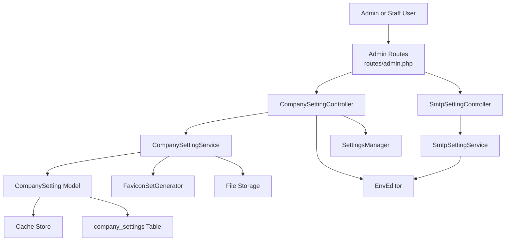
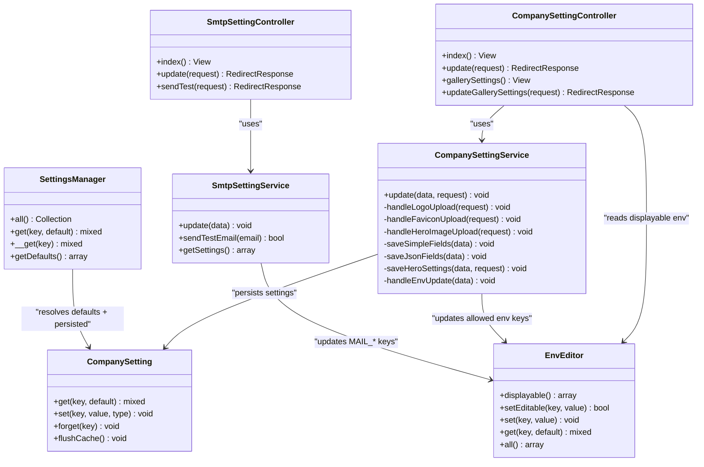
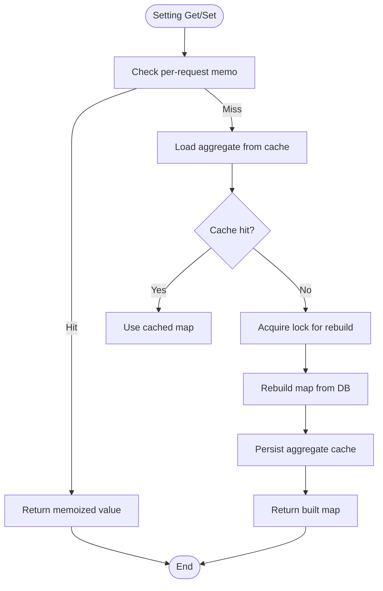
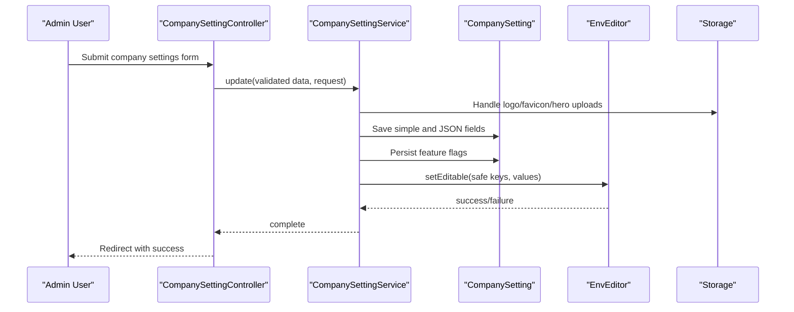
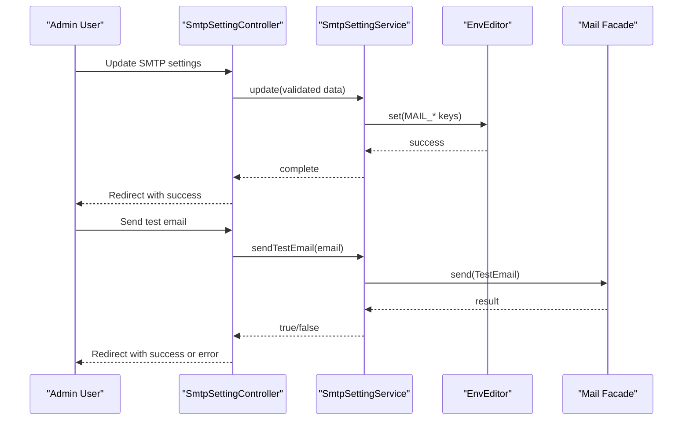
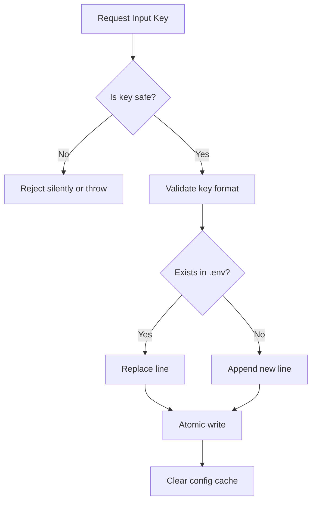
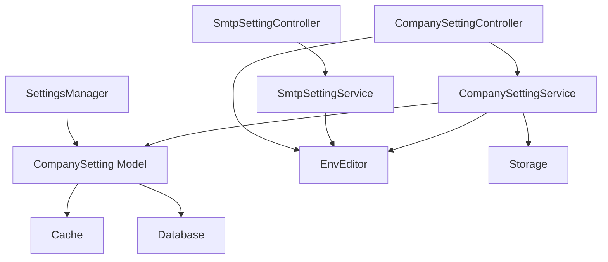

# System Settings

<cite>
**Referenced Files in This Document**
- [CompanySetting.php](file://app/Models/CompanySetting.php)
- [CompanySettingService.php](file://app/Services/CompanySettingService.php)
- [SmtpSettingService.php](file://app/Services/SmtpSettingService.php)
- [EnvEditor.php](file://app/Services/EnvEditor.php)
- [SettingsManager.php](file://app/Services/Settings/SettingsManager.php)
- [CompanyValidationRules.php](file://app/Trait/CompanyValidationRules.php)
- [CompanySettingController.php](file://app/Http/Controllers/Admin/CompanySettingController.php)
- [SmtpSettingController.php](file://app/Http/Controllers/Admin/SmtpSettingController.php)
- [settings.php](file://routes/settings.php)
- [admin.php](file://routes/admin.php)
- [2026_04_17_110000_create_company_settings_table.php](file://database/migrations/2026_04_17_110000_create_company_settings_table.php)
- [mail.php](file://config/mail.php)
</cite>

## Table of Contents
1. Introduction
2. Project Structure
3. Core Components
4. Architecture Overview
5. Detailed Component Analysis
6. Dependency Analysis
7. Performance Considerations
8. Troubleshooting Guide
9. Conclusion

## Introduction
This document explains the Highblossom system settings management layer. It covers how company information, email service configuration, theme and homepage customization, and application-wide preferences are modeled, validated, persisted, and exposed through the admin interface. It also documents environment variable management, security restrictions around sensitive configuration, backup and migration considerations, and guidance for extending the settings system with new categories.

## Project Structure
The settings subsystem spans models, services, controllers, routes, validation rules, migrations, and configuration files:

- Model and persistence: `app/Models/CompanySetting.php`, database migration for the `company_settings` table.
- Business logic: `app/Services/CompanySettingService.php` (general company settings), `app/Services/SmtpSettingService.php` (SMTP configuration), `app/Services/EnvEditor.php` (safe `.env` editing).
- Defaults and resolution: `app/Services/Settings/SettingsManager.php`.
- Validation: `app/Trait/CompanyValidationRules.php`.
- Admin interfaces: `app/Http/Controllers/Admin/CompanySettingController.php`, `app/Http/Controllers/Admin/SmtpSettingController.php`.
- Routing: `routes/admin.php` (admin settings routes), `routes/settings.php` (user-facing settings entry point).
- Mailer configuration: `config/mail.php`.

**Diagram sources**
- [admin.php:72-77](file://routes/admin.php#L72-L77)
- [CompanySettingController.php:1-90](file://app/Http/Controllers/Admin/CompanySettingController.php#L1-L90)
- [SmtpSettingController.php:1-55](file://app/Http/Controllers/Admin/SmtpSettingController.php#L1-L55)
- [CompanySettingService.php:1-200](file://app/Services/CompanySettingService.php#L1-L200)
- [SmtpSettingService.php:1-85](file://app/Services/SmtpSettingService.php#L1-L85)
- [EnvEditor.php:1-200](file://app/Services/EnvEditor.php#L1-L200)
- [SettingsManager.php:1-163](file://app/Services/Settings/SettingsManager.php#L1-L163)
- [CompanySetting.php:1-196](file://app/Models/CompanySetting.php#L1-L196)

**Section sources**
- [CompanySetting.php:1-196](file://app/Models/CompanySetting.php#L1-L196)
- [CompanySettingService.php:1-200](file://app/Services/CompanySettingService.php#L1-L200)
- [SmtpSettingService.php:1-85](file://app/Services/SmtpSettingService.php#L1-L85)
- [EnvEditor.php:1-200](file://app/Services/EnvEditor.php#L1-L200)
- [SettingsManager.php:1-163](file://app/Services/Settings/SettingsManager.php#L1-L163)
- [CompanyValidationRules.php:1-143](file://app/Trait/CompanyValidationRules.php#L1-L143)
- [CompanySettingController.php:1-90](file://app/Http/Controllers/Admin/CompanySettingController.php#L1-L90)
- [SmtpSettingController.php:1-55](file://app/Http/Controllers/Admin/SmtpSettingController.php#L1-L55)
- [settings.php:1-16](file://routes/settings.php#L1-L16)
- [admin.php:72-77](file://routes/admin.php#L72-L77)
- [2026_04_17_110000_create_company_settings_table.php:1-24](file://database/migrations/2026_04_17_110000_create_company_settings_table.php#L1-L24)
- [mail.php:1-123](file://config/mail.php#L1-L123)

## Core Components
- CompanySetting model: A key-value store for application settings with type casting, request-scoped memoization, and aggregate caching backed by a single cache entry. Writes invalidate the cache automatically.
- CompanySettingService: Orchestrates company-wide settings updates, including logos, favicons, hero images, working hours, social links, homepage content, and safe environment variable changes.
- SmtpSettingService: Manages SMTP configuration in `.env`, provides test email functionality, and exposes current mail settings to the UI without leaking secrets.
- EnvEditor: Reads and writes `.env` safely. Only an allowlisted set of keys is editable via the admin interface; sensitive keys such as database, Redis, and mail credentials are excluded from display and protected from arbitrary user input.
- SettingsManager: Centralizes default values and merges them with persisted values using the CompanySetting model.
- CompanyValidationRules: Shared validation rules for all company settings fields, including business identity, contact details, timezone, locale, booking configuration, image paths, homepage sections, announcements, and environment variables.

**Section sources**
- [CompanySetting.php:1-196](file://app/Models/CompanySetting.php#L1-L196)
- [CompanySettingService.php:1-200](file://app/Services/CompanySettingService.php#L1-L200)
- [SmtpSettingService.php:1-85](file://app/Services/SmtpSettingService.php#L1-L85)
- [EnvEditor.php:1-200](file://app/Services/EnvEditor.php#L1-L200)
- [SettingsManager.php:1-163](file://app/Services/Settings/SettingsManager.php#L1-L163)
- [CompanyValidationRules.php:1-143](file://app/Trait/CompanyValidationRules.php#L1-L143)

## Architecture Overview
The settings architecture separates concerns across persistence, business logic, validation, and presentation:

**Diagram sources**
- [CompanySetting.php:1-196](file://app/Models/CompanySetting.php#L1-L196)
- [CompanySettingService.php:1-200](file://app/Services/CompanySettingService.php#L1-L200)
- [SmtpSettingService.php:1-85](file://app/Services/SmtpSettingService.php#L1-L85)
- [EnvEditor.php:1-200](file://app/Services/EnvEditor.php#L1-L200)
- [SettingsManager.php:1-163](file://app/Services/Settings/SettingsManager.php#L1-L163)
- [CompanySettingController.php:1-90](file://app/Http/Controllers/Admin/CompanySettingController.php#L1-L90)
- [SmtpSettingController.php:1-55](file://app/Http/Controllers/Admin/SmtpSettingController.php#L1-L55)

## Detailed Component Analysis

### CompanySetting Model Architecture
The `CompanySetting` model implements a robust, cached key-value store:

- Persistence schema: The `company_settings` table stores rows with unique `key`, text `value`, and a `type` field indicating how the value should be cast (`text`, `number`, `boolean`, `json`).
- Caching strategy:
  - Aggregate cache key holds a map of every setting.
  - Per-request memoization avoids repeated lookups within a single request.
  - Lock-guarded rebuild prevents concurrent cold-cache storms.
- Type coercion:
  - `get()` returns booleans, numbers, decoded JSON, or raw strings based on stored type.
- Write behavior:
  - `set()` persists a value and its type. Arrays are encoded as JSON.
  - Any save or delete triggers cache invalidation so stale data cannot persist.

**Diagram sources**
- [CompanySetting.php:1-196](file://app/Models/CompanySetting.php#L1-L196)

**Section sources**
- [CompanySetting.php:1-196](file://app/Models/CompanySetting.php#L1-L196)
- [2026_04_17_110000_create_company_settings_table.php:1-24](file://database/migrations/2026_04_17_110000_create_company_settings_table.php#L1-L24)

### Company Setting Service
The `CompanySettingService` centralizes update logic for general company settings:

- Image handling:
  - Logo, favicon, and hero banner uploads support explicit removal, adoption of pre-uploaded media paths, and direct upload normalization to WebP at fixed quality.
  - Previous files are deleted when replaced.
- Field categorization:
  - Simple scalar fields are saved directly to the settings store.
  - Homepage repeater fields are stored as JSON arrays.
  - Hero-related settings include style, slides, stats, autoplay, and button configuration.
- Environment updates:
  - Only keys explicitly allowed by `EnvEditor::SAFE_EDITABLE_KEYS` are written from admin input.
  - After writing, configuration cache is cleared.
- Feature flags:
  - Announcement activation, registration enablement, and homepage urgency toggles are persisted as boolean-like values.

**Diagram sources**
- [CompanySettingController.php:1-90](file://app/Http/Controllers/Admin/CompanySettingController.php#L1-L90)
- [CompanySettingService.php:1-200](file://app/Services/CompanySettingService.php#L1-L200)
- [CompanySetting.php:1-196](file://app/Models/CompanySetting.php#L1-L196)
- [EnvEditor.php:1-200](file://app/Services/EnvEditor.php#L1-L200)

**Section sources**
- [CompanySettingService.php:1-200](file://app/Services/CompanySettingService.php#L1-L200)
- [CompanySettingController.php:1-90](file://app/Http/Controllers/Admin/CompanySettingController.php#L1-L90)

### SMTP Configuration Management
The SMTP subsystem manages transport configuration and testing:

- `SmtpSettingService`:
  - Updates `MAIL_*` keys in `.env`.
  - Leaves password unchanged when empty to avoid overwriting secrets.
  - Clears configuration cache after updates.
  - Provides `getSettings()` which never returns the password to views.
  - Sends a test email using the configured mailer.
- `SmtpSettingController`:
  - Displays current SMTP settings.
  - Validates and persists updates.
  - Supports sending a test email.

**Diagram sources**
- [SmtpSettingController.php:1-55](file://app/Http/Controllers/Admin/SmtpSettingController.php#L1-L55)
- [SmtpSettingService.php:1-85](file://app/Services/SmtpSettingService.php#L1-L85)
- [EnvEditor.php:1-200](file://app/Services/EnvEditor.php#L1-L200)
- [mail.php:1-123](file://config/mail.php#L1-L123)

**Section sources**
- [SmtpSettingService.php:1-85](file://app/Services/SmtpSettingService.php#L1-L85)
- [SmtpSettingController.php:1-55](file://app/Http/Controllers/Admin/SmtpSettingController.php#L1-L55)
- [mail.php:1-123](file://config/mail.php#L1-L123)

### Environment Variable Management and Security
The `EnvEditor` enforces strict safety boundaries:

- Allowlist-driven editing:
  - `SAFE_EDITABLE_KEYS` defines keys visible and editable from the settings UI.
  - Keys prefixed with `FEATURES_` are also considered safe.
  - Sensitive keys like `APP_KEY`, database credentials, Redis, and mail secrets are excluded from display and protected from arbitrary input.
- Safe write path:
  - `setEditable()` validates keys against the allowlist before writing.
  - Direct `set()` is reserved for trusted services (e.g., SMTP editor writing `MAIL_*` keys).
- Atomic file writes:
  - `.env` is updated atomically to reduce corruption risk.
- Configuration refresh:
  - Controllers/services call configuration cache clearing after `.env` changes.

**Diagram sources**
- [EnvEditor.php:1-200](file://app/Services/EnvEditor.php#L1-L200)

**Section sources**
- [EnvEditor.php:1-200](file://app/Services/EnvEditor.php#L1-L200)
- [CompanySettingService.php:1-200](file://app/Services/CompanySettingService.php#L1-L200)

### Settings Interface and Categories
The settings interface is organized into categorized sections:

- General company information:
  - Company name, logo, primary and secondary phone numbers, WhatsApp defaults, address, timezone, locale, date/time formats, currency symbol.
- Contact and mapping:
  - Google Maps API key, directions link.
- Booking configuration:
  - Lead time, slot intervals, workshop/mobile capacity, service durations.
- Social integrations:
  - Facebook, Instagram, LinkedIn URLs.
- Notifications:
  - Quote notification emails.
- Authentication and session policy:
  - Email verification requirement, registration enablement, idle timeout.
- Navigation layout:
  - Admin navigation layout selection.
- Announcements:
  - Active announcement flag and structured announcement entries.
- Gallery metrics:
  - Label/value/suffix pairs for gallery statistics.
- SEO metadata:
  - Meta title, description, keywords, image, and Google site verification.
- Homepage content and theme:
  - Tagline, years experience, warranty copy, urgency message, CTAs, service area, mobile coverage, WhatsApp message.
  - Hero style, slides, stats, autoplay, button label and URL.
  - Fact tiles, warranty highlights, process steps, FAQs.
- Environment variables:
  - Display-only view for safe keys; write access gated by permission.

```mermaid
graph LR
    General["General Company Info"] --> Contact["Contact & Mapping"]
    Contact --> Booking["Booking Configuration"]
    Booking --> Social["Social Integrations"]
    Social --> AuthPolicy["Auth & Session Policy"]
    AuthPolicy --> NavLayout["Navigation Layout"]
    NavLayout --> Announcements["Announcements"]
    Announcements --> GalleryMetrics["Gallery Metrics"]
    GalleryMetrics --> Seo["SEO Metadata"]
    Seo --> Homepage["Homepage Content & Theme"]
    Homepage --> Environment["Environment Variables"]
```

**Diagram sources**
- [CompanySettingService.php:1-200](file://app/Services/CompanySettingService.php#L1-L200)
- [CompanyValidationRules.php:1-143](file://app/Trait/CompanyValidationRules.php#L1-L143)
- [SettingsManager.php:1-163](file://app/Services/Settings/SettingsManager.php#L1-L163)

**Section sources**
- [CompanySettingController.php:1-90](file://app/Http/Controllers/Admin/CompanySettingController.php#L1-L90)
- [CompanyValidationRules.php:1-143](file://app/Trait/CompanyValidationRules.php#L1-L143)
- [SettingsManager.php:1-163](file://app/Services/Settings/SettingsManager.php#L1-L163)

### Validation Rules and Change Tracking
Validation is centralized in `CompanyValidationRules`:

- Field-level constraints:
  - Required strings, emails, URLs, integers with ranges, booleans, enums, arrays with nested object validation.
  - Image validations enforce MIME types, size limits, and minimum dimensions where applicable.
  - Path fields use a custom rule ensuring only approved storage directories are accepted.
- Structural validation:
  - Working hours, WhatsApp additional numbers, announcements, gallery metrics, homepage slides, and FAQ entries validate both structure and content.
- Environment variables:
  - `env` is validated as an array with bounded size and string values. Actual key authorization occurs later in `EnvEditor::setEditable()`.

Change tracking:

- The model uses Eloquent events to flush cache on any write or delete.
- Services clear configuration cache after `.env` updates.
- Request-scoped memoization ensures consistent reads within a request.

**Section sources**
- [CompanyValidationRules.php:1-143](file://app/Trait/CompanyValidationRules.php#L1-L143)
- [CompanySetting.php:1-196](file://app/Models/CompanySetting.php#L1-L196)
- [CompanySettingService.php:1-200](file://app/Services/CompanySettingService.php#L1-L200)

### Advanced Settings: SMTP, Social Media, and Third-party Services
- SMTP:
  - Managed through `SmtpSettingService` and `SmtpSettingController`.
  - Supports multiple mailers via `config/mail.php`, including SMTP, SES, Postmark, Resend, Sendmail, log, array, failover, and round-robin configurations.
- Social media:
  - Facebook, Instagram, and LinkedIn URLs are validated and persisted as part of company settings.
- Third-party integrations:
  - Google Maps API key is stored as a simple setting.
  - SEO metadata and Google site verification are included in settings defaults and validation.

**Section sources**
- [SmtpSettingService.php:1-85](file://app/Services/SmtpSettingService.php#L1-L85)
- [SmtpSettingController.php:1-55](file://app/Http/Controllers/Admin/SmtpSettingController.php#L1-L55)
- [CompanyValidationRules.php:1-143](file://app/Trait/CompanyValidationRules.php#L1-L143)
- [mail.php:1-123](file://config/mail.php#L1-L123)

### Examples: Environments, Custom Categories, and Validation
- Configuring different environments:
  - Use `.env` variables for environment-specific values such as app name, URL, timezone, locale, and feature flags.
  - Admins can edit only safe keys; sensitive environment variables should be managed through deployment pipelines or secure configuration management.
- Creating a custom setting category:
  - Add new keys to `SettingsManager::getDefaults()` with appropriate default values.
  - Extend `CompanySettingService` to handle persistence for simple or JSON fields.
  - Add validation rules in `CompanyValidationRules`.
  - Expose the new fields in the admin interface through the controller and view.
- Implementing settings validation:
  - Use existing Laravel validation rules and custom rules like `SafeStoredUploadPath`.
  - Enforce enums, ranges, and structural constraints for complex objects.

**Section sources**
- [SettingsManager.php:1-163](file://app/Services/Settings/SettingsManager.php#L1-L163)
- [CompanySettingService.php:1-200](file://app/Services/CompanySettingService.php#L1-L200)
- [CompanyValidationRules.php:1-143](file://app/Trait/CompanyValidationRules.php#L1-L143)
- [EnvEditor.php:1-200](file://app/Services/EnvEditor.php#L1-L200)

## Dependency Analysis
The settings system has clear separation between persistence, business logic, and presentation:

**Diagram sources**
- [CompanySetting.php:1-196](file://app/Models/CompanySetting.php#L1-L196)
- [CompanySettingService.php:1-200](file://app/Services/CompanySettingService.php#L1-L200)
- [SmtpSettingService.php:1-85](file://app/Services/SmtpSettingService.php#L1-L85)
- [EnvEditor.php:1-200](file://app/Services/EnvEditor.php#L1-L200)
- [CompanySettingController.php:1-90](file://app/Http/Controllers/Admin/CompanySettingController.php#L1-L90)
- [SmtpSettingController.php:1-55](file://app/Http/Controllers/Admin/SmtpSettingController.php#L1-L55)
- [SettingsManager.php:1-163](file://app/Services/Settings/SettingsManager.php#L1-L163)

**Section sources**
- [CompanySetting.php:1-196](file://app/Models/CompanySetting.php#L1-L196)
- [CompanySettingService.php:1-200](file://app/Services/CompanySettingService.php#L1-L200)
- [SmtpSettingService.php:1-85](file://app/Services/SmtpSettingService.php#L1-L85)
- [EnvEditor.php:1-200](file://app/Services/EnvEditor.php#L1-L200)
- [CompanySettingController.php:1-90](file://app/Http/Controllers/Admin/CompanySettingController.php#L1-L90)
- [SmtpSettingController.php:1-55](file://app/Http/Controllers/Admin/SmtpSettingController.php#L1-L55)
- [SettingsManager.php:1-163](file://app/Services/Settings/SettingsManager.php#L1-L163)

## Performance Considerations
- Aggregated cache reduces repeated database queries for settings.
- Request-scoped memoization prevents redundant reads within a single request.
- Lock-guarded rebuild avoids thundering herd during cache misses.
- Image processing normalizes assets to WebP at fixed quality to reduce storage and bandwidth.
- Configuration cache clearing is performed only when `.env` changes occur.

[No sources needed since this section provides general guidance]

## Troubleshooting Guide
- Settings not updating:
  - Ensure cache is flushed after writes; model events handle this automatically.
  - Verify that `.env` changes trigger configuration cache clearing.
- Images not saving:
  - Confirm storage disk permissions and that the correct directories are used for uploaded or adopted paths.
  - Validate MIME types and size limits enforced by validation rules.
- SMTP test failures:
  - Check `MAIL_*` keys in `.env`; ensure host, port, username, encryption, and from address are correct.
  - Use the test email endpoint to verify connectivity.
- Environment variables not reflecting:
  - Confirm the key is in the safe editable allowlist if edited via admin UI.
  - Clear configuration cache after manual `.env` edits.
- Permission errors:
  - Admin environment tab requires `manage environment` permission.
  - Settings update routes require appropriate permissions defined in admin routes.

**Section sources**
- [CompanySetting.php:1-196](file://app/Models/CompanySetting.php#L1-L196)
- [CompanySettingService.php:1-200](file://app/Services/CompanySettingService.php#L1-L200)
- [SmtpSettingService.php:1-85](file://app/Services/SmtpSettingService.php#L1-L85)
- [EnvEditor.php:1-200](file://app/Services/EnvEditor.php#L1-L200)
- [admin.php:72-77](file://routes/admin.php#L72-L77)

## Conclusion
Highblossom’s system settings management provides a secure, extensible, and performant foundation for configuring company information, email services, theme customization, and application-wide preferences. The design emphasizes safe environment variable handling, robust caching, comprehensive validation, and clear separation of responsibilities. Extending the system involves adding defaults, persistence logic, validation rules, and admin interface exposure while respecting the established security and performance patterns.

[No sources needed since this section summarizes without analyzing specific files]