# User Management

<cite>
**Referenced Files in This Document**   
- [User.php](file://app/Models/User.php)
- [UserService.php](file://app/Services/UserService.php)
- [RoleService.php](file://app/Services/RoleService.php)
- [PasswordPolicy.php](file://app/Services/PasswordPolicy.php)
- [UserSession.php](file://app/Models/UserSession.php)
- [UserSessionService.php](file://app/Services/UserSessionService.php)
- [RecordSessionLogin.php](file://app/Listeners/RecordSessionLogin.php)
- [EndSessionOnLogout.php](file://app/Listeners/EndSessionOnLogout.php)
- [RevokeSessionsOnPasswordReset.php](file://app/Listeners/RevokeSessionsOnPasswordReset.php)
- [PruneUserSessionsCommand.php](file://app/Console/Commands/PruneUserSessionsCommand.php)
- [UserController.php](file://app/Http/Controllers/Admin/UserController.php)
- [RoleController.php](file://app/Http/Controllers/Admin/RoleController.php)
- [UserSessionController.php](file://app/Http/Controllers/Admin/UserSessionController.php)
- [FortifyServiceProvider.php](file://app/Providers/FortifyServiceProvider.php)
- [PasswordRulesServiceProvider.php](file://app/Providers/PasswordRulesServiceProvider.php)
- [CanonicalLoginRateLimiter.php](file://app/Support/CanonicalLoginRateLimiter.php)
- [PasswordPolicyAudit.php](file://app/Models/PasswordPolicyAudit.php)
- [permission.php](file://config/permission.php)
- [auth.php](file://config/auth.php)
- [session.php](file://config/session.php)
- [user-sessions.php](file://config/user-sessions.php)
- [0001_01_01_000000_create_users_table.php](file://database/migrations/0001_01_01_000000_create_users_table.php)
- [2025_08_14_170933_add_two_factor_columns_to_users_table.php](file://database/migrations/2025_08_14_170933_add_two_factor_columns_to_users_table.php)
- [2026_10_20_000000_create_password_policy_audits_table.php](file://database/migrations/2026_10_20_000000_create_password_policy_audits_table.php)
- [2026_05_05_091031_seed_roles_permissions_and_admin_user.php](file://database/migrations/2026_05_05_091031_seed_roles_permissions_and_admin_user.php)
- [RolesAndPermissionsSeeder.php](file://database/seeders/RolesAndPermissionsSeeder.php)
- [2026_10_03_140000_add_manage_user_sessions_permission.php](file://database/migrations/2026_10_03_140000_add_manage_user_sessions_permission.php)
- [admin.php](file://routes/admin.php)
- [users index view](file://resources/views/admin/users/index.blade.php)
- [admin-users language file](file://lang/en/admin-users.php)
</cite>

## Table of Contents
1. [Introduction](#introduction)
2. [Project Structure](#project-structure)
3. [Core Components](#core-components)
4. [Architecture Overview](#architecture-overview)
5. [Detailed Component Analysis](#detailed-component-analysis)
6. [Dependency Analysis](#dependency-analysis)
7. [Performance Considerations](#performance-considerations)
8. [Troubleshooting Guide](#troubleshooting-guide)
9. [Security Best Practices and Compliance](#security-best-practices-and-compliance)
10. [Conclusion](#conclusion)

## Introduction
This document explains the Highblossom user management system from end to end. It covers how user accounts are created, edited, and removed; how passwords and two-factor authentication work; how Spatie Permissions implements role-based access control; how user sessions are recorded, monitored, and revoked; and how administrators interact with the system through the admin interface.

The system is centered around:
- A core `User` model extended with roles, passkeys, two-factor authentication, email verification, API tokens, and a session ledger.
- Service classes for user operations, role and permission management, password policy enforcement, and session lifecycle tracking.
- Fortify-powered authentication with custom login, registration, password reset, and rate limiting.
- An admin area that exposes users, roles, permissions, security settings, and session monitoring.

## Project Structure
The user management features span models, services, controllers, listeners, configuration, migrations, seeders, routes, views, and language files. The most relevant paths are grouped below by responsibility.

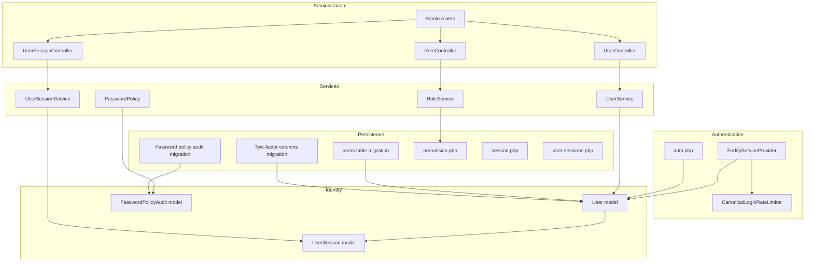

**Diagram sources**
- [FortifyServiceProvider.php:1-118](file://app/Providers/FortifyServiceProvider.php#L1-L118)
- [CanonicalLoginRateLimiter.php:1-37](file://app/Support/CanonicalLoginRateLimiter.php#L1-L37)
- [auth.php:1-117](file://config/auth.php#L1-L117)
- [User.php:1-141](file://app/Models/User.php#L1-L141)
- [UserSession.php:1-200](file://app/Models/UserSession.php#L1-L200)
- [PasswordPolicyAudit.php:1-42](file://app/Models/PasswordPolicyAudit.php#L1-L42)
- [UserService.php:1-69](file://app/Services/UserService.php#L1-L69)
- [RoleService.php:1-43](file://app/Services/RoleService.php#L1-L43)
- [PasswordPolicy.php:1-200](file://app/Services/PasswordPolicy.php#L1-L200)
- [UserSessionService.php:1-200](file://app/Services/UserSessionService.php#L1-L200)
- [UserController.php:1-96](file://app/Http/Controllers/Admin/UserController.php#L1-L96)
- [RoleController.php:1-96](file://app/Http/Controllers/Admin/RoleController.php#L1-L96)
- [UserSessionController.php:1-126](file://app/Http/Controllers/Admin/UserSessionController.php#L1-L126)
- [admin.php:1-171](file://routes/admin.php#L1-L171)
- [0001_01_01_000000_create_users_table.php:1-49](file://database/migrations/0001_01_01_000000_create_users_table.php#L1-L49)
- [2025_08_14_170933_add_two_factor_columns_to_users_table.php:1-34](file://database/migrations/2025_08_14_170933_add_two_factor_columns_to_users_table.php#L1-L34)
- [2026_10_20_000000_create_password_policy_audits_table.php:1-32](file://database/migrations/2026_10_20_000000_create_password_policy_audits_table.php#L1-L32)
- [permission.php:1-200](file://config/permission.php#L1-L200)
- [session.php:1-200](file://config/session.php#L1-L200)
- [user-sessions.php:1-42](file://config/user-sessions.php#L1-L42)

**Section sources**
- [FortifyServiceProvider.php:1-118](file://app/Providers/FortifyServiceProvider.php#L1-L118)
- [auth.php:1-117](file://config/auth.php#L1-L117)
- [admin.php:1-171](file://routes/admin.php#L1-L171)

## Core Components
The user management system has five main responsibilities:

| Responsibility | Primary Implementation | Purpose |
|---|---|---|
| Identity and relationships | `User` model | Stores account data, normalizes usernames, manages roles, passkeys, two-factor state, email verification, avatar URLs, initials, and related records such as posts, bookings, inspection notes, and sessions. |
| User operations | `UserService` | Creates, updates, and deletes users; assigns roles; revokes sessions when an administrator changes another user's password. |
| Roles and permissions | `RoleService`, Spatie Permission configuration | Creates, updates, and deletes roles; attaches permissions to roles; protects the protected `Super Admin` role from deletion. |
| Password policy | `PasswordPolicy` | Centralizes minimum length, maximum length, mixed-case, numeric, symbol, and breached-password rules; integrates with Laravel validation defaults. |
| Session monitoring | `UserSession` model, `UserSessionService`, listeners, prune command | Records every device sign-in, tracks activity, closes sessions on logout or revocation, reconciles stale entries, and supports administrative filtering and bulk actions. |

**Section sources**
- [User.php:1-141](file://app/Models/User.php#L1-L141)
- [UserService.php:1-69](file://app/Services/UserService.php#L1-L69)
- [RoleService.php:1-43](file://app/Services/RoleService.php#L1-L43)
- [PasswordPolicy.php:1-200](file://app/Services/PasswordPolicy.php#L1-L200)
- [UserSession.php:1-200](file://app/Models/UserSession.php#L1-L200)
- [UserSessionService.php:1-200](file://app/Services/UserSessionService.php#L1-L200)

## Architecture Overview
At runtime, user management flows through three layers:

1. **Interface layer**: Controllers render admin views, accept validated requests, and delegate to services.
2. **Business layer**: Services encapsulate creation, assignment, policy evaluation, and session lifecycle logic.
3. **Persistence layer**: Eloquent models write to database tables defined by migrations; Spatie Permissions manages roles and permissions.

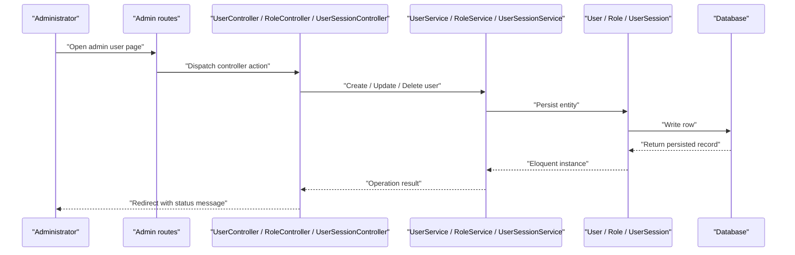

**Diagram sources**
- [admin.php:1-171](file://routes/admin.php#L1-L171)
- [UserController.php:1-96](file://app/Http/Controllers/Admin/UserController.php#L1-L96)
- [RoleController.php:1-96](file://app/Http/Controllers/Admin/RoleController.php#L1-L96)
- [UserSessionController.php:1-126](file://app/Http/Controllers/Admin/UserSessionController.php#L1-L126)
- [UserService.php:1-69](file://app/Services/UserService.php#L1-L69)
- [RoleService.php:1-43](file://app/Services/RoleService.php#L1-L43)
- [UserSessionService.php:1-200](file://app/Services/UserSessionService.php#L1-L200)

## Detailed Component Analysis

### User Account Lifecycle
Account creation and editing are implemented through a thin controller and a service that performs persistence and side effects.

#### User Creation
- The admin route delegates to `UserController::store`.
- Validation occurs in `UserRequest`; the exact field list is not shown here, but the controller forwards validated data to `UserService::create`.
- `UserService::create` creates the user with name, username, email, and hashed password, then synchronizes roles if provided.

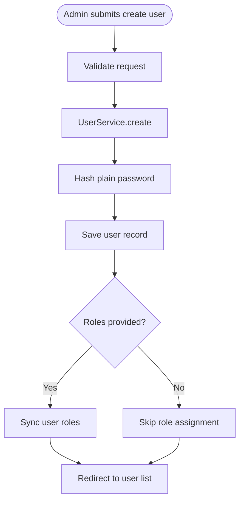

**Diagram sources**
- [UserController.php:1-96](file://app/Http/Controllers/Admin/UserController.php#L1-L96)
- [UserService.php:1-69](file://app/Services/UserService.php#L1-L69)

#### User Editing
- `UserController::edit` loads the user and all roles for the form.
- `UserController::update` calls `UserService::update`.
- `UserService::update` persists name, optional username, and email. If a new password is supplied, it hashes and stores it, then triggers session revocation for the target user. If roles are supplied, they are synchronized.

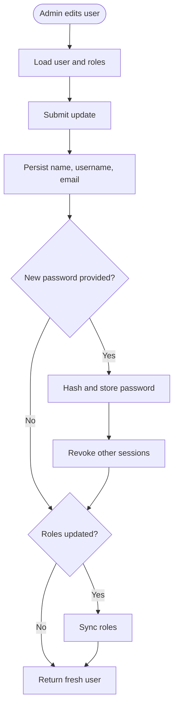

**Diagram sources**
- [UserController.php:1-96](file://app/Http/Controllers/Admin/UserController.php#L1-L96)
- [UserService.php:1-69](file://app/Services/UserService.php#L1-L69)

#### User Deletion
- `UserController::destroy` delegates to `UserService::delete`.
- Deletion removes the user record. Business-level cascading behavior depends on foreign key constraints and application-level safeguards.

**Section sources**
- [UserController.php:1-96](file://app/Http/Controllers/Admin/UserController.php#L1-L96)
- [UserService.php:1-69](file://app/Services/UserService.php#L1-L69)

### Profile Editing and Personal Data
The `User` model exposes several computed and normalized fields useful for profiles and UI presentation:

| Field or Method | Behavior |
|---|---|
| `username` attribute setter | Normalizes the username before storage so case variations do not violate uniqueness. |
| `initials()` | Returns two uppercase letters derived from trimmed first words of the user's name. |
| `avatar_url` accessor | Converts a stored avatar path into a full asset URL, returning null when no avatar exists. |
| Email-related casts | `email_verified_at` is cast to a datetime. |
| Consent timestamps | `terms_accepted_at` and `privacy_accepted_at` are stored as datetimes. |
| Theme and navigation layout | Casted to typed enums rather than raw strings. |

The base users table also includes standard identity columns such as name, unique email, password, remember token, and timestamps. Additional later migrations add phone, avatar, theme preference, consent flags, and username.

**Section sources**
- [User.php:1-141](file://app/Models/User.php#L1-L141)
- [0001_01_01_000000_create_users_table.php:1-49](file://database/migrations/0001_01_01_000000_create_users_table.php#L1-L49)

### Password Management
Password handling is centralized through `PasswordPolicy`, which is registered as the default password rule source.

Key behaviors:
- Configuration is read from company settings with safe fallback values.
- Minimum and maximum lengths are clamped to hard bounds to prevent unsafe configuration.
- Mixed case, numbers, symbols, and breached-password checks are applied conditionally.
- The same policy is used by Laravel's `Password::default()`, ensuring consistency across registration, password reset, Security settings, and admin user forms.
- The `PasswordRulesServiceProvider` registers this callback once per application boot.

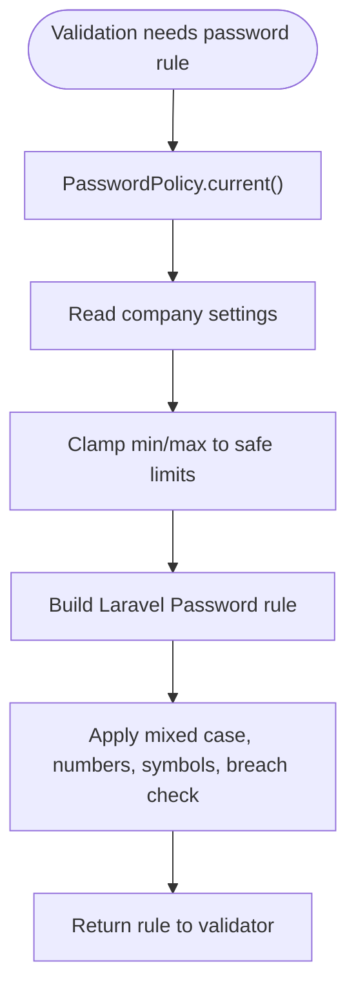

**Diagram sources**
- [PasswordPolicy.php:1-200](file://app/Services/PasswordPolicy.php#L1-L200)
- [PasswordRulesServiceProvider.php:1-37](file://app/Providers/PasswordRulesServiceProvider.php#L1-L37)

When an administrator changes another user's password through `UserService::update`, the system can revoke the target user's other sessions. Whether this happens is controlled by the `user-sessions.revoke_on_password_change` configuration.

**Section sources**
- [PasswordPolicy.php:1-200](file://app/Services/PasswordPolicy.php#L1-L200)
- [PasswordRulesServiceProvider.php:1-37](file://app/Providers/PasswordRulesServiceProvider.php#L1-L37)
- [UserService.php:1-69](file://app/Services/UserService.php#L1-L69)
- [user-sessions.php:1-42](file://config/user-sessions.php#L1-L42)

### Two-Factor Authentication
Two-factor authentication is enabled on the `User` model through Laravel Fortify's `TwoFactorAuthenticatable` trait. The users table includes:
- `two_factor_secret`
- `two_factor_recovery_codes`
- `two_factor_confirmed_at`

Fortify provides the login, two-factor challenge, confirmation, registration, and password reset views. The provider configures these views and wires custom actions for creating users and resetting passwords.

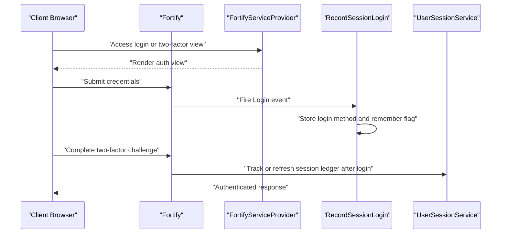

**Diagram sources**
- [User.php:1-141](file://app/Models/User.php#L1-L141)
- [2025_08_14_170933_add_two_factor_columns_to_users_table.php:1-34](file://database/migrations/2025_08_14_170933_add_two_factor_columns_to_users_table.php#L1-L34)
- [FortifyServiceProvider.php:1-118](file://app/Providers/FortifyServiceProvider.php#L1-L118)
- [RecordSessionLogin.php:1-56](file://app/Listeners/RecordSessionLogin.php#L1-L56)
- [UserSessionService.php:1-200](file://app/Services/UserSessionService.php#L1-L200)

### Role-Based Access Control with Spatie Permissions
The system uses Spatie Permissions with the following setup:
- The `User` model uses the `HasRoles` trait.
- The permission configuration maps roles, permissions, and pivot tables.
- Seeders define permissions and roles, including `Super Admin`, `Admin`, `Staff`, and `User`.
- `RoleService` creates and updates roles and prevents deletion of `Super Admin`.

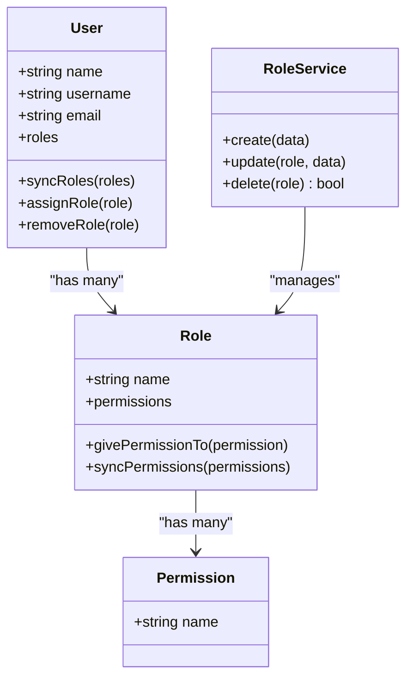

**Diagram sources**
- [User.php:1-141](file://app/Models/User.php#L1-L141)
- [RoleService.php:1-43](file://app/Services/RoleService.php#L1-L43)
- [permission.php:1-200](file://config/permission.php#L1-L200)
- [RolesAndPermissionsSeeder.php:1-161](file://database/seeders/RolesAndPermissionsSeeder.php#L1-L161)
- [2026_05_05_091031_seed_roles_permissions_and_admin_user.php:1-154](file://database/migrations/2026_05_05_091031_seed_roles_permissions_and_admin_user.php#L1-L154)

#### Permission Assignment Workflows
- Fresh installations use the seeder to create permissions and assign them to predefined roles.
- The migration `2026_05_05_091031_seed_roles_permissions_and_admin_user.php` ensures idempotent setup of permissions, roles, and an initial super-admin user.
- The migration `2026_10_03_140000_add_manage_user_sessions_permission.php` adds the `manage user sessions` permission and grants it to `Super Admin` and `Admin` where present.
- The `RoleController` exposes CRUD for roles and their permissions.

**Section sources**
- [RoleController.php:1-96](file://app/Http/Controllers/Admin/RoleController.php#L1-L96)
- [RoleService.php:1-43](file://app/Services/RoleService.php#L1-L43)
- [RolesAndPermissionsSeeder.php:1-161](file://database/seeders/RolesAndPermissionsSeeder.php#L1-L161)
- [2026_05_05_091031_seed_roles_permissions_and_admin_user.php:1-154](file://database/migrations/2026_05_05_091031_seed_roles_permissions_and_admin_user.php#L1-L154)
- [2026_10_03_140000_add_manage_user_sessions_permission.php:1-43](file://database/migrations/2026_10_03_140000_add_manage_user_sessions_permission.php#L1-L43)

### User Session Management
Sessions are tracked separately from Laravel's framework session storage. The `UserSession` model represents one session lifecycle, while `UserSessionService` owns opening, touching, closing, filtering, and revoking.

#### Session Recording Flow
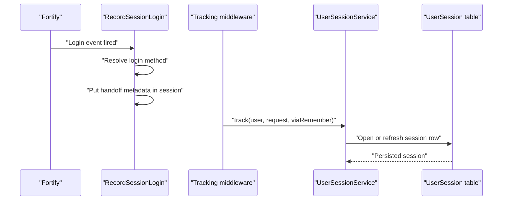

**Diagram sources**
- [RecordSessionLogin.php:1-56](file://app/Listeners/RecordSessionLogin.php#L1-L56)
- [UserSessionService.php:1-200](file://app/Services/UserSessionService.php#L1-L200)
- [UserSession.php:1-200](file://app/Models/UserSession.php#L1-L200)

#### Session Monitoring and Revocation
- `UserSessionController` lists all sessions or sessions scoped to one user.
- Administrators can revoke a single session or all live sessions for a user except the current admin session.
- Revoke operations delete the underlying framework session row and close the ledger entry.
- The prune command reconciles expired, idle, and orphaned ledger rows with framework session reality.

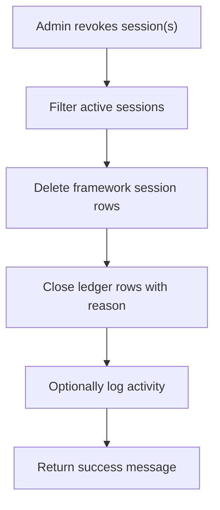

**Diagram sources**
- [UserSessionController.php:1-126](file://app/Http/Controllers/Admin/UserSessionController.php#L1-L126)
- [UserSessionService.php:201-272](file://app/Services/UserSessionService.php#L201-L272)
- [PruneUserSessionsCommand.php:1-63](file://app/Console/Commands/PruneUserSessionsCommand.php#L1-L63)

#### Session End Reasons and State
The session ledger distinguishes between:
- Active sessions still within the configured lifetime.
- Ended sessions with a recorded end time and reason.
- Stale open sessions whose last activity is older than the framework session lifetime.
- Orphaned sessions whose framework session row is missing beyond a grace window.

**Section sources**
- [UserSession.php:1-200](file://app/Models/UserSession.php#L1-L200)
- [UserSessionService.php:1-272](file://app/Services/UserSessionService.php#L1-L272)
- [EndSessionOnLogout.php:1-30](file://app/Listeners/EndSessionOnLogout.php#L1-L30)
- [RevokeSessionsOnPasswordReset.php:1-40](file://app/Listeners/RevokeSessionsOnPasswordReset.php#L1-L40)
- [PruneUserSessionsCommand.php:1-63](file://app/Console/Commands/PruneUserSessionsCommand.php#L1-L63)
- [user-sessions.php:1-42](file://config/user-sessions.php#L1-L42)

### Administrative User Interface
The admin interface for users consists of:
- A paginated user list with search and role display.
- Links to edit users and, when permitted, manage their sessions.
- Role management pages exposed by `RoleController`.
- Session monitoring pages exposed by `UserSessionController`.

The user index view renders:
- A search box.
- A create-user link.
- A table showing user initials, name, email, roles, and actions.
- Pagination links.

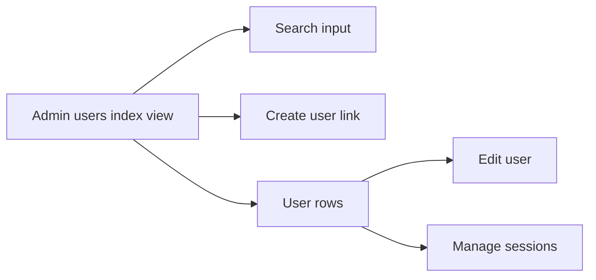

**Diagram sources**
- [users index view:1-101](file://resources/views/admin/users/index.blade.php#L1-L101)
- [UserController.php:1-96](file://app/Http/Controllers/Admin/UserController.php#L1-L96)
- [admin-users language file:1-31](file://lang/en/admin-users.php#L1-L31)

**Section sources**
- [UserController.php:1-96](file://app/Http/Controllers/Admin/UserController.php#L1-L96)
- [RoleController.php:1-96](file://app/Http/Controllers/Admin/RoleController.php#L1-L96)
- [UserSessionController.php:1-126](file://app/Http/Controllers/Admin/UserSessionController.php#L1-L126)
- [users index view:1-101](file://resources/views/admin/users/index.blade.php#L1-L101)
- [admin.php:1-171](file://routes/admin.php#L1-L171)

### User Activity Monitoring and Login History Tracking
Activity and security monitoring are supported by:
- The session ledger recording device type, platform, browser, IP address, login method, and timestamps.
- Listeners capturing login events and closing sessions on logout.
- Automatic revocation of other sessions on password reset.
- Administrative listing, filtering, and revocation of sessions.
- Scheduled pruning of expired or orphaned sessions.

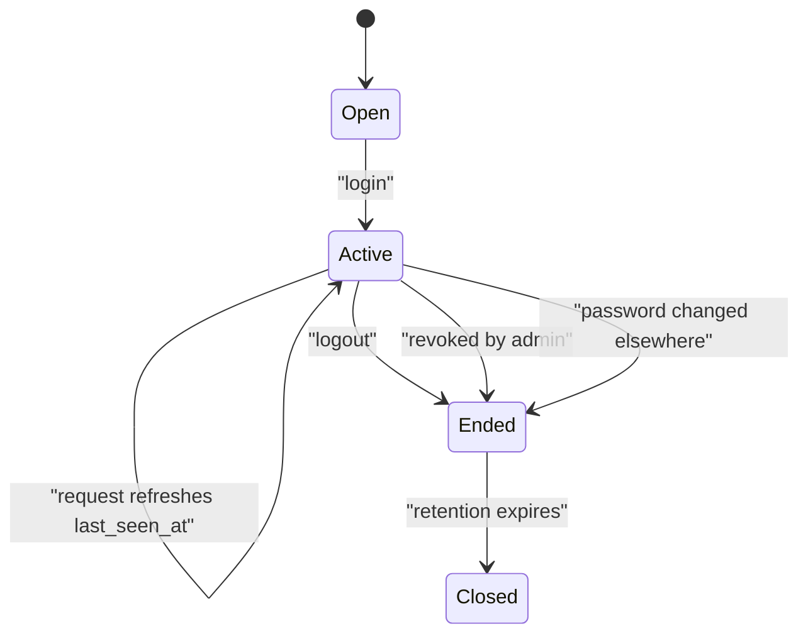

**Diagram sources**
- [UserSession.php:1-200](file://app/Models/UserSession.php#L1-L200)
- [RecordSessionLogin.php:1-56](file://app/Listeners/RecordSessionLogin.php#L1-L56)
- [EndSessionOnLogout.php:1-30](file://app/Listeners/EndSessionOnLogout.php#L1-L30)
- [RevokeSessionsOnPasswordReset.php:1-40](file://app/Listeners/RevokeSessionsOnPasswordReset.php#L1-L40)
- [UserSessionService.php:1-272](file://app/Services/UserSessionService.php#L1-L272)

### Bulk Operations and Import/Export Notes
The analyzed codebase provides:
- Single-user creation, editing, and deletion.
- Role and permission CRUD.
- Per-user and global session listing and revocation.
- No dedicated bulk user import/export controller or service was identified in the examined files.

Bulk-like capabilities currently available include:
- Revoking all live sessions for a user except the current session.
- Pruning expired or orphaned sessions through the scheduled command or admin action.

If bulk user import or export is required, it should be added as a new controller, request class, service, and job queue consumer, following the existing patterns in `UserController`, `RoleController`, and `UserSessionController`.

**Section sources**
- [UserController.php:1-96](file://app/Http/Controllers/Admin/UserController.php#L1-L96)
- [RoleController.php:1-96](file://app/Http/Controllers/Admin/RoleController.php#L1-L96)
- [UserSessionController.php:1-126](file://app/Http/Controllers/Admin/UserSessionController.php#L1-L126)
- [PruneUserSessionsCommand.php:1-63](file://app/Console/Commands/PruneUserSessionsCommand.php#L1-L63)

## Dependency Analysis
The user management subsystem has clear boundaries:

- Controllers depend on services, not directly on models for business logic.
- Services depend on models and configuration.
- Authentication depends on Fortify, custom rate limiting, and the canonical login limiter.
- Session tracking depends on framework events, session storage, and the session configuration.

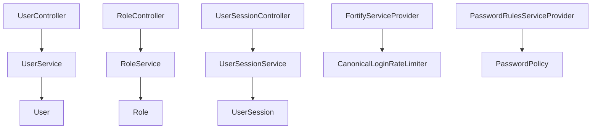

**Diagram sources**
- [UserController.php:1-96](file://app/Http/Controllers/Admin/UserController.php#L1-L96)
- [RoleController.php:1-96](file://app/Http/Controllers/Admin/RoleController.php#L1-L96)
- [UserSessionController.php:1-126](file://app/Http/Controllers/Admin/UserSessionController.php#L1-L126)
- [UserService.php:1-69](file://app/Services/UserService.php#L1-L69)
- [RoleService.php:1-43](file://app/Services/RoleService.php#L1-L43)
- [UserSessionService.php:1-272](file://app/Services/UserSessionService.php#L1-L272)
- [FortifyServiceProvider.php:1-118](file://app/Providers/FortifyServiceProvider.php#L1-L118)
- [CanonicalLoginRateLimiter.php:1-37](file://app/Support/CanonicalLoginRateLimiter.php#L1-L37)
- [PasswordRulesServiceProvider.php:1-37](file://app/Providers/PasswordRulesServiceProvider.php#L1-L37)
- [PasswordPolicy.php:1-200](file://app/Services/PasswordPolicy.php#L1-L200)

**Section sources**
- [UserController.php:1-96](file://app/Http/Controllers/Admin/UserController.php#L1-L96)
- [RoleController.php:1-96](file://app/Http/Controllers/Admin/RoleController.php#L1-L96)
- [UserSessionController.php:1-126](file://app/Http/Controllers/Admin/UserSessionController.php#L1-L126)
- [UserService.php:1-69](file://app/Services/UserService.php#L1-L69)
- [RoleService.php:1-43](file://app/Services/RoleService.php#L1-L43)
- [UserSessionService.php:1-272](file://app/Services/UserSessionService.php#L1-L272)

## Performance Considerations
- **Session touch throttling**: The session ledger does not update `last_seen_at` on every request. It is throttled using `user-sessions.touch_throttle_seconds` to reduce writes during busy periods.
- **Permission caching**: Spatie Permissions caches roles and permissions. The seeders clear cached permissions when creating or seeding roles.
- **Pagination**: Admin user listings paginate results, reducing memory and rendering costs.
- **Enum casting**: Models cast status and type fields to PHP enums, improving readability and type safety without significant overhead.
- **Fallback password policy**: When company settings are unreadable, the system falls back to conservative defaults rather than weakening password requirements.

[No sources needed since this section provides general guidance]

## Troubleshooting Guide

### New User Cannot Log In After Being Created
Check:
- Whether the user received and confirmed the email verification link.
- Whether roles were assigned correctly.
- Whether the admin panel requires `access admin panel`.
- Whether the user was created with a valid, policy-compliant password.

**Section sources**
- [UserService.php:1-69](file://app/Services/UserService.php#L1-L69)
- [RolesAndPermissionsSeeder.php:1-161](file://database/seeders/RolesAndPermissionsSeeder.php#L1-L161)

### Password Change Does Not Revoke Other Sessions
Check:
- The `user-sessions.revoke_on_password_change` setting.
- Whether the password change went through `UserService::update`.
- Whether the configuration is loaded from company settings or environment variables.

**Section sources**
- [UserService.php:1-69](file://app/Services/UserService.php#L1-L69)
- [user-sessions.php:1-42](file://config/user-sessions.php#L1-L42)

### Login Attempts Are Locked Out Under Different Keys
The application overrides Fortify's login rate limiter to normalize the throttle key based on the resolved identifier rather than the raw submitted string. Verify:
- That `CanonicalLoginRateLimiter` is bound.
- That `SignInIdentifier` resolves the correct account.
- That the login and two-factor rate limiters are configured.

**Section sources**
- [CanonicalLoginRateLimiter.php:1-37](file://app/Support/CanonicalLoginRateLimiter.php#L1-L37)
- [FortifyServiceProvider.php:1-118](file://app/Providers/FortifyServiceProvider.php#L1-L118)

### Session Ledger Shows Expired or Orphaned Rows
Run the prune command to reconcile framework sessions with the ledger. Use the dry-run option first to preview what would be closed or deleted.

**Section sources**
- [PruneUserSessionsCommand.php:1-63](file://app/Console/Commands/PruneUserSessionsCommand.php#L1-L63)
- [UserSessionService.php:1-272](file://app/Services/UserSessionService.php#L1-L272)

### Super Admin Role Cannot Be Deleted
This is intentional. `RoleService::delete` rejects deletion of the `Super Admin` role to prevent loss of critical administrative access.

**Section sources**
- [RoleService.php:1-43](file://app/Services/RoleService.php#L1-L43)

### Two-Factor Challenge Is Not Showing
Verify:
- That the Fortify provider registers the two-factor challenge view.
- That the user has two-factor secret and recovery codes stored.
- That the users table migration adding two-factor columns has been applied.

**Section sources**
- [FortifyServiceProvider.php:1-118](file://app/Providers/FortifyServiceProvider.php#L1-L118)
- [2025_08_14_170933_add_two_factor_columns_to_users_table.php:1-34](file://database/migrations/2025_08_14_170933_add_two_factor_columns_to_users_table.php#L1-L34)

## Security Best Practices and Compliance

### Password Policies
- Enforce a minimum length appropriate for organizational risk, typically 12 characters or more.
- Require mixed case, numbers, and symbols when appropriate.
- Enable breached-password checking if integration is available.
- Avoid exposing password policies inconsistently across forms; use `PasswordPolicy` as the single source of truth.

**Section sources**
- [PasswordPolicy.php:1-200](file://app/Services/PasswordPolicy.php#L1-L200)
- [PasswordRulesServiceProvider.php:1-37](file://app/Providers/PasswordRulesServiceProvider.php#L1-L37)

### Session Security
- Keep session lifetime aligned with organizational expectations.
- Prefer database or secure cache-backed session storage.
- Enable HTTPS-only cookies in production.
- Use `revoke_on_password_change` to terminate potentially compromised sessions.
- Regularly prune expired and orphaned sessions.

**Section sources**
- [session.php:1-200](file://config/session.php#L1-L200)
- [user-sessions.php:1-42](file://config/user-sessions.php#L1-L42)
- [UserSessionService.php:1-272](file://app/Services/UserSessionService.php#L1-L272)

### Two-Factor Authentication
- Encourage or require two-factor authentication for administrative accounts.
- Store recovery codes securely and restrict access.
- Treat two-factor secrets as sensitive data.

**Section sources**
- [User.php:1-141](file://app/Models/User.php#L1-L141)
- [2025_08_14_170933_add_two_factor_columns_to_users_table.php:1-34](file://database/migrations/2025_08_14_170933_add_two_factor_columns_to_users_table.php#L1-L34)

### Role-Based Access Control
- Grant only the permissions necessary for each role.
- Protect the `Super Admin` role from accidental deletion.
- Audit changes to roles and permissions.
- Use the `can:` middleware on admin routes to enforce authorization at the route level.

**Section sources**
- [RoleService.php:1-43](file://app/Services/RoleService.php#L1-L43)
- [admin.php:1-171](file://routes/admin.php#L1-L171)
- [permission.php:1-200](file://config/permission.php#L1-L200)

### Compliance and Auditing
- Retain session history for a configurable period.
- Record password policy changes through `PasswordPolicyAudit`.
- Restrict access to session management through the `manage user sessions` permission.
- Avoid storing passwords in audit logs or change sets.

**Section sources**
- [PasswordPolicyAudit.php:1-42](file://app/Models/PasswordPolicyAudit.php#L1-L42)
- [2026_10_20_000000_create_password_policy_audits_table.php:1-32](file://database/migrations/2026_10_20_000000_create_password_policy_audits_table.php#L1-L32)
- [2026_10_03_140000_add_manage_user_sessions_permission.php:1-43](file://database/migrations/2026_10_03_140000_add_manage_user_sessions_permission.php#L1-L43)

## Conclusion
The Highblossom user management system combines Laravel Fortify, Spatie Permissions, and a custom session ledger to provide secure, auditable, and administrable user operations. Accounts are created and edited through a clean controller/service pattern; passwords are governed by a centralized policy; two-factor authentication is integrated into the Fortify flow; and session monitoring gives administrators visibility into device activity.

For future enhancements, consider adding:
- Bulk user import and export functionality.
- Dedicated user activity audit trails beyond session logging.
- Granular permission scoping for multi-tenant or team-based access.
- Explicit compliance reports for password policy adherence and session retention.

These additions should follow the existing separation between controllers, services, models, and configuration already established in the codebase.