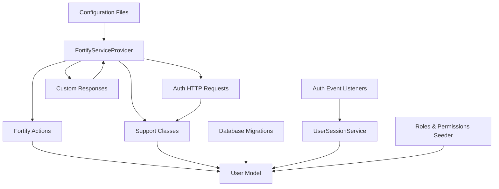
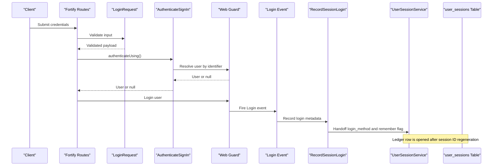
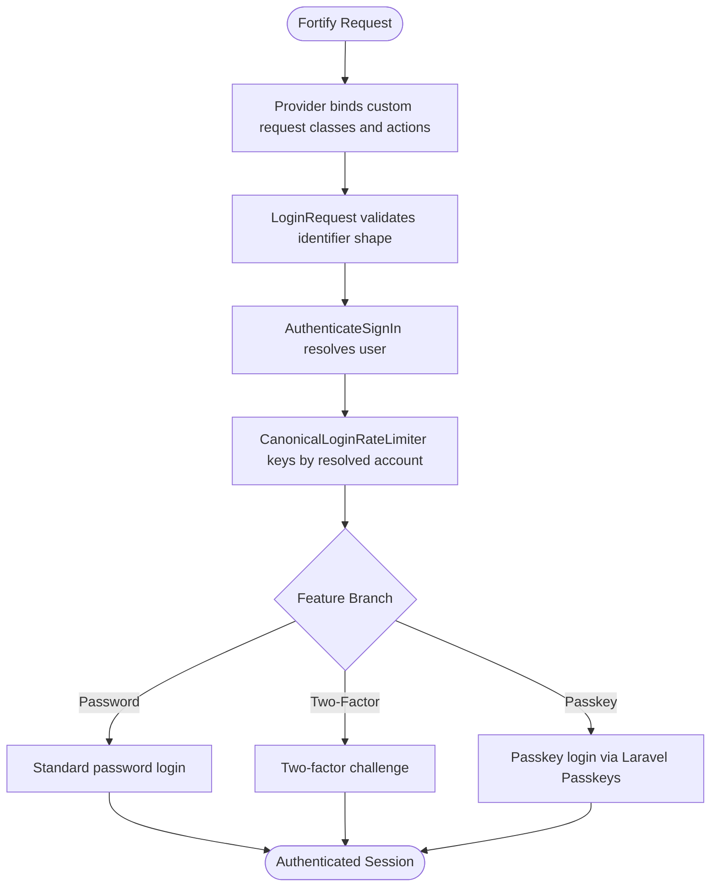
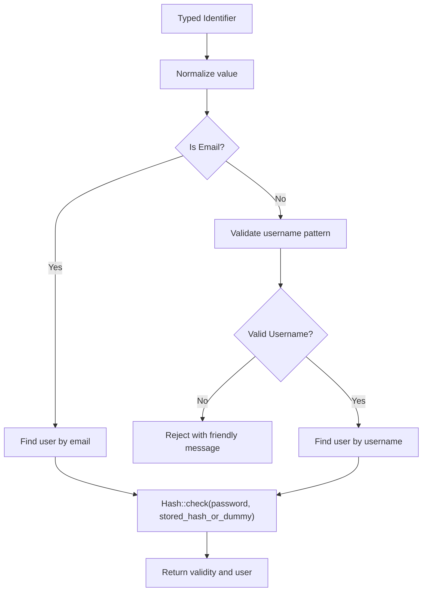
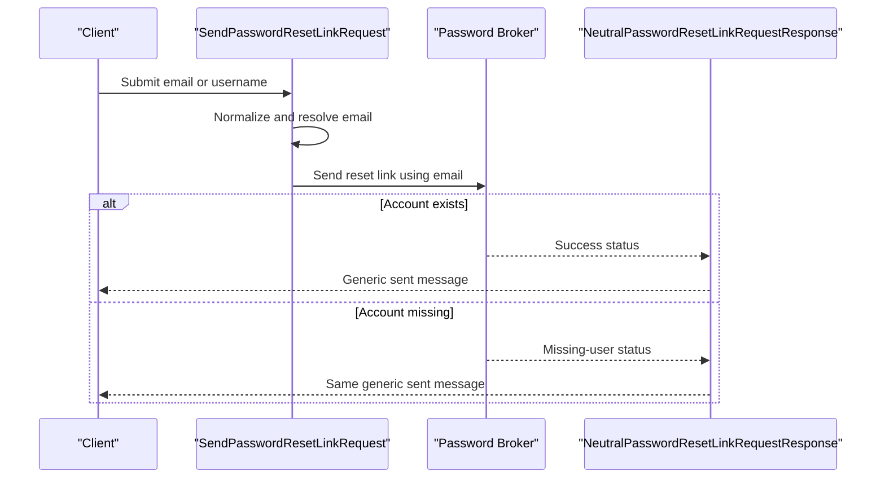
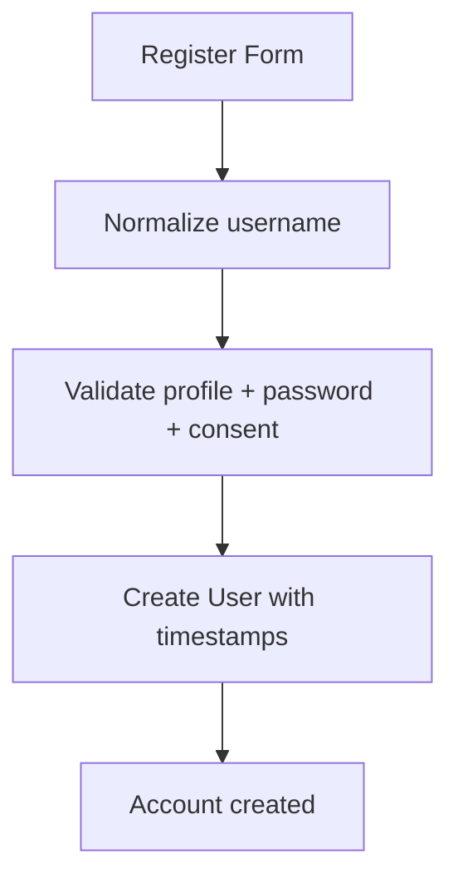
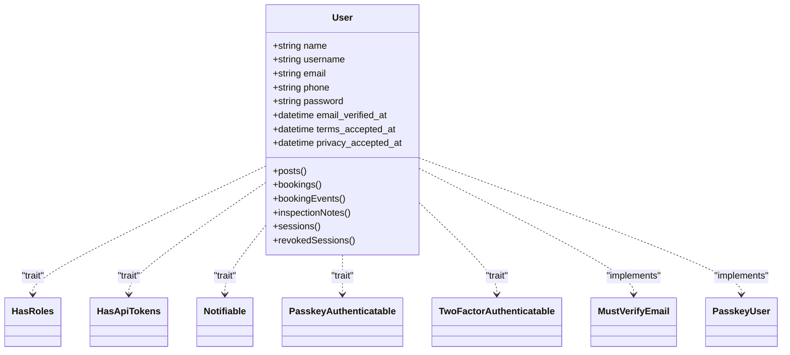
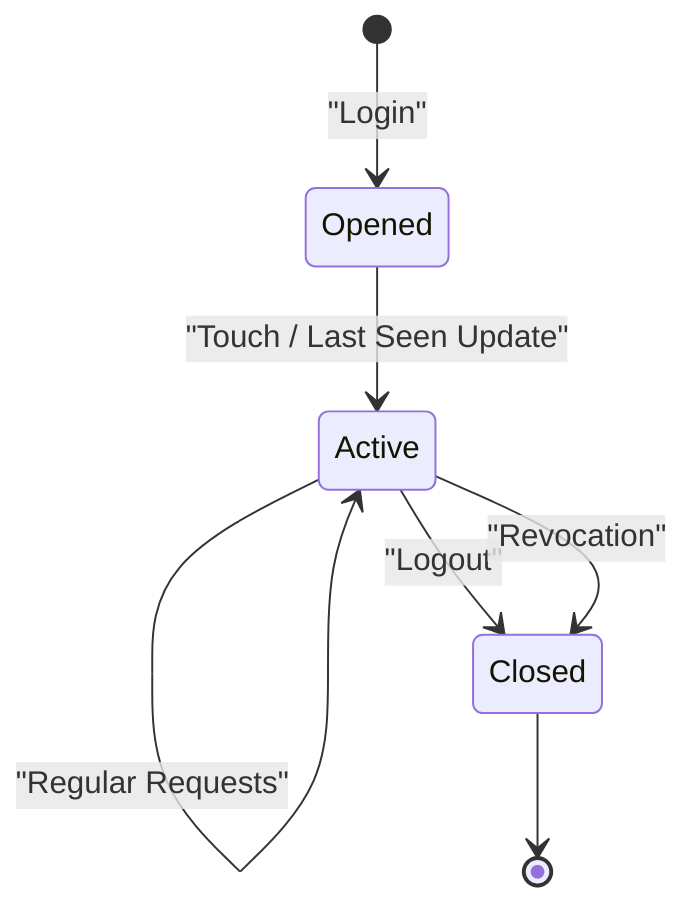
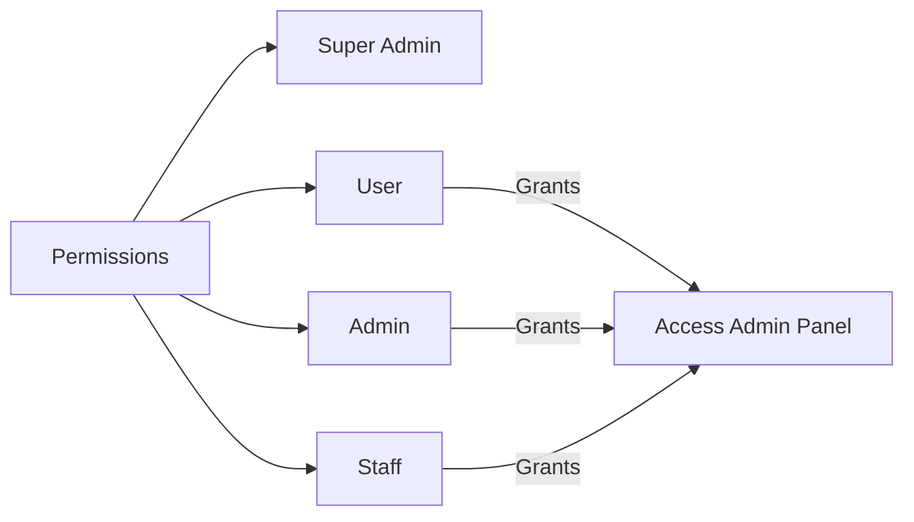
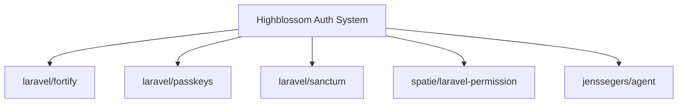

# Authentication & Authorization

<cite>
**Referenced Files in This Document**
- [composer.json](file://composer.json)
- [config/fortify.php](file://config/fortify.php)
- [config/auth.php](file://config/auth.php)
- [config/passkeys.php](file://config/passkeys.php)
- [config/permission.php](file://config/permission.php)
- [config/user-sessions.php](file://config/user-sessions.php)
- [app/Providers/FortifyServiceProvider.php](file://app/Providers/FortifyServiceProvider.php)
- [app/Actions/Fortify/AuthenticateSignIn.php](file://app/Actions/Fortify/AuthenticateSignIn.php)
- [app/Actions/Fortify/CreateNewUser.php](file://app/Actions/Fortify/CreateNewUser.php)
- [app/Actions/Fortify/ResetUserPassword.php](file://app/Actions/Fortify/ResetUserPassword.php)
- [app/Http/Requests/Auth/LoginRequest.php](file://app/Http/Requests/Auth/LoginRequest.php)
- [app/Http/Requests/Auth/SendPasswordResetLinkRequest.php](file://app/Http/Requests/Auth/SendPasswordResetLinkRequest.php)
- [app/Http/Responses/FailedPasswordConfirmationResponse.php](file://app/Http/Responses/FailedPasswordConfirmationResponse.php)
- [app/Http/Responses/NeutralPasswordResetLinkRequestResponse.php](file://app/Http/Responses/NeutralPasswordResetLinkRequestResponse.php)
- [app/Support/CanonicalLoginRateLimiter.php](file://app/Support/CanonicalLoginRateLimiter.php)
- [app/Support/SignInIdentifier.php](file://app/Support/SignInIdentifier.php)
- [app/Models/User.php](file://app/Models/User.php)
- [database/migrations/2025_08_14_170933_add_two_factor_columns_to_users_table.php](file://database/migrations/2025_08_14_170933_add_two_factor_columns_to_users_table.php)
- [database/migrations/2026_06_08_113028_create_passkeys_table.php](file://database/migrations/2026_06_08_113028_create_passkeys_table.php)
- [database/migrations/2026_10_03_130000_create_user_sessions_table.php](file://database/migrations/2026_10_03_130000_create_user_sessions_table.php)
- [app/Services/UserSessionService.php](file://app/Services/UserSessionService.php)
- [app/Listeners/RecordSessionLogin.php](file://app/Listeners/RecordSessionLogin.php)
- [app/Listeners/EndSessionOnLogout.php](file://app/Listeners/EndSessionOnLogout.php)
- [app/Listeners/RevokeSessionsOnPasswordReset.php](file://app/Listeners/RevokeSessionsOnPasswordReset.php)
- [database/seeders/RolesAndPermissionsSeeder.php](file://database/seeders/RolesAndPermissionsSeeder.php)
</cite>

## Table of Contents
1. [Introduction](#introduction)
2. [Project Structure](#project-structure)
3. [Core Components](#core-components)
4. [Architecture Overview](#architecture-overview)
5. [Detailed Component Analysis](#detailed-component-analysis)
6. [Dependency Analysis](#dependency-analysis)
7. [Performance Considerations](#performance-considerations)
8. [Troubleshooting Guide](#troubleshooting-guide)
9. [Security Best Practices and Mitigations](#security-best-practices-and-mitigations)
10. [Conclusion](#conclusion)

## Introduction
This document explains the Highblossom authentication and authorization system. It covers:

- Laravel Fortify integration for username/email sign-in, registration, password reset, email verification, two-factor authentication, and passkey support.
- Spatie Permission integration for role-based access control, including predefined roles and permissions.
- User model extensions supporting roles, API tokens, passkeys, and two-factor authentication.
- Session management through a durable `user_sessions` ledger that records device information, login method, activity, revocation, and history.
- Security measures such as timing-safe credential checks, neutral error responses, rate limiting, account enumeration prevention, session revocation on password reset, and configurable password hashing upgrades.

The system is built around Laravel 13, Fortify, Laravel Passkeys, Sanctum, and Spatie Permission.

## Project Structure
Authentication-related code is organized by responsibility rather than strictly by directory layer:

| Area | Responsibility | Key Locations |
|---|---|---|
| Configuration | Guards, Fortify features, passkeys, permissions, sessions | `config/auth.php`, `config/fortify.php`, `config/passkeys.php`, `config/permission.php`, `config/user-sessions.php` |
| Service Provider | Binds custom requests, actions, responses, and rate limiter | `app/Providers/FortifyServiceProvider.php` |
| Fortify Actions | Sign-in resolution, user creation, password reset | `app/Actions/Fortify/*` |
| HTTP Requests | Validation and friendly messages for login and forgot-password | `app/Http/Requests/Auth/*` |
| HTTP Responses | Neutralized failure responses for confirmation and reset-link flows | `app/Http/Responses/*` |
| Support Classes | Identifier detection, canonical throttling key | `app/Support/*` |
| Models | Authenticatable user with roles, passkeys, two-factor, relationships | `app/Models/User.php` |
| Migrations | Two-factor columns, passkeys table, session ledger | `database/migrations/*` |
| Listeners | Session tracking, logout closing, password-reset session revocation | `app/Listeners/*` |
| Services | Session ledger operations | `app/Services/UserSessionService.php` |
| Seeders | Predefined roles and permissions | `database/seeders/RolesAndPermissionsSeeder.php` |

**Diagram sources**
- [config/fortify.php:1-162](file://config/fortify.php#L1-L162)
- [app/Providers/FortifyServiceProvider.php:1-118](file://app/Providers/FortifyServiceProvider.php#L1-L118)
- [app/Models/User.php:1-141](file://app/Models/User.php#L1-L141)
- [database/seeders/RolesAndPermissionsSeeder.php:1-161](file://database/seeders/RolesAndPermissionsSeeder.php#L1-L161)

**Section sources**
- [config/fortify.php:1-162](file://config/fortify.php#L1-L162)
- [config/auth.php:1-117](file://config/auth.php#L1-L117)
- [config/passkeys.php:1-117](file://config/passkeys.php#L1-L117)
- [config/permission.php:1-200](file://config/permission.php#L1-L200)
- [config/user-sessions.php:1-42](file://config/user-sessions.php#L1-L42)

## Core Components
The authentication system consists of six core components:

1. **Fortify provider and configuration**: Enables registration, password reset, email verification, two-factor authentication, and passkeys. It binds custom request classes, actions, response contracts, and a canonical login rate limiter.
2. **Sign-in identifier and validation**: Accepts either an email address or a username while preventing enumeration and timing leaks.
3. **User model**: Extends Laravel's authenticatable user with roles, API tokens, passkeys, two-factor support, and session relationships.
4. **Session ledger service**: Tracks active sessions, device metadata, login methods, revocations, and history.
5. **Event listeners**: Record login metadata, close sessions on logout, and revoke other sessions after password reset.
6. **Permission seed**: Creates permissions, roles, and assigns the first user as super admin.

**Section sources**
- [app/Providers/FortifyServiceProvider.php:1-118](file://app/Providers/FortifyServiceProvider.php#L1-L118)
- [app/Support/SignInIdentifier.php:1-150](file://app/Support/SignInIdentifier.php#L1-L150)
- [app/Models/User.php:1-141](file://app/Models/User.php#L1-L141)
- [app/Services/UserSessionService.php:1-272](file://app/Services/UserSessionService.php#L1-L272)
- [app/Listeners/RecordSessionLogin.php:1-56](file://app/Listeners/RecordSessionLogin.php#L1-L56)
- [app/Listeners/EndSessionOnLogout.php:1-30](file://app/Listeners/EndSessionOnLogout.php#L1-L30)
- [app/Listeners/RevokeSessionsOnPasswordReset.php:1-40](file://app/Listeners/RevokeSessionsOnPasswordReset.php#L1-L40)
- [database/seeders/RolesAndPermissionsSeeder.php:1-161](file://database/seeders/RolesAndPermissionsSeeder.php#L1-L161)

## Architecture Overview
The authentication flow combines framework events, Fortify actions, application-specific validators, and a session ledger.

**Diagram sources**
- [app/Providers/FortifyServiceProvider.php:47-118](file://app/Providers/FortifyServiceProvider.php#L47-L118)
- [app/Http/Requests/Auth/LoginRequest.php:1-74](file://app/Http/Requests/Auth/LoginRequest.php#L1-L74)
- [app/Actions/Fortify/AuthenticateSignIn.php:1-76](file://app/Actions/Fortify/AuthenticateSignIn.php#L1-L76)
- [app/Listeners/RecordSessionLogin.php:1-56](file://app/Listeners/RecordSessionLogin.php#L1-L56)
- [app/Services/UserSessionService.php:33-105](file://app/Services/UserSessionService.php#L33-L105)

## Detailed Component Analysis

### Fortify Integration
Fortify is configured to use the `web` guard, `users` password broker, email as the username field, lowercase normalization, `/dashboard` as the home path, and web middleware. Enabled features include registration, password reset, email verification, two-factor authentication with confirmation and password confirmation, and passkeys without password confirmation.

The provider binds:
- Custom login and forgot-password request classes.
- A neutral failed password confirmation response.
- A neutral failed password reset link response.
- A canonical login rate limiter.
- Custom actions for creating users and resetting passwords.
- A custom sign-in resolver used by both plain login and two-factor challenge.

It also registers Fortify views for login, email verification, two-factor challenge, password confirmation, registration, reset password, and forgot password.

**Diagram sources**
- [config/fortify.php:1-162](file://config/fortify.php#L1-L162)
- [app/Providers/FortifyServiceProvider.php:1-118](file://app/Providers/FortifyServiceProvider.php#L1-L118)

**Section sources**
- [config/fortify.php:1-162](file://config/fortify.php#L1-L162)
- [app/Providers/FortifyServiceProvider.php:1-118](file://app/Providers/FortifyServiceProvider.php#L1-L118)

### Single Sign-In Field and Enumeration Prevention
The single sign-in field accepts either an email address or a username. The wire format remains `email` because Fortify still configures its username field as `email`.

Key behaviors:
- Email detection uses basic email validation.
- Normalization lowercases and trims values consistently across storage and lookup.
- Unknown identifiers trigger a fixed-cost hash check so rejection time matches real password checks.
- Throttle keys are canonicalized by resolving the identifier to the user’s email when possible; otherwise they fall back to the normalized input combined with IP.
- Validation rules enforce required input, length limits, email or allowed username patterns, and one message per failing rule.

**Diagram sources**
- [app/Support/SignInIdentifier.php:1-150](file://app/Support/SignInIdentifier.php#L1-L150)
- [app/Http/Requests/Auth/LoginRequest.php:1-74](file://app/Http/Requests/Auth/LoginRequest.php#L1-L74)

**Section sources**
- [app/Support/SignInIdentifier.php:1-150](file://app/Support/SignInIdentifier.php#L1-L150)
- [app/Http/Requests/Auth/LoginRequest.php:1-74](file://app/Http/Requests/Auth/LoginRequest.php#L1-L74)
- [app/Support/CanonicalLoginRateLimiter.php:1-37](file://app/Support/CanonicalLoginRateLimiter.php#L1-L37)

### Password Reset and Forgot-Password Flow
The forgot-password request accepts an email or username. If a username is supplied, it is converted to the corresponding email before the broker runs. Unknown usernames become an invalid address so the response follows the not-found branch. The response class neutralizes the missing-account message so it matches the success message.

The password reset action reuses shared password rules and applies them only to the new password fields.

**Diagram sources**
- [app/Http/Requests/Auth/SendPasswordResetLinkRequest.php:1-111](file://app/Http/Requests/Auth/SendPasswordResetLinkRequest.php#L1-L111)
- [app/Http/Responses/NeutralPasswordResetLinkRequestResponse.php:1-51](file://app/Http/Responses/NeutralPasswordResetLinkRequestResponse.php#L1-L51)
- [app/Actions/Fortify/ResetUserPassword.php:1-47](file://app/Actions/Fortify/ResetUserPassword.php#L1-L47)

**Section sources**
- [app/Http/Requests/Auth/SendPasswordResetLinkRequest.php:1-111](file://app/Http/Requests/Auth/SendPasswordResetLinkRequest.php#L1-L111)
- [app/Http/Responses/NeutralPasswordResetLinkRequestResponse.php:1-51](file://app/Http/Responses/NeutralPasswordResetLinkRequestResponse.php#L1-L51)
- [app/Actions/Fortify/ResetUserPassword.php:1-47](file://app/Actions/Fortify/ResetUserPassword.php#L1-L47)

### Registration and User Creation
Registration validates name, username, email, password, terms, and privacy policy acceptance. Username normalization happens before validation so uniqueness checks compare the stored lowercase form. Password strength comes from shared rules, while human-readable messages replace framework defaults.

**Diagram sources**
- [app/Actions/Fortify/CreateNewUser.php:1-99](file://app/Actions/Fortify/CreateNewUser.php#L1-L99)

**Section sources**
- [app/Actions/Fortify/CreateNewUser.php:1-99](file://app/Actions/Fortify/CreateNewUser.php#L1-L99)

### Two-Factor Authentication
Two-factor authentication is enabled with confirm and confirmPassword flags and a one-minute window. Fortify’s default two-factor routes and middleware are used, and a custom rate limiter named `two-factor` limits attempts per logged-in user. The same `authenticateUsing` callback ensures the single sign-in field behaves identically during the two-factor challenge as during initial login.

The database migration adds two-factor secret, recovery codes, and confirmation timestamp to the users table.

**Section sources**
- [config/fortify.php:118-162](file://config/fortify.php#L118-L162)
- [app/Providers/FortifyServiceProvider.php:83-118](file://app/Providers/FortifyServiceProvider.php#L83-L118)
- [app/Actions/Fortify/AuthenticateSignIn.php:1-76](file://app/Actions/Fortify/AuthenticateSignIn.php#L1-L76)
- [database/migrations/2025_08_14_170933_add_two_factor_columns_to_users_table.php:1-34](file://database/migrations/2025_08_14_170933_add_two_factor_columns_to_users_table.php#L1-L34)

### Passkey Support
Passkeys are supported through Laravel Passkeys. The relying party ID is derived from the application URL host, allowed origins include the application URL, WebAuthn timeout is 60 seconds, the guard is `web`, and passkey management routes use empty middleware by default. Passkey endpoints are throttled at six requests per minute.

The passkeys table stores the user association, display name, unique credential identifier, serialized credential data, last-used timestamp, and audit timestamps.

**Section sources**
- [config/passkeys.php:1-117](file://config/passkeys.php#L1-L117)
- [database/migrations/2026_06_08_113028_create_passkeys_table.php:1-35](file://database/migrations/2026_06_08_113028_create_passkeys_table.php#L1-L35)

### User Model Extensions
The `User` model extends Laravel's authenticatable model and implements:

- `MustVerifyEmail` for email verification.
- `PasskeyUser` for passkey support.
- Roles through `HasRoles`.
- API tokens through Sanctum's `HasApiTokens`.
- Passkey authentication through `PasskeyAuthenticatable`.
- Two-factor authentication through `TwoFactorAuthenticatable`.

It casts several attributes, normalizes usernames, exposes avatar URLs, computes initials, and defines relationships for posts, bookings, booking events, inspection notes, session ledger rows, and revoked sessions.

**Diagram sources**
- [app/Models/User.php:1-141](file://app/Models/User.php#L1-L141)

**Section sources**
- [app/Models/User.php:1-141](file://app/Models/User.php#L1-L141)

### Session Management
The session ledger provides a durable record of every session, even after the framework deletes its live session row. It tracks session IDs, IP addresses, user agents, parsed device metadata, login method, remembered state, login time, last seen time, end time, end reason, and who revoked the session.

Lifecycle behavior:
- On login, metadata is left in the session under a configurable handoff key.
- After the framework regenerates the session ID, the tracking logic opens a new ledger row or touches an existing one.
- Activity writes are throttled per session to reduce UPDATE frequency.
- Logout closes the current ledger row.
- Password resets can revoke other sessions based on configuration.
- Admin revocation deletes the framework session row and marks the ledger row closed.

**Diagram sources**
- [app/Listeners/RecordSessionLogin.php:1-56](file://app/Listeners/RecordSessionLogin.php#L1-L56)
- [app/Services/UserSessionService.php:33-105](file://app/Services/UserSessionService.php#L33-L105)
- [app/Listeners/EndSessionOnLogout.php:1-30](file://app/Listeners/EndSessionOnLogout.php#L1-L30)
- [database/migrations/2026_10_03_130000_create_user_sessions_table.php:1-67](file://database/migrations/2026_10_03_130000_create_user_sessions_table.php#L1-L67)

**Section sources**
- [app/Services/UserSessionService.php:1-272](file://app/Services/UserSessionService.php#L1-L272)
- [app/Listeners/RecordSessionLogin.php:1-56](file://app/Listeners/RecordSessionLogin.php#L1-L56)
- [app/Listeners/EndSessionOnLogout.php:1-30](file://app/Listeners/EndSessionOnLogout.php#L1-L30)
- [app/Listeners/RevokeSessionsOnPasswordReset.php:1-40](file://app/Listeners/RevokeSessionsOnPasswordReset.php#L1-L40)
- [config/user-sessions.php:1-42](file://config/user-sessions.php#L1-L42)
- [database/migrations/2026_10_03_130000_create_user_sessions_table.php:1-67](file://database/migrations/2026_10_03_130000_create_user_sessions_table.php#L1-L67)

### Role-Based Access Control with Spatie Permission
Spatie Permission is configured with default table names, permission checking registered on the gate, disabled Octane reset listener, disabled team feature, disabled wildcard permissions, and a 24-hour cache expiration. Exception messages hide required permission and role names by default.

The seeder creates many granular permissions grouped by domain, then defines four roles:

| Role | Scope |
|---|---|
| Super Admin | All permissions |
| Admin | Broad administrative capabilities across blog, bookings, inspections, gallery, services, settings, SEO, content, communication, HR, versioning, and admin panel access |
| Staff | Read and limited write access to blog, bookings, inspections, gallery, services, and admin panel access |
| User | Dashboard view, admin panel access, and service viewing |

The seeder also assigns the first user the Super Admin role if present.

**Diagram sources**
- [config/permission.php:1-200](file://config/permission.php#L1-L200)
- [database/seeders/RolesAndPermissionsSeeder.php:1-161](file://database/seeders/RolesAndPermissionsSeeder.php#L1-L161)

**Section sources**
- [config/permission.php:1-200](file://config/permission.php#L1-L200)
- [database/seeders/RolesAndPermissionsSeeder.php:1-161](file://database/seeders/RolesAndPermissionsSeeder.php#L1-L161)

## Dependency Analysis
The authentication subsystem depends on these external packages:

| Package | Purpose |
|---|---|
| `laravel/fortify` | Authentication scaffolding, features, rate limiters, and request/response contracts |
| `laravel/passkeys` | WebAuthn passkey registration and authentication |
| `laravel/sanctum` | API token support via `HasApiTokens` |
| `spatie/laravel-permission` | Role and permission management |
| `jenssegers/agent` | Device and browser parsing used by session metadata |

**Diagram sources**
- [composer.json:1-138](file://composer.json#L1-L138)

**Section sources**
- [composer.json:1-138](file://composer.json#L1-L138)

## Performance Considerations
- **Password rehashing on login**: The sign-in action rehashes stale bcrypt hashes when needed. Failures are logged rather than treated as authentication failures, preserving availability.
- **Session touch throttling**: The session ledger avoids writing `last_seen_at` on every request when the IP has not changed and the throttle window has not expired.
- **Permission caching**: Spatie Permission caches roles and permissions for 24 hours and flushes on changes.
- **Rate limiting**: Both login and two-factor endpoints are rate-limited, with login keyed by canonical account plus IP.
- **Passkey throttling**: Passkey endpoints are throttled at six requests per minute.

[No sources needed since this section summarizes performance characteristics already analyzed above]

## Troubleshooting Guide

### Login Fails Even When Credentials Are Correct
Possible causes:
- The identifier was typed differently but resolves to the same account; ensure the canonical throttle key is being used.
- The password hash needs rehashing; the action will attempt this silently and log failures.
- Rate limiting locked out the account due to multiple attempts against the same canonical key.

Check:
- `SignInIdentifier::throttleKey` behavior.
- `CanonicalLoginRateLimiter`.
- `AuthenticateSignIn::rehashIfStale`.

**Section sources**
- [app/Support/SignInIdentifier.php:106-150](file://app/Support/SignInIdentifier.php#L106-L150)
- [app/Support/CanonicalLoginRateLimiter.php:1-37](file://app/Support/CanonicalLoginRateLimiter.php#L1-L37)
- [app/Actions/Fortify/AuthenticateSignIn.php:38-76](file://app/Actions/Fortify/AuthenticateSignIn.php#L38-L76)

### Forgot-Password Always Returns “Not Found”
Likely cause:
- The request class intentionally returns the same generic response for known and unknown accounts to prevent enumeration.
- A username may have been transformed into an invalid address when no matching user was found.

Check:
- `SendPasswordResetLinkRequest::prepareForValidation`.
- `NeutralPasswordResetLinkRequestResponse`.

**Section sources**
- [app/Http/Requests/Auth/SendPasswordResetLinkRequest.php:23-76](file://app/Http/Requests/Auth/SendPasswordResetLinkRequest.php#L23-L76)
- [app/Http/Responses/NeutralPasswordResetLinkRequestResponse.php:1-51](file://app/Http/Responses/NeutralPasswordResetLinkRequestResponse.php#L1-L51)

### Two-Factor Challenge Does Not Accept Username
Cause:
- The two-factor challenge shares the same `authenticateUsing` callback as standard login, so the single identifier field must still be valid.

Check:
- `FortifyServiceProvider::configureActions`.
- `AuthenticateSignIn`.

**Section sources**
- [app/Providers/FortifyServiceProvider.php:63-76](file://app/Providers/FortifyServiceProvider.php#L63-L76)
- [app/Actions/Fortify/AuthenticateSignIn.php:1-76](file://app/Actions/Fortify/AuthenticateSignIn.php#L1-L76)

### Session History Shows Orphaned or Inactive Rows
Possible causes:
- Framework session row was deleted but the ledger row remained.
- Pruning logic considers grace periods for orphaned rows.
- Concurrency caused two requests to miss the initial lookup and update the same row.

Check:
- `UserSessionService::open` concurrency handling.
- `UserSessionService::touch` throttle logic.
- `config/user-sessions.php` retention and grace settings.

**Section sources**
- [app/Services/UserSessionService.php:72-105](file://app/Services/UserSessionService.php#L72-L105)
- [config/user-sessions.php:1-42](file://config/user-sessions.php#L1-L42)

### Password Reset Leaves Other Sessions Alive
Cause:
- Fortify rotates the remember token but does not automatically revoke all live sessions.
- The application listener revokes other sessions only when enabled.

Check:
- `RevokeSessionsOnPasswordReset`.
- `UserSessionService::handlePasswordChanged`.
- `USER_SESSIONS_REVOKE_ON_PASSWORD_CHANGE`.

**Section sources**
- [app/Listeners/RevokeSessionsOnPasswordReset.php:1-40](file://app/Listeners/RevokeSessionsOnPasswordReset.php#L1-L40)
- [app/Services/UserSessionService.php:235-249](file://app/Services/UserSessionService.php#L235-L249)
- [config/user-sessions.php:28-31](file://config/user-sessions.php#L28-L31)

## Security Best Practices and Mitigations

### Implemented Mitigations
- **Enumeration prevention**: Login and forgot-password flows avoid revealing whether an identifier belongs to an account.
- **Timing attack mitigation**: Unknown identifiers still perform a fixed-cost hash check.
- **Canonical rate limiting**: Login attempts are keyed by resolved account plus IP, not raw input.
- **Password hashing upgrade**: Stale bcrypt hashes are upgraded on successful login when configured.
- **Neutral error responses**: Failed password confirmation and forgotten-password responses do not leak account existence.
- **Two-factor protection**: Dedicated rate limiter and optional password confirmation.
- **Passkey security**: Relying party ID, allowed origins, timeout, guard, and throttling are configurable.
- **Session revocation**: Password reset can revoke other sessions; logout closes ledger rows.
- **Audit-friendly session ledger**: Durable records capture login method, device metadata, IP changes, revocation actor, and lifecycle transitions.
- **Least-privilege roles**: Permissions are granular and roles are scoped by business area.

### Adding a New Authentication Method
Recommended approach:
1. Define how the method identifies a user in a dedicated helper similar to `SignInIdentifier`.
2. Add a Fortify action or extend `authenticateUsing` if the method participates in Fortify’s login pipeline.
3. Update the session ledger handoff so `RecordSessionLogin` can classify the login method.
4. Add a route name match in `RecordSessionLogin::resolveMethod`.
5. Extend `LoginMethod` enum if necessary.
6. Add tests covering enumeration safety, rate limiting, and session recording.

### Creating Custom Roles and Permissions
Recommended approach:
1. Add a new permission string to the seeder.
2. Assign it to an existing role or create a new role.
3. Use the Spatie Permission policies or gates in controllers and views.
4. Avoid hardcoding role names in business logic where permission strings are more expressive.

### Securing Specific Routes or Actions
Recommended approaches:
- Use route-level guards for authentication.
- Apply policy or permission checks in controllers, Livewire components, or service layers.
- For sensitive actions, require password confirmation using Fortify’s confirmation flow.
- For administrative endpoints, combine authentication, role checks, and audit logging.

### Audit Logging for Authentication Events
Current implementation focuses on session lifecycle and password-reset side effects:
- Login leaves metadata for session tracking.
- Logout closes the ledger row.
- Password reset can revoke other sessions.
- Application-level audit tables exist through the auditify package, but authentication-specific audit entries are not implemented in the analyzed files.

[No sources needed since this section provides general guidance beyond the analyzed files]

## Conclusion
Highblossom’s authentication and authorization system builds on Laravel Fortify, Laravel Passkeys, Sanctum, and Spatie Permission. It emphasizes secure defaults: neutral error responses, timing-safe lookups, canonical rate limiting, configurable password hashing upgrades, two-factor support, passkey support, and a durable session ledger. Role-based access control is centralized in a permission seed and can be extended safely.

For future work, consider adding explicit authentication audit entries, extending the session pruning command, centralizing policy definitions, and documenting route-level protections alongside controller-level permissions.