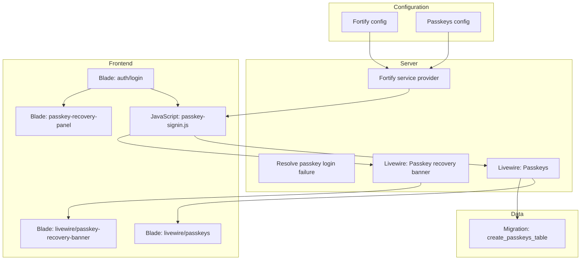
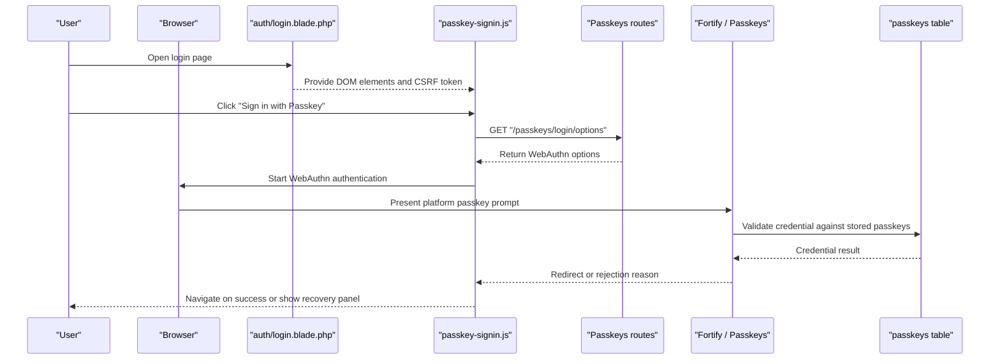
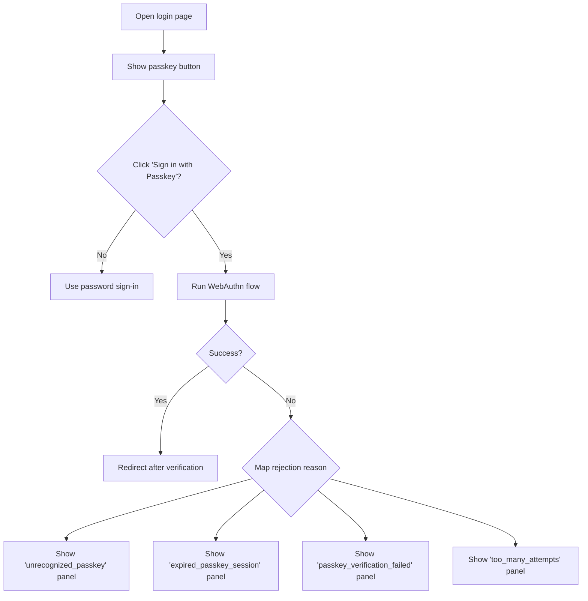
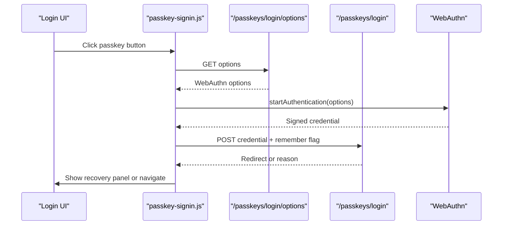
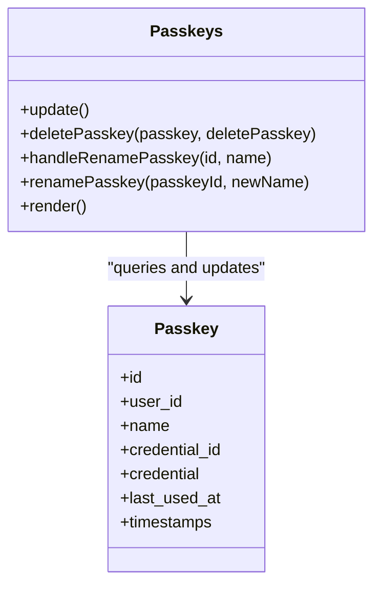
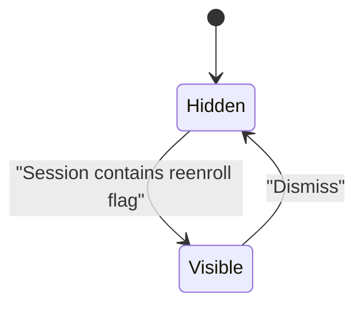
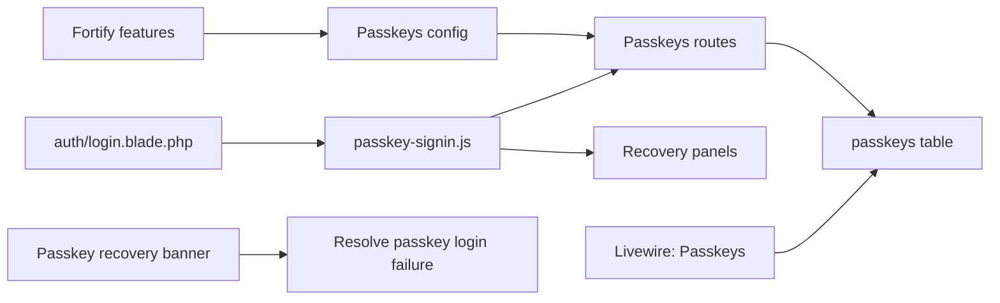
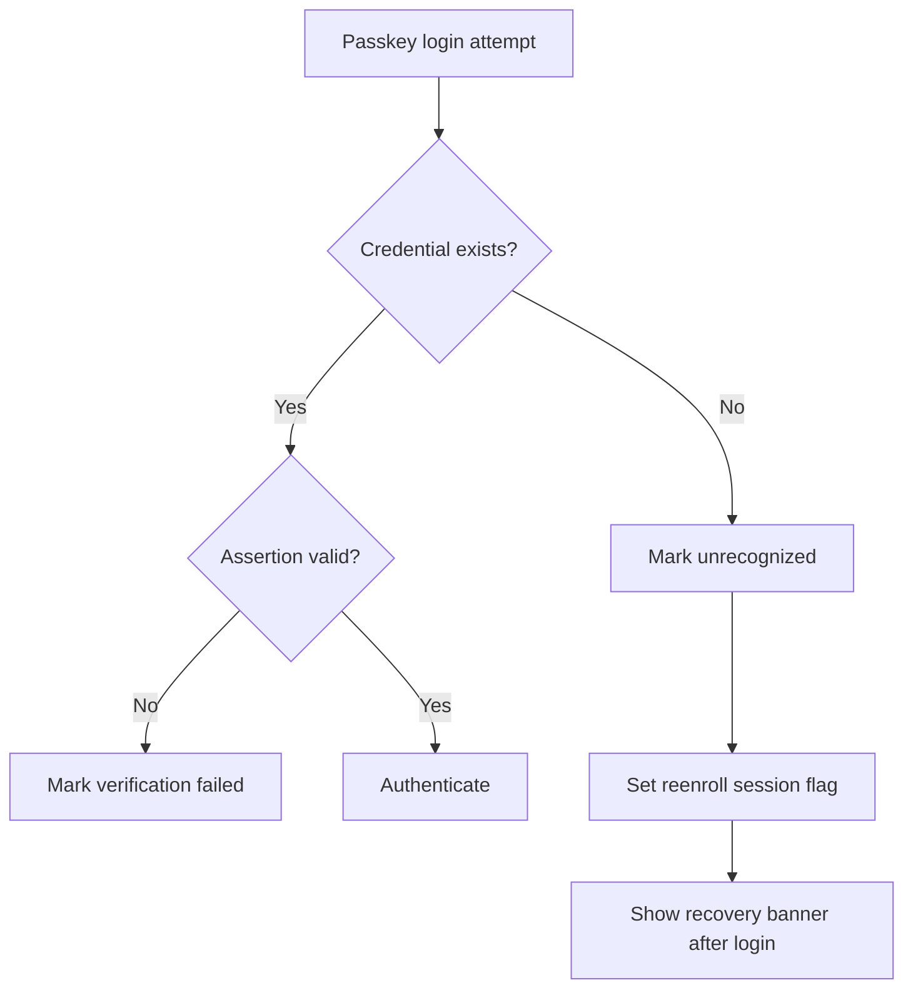

# Passkey Authentication

<cite>
**Referenced Files in This Document**
- [config/fortify.php](file://config/fortify.php)
- [config/passkeys.php](file://config/passkeys.php)
- [app/Providers/FortifyServiceProvider.php](file://app/Providers/FortifyServiceProvider.php)
- [app/Livewire/Passkeys.php](file://app/Livewire/Passkeys.php)
- [app/Livewire/PasskeyRecoveryBanner.php](file://app/Livewire/PasskeyRecoveryBanner.php)
- [app/Actions/Auth/ResolvePasskeyLoginFailure.php](file://app/Actions/Auth/ResolvePasskeyLoginFailure.php)
- [resources/js/passkey-signin.js](file://resources/js/passkey-signin.js)
- [database/migrations/2026_06_08_113028_create_passkeys_table.php](file://database/migrations/2026_06_08_113028_create_passkeys_table.php)
- [database/migrations/2026_06_08_105000_drop_passkeys_table.php](file://database/migrations/2026_06_08_105000_drop_passkeys_table.php)
- [resources/views/auth/login.blade.php](file://resources/views/auth/login.blade.php)
- [resources/views/components/passkey-recovery-panel.blade.php](file://resources/views/components/passkey-recovery-panel.blade.php)
- [resources/views/livewire/passkeys.blade.php](file://resources/views/livewire/passkeys.blade.php)
- [resources/views/livewire/passkey-recovery-banner.blade.php](file://resources/views/livewire/passkey-recovery-banner.blade.php)
- [lang/en/auth.php](file://lang/en/auth.php)
</cite>

## Table of Contents
1. [Introduction](#introduction)
2. [Project Structure](#project-structure)
3. [Core Components](#core-components)
4. [Architecture Overview](#architecture-overview)
5. [Detailed Component Analysis](#detailed-component-analysis)
6. [Dependency Analysis](#dependency-analysis)
7. [Performance Considerations](#performance-considerations)
8. [Troubleshooting Guide](#troubleshooting-guide)
9. [Conclusion](#conclusion)
10. [Appendices](#appendices)

## Introduction
This document explains the Highblossom passkey (passwordless) authentication system. It is built on Laravel Fortify’s Passkeys feature and uses WebAuthn for browser-based registration and sign-in. The implementation provides:

- Passkey registration through a Livewire-managed security keys interface.
- Passkey sign-in from the login page using JavaScript that calls `/passkeys/login/options` and `/passkeys/login`.
- A recovery banner that appears when a device offers an unrecognized or expired passkey.
- A database schema for storing passkey credentials.
- Clear user-facing error handling and localized messages.

The goal is to let users sign in without passwords while keeping traditional password authentication available as a fallback.

## Project Structure
The passkey feature spans configuration, service providers, Livewire components, Blade views, JavaScript, translations, and a database migration.

**Diagram sources**
- [config/fortify.php:116-162](file://config/fortify.php#L116-L162)
- [config/passkeys.php:1-117](file://config/passkeys.php#L1-L117)
- [app/Providers/FortifyServiceProvider.php:1-118](file://app/Providers/FortifyServiceProvider.php#L1-L118)
- [app/Actions/Auth/ResolvePasskeyLoginFailure.php:1-95](file://app/Actions/Auth/ResolvePasskeyLoginFailure.php#L1-L95)
- [app/Livewire/Passkeys.php:1-123](file://app/Livewire/Passkeys.php#L1-L123)
- [app/Livewire/PasskeyRecoveryBanner.php:1-50](file://app/Livewire/PasskeyRecoveryBanner.php#L1-L50)
- [resources/js/passkey-signin.js:1-160](file://resources/js/passkey-signin.js#L1-L160)
- [resources/views/auth/login.blade.php:1-121](file://resources/views/auth/login.blade.php#L1-L121)
- [resources/views/components/passkey-recovery-panel.blade.php:1-28](file://resources/views/components/passkey-recovery-panel.blade.php#L1-L28)
- [resources/views/livewire/passkeys.blade.php:1-92](file://resources/views/livewire/passkeys.blade.php#L1-L92)
- [resources/views/livewire/passkey-recovery-banner.blade.php:1-28](file://resources/views/livewire/passkey-recovery-banner.blade.php#L1-L28)
- [database/migrations/2026_06_08_113028_create_passkeys_table.php:1-35](file://database/migrations/2026_06_08_113028_create_passkeys_table.php#L1-L35)

**Section sources**
- [config/fortify.php:116-162](file://config/fortify.php#L116-L162)
- [config/passkeys.php:1-117](file://config/passkeys.php#L1-L117)
- [app/Providers/FortifyServiceProvider.php:1-118](file://app/Providers/FortifyServiceProvider.php#L1-L118)
- [resources/views/auth/login.blade.php:1-121](file://resources/views/auth/login.blade.php#L1-L121)
- [database/migrations/2026_06_08_113028_create_passkeys_table.php:1-35](file://database/migrations/2026_06_08_113028_create_passkeys_table.php#L1-L35)

## Core Components
The passkey system has five main responsibilities:

| Area | Responsibility | Key files |
|---|---|---|
| Configuration | Enable Fortify passkeys and define relying party settings | [config/fortify.php](file://config/fortify.php), [config/passkeys.php](file://config/passkeys.php) |
| Server setup | Register Fortify behavior, actions, views, and rate limiting | [app/Providers/FortifyServiceProvider.php](file://app/Providers/FortifyServiceProvider.php) |
| Login flow | Browser JavaScript performs WebAuthn operations | [resources/js/passkey-signin.js](file://resources/js/passkey-signin.js) |
| Registration management | List, rename, and delete passkeys for the authenticated user | [app/Livewire/Passkeys.php](file://app/Livewire/Passkeys.php), [resources/views/livewire/passkeys.blade.php](file://resources/views/livewire/passkeys.blade.php) |
| Recovery workflow | Classify rejected sign-ins and show re-enrollment prompts | [app/Actions/Auth/ResolvePasskeyLoginFailure.php](file://app/Actions/Auth/ResolvePasskeyLoginFailure.php), [app/Livewire/PasskeyRecoveryBanner.php](file://app/Livewire/PasskeyRecoveryBanner.php), [resources/views/livewire/passkey-recovery-banner.blade.php](file://resources/views/livewire/passkey-recovery-banner.blade.php) |

**Section sources**
- [config/fortify.php:116-162](file://config/fortify.php#L116-L162)
- [config/passkeys.php:1-117](file://config/passkeys.php#L1-L117)
- [app/Providers/FortifyServiceProvider.php:1-118](file://app/Providers/FortifyServiceProvider.php#L1-L118)
- [resources/js/passkey-signin.js:1-160](file://resources/js/passkey-signin.js#L1-L160)
- [app/Livewire/Passkeys.php:1-123](file://app/Livewire/Passkeys.php#L1-L123)
- [app/Actions/Auth/ResolvePasskeyLoginFailure.php:1-95](file://app/Actions/Auth/ResolvePasskeyLoginFailure.php#L1-L95)
- [app/Livewire/PasskeyRecoveryBanner.php:1-50](file://app/Livewire/PasskeyRecoveryBanner.php#L1-L50)

## Architecture Overview
The passkey authentication architecture connects the browser, Fortify, the application server, and the passkey storage table.

**Diagram sources**
- [resources/views/auth/login.blade.php:1-121](file://resources/views/auth/login.blade.php#L1-L121)
- [resources/js/passkey-signin.js:1-160](file://resources/js/passkey-signin.js#L1-L160)
- [config/passkeys.php:1-117](file://config/passkeys.php#L1-L117)
- [database/migrations/2026_06_08_113028_create_passkeys_table.php:1-35](file://database/migrations/2026_06_08_113028_create_passkeys_table.php#L1-L35)

## Detailed Component Analysis

### Configuration Layer
Fortify is configured to enable registration, password reset, email verification, two-factor authentication, and passkeys. Passkeys are enabled with `confirmPassword` disabled, so passkey sign-in does not require a separate password confirmation step.

Passkeys configuration defines:

| Setting | Purpose |
|---|---|
| `relying_party_id` | Domain identity used by WebAuthn; passkeys are bound to this value |
| `allowed_origins` | Origins permitted to complete WebAuthn ceremonies |
| `user_handle_secret` | Stable derivation for WebAuthn user handles across key rotations |
| `timeout` | Milliseconds allowed for registration or authentication |
| `guard` | Authentication guard used during passkey login |
| `middleware` | Middleware applied to passkey routes |
| `management_middleware` | Middleware protecting creation or deletion of passkeys |
| `throttle` | Rate limiting middleware for passkey endpoints |
| `redirect` | Redirect path after successful passkey verification |

These values come from the application URL, environment variables, and the Laravel application key.

**Section sources**
- [config/fortify.php:116-162](file://config/fortify.php#L116-L162)
- [config/passkeys.php:1-117](file://config/passkeys.php#L1-L117)

### Fortify Service Provider
The Fortify service provider binds custom request classes, response contracts, and a canonical login rate limiter. It also registers custom Fortify actions and view resolvers. While passkey support comes from Fortify’s features array, the provider ensures login requests accept either an email or username and controls rate limiting behavior.

Key behaviors:

- Customizes login and password reset request handling.
- Replaces default failed password confirmation responses.
- Binds a custom login rate limiter keyed by a stable identifier rather than only raw input.
- Registers Fortify view resolvers for login, registration, password reset, email verification, and two-factor challenge screens.

**Section sources**
- [app/Providers/FortifyServiceProvider.php:1-118](file://app/Providers/FortifyServiceProvider.php#L1-L118)

### Login Page and Recovery Panels
The login view renders both the traditional password form and the passkey button. It also includes four recovery panels for specific passkey rejection reasons.

Important UI contract details:

- The passkey button has id `passkey-signin-btn` and attribute `data-passkey-signin`.
- The label element has id `passkey-signin-label` and data attributes for supported states.
- Error output goes into `passkey-error`.
- Recovery panels use `data-passkey-recovery="<reason>"`.
- The view loads localization strings for passkey labels, waiting state, unsupported state, generic error, and each recovery scenario.

**Diagram sources**
- [resources/views/auth/login.blade.php:1-121](file://resources/views/auth/login.blade.php#L1-L121)
- [resources/views/components/passkey-recovery-panel.blade.php:1-28](file://resources/views/components/passkey-recovery-panel.blade.php#L1-L28)
- [lang/en/auth.php:1-75](file://lang/en/auth.php#L1-L75)

**Section sources**
- [resources/views/auth/login.blade.php:1-121](file://resources/views/auth/login.blade.php#L1-L121)
- [resources/views/components/passkey-recovery-panel.blade.php:1-28](file://resources/views/components/passkey-recovery-panel.blade.php#L1-L28)
- [lang/en/auth.php:1-75](file://lang/en/auth.php#L1-L75)

### JavaScript Integration
The JavaScript module integrates directly with the browser’s WebAuthn API through `@simplewebauthn/browser`. It:

1. Checks whether the browser supports WebAuthn.
2. Reads the CSRF token from a meta tag or falls back to the `XSRF-TOKEN` cookie.
3. Requests WebAuthn options from `/passkeys/login/options`.
4. Calls `startAuthentication` with those options.
5. Submits the signed assertion to `/passkeys/login`.
6. Follows the redirect returned by the server on success.
7. Shows recovery panels for known reasons.
8. Displays generic errors for unexpected failures.
9. Disables the button on unsupported browsers and restores it after the operation completes.

Cancellation errors such as `AbortError`, `NotAllowedError`, and `UserCancelledError` are treated as user cancellations rather than application errors.

**Diagram sources**
- [resources/js/passkey-signin.js:1-160](file://resources/js/passkey-signin.js#L1-L160)
- [resources/views/auth/login.blade.php:1-121](file://resources/views/auth/login.blade.php#L1-L121)

**Section sources**
- [resources/js/passkey-signin.js:1-160](file://resources/js/passkey-signin.js#L1-L160)

### Passkey Management Livewire Component
The `Passkeys` Livewire component manages registered passkeys for the authenticated user. It exposes:

- An event-driven refresh handler for registration, deletion, and rename events.
- A `deletePasskey` method that validates ownership before deleting.
- A `renamePasskey` method that validates name length and ownership.
- A render method that lists passkeys belonging to the current user.

The Blade view under `livewire/passkeys.blade.php` provides:

- A register button that prompts for a name and calls `window.Passkeys.register`.
- A list of existing passkeys.
- Inline rename functionality dispatched to Livewire.
- Delete functionality with Livewire confirmation.

**Diagram sources**
- [app/Livewire/Passkeys.php:1-123](file://app/Livewire/Passkeys.php#L1-L123)
- [database/migrations/2026_06_08_113028_create_passkeys_table.php:1-35](file://database/migrations/2026_06_08_113028_create_passkeys_table.php#L1-L35)

**Section sources**
- [app/Livewire/Passkeys.php:1-123](file://app/Livewire/Passkeys.php#L1-L123)
- [resources/views/livewire/passkeys.blade.php:1-92](file://resources/views/livewire/passkeys.blade.php#L1-L92)
- [database/migrations/2026_06_08_113028_create_passkeys_table.php:1-35](file://database/migrations/2026_06_08_113028_create_passkeys_table.php#L1-L35)

### Passkey Recovery Banner
The recovery banner is shown after a passkey sign-in attempt fails because the offered credential is no longer linked to the account. It is controlled by a session flag written by `ResolvePasskeyLoginFailure`.

Behavior:

- On mount, the component checks for the re-enrollment session key.
- If present, it renders an alert prompting the user to set up a new passkey.
- The banner links to the admin profile passkeys tab.
- Dismissing clears the session flag and hides the banner.

**Diagram sources**
- [app/Livewire/PasskeyRecoveryBanner.php:1-50](file://app/Livewire/PasskeyRecoveryBanner.php#L1-L50)
- [app/Actions/Auth/ResolvePasskeyLoginFailure.php:1-95](file://app/Actions/Auth/ResolvePasskeyLoginFailure.php#L1-L95)
- [resources/views/livewire/passkey-recovery-banner.blade.php:1-28](file://resources/views/livewire/passkey-recovery-banner.blade.php#L1-L28)

**Section sources**
- [app/Livewire/PasskeyRecoveryBanner.php:1-50](file://app/Livewire/PasskeyRecoveryBanner.php#L1-L50)
- [app/Actions/Auth/ResolvePasskeyLoginFailure.php:1-95](file://app/Actions/Auth/ResolvePasskeyLoginFailure.php#L1-L95)
- [resources/views/livewire/passkey-recovery-banner.blade.php:1-28](file://resources/views/livewire/passkey-recovery-banner.blade.php#L1-L28)

### Database Schema for Passkeys
The `passkeys` table stores one row per passkey credential.

| Column | Type / Constraint | Purpose |
|---|---|---|
| `id` | Primary key | Row identifier |
| `user_id` | Foreign key to the passkey user model | Links the credential to a user |
| `name` | String | Human-readable label for the passkey |
| `credential_id` | Unique string | Stable identifier for the WebAuthn credential |
| `credential` | JSON | Encrypted or serialized credential data |
| `last_used_at` | Nullable timestamp | Tracks when the passkey was last verified |
| `created_at` / `updated_at` | Timestamps | Lifecycle tracking |
| Index on `user_id` | Index | Improves queries for a user’s passkeys |

There is also a migration that drops an earlier passkeys table, indicating the schema evolved.

**Section sources**
- [database/migrations/2026_06_08_113028_create_passkeys_table.php:1-35](file://database/migrations/2026_06_08_113028_create_passkeys_table.php#L1-L35)
- [database/migrations/2026_06_08_105000_drop_passkeys_table.php](file://database/migrations/2026_06_08_105000_drop_passkeys_table.php)

## Dependency Analysis
The passkey feature depends on several layers:

- **Fortify features**: Passkeys are enabled in the Fortify configuration.
- **Passkeys configuration**: Relies on `app.url`, `app.key`, and environment variables.
- **Browser WebAuthn**: Requires HTTPS, a secure context, and modern browser support.
- **CSRF protection**: The JavaScript reads a meta tag first and falls back to the XSRF cookie.
- **Livewire events**: Registration, renaming, and deletion trigger UI refreshes.
- **Localization**: All user-facing messages are loaded from language files.

**Diagram sources**
- [config/fortify.php:116-162](file://config/fortify.php#L116-L162)
- [config/passkeys.php:1-117](file://config/passkeys.php#L1-L117)
- [resources/views/auth/login.blade.php:1-121](file://resources/views/auth/login.blade.php#L1-L121)
- [resources/js/passkey-signin.js:1-160](file://resources/js/passkey-signin.js#L1-L160)
- [app/Livewire/Passkeys.php:1-123](file://app/Livewire/Passkeys.php#L1-L123)
- [app/Actions/Auth/ResolvePasskeyLoginFailure.php:1-95](file://app/Actions/Auth/ResolvePasskeyLoginFailure.php#L1-L95)
- [database/migrations/2026_06_08_113028_create_passkeys_table.php:1-35](file://database/migrations/2026_06_08_113028_create_passkeys_table.php#L1-L35)

**Section sources**
- [config/fortify.php:116-162](file://config/fortify.php#L116-L162)
- [config/passkeys.php:1-117](file://config/passkeys.php#L1-L117)
- [resources/js/passkey-signin.js:1-160](file://resources/js/passkey-signin.js#L1-L160)
- [app/Livewire/Passkeys.php:1-123](file://app/Livewire/Passkeys.php#L1-L123)
- [app/Actions/Auth/ResolvePasskeyLoginFailure.php:1-95](file://app/Actions/Auth/ResolvePasskeyLoginFailure.php#L1-L95)

## Performance Considerations
- **Rate limiting**: Fortify applies login throttling, and the passkeys configuration defines its own throttle middleware. Keep these limits conservative to prevent abuse during registration and verification.
- **Timeouts**: The passkey timeout should balance usability and security. Too short can cause unnecessary failures on slower devices; too long may keep sessions open unnecessarily.
- **Database indexing**: The passkeys table indexes `user_id`, which improves performance when listing or managing a user’s passkeys.
- **JavaScript cancellation**: Cancellation errors are suppressed to avoid noisy error messages when users explicitly cancel the platform prompt.
- **Livewire refresh**: Event-driven refresh avoids full-page reloads during passkey management.

[No sources needed since this section provides general guidance]

## Troubleshooting Guide

### Enabling Passkey Authentication
To enable passkeys:

1. Ensure Fortify has the passkeys feature enabled.
2. Verify the passkeys configuration points to the correct domain and origin.
3. Confirm the application runs over HTTPS, because WebAuthn requires a secure context.
4. Include the login view with the passkey button and recovery panels.
5. Ensure the passkeys migration has been run.
6. Test registration through the passkeys management interface and sign-in from the login page.

**Section sources**
- [config/fortify.php:116-162](file://config/fortify.php#L116-L162)
- [config/passkeys.php:1-117](file://config/passkeys.php#L1-L117)
- [resources/views/auth/login.blade.php:1-121](file://resources/views/auth/login.blade.php#L1-L121)
- [database/migrations/2026_06_08_113028_create_passkeys_table.php:1-35](file://database/migrations/2026_06_08_113028_create_passkeys_table.php#L1-L35)

### Handling Passkey Registration Errors
Registration errors commonly fall into three categories:

| Category | Typical cause | Recommended action |
|---|---|---|
| User cancellation | The user dismissed the platform prompt | Do not treat as an application error |
| Permission denied | Browser or OS blocked the credential | Explain why permissions are required and retry |
| Unsupported environment | Missing WebAuthn or insecure context | Fall back to password authentication |

The registration view dispatches a toast for real errors but ignores expected cancellation errors.

**Section sources**
- [resources/views/livewire/passkeys.blade.php:1-92](file://resources/views/livewire/passkeys.blade.php#L1-L92)
- [resources/js/passkey-signin.js:1-160](file://resources/js/passkey-signin.js#L1-L160)

### Implementing Passkey Recovery Workflows
When a passkey sign-in fails, the system maps the failure to a machine-readable reason:

| Reason | Meaning | User experience |
|---|---|---|
| `unrecognized_passkey` | The credential is absent from the database | Invite the user to try another passkey or sign in with a password |
| `expired_passkey_session` | The WebAuthn challenge session is gone | Ask the user to retry |
| `passkey_verification_failed` | The assertion was rejected | Inform the user that verification failed |
| `too_many_attempts` | Rate limit triggered | Prompt the user to wait |

For unrecognized passkeys, the system sets a session flag that causes the recovery banner to appear after the user signs in with another method.

**Diagram sources**
- [app/Actions/Auth/ResolvePasskeyLoginFailure.php:1-95](file://app/Actions/Auth/ResolvePasskeyLoginFailure.php#L1-L95)
- [app/Livewire/PasskeyRecoveryBanner.php:1-50](file://app/Livewire/PasskeyRecoveryBanner.php#L1-L50)
- [resources/views/livewire/passkey-recovery-banner.blade.php:1-28](file://resources/views/livewire/passkey-recovery-banner.blade.php#L1-L28)

**Section sources**
- [app/Actions/Auth/ResolvePasskeyLoginFailure.php:1-95](file://app/Actions/Auth/ResolvePasskeyLoginFailure.php#L1-L95)
- [resources/views/auth/login.blade.php:1-121](file://resources/views/auth/login.blade.php#L1-L121)
- [lang/en/auth.php:1-75](file://lang/en/auth.php#L1-L75)

### Cross-Browser Compatibility
- Modern browsers that implement WebAuthn will show the native platform prompt.
- Older browsers or environments without WebAuthn support should display the disabled state and offer password sign-in.
- Mobile passkey support varies by operating system and browser. Android and iOS generally support platform passkeys, but exact behavior depends on the device and browser version.
- If the browser reports no support, the login button should remain disabled and the user should continue with password authentication.

**Section sources**
- [resources/js/passkey-signin.js:1-160](file://resources/js/passkey-signin.js#L1-L160)
- [resources/views/auth/login.blade.php:1-121](file://resources/views/auth/login.blade.php#L1-L121)

### Security Benefits of Passkeys
- Passkeys eliminate password reuse and phishing resistance because they are bound to the application’s relying party ID and origin.
- Credentials never leave the device; only cryptographic assertions are exchanged.
- The system stores encrypted or serialized credential data alongside a stable credential identifier.
- Ownership validation prevents unauthorized deletion or renaming of other users’ passkeys.
- Recovery workflows provide clear messaging when credentials are missing or invalid.

**Section sources**
- [config/passkeys.php:1-117](file://config/passkeys.php#L1-L117)
- [app/Livewire/Passkeys.php:1-123](file://app/Livewire/Passkeys.php#L1-L123)
- [database/migrations/2026_06_08_113028_create_passkeys_table.php:1-35](file://database/migrations/2026_06_08_113028_create_passkeys_table.php#L1-L35)

### Migration Strategy from Traditional Password Authentication
A safe migration strategy should retain password authentication while introducing passkeys:

1. Keep the existing login form and allow both password and passkey sign-in.
2. Enable passkeys through Fortify without disabling password authentication.
3. Add the passkey management interface to user profiles.
4. Run the passkeys migration and seed or migrate existing accounts as needed.
5. Communicate passkey benefits to users and encourage enrollment.
6. Use recovery banners to guide users whose old passkeys become invalid.
7. Monitor failed passkey attempts and adjust timeouts, throttling, and copy based on real usage.

**Section sources**
- [config/fortify.php:116-162](file://config/fortify.php#L116-L162)
- [resources/views/auth/login.blade.php:1-121](file://resources/views/auth/login.blade.php#L1-L121)
- [resources/views/livewire/passkeys.blade.php:1-92](file://resources/views/livewire/passkeys.blade.php#L1-L92)
- [app/Livewire/PasskeyRecoveryBanner.php:1-50](file://app/Livewire/PasskeyRecoveryBanner.php#L1-L50)

## Conclusion
Highblossom’s passkey authentication combines Laravel Fortify, WebAuthn, Livewire, and Blade to deliver a passwordless sign-in option. The login page handles browser compatibility and recovery flows, the JavaScript layer performs secure WebAuthn operations, and the Livewire interface lets users manage their passkeys safely. The database schema stores credentials with clear ownership and lifecycle metadata. With proper configuration, cross-browser fallbacks, and recovery workflows, this system provides stronger security while preserving access for users who still need password authentication.

[No sources needed since this section summarizes without analyzing specific files]

## Appendices

### Passkey Login Request Flow Summary
- The login view mounts the passkey button and recovery panels.
- The JavaScript client calls `/passkeys/login/options` and `/passkeys/login`.
- Successful verification redirects the user.
- Failures map to localized recovery messages.
- Unrecognized passkeys trigger a re-enrollment banner after subsequent login.

**Section sources**
- [resources/views/auth/login.blade.php:1-121](file://resources/views/auth/login.blade.php#L1-L121)
- [resources/js/passkey-signin.js:1-160](file://resources/js/passkey-signin.js#L1-L160)
- [app/Actions/Auth/ResolvePasskeyLoginFailure.php:1-95](file://app/Actions/Auth/ResolvePasskeyLoginFailure.php#L1-L95)
- [lang/en/auth.php:1-75](file://lang/en/auth.php#L1-L75)