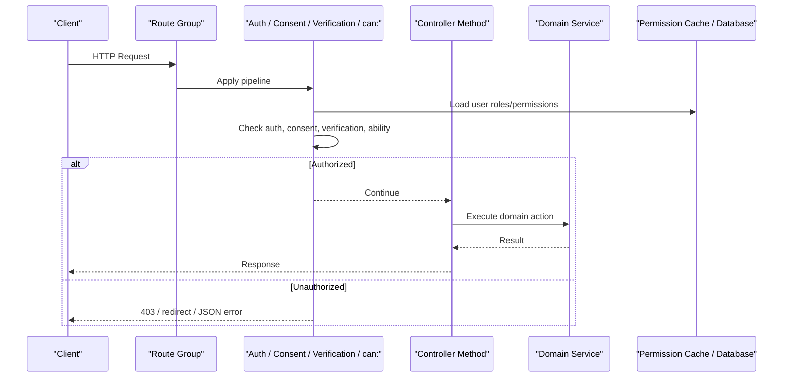
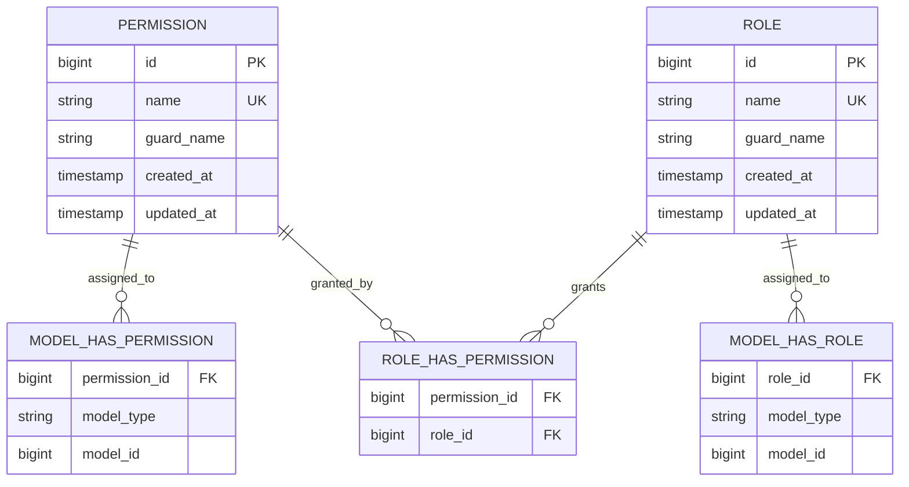
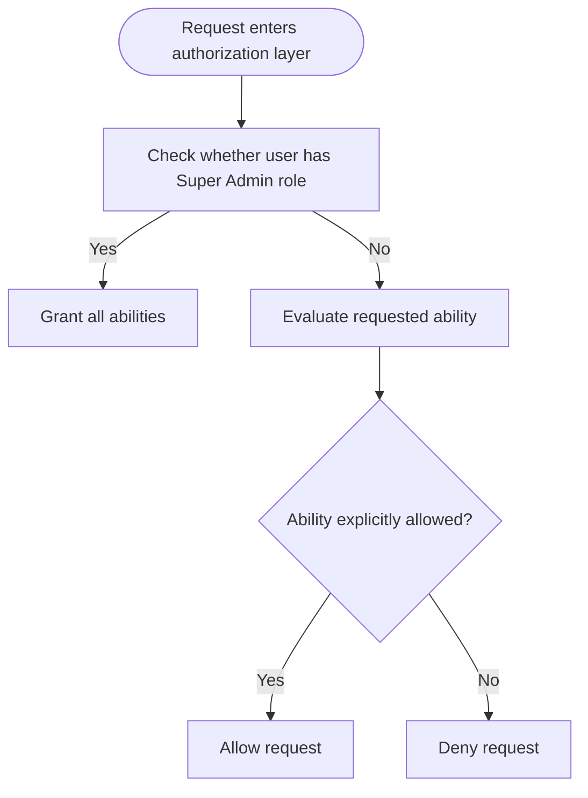
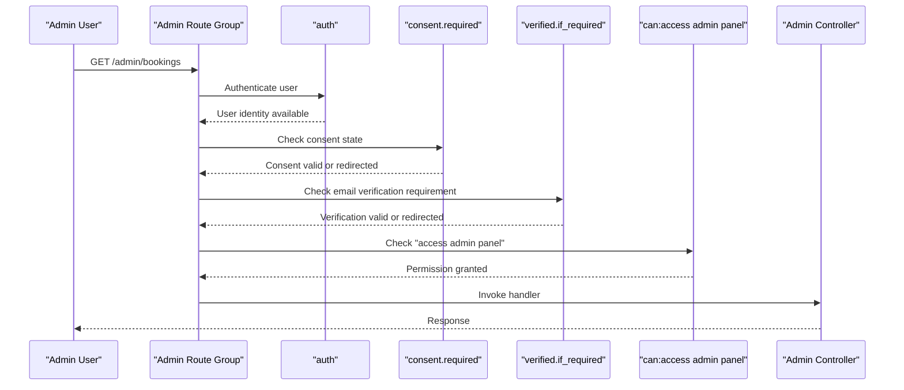
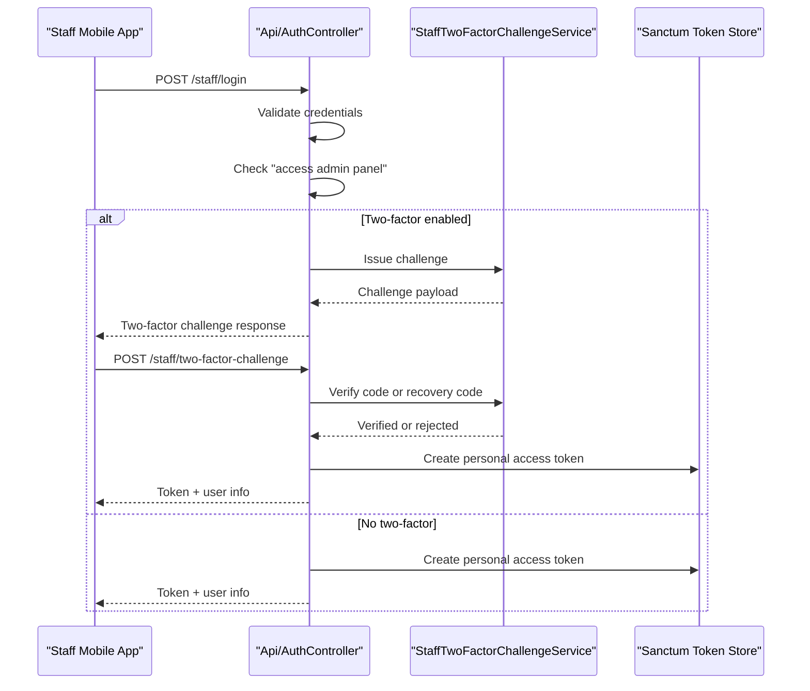
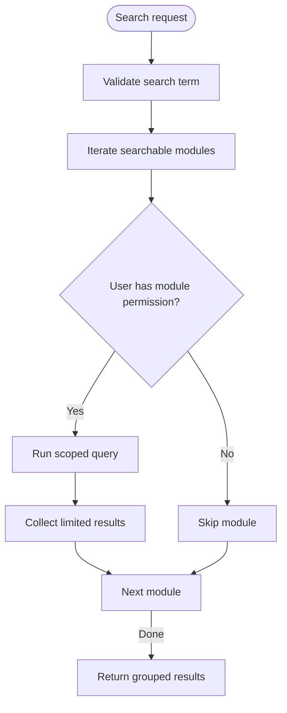
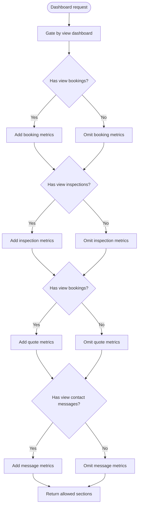
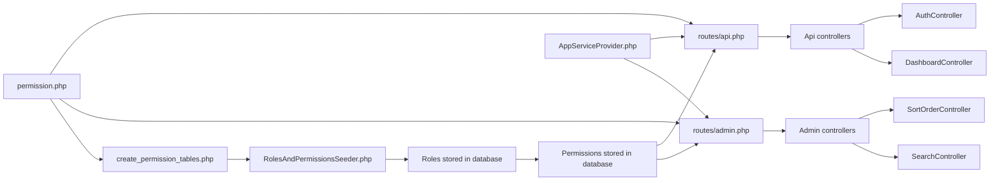

# Authorization Policies & Middleware

<cite>
**Referenced Files in This Document**
- [permission.php](file://config/permission.php)
- [create_permission_tables.php](file://database/migrations/2026_04_18_163436_create_permission_tables.php)
- [RolesAndPermissionsSeeder.php](file://database/seeders/RolesAndPermissionsSeeder.php)
- [admin.php](file://routes/admin.php)
- [api.php](file://routes/api.php)
- [web.php](file://routes/web.php)
- [settings.php](file://routes/settings.php)
- [AppServiceProvider.php](file://app/Providers/AppServiceProvider.php)
- [RoleService.php](file://app/Services/RoleService.php)
- [EnsureConsentRecorded.php](file://app/Http/Middleware/EnsureConsentRecorded.php)
- [EnsureEmailIsVerifiedWhenRequired.php](file://app/Http/Middleware/EnsureEmailIsVerifiedWhenRequired.php)
- [TrackUserSession.php](file://app/Http/Middleware/TrackUserSession.php)
- [ShareThemePreference.php](file://app/Http/Middleware/ShareThemePreference.php)
- [EnsureRegistrationIsEnabled.php](file://app/Http/Middleware/EnsureRegistrationIsEnabled.php)
- [ThrottleUsernameAvailability.php](file://app/Http/Middleware/ThrottleUsernameAvailability.php)
- [SearchController.php](file://app/Http/Controllers/Admin/SearchController.php)
- [SortOrderController.php](file://app/Http/Controllers/Admin/SortOrderController.php)
- [DashboardController.php](file://app/Http/Controllers/Api/DashboardController.php)
- [AuthController.php](file://app/Http/Controllers/Api/AuthController.php)
</cite>

## Table of Contents
1. [Introduction](#introduction)
2. [Project Structure](#project-structure)
3. [Core Components](#core-components)
4. [Architecture Overview](#architecture-overview)
5. [Detailed Component Analysis](#detailed-component-analysis)
6. [Dependency Analysis](#dependency-analysis)
7. [Performance Considerations](#performance-considerations)
8. [Troubleshooting Guide](#troubleshooting-guide)
9. [Conclusion](#conclusion)

## Introduction
This document explains how authorization is implemented across Highblossom’s web admin panel and staff API. The system combines Laravel middleware, Spatie Laravel Permissions, custom application services, and controller-level checks to enforce roles, permissions, and contextual access rules. It covers:

- How the permission model and database schema are configured.
- How route groups protect admin routes with `auth` and `can:` abilities.
- How the staff API uses Sanctum tokens plus the same permission abilities.
- How controllers perform conditional and context-aware authorization.
- Best practices for organizing, testing, and securing authorization logic.
- Performance considerations around permission caching and request-scoped checks.

## Project Structure
Authorization spans configuration, routing, middleware, service providers, seeders, services, and controllers:

```mermaid
graph TB
  subgraph "Configuration"
    PConfig["config/permission.php"]
  end

  subgraph "Database"
    PermMigration["migrations/create_permission_tables.php"]
    RoleSeed["seeders/RolesAndPermissionsSeeder.php"]
  end

  subgraph "Bootstrapping"
    AppProvider["AppServiceProvider.php"]
  end

  subgraph "Routing"
    AdminRoutes["routes/admin.php"]
    ApiRoutes["routes/api.php"]
    WebRoutes["routes/web.php"]
    SettingsRoutes["routes/settings.php"]
  end

  subgraph "Middleware"
    Consent["EnsureConsentRecorded.php"]
    EmailVerify["EnsureEmailIsVerifiedWhenRequired.php"]
    SessionTrack["TrackUserSession.php"]
    Theme["ShareThemePreference.php"]
    RegEnabled["EnsureRegistrationIsEnabled.php"]
    UsernameThrottle["ThrottleUsernameAvailability.php"]
  end

  subgraph "Controllers"
    AdminSearch["Admin/SearchController.php"]
    SortOrder["Admin/SortOrderController.php"]
    ApiDashboard["Api/DashboardController.php"]
    ApiAuth["Api/AuthController.php"]
  end

  PConfig --> PermMigration
  PermMigration --> RoleSeed
  PConfig --> AdminRoutes
  PConfig --> ApiRoutes
  AppProvider --> AdminRoutes
  AppProvider --> ApiRoutes
  AdminRoutes --> AdminSearch
  AdminRoutes --> SortOrder
  ApiRoutes --> ApiDashboard
  ApiRoutes --> ApiAuth
  WebRoutes --> Consent
  WebRoutes --> EmailVerify
  WebRoutes --> SessionTrack
  WebRoutes --> Theme
  SettingsRoutes --> RegEnabled
  SettingsRoutes --> UsernameThrottle
```



**Diagram sources**
- [permission.php:1-200](file://config/permission.php#L1-L200)
- [create_permission_tables.php:1-137](file://database/migrations/2026_04_18_163436_create_permission_tables.php#L1-L137)
- [RolesAndPermissionsSeeder.php:1-161](file://database/seeders/RolesAndPermissionsSeeder.php#L1-L161)
- [AppServiceProvider.php:1-110](file://app/Providers/AppServiceProvider.php#L1-L110)
- [admin.php:1-171](file://routes/admin.php#L1-L171)
- [api.php:1-117](file://routes/api.php#L1-L117)
- [web.php:1-76](file://routes/web.php#L1-L76)
- [settings.php:1-16](file://routes/settings.php#L1-L16)

**Section sources**
- [permission.php:1-200](file://config/permission.php#L1-L200)
- [admin.php:1-171](file://routes/admin.php#L1-L171)
- [api.php:1-117](file://routes/api.php#L1-L117)

## Core Components
Highblossom’s authorization relies on five layers:

| Layer | Responsibility | Key files |
|---|---|---|
| Permission configuration | Defines models, table names, cache settings, and wildcard behavior | [permission.php](file://config/permission.php#L1-L200) |
| Schema and data | Creates role/permission tables and seeds default roles and abilities | [create_permission_tables.php](file://database/migrations/2026_04_18_163436_create_permission_tables.php#L1-L137), [RolesAndPermissionsSeeder.php](file://database/seeders/RolesAndPermissionsSeeder.php#L1-L161) |
| Global gate policy | Grants Super Admin all permissions and registers special gates | [AppServiceProvider.php](file://app/Providers/AppServiceProvider.php#L1-L110) |
| Route protection | Applies authentication, consent, verification, and permission abilities | [admin.php](file://routes/admin.php#L1-L171), [api.php](file://routes/api.php#L1-L117), [web.php](file://routes/web.php#L1-L76), [settings.php](file://routes/settings.php#L1-L16) |
| Controller-level checks | Adds dynamic, context-aware authorization where route-level guards are insufficient | [SearchController.php](file://app/Http/Controllers/Admin/SearchController.php#L1-L200), [SortOrderController.php](file://app/Http/Controllers/Admin/SortOrderController.php#L1-L71), [DashboardController.php](file://app/Http/Controllers/Api/DashboardController.php#L1-L79), [AuthController.php](file://app/Http/Controllers/Api/AuthController.php#L1-L135) |

The primary pattern is ability-based rather than role-based at the route layer. Routes use `can:<ability>` so business capabilities such as `view bookings`, `update blog`, `manage settings`, and `access admin panel` are explicit. Roles exist primarily as grouping mechanisms populated by the seeder.

**Section sources**
- [permission.php:1-200](file://config/permission.php#L1-L200)
- [RolesAndPermissionsSeeder.php:1-161](file://database/seeders/RolesAndPermissionsSeeder.php#L1-L161)
- [AppServiceProvider.php:1-110](file://app/Providers/AppServiceProvider.php#L1-L110)

## Architecture Overview
The authorization pipeline differs slightly between the web admin panel and the staff API, but both converge on Spatie permissions.



**Diagram sources**
- [admin.php:1-171](file://routes/admin.php#L1-L171)
- [api.php:1-117](file://routes/api.php#L1-L117)
- [EnsureConsentRecorded.php:1-38](file://app/Http/Middleware/EnsureConsentRecorded.php#L1-L38)
- [EnsureEmailIsVerifiedWhenRequired.php:1-40](file://app/Http/Middleware/EnsureEmailIsVerifiedWhenRequired.php#L1-L40)
- [AppServiceProvider.php:1-110](file://app/Providers/AppServiceProvider.php#L1-L110)

Key behaviors:

- **Web admin panel**: Routes under `/admin` require authentication, consent capture, email verification when required, and an `access admin panel` permission. Individual endpoints add narrower abilities like `view bookings`, `update inspections`, or `manage settings`.
- **Staff API**: Authentication is token-based via Sanctum (`auth:sanctum`). Every protected endpoint also applies the same `can:` abilities used by the web admin, ensuring consistent authorization across channels.
- **Public API routes**: Public endpoints under `/api` such as booking availability and poll voting are intentionally unauthenticated and rate-limited instead of permission-gated.

**Section sources**
- [admin.php:1-171](file://routes/admin.php#L1-L171)
- [api.php:1-117](file://routes/api.php#L1-L117)
- [web.php:1-76](file://routes/web.php#L1-L76)

## Detailed Component Analysis

### Permission Configuration and Data Model
Spatie Laravel Permissions is configured through `config/permission.php`. The configuration defines:

- Models for permissions and roles.
- Table names for permissions, roles, and pivot tables.
- Column naming conventions for morph keys and team support.
- Whether built-in permission check methods are registered.
- Octane reset listener behavior.
- Events for role/permission assignment changes.
- Team mode, which is disabled.
- Wildcard permission support, which is disabled.
- Cache expiration time and key.

The migration creates four core tables:

| Table | Purpose |
|---|---|
| `permissions` | Stores named abilities such as `view bookings` or `manage settings` |
| `roles` | Stores role names such as `Super Admin`, `Admin`, `Staff`, `User` |
| `model_has_permissions` | Links users to permissions |
| `model_has_roles` | Links users to roles |
| `role_has_permissions` | Links roles to permissions |

The seeder clears cached permissions, creates a flat list of abilities, assigns every ability to `Super Admin`, distributes realistic subsets to `Admin`, `Staff`, and `User`, and assigns `Super Admin` to the first user if present.



**Diagram sources**
- [create_permission_tables.php:1-137](file://database/migrations/2026_04_18_163436_create_permission_tables.php#L1-L137)

**Section sources**
- [permission.php:1-200](file://config/permission.php#L1-L200)
- [create_permission_tables.php:1-137](file://database/migrations/2026_04_18_163436_create_permission_tables.php#L1-L137)
- [RolesAndPermissionsSeeder.php:1-161](file://database/seeders/RolesAndPermissionsSeeder.php#L1-L161)

### Global Gate Policy and Super Admin Behavior
`AppServiceProvider` configures global authorization behavior:

- Log Viewer authentication requires the `Super Admin` role.
- Auditify authentication requires the `Super Admin` role.
- A global `Gate::before` callback grants any ability to users with the `Super Admin` role.
- Explicit gates are defined for `viewSchedulerList` and `manage environment`, also tied to `Super Admin`.

This means that `Super Admin` bypasses normal permission checks, while other roles must satisfy explicit abilities.



**Diagram sources**
- [AppServiceProvider.php:1-110](file://app/Providers/AppServiceProvider.php#L1-L110)

**Section sources**
- [AppServiceProvider.php:1-110](file://app/Providers/AppServiceProvider.php#L1-L110)

### Admin Route Protection Pipeline
The admin route group protects the entire `/admin` area with:

| Middleware | Purpose |
|---|---|
| `auth` | Ensures a user is authenticated |
| `consent.required` | Requires recorded terms and privacy consent |
| `verified.if_required` | Enforces email verification when company settings require it |
| `can:access admin panel` | Requires the general admin entry permission |

Within the group, each route adds its own ability:

- Read-only resources use `view <resource>`.
- Write operations use `update <resource>`, `manage <resource>`, or a specific capability such as `manage versions`.
- Some shared read endpoints, such as sort-order availability, are intentionally left without route-level ability checks because the controller itself performs authorization.



**Diagram sources**
- [admin.php:1-171](file://routes/admin.php#L1-L171)
- [EnsureConsentRecorded.php:1-38](file://app/Http/Middleware/EnsureConsentRecorded.php#L1-L38)
- [EnsureEmailIsVerifiedWhenRequired.php:1-40](file://app/Http/Middleware/EnsureEmailIsVerifiedWhenRequired.php#L1-L40)

**Section sources**
- [admin.php:1-171](file://routes/admin.php#L1-L171)

### Staff API Security and Token-Based Authorization
The staff API lives under `/staff` and separates login and two-factor challenge from protected data routes:

| Endpoint category | Authentication | Authorization |
|---|---|---|
| Login | None, but throttled | None |
| Two-factor challenge | None, but throttled | Challenge validation |
| Protected data routes | Sanctum personal access token | Same `can:` abilities as the web admin |

The login flow enforces:

1. Credential validation.
2. Permission check for `access admin panel`.
3. Two-factor challenge handling when enabled.
4. Token issuance scoped to three months.
5. UI gating information returned through `me`.



**Diagram sources**
- [api.php:1-117](file://routes/api.php#L1-L117)
- [AuthController.php:1-135](file://app/Http/Controllers/Api/AuthController.php#L1-L135)

**Section sources**
- [api.php:1-117](file://routes/api.php#L1-L117)
- [AuthController.php:1-135](file://app/Http/Controllers/Api/AuthController.php#L1-L135)

### Direct Method Calls and Conditional Access Control
Not every authorization decision belongs in middleware. Controllers implement direct method calls for context-aware decisions.

#### Search Controller
The search controller builds a command palette that only queries modules the requester is permitted to see. For each module, it checks `user->cannot($module['permission'])` before running the query. This ensures results cannot be exposed even if a client guesses a route.



**Diagram sources**
- [SearchController.php:1-L200](file://app/Http/Controllers/Admin/SearchController.php#L1-L200)

**Section sources**
- [SearchController.php:1-L200](file://app/Http/Controllers/Admin/SearchController.php#L1-L200)

#### Sort Order Controller
The sort-order availability endpoint is read-only and reports whether a sort order is free within a scope. It uses direct authorization:

```php
abort_unless($request->user()?->can(SortOrderRegistry::ability($module)), 403);
```

This demonstrates dynamic ability resolution based on registry metadata rather than hardcoding a single ability string per route.

**Section sources**
- [SortOrderController.php:1-L71](file://app/Http/Controllers/Admin/SortOrderController.php#L1-L71)

#### Dashboard Controller
The dashboard aggregates counts for multiple domains. Even though the endpoint itself is gated by `can:view dashboard`, individual sections are conditionally included only when the user holds the corresponding ability. This prevents leaking aggregate visibility into the response payload.



**Diagram sources**
- [DashboardController.php:1-L79](file://app/Http/Controllers/Api/DashboardController.php#L1-L79)

**Section sources**
- [DashboardController.php:1-L79](file://app/Http/Controllers/Api/DashboardController.php#L1-L79)

### Custom Middleware Patterns
Custom middleware handles non-permission concerns that still affect authorization boundaries:

| Middleware | Behavior |
|---|---|
| `EnsureConsentRecorded` | Redirects or returns 403 for users who have not accepted terms and privacy policy |
| `EnsureEmailIsVerifiedWhenRequired` | Redirects or returns 403 when email verification is required and missing |
| `EnsureRegistrationIsEnabled` | Returns 404 for registration routes when registration is disabled globally |
| `ThrottleUsernameAvailability` | Rate-limits username uniqueness checks by route, user, and IP |
| `TrackUserSession` | Records device session metadata after the request completes |
| `ShareThemePreference` | Shares theme preference with views based on the authenticated user |

These middlewares demonstrate common patterns:

- JSON requests receive structured 403 responses instead of redirects.
- Blade and API clients are treated consistently where possible.
- Rate limiting is applied narrowly to vulnerable surfaces rather than broadly to all authentication flows.

**Section sources**
- [EnsureConsentRecorded.php:1-38](file://app/Http/Middleware/EnsureConsentRecorded.php#L1-L38)
- [EnsureEmailIsVerifiedWhenRequired.php:1-40](file://app/Http/Middleware/EnsureEmailIsVerifiedWhenRequired.php#L1-L40)
- [EnsureRegistrationIsEnabled.php:1-39](file://app/Http/Middleware/EnsureRegistrationIsEnabled.php#L1-L39)
- [ThrottleUsernameAvailability.php:1-72](file://app/Http/Middleware/ThrottleUsernameAvailability.php#L1-L72)
- [TrackUserSession.php:1-39](file://app/Http/Middleware/TrackUserSession.php#L1-L39)
- [ShareThemePreference.php:1-32](file://app/Http/Middleware/ShareThemePreference.php#L1-L32)

### Organizing Authorization Logic
Recommended organization patterns observed in Highblossom:

| Concern | Recommended location |
|---|---|
| Named abilities | Seeders and database; never hardcode scattered throughout controllers |
| Entry-point access control | Route middleware |
| Domain-specific checks | Controllers or actions |
| Cross-cutting security behavior | Middleware |
| Role mutation and permission assignment | Services and seeders |
| Global super-user overrides | Service provider |

The `RoleService` encapsulates role creation, update, and deletion, including protection for the `Super Admin` role. This keeps permission mutation logic out of controllers.

**Section sources**
- [RoleService.php:1-43](file://app/Services/RoleService.php#L1-L43)
- [RolesAndPermissionsSeeder.php:1-161](file://database/seeders/RolesAndPermissionsSeeder.php#L1-L161)

## Dependency Analysis
The authorization dependency graph shows how configuration, routing, and controllers interact.



**Diagram sources**
- [permission.php:1-200](file://config/permission.php#L1-L200)
- [create_permission_tables.php:1-137](file://database/migrations/2026_04_18_163436_create_permission_tables.php#L1-L137)
- [RolesAndPermissionsSeeder.php:1-161](file://database/seeders/RolesAndPermissionsSeeder.php#L1-L161)
- [AppServiceProvider.php:1-110](file://app/Providers/AppServiceProvider.php#L1-L110)
- [admin.php:1-171](file://routes/admin.php#L1-L171)
- [api.php:1-117](file://routes/api.php#L1-L117)

Coupling observations:

- Routing is tightly coupled to permission names. Changing a permission name requires updating routes, seeders, and any controller-level checks.
- The staff API reuses the same ability names as the web admin, reducing duplication and drift.
- Controller-level checks depend on the current authenticated user and should avoid loading unrelated data before authorization.
- Global gate overrides create a privileged path for `Super Admin`; this is convenient but must be documented clearly to prevent accidental privilege escalation assumptions.

**Section sources**
- [admin.php:1-171](file://routes/admin.php#L1-L171)
- [api.php:1-117](file://routes/api.php#L1-L117)
- [AppServiceProvider.php:1-110](file://app/Providers/AppServiceProvider.php#L1-L110)

## Performance Considerations
Authorization performance depends on three main factors: permission cache usage, query complexity, and request volume.

### Permission Caching
The Spatie Permissions configuration sets a 24-hour expiration time and a dedicated cache key. The migration also clears the cache during creation. This reduces repeated database reads for role and permission lookups.

Recommendations:

- Keep permission definitions centralized in seeders or deployment scripts.
- Flush the permission cache after mutating roles or permissions.
- Avoid frequent runtime permission mutations in hot paths.
- Use explicit ability names rather than dynamic strings where possible.

### Controller-Level Checks
Controller-level authorization is efficient when it short-circuits early:

- Check permissions before building large queries.
- Use narrow queries per module, as seen in the search controller.
- Avoid returning unauthorized sections in aggregated responses.
- Prefer read-only endpoints for probes and availability checks, then validate again at write time.

### API Aggregates
The dashboard controller demonstrates safe aggregation:

- Each section is guarded independently.
- Queries are simple counts and filters.
- Responses omit sections the user cannot see, preventing indirect leakage.

For more complex aggregates, consider:

- Caching computed dashboards behind feature flags and user abilities.
- Using background jobs for expensive statistics.
- Validating permissions before starting long-running work.

[No sources needed since this section provides general guidance]

## Troubleshooting Guide

### Common Authorization Problems

| Symptom | Likely cause | Resolution |
|---|---|---|
| Admin routes return 403 even for logged-in users | Missing `access admin panel` permission | Assign the permission to the user’s role |
| Staff app login fails for valid users | User lacks `access admin panel` | Update role permissions or assign directly |
| API endpoints work in browser but fail in mobile app | Token not issued or expired | Reauthenticate and verify token scope |
| Search returns unexpected empty results | Module permission check skips the module | Verify the ability used by the module definition |
| Dashboard omits expected sections | Section-level ability missing | Check abilities such as `view bookings` or `view inspections` |
| Registration route returns 404 | Registration disabled by company setting | Enable registration or adjust environment configuration |
| Username uniqueness checks are slow or abused | Missing rate limiting on availability surface | Ensure the throttle middleware is applied to affected routes |

### Unauthorized Access Handling
Highblossom handles unauthorized access consistently:

- Blade requests may redirect to consent, verification, or guest pages.
- JSON requests return structured messages with appropriate status codes.
- Route-level failures are usually 403 Forbidden.
- Feature-gated public routes, such as registration, may return 404 to avoid revealing whether the feature exists.

### Testing Authorization Rules
Test authorization using these strategies:

1. **Route-level tests**: Assert that unauthenticated requests are denied and that missing permissions return 403.
2. **Permission-level tests**: Create roles with minimal permissions and assert only allowed endpoints respond successfully.
3. **Context-aware tests**: Assert that search does not include restricted modules and that dashboard omits unauthorized sections.
4. **API tests**: Test Sanctum token issuance, two-factor challenges, and ability-gated endpoints.
5. **Super Admin tests**: Confirm that `Super Admin` bypasses normal permission checks where intended.
6. **Cache tests**: After seeding or changing permissions, clear the permission cache and verify behavior stabilizes.

**Section sources**
- [AuthController.php:1-L135](file://app/Http/Controllers/Api/AuthController.php#L1-L135)
- [SearchController.php:1-L200](file://app/Http/Controllers/Admin/SearchController.php#L1-L200)
- [DashboardController.php:1-L79](file://app/Http/Controllers/Api/DashboardController.php#L1-L79)
- [EnsureRegistrationIsEnabled.php:1-39](file://app/Http/Middleware/EnsureRegistrationIsEnabled.php#L1-L39)

## Conclusion
Highblossom implements authorization through layered controls:

- Route middleware protects entry points and common requirements such as consent and email verification.
- Spatie permissions provide explicit, testable abilities.
- The staff API shares the same ability model as the web admin, ensuring consistency across channels.
- Controllers add context-aware checks where broad route guards are insufficient.
- Global gate overrides give `Super Admin` full access, which simplifies administration but requires careful documentation.
- Permission caching improves performance, while controller-level checks keep sensitive data from leaking into responses.

For new features, follow the established pattern: define abilities in the seeder, protect routes with `can:`, add controller-level checks only when resource context matters, and handle unauthorized access consistently for both HTML and JSON clients.

[No sources needed since this section summarizes without analyzing specific files]