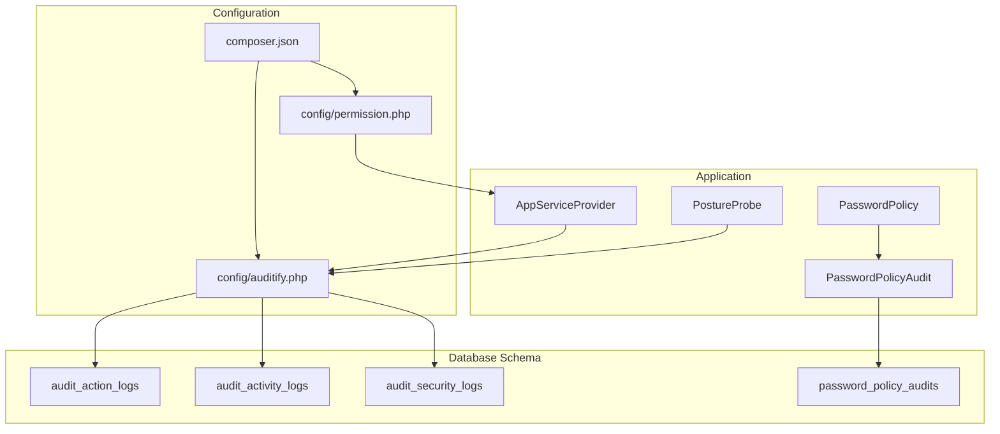
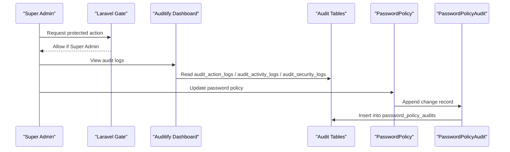
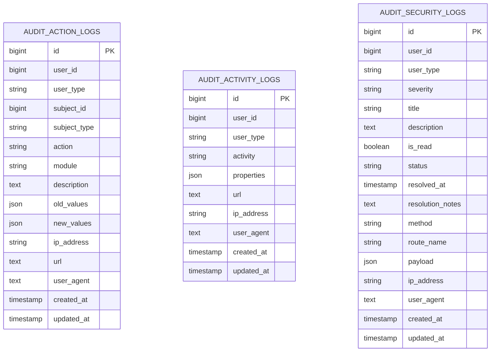
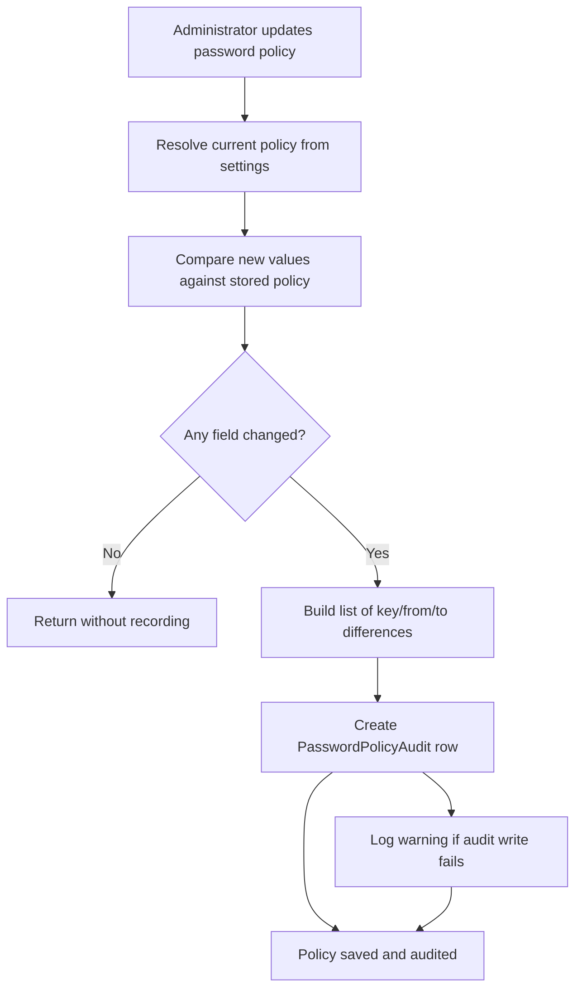
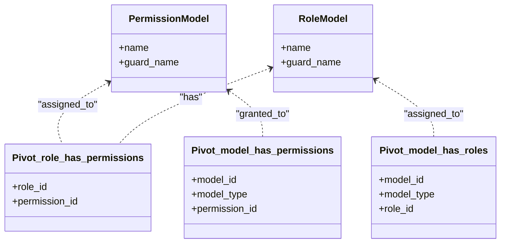
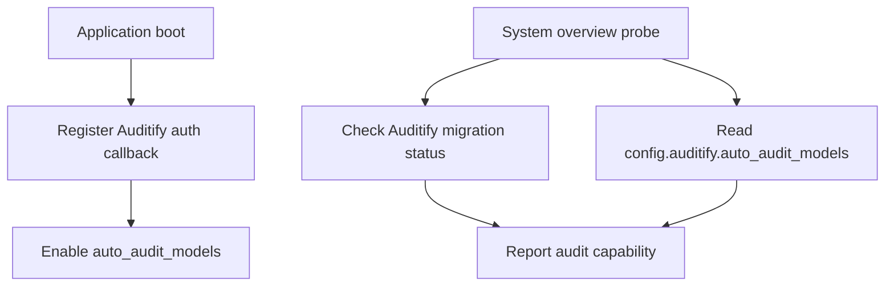
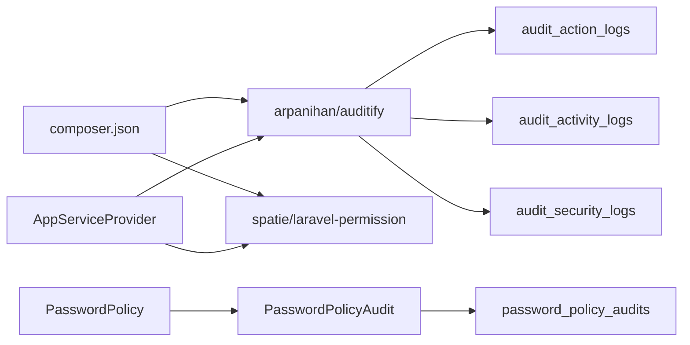

# Permission Auditing & Logging

<cite>
**Referenced Files in This Document**
- [auditify.php](file://config/auditify.php)
- [2026_01_01_000000_create_audit_action_logs_table.php](file://database/migrations/2026_01_01_000000_create_audit_action_logs_table.php)
- [2026_01_01_000001_create_audit_activity_logs_table.php](file://database/migrations/2026_01_01_000001_create_audit_activity_logs_table.php)
- [2026_01_01_000002_create_audit_security_logs_table.php](file://database/migrations/2026_01_01_000002_create_audit_security_logs_table.php)
- [permission.php](file://config/permission.php)
- [composer.json](file://composer.json)
- [AppServiceProvider.php](file://app/Providers/AppServiceProvider.php)
- [PostureProbe.php](file://app/Support/SystemOverview/Probes/PostureProbe.php)
- [PasswordPolicyAudit.php](file://app/Models/PasswordPolicyAudit.php)
- [2026_10_20_000000_create_password_policy_audits_table.php](file://database/migrations/2026_10_20_000000_create_password_policy_audits_table.php)
- [PasswordPolicy.php](file://app/Services/PasswordPolicy.php)
</cite>

## Table of Contents
1. [Introduction](#introduction)
2. [Project Structure](#project-structure)
3. [Core Components](#core-components)
4. [Architecture Overview](#architecture-overview)
5. [Detailed Component Analysis](#detailed-component-analysis)
6. [Dependency Analysis](#dependency-analysis)
7. [Performance Considerations](#performance-considerations)
8. [Troubleshooting Guide](#troubleshooting-guide)
9. [Conclusion](#conclusion)

## Introduction
This document explains how Highblossom tracks permission-related changes through its audit logging system. It focuses on:

- The three audit log tables created for the application.
- How the third-party Auditify package is configured and integrated.
- How Spatie Laravel Permission is wired into the project.
- The custom password policy audit trail as a concrete example of append-only security auditing.
- Practical guidance for querying logs, investigating access issues, generating compliance reports, and managing retention and performance.

The repository does not include custom Spatie `RoleAttachedEvent` or `PermissionAttachedEvent` listeners, so role and permission assignments are not currently recorded by dedicated audit events. Instead, the system relies on Auditify’s automatic model auditing for models that it chooses to track, plus explicit custom audit records where implemented.

## Project Structure
The permission and audit surface spans configuration, migrations, service provider wiring, and one domain-specific audit model.

**Diagram sources**
- [auditify.php:1-81](file://config/auditify.php#L1-L81)
- [permission.php:1-200](file://config/permission.php#L1-L200)
- [composer.json:24-54](file://composer.json#L24-L54)
- [2026_01_01_000000_create_audit_action_logs_table.php:1-37](file://database/migrations/2026_01_01_000000_create_audit_action_logs_table.php#L1-L37)
- [2026_01_01_000001_create_audit_activity_logs_table.php:1-33](file://database/migrations/2026_01_01_000001_create_audit_activity_logs_table.php#L1-L33)
- [2026_01_01_000002_create_audit_security_logs_table.php:1-40](file://database/migrations/2026_01_01_000002_create_audit_security_logs_table.php#L1-L40)
- [2026_10_20_000000_create_password_policy_audits_table.php:1-32](file://database/migrations/2026_10_20_000000_create_password_policy_audits_table.php#L1-L32)
- [AppServiceProvider.php:1-110](file://app/Providers/AppServiceProvider.php#L1-L110)
- [PostureProbe.php:370-380](file://app/Support/SystemOverview/Probes/PostureProbe.php#L370-L380)
- [PasswordPolicy.php:250-322](file://app/Services/PasswordPolicy.php#L250-L322)
- [PasswordPolicyAudit.php:1-42](file://app/Models/PasswordPolicyAudit.php#L1-L42)

**Section sources**
- [auditify.php:1-81](file://config/auditify.php#L1-L81)
- [permission.php:1-200](file://config/permission.php#L1-L200)
- [composer.json:24-54](file://composer.json#L24-L54)
- [AppServiceProvider.php:1-110](file://app/Providers/AppServiceProvider.php#L1-L110)

## Core Components
Highblossom uses two complementary layers for permission auditing:

| Layer | Purpose | Current State |
|---|---|---|
| Auditify package | Provides an admin UI, middleware, auto-audit behavior, IP/user-agent tracking, alerts, XSS protection, and pruning. | Installed, configured, and authorized only for Super Admins. Auto-model auditing is enabled. |
| Spatie Laravel Permission | Supplies roles, permissions, gates, and optional assignment events. | Installed with default table names; event emission is disabled. |
| Custom password policy audit | Records field-level changes to the password policy as append-only rows. | Implemented and exposed via a service method. |

### Auditify Configuration Highlights
- Route prefix: `auditify`.
- Authentication callback restricts Auditify pages to users with the Super Admin role.
- Tracks IP address, user agent, URL, and page visits.
- Security alerts are enabled for sensitive modules such as User, Role, Permission, Setting, and Config.
- Automatic model auditing is enabled.
- Pruning retains audit data for 90 days.

### Spatie Permission Configuration Highlights
- Uses default `roles`, `permissions`, `model_has_roles`, `model_has_permissions`, and `role_has_permissions` tables.
- Event emission for role and permission assignments is disabled.
- Permissions are cached for 24 hours.

### Authorization Integration
The application grants all permissions to the Super Admin role and limits Auditify dashboard access to Super Admins.

**Section sources**
- [auditify.php:1-81](file://config/auditify.php#L1-L81)
- [permission.php:1-200](file://config/permission.php#L1-L200)
- [AppServiceProvider.php:54-90](file://app/Providers/AppServiceProvider.php#L54-L90)

## Architecture Overview
The permission change auditing flow combines framework authorization, third-party auditing, and optional custom audit records.

**Diagram sources**
- [AppServiceProvider.php:54-90](file://app/Providers/AppServiceProvider.php#L54-L90)
- [auditify.php:1-81](file://config/auditify.php#L1-L81)
- [2026_01_01_000000_create_audit_action_logs_table.php:1-37](file://database/migrations/2026_01_01_000000_create_audit_action_logs_table.php#L1-L37)
- [2026_01_01_000001_create_audit_activity_logs_table.php:1-33](file://database/migrations/2026_01_01_000001_create_audit_activity_logs_table.php#L1-L33)
- [2026_01_01_000002_create_audit_security_logs_table.php:1-40](file://database/migrations/2026_01_01_000002_create_audit_security_logs_table.php#L1-L40)
- [PasswordPolicy.php:250-322](file://app/Services/PasswordPolicy.php#L250-L322)
- [PasswordPolicyAudit.php:1-42](file://app/Models/PasswordPolicyAudit.php#L1-L42)

## Detailed Component Analysis

### Audit Log Data Model

#### Audit Action Logs
Used by Auditify for general model mutations and action history.

| Column | Meaning |
|---|---|
| `id` | Primary key. |
| `user_id`, `user_type` | Polymorphic actor who performed the action. |
| `subject_id`, `subject_type` | Polymorphic subject entity changed. |
| `action` | Short label describing the operation. |
| `module` | Business module name. |
| `description` | Human-readable description. |
| `old_values` | JSON snapshot before the change. |
| `new_values` | JSON snapshot after the change. |
| `ip_address` | Client IP. |
| `url` | Request URL. |
| `user_agent` | Browser or client user agent. |
| `created_at`, `updated_at` | Timestamps. |

#### Audit Activity Logs
Used for broader activity tracking rather than strict model diffs.

| Column | Meaning |
|---|---|
| `id` | Primary key. |
| `user_id`, `user_type` | Actor. |
| `activity` | Activity label. |
| `properties` | Optional structured payload. |
| `url`, `ip_address`, `user_agent` | Request context. |
| `created_at`, `updated_at` | Timestamps. |

#### Audit Security Logs
Used for security-relevant events, alert triage, and resolution tracking.

| Column | Meaning |
|---|---|
| `id` | Primary key. |
| `user_id`, `user_type` | Related actor when available. |
| `severity` | Alert severity. |
| `title`, `description` | Human-readable alert. |
| `is_read`, `status`, `resolved_at` | Lifecycle state. |
| `resolution_notes` | Investigation notes. |
| `method`, `route_name`, `payload` | Request details. |
| `ip_address`, `user_agent` | Client context. |
| `created_at`, `updated_at` | Timestamps. |

**Diagram sources**
- [2026_01_01_000000_create_audit_action_logs_table.php:7-30](file://database/migrations/2026_01_01_000000_create_audit_action_logs_table.php#L7-L30)
- [2026_01_01_000001_create_audit_activity_logs_table.php:7-25](file://database/migrations/2026_01_01_000001_create_audit_activity_logs_table.php#L7-L25)
- [2026_01_01_000002_create_audit_security_logs_table.php:7-32](file://database/migrations/2026_01_01_000002_create_audit_security_logs_table.php#L7-L32)

**Section sources**
- [2026_01_01_000000_create_audit_action_logs_table.php:1-37](file://database/migrations/2026_01_01_000000_create_audit_action_logs_table.php#L1-L37)
- [2026_01_01_000001_create_audit_activity_logs_table.php:1-33](file://database/migrations/2026_01_01_000001_create_audit_activity_logs_table.php#L1-L33)
- [2026_01_01_000002_create_audit_security_logs_table.php:1-40](file://database/migrations/2026_01_01_000002_create_audit_security_logs_table.php#L1-L40)

### Password Policy Audit Trail
The password policy audit trail is a focused, append-only audit model used to record configuration changes to password requirements.

#### Data Model

| Column | Meaning |
|---|---|
| `id` | Primary key. |
| `user_id` | Administrator who saved the policy change. |
| `changes` | Array of field-level differences between the previous and new policy. |
| `ip_address` | Client IP at save time. |
| `created_at`, `updated_at` | Timestamps. |

The model casts `changes` as an array and exposes a relationship back to the `User` model.

#### Change Recording Flow

**Diagram sources**
- [PasswordPolicy.php:250-322](file://app/Services/PasswordPolicy.php#L250-L322)
- [2026_10_20_000000_create_password_policy_audits_table.php:7-26](file://database/migrations/2026_10_20_000000_create_password_policy_audits_table.php#L7-L26)
- [PasswordPolicyAudit.php:1-42](file://app/Models/PasswordPolicyAudit.php#L1-L42)

#### Example Audit Payload Shape
Each entry in the `changes` array contains:

- `key`: Field name being changed.
- `from`: Previous value.
- `to`: New value.

The audit trail API returns recent entries with actor email, a readable summary of changes, and relative time.

**Section sources**
- [2026_10_20_000000_create_password_policy_audits_table.php:1-32](file://database/migrations/2026_10_20_000000_create_password_policy_audits_table.php#L1-L32)
- [PasswordPolicyAudit.php:1-42](file://app/Models/PasswordPolicyAudit.php#L1-L42)
- [PasswordPolicy.php:250-322](file://app/Services/PasswordPolicy.php#L250-L322)

### Spatie Permission Integration
Spatie Laravel Permission provides the core role and permission infrastructure.

- Default table names are used for roles, permissions, and pivot tables.
- Permission caching is enabled with a 24-hour expiration.
- Role and permission assignment events are disabled, so there is no built-in hook to emit custom audit events for role or permission changes.

**Diagram sources**
- [permission.php:1-200](file://config/permission.php#L1-L200)

**Section sources**
- [permission.php:1-200](file://config/permission.php#L1-L200)

### Auditify Integration and Health Check
Auditify is installed as a Composer dependency and configured through `config/auditify.php`. The application authorizes Auditify access to Super Admins and enables automatic model auditing.

The system overview probe checks whether Auditify migrations have been run and whether automatic model auditing is enabled.

**Diagram sources**
- [AppServiceProvider.php:54-90](file://app/Providers/AppServiceProvider.php#L54-L90)
- [auditify.php:1-81](file://config/auditify.php#L1-L81)
- [PostureProbe.php:370-380](file://app/Support/SystemOverview/Probes/PostureProbe.php#L370-L380)

**Section sources**
- [composer.json:24-54](file://composer.json#L24-L54)
- [auditify.php:1-81](file://config/auditify.php#L1-L81)
- [AppServiceProvider.php:54-90](file://app/Providers/AppServiceProvider.php#L54-L90)
- [PostureProbe.php:370-380](file://app/Support/SystemOverview/Probes/PostureProbe.php#L370-L380)

## Dependency Analysis

**Diagram sources**
- [composer.json:24-54](file://composer.json#L24-L54)
- [AppServiceProvider.php:54-90](file://app/Providers/AppServiceProvider.php#L54-L90)
- [2026_01_01_000000_create_audit_action_logs_table.php:7-30](file://database/migrations/2026_01_01_000000_create_audit_action_logs_table.php#L7-L30)
- [2026_01_01_000001_create_audit_activity_logs_table.php:7-25](file://database/migrations/2026_01_01_000001_create_audit_activity_logs_table.php#L7-L25)
- [2026_01_01_000002_create_audit_security_logs_table.php:7-32](file://database/migrations/2026_01_01_000002_create_audit_security_logs_table.php#L7-L32)
- [PasswordPolicy.php:250-322](file://app/Services/PasswordPolicy.php#L250-L322)
- [PasswordPolicyAudit.php:1-42](file://app/Models/PasswordPolicyAudit.php#L1-L42)
- [2026_10_20_000000_create_password_policy_audits_table.php:7-26](file://database/migrations/2026_10_20_000000_create_password_policy_audits_table.php#L7-L26)

### Coupling and Cohesion
- Auditify owns the three audit tables and provides the administrative interface.
- Spatie Permission owns the role/permission schema but does not participate in audit recording because its events are disabled.
- The password policy audit is isolated behind a single service and model, making it easy to extend or replace without affecting the rest of the auditing stack.

### Potential Circular Dependencies
There is no direct circular dependency between the audit tables and Spatie Permission. The main coupling is through configuration and authorization callbacks.

**Section sources**
- [composer.json:24-54](file://composer.json#L24-L54)
- [auditify.php:1-81](file://config/auditify.php#L1-L81)
- [permission.php:1-200](file://config/permission.php#L1-L200)
- [AppServiceProvider.php:54-90](file://app/Providers/AppServiceProvider.php#L54-L90)

## Performance Considerations

### Audit Logging Overhead
- **Automatic model auditing**: Enabled globally. Every audited model mutation can create an `audit_action_logs` row. This adds write overhead proportional to the number of audited mutations.
- **IP, user agent, and URL tracking**: Adds small per-request metadata writes.
- **JSON snapshots**: `old_values` and `new_values` can grow large for entities with many fields.
- **Security alerts and XSS scanning**: Can add processing cost on requests considered sensitive.

### Retention Policy
Auditify is configured to prune audit data older than 90 days. This helps control table growth but should be reviewed against compliance requirements.

### Filtering Large Audit Datasets
When working with audit tables directly, prefer:

- Narrow date ranges using timestamps.
- Filter by user or subject polymorphic pairs where appropriate.
- Use indexes already present on relevant columns, such as `created_at` on `password_policy_audits`.
- Avoid selecting full JSON payloads unless needed.
- Paginate results at the database level rather than loading all rows into memory.

### Recommendations
- If role and permission changes become high-volume, consider queuing audit writes or batching them.
- Monitor the size of `audit_action_logs.old_values` and `audit_action_logs.new_values`.
- Tune Auditify’s alert thresholds and sensitive modules based on operational needs.
- Review the 90-day pruning policy with legal and compliance teams.

[No sources needed since this section provides general guidance]

## Troubleshooting Guide

### Auditify Dashboard Is Not Accessible
**Symptoms**: Administrators cannot reach the Auditify routes.

**Checks**:
- Confirm the Auditify migrations have run.
- Confirm the requesting user has the Super Admin role.
- Verify the Auditify authentication callback returns true for authorized users.

**Relevant files**:
- [AppServiceProvider.php:54-90](file://app/Providers/AppServiceProvider.php#L54-L90)
- [auditify.php:1-81](file://config/auditify.php#L1-L81)

### No Permission Assignment Audit Entries
**Symptoms**: Role or permission assignments do not appear in audit logs.

**Reason**: Spatie Permission event emission is disabled, and the repository does not contain custom listeners for `RoleAttachedEvent` or `PermissionAttachedEvent`.

**Options**:
- Enable Spatie Permission events in configuration and implement listeners to write audit records.
- Use Auditify’s automatic model auditing if the Role and Permission models are included in Auditify’s tracked models.
- Add explicit audit calls around permission and role update operations.

**Relevant files**:
- [permission.php:100-140](file://config/permission.php#L100-L140)
- [auditify.php:1-81](file://config/auditify.php#L1-L81)

### Password Policy Changes Are Not Audited
**Symptoms**: Policy updates succeed but no audit row appears.

**Checks**:
- Ensure the `password_policy_audits` table exists.
- Verify that the audit write path catches exceptions and logs warnings instead of failing silently.
- Inspect application logs for messages indicating audit write failures.

**Relevant files**:
- [2026_10_20_000000_create_password_policy_audits_table.php:1-32](file://database/migrations/2026_10_20_000000_create_password_policy_audits_table.php#L1-L32)
- [PasswordPolicy.php:250-322](file://app/Services/PasswordPolicy.php#L250-L322)
- [PasswordPolicyAudit.php:1-42](file://app/Models/PasswordPolicyAudit.php#L1-L42)

### Audit Data Is Being Deleted Too Soon
**Symptoms**: Older audit records disappear unexpectedly.

**Cause**: Auditify pruning is set to keep data for 90 days.

**Action**: Adjust `keep_days` in the Auditify configuration if longer retention is required.

**Relevant files**:
- [auditify.php:60-81](file://config/auditify.php#L60-L81)

**Section sources**
- [AppServiceProvider.php:54-90](file://app/Providers/AppServiceProvider.php#L54-L90)
- [auditify.php:1-81](file://config/auditify.php#L1-L81)
- [permission.php:100-140](file://config/permission.php#L100-L140)
- [2026_10_20_000000_create_password_policy_audits_table.php:1-32](file://database/migrations/2026_10_20_000000_create_password_policy_audits_table.php#L1-L32)
- [PasswordPolicy.php:250-322](file://app/Services/PasswordPolicy.php#L250-L322)

## Conclusion
Highblossom’s permission auditing strategy combines:

- Auditify for general model auditing, request context capture, security alerts, and a Super Admin-only dashboard.
- Spatie Laravel Permission for role and permission management, with event emission currently disabled.
- A focused, append-only password policy audit trail for configuration compliance.

For comprehensive permission change auditing, the most important next step is to decide whether role and permission assignment changes should be captured through Spatie Permission events or through explicit audit calls. Until then, administrators should rely on Auditify’s automatic model auditing where applicable, investigate issues through the three audit tables, and use the password policy audit trail for configuration accountability.

[No sources needed since this section summarizes without analyzing specific files]