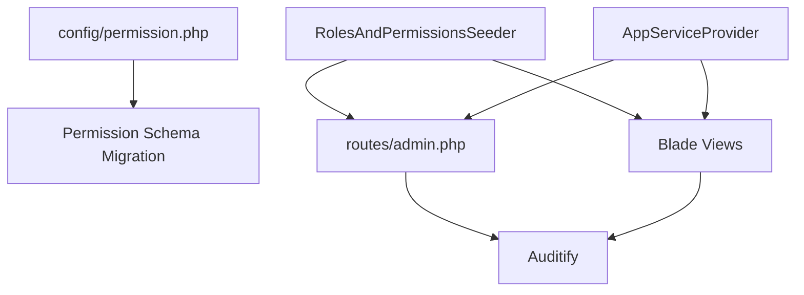
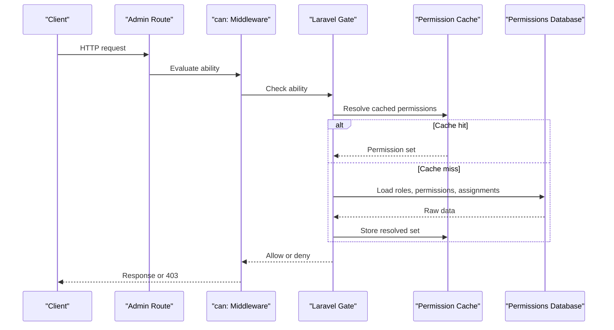
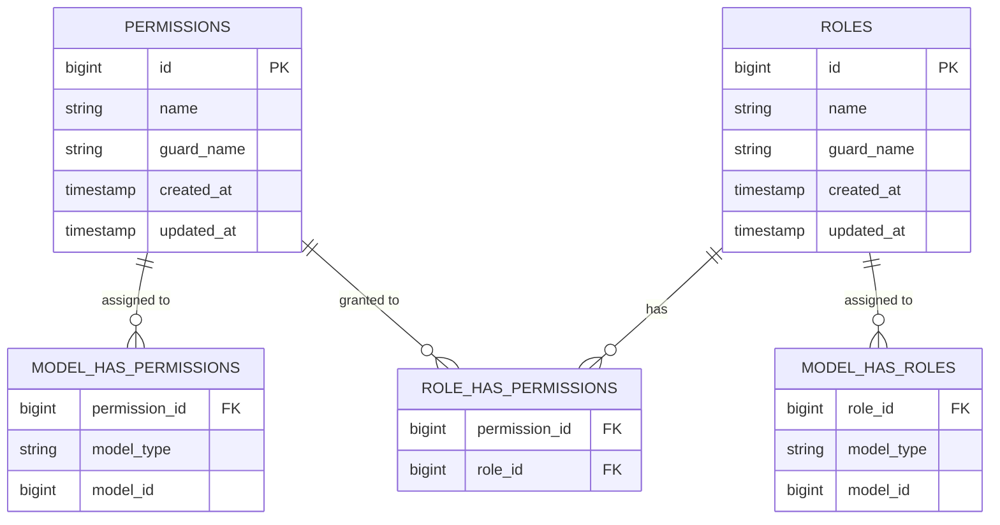
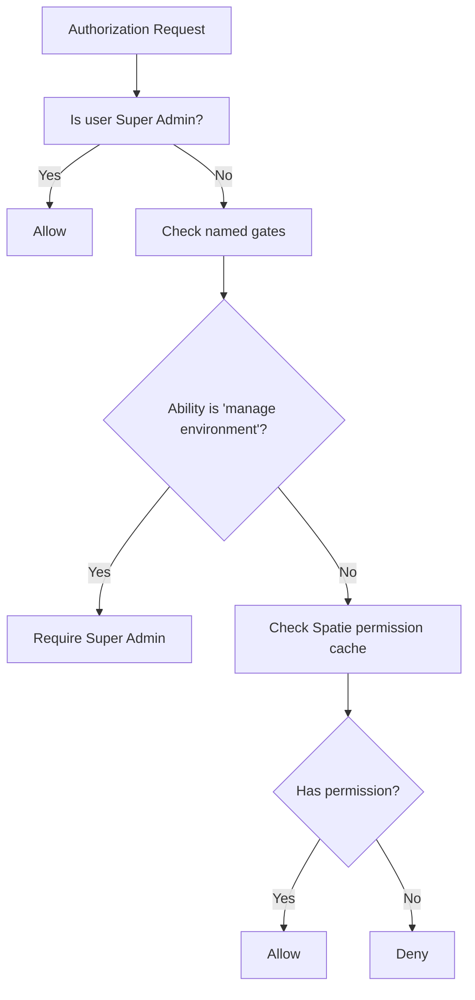
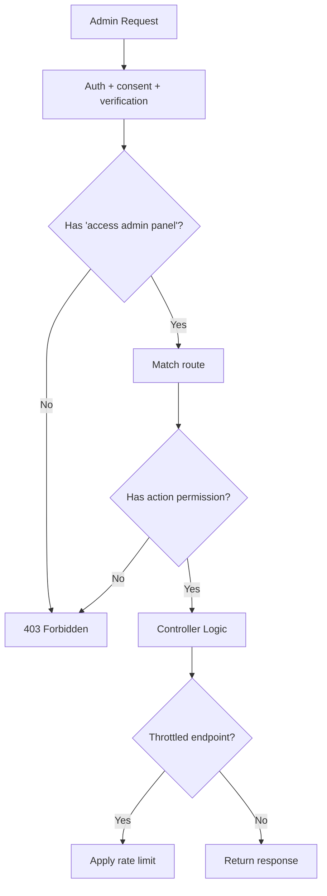
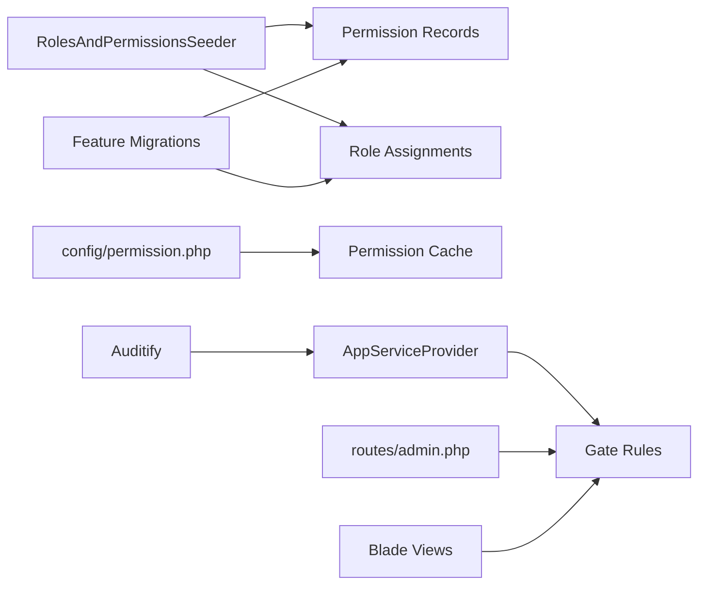
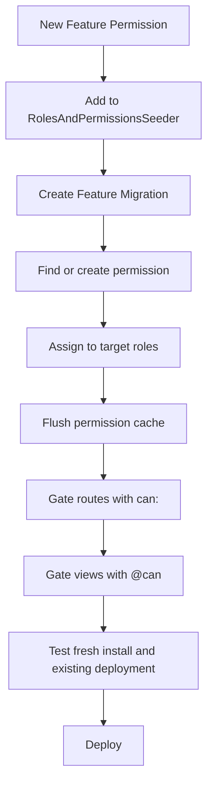

# Permissions Management

<cite>
**Referenced Files in This Document**
- [config/permission.php](file://config/permission.php)
- [2026_04_18_163436_create_permission_tables.php](file://database/migrations/2026_04_18_163436_create_permission_tables.php)
- [2026_05_05_091031_seed_roles_permissions_and_admin_user.php](file://database/migrations/2026_05_05_091031_seed_roles_permissions_and_admin_user.php)
- [2026_10_03_140000_add_manage_user_sessions_permission.php](file://database/migrations/2026_10_03_140000_add_manage_user_sessions_permission.php)
- [2026_10_15_120000_add_view_system_overview_permission.php](file://database/migrations/2026_10_15_120000_add_view_system_overview_permission.php)
- [2026_10_15_190000_add_export_system_overview_permission.php](file://database/migrations/2026_10_15_190000_add_export_system_overview_permission.php)
- [2026_10_23_215000_add_manage_settings_permission.php](file://database/migrations/2026_10_23_215000_add_manage_settings_permission.php)
- [RolesAndPermissionsSeeder.php](file://database/seeders/RolesAndPermissionsSeeder.php)
- [AppServiceProvider.php](file://app/Providers/AppServiceProvider.php)
- [admin.php](file://routes/admin.php)
- [index.blade.php (System Overview)](file://resources/views/admin/system-overview/index.blade.php)
- [user-menu.blade.php](file://resources/views/components/admin/topbar/user-menu.blade.php)
</cite>

## Table of Contents
1. [Introduction](#introduction)
2. [Project Structure](#project-structure)
3. [Core Components](#core-components)
4. [Architecture Overview](#architecture-overview)
5. [Detailed Component Analysis](#detailed-component-analysis)
6. [Permission Registry and Mapping](#permission-registry-and-mapping)
7. [Dependency Analysis](#dependency-analysis)
8. [Performance Considerations](#performance-considerations)
9. [Migration Strategy](#migration-strategy)
10. [Troubleshooting Guide](#troubleshooting-guide)
11. [Conclusion](#conclusion)

## Introduction
Highblossom implements role-based access control using the Spatie Laravel Permission package. Permissions are string abilities such as `view bookings`, `manage settings`, `view system overview`, and `export system overview`. Roles group permissions, and users inherit permissions through roles. The application gates routes, views, and some request authorizations with these permissions. A special Super Admin role is granted all permissions through a global gate callback.

This document explains how Highblossom defines, migrates, assigns, caches, audits, and optimizes permissions. It focuses on the predefined permissions referenced by the codebase and provides guidance for adding new ones safely.

## Project Structure
The permission system spans configuration, migrations, seeders, service providers, routes, Blade views, and audit infrastructure:

- **Configuration**: Defines models, tables, column names, caching behavior, and security options.
- **Migrations**: Create the permission schema and add feature-specific permissions idempotently.
- **Seeders**: Define default permissions and assign them to roles for fresh installations.
- **Service Provider**: Grants Super Admin every ability and defines additional named gates.
- **Routes**: Gate admin endpoints with `can:` middleware.
- **Views**: Hide or enable UI elements with `@can` directives.
- **Audit Infrastructure**: Logs administrative activity when enabled.

**Diagram sources**
- [config/permission.php:1-206](file://config/permission.php#L1-L206)
- [2026_04_18_163436_create_permission_tables.php:1-137](file://database/migrations/2026_04_18_163436_create_permission_tables.php#L1-L137)
- [RolesAndPermissionsSeeder.php:1-161](file://database/seeders/RolesAndPermissionsSeeder.php#L1-L161)
- [AppServiceProvider.php:60-100](file://app/Providers/AppServiceProvider.php#L60-L100)
- [admin.php:1-291](file://routes/admin.php#L1-L291)
- [index.blade.php (System Overview):39](file://resources/views/admin/system-overview/index.blade.php#L39)
- [user-menu.blade.php:10](file://resources/views/components/admin/topbar/user-menu.blade.php#L10)

**Section sources**
- [config/permission.php:1-206](file://config/permission.php#L1-L206)
- [2026_04_18_163436_create_permission_tables.php:1-137](file://database/migrations/2026_04_18_163436_create_permission_tables.php#L1-L137)
- [RolesAndPermissionsSeeder.php:1-161](file://database/seeders/RolesAndPermissionsSeeder.php#L1-L161)
- [AppServiceProvider.php:60-100](file://app/Providers/AppServiceProvider.php#L60-L100)
- [admin.php:1-291](file://routes/admin.php#L1-L291)

## Core Components
- **Permission model and table**: Stores unique permission names per guard.
- **Role model and table**: Stores role names per guard.
- **Pivot tables**: Connect models, roles, and permissions.
- **Cache layer**: Caches permissions and roles with configurable expiration and key.
- **Gate integration**: Registers permission checks and grants Super Admin full access.
- **Route-level gating**: Uses `can:` middleware for each admin endpoint.
- **View-level gating**: Uses `@can` directives to conditionally render UI.
- **Audit logging**: Integrates with Auditify for Super Admin access where configured.

Key behaviors:
- Permission names are strings and must be unique per guard.
- Roles can be assigned to any Eloquent model via polymorphic relationships.
- Fresh installs rely on seeders; existing databases rely on feature migrations.
- Super Admin bypasses normal permission checks through `Gate::before`.

**Section sources**
- [2026_04_18_163436_create_permission_tables.php:20-120](file://database/migrations/2026_04_18_163436_create_permission_tables.php#L20-L120)
- [config/permission.php:1-120](file://config/permission.php#L1-L120)
- [AppServiceProvider.php:73-95](file://app/Providers/AppServiceProvider.php#L73-L95)

## Architecture Overview
The permission architecture combines database-backed RBAC with Laravel’s Gate and middleware:

**Diagram sources**
- [admin.php:1-291](file://routes/admin.php#L1-L291)
- [config/permission.php:120-206](file://config/permission.php#L120-L206)
- [2026_04_18_163436_create_permission_tables.php:20-120](file://database/migrations/2026_04_18_163436_create_permission_tables.php#L20-L120)

## Detailed Component Analysis

### Configuration Layer
The permission configuration controls:
- Models used for permissions and roles.
- Table names for roles, permissions, and pivot relationships.
- Column naming conventions for pivots and team support.
- Whether to register permission checks on the gate.
- Octane reset listener behavior.
- Event emission for role and permission changes.
- Team scoping.
- Exception display of required roles and permissions.
- Wildcard permission support.
- Cache driver, key, and expiration.

Important defaults in this project:
- Wildcard permissions are disabled.
- Events are disabled by default.
- Teams are disabled.
- Exceptions do not expose permission or role names by default.
- Cache expiration is 24 hours.
- Cache key is `spatie.permission.cache`.

**Section sources**
- [config/permission.php:1-206](file://config/permission.php#L1-L206)

### Schema and Data Model
The migration creates four core tables:

| Table | Purpose | Key Columns | Constraints |
|---|---|---|---|
| `permissions` | Stores abilities | `id`, `name`, `guard_name`, timestamps | Unique `(name, guard_name)` |
| `roles` | Stores role groups | `id`, `name`, `guard_name`, timestamps | Unique `(name, guard_name)` |
| `model_has_permissions` | Associates models with permissions | `permission_id`, `model_type`, `model_id` | Foreign key to `permissions`; composite primary key |
| `model_has_roles` | Associates models with roles | `role_id`, `model_type`, `model_id` | Foreign key to `roles`; composite primary key |
| `role_has_permissions` | Associates roles with permissions | `permission_id`, `role_id` | Composite primary key; foreign keys cascade on delete |

**Diagram sources**
- [2026_04_18_163436_create_permission_tables.php:20-120](file://database/migrations/2026_04_18_163436_create_permission_tables.php#L20-L120)

**Section sources**
- [2026_04_18_163436_create_permission_tables.php:20-120](file://database/migrations/2026_04_18_163436_create_permission_tables.php#L20-L120)

### Global Authorization Rules
The application provider configures authorization behavior:
- Super Admin passes every permission check.
- Named gates `viewSchedulerList` and `manage environment` require Super Admin.
- Auditify authentication is restricted to Super Admin.

This means that even if a route or view does not explicitly declare a permission, Super Admin may still reach it depending on the gate rule.

**Diagram sources**
- [AppServiceProvider.php:73-95](file://app/Providers/AppServiceProvider.php#L73-L95)

**Section sources**
- [AppServiceProvider.php:60-100](file://app/Providers/AppServiceProvider.php#L60-L100)

### Route-Level Gating
Admin routes use `can:` middleware to enforce permissions before controller logic runs. Examples include:
- `access admin panel`: Entry gate for the entire admin section.
- `view bookings`, `update bookings`, `delete bookings`: Booking operations.
- `view inspections`, `update inspections`: Inspection operations.
- `manage gallery`, `view gallery`: Gallery management.
- `view services`, `manage services`: Service definitions.
- `view blog`, `create blog`, `update blog`, `delete blog`: Blog content.
- `manage pages`, `manage categories`, `manage tags`, `manage testimonials`: Content administration.
- `manage seo`: SEO configuration.
- `manage absences`: HR absence management.
- `manage settings`: Staff directory and partner management.
- `manage versions`, `manage cache`: System maintenance.
- `view system overview`, `export system overview`: System dashboard and export.
- `manage users`, `manage roles`, `manage user sessions`: Access control and session administration.

Some endpoints also apply throttling to reduce abuse risk.

**Diagram sources**
- [admin.php:1-291](file://routes/admin.php#L1-L291)

**Section sources**
- [admin.php:1-291](file://routes/admin.php#L1-L291)

### View-Level Gating
Blade templates use `@can` to hide or show UI elements based on permissions. Examples include:
- Export button visibility controlled by `export system overview`.
- Session management links controlled by `manage user sessions`.
- Gallery actions controlled by `manage gallery`.
- Blog CRUD controls controlled by blog-related permissions.

This ensures that users without a permission never see the corresponding action, complementing backend enforcement.

**Section sources**
- [index.blade.php (System Overview):39](file://resources/views/admin/system-overview/index.blade.php#L39)
- [user-menu.blade.php:10](file://resources/views/components/admin/topbar/user-menu.blade.php#L10)

## Permission Registry and Mapping

### Predefined Permissions
The following permissions are defined in the seeder and migrations:

| Permission | Grouping | Primary Feature Area | Typical Role Assignment |
|---|---|---|---|
| `view blog` | Blog | Read-only blog access | Admin, Staff, User |
| `create blog` | Blog | Blog creation | Admin, Staff |
| `update blog` | Blog | Blog editing | Admin, Staff |
| `delete blog` | Blog | Blog deletion | Admin |
| `publish blog` | Blog | Publishing workflow | Admin |
| `manage revisions` | Blog | Revision control | Admin |
| `view bookings` | Bookings | Quote and booking viewing | Admin, Staff, User |
| `create bookings` | Bookings | Creating quotes/bookings | Admin, Staff |
| `update bookings` | Bookings | Updating status and details | Admin, Staff |
| `delete bookings` | Bookings | Deleting records | Admin |
| `view inspections` | Inspections | Reading inspection data | Admin, Staff |
| `create inspections` | Inspections | Creating inspections | Admin, Staff |
| `update inspections` | Inspections | Editing and completing inspections | Admin, Staff |
| `delete inspections` | Inspections | Removing inspections | Admin |
| `view gallery` | Gallery | Viewing galleries | Admin, Staff, User |
| `manage gallery` | Gallery | Full gallery administration | Admin |
| `view services` | Services | Viewing services and types | Admin, Staff, User |
| `manage services` | Services | Managing services, types, and subcategories | Admin |
| `view settings` | Settings | Viewing company settings and security policies | Admin |
| `update settings` | Settings | Updating general settings | Admin |
| `manage settings` | Settings | Managing staff and partners | Admin |
| `manage seo` | SEO | SEO configuration | Admin |
| `manage pages` | Content | About Us and page content | Admin |
| `manage categories` | Content | Blog categories | Admin |
| `manage tags` | Content | Blog tags | Admin |
| `manage testimonials` | Content | Testimonials | Admin |
| `view contact messages` | Communication | Reading contact messages | Admin |
| `manage contact numbers` | Communication | Managing contact numbers | Admin |
| `manage absences` | HR | Staff absence management | Admin |
| `manage users` | Access Control | User administration | Admin, Super Admin |
| `manage roles` | Access Control | Role administration | Admin, Super Admin |
| `manage user sessions` | Access Control | Session and device administration | Admin, Super Admin |
| `access admin panel` | Access Control | Entry into admin area | Admin, Staff, User |
| `manage versions` | System | Application version management | Admin, Super Admin |
| `manage cache` | System | Cache clearing and optimization | Admin, Super Admin |
| `view system overview` | System | System overview dashboard | Super Admin |
| `export system overview` | System | Exporting system overview data | Super Admin |
| `view dashboard` | Dashboard | Public-facing dashboard access | User |

Notes:
- Super Admin receives every permission.
- Admin receives most operational and system-management permissions except the sensitive system overview permissions.
- Staff receives read-heavy and limited write permissions.
- User receives minimal access, primarily dashboard and service viewing.

**Section sources**
- [RolesAndPermissionsSeeder.php:20-161](file://database/seeders/RolesAndPermissionsSeeder.php#L20-L161)
- [2026_05_05_091031_seed_roles_permissions_and_admin_user.php:20-154](file://database/migrations/2026_05_05_091031_seed_roles_permissions_and_admin_user.php#L20-L154)

### Permission Naming Conventions
- Permissions are lowercase English phrases separated by spaces.
- They follow an action-object pattern, such as `view bookings`, `manage settings`, `export system overview`.
- Each permission has a guard, typically `web` for the web application.
- Permission names are stored uniquely per guard.

This convention makes permissions readable and directly mappable to features.

**Section sources**
- [2026_04_18_163436_create_permission_tables.php:30-45](file://database/migrations/2026_04_18_163436_create_permission_tables.php#L30-L45)
- [RolesAndPermissionsSeeder.php:20-90](file://database/seeders/RolesAndPermissionsSeeder.php#L20-L90)

### Grouping Strategy
Permissions are grouped conceptually by feature area:
- Blog
- Bookings
- Inspections
- Gallery
- Services
- Settings
- SEO
- Content
- Communication
- HR
- Access Control
- System
- Dashboard

These groupings appear as comments in the seeder and correspond to admin routes and controllers.

**Section sources**
- [RolesAndPermissionsSeeder.php:20-120](file://database/seeders/RolesAndPermissionsSeeder.php#L20-L120)
- [admin.php:1-291](file://routes/admin.php#L1-L291)

### Mapping to Application Features
Each major feature area is protected at two layers:
1. **Route layer**: `can:` middleware prevents unauthorized controller execution.
2. **View layer**: `@can` directives prevent unauthorized UI rendering.

Examples:
- System overview dashboard requires `view system overview`.
- System overview export requires both `export system overview` and throttling.
- Staff and partner management requires `manage settings`.
- Role management requires `manage roles`.
- Session management requires `manage user sessions`.

**Section sources**
- [admin.php:172-291](file://routes/admin.php#L172-L291)
- [index.blade.php (System Overview):39](file://resources/views/admin/system-overview/index.blade.php#L39)
- [user-menu.blade.php:10](file://resources/views/components/admin/topbar/user-menu.blade.php#L10)

## Dependency Analysis
The permission system depends on several components:

**Diagram sources**
- [RolesAndPermissionsSeeder.php:1-161](file://database/seeders/RolesAndPermissionsSeeder.php#L1-L161)
- [2026_10_03_140000_add_manage_user_sessions_permission.php:1-43](file://database/migrations/2026_10_03_140000_add_manage_user_sessions_permission.php#L1-L43)
- [2026_10_15_120000_add_view_system_overview_permission.php:1-43](file://database/migrations/2026_10_15_120000_add_view_system_overview_permission.php#L1-L43)
- [2026_10_15_190000_add_export_system_overview_permission.php:1-44](file://database/migrations/2026_10_15_190000_add_export_system_overview_permission.php#L1-L44)
- [2026_10_23_215000_add_manage_settings_permission.php:1-51](file://database/migrations/2026_10_23_215000_add_manage_settings_permission.php#L1-L51)
- [config/permission.php:120-206](file://config/permission.php#L120-L206)
- [AppServiceProvider.php:60-100](file://app/Providers/AppServiceProvider.php#L60-L100)
- [admin.php:1-291](file://routes/admin.php#L1-L291)

**Section sources**
- [RolesAndPermissionsSeeder.php:1-161](file://database/seeders/RolesAndPermissionsSeeder.php#L1-L161)
- [config/permission.php:120-206](file://config/permission.php#L120-L206)
- [AppServiceProvider.php:60-100](file://app/Providers/AppServiceProvider.php#L60-L100)

## Performance Considerations
- **Caching**: Permissions and roles are cached for 24 hours by default. The cache key is `spatie.permission.cache`.
- **Cache flushing**: Migrations and seeders flush cached permissions to avoid stale state after changes.
- **Octane**: The Octane reset listener is disabled by default; enable it only if running under Octane/Vapor and experiencing permission staleness.
- **Wildcard permissions**: Disabled by default. Enabling them adds lookup complexity and should be used cautiously.
- **Exception safety**: Permission and role names are hidden from exceptions by default to reduce information leakage.
- **Route-level checks**: Using `can:` middleware avoids unnecessary controller execution when a user lacks permission.
- **Throttling**: Sensitive endpoints like system overview export and cache operations are throttled to reduce abuse.

Recommendations for large permission sets:
- Keep permission names short and consistent.
- Avoid dynamic permission generation per request unless necessary.
- Prefer role aggregation over granting many individual permissions to users.
- Monitor cache size and expiration when scaling horizontally.
- Use explicit `can:` checks rather than relying solely on Super Admin bypass.

**Section sources**
- [config/permission.php:120-206](file://config/permission.php#L120-L206)
- [2026_04_18_163436_create_permission_tables.php:120-137](file://database/migrations/2026_04_18_163436_create_permission_tables.php#L120-L137)
- [admin.php:200-230](file://routes/admin.php#L200-L230)

## Migration Strategy
Adding a new permission should follow this process:

1. **Decide scope and risk**: Determine whether the permission is read-only, write-heavy, or sensitive.
2. **Choose a guard**: Usually `web` for admin routes.
3. **Add the permission to the seeder**: Include it in the permission list so fresh installs get it automatically.
4. **Create a feature migration**: Add the permission idempotently using `findOrCreate` and assign it to the appropriate roles.
5. **Gate routes**: Add `can:` middleware to relevant admin routes.
6. **Gate views**: Add `@can` directives to relevant Blade templates.
7. **Update role assignments**: Ensure Admin, Staff, User, and Super Admin receive the expected permissions.
8. **Flush cache**: Let migrations and seeders handle cache flushing, or clear it during deployment.
9. **Test backward compatibility**: Verify existing deployments gain the permission through the migration, not only through the seeder.

### Backward Compatibility Pattern
The repository demonstrates a consistent pattern:
- The seeder declares the canonical permission list.
- Feature migrations create missing permissions and assign them to roles.
- Migrations flush the permission cache.
- Down methods remove the permission and revoke role assignments.

Examples in the codebase:
- `manage user sessions`: Added for session and device management.
- `view system overview`: Added for the system overview dashboard.
- `export system overview`: Separated from viewing because exporting carries different risk.
- `manage settings`: Restored as a real permission for staff and partner routes instead of relying on Super Admin bypass.

**Diagram sources**
- [RolesAndPermissionsSeeder.php:20-161](file://database/seeders/RolesAndPermissionsSeeder.php#L20-L161)
- [2026_10_03_140000_add_manage_user_sessions_permission.php:1-43](file://database/migrations/2026_10_03_140000_add_manage_user_sessions_permission.php#L1-L43)
- [2026_10_15_120000_add_view_system_overview_permission.php:1-43](file://database/migrations/2026_10_15_120000_add_view_system_overview_permission.php#L1-L43)
- [2026_10_15_190000_add_export_system_overview_permission.php:1-44](file://database/migrations/2026_10_15_190000_add_export_system_overview_permission.php#L1-L44)
- [2026_10_23_215000_add_manage_settings_permission.php:1-51](file://database/migrations/2026_10_23_215000_add_manage_settings_permission.php#L1-L51)

**Section sources**
- [2026_10_03_140000_add_manage_user_sessions_permission.php:1-43](file://database/migrations/2026_10_03_140000_add_manage_user_sessions_permission.php#L1-L43)
- [2026_10_15_120000_add_view_system_overview_permission.php:1-43](file://database/migrations/2026_10_15_120000_add_view_system_overview_permission.php#L1-L43)
- [2026_10_15_190000_add_export_system_overview_permission.php:1-44](file://database/migrations/2026_10_15_190000_add_export_system_overview_permission.php#L1-L44)
- [2026_10_23_215000_add_manage_settings_permission.php:1-51](file://database/migrations/2026_10_23_215000_add_manage_settings_permission.php#L1-L51)

## Troubleshooting Guide

### Symptom: Route Always Returns 403
Possible causes:
- The permission was added to the seeder but not deployed as a migration.
- The role was not granted the permission.
- The cache contains stale permissions.
- The route uses a different permission name than the one defined.

Resolution steps:
1. Confirm the permission exists in the seeder.
2. Run migrations to ensure the feature migration runs.
3. Check role assignments for Admin, Staff, or User.
4. Clear configuration and permission cache during deployment.
5. Verify the `can:` middleware matches the permission name exactly.

**Section sources**
- [admin.php:1-291](file://routes/admin.php#L1-L291)
- [RolesAndPermissionsSeeder.php:20-161](file://database/seeders/RolesAndPermissionsSeeder.php#L20-L161)
- [2026_04_18_163436_create_permission_tables.php:120-137](file://database/migrations/2026_04_18_163436_create_permission_tables.php#L120-L137)

### Symptom: Super Admin Cannot Be Denied Even Without a Permission
This is expected behavior. The application provider grants Super Admin every ability through `Gate::before`. If you need to restrict Super Admin for a specific operation, define a named gate that explicitly denies it after the Super Admin check or refactor the gate order.

**Section sources**
- [AppServiceProvider.php:73-95](file://app/Providers/AppServiceProvider.php#L73-L95)

### Symptom: `manage settings` Was Silent Before
Historically, staff and partner routes gated on `manage settings`, but no permission existed. Super Admin could still pass because of the global gate bypass, while other roles received silent denials. The dedicated migration created the permission and granted it to Admin.

**Section sources**
- [2026_10_23_215000_add_manage_settings_permission.php:1-51](file://database/migrations/2026_10_23_215000_add_manage_settings_permission.php#L1-L51)

### Symptom: Export Button Is Missing
The export button in the system overview view is controlled by `export system overview`. Only Super Admin currently receives this permission.

**Section sources**
- [index.blade.php (System Overview):39](file://resources/views/admin/system-overview/index.blade.php#L39)
- [2026_10_15_190000_add_export_system_overview_permission.php:1-44](file://database/migrations/2026_10_15_190000_add_export_system_overview_permission.php#L1-L44)

### Auditing Notes
Auditify is integrated to authenticate audit access for Super Admin. While this file does not implement permission-specific audit events, the presence of audit infrastructure indicates that administrative actions should be considered auditable. When adding sensitive permissions such as `export system overview` or `manage cache`, consider whether audit logging should capture their usage.

**Section sources**
- [AppServiceProvider.php:85-95](file://app/Providers/AppServiceProvider.php#L85-L95)

## Conclusion
Highblossom’s permission system is a conventional Spatie-based RBAC setup with clear separation between schema, seeders, migrations, routing, views, and global authorization rules. Permissions are human-readable, grouped by feature, and enforced at both route and view layers. Super Admin overrides normal checks, which simplifies administration but requires care when introducing fine-grained restrictions.

For new features, always combine a seeder declaration with a backward-compatible migration, gate routes and views explicitly, assign permissions to the correct roles, and test both fresh and existing deployments. For performance, rely on caching, keep permissions stable, and reserve wildcard permissions for cases where they are truly needed.