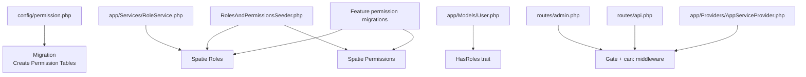
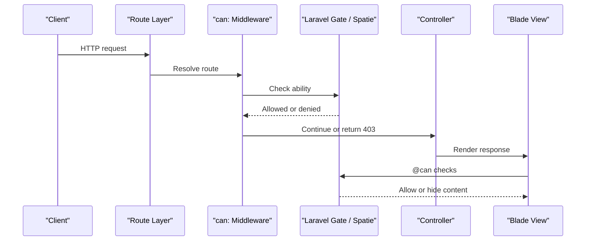
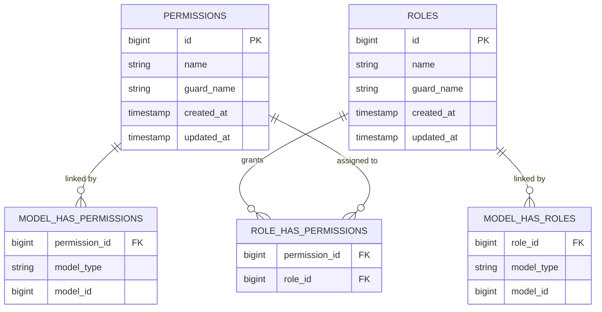
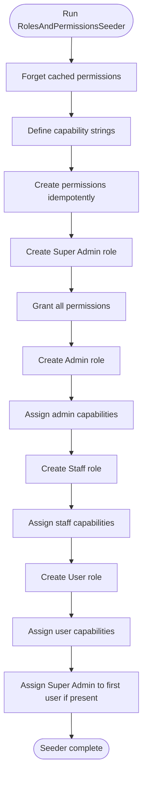
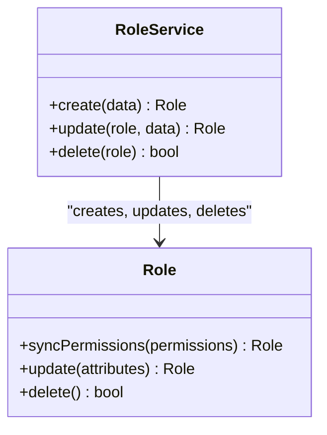
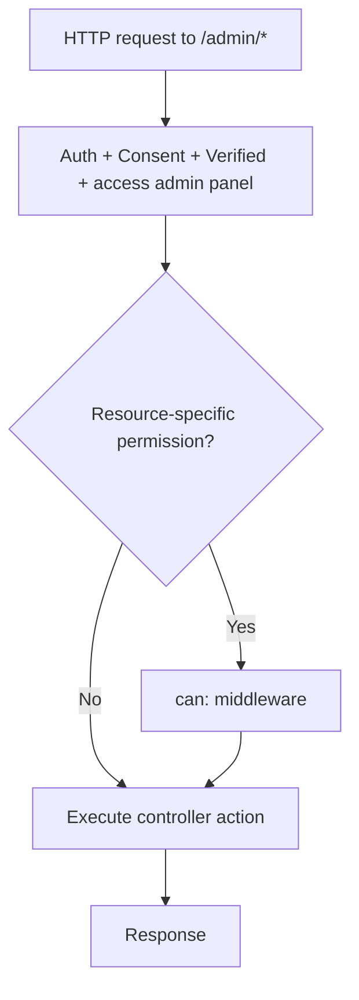
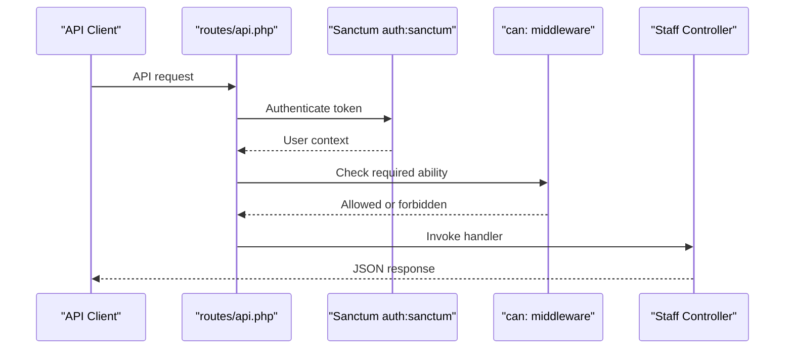
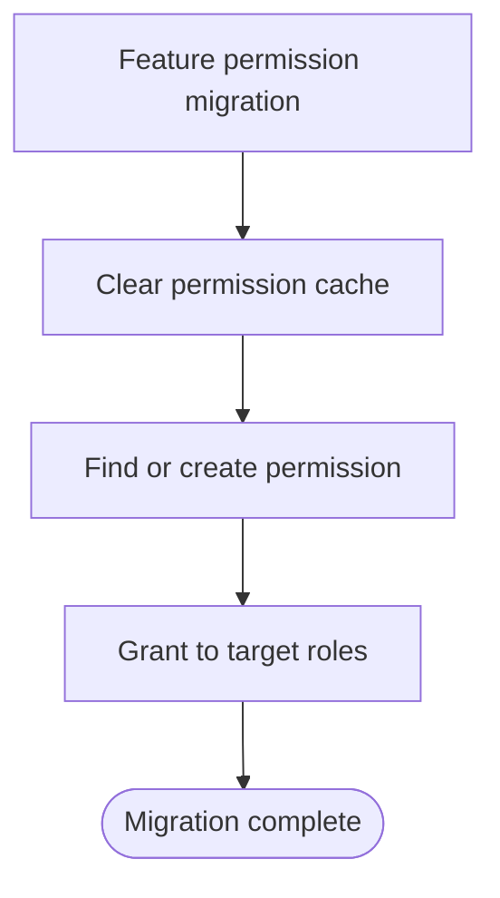
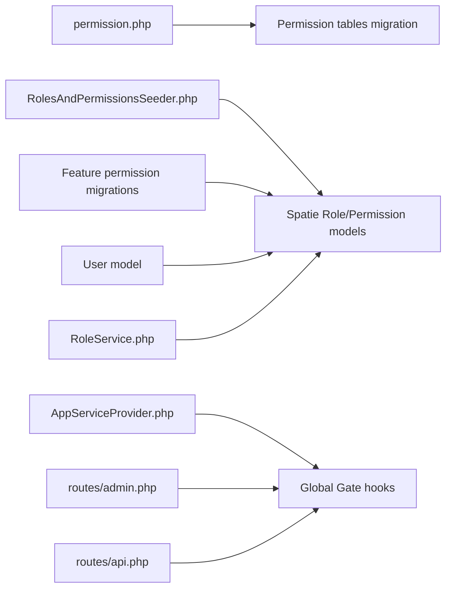

# Role & Permission System

<cite>
**Referenced Files in This Document**
- [permission.php](file://config/permission.php)
- [2026_04_18_163436_create_permission_tables.php](file://database/migrations/2026_04_18_163436_create_permission_tables.php)
- [RolesAndPermissionsSeeder.php](file://database/seeders/RolesAndPermissionsSeeder.php)
- [User.php](file://app/Models/User.php)
- [RoleService.php](file://app/Services/RoleService.php)
- [AppServiceProvider.php](file://app/Providers/AppServiceProvider.php)
- [admin.php](file://routes/admin.php)
- [api.php](file://routes/api.php)
- [2026_10_03_140000_add_manage_user_sessions_permission.php](file://database/migrations/2026_10_03_140000_add_manage_user_sessions_permission.php)
- [2026_10_15_120000_add_view_system_overview_permission.php](file://database/migrations/2026_10_15_120000_add_view_system_overview_permission.php)
- [2026_10_15_190000_add_export_system_overview_permission.php](file://database/migrations/2026_10_15_190000_add_export_system_overview_permission.php)
- [2026_10_23_215000_add_manage_settings_permission.php](file://database/migrations/2026_10_23_215000_add_manage_settings_permission.php)
</cite>

## Table of Contents
1. [Introduction](#introduction)
2. [Project Structure](#project-structure)
3. [Core Components](#core-components)
4. [Architecture Overview](#architecture-overview)
5. [Detailed Component Analysis](#detailed-component-analysis)
6. [Permission Implementation Patterns](#permission-implementation-patterns)
7. [Dependency Analysis](#dependency-analysis)
8. [Performance Considerations](#performance-considerations)
9. [Troubleshooting Guide](#troubleshooting-guide)
10. [Conclusion](#conclusion)

## Introduction
This document explains the Highblossom role-based access control system built on the Spatie Permission package. It covers the database schema, predefined roles and permissions, seeding strategy, dynamic permission creation, role assignment, controller and API authorization, view-level checks, audit integration, performance characteristics, and best practices for organizing permission hierarchies.

The project currently defines four application roles: Super Admin, Admin, Staff, and User. There is no dedicated Customer role in the codebase; public-facing user capabilities are represented by the User role and standard web routes rather than an explicit customer RBAC layer.

## Project Structure
The authorization system spans configuration, migrations, seeders, models, services, route definitions, and a global service provider.

**Diagram sources**
- [permission.php:1-200](file://config/permission.php#L1-L200)
- [2026_04_18_163436_create_permission_tables.php:1-137](file://database/migrations/2026_04_18_163436_create_permission_tables.php#L1-L137)
- [RolesAndPermissionsSeeder.php:1-161](file://database/seeders/RolesAndPermissionsSeeder.php#L1-L161)
- [User.php:1-141](file://app/Models/User.php#L1-L141)
- [admin.php:1-171](file://routes/admin.php#L1-L171)
- [api.php:29-115](file://routes/api.php#L29-L115)
- [AppServiceProvider.php:53-80](file://app/Providers/AppServiceProvider.php#L53-L80)
- [RoleService.php:1-43](file://app/Services/RoleService.php#L1-L43)

**Section sources**
- [permission.php:1-200](file://config/permission.php#L1-L200)
- [2026_04_18_163436_create_permission_tables.php:1-137](file://database/migrations/2026_04_18_163436_create_permission_tables.php#L1-L137)
- [RolesAndPermissionsSeeder.php:1-161](file://database/seeders/RolesAndPermissionsSeeder.php#L1-L161)
- [User.php:1-141](file://app/Models/User.php#L1-L141)
- [admin.php:1-171](file://routes/admin.php#L1-L171)
- [api.php:29-115](file://routes/api.php#L29-L115)
- [AppServiceProvider.php:53-80](file://app/Providers/AppServiceProvider.php#L53-L80)
- [RoleService.php:1-43](file://app/Services/RoleService.php#L1-L43)

## Core Components
- Configuration: The Spatie Permission configuration defines model classes, table names, column names, cache settings, wildcard behavior, team support, and exception display options.
- Database schema: A migration creates the permission tables used by Spatie.
- Seeders: The main seeder defines all capability strings, creates idempotent permissions, builds roles, assigns granular permissions, and assigns Super Admin to the first user.
- User model: The authenticated user uses Spatie’s HasRoles trait, enabling `hasRole`, `hasPermission`, and related methods.
- Service: RoleService provides create, update, and delete operations for custom roles with permission synchronization.
- Global gate: AppServiceProvider grants Super Admin every ability through a Gate before hook and registers additional named abilities.
- Routing: Web admin and staff API routes use Laravel’s `can:` middleware to enforce permissions at the request boundary.

**Section sources**
- [permission.php:1-200](file://config/permission.php#L1-L200)
- [2026_04_18_163436_create_permission_tables.php:1-137](file://database/migrations/2026_04_18_163436_create_permission_tables.php#L1-L137)
- [RolesAndPermissionsSeeder.php:1-161](file://database/seeders/RolesAndPermissionsSeeder.php#L1-L161)
- [User.php:1-141](file://app/Models/User.php#L1-L141)
- [RoleService.php:1-43](file://app/Services/RoleService.php#L1-L43)
- [AppServiceProvider.php:53-80](file://app/Providers/AppServiceProvider.php#L53-L80)
- [admin.php:1-171](file://routes/admin.php#L1-L171)
- [api.php:29-115](file://routes/api.php#L29-L115)

## Architecture Overview
At runtime, authorization flows through Spatie’s gate integration:

1. A request arrives at a protected route.
2. Route middleware invokes the `can:` ability check.
3. Spatie resolves the ability against the authenticated user’s roles and permissions.
4. Super Admin bypasses specific ability checks via a global Gate hook.
5. Controllers and views perform domain-specific checks using policies, method calls, or Blade directives.

**Diagram sources**
- [admin.php:1-171](file://routes/admin.php#L1-L171)
- [api.php:29-115](file://routes/api.php#L29-L115)
- [AppServiceProvider.php:72-80](file://app/Providers/AppServiceProvider.php#L72-L80)

## Detailed Component Analysis

### Spatie Permission Configuration
The configuration centralizes:
- Model bindings for Permission and Role.
- Table names for permissions, roles, and pivot tables.
- Column names including team and pivot keys.
- Cache expiration, key, driver, and Octane reset listener.
- Event emission toggles.
- Team feature toggle and resolver.
- Wildcard permission support.
- Exception display flags for roles and permissions.

Key implications:
- Teams are disabled by default, so role and permission checks apply globally within the configured guard.
- Caching is enabled with a default 24-hour expiration and a dedicated cache key.
- Wildcard permissions are disabled by default.

**Section sources**
- [permission.php:1-200](file://config/permission.php#L1-L200)

### Database Schema
The migration creates:
- `permissions`: unique by name and guard.
- `roles`: unique by name and guard, optionally scoped by team.
- `model_has_permissions`: polymorphic link between any model and permissions.
- `model_has_roles`: polymorphic link between any model and roles.
- `role_has_permissions`: many-to-many mapping.

It also clears Spatie’s permission cache after creating tables.

**Diagram sources**
- [2026_04_18_163436_create_permission_tables.php:26-114](file://database/migrations/2026_04_18_163436_create_permission_tables.php#L26-L114)

**Section sources**
- [2026_04_18_163436_create_permission_tables.php:1-137](file://database/migrations/2026_04_18_163436_create_permission_tables.php#L1-L137)

### Predefined Roles and Capabilities
The seeder defines these capabilities:
- Blog: view, create, update, delete, publish, manage revisions.
- Bookings: view, create, update, delete.
- Inspections: view, create, update, delete, plus note management through update inspections.
- Gallery: view, manage.
- Services: view, manage.
- Settings: view, update, manage.
- SEO: manage seo.
- Content: manage pages, categories, tags, testimonials.
- Communication: view contact messages, manage contact numbers.
- HR: manage absences.
- Access control: manage users, manage roles, manage user sessions, access admin panel.
- System: manage versions, manage cache, view system overview, export system overview.
- Dashboard: view dashboard.

Defined roles:
- Super Admin: receives every permission.
- Admin: broad administrative permissions across blog, bookings, inspections, gallery, services, settings, content, communication, HR, system, and admin panel access.
- Staff: read-heavy operational permissions plus limited write actions and admin panel access.
- User: minimal dashboard, admin panel access, and service viewing capability.

The first user in the database is assigned Super Admin during seeding.

**Diagram sources**
- [RolesAndPermissionsSeeder.php:1-161](file://database/seeders/RolesAndPermissionsSeeder.php#L1-L161)

**Section sources**
- [RolesAndPermissionsSeeder.php:1-161](file://database/seeders/RolesAndPermissionsSeeder.php#L1-L161)

### User Model and Role Integration
The User model:
- Extends Laravel’s Authenticatable.
- Uses Spatie’s HasRoles trait.
- Supports passkeys, two-factor authentication, Sanctum tokens, email verification, and notification delivery.
- Provides relationships for posts, bookings, booking events, inspection notes, and sessions.

Because HasRoles is applied, authenticated users can call role and permission methods directly.

**Section sources**
- [User.php:1-141](file://app/Models/User.php#L1-L141)

### Dynamic Role Management Service
RoleService encapsulates role lifecycle operations:
- Create: creates a role and synchronizes its permissions when provided.
- Update: updates the role name and synchronizes permissions when provided.
- Delete: prevents deletion of the Super Admin role and deletes other roles safely.

This service is suitable for admin UIs or APIs that need controlled role mutation.

**Diagram sources**
- [RoleService.php:1-43](file://app/Services/RoleService.php#L1-L43)

**Section sources**
- [RoleService.php:1-43](file://app/Services/RoleService.php#L1-L43)

### Global Authorization Hooks
AppServiceProvider configures:
- Log Viewer authentication restricted to Super Admin.
- A Gate before hook that returns true for Super Admin on every ability.
- Named abilities `viewSchedulerList` and `manage environment` restricted to Super Admin.
- Auditify authentication restricted to Super Admin.

This means Super Admin effectively bypasses normal permission checks for most gates.

**Section sources**
- [AppServiceProvider.php:53-80](file://app/Providers/AppServiceProvider.php#L53-L80)

### Web Admin Authorization
The admin portal group:
- Requires authentication, consent, and email verification where applicable.
- Requires `access admin panel` for the entire `/admin` prefix.
- Applies fine-grained `can:` middleware per resource, such as `view bookings`, `update bookings`, `view inspections`, `manage gallery`, `manage services`, `view blog`, `create blog`, `update blog`, `delete blog`, `manage testimonials`, `manage absences`, `view settings`, `update settings`, `manage versions`, `manage pages`, `manage settings`, and role management endpoints.

**Diagram sources**
- [admin.php:1-171](file://routes/admin.php#L1-L171)

**Section sources**
- [admin.php:1-171](file://routes/admin.php#L1-L171)

### API Authorization
The staff API group:
- Uses Sanctum authentication.
- Gates dashboard, bookings, inspections, quotes, contact messages, testimonials, blog resources, taxonomy, staff team, partners, and gallery routes through `can:` middleware.
- Reuses the same permission vocabulary as the web admin.

**Diagram sources**
- [api.php:29-115](file://routes/api.php#L29-L115)

**Section sources**
- [api.php:29-115](file://routes/api.php#L29-L115)

### Feature Permission Migrations
Several migrations add new permissions after initial seeding:
- Manage user sessions: granted to Super Admin and Admin.
- View system overview: granted to Super Admin only.
- Export system overview: granted to Super Admin only.
- Manage settings: added to close a gap where routes gated on a permission not declared in the registry; granted to Admin.

These migrations use `findOrCreate`, grant permissions to specific roles, and clear the permission cache.

**Diagram sources**
- [2026_10_03_140000_add_manage_user_sessions_permission.php:1-43](file://database/migrations/2026_10_03_140000_add_manage_user_sessions_permission.php#L1-L43)
- [2026_10_15_120000_add_view_system_overview_permission.php:1-43](file://database/migrations/2026_10_15_120000_add_view_system_overview_permission.php#L1-L43)
- [2026_10_15_190000_add_export_system_overview_permission.php:1-44](file://database/migrations/2026_10_15_190000_add_export_system_overview_permission.php#L1-L44)
- [2026_10_23_215000_add_manage_settings_permission.php:1-51](file://database/migrations/2026_10_23_215000_add_manage_settings_permission.php#L1-L51)

**Section sources**
- [2026_10_03_140000_add_manage_user_sessions_permission.php:1-43](file://database/migrations/2026_10_03_140000_add_manage_user_sessions_permission.php#L1-L43)
- [2026_10_15_120000_add_view_system_overview_permission.php:1-43](file://database/migrations/2026_10_15_120000_add_view_system_overview_permission.php#L1-L43)
- [2026_10_15_190000_add_export_system_overview_permission.php:1-44](file://database/migrations/2026_10_15_190000_add_export_system_overview_permission.php#L1-L44)
- [2026_10_23_215000_add_manage_settings_permission.php:1-51](file://database/migrations/2026_10_23_215000_add_manage_settings_permission.php#L1-L51)

## Permission Implementation Patterns

### Implementing Role Checks in Controllers
Recommended patterns:
- Use route-level `can:` middleware for coarse-grained access.
- Use policy methods for object-scoped decisions.
- For API endpoints, keep authorization logic near the controller method while delegating ownership checks to services or repositories.

Current project pattern:
- Web admin routes use `can:` middleware extensively.
- Staff API routes use `can:` middleware for each endpoint.
- Policies are not evident in the analyzed files; therefore, controllers should avoid relying solely on route guards for object-level authorization.

### Implementing Role Checks in Views
Views commonly use the Blade `@can` directive to conditionally render controls based on permissions. Examples in the repository include:
- Managing user sessions.
- Managing gallery items.
- Creating, updating, and deleting blog posts and taxonomy terms.
- Exporting system overview data.

Best practice:
- Keep UI permissions aligned with backend permissions.
- Avoid duplicating business rules in views; use helper methods or view components when conditional rendering becomes complex.

**Section sources**
- [admin.php:1-171](file://routes/admin.php#L1-L171)
- [api.php:29-115](file://routes/api.php#L29-L115)

### Implementing Conditional Access Control
Conditional access can be implemented at multiple layers:
- Route layer: protect entire sections with `can:` middleware.
- Controller layer: authorize actions or objects.
- Service layer: enforce domain rules and ownership.
- View layer: hide or show UI elements.

For example, managing roles requires `manage roles`; exporting system overview requires `export system overview`; viewing system overview requires `view system overview`.

### Creating Custom Roles
Use RoleService to:
- Create a role with a descriptive name.
- Synchronize permissions from a list of permission identifiers.
- Prevent accidental deletion of Super Admin.

For ad-hoc scenarios, you may also create roles directly through Spatie’s Role model, but prefer the service for consistent validation and future extension points.

**Section sources**
- [RoleService.php:1-43](file://app/Services/RoleService.php#L1-L43)

### Assigning Granular Permissions
Granular permissions follow a verb-object naming convention in this project:
- Blog: view, create, update, delete, publish, manage revisions.
- Bookings: view, create, update, delete.
- Inspections: view, create, update, delete.
- Gallery: view, manage.
- Services: view, manage.
- Settings: view, update, manage.
- System features: view system overview, export system overview, manage versions, manage cache.

When adding a new capability:
1. Add the permission string to the seeder or a feature migration.
2. Assign it to appropriate roles.
3. Gate the relevant route or action.
4. Update views and API documentation accordingly.

**Section sources**
- [RolesAndPermissionsSeeder.php:1-161](file://database/seeders/RolesAndPermissionsSeeder.php#L1-L161)
- [admin.php:1-171](file://routes/admin.php#L1-L171)
- [api.php:29-115](file://routes/api.php#L29-L115)

### Resource-Based Permissions
Although policies are not shown in the analyzed files, resource-based permission checking should distinguish:
- Global capability: “Can I manage blog posts?”
- Instance capability: “Can I update this specific post?”

A recommended approach:
- Define a policy for each major resource.
- Map `view`, `update`, `delete`, and `publish` methods to both role checks and ownership checks.
- Register the policy with the Gate facade.

### Team-Scoped Access Control
Team scoping is supported by Spatie but is disabled in this project:
- `teams` is false in the permission configuration.
- The migration adds team columns only when teams are enabled.

If team-scoped access is needed later:
- Enable the teams feature in configuration.
- Ensure migrations include team foreign keys.
- Provide a team resolver or bind the current team into the request context.
- Scope roles and permissions to teams.

**Section sources**
- [permission.php:1-200](file://config/permission.php#L1-L200)
- [2026_04_18_163436_create_permission_tables.php:40-73](file://database/migrations/2026_04_18_163436_create_permission_tables.php#L40-L73)

## Dependency Analysis
The authorization dependencies are intentionally layered:

**Diagram sources**
- [permission.php:1-200](file://config/permission.php#L1-L200)
- [2026_04_18_163436_create_permission_tables.php:1-137](file://database/migrations/2026_04_18_163436_create_permission_tables.php#L1-L137)
- [RolesAndPermissionsSeeder.php:1-161](file://database/seeders/RolesAndPermissionsSeeder.php#L1-L161)
- [User.php:1-141](file://app/Models/User.php#L1-L141)
- [RoleService.php:1-43](file://app/Services/RoleService.php#L1-L43)
- [AppServiceProvider.php:53-80](file://app/Providers/AppServiceProvider.php#L53-L80)
- [admin.php:1-171](file://routes/admin.php#L1-L171)
- [api.php:29-115](file://routes/api.php#L29-L115)

Coupling observations:
- Routes depend on named permissions, making them easy to audit and refactor.
- The super-admin shortcut in the global Gate simplifies administration but reduces visibility into exact permissions for that role.
- Feature permission migrations decouple new capabilities from the main seeder, improving deployability.

**Section sources**
- [AppServiceProvider.php:72-80](file://app/Providers/AppServiceProvider.php#L72-L80)
- [RolesAndPermissionsSeeder.php:1-161](file://database/seeders/RolesAndPermissionsSeeder.php#L1-L161)
- [admin.php:1-171](file://routes/admin.php#L1-L171)
- [api.php:29-115](file://routes/api.php#L29-L115)

## Performance Considerations
- Permission caching: Spatie caches permissions with a configurable expiration time and cache key. This reduces repeated database queries for role and permission checks.
- Cache invalidation: The permission-table migration and several feature migrations clear the cache after modifying permissions.
- Octane support: Octane reset listener registration is disabled by default; enable it only if running under Octane or Vapor environments that require permission cache refresh on tick termination.
- Route-level gating: Using `can:` middleware avoids unnecessary controller execution for unauthorized requests.
- Super Admin shortcut: The global Gate before hook short-circuits checks for Super Admin, which is efficient but should be understood when auditing access.

Recommendations:
- Prefer route-level `can:` middleware for coarse-grained protection.
- Use policies for object-scoped checks to minimize redundant logic.
- Avoid expensive authorization logic inside frequently rendered views; cache computed visibility when necessary.
- Monitor permission cache usage and adjust expiration if role/permission changes occur frequently in development.

[No sources needed since this section provides general guidance]

## Troubleshooting Guide

### Routes Return 403 Even Though a Role Exists
Possible causes:
- The route is gated by a permission not yet defined in the registry.
- The role has not been granted the required permission.
- The permission cache has not been cleared after deployment.

Resolution steps:
1. Verify the permission exists using the roles management screen or direct query.
2. Confirm the role has the permission assigned.
3. Clear configuration and permission caches.
4. Check whether Super Admin is being relied upon unintentionally because of the global Gate shortcut.

**Section sources**
- [2026_10_23_215000_add_manage_settings_permission.php:1-51](file://database/migrations/2026_10_23_215000_add_manage_settings_permission.php#L1-L51)
- [AppServiceProvider.php:72-80](file://app/Providers/AppServiceProvider.php#L72-L80)

### Staff API Endpoints Return 403
The staff API uses Sanctum authentication and `can:` middleware. If requests fail:
- Ensure the bearer token belongs to a user with the required role and permission.
- Verify the requested ability matches the route definition.
- Confirm the permission was seeded or added through a feature migration.

**Section sources**
- [api.php:29-115](file://routes/api.php#L29-L115)

### Cannot Manage Settings Through Roles Screen
A previous gap existed where routes gated on `manage settings` even though the permission was missing from the registry. A migration declares the permission and grants it to Admin. After applying migrations:
- Refresh the roles screen.
- Reassign `manage settings` to Admin if needed.
- Clear permission caches.

**Section sources**
- [2026_10_23_215000_add_manage_settings_permission.php:1-51](file://database/migrations/2026_10_23_215000_add_manage_settings_permission.php#L1-L51)

### Super Admin Cannot Be Deleted
RoleService explicitly prevents deletion of the Super Admin role. This protects the system from losing the fallback administrator account.

**Section sources**
- [RoleService.php:28-43](file://app/Services/RoleService.php#L28-L43)

### Audit Logging Integration
Auditify authentication is restricted to Super Admin in the application service provider. Permission change auditing is not shown in the analyzed files; if audit logging is required for role and permission mutations, implement listeners or interceptors around role and permission modification points.

**Section sources**
- [AppServiceProvider.php:53-80](file://app/Providers/AppServiceProvider.php#L53-L80)

## Conclusion
Highblossom implements a clear, route-driven RBAC system using Spatie Permission. The predefined roles—Super Admin, Admin, Staff, and User—provide progressively narrower capabilities. Permissions are centrally defined, idempotently created, and attached to roles during seeding and through feature migrations. Authorization is enforced at routes, controllers, and views, with Super Admin receiving a global bypass through the Gate.

For long-term maintainability:
- Keep permission names descriptive and aligned with resource boundaries.
- Use route-level gates for coarse checks and policies for object-scoped checks.
- Introduce feature migrations for new permissions instead of mutating the main seeder repeatedly.
- Treat Super Admin as a safety net, not a substitute for proper permissions.
- When scaling to multi-tenant or team-scoped access, enable teams carefully and scope roles, permissions, and ownership checks consistently.