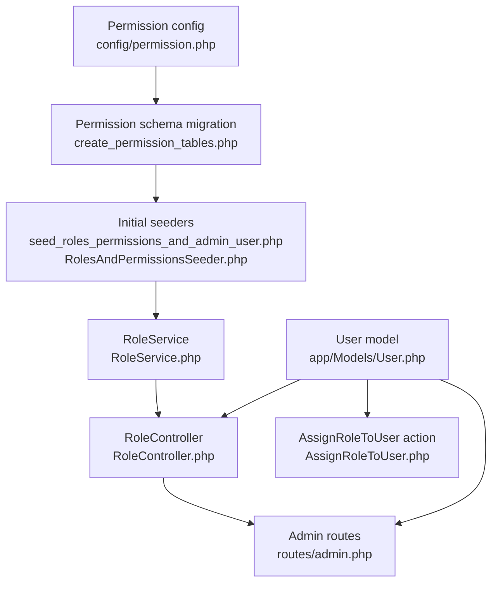
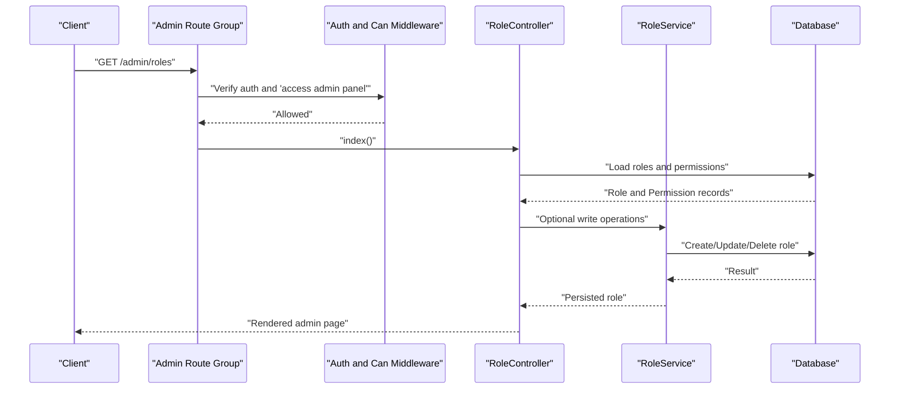
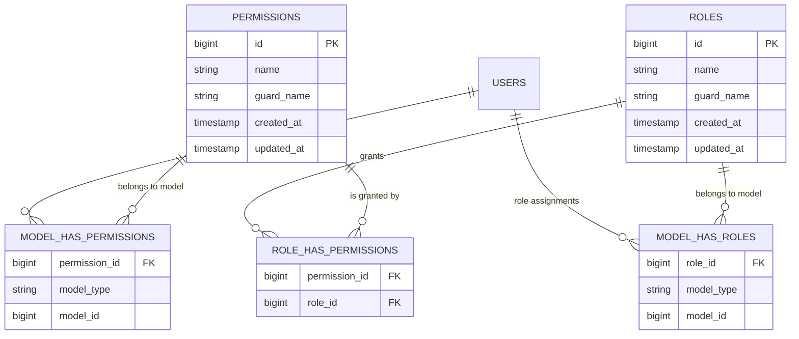
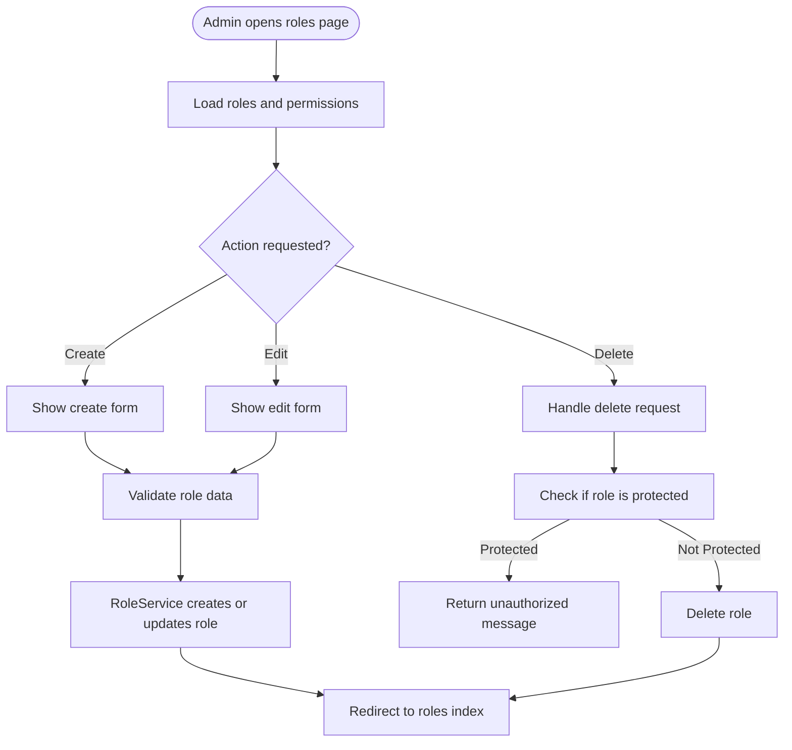
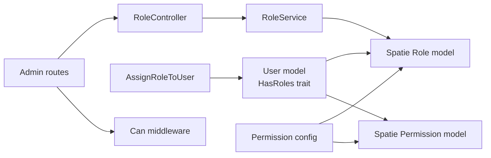

# Roles Overview

<cite>
**Referenced Files in This Document**
- [User.php](file://app/Models/User.php)
- [RoleService.php](file://app/Services/RoleService.php)
- [RoleController.php](file://app/Http/Controllers/Admin/RoleController.php)
- [AssignRoleToUser.php](file://app/Actions/Admin/AssignRoleToUser.php)
- [admin.php](file://routes/admin.php)
- [permission.php](file://config/permission.php)
- [create_permission_tables.php](file://database/migrations/2026_04_18_163436_create_permission_tables.php)
- [seed_roles_permissions_and_admin_user.php](file://database/migrations/2026_05_05_091031_seed_roles_permissions_and_admin_user.php)
- [RolesAndPermissionsSeeder.php](file://database/seeders/RolesAndPermissionsSeeder.php)
- [cache.php](file://config/cache.php)
</cite>

## Table of Contents
1. [Introduction](#introduction)
2. [Project Structure](#project-structure)
3. [Core Components](#core-components)
4. [Architecture Overview](#architecture-overview)
5. [Detailed Component Analysis](#detailed-component-analysis)
6. [Dependency Analysis](#dependency-analysis)
7. [Performance Considerations](#performance-considerations)
8. [Troubleshooting Guide](#troubleshooting-guide)
9. [Conclusion](#conclusion)

## Introduction
This document explains the Highblossom role system built on Spatie Laravel Permission. It covers:

- The predefined roles and their permissions.
- How roles relate to users through database tables and Eloquent.
- The administrative workflow for managing roles and assigning them to users.
- Programmatic APIs for creating, updating, deleting roles, and assigning roles to users.
- Design decisions around permission-based authorization rather than deep role inheritance.
- Naming conventions, best practices, and performance considerations for role checks.

Highblossom does not implement a strict role hierarchy such as “customer is a child of staff.” Instead, it uses a flat set of named roles (`Super Admin`, `Admin`, `Staff`, `User`) and granular permissions. Access control is primarily permission-driven, with routes guarded by `can(...)` middleware and Blade directives like `@can(...)`.

## Project Structure
The role system spans several layers:

| Layer | Responsibility | Key files |
|---|---|---|
| Configuration | Defines Spatie Permission models, table names, cache key, expiration, and guard behavior | [permission.php](file://config/permission.php) |
| Database schema | Creates `roles`, `permissions`, and pivot tables for model-to-role and model-to-permission mappings | [create_permission_tables.php](file://database/migrations/2026_04_18_163436_create_permission_tables.php) |
| Seeders and initial data | Creates default permissions, roles, and assigns an initial admin user | [seed_roles_permissions_and_admin_user.php](file://database/migrations/2026_05_05_091031_seed_roles_permissions_and_admin_user.php), [RolesAndPermissionsSeeder.php](file://database/seeders/RolesAndPermissionsSeeder.php) |
| User model | Enables role and permission checking via Spatie’s `HasRoles` trait | [User.php](file://app/Models/User.php) |
| Admin UI | Provides controllers, requests, and views for role management | [RoleController.php](file://app/Http/Controllers/Admin/RoleController.php) |
| Business logic | Encapsulates create/update/delete operations for roles | [RoleService.php](file://app/Services/RoleService.php) |
| Programmatic assignment | Simple action for assigning a role to a user | [AssignRoleToUser.php](file://app/Actions/Admin/AssignRoleToUser.php) |
| Routing and guards | Protects admin routes with `access admin panel` and feature-specific permissions | [admin.php](file://routes/admin.php) |

**Diagram sources**
- [permission.php](file://config/permission.php)
- [create_permission_tables.php](file://database/migrations/2026_04_18_163436_create_permission_tables.php)
- [seed_roles_permissions_and_admin_user.php](file://database/migrations/2026_05_05_091031_seed_roles_permissions_and_admin_user.php)
- [RolesAndPermissionsSeeder.php](file://database/seeders/RolesAndPermissionsSeeder.php)
- [RoleService.php](file://app/Services/RoleService.php)
- [RoleController.php](file://app/Http/Controllers/Admin/RoleController.php)
- [admin.php](file://routes/admin.php)
- [User.php](file://app/Models/User.php)
- [AssignRoleToUser.php](file://app/Actions/Admin/AssignRoleToUser.php)

**Section sources**
- [permission.php](file://config/permission.php)
- [create_permission_tables.php](file://database/migrations/2026_04_18_163436_create_permission_tables.php)
- [seed_roles_permissions_and_admin_user.php](file://database/migrations/2026_05_05_091031_seed_roles_permissions_and_admin_user.php)
- [RolesAndPermissionsSeeder.php](file://database/seeders/RolesAndPermissionsSeeder.php)
- [RoleService.php](file://app/Services/RoleService.php)
- [RoleController.php](file://app/Http/Controllers/Admin/RoleController.php)
- [admin.php](file://routes/admin.php)
- [User.php](file://app/Models/User.php)
- [AssignRoleToUser.php](file://app/Actions/Admin/AssignRoleToUser.php)

## Core Components

### User Model and Role Integration
The `User` model integrates Spatie Permission through the `HasRoles` trait. This enables methods such as:

- Checking permissions: `$user->can('...')`
- Checking roles: `$user->hasRole('...')`
- Assigning roles: `$user->assignRole(...)`
- Removing roles: `$user->removeRole(...)`

The model also includes authentication traits, passkeys, two-factor support, casts, and domain relationships such as posts, bookings, inspections, and sessions. Role capability is therefore attached to the same authenticated user object used throughout the application.

**Section sources**
- [User.php](file://app/Models/User.php)

### Role Service
The `RoleService` centralizes role lifecycle operations:

| Operation | Behavior |
|---|---|
| Create | Creates a role by name and optionally syncs permissions. |
| Update | Updates the role name and optionally replaces its permission set. Returns a fresh instance. |
| Delete | Prevents deletion of the `Super Admin` role; otherwise deletes the role. |

This service is used by the admin controller so that validation, persistence, and business rules are separated from HTTP concerns.

**Section sources**
- [RoleService.php](file://app/Services/RoleService.php)

### Admin Role Controller
The `RoleController` exposes standard CRUD endpoints for roles:

| Action | Purpose | Notes |
|---|---|---|
| `index` | Lists roles with their permissions and available permissions for selection. | Uses eager loading of permissions. |
| `create` | Renders a form for new roles. | Loads all permissions. |
| `store` | Validates input and delegates creation to `RoleService`. | Redirects with success or error messages. |
| `edit` | Renders an edit form for an existing role. | Loads role permissions. |
| `update` | Delegates update to `RoleService`. | Redirects with feedback. |
| `destroy` | Attempts deletion through `RoleService`; returns unauthorized feedback when protected roles are targeted. |

The controller depends on `RoleRequest` for validation and uses Spatie’s `Role` and `Permission` models directly.

**Section sources**
- [RoleController.php](file://app/Http/Controllers/Admin/RoleController.php)

### Programmatic Role Assignment
The `AssignRoleToUser` action provides a simple, testable interface for assigning a role to a user. It accepts either a string role name or a `Role` instance and calls the user’s `assignRole` method. This pattern keeps route handlers and controllers thin while preserving reusable assignment logic.

**Section sources**
- [AssignRoleToUser.php](file://app/Actions/Admin/AssignRoleToUser.php)

## Architecture Overview
Authorization in Highblossom follows this flow:

1. A request enters the admin route group.
2. Middleware enforces authentication, consent, email verification where required, and access to the admin panel.
3. Feature routes are further restricted by specific permissions using `can(...)`.
4. Controllers delegate persistence to services or actions.
5. Views use `@can(...)` to conditionally render controls based on the current user’s permissions.

**Diagram sources**
- [admin.php](file://routes/admin.php)
- [RoleController.php](file://app/Http/Controllers/Admin/RoleController.php)
- [RoleService.php](file://app/Services/RoleService.php)

## Detailed Component Analysis

### Predefined Roles and Capabilities
Highblossom defines four primary roles:

| Role | Intended audience | Capability summary |
|---|---|---|
| Super Admin | Platform owners or highest-trust operators | Full permissions across blog, bookings, inspections, gallery, services, settings, SEO, content, communication, HR, access control, versions, cache, system overview, dashboard, and admin panel access. |
| Admin | Site administrators | Broad operational permissions including blog, bookings, inspections, gallery, services, settings, content, communication, HR, version management, and admin panel access. Does not necessarily receive every system-level permission depending on the seeder. |
| Staff | Operational staff | Read and limited write access to blog, bookings, inspections, gallery, services, and admin panel access. No broad configuration or full delete capabilities. |
| User | General logged-in users | Minimal access such as viewing the dashboard, accessing the admin panel entry point, and viewing services. |

The exact permission sets differ slightly between the installation seeder and the general roles seeder, which is why developers should treat these seeders as starting points rather than immutable truth.

#### Installation Seeder
The installation migration creates permissions idempotently and then assigns:

- `Super Admin`: all permissions.
- `Admin`: large but explicit subset focused on content, bookings, inspections, gallery, services, settings, pages, categories, tags, testimonials, contact numbers, absences, and admin panel access.
- `Staff`: read and partial write access for blog, bookings, inspections, gallery, services, and admin panel access.
- `User`: no explicit permissions in this file, leaving it minimal by default.

It also creates an initial admin user and assigns the `Super Admin` role.

**Section sources**
- [seed_roles_permissions_and_admin_user.php](file://database/migrations/2026_05_05_091031_seed_roles_permissions_and_admin_user.php)

#### General Roles Seeder
The dedicated roles seeder explicitly creates and persists permissions under the `web` guard and assigns:

- `Super Admin`: all permissions.
- `Admin`: extensive operational permissions including blog, bookings, inspections, gallery, services, settings, content, communication, HR, version management, and admin panel access.
- `Staff`: operational read and limited write permissions plus admin panel access.
- `User`: dashboard view, admin panel access, and service viewing.

It also assigns `Super Admin` to the first user if one exists.

**Section sources**
- [RolesAndPermissionsSeeder.php](file://database/seeders/RolesAndPermissionsSeeder.php)

### Database Schema and Relationships
Spatie Permission creates four core tables:

| Table | Purpose | Important characteristics |
|---|---|---|
| `permissions` | Stores permission definitions | Unique constraint on `name` and `guard_name`. |
| `roles` | Stores role definitions | Unique constraint on `name` and `guard_name`; supports optional team scoping. |
| `model_has_permissions` | Maps a polymorphic model to permissions | Uses `model_type` and `model_id`. |
| `model_has_roles` | Maps a polymorphic model to roles | Uses `model_type` and `model_id`. |
| `role_has_permissions` | Maps roles to permissions | Composite primary key on permission and role IDs. |

For Highblossom, the `User` model is the main polymorphic model bound to roles and permissions. The pivot tables reference roles and permissions by ID and include foreign key constraints with cascade deletes.

**Diagram sources**
- [create_permission_tables.php](file://database/migrations/2026_04_18_163436_create_permission_tables.php)
- [User.php](file://app/Models/User.php)

**Section sources**
- [create_permission_tables.php](file://database/migrations/2026_04_18_163436_create_permission_tables.php)
- [User.php](file://app/Models/User.php)

### Authorization Flow in Routes
Admin routes are protected by:

- Authentication.
- Consent requirements.
- Email verification where configured.
- `can:access admin panel` middleware on the entire admin route group.
- Fine-grained `can:<permission>` middleware per route.

Examples include:

- Booking listing requires `view bookings`.
- Booking updates require `update bookings`.
- Blog post creation requires `create blog`.
- Settings pages require `view settings` or `update settings`.
- System overview export requires `export system overview`.

This design favors permission-based gates over role names in routing, making access control more granular and easier to evolve.

**Section sources**
- [admin.php](file://routes/admin.php)

### Role Management Workflow
The admin role management workflow follows this sequence:

**Diagram sources**
- [RoleController.php](file://app/Http/Controllers/Admin/RoleController.php)
- [RoleService.php](file://app/Services/RoleService.php)

### Role Hierarchy Design Decisions
Highblossom deliberately avoids deep role inheritance. There is no code implementing parent-child role relationships. Instead:

- Permissions are atomic units such as `view bookings`, `create blog`, `manage settings`, and `access admin panel`.
- Roles are named collections of permissions.
- `Super Admin` receives all permissions in both seeders.
- `Admin` receives a broad but explicit subset.
- `Staff` receives operational read and limited write permissions.
- `User` receives minimal public-facing or dashboard-oriented access.

This approach has advantages:

- Permissions remain explicit and auditable.
- Adding a new capability usually means adding a permission rather than restructuring a role tree.
- Role names describe intent without enforcing rigid inheritance.

The trade-off is that developers must manually curate permission sets when creating new roles. The `RoleService` and admin controller make this manageable.

**Section sources**
- [RoleService.php](file://app/Services/RoleService.php)
- [seed_roles_permissions_and_admin_user.php](file://database/migrations/2026_05_05_091031_seed_roles_permissions_and_admin_user.php)
- [RolesAndPermissionsSeeder.php](file://database/seeders/RolesAndPermissionsSeeder.php)

### Naming Conventions and Best Practices

#### Permission Names
- Use lowercase words separated by spaces.
- Prefer verb-noun patterns such as `view bookings`, `create blog`, `manage settings`, `export system overview`.
- Keep permissions feature-scoped rather than role-scoped.
- Avoid embedding role names inside permission strings.

#### Role Names
- Use clear, human-readable titles such as `Super Admin`, `Admin`, `Staff`, `User`.
- Treat role names as labels for permission bundles.
- Do not assume a role inherits another role unless you add explicit logic.

#### Guard Usage
- The general roles seeder explicitly uses the `web` guard when creating permissions.
- Ensure new roles and permissions align with the intended guard when integrating API or other authentication mechanisms.

#### Creating New Roles
Recommended process:

1. Define new permissions before defining the role.
2. Use the admin panel or `RoleService` to create the role.
3. Assign only the permissions required for the role’s purpose.
4. Test route access, Blade visibility, and programmatic checks.
5. Update seeders if the role should be reproducible in development or deployment environments.

#### Programmatic Methods
Common programmatic patterns include:

- `$user->can('permission-name')` to check fine-grained access.
- `$user->hasRole('Role Name')` to check role membership.
- `$user->assignRole('Role Name')` or `$user->assignRole($role)` to assign roles.
- `$role->syncPermissions([...])` to replace a role’s permissions.
- `$role->givePermissionTo(...)` to grant specific permissions.
- `Role::findOrCreate('Role Name')` for idempotent role creation.
- `Permission::findOrCreate('permission name', 'web')` for idempotent permission creation.

**Section sources**
- [RolesAndPermissionsSeeder.php](file://database/seeders/RolesAndPermissionsSeeder.php)
- [RoleService.php](file://app/Services/RoleService.php)
- [AssignRoleToUser.php](file://app/Actions/Admin/AssignRoleToUser.php)
- [User.php](file://app/Models/User.php)

## Dependency Analysis

**Diagram sources**
- [User.php](file://app/Models/User.php)
- [RoleController.php](file://app/Http/Controllers/Admin/RoleController.php)
- [RoleService.php](file://app/Services/RoleService.php)
- [AssignRoleToUser.php](file://app/Actions/Admin/AssignRoleToUser.php)
- [admin.php](file://routes/admin.php)
- [permission.php](file://config/permission.php)

**Section sources**
- [User.php](file://app/Models/User.php)
- [RoleController.php](file://app/Http/Controllers/Admin/RoleController.php)
- [RoleService.php](file://app/Services/RoleService.php)
- [AssignRoleToUser.php](file://app/Actions/Admin/AssignRoleToUser.php)
- [admin.php](file://routes/admin.php)
- [permission.php](file://config/permission.php)

## Performance Considerations

### Caching Strategy
Spatie Permission caches roles and permissions to avoid repeated database queries during authorization checks. Relevant configuration includes:

- Cache expiration time.
- Cache key name.
- Optional custom cache store.
- Octane reset listener (disabled by default).
- Wildcard permission lookup (disabled by default).

When roles or permissions change, the seeders and migrations call `forgetCachedPermissions()` to ensure consistency.

**Section sources**
- [permission.php](file://config/permission.php)
- [seed_roles_permissions_and_admin_user.php](file://database/migrations/2026_05_05_091031_seed_roles_permissions_and_admin_user.php)
- [RolesAndPermissionsSeeder.php](file://database/seeders/RolesAndPermissionsSeeder.php)

### Checking Multiple Roles and Permissions
Because Highblossom relies on permissions rather than a role hierarchy, performance concerns are less about traversing inherited roles and more about how many permission checks occur per request. Recommendations:

- Prefer checking a small number of relevant permissions at the edge of the request pipeline, such as route middleware.
- Use Blade `@can(...)` directives for view-level rendering; they are lightweight after the initial gate evaluation.
- Avoid excessive nested checks inside loops or hot paths.
- If many features depend on a common bundle, consider grouping related permissions under a clearly named role and checking role membership where appropriate.
- Keep permission names stable so cached entries remain valid.
- When running deployments or seeders, clear the permission cache once after creating or updating roles and permissions.

The application’s default cache store can be configured independently from Spatie’s permission cache, but using a fast backend such as Redis improves overall authorization performance.

**Section sources**
- [permission.php](file://config/permission.php)
- [cache.php](file://config/cache.php)
- [admin.php](file://routes/admin.php)

## Troubleshooting Guide

### Admin Panel Is Not Visible
If a user cannot see the admin panel:

1. Confirm the user is authenticated.
2. Confirm the user has the `access admin panel` permission.
3. Check whether the admin route group applies the `can:access admin panel` middleware.
4. Verify that the role assigned to the user includes that permission.

**Section sources**
- [admin.php](file://routes/admin.php)

### Role Cannot Be Deleted
Deleting `Super Admin` is intentionally blocked by `RoleService`. If deletion fails:

- Confirm the target role is not `Super Admin`.
- Review the destroy flow in the controller and service.
- Reassign any necessary responsibilities before removing other roles.

**Section sources**
- [RoleService.php](file://app/Services/RoleService.php)
- [RoleController.php](file://app/Http/Controllers/Admin/RoleController.php)

### Permissions Not Taking Effect Immediately
After creating or updating roles and permissions:

- Clear the permission cache by running the appropriate seeder or cache-clear operation.
- Verify that the correct guard is used when creating permissions and roles.
- Confirm that the user’s session reflects the updated permissions.

**Section sources**
- [permission.php](file://config/permission.php)
- [RolesAndPermissionsSeeder.php](file://database/seeders/RolesAndPermissionsSeeder.php)

### User Has Role But Lacks Permission
A role is only a collection of permissions. If a user has a role but lacks access:

- Inspect the role’s assigned permissions.
- Add the missing permission to the role.
- Test both `$user->hasRole(...)` and `$user->can(...)` separately to isolate whether the issue is role membership or permission assignment.

**Section sources**
- [User.php](file://app/Models/User.php)
- [RoleService.php](file://app/Services/RoleService.php)

## Conclusion
Highblossom’s role system is permission-first, with named roles acting as convenient bundles of permissions. The predefined roles—`Super Admin`, `Admin`, `Staff`, and `User`—provide a practical starting point, but the real authority comes from permissions such as `view bookings`, `manage settings`, and `access admin panel`.

Key takeaways:

- Roles are defined in the database schema created by Spatie Permission.
- Users inherit permissions through roles via polymorphic pivot tables.
- The admin panel provides a controlled interface for managing roles and permissions.
- Programmatic APIs support flexible assignment and inspection of roles and permissions.
- There is no automatic role inheritance; new roles require explicit permission assignment.
- Performance benefits from caching and careful placement of authorization checks.
- Best practice is to define fine-grained permissions and compose roles around business needs rather than building deep hierarchies.