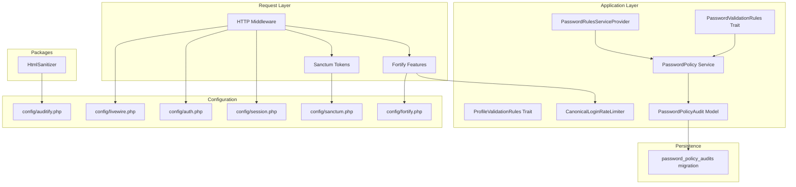
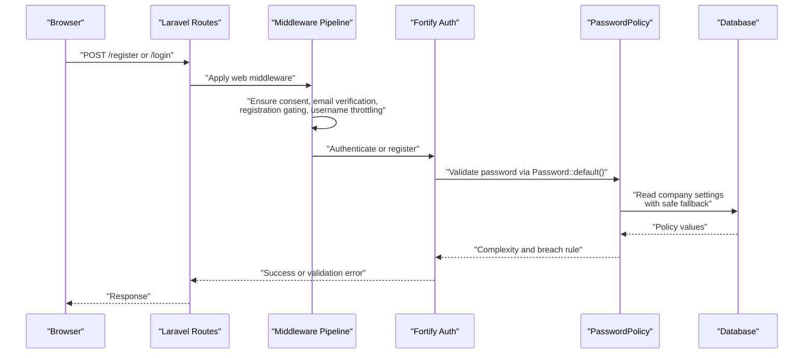
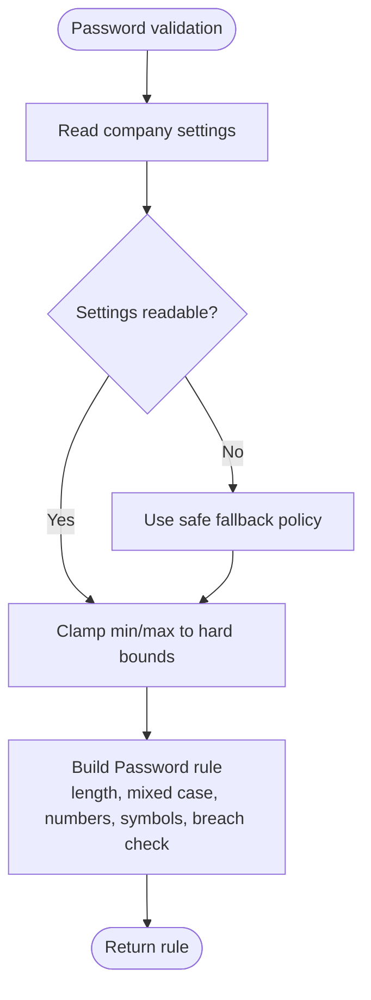
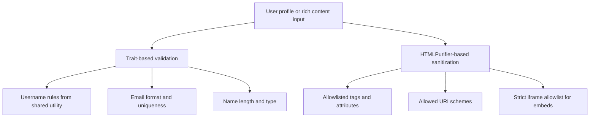
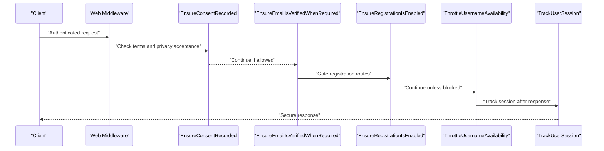
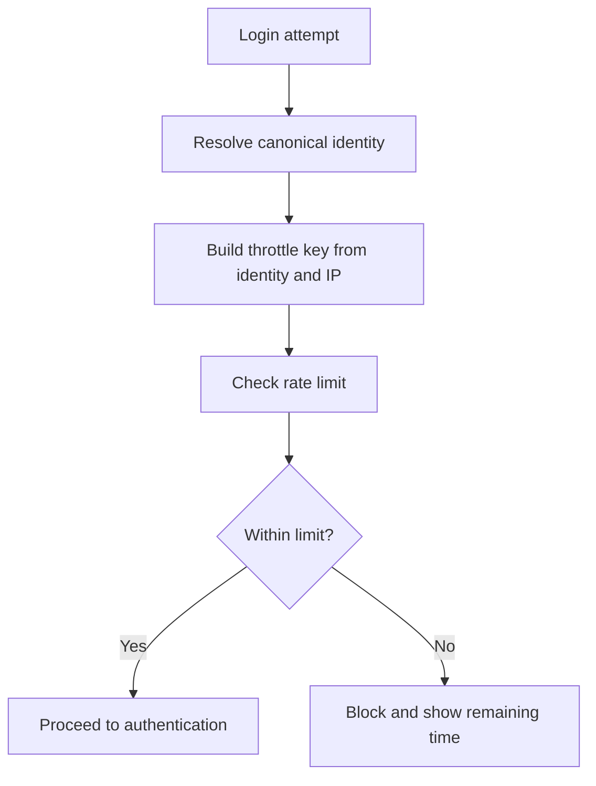
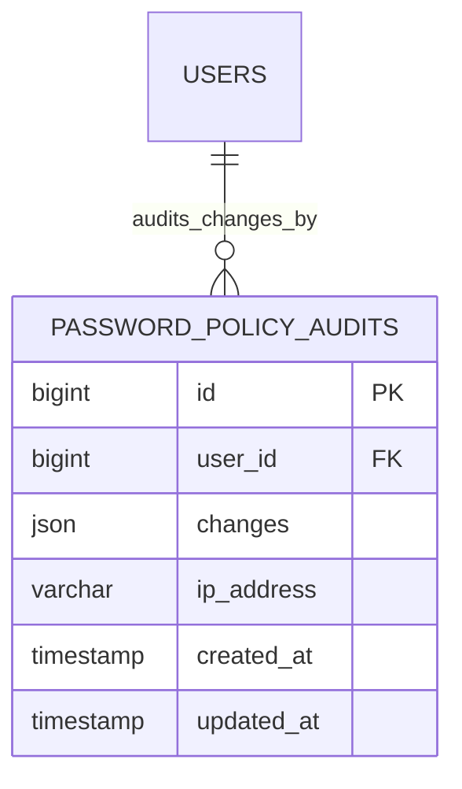
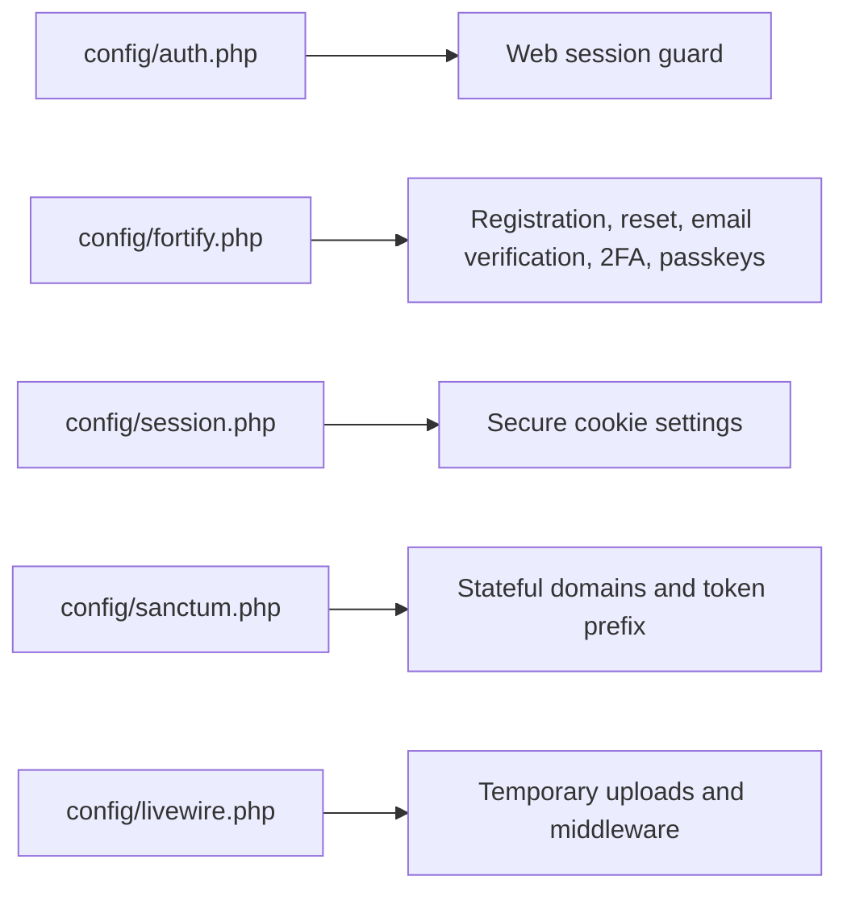
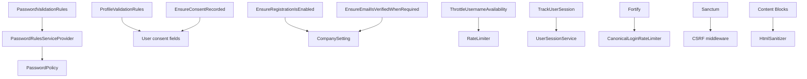

# Security Policies

<cite>
**Referenced Files in This Document**   
- [PasswordPolicy.php](file://app/Services/PasswordPolicy.php)
- [PasswordRulesServiceProvider.php](file://app/Providers/PasswordRulesServiceProvider.php)
- [PasswordValidationRules.php](file://app/Concerns/PasswordValidationRules.php)
- [ProfileValidationRules.php](file://app/Concerns/ProfileValidationRules.php)
- [CanonicalLoginRateLimiter.php](file://app/Support/CanonicalLoginRateLimiter.php)
- [EnsureRegistrationIsEnabled.php](file://app/Http/Middleware/EnsureRegistrationIsEnabled.php)
- [EnsureEmailIsVerifiedWhenRequired.php](file://app/Http/Middleware/EnsureEmailIsVerifiedWhenRequired.php)
- [EnsureConsentRecorded.php](file://app/Http/Middleware/EnsureConsentRecorded.php)
- [ThrottleUsernameAvailability.php](file://app/Http/Middleware/ThrottleUsernameAvailability.php)
- [TrackUserSession.php](file://app/Http/Middleware/TrackUserSession.php)
- [bootstrap/app.php](file://bootstrap/app.php)
- [config/auth.php](file://config/auth.php)
- [config/session.php](file://config/session.php)
- [config/sanctum.php](file://config/sanctum.php)
- [config/fortify.php](file://config/fortify.php)
- [config/livewire.php](file://config/livewire.php)
- [config/auditify.php](file://config/auditify.php)
- [PasswordPolicyAudit.php](file://app/Models/PasswordPolicyAudit.php)
- [2026_10_20_000000_create_password_policy_audits_table.php](file://database/migrations/2026_10_20_000000_create_password_policy_audits_table.php)
- [HtmlSanitizer.php](file://packages/ContentBlocks/src/Services/HtmlSanitizer.php)
</cite>

## Table of Contents
1. [Introduction](#introduction)
2. [Project Structure](#project-structure)
3. [Core Components](#core-components)
4. [Architecture Overview](#architecture-overview)
5. [Detailed Component Analysis](#detailed-component-analysis)
6. [Dependency Analysis](#dependency-analysis)
7. [Performance Considerations](#performance-considerations)
8. [Troubleshooting Guide](#troubleshooting-guide)
9. [Conclusion](#conclusion)

## Introduction
This document describes the Highblossom security policies and validation frameworks with a focus on:
- Password policy enforcement, including complexity requirements, breach checking, and auditability.
- Profile validation rules, input sanitization strategies, and reusable validation traits.
- The HTTP middleware pipeline used for request security, registration gating, rate limiting, consent checks, email verification, and session tracking.
- Configuration for authentication, sessions, Sanctum tokens, Fortify features, Livewire uploads, and auditing.
- Guidance for extending validation rules, implementing custom security policies, integrating third-party security tools, and operating securely in production.

The goal is to make these mechanisms understandable for both developers and operators while remaining grounded in the actual codebase.

## Project Structure
Security-related logic is distributed across several layers:
- Services define core business policies such as password strength.
- Providers register framework-level defaults so all consumers inherit secure behavior.
- Traits centralize reusable validation rules for passwords and profiles.
- Middleware enforces per-request security constraints.
- Configuration files tune authentication, sessions, API tokens, Fortify, Livewire, and auditing.
- Models and migrations persist security-sensitive state, including policy change audits.
- A package provides HTML sanitization for rich content blocks.



**Diagram sources**
- [bootstrap/app.php:1-71](file://bootstrap/app.php#L1-L71)
- [PasswordRulesServiceProvider.php:1-37](file://app/Providers/PasswordRulesServiceProvider.php#L1-L37)
- [PasswordPolicy.php:1-200](file://app/Services/PasswordPolicy.php#L1-L200)
- [PasswordValidationRules.php:1-36](file://app/Concerns/PasswordValidationRules.php#L1-L36)
- [ProfileValidationRules.php:1-74](file://app/Concerns/ProfileValidationRules.php#L1-L74)
- [CanonicalLoginRateLimiter.php:1-37](file://app/Support/CanonicalLoginRateLimiter.php#L1-L37)
- [PasswordPolicyAudit.php:1-42](file://app/Models/PasswordPolicyAudit.php#L1-L42)
- [2026_10_20_000000_create_password_policy_audits_table.php:1-32](file://database/migrations/2026_10_20_000000_create_password_policy_audits_table.php#L1-L32)
- [HtmlSanitizer.php:1-124](file://packages/ContentBlocks/src/Services/HtmlSanitizer.php#L1-L124)
- [config/auth.php:1-117](file://config/auth.php#L1-L117)
- [config/session.php:1-200](file://config/session.php#L1-L200)
- [config/sanctum.php:1-87](file://config/sanctum.php#L1-L87)
- [config/fortify.php:1-162](file://config/fortify.php#L1-L162)
- [config/livewire.php:1-200](file://config/livewire.php#L1-L200)
- [config/auditify.php:1-81](file://config/auditify.php#L1-L81)

**Section sources**
- [bootstrap/app.php:1-71](file://bootstrap/app.php#L1-L71)
- [config/auth.php:1-117](file://config/auth.php#L1-L117)
- [config/session.php:1-200](file://config/session.php#L1-L200)
- [config/sanctum.php:1-87](file://config/sanctum.php#L1-L87)
- [config/fortify.php:1-162](file://config/fortify.php#L1-L162)
- [config/livewire.php:1-200](file://config/livewire.php#L1-L200)
- [config/auditify.php:1-81](file://config/auditify.php#L1-L81)

## Core Components
This section summarizes the primary security components before diving into details.

| Component | Responsibility | Key Behavior |
|---|---|---|
| `PasswordPolicy` service | Centralizes password complexity, length, and breach-checking policy | Reads settings with safe fallbacks, clamps values to hard bounds, builds Laravel `Password` rules, exposes checklist and summary strings |
| `PasswordRulesServiceProvider` | Registers default password rules globally | Binds `Password::defaults()` to `PasswordPolicy::rule()` so every form inherits the active policy |
| `PasswordValidationRules` trait | Reusable password validation helpers | Provides `passwordRules()` and `currentPasswordRules()` methods that use `Password::default()` |
| `ProfileValidationRules` trait | Reusable profile field validation | Validates name, username, and email using shared `Username` rules and uniqueness checks |
| `CanonicalLoginRateLimiter` | Secure login throttling | Throttles by canonical identity plus IP instead of raw submitted username string |
| Request middleware | Enforces per-request security controls | Registration gating, consent capture, email verification requirement, username availability throttling, session tracking |
| HTML sanitizer | Sanitizes rich text and embed markup | Uses HTMLPurifier with allowlists for tags, attributes, schemes, and a stricter iframe rule for embeds |
| Auditing configuration | Tracks security-relevant events | Enables XSS scanning, user-agent/IP tracking, alerts, and pruning intervals |

**Section sources**
- [PasswordPolicy.php:1-200](file://app/Services/PasswordPolicy.php#L1-L200)
- [PasswordRulesServiceProvider.php:1-37](file://app/Providers/PasswordRulesServiceProvider.php#L1-L37)
- [PasswordValidationRules.php:1-36](file://app/Concerns/PasswordValidationRules.php#L1-L36)
- [ProfileValidationRules.php:1-74](file://app/Concerns/ProfileValidationRules.php#L1-L74)
- [CanonicalLoginRateLimiter.php:1-37](file://app/Support/CanonicalLoginRateLimiter.php#L1-L37)
- [EnsureRegistrationIsEnabled.php:1-39](file://app/Http/Middleware/EnsureRegistrationIsEnabled.php#L1-L39)
- [EnsureEmailIsVerifiedWhenRequired.php:1-40](file://app/Http/Middleware/EnsureEmailIsVerifiedWhenRequired.php#L1-L40)
- [EnsureConsentRecorded.php:1-38](file://app/Http/Middleware/EnsureConsentRecorded.php#L1-L38)
- [ThrottleUsernameAvailability.php:1-72](file://app/Http/Middleware/ThrottleUsernameAvailability.php#L1-L72)
- [TrackUserSession.php:1-39](file://app/Http/Middleware/TrackUserSession.php#L1-L39)
- [HtmlSanitizer.php:1-124](file://packages/ContentBlocks/src/Services/HtmlSanitizer.php#L1-L124)
- [config/auditify.php:1-81](file://config/auditify.php#L1-L81)

## Architecture Overview
The application follows a layered approach:
- HTTP requests enter through Laravel’s web or API routes.
- Framework and application middleware enforce session trust proxies, consent, email verification, registration gating, username throttling, and session tracking.
- Fortify handles authentication flows and integrates with rate limiting.
- Form validation uses traits that delegate to the centralized `PasswordPolicy`.
- Rich content is sanitized before storage or rendering through the Content Blocks package.
- Authentication, session cookies, API tokens, and audit events are configured centrally.



**Diagram sources**
- [bootstrap/app.php:1-71](file://bootstrap/app.php#L1-L71)
- [config/fortify.php:1-162](file://config/fortify.php#L1-L162)
- [PasswordRulesServiceProvider.php:1-37](file://app/Providers/PasswordRulesServiceProvider.php#L1-L37)
- [PasswordPolicy.php:1-200](file://app/Services/PasswordPolicy.php#L1-L200)
- [EnsureRegistrationIsEnabled.php:1-39](file://app/Http/Middleware/EnsureRegistrationIsEnabled.php#L1-L39)
- [EnsureEmailIsVerifiedWhenRequired.php:1-40](file://app/Http/Middleware/EnsureEmailIsVerifiedWhenRequired.php#L1-L40)
- [EnsureConsentRecorded.php:1-38](file://app/Http/Middleware/EnsureConsentRecorded.php#L1-L38)
- [ThrottleUsernameAvailability.php:1-72](file://app/Http/Middleware/ThrottleUsernameAvailability.php#L1-L72)

## Detailed Component Analysis

### Password Policy Enforcement
The password policy is the single source of truth for password strength. It:
- Reads minimum and maximum lengths, mixed-case, number, symbol, and breach-check flags from company settings.
- Applies safe defaults when settings cannot be read.
- Clamps values to hard bounds: minimum floor, maximum floor, and maximum ceiling aligned with bcrypt limits.
- Builds a Laravel `Password` rule reflecting current policy.
- Exposes a checklist for live hints and a human-readable summary.



**Diagram sources**
- [PasswordPolicy.php:1-200](file://app/Services/PasswordPolicy.php#L1-L200)

Key implementation points:
- Hard bounds prevent misconfiguration from weakening or destabilizing hashing.
- Breach checking can be enabled through the policy; when enabled, it uses the framework’s compromised-password capability.
- The service provider registers the global default, ensuring consistency across registration, reset, profile, and admin forms.

```mermaid
classDiagram
  class PasswordPolicy {
    +MIN_FLOOR
    +MAX_FLOOR
    +MAX_CEILING
    +current() array
    +rule() Password
    +checklist() list
    +summary() string
  }

  class PasswordRulesServiceProvider {
    +register() void
    +boot() void
  }

  class PasswordValidationRules {
    +passwordRules() array
    +currentPasswordRules() array
  }

  PasswordRulesServiceProvider --> PasswordPolicy : "registers default"
  PasswordValidationRules --> PasswordPolicy : "uses Password::default()"
```

**Diagram sources**
- [PasswordPolicy.php:1-200](file://app/Services/PasswordPolicy.php#L1-L200)
- [PasswordRulesServiceProvider.php:1-37](file://app/Providers/PasswordRulesServiceProvider.php#L1-L37)
- [PasswordValidationRules.php:1-36](file://app/Concerns/PasswordValidationRules.php#L1-L36)

**Section sources**
- [PasswordPolicy.php:1-200](file://app/Services/PasswordPolicy.php#L1-L200)
- [PasswordRulesServiceProvider.php:1-37](file://app/Providers/PasswordRulesServiceProvider.php#L1-L37)
- [PasswordValidationRules.php:1-36](file://app/Concerns/PasswordValidationRules.php#L1-L36)

#### Password History Checks and Expiration
- Explicit password history checks are not implemented in the referenced files.
- Password expiration is not enforced by the password policy service itself.
- The authentication configuration includes a password confirmation timeout setting, which controls how long a password confirmation window remains valid.
- Audit changes to the password policy are persisted separately, but this does not represent per-user password history.

**Section sources**
- [config/auth.php:1-117](file://config/auth.php#L1-L117)
- [PasswordPolicy.php:1-200](file://app/Services/PasswordPolicy.php#L1-L200)
- [PasswordPolicyAudit.php:1-42](file://app/Models/PasswordPolicyAudit.php#L1-L42)

### Profile Validation Rules and Input Sanitization
Profile validation is centralized through a trait:
- Name is required, a string, and limited to a reasonable length.
- Username validation delegates to a dedicated `Username` utility so the shape, reserved names, and uniqueness rules match sign-in lookup behavior.
- Email is required, validated as an email, limited in length, and checked for uniqueness against existing users, with support for ignoring the current user during updates.

Rich HTML content is sanitized through the Content Blocks package:
- General HTML is restricted to an allowlist of tags, attributes, and URI schemes.
- Embed markup receives a stricter sanitizer that permits only safe iframe attributes and removes scripts and unsafe handlers.
- HTMLPurifier caching is configured under a writable storage path.



**Diagram sources**
- [ProfileValidationRules.php:1-74](file://app/Concerns/ProfileValidationRules.php#L1-L74)
- [HtmlSanitizer.php:1-124](file://packages/ContentBlocks/src/Services/HtmlSanitizer.php#L1-L124)

**Section sources**
- [ProfileValidationRules.php:1-74](file://app/Concerns/ProfileValidationRules.php#L1-L74)
- [HtmlSanitizer.php:1-124](file://packages/ContentBlocks/src/Services/HtmlSanitizer.php#L1-L124)

### Middleware Pipeline for Request Security
The middleware pipeline applies shared security and operational concerns:
- Proxy trust headers are set so public URLs preserve HTTPS and host information.
- Consent must be recorded before authenticated users access protected resources.
- Email verification may be required based on company settings.
- Registration routes are gated by a database-backed feature flag.
- Username availability endpoints are rate-limited per route, user, and IP to prevent enumeration.
- Live sessions are tracked after response processing so the device ledger stays consistent with regenerated session identifiers.



**Diagram sources**
- [bootstrap/app.php:1-71](file://bootstrap/app.php#L1-L71)
- [EnsureConsentRecorded.php:1-38](file://app/Http/Middleware/EnsureConsentRecorded.php#L1-L38)
- [EnsureEmailIsVerifiedWhenRequired.php:1-40](file://app/Http/Middleware/EnsureEmailIsVerifiedWhenRequired.php#L1-L40)
- [EnsureRegistrationIsEnabled.php:1-39](file://app/Http/Middleware/EnsureRegistrationIsEnabled.php#L1-L39)
- [ThrottleUsernameAvailability.php:1-72](file://app/Http/Middleware/ThrottleUsernameAvailability.php#L1-L72)
- [TrackUserSession.php:1-39](file://app/Http/Middleware/TrackUserSession.php#L1-L39)

CSRF protection:
- CSRF token validation is part of Sanctum’s middleware stack.
- Sanctum also configures cookie encryption and validates CSRF tokens for stateful first-party SPA authentication.

XSS prevention:
- Application-level XSS mitigation is provided by the HTML sanitizer for rich content.
- The auditing package includes an XSS protection configuration with blocking and exclusion options.

SQL injection mitigation:
- SQL injection risks are mitigated primarily through Eloquent parameter binding rather than direct query construction.
- No custom SQL injection middleware was found in the referenced files.

**Section sources**
- [bootstrap/app.php:1-71](file://bootstrap/app.php#L1-L71)
- [config/sanctum.php:1-87](file://config/sanctum.php#L1-L87)
- [HtmlSanitizer.php:1-124](file://packages/ContentBlocks/src/Services/HtmlSanitizer.php#L1-L124)
- [config/auditify.php:1-81](file://config/auditify.php#L1-L81)

### Login Throttling and Identity Canonicalization
The custom login rate limiter resolves a security issue where different inputs mapping to the same account could bypass per-account throttling. It:
- Extends Fortify’s rate limiter.
- Computes the throttle key from a canonical identity plus IP address.
- Ensures lockout and banner behavior remain consistent regardless of whether the user submits a username or email.



**Diagram sources**
- [CanonicalLoginRateLimiter.php:1-37](file://app/Support/CanonicalLoginRateLimiter.php#L1-L37)

**Section sources**
- [CanonicalLoginRateLimiter.php:1-37](file://app/Support/CanonicalLoginRateLimiter.php#L1-L37)
- [config/fortify.php:1-162](file://config/fortify.php#L1-L162)

### Password Policy Auditing
Changes to the password policy are auditable:
- The model stores administrator identity, changes as JSON, and originating IP address.
- The migration defines an append-only table structure suitable for audit trails.
- The model casts the changes column to an array and relates the audit to a user.



**Diagram sources**
- [PasswordPolicyAudit.php:1-42](file://app/Models/PasswordPolicyAudit.php#L1-L42)
- [2026_10_20_000000_create_password_policy_audits_table.php:1-32](file://database/migrations/2026_10_20_000000_create_password_policy_audits_table.php#L1-L32)

**Section sources**
- [PasswordPolicyAudit.php:1-42](file://app/Models/PasswordPolicyAudit.php#L1-L42)
- [2026_10_20_000000_create_password_policy_audits_table.php:1-32](file://database/migrations/2026_10_20_000000_create_password_policy_audits_table.php#L1-L32)

### Authentication, Sessions, and API Tokens
Authentication:
- The web guard uses session-based authentication with an Eloquent user provider.
- Password reset tokens expire after a short period and are rate-limited.
- Fortify manages registration, password resets, email verification, two-factor authentication, and passkeys.

Sessions:
- Session driver, lifetime, encryption, storage connection, table, cookie name, path, domain, secure flag, HTTP-only flag, and same-site policy are configurable.
- These settings control secure cookie behavior and cross-site request protections.

API tokens:
- Sanctum supports stateful domains for first-party SPAs.
- Token expiration can be configured.
- Token prefixing helps secret scanners avoid committing tokens.
- Sanctum middleware includes session authentication, cookie encryption, and CSRF validation.

Livewire uploads:
- Temporary file upload configuration allows limiting file size, MIME types, cleanup behavior, and applying middleware such as rate limiting.



**Diagram sources**
- [config/auth.php:1-117](file://config/auth.php#L1-L117)
- [config/fortify.php:1-162](file://config/fortify.php#L1-L162)
- [config/session.php:1-200](file://config/session.php#L1-L200)
- [config/sanctum.php:1-87](file://config/sanctum.php#L1-L87)
- [config/livewire.php:1-200](file://config/livewire.php#L1-L200)

**Section sources**
- [config/auth.php:1-117](file://config/auth.php#L1-L117)
- [config/fortify.php:1-162](file://config/fortify.php#L1-L162)
- [config/session.php:1-200](file://config/session.php#L1-L200)
- [config/sanctum.php:1-87](file://config/sanctum.php#L1-L87)
- [config/livewire.php:1-200](file://config/livewire.php#L1-L200)

### Security Headers, Content Security Policy, and Secure Cookies
- Secure cookie settings are available through session configuration, including secure, HTTP-only, and same-site options.
- No explicit security header middleware or Content Security Policy implementation was found in the analyzed files.
- If CSP is required, it should be added through a dedicated middleware or server configuration, ensuring compatibility with trusted domains, inline scripts, and third-party assets.

Recommendations:
- Enable HTTPS-only sessions in production.
- Set appropriate same-site cookie policies for CSRF protection.
- Add security headers at the proxy, reverse proxy, or application layer.
- Define a strict CSP aligned with application assets and third-party integrations.

**Section sources**
- [config/session.php:1-200](file://config/session.php#L1-L200)

## Dependency Analysis
The security subsystem has clear boundaries:
- `PasswordPolicy` is the single dependency for password rules.
- Traits depend on the policy through `Password::default()` rather than duplicating logic.
- Middleware depends on company settings and identity data but not on password policy.
- Fortify integration depends on rate limiting and feature configuration.
- Auditing depends on models and migrations.
- HTML sanitization depends on package configuration and storage paths.



**Diagram sources**
- [PasswordValidationRules.php:1-36](file://app/Concerns/PasswordValidationRules.php#L1-L36)
- [PasswordRulesServiceProvider.php:1-37](file://app/Providers/PasswordRulesServiceProvider.php#L1-L37)
- [PasswordPolicy.php:1-200](file://app/Services/PasswordPolicy.php#L1-L200)
- [ProfileValidationRules.php:1-74](file://app/Concerns/ProfileValidationRules.php#L1-L74)
- [EnsureRegistrationIsEnabled.php:1-39](file://app/Http/Middleware/EnsureRegistrationIsEnabled.php#L1-L39)
- [EnsureEmailIsVerifiedWhenRequired.php:1-40](file://app/Http/Middleware/EnsureEmailIsVerifiedWhenRequired.php#L1-L40)
- [EnsureConsentRecorded.php:1-38](file://app/Http/Middleware/EnsureConsentRecorded.php#L1-L38)
- [ThrottleUsernameAvailability.php:1-72](file://app/Http/Middleware/ThrottleUsernameAvailability.php#L1-L72)
- [TrackUserSession.php:1-39](file://app/Http/Middleware/TrackUserSession.php#L1-L39)
- [CanonicalLoginRateLimiter.php:1-37](file://app/Support/CanonicalLoginRateLimiter.php#L1-L37)
- [config/sanctum.php:1-87](file://config/sanctum.php#L1-L87)
- [HtmlSanitizer.php:1-124](file://packages/ContentBlocks/src/Services/HtmlSanitizer.php#L1-L124)

**Section sources**
- [PasswordValidationRules.php:1-36](file://app/Concerns/PasswordValidationRules.php#L1-L36)
- [PasswordRulesServiceProvider.php:1-37](file://app/Providers/PasswordRulesServiceProvider.php#L1-L37)
- [PasswordPolicy.php:1-200](file://app/Services/PasswordPolicy.php#L1-L200)
- [ProfileValidationRules.php:1-74](file://app/Concerns/ProfileValidationRules.php#L1-L74)
- [EnsureRegistrationIsEnabled.php:1-39](file://app/Http/Middleware/EnsureRegistrationIsEnabled.php#L1-L39)
- [EnsureEmailIsVerifiedWhenRequired.php:1-40](file://app/Http/Middleware/EnsureEmailIsVerifiedWhenRequired.php#L1-L40)
- [EnsureConsentRecorded.php:1-38](file://app/Http/Middleware/EnsureConsentRecorded.php#L1-L38)
- [ThrottleUsernameAvailability.php:1-72](file://app/Http/Middleware/ThrottleUsernameAvailability.php#L1-L72)
- [TrackUserSession.php:1-39](file://app/Http/Middleware/TrackUserSession.php#L1-L39)
- [CanonicalLoginRateLimiter.php:1-37](file://app/Support/CanonicalLoginRateLimiter.php#L1-L37)
- [config/sanctum.php:1-87](file://config/sanctum.php#L1-L87)
- [HtmlSanitizer.php:1-124](file://packages/ContentBlocks/src/Services/HtmlSanitizer.php#L1-L124)

## Performance Considerations
- Password policy resolution caches the resolved policy within a request to avoid repeated settings reads.
- HTMLPurifier instances are lazily initialized and cached inside the sanitizer.
- Rate limiting protects sensitive endpoints without disabling legitimate usage.
- Session and token configurations should balance security with latency, especially in multi-server environments.

Operational guidance:
- Ensure the HTMLPurifier cache directory is writable.
- Monitor rate limiter hits for abuse patterns.
- Keep debug mode disabled in production to avoid leaking stack traces.
- Review Fortify and Sanctum configurations when scaling across domains or APIs.

[No sources needed since this section provides general guidance]

## Troubleshooting Guide

Common issues and diagnostics:
- Password validation failures: verify the active policy and its checklist output. Confirm that company settings are readable and within hard bounds.
- Registration blocked unexpectedly: check the registration feature flag and confirm the middleware is applied only to registration routes.
- Users unable to log in due to throttling: inspect canonical login rate limiting and ensure the limiter key accounts for both usernames and emails.
- Cookie or session problems: review session driver, secure flag, HTTP-only flag, same-site policy, domain, and path.
- Rich content stripped: validate HTML allowlists and embed sanitizer configuration; ensure the cache directory exists.
- Audit visibility: confirm audit tables exist and auditing configuration enables relevant tracking.

Recommended diagnostic steps:
- Inspect validation errors returned by forms using traits.
- Check Fortify limiters and Sanctum stateful domains.
- Review middleware order in the bootstrap application configuration.
- Use the auditing package’s alert thresholds and pruning configuration to manage logs.

**Section sources**
- [PasswordPolicy.php:1-200](file://app/Services/PasswordPolicy.php#L1-L200)
- [EnsureRegistrationIsEnabled.php:1-39](file://app/Http/Middleware/EnsureRegistrationIsEnabled.php#L1-L39)
- [CanonicalLoginRateLimiter.php:1-37](file://app/Support/CanonicalLoginRateLimiter.php#L1-L37)
- [config/session.php:1-200](file://config/session.php#L1-L200)
- [config/sanctum.php:1-87](file://config/sanctum.php#L1-L87)
- [HtmlSanitizer.php:1-124](file://packages/ContentBlocks/src/Services/HtmlSanitizer.php#L1-L124)
- [config/auditify.php:1-81](file://config/auditify.php#L1-L81)

## Conclusion
Highblossom centralizes security through a small set of focused components:
- Password strength is enforced consistently by a single policy service and registered globally.
- Profile validation and HTML sanitization reduce input risks.
- Middleware gates registration, consent, email verification, and username enumeration while tracking sessions.
- Authentication, sessions, tokens, and auditing are configured through framework and package configuration.
- Production security should additionally include secure cookie settings, security headers, CSP, vulnerability scanning, and incident response procedures tailored to the deployment environment.

Extending security safely means:
- Adding new validation rules through traits or custom rules.
- Implementing custom security policies as services and registering them through providers.
- Integrating third-party tools via middleware, listeners, or service classes.
- Keeping configuration explicit and reviewing it regularly in audits.

[No sources needed since this section summarizes without analyzing specific files]