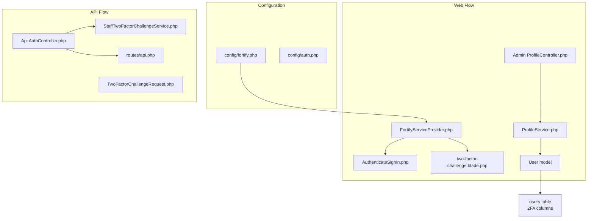
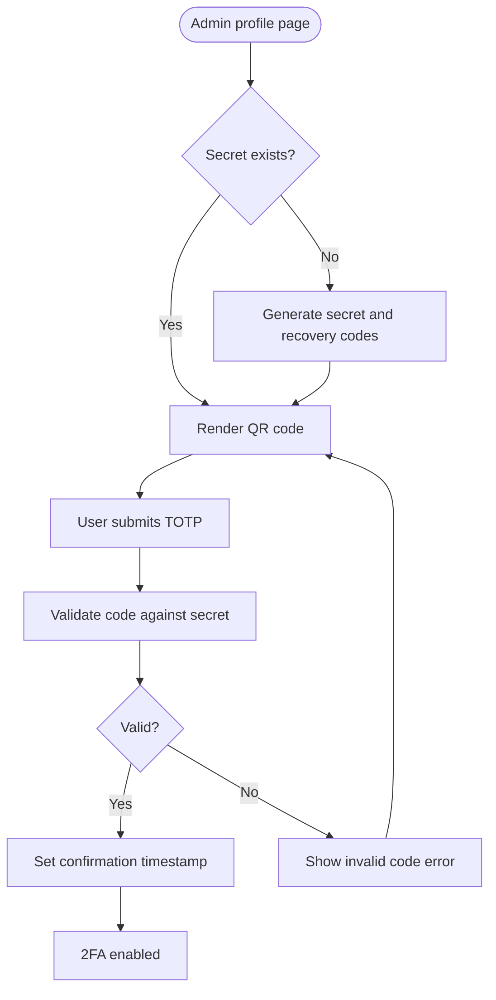
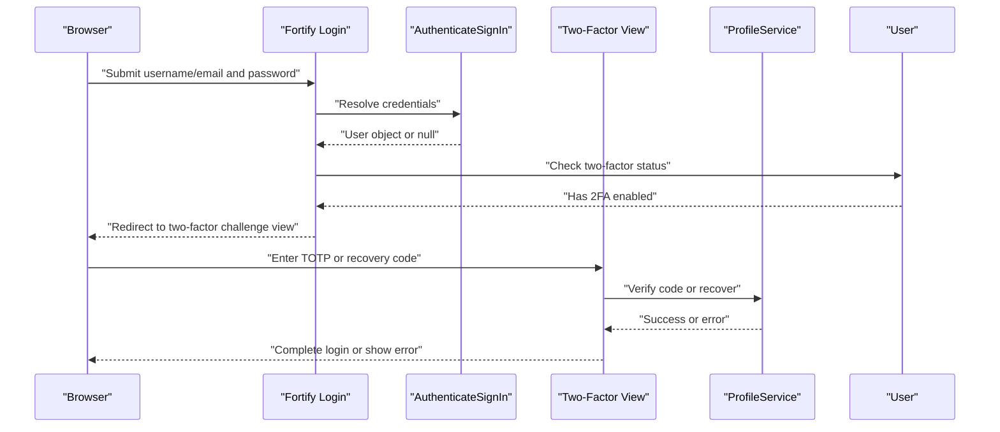
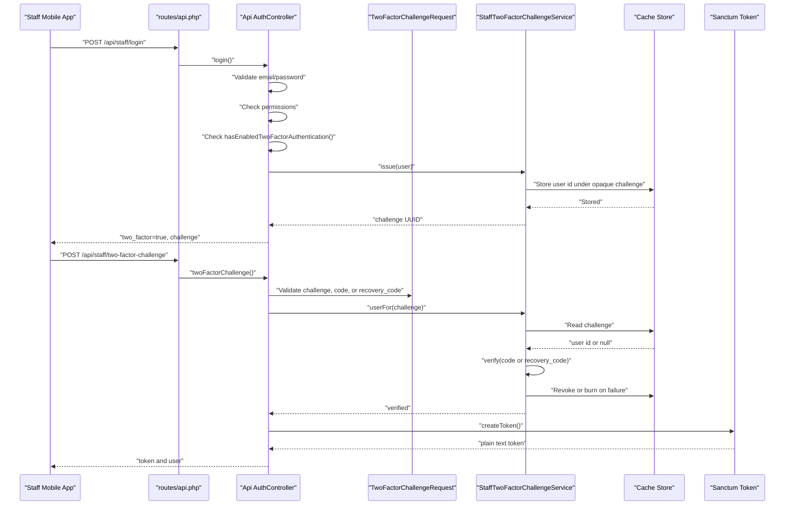
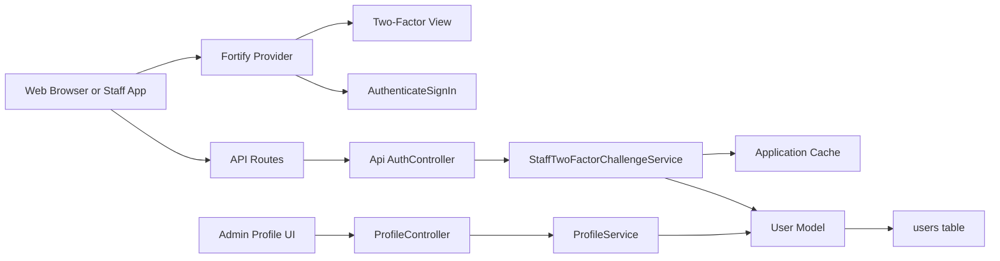
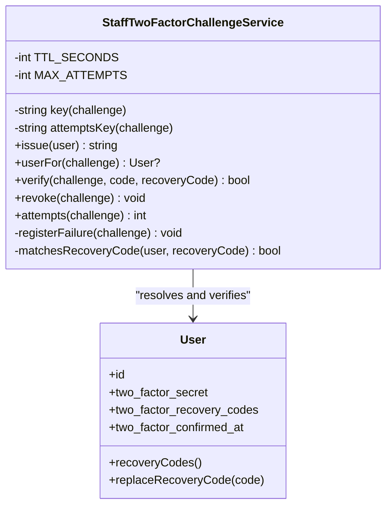
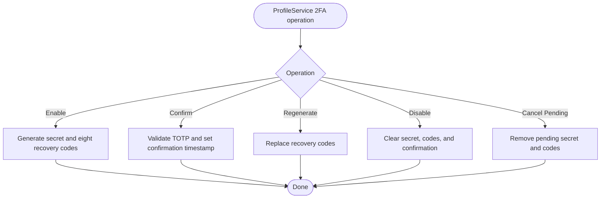
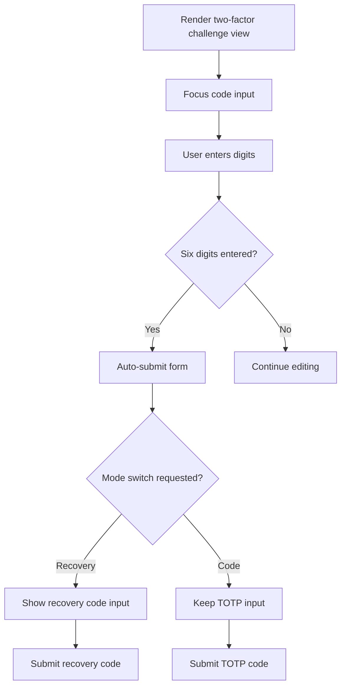
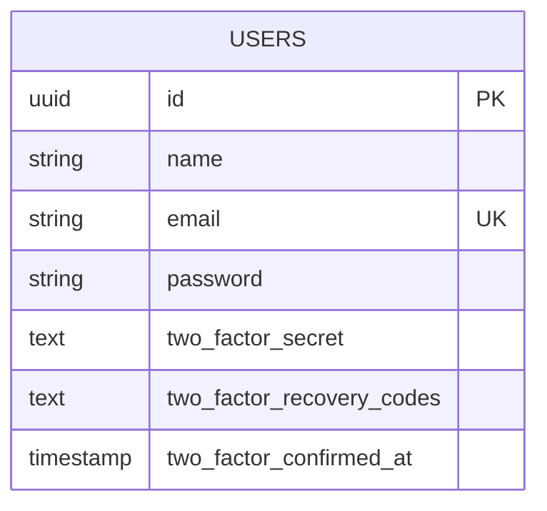
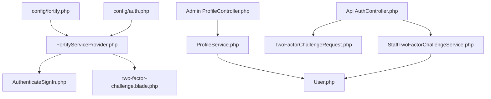

# Two-Factor Authentication

<cite>
**Referenced Files in This Document**   
- [StaffTwoFactorChallengeService.php](file://app/Services/StaffTwoFactorChallengeService.php)
- [ProfileService.php](file://app/Services/ProfileService.php)
- [User.php](file://app/Models/User.php)
- [AuthController.php](file://app/Http/Controllers/Api/AuthController.php)
- [TwoFactorChallengeRequest.php](file://app/Http/Requests/Api/TwoFactorChallengeRequest.php)
- [FortifyServiceProvider.php](file://app/Providers/FortifyServiceProvider.php)
- [AuthenticateSignIn.php](file://app/Actions/Fortify/AuthenticateSignIn.php)
- [two-factor-challenge.blade.php](file://resources/views/auth/two-factor-challenge.blade.php)
- [ProfileController.php](file://app/Http/Controllers/Admin/ProfileController.php)
- [2025_08_14_170933_add_two_factor_columns_to_users_table.php](file://database/migrations/2025_08_14_170933_add_two_factor_columns_to_users_table.php)
- [fortify.php](file://config/fortify.php)
- [auth.php](file://config/auth.php)
- [api.php](file://routes/api.php)
- [index.blade.php](file://resources/views/admin/profile/index.blade.php)
- [auth.php](file://lang/en/auth.php)
</cite>

## Table of Contents
1. [Introduction](#introduction)
2. [Project Structure](#project-structure)
3. [Core Components](#core-components)
4. [Architecture Overview](#architecture-overview)
5. [Detailed Component Analysis](#detailed-component-analysis)
6. [Dependency Analysis](#dependency-analysis)
7. [Performance Considerations](#performance-considerations)
8. [Troubleshooting Guide](#troubleshooting-guide)
9. [Conclusion](#conclusion)

## Introduction
This document explains the Highblossom two-factor authentication system. It covers:

- Time-based one-time password (TOTP) setup and verification through Laravel Fortify.
- Backup code generation, replacement, and recovery.
- The `StaffTwoFactorChallengeService`, which provides a stateless second-factor flow for the staff mobile API.
- Web-based 2FA challenge handling via Fortify views and actions.
- Database schema changes for storing TOTP secrets, recovery codes, and confirmation timestamps.
- Security considerations for QR codes, secret storage, token validation, and brute-force protection.
- Integration with existing web login and Sanctum-powered API login flows.

The implementation is split between:

| Area | Responsibility |
|---|---|
| Web admin panel | User enables and confirms 2FA, scans QR codes, manages backup codes, and logs in through Fortify’s session-based 2FA challenge. |
| Staff mobile API | Completes 2FA without server-side sessions by using short-lived, single-use challenge identifiers stored in cache. |
| Shared model and configuration | Stores encrypted TOTP data and configures Fortify features. |

## Project Structure
The 2FA feature touches configuration, models, services, controllers, requests, routes, database migrations, views, and language strings.

**Diagram sources**
- [fortify.php:1-162](file://config/fortify.php#L1-L162)
- [auth.php:1-117](file://config/auth.php#L1-L117)
- [FortifyServiceProvider.php:1-118](file://app/Providers/FortifyServiceProvider.php#L1-L118)
- [AuthenticateSignIn.php:1-76](file://app/Actions/Fortify/AuthenticateSignIn.php#L1-L76)
- [two-factor-challenge.blade.php:1-174](file://resources/views/auth/two-factor-challenge.blade.php#L1-L174)
- [ProfileController.php:1-200](file://app/Http/Controllers/Admin/ProfileController.php#L1-L200)
- [ProfileService.php:1-255](file://app/Services/ProfileService.php#L1-L255)
- [User.php:1-141](file://app/Models/User.php#L1-L141)
- [AuthController.php:1-135](file://app/Http/Controllers/Api/AuthController.php#L1-L135)
- [TwoFactorChallengeRequest.php:1-65](file://app/Http/Requests/Api/TwoFactorChallengeRequest.php#L1-L65)
- [api.php:1-117](file://routes/api.php#L1-L117)

**Section sources**
- [fortify.php:1-162](file://config/fortify.php#L1-L162)
- [auth.php:1-117](file://config/auth.php#L1-L117)
- [FortifyServiceProvider.php:1-118](file://app/Providers/FortifyServiceProvider.php#L1-L118)
- [api.php:1-117](file://routes/api.php#L1-L117)

## Core Components

### TOTP Storage Model
The `User` model integrates Fortify’s two-factor support. It uses the `TwoFactorAuthenticatable` trait and hides both `two_factor_secret` and `two_factor_recovery_codes` from JSON serialization.

Key responsibilities:

- Provides Fortify methods such as `hasEnabledTwoFactorAuthentication()` and `twoFactorQrCodeUrl()`.
- Marks sensitive 2FA fields as hidden so they do not leak into API responses.
- Maps to the `users` table, where migration adds the TOTP columns.

Security note: The controller layer must still avoid exposing these attributes; hiding them at the model level is an additional safeguard.

**Section sources**
- [User.php:1-141](file://app/Models/User.php#L1-L141)
- [2025_08_14_170933_add_two_factor_columns_to_users_table.php:1-34](file://database/migrations/2025_08_14_170933_add_two_factor_columns_to_users_table.php#L1-L34)

### Web-Based 2FA Setup and Management
The admin profile controller and service coordinate enabling, confirming, canceling, disabling, and regenerating backup codes.

Flow highlights:

- Enabling 2FA generates a secret and eight recovery codes only when none exists yet.
- Confirmation validates the user-provided TOTP against the stored secret and records `two_factor_confirmed_at`.
- QR code SVG rendering is driven by the user’s Fortify QR URL.
- Recovery codes are regenerated or canceled depending on whether 2FA is already confirmed.

**Diagram sources**
- [ProfileController.php:1-200](file://app/Http/Controllers/Admin/ProfileController.php#L1-L200)
- [ProfileService.php:1-255](file://app/Services/ProfileService.php#L1-L255)

**Section sources**
- [ProfileController.php:1-200](file://app/Http/Controllers/Admin/ProfileController.php#L1-L200)
- [ProfileService.php:1-255](file://app/Services/ProfileService.php#L1-L255)
- [index.blade.php:1-200](file://resources/views/admin/profile/index.blade.php#L1-L200)

### Web Login and 2FA Challenge
Fortify handles the standard web sign-in flow. The application customizes:

- Credential resolution through `AuthenticateSignIn`.
- Login and 2FA view registration.
- Two-factor rate limiting scoped to the active login session identifier.

When credentials pass but the user has 2FA enabled, Fortify redirects to the custom two-factor challenge view. That view posts to Fortify’s two-factor route with either a six-digit authenticator code or a recovery code.

**Diagram sources**
- [FortifyServiceProvider.php:1-118](file://app/Providers/FortifyServiceProvider.php#L1-L118)
- [AuthenticateSignIn.php:1-76](file://app/Actions/Fortify/AuthenticateSignIn.php#L1-L76)
- [two-factor-challenge.blade.php:1-174](file://resources/views/auth/two-factor-challenge.blade.php#L1-L174)
- [ProfileService.php:1-255](file://app/Services/ProfileService.php#L1-L255)

**Section sources**
- [FortifyServiceProvider.php:1-118](file://app/Providers/FortifyServiceProvider.php#L1-L118)
- [AuthenticateSignIn.php:1-76](file://app/Actions/Fortify/AuthenticateSignIn.php#L1-L76)
- [two-factor-challenge.blade.php:1-174](file://resources/views/auth/two-factor-challenge.blade.php#L1-L174)
- [auth.php:1-172](file://lang/en/auth.php#L1-L172)

### Stateless API 2FA Challenge
The staff mobile app cannot rely on browser sessions. Instead, it completes two factors over stateless Sanctum calls.

Process summary:

1. The client calls `/api/staff/login` with email and password.
2. If the account has 2FA enabled, the server responds with `two_factor: true` and a `challenge` UUID.
3. The client calls `/api/staff/two-factor-challenge` with the challenge, plus either a TOTP code or a recovery code.
4. On success, the server returns a personal access token.
5. On failure, the challenge may be burned after too many attempts.

**Diagram sources**
- [api.php:1-117](file://routes/api.php#L1-L117)
- [AuthController.php:1-135](file://app/Http/Controllers/Api/AuthController.php#L1-L135)
- [TwoFactorChallengeRequest.php:1-65](file://app/Http/Requests/Api/TwoFactorChallengeRequest.php#L1-L65)
- [StaffTwoFactorChallengeService.php:1-197](file://app/Services/StaffTwoFactorChallengeService.php#L1-L197)

**Section sources**
- [AuthController.php:1-135](file://app/Http/Controllers/Api/AuthController.php#L1-L135)
- [TwoFactorChallengeRequest.php:1-65](file://app/Http/Requests/Api/TwoFactorChallengeRequest.php#L1-L65)
- [StaffTwoFactorChallengeService.php:1-197](file://app/Services/StaffTwoFactorChallengeService.php#L1-L197)
- [api.php:1-117](file://routes/api.php#L1-L117)

## Architecture Overview
The system combines three layers:

1. **Configuration and provider layer**: Fortify is configured to enable two-factor authentication, register views, and apply rate limits.
2. **Web layer**: The admin profile allows users to set up TOTP, scan QR codes, confirm codes, and manage recovery codes. Web login delegates credential checking to a custom action and renders a dedicated two-factor challenge view.
3. **API layer**: The staff API enforces 2FA before issuing tokens. Because API calls are stateless, challenges are represented by short-lived cache entries containing only user IDs.

**Diagram sources**
- [fortify.php:1-162](file://config/fortify.php#L1-L162)
- [FortifyServiceProvider.php:1-118](file://app/Providers/FortifyServiceProvider.php#L1-L118)
- [ProfileController.php:1-200](file://app/Http/Controllers/Admin/ProfileController.php#L1-L200)
- [ProfileService.php:1-255](file://app/Services/ProfileService.php#L1-L255)
- [AuthController.php:1-135](file://app/Http/Controllers/Api/AuthController.php#L1-L135)
- [StaffTwoFactorChallengeService.php:1-197](file://app/Services/StaffTwoFactorChallengeService.php#L1-L197)
- [User.php:1-141](file://app/Models/User.php#L1-L141)

## Detailed Component Analysis

### StaffTwoFactorChallengeService
This service is the core of the stateless API 2FA flow. It issues, resolves, verifies, and revokes challenges.

#### Responsibilities
- Generate a random challenge UUID.
- Store only the user ID in cache under a prefixed key.
- Resolve a user from a challenge while guarding against expired or unknown challenges.
- Verify either a TOTP code or a recovery code.
- Burn the challenge after too many failed attempts.
- Rotate used recovery codes.

#### Data Structures and Complexity
- Challenge mapping: constant-time lookup by UUID in cache.
- Attempt counter: per-challenge integer incremented until the maximum.
- Recovery code comparison: iterates stored codes and uses constant-time string comparison to prevent timing attacks.

**Diagram sources**
- [StaffTwoFactorChallengeService.php:1-197](file://app/Services/StaffTwoFactorChallengeService.php#L1-L197)
- [User.php:1-141](file://app/Models/User.php#L1-L141)

#### Security Behavior
- Challenge lifetime: ten minutes.
- Maximum wrong attempts: five.
- Successful verification consumes the challenge.
- Wrong TOTP increments the attempt counter and may revoke the challenge.
- Recovery codes are compared using constant-time hashing.
- Used recovery codes are replaced so they cannot be reused.

**Section sources**
- [StaffTwoFactorChallengeService.php:1-197](file://app/Services/StaffTwoFactorChallengeService.php#L1-L197)

### ProfileService 2FA Methods
This service implements the user-facing 2FA lifecycle.

| Method | Purpose | Security Detail |
|---|---|---|
| `enableTwoFactor` | Creates secret and recovery codes if none exist. | Idempotent; does not overwrite an existing secret. |
| `confirmTwoFactor` | Validates a TOTP code and sets confirmation time. | Strips spaces and dashes before verification. |
| `getTwoFactorQrCodeSvg` | Generates SVG QR code from Fortify’s QR URL. | Uses high error correction for better scanning reliability. |
| `regenerateRecoveryCodes` | Replaces all backup codes. | Invalidates old codes immediately. |
| `disableTwoFactor` | Clears secret, recovery codes, and confirmation. | Requires explicit disable action. |
| `cancelTwoFactorSetup` | Removes pending unconfirmed setup. | Refuses to touch already confirmed setups. |

**Diagram sources**
- [ProfileService.php:1-255](file://app/Services/ProfileService.php#L1-L255)

**Section sources**
- [ProfileService.php:1-255](file://app/Services/ProfileService.php#L1-L255)

### Web Two-Factor Challenge View
The Blade template implements a six-character numeric input with auto-submit, mode switching between TOTP and recovery codes, accessibility helpers, and localized labels.

Important UX behaviors:

- Focuses the code input automatically.
- Submits when six digits are entered.
- Shows a spinner while submitting.
- Allows switching to recovery code mode.
- Uses `autocomplete="one-time-code"` for device autofill.
- Displays field-level errors for both code types.

**Diagram sources**
- [two-factor-challenge.blade.php:1-174](file://resources/views/auth/two-factor-challenge.blade.php#L1-L174)

**Section sources**
- [two-factor-challenge.blade.php:1-174](file://resources/views/auth/two-factor-challenge.blade.php#L1-L174)
- [auth.php:1-172](file://lang/en/auth.php#L1-L172)

### API Authentication Controller
The API controller separates first-factor and second-factor logic clearly.

Behavior matrix:

| Scenario | Response |
|---|---|
| Invalid email or password | `422` with message. |
| User lacks admin panel permission | `403` with message. |
| User has 2FA enabled | `two_factor: true` and challenge UUID. |
| No 2FA | Personal access token and user resource. |
| Expired or unknown challenge | `422` with reason. |
| Wrong TOTP or recovery code | `422` with error message. |
| Valid second factor | Personal access token and user resource. |

**Section sources**
- [AuthController.php:1-135](file://app/Http/Controllers/Api/AuthController.php#L1-L135)
- [api.php:1-117](file://routes/api.php#L1-L117)

### Database Schema Modifications
The migration adds three nullable columns to the `users` table:

| Column | Type | Meaning |
|---|---|---|
| `two_factor_secret` | `text` | Encrypted TOTP secret. |
| `two_factor_recovery_codes` | `text` | Encrypted JSON array of backup codes. |
| `two_factor_confirmed_at` | `timestamp` | When the user successfully confirmed their authenticator app. |

The down migration drops these columns in reverse order.

**Diagram sources**
- [2025_08_14_170933_add_two_factor_columns_to_users_table.php:1-34](file://database/migrations/2025_08_14_170933_add_two_factor_columns_to_users_table.php#L1-L34)

**Section sources**
- [2025_08_14_170933_add_two_factor_columns_to_users_table.php:1-34](file://database/migrations/2025_08_14_170933_add_two_factor_columns_to_users_table.php#L1-L34)

## Dependency Analysis

**Diagram sources**
- [fortify.php:1-162](file://config/fortify.php#L1-L162)
- [auth.php:1-117](file://config/auth.php#L1-L117)
- [FortifyServiceProvider.php:1-118](file://app/Providers/FortifyServiceProvider.php#L1-L118)
- [AuthenticateSignIn.php:1-76](file://app/Actions/Fortify/AuthenticateSignIn.php#L1-L76)
- [two-factor-challenge.blade.php:1-174](file://resources/views/auth/two-factor-challenge.blade.php#L1-L174)
- [ProfileController.php:1-200](file://app/Http/Controllers/Admin/ProfileController.php#L1-L200)
- [ProfileService.php:1-255](file://app/Services/ProfileService.php#L1-L255)
- [User.php:1-141](file://app/Models/User.php#L1-L141)
- [AuthController.php:1-135](file://app/Http/Controllers/Api/AuthController.php#L1-L135)
- [TwoFactorChallengeRequest.php:1-65](file://app/Http/Requests/Api/TwoFactorChallengeRequest.php#L1-L65)
- [StaffTwoFactorChallengeService.php:1-197](file://app/Services/StaffTwoFactorChallengeService.php#L1-L197)

**Section sources**
- [FortifyServiceProvider.php:1-118](file://app/Providers/FortifyServiceProvider.php#L1-L118)
- [ProfileService.php:1-255](file://app/Services/ProfileService.php#L1-L255)
- [AuthController.php:1-135](file://app/Http/Controllers/Api/AuthController.php#L1-L135)
- [StaffTwoFactorChallengeService.php:1-197](file://app/Services/StaffTwoFactorChallengeService.php#L1-L197)

## Performance Considerations

- **Challenge cache lifetime**: Ten-minute TTL balances usability and security. Short-lived challenges reduce replay risk.
- **Attempt throttling**: The API route uses global throttling, while the challenge itself burns after five wrong attempts. Web two-factor login uses a separate rate limiter keyed by the active login session.
- **QR code generation**: SVG generation happens only during pending or unconfirmed 2FA setup.
- **Secret storage**: Secrets and recovery codes are encrypted before writing to the database.
- **Token issuance**: API tokens are issued only after both factors are satisfied.

Recommendations:

- Ensure the cache backend is reliable and backed up according to operational needs, since API 2FA depends on it.
- Monitor failed challenge attempts and consider alerting on repeated failures.
- Keep Fortify’s two-factor rate limiter and API throttle settings aligned with expected usage patterns.

[No sources needed since this section provides general guidance]

## Troubleshooting Guide

### Common Issues and Resolutions

| Issue | Likely Cause | Resolution |
|---|---|---|
| Web login never shows the 2FA screen | Fortify two-factor feature disabled or user has no secret. | Verify `features` includes `twoFactorAuthentication`; check that the user has a secret and confirmation timestamp. |
| QR code is missing in admin profile | Secret is missing or already confirmed. | Ensure the user is in pending setup state and that the secret exists. |
| TOTP confirmation fails | Incorrect code or secret mismatch. | Ask the user to regenerate codes only if necessary; verify clock synchronization on the authenticator device. |
| API login returns a challenge but verification always fails | Challenge expired, wrong code, or invalid recovery code. | Have the user restart login; check attempt count and cache health. |
| Recovery code accepted but still works later | Recovery code was not rotated. | Investigate whether `replaceRecoveryCode` is available and invoked; verify service implementation. |
| Two-factor rate-limited | Too many submissions in a minute. | Wait and retry; inspect rate limiter configuration. |

### Security Checklist

- Do not log TOTP secrets, recovery codes, submitted codes, or challenge values.
- Never expose `two_factor_secret` or `two_factor_recovery_codes` in API responses.
- Treat the challenge UUID as a temporary authorization token.
- Limit the number of allowed attempts.
- Use HTTPS for all endpoints that accept passwords, TOTP codes, or recovery codes.
- Rotate recovery codes regularly and invalidate old ones on regeneration.
- Restrict API access to permitted roles or abilities.

**Section sources**
- [StaffTwoFactorChallengeService.php:1-197](file://app/Services/StaffTwoFactorChallengeService.php#L1-L197)
- [FortifyServiceProvider.php:1-118](file://app/Providers/FortifyServiceProvider.php#L1-L118)
- [User.php:1-141](file://app/Models/User.php#L1-L141)
- [auth.php:1-172](file://lang/en/auth.php#L1-L172)

## Conclusion
Highblossom’s 2FA implementation follows established TOTP practices and adapts them for both web and stateless API contexts:

- The web flow uses Fortify’s session-based pipeline with a customized challenge view.
- The API flow uses short-lived cache-backed challenges to enforce two factors without shared server state.
- Secrets and backup codes are encrypted and carefully managed.
- Brute-force protection is enforced through rate limiting, attempt caps, and single-use challenges.
- User experience includes QR code generation, clear copy, accessible inputs, and recovery options.

Future improvements could include:

- Adding audit logging for 2FA setup, confirmation, recovery code use, and failures.
- Supporting multiple devices explicitly.
- Exposing challenge expiration and remaining attempts in API responses.
- Centralizing 2FA policy configuration behind a feature flag or company setting.

[No sources needed since this section summarizes without analyzing specific files]