# User Authentication

<cite>
**Referenced Files in This Document**   
- [fortify.php](file://config/fortify.php)
- [auth.php](file://config/auth.php)
- [session.php](file://config/session.php)
- [2026_10_03_130000_create_user_sessions_table.php](file://database/migrations/2026_10_03_130000_create_user_sessions_table.php)
</cite>

## Table of Contents
1. [Introduction](#introduction)
2. [Project Structure](#project-structure)
3. [Core Components](#core-components)
4. [Architecture Overview](#architecture-overview)
5. [Detailed Component Analysis](#detailed-component-analysis)
6. [Dependency Analysis](#dependency-analysis)
7. [Performance Considerations](#performance-considerations)
8. [Troubleshooting Guide](#troubleshooting-guide)
9. [Conclusion](#conclusion)
10. [Appendices](#appendices)

## Introduction
This document explains the Highblossom user authentication system built on Laravel Fortify. It covers the configured authentication stack, session and remember-me behavior, rate limiting, two-factor and passkey features, password reset flows, registration controls, and the custom durable session ledger used to track concurrent sessions. The goal is to help developers understand how login, logout, registration, password management, and session lifecycle interact, and how to safely customize or extend the system.

## Project Structure
Authentication-related configuration and data structures are concentrated in:

- Configuration:
  - `config/fortify.php`: Fortify guard, username field, middleware, rate limiters, view routes, and enabled features.
  - `config/auth.php`: Default guard, Eloquent user provider, and password broker settings.
  - `config/session.php`: Session driver, lifetime, cookie security, SameSite policy, and persistence table.
- Database schema:
  - `database/migrations/2026_10_03_130000_create_user_sessions_table.php`: Durable `user_sessions` ledger for audit and concurrency tracking.

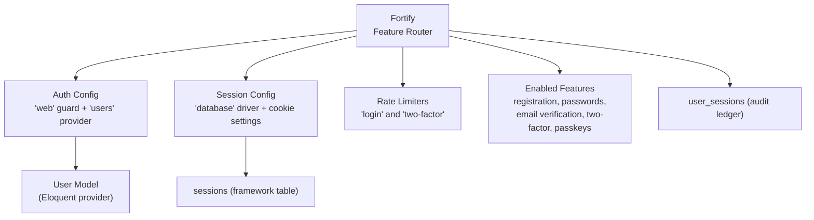

**Diagram sources**
- [fortify.php:1-162](file://config/fortify.php#L1-L162)
- [auth.php:1-117](file://config/auth.php#L1-L117)
- [session.php:1-200](file://config/session.php#L1-L200)
- [2026_10_03_130000_create_user_sessions_table.php:1-67](file://database/migrations/2026_10_03_130000_create_user_sessions_table.php#L1-L67)

**Section sources**
- [fortify.php:1-162](file://config/fortify.php#L1-L162)
- [auth.php:1-117](file://config/auth.php#L1-L117)
- [session.php:1-200](file://config/session.php#L1-L200)
- [2026_10_03_130000_create_user_sessions_table.php:1-67](file://database/migrations/2026_10_03_130000_create_user_sessions_table.php#L1-L67)

## Core Components
This section summarizes the key configuration building blocks that drive the authentication flow.

### Fortify Configuration
- Guard and password broker:
  - Uses the `'web'` guard and `'users'` password broker.
- Username field:
  - Treats the `email` attribute as the primary login identifier.
- Lowercase usernames:
  - Enabled to normalize case before saving.
- Home redirect:
  - Redirects authenticated users to `/dashboard`.
- Route prefix/domain:
  - No prefix; domain is null by default.
- Middleware:
  - Routes use the `'web'` and `'registration.enabled'` middleware.
- Rate limiters:
  - Named `'login'` and `'two-factor'` limiters are registered.
- Views:
  - Built-in Fortify views are enabled.
- Features:
  - Registration, password resets, email verification, two-factor authentication with confirmation, and passkeys are enabled.

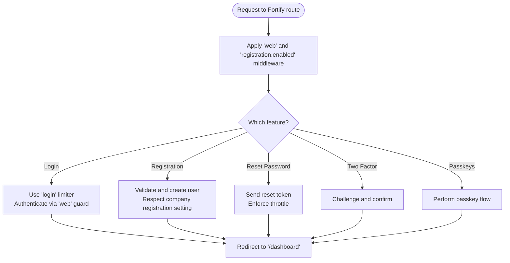

**Diagram sources**
- [fortify.php:1-162](file://config/fortify.php#L1-L162)

**Section sources**
- [fortify.php:1-162](file://config/fortify.php#L1-L162)

### Authentication Stack
- Default guard:
  - `'web'` guard uses the session driver and `'users'` provider.
- User provider:
  - Eloquent provider backed by the application’s User model class.
- Password broker:
  - `'users'` broker points to the standard password reset tokens table.
- Password timeout:
  - Confirmation timeouts are configurable through environment variables.

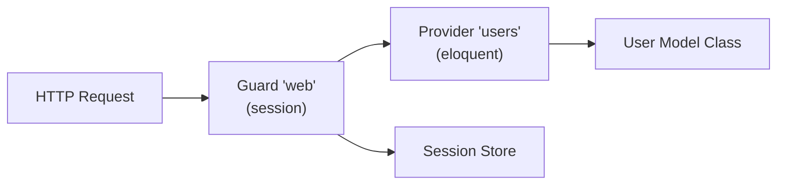

**Diagram sources**
- [auth.php:1-117](file://config/auth.php#L1-L117)

**Section sources**
- [auth.php:1-117](file://config/auth.php#L1-L117)

### Session and Remember-Me Behavior
- Driver:
  - Defaults to database-backed sessions.
- Lifetime:
  - Configurable via environment variable; defaults to a finite number of minutes.
- Cookie security:
  - Secure flag, HTTP-only, path, domain, and SameSite policies are configurable.
- Persistence:
  - Framework sessions persist into the configured session table.
- Concurrency:
  - A separate `user_sessions` ledger tracks device, IP, browser, login method, remember status, and lifecycle events.

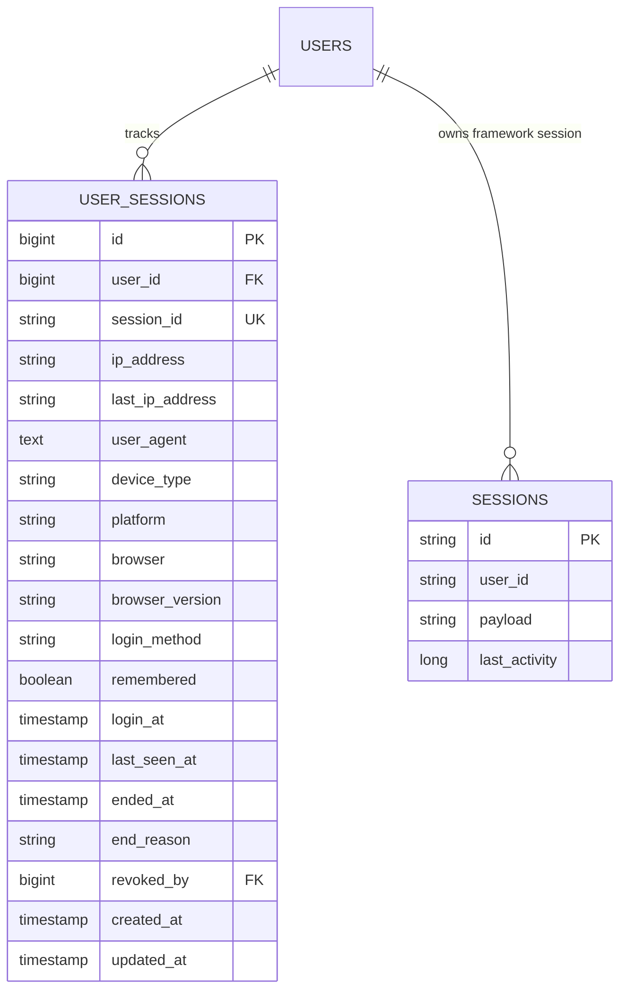

**Diagram sources**
- [session.php:1-200](file://config/session.php#L1-L200)
- [2026_10_03_130000_create_user_sessions_table.php:1-67](file://database/migrations/2026_10_03_130000_create_user_sessions_table.php#L1-L67)

**Section sources**
- [session.php:1-200](file://config/session.php#L1-L200)
- [2026_10_03_130000_create_user_sessions_table.php:1-67](file://database/migrations/2026_10_03_130000_create_user_sessions_table.php#L1-L67)

## Architecture Overview
The authentication architecture combines Fortify’s request-driven features with Laravel’s guard/provider/session infrastructure and an application-level session ledger.

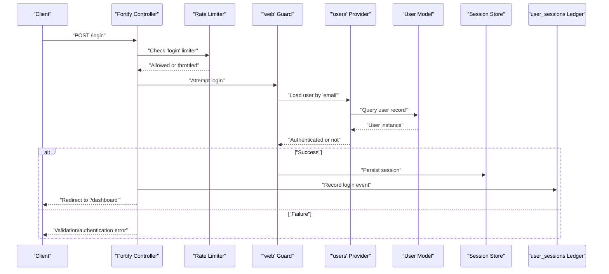

**Diagram sources**
- [fortify.php:1-162](file://config/fortify.php#L1-L162)
- [auth.php:1-117](file://config/auth.php#L1-L117)
- [session.php:1-200](file://config/session.php#L1-L200)
- [2026_10_03_130000_create_user_sessions_table.php:1-67](file://database/migrations/2026_10_03_130000_create_user_sessions_table.php#L1-L67)

## Detailed Component Analysis

### Login Flow
- Identifier:
  - Login uses the `email` field as configured by Fortify.
- Rate limiting:
  - The `'login'` named limiter protects against brute-force attempts.
- Guard and provider:
  - Authentication goes through the `'web'` guard and the Eloquent `'users'` provider.
- Post-login:
  - Successful authentication redirects to `/dashboard`.
- Sessions:
  - Framework session storage persists the authenticated state.
  - The durable `user_sessions` ledger can be used to record device, IP, browser, and whether remember-me was used.

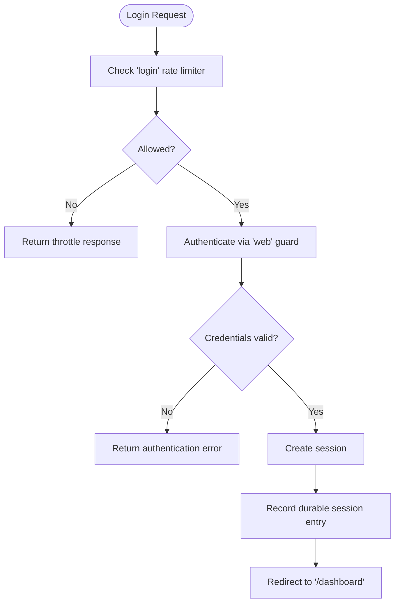

**Diagram sources**
- [fortify.php:1-162](file://config/fortify.php#L1-L162)
- [auth.php:1-117](file://config/auth.php#L1-L117)
- [session.php:1-200](file://config/session.php#L1-L200)
- [2026_10_03_130000_create_user_sessions_table.php:1-67](file://database/migrations/2026_10_03_130000_create_user_sessions_table.php#L1-L67)

**Section sources**
- [fortify.php:1-162](file://config/fortify.php#L1-L162)
- [auth.php:1-117](file://config/auth.php#L1-L117)
- [session.php:1-200](file://config/session.php#L1-L200)
- [2026_10_03_130000_create_user_sessions_table.php:1-67](file://database/migrations/2026_10_03_130000_create_user_sessions_table.php#L1-L67)

### Logout Flow
- Logout terminates the current framework session.
- Application logic may also update the durable `user_sessions` ledger to mark sessions as ended.

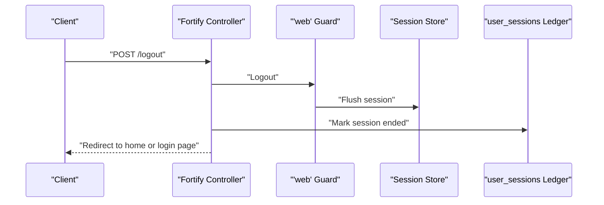

**Diagram sources**
- [fortify.php:1-162](file://config/fortify.php#L1-L162)
- [session.php:1-200](file://config/session.php#L1-L200)
- [2026_10_03_130000_create_user_sessions_table.php:1-67](file://database/migrations/2026_10_03_130000_create_user_sessions_table.php#L1-L67)

**Section sources**
- [fortify.php:1-162](file://config/fortify.php#L1-L162)
- [session.php:1-200](file://config/session.php#L1-L200)
- [2026_10_03_130000_create_user_sessions_table.php:1-67](file://database/migrations/2026_10_03_130000_create_user_sessions_table.php#L1-L67)

### Registration Flow
- Registration is enabled via Fortify features.
- The `'registration.enabled'` middleware short-circuits the `/register` route based on the application’s company settings while other Fortify routes bypass this check.
- After successful registration, users are redirected according to Fortify’s home configuration.

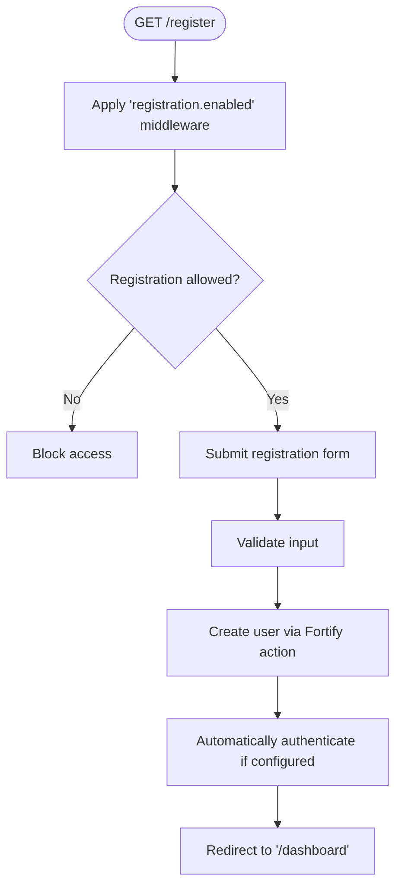

**Diagram sources**
- [fortify.php:1-162](file://config/fortify.php#L1-L162)

**Section sources**
- [fortify.php:1-162](file://config/fortify.php#L1-L162)

### Password Management
- Password reset requests are protected by the password broker and its throttle configuration.
- Fortify enables the reset-password feature, which coordinates token generation, validation, and updating the user’s password.
- Two-factor and passkey features are also enabled, adding additional layers of identity assurance.

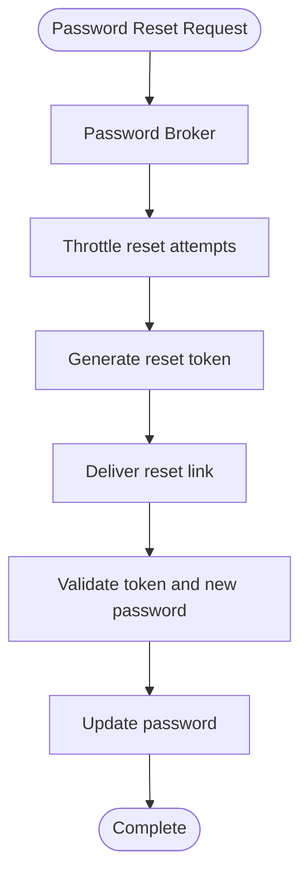

**Diagram sources**
- [fortify.php:1-162](file://config/fortify.php#L1-L162)
- [auth.php:1-117](file://config/auth.php#L1-L117)

**Section sources**
- [fortify.php:1-162](file://config/fortify.php#L1-L162)
- [auth.php:1-117](file://config/auth.php#L1-L117)

### Two-Factor Authentication and Passkeys
- Two-factor authentication is enabled with confirmation and password confirmation enabled.
- Passkeys are enabled without requiring password confirmation during setup.
- These features integrate with Fortify’s controllers and views.

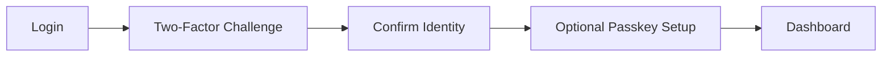

**Diagram sources**
- [fortify.php:1-162](file://config/fortify.php#L1-L162)

**Section sources**
- [fortify.php:1-162](file://config/fortify.php#L1-L162)

### Customizing Authentication Behavior
Common customization patterns include:

- Changing the login identifier:
  - Adjust the Fortify username configuration when the application uses a different field.
- Adding new login fields:
  - Extend Fortify’s login handling by overriding actions or registering custom request handlers.
- Custom validation rules:
  - Apply application-specific validation in form requests or custom rules before creating users or updating profiles.
- Custom responses:
  - Replace Fortify’s default responses to return JSON, API-friendly payloads, or custom redirects.

These customizations should preserve existing security controls such as rate limiting, password hashing, CSRF protection, and session security.

[No sources needed since this section provides general guidance]

## Dependency Analysis
The following diagram maps the main dependencies between authentication configuration components.

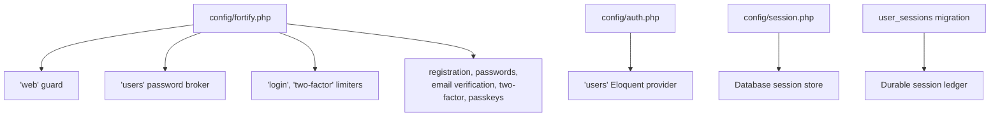

**Diagram sources**
- [fortify.php:1-162](file://config/fortify.php#L1-L162)
- [auth.php:1-117](file://config/auth.php#L1-L117)
- [session.php:1-200](file://config/session.php#L1-L200)
- [2026_10_03_130000_create_user_sessions_table.php:1-67](file://database/migrations/2026_10_03_130000_create_user_sessions_table.php#L1-L67)

**Section sources**
- [fortify.php:1-162](file://config/fortify.php#L1-L162)
- [auth.php:1-117](file://config/auth.php#L1-L117)
- [session.php:1-200](file://config/session.php#L1-L200)
- [2026_10_03_130000_create_user_sessions_table.php:1-67](file://database/migrations/2026_10_03_130000_create_user_sessions_table.php#L1-L67)

## Performance Considerations
- Use a fast session backend:
  - For high traffic, consider Redis or another cache-backed session store instead of the database.
- Keep rate limits conservative:
  - Tune the `'login'` and `'two-factor'` limiters to balance security and usability.
- Minimize unnecessary writes:
  - Avoid logging excessive details on every request; batch or sample session ledger updates where appropriate.
- Indexing:
  - Ensure database indexes support frequent queries on session tables and the `user_sessions` ledger.
- View rendering:
  - When using Fortify views, ensure assets are precompiled and cached.

[No sources needed since this section provides general guidance]

## Troubleshooting Guide
Common issues and diagnostics:

- Cannot log in:
  - Verify the configured username field matches the expected input.
  - Check that the `'web'` guard and `'users'` provider are correctly configured.
- Registration is blocked:
  - Inspect the `'registration.enabled'` middleware behavior and the company setting controlling registration.
- Too many login attempts:
  - Review the `'login'` rate limiter configuration and temporary lockout windows.
- Password reset emails not received:
  - Confirm mail configuration and password broker throttle settings.
- Session expiring too quickly:
  - Adjust session lifetime and cookie secure flags.
- Concurrent session confusion:
  - Inspect the `user_sessions` ledger to correlate framework sessions with device/browser metadata.

**Section sources**
- [fortify.php:1-162](file://config/fortify.php#L1-L162)
- [auth.php:1-117](file://config/auth.php#L1-L117)
- [session.php:1-200](file://config/session.php#L1-L200)
- [2026_10_03_130000_create_user_sessions_table.php:1-67](file://database/migrations/2026_10_03_130000_create_user_sessions_table.php#L1-L67)

## Conclusion
Highblossom’s authentication system centers on Laravel Fortify, the `'web'` guard with an Eloquent user provider, and database-backed sessions. Registration is gated by a custom middleware, while login, password reset, two-factor authentication, and passkeys are enabled through Fortify features. A durable `user_sessions` ledger complements framework sessions by providing an auditable history of device, IP, browser, login method, and lifecycle events. When customizing authentication, preserve rate limiting, secure session cookies, and proper password handling.

[No sources needed since this section summarizes without analyzing specific files]

## Appendices

### Security Checklist
- Enforce HTTPS and secure session cookies in production.
- Keep rate limiters active for login and two-factor challenges.
- Require strong passwords and enable two-factor authentication where appropriate.
- Monitor the `user_sessions` ledger for suspicious activity.
- Rotate secrets and keep the application encryption key secure.

[No sources needed since this section provides general guidance]