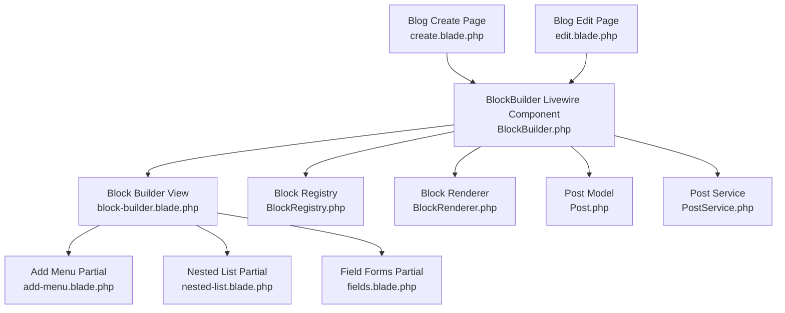
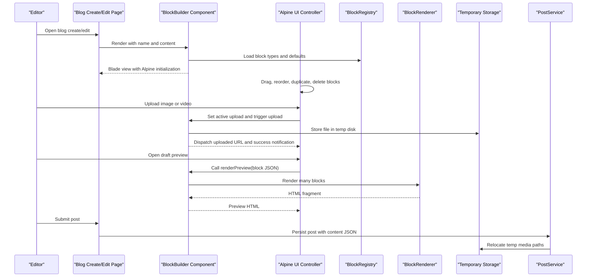
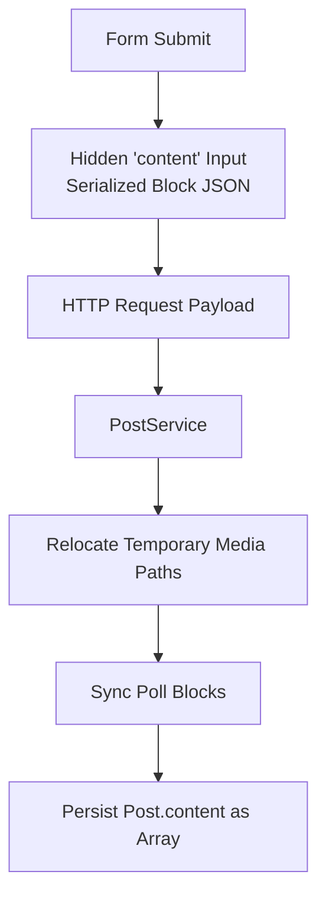
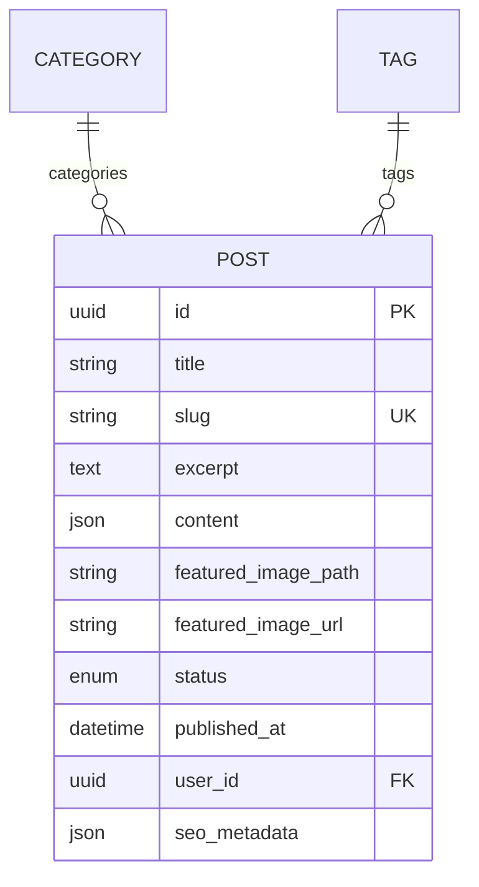
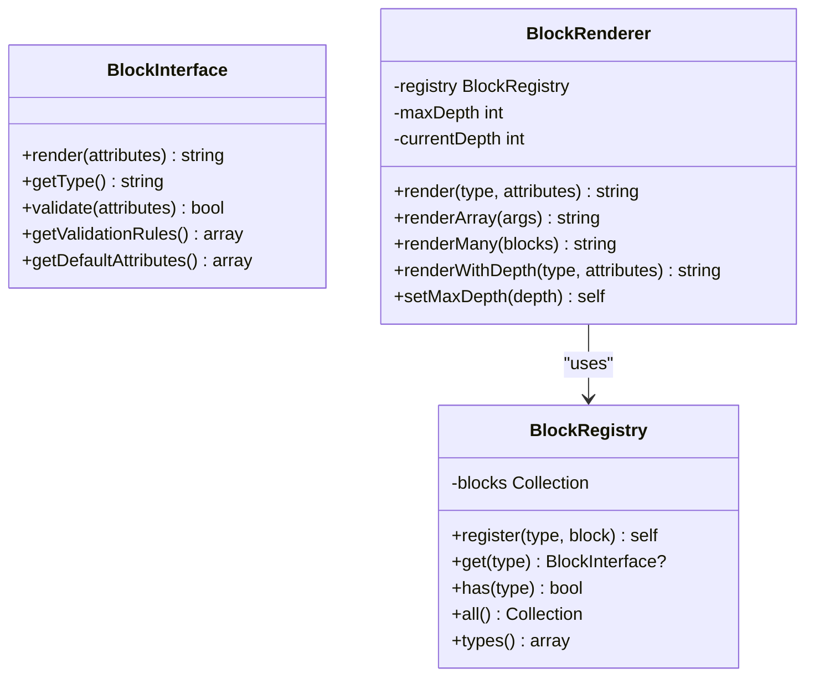
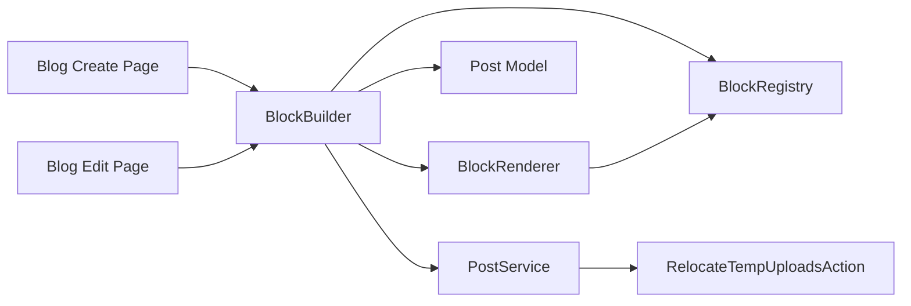

# BlockBuilder Interface & Management

<cite>
**Referenced Files in This Document**
- [BlockBuilder.php](file://app/Livewire/BlockBuilder.php)
- [block-builder.blade.php](file://resources/views/livewire/block-builder.blade.php)
- [add-menu.blade.php](file://resources/views/livewire/block-builder/add-menu.blade.php)
- [nested-list.blade.php](file://resources/views/livewire/block-builder/nested-list.blade.php)
- [fields.blade.php](file://resources/views/livewire/block-builder/fields.blade.php)
- [create.blade.php](file://resources/views/admin/blog/posts/create.blade.php)
- [edit.blade.php](file://resources/views/admin/blog/posts/edit.blade.php)
- [Post.php](file://app/Models/Post.php)
- [PostService.php](file://app/Services/PostService.php)
- [BlockInterface.php](file://packages/ContentBlocks/src/Contracts/BlockInterface.php)
- [BlockRegistry.php](file://packages/ContentBlocks/src/Services/BlockRegistry.php)
- [BlockRenderer.php](file://packages/ContentBlocks/src/Services/BlockRenderer.php)
</cite>

## Table of Contents
1. [Introduction](#introduction)
2. [Project Structure](#project-structure)
3. [Core Components](#core-components)
4. [Architecture Overview](#architecture-overview)
5. [Detailed Component Analysis](#detailed-component-analysis)
6. [Dependency Analysis](#dependency-analysis)
7. [Performance Considerations](#performance-considerations)
8. [Troubleshooting Guide](#troubleshooting-guide)
9. [Conclusion](#conclusion)

## Introduction
The BlockBuilder Livewire component is the content management interface for building rich blog posts from reusable content blocks. It powers a drag-and-drop block list, inline editors for editable block types, media upload flows, server-side validation feedback, and a real-time draft preview. The builder is primarily used by the admin blog post create and edit pages and persists structured JSON into the `content` column of blog posts.

It does not implement drag-and-drop itself; instead, it renders Blade templates that initialize an Alpine.js controller responsible for client-side ordering, duplication, collapse, undo, error display, and preview rendering. Backend responsibilities include loading registered block metadata, handling image/video uploads, validating uploaded data, mapping backend errors to blocks, and rendering previews through the ContentBlocks package renderer.

## Project Structure
The BlockBuilder feature spans three layers:

- **Livewire component**: state, uploads, validation, preview rendering, and view selection.
- **Blade templates**: block list UI, add-block menu, nested sub-editors, and per-type field forms.
- **ContentBlocks package**: block contract, registry, and renderer used by the builder and for production rendering.

**Diagram sources**
- [BlockBuilder.php:1-431](file://app/Livewire/BlockBuilder.php#L1-L431)
- [block-builder.blade.php:1-206](file://resources/views/livewire/block-builder.blade.php#L1-L206)
- [add-menu.blade.php:1-34](file://resources/views/livewire/block-builder/add-menu.blade.php#L1-L34)
- [nested-list.blade.php:1-48](file://resources/views/livewire/block-builder/nested-list.blade.php#L1-L48)
- [fields.blade.php:1-633](file://resources/views/livewire/block-builder/fields.blade.php#L1-L633)
- [BlockRegistry.php:1-66](file://packages/ContentBlocks/src/Services/BlockRegistry.php#L1-L66)
- [BlockRenderer.php:1-96](file://packages/ContentBlocks/src/Services/BlockRenderer.php#L1-L96)
- [Post.php:1-274](file://app/Models/Post.php#L1-L274)
- [PostService.php:1-178](file://app/Services/PostService.php#L1-L178)

**Section sources**
- [BlockBuilder.php:1-431](file://app/Livewire/BlockBuilder.php#L1-L431)
- [block-builder.blade.php:1-206](file://resources/views/livewire/block-builder.blade.php#L1-L206)
- [create.blade.php:1-57](file://resources/views/admin/blog/posts/create.blade.php#L1-L57)
- [edit.blade.php:1-75](file://resources/views/admin/blog/posts/edit.blade.php#L1-L75)

## Core Components
The core runtime consists of:

| Component | Responsibility | Key Behavior |
|---|---|---|
| `BlockBuilder` Livewire class | Manages block state, uploads, validation messages, preview rendering, and metadata loading | Accepts a `name` and initial `value`, normalizes JSON or array blocks, assigns unique IDs, loads block registry metadata, validates uploaded files, detects video URLs, and renders preview HTML through `BlockRenderer`. |
| `block-builder.blade.php` | Root UI shell | Initializes Alpine state with initial blocks, metadata, errors, form name, and public storage base URL. Renders invalid-block warnings, undo banner, draggable block rows, add menu, preview button, and modal. |
| `add-menu.blade.php` | Block type picker | Lists editable block types from the registry and executes an Alpine callback when a type is selected. |
| `nested-list.blade.php` | Sub-block editor | Provides local reorder, remove, and add operations for nested structures such as columns, tabs, or carousel entries. |
| `fields.blade.php` | Per-type form fields | Renders inputs for paragraph, heading, image, quote, code, list, alert, HTML, embed, divider, countdown, poll, gallery, table, and other supported types. |
| Blog post views | Integration points | Embed `livewire:block-builder` and serialize its JSON output into a hidden `content` input. |
| `Post` model | Persistence contract | Casts `content` to an array and defines prose keys used for read-time estimates and publishing checks. |
| `PostService` | Save pipeline | Handles featured images, relocates temporary media paths, syncs polls, and persists relations. |
| ContentBlocks package | Extension point | Defines `BlockInterface`, `BlockRegistry`, and `BlockRenderer`. |

**Section sources**
- [BlockBuilder.php:1-431](file://app/Livewire/BlockBuilder.php#L1-L431)
- [block-builder.blade.php:1-206](file://resources/views/livewire/block-builder.blade.php#L1-L206)
- [add-menu.blade.php:1-34](file://resources/views/livewire/block-builder/add-menu.blade.php#L1-L34)
- [nested-list.blade.php:1-48](file://resources/views/livewire/block-builder/nested-list.blade.php#L1-L48)
- [fields.blade.php:1-633](file://resources/views/livewire/block-builder/fields.blade.php#L1-L633)
- [Post.php:1-274](file://app/Models/Post.php#L1-L274)
- [PostService.php:1-178](file://app/Services/PostService.php#L1-L178)

## Architecture Overview
The BlockBuilder follows a layered Livewire + Alpine + Blade architecture:

1. The blog create/edit page includes the `livewire:block-builder` component with `name="content"` and either old input or existing post content.
2. The Livewire component mounts, decodes the value, ensures each block has a unique ID, and loads editable type metadata from the ContentBlocks registry.
3. Blade renders the Alpine-initialized UI with the current block tree.
4. Client-side logic handles drag-and-drop, reordering, duplication, collapse, and deletion.
5. Media uploads target the Livewire component, which stores temporary files and dispatches events back to the UI.
6. Draft preview serializes the current block tree and asks the backend to render it through `BlockRenderer`.
7. On form submission, the post save pipeline moves temporary media to permanent storage and persists the block structure as JSON.

**Diagram sources**
- [BlockBuilder.php:1-431](file://app/Livewire/BlockBuilder.php#L1-L431)
- [block-builder.blade.php:1-206](file://resources/views/livewire/block-builder.blade.php#L1-L206)
- [BlockRegistry.php:1-66](file://packages/ContentBlocks/src/Services/BlockRegistry.php#L1-L66)
- [BlockRenderer.php:1-96](file://packages/ContentBlocks/src/Services/BlockRenderer.php#L1-L96)
- [PostService.php:1-178](file://app/Services/PostService.php#L1-L178)

## Detailed Component Analysis

### BlockBuilder Livewire Class
The `BlockBuilder` class owns:

- A locked `name` property defaulting to `content`.
- A `blocks` array representing the live content tree.
- Image and video upload properties with validation rules.
- Active upload targeting state: `activeImageUploadId`, `activeImageUploadPath`, and `uploadingVideoBlockId`.
- Server-side metadata `blockMeta` derived from the ContentBlocks registry.
- Error mapping `blockErrors` keyed by block ID.

Key lifecycle and behavior:

- `mount` accepts a field name and value, decodes JSON or arrays, assigns missing block IDs, and loads block metadata.
- `loadBlockMeta` queries `BlockRegistry::types()`, resolves each block, computes label, editable status, default attributes, and required fields.
- `requiredFields` inspects block validation rules to find top-level fields marked required.
- `setActiveImageUpload` selects the destination block and attribute path for the next image upload.
- `updatedImageUpload` triggers automatic upload when an image is present and targeted.
- `uploadImageForBlock` validates, stores to the temporary disk, emits `image-uploaded`, and shows a success notification.
- `startVideoUpload`, `uploadVideo`, and `updatedVideoUpload` handle direct video uploads, thumbnail generation via FFmpeg, and `video-uploaded` events.
- `detectVideoUrl` uses `VideoSourceDetector` to validate external URLs and return embed information.
- `renderPreview` sanitizes and renders unsaved blocks through `BlockRenderer::renderMany`.
- `render` reloads metadata, maps flashed errors to blocks, and returns the Blade view.

Complexity notes:
- Block decoding and normalization are linear in the number of blocks.
- Metadata loading is linear in registered block types.
- Preview rendering is proportional to the number of blocks rendered by the backend renderer.

Error handling:
- Empty or malformed preview content is rejected before rendering.
- Thumbnail generation failures are logged and treated gracefully.
- Uploaded files are validated before storage.
- Backend validation errors are mapped from session error bags into per-block messages.

**Section sources**
- [BlockBuilder.php:1-431](file://app/Livewire/BlockBuilder.php#L1-L431)

### Blade Templates and Alpine UI
The root template initializes Alpine with:

- Initial block data.
- Block metadata.
- Backend validation errors.
- Field name.
- Public media base URL.

It renders:

- An invalid-block summary when required fields are missing.
- An undo banner after removing a block.
- A draggable block list where each row exposes move up/down, duplicate, collapse, and delete actions.
- Inline validation messages under each block.
- The add-block menu.
- A preview button and modal.

Drag-and-drop behavior:
- Each block header contains a draggable handle.
- `dragstart`, `dragend`, `dragover`, and `drop` handlers coordinate visual hover states and client-side reordering.
- Move buttons provide non-drag accessibility for ordering.

Undo behavior:
- Removed blocks are tracked so the user can restore them immediately.

Validation feedback:
- Invalid blocks receive red borders and hint labels.
- Errors returned by Livewire are grouped by block ID and displayed inside the corresponding block panel.

Preview behavior:
- Opening the preview serializes the current block array and calls `renderPreview`.
- The modal displays loading state, rendered HTML, or empty-state messaging.
- Escape closes the preview modal.

Accessibility highlights:
- Draggable handles have explicit `aria-label` attributes.
- Move, duplicate, delete, and expand/collapse controls have descriptive titles and labels.
- The preview modal provides a close button with an accessible label.

**Section sources**
- [block-builder.blade.php:1-206](file://resources/views/livewire/block-builder.blade.php#L1-L206)

### Add Menu and Nested List
The add menu:

- Shows registered editable block types.
- Supports custom type expressions and add callbacks.
- Displays a fallback message when no blocks are registered.

The nested list:

- Iterates over a JavaScript expression representing nested blocks.
- Provides move up, move down, and delete controls.
- Includes its own add menu for nested editable types.
- Recursively includes the fields partial for nested editors.

These partials make builders like columns, tabs, and carousel possible without duplicating block list behavior.

**Section sources**
- [add-menu.blade.php:1-34](file://resources/views/livewire/block-builder/add-menu.blade.php#L1-L34)
- [nested-list.blade.php:1-48](file://resources/views/livewire/block-builder/nested-list.blade.php#L1-L48)

### Field Editors
The fields partial renders per-type editors:

| Block Type | Editor Highlights |
|---|---|
| Paragraph | CKEditor-backed textarea with change and blur synchronization. |
| Heading | Text input and heading level selector. |
| Image | Single source URL, library picker, upload, alt text, caption, and repeatable image set. |
| Quote | Quote body, author, and citation fields. |
| CTA | Title, description, button text, and button URL. |
| Video | External URL mode with live detection and iframe preview, or upload mode with thumbnail generation. |
| Code | Language and monospaced content. |
| List | Ordered or unordered list with newline-separated items. |
| Alert | Type, title, content, and dismissible toggle. |
| HTML | Raw HTML textarea. |
| Embed | URL and title. |
| Divider | Style and size selectors. |
| Countdown | Target date and label. |
| Poll | Question, options list, allow multiple, show results. |
| Gallery | Column count and repeatable image entries. |
| Table | Caption, headers, rows, and column controls. |

Data binding:
- Most fields use two-way Alpine binding against `block.attributes.*`.
- Image and gallery uploads use `$wire.setActiveImageUpload` followed by a Livewire upload.
- Video URL input debounces calls to `detectVideoUrl`.
- CKEditor updates are synchronized on change and blur.

**Section sources**
- [fields.blade.php:1-633](file://resources/views/livewire/block-builder/fields.blade.php#L1-L633)

### Blog Post Integration
The create and edit pages integrate BlockBuilder as follows:

- Both pages wrap the builder in a standard HTML form with multipart encoding.
- A hidden `content` input receives the serialized block JSON.
- The create page passes `old('content')`.
- The edit page passes `old('content', json_encode($post->content))`.
- The builder is invoked with `name="content"` so the Alpine controller serializes to the correct input.

This design keeps the builder’s internal block array isolated while still posting valid JSON to the backend.

**Diagram sources**
- [create.blade.php:1-57](file://resources/views/admin/blog/posts/create.blade.php#L1-L57)
- [edit.blade.php:1-75](file://resources/views/admin/blog/posts/edit.blade.php#L1-L75)
- [PostService.php:1-178](file://app/Services/PostService.php#L1-L178)

**Section sources**
- [create.blade.php:1-57](file://resources/views/admin/blog/posts/create.blade.php#L1-L57)
- [edit.blade.php:1-75](file://resources/views/admin/blog/posts/edit.blade.php#L1-L75)

### Data Model and Serialization
The `Post` model casts `content` to an array, so Laravel automatically serializes the block tree to JSON in the database. Each block is expected to contain at least:

- `type`: string identifying the block.
- `attributes`: object containing block-specific configuration.
- `id`: stable identifier assigned by the builder.

The model also defines prose-sensitive keys used for read-time calculations and publish requirements. Publishing checks treat empty content as incomplete.

Serialization flow:

1. Alpine serializes the current block array into the hidden `content` input.
2. The request payload includes `content` as JSON.
3. Eloquent casts `content` to an array on load.
4. The service layer processes the content before persistence.

**Diagram sources**
- [Post.php:1-274](file://app/Models/Post.php#L1-L274)

**Section sources**
- [Post.php:1-274](file://app/Models/Post.php#L1-L274)

### ContentBlocks Package Integration
The builder depends on three package components:

| Contract or Service | Role |
|---|---|
| `BlockInterface` | Defines block type contracts: render, type identification, validation, validation rules, and default attributes. |
| `BlockRegistry` | Stores and retrieves block instances by type. |
| `BlockRenderer` | Renders a single block, an array of blocks, unknown blocks, and nested blocks with depth protection. |

The builder uses `BlockRegistry` to discover available block types and compute editable status, defaults, and required fields. It uses `BlockRenderer` only for preview rendering of unsaved content.

**Diagram sources**
- [BlockInterface.php:1-36](file://packages/ContentBlocks/src/Contracts/BlockInterface.php#L1-L36)
- [BlockRegistry.php:1-66](file://packages/ContentBlocks/src/Services/BlockRegistry.php#L1-L66)
- [BlockRenderer.php:1-96](file://packages/ContentBlocks/src/Services/BlockRenderer.php#L1-L96)

**Section sources**
- [BlockInterface.php:1-36](file://packages/ContentBlocks/src/Contracts/BlockInterface.php#L1-L36)
- [BlockRegistry.php:1-66](file://packages/ContentBlocks/src/Services/BlockRegistry.php#L1-L66)
- [BlockRenderer.php:1-96](file://packages/ContentBlocks/src/Services/BlockRenderer.php#L1-L96)

### User Interaction Patterns and Keyboard Shortcuts
Documented interaction patterns:

- **Adding blocks**: Use the Add Block menu to choose an editable type.
- **Reordering blocks**: Drag the grab handle or use Move Up / Move Down.
- **Duplicating blocks**: Click Duplicate.
- **Collapsing panels**: Toggle the chevron to hide or reveal block configuration.
- **Deleting blocks**: Click Delete and optionally Undo.
- **Editing content**: Use inline fields such as CKEditor, text inputs, select menus, and toggles.
- **Uploading media**: Use Library or Upload for images; use URL or Upload for videos.
- **Validating content**: Required fields are detected from block validation rules and shown as invalid hints.
- **Previewing content**: Open the Draft preview modal to see server-rendered HTML.

Keyboard shortcuts:
- No dedicated keyboard shortcuts are implemented by the BlockBuilder component.
- Standard browser behaviors apply, including Escape closing the preview modal.
- Accessibility labels exist for most interactive controls, but there is no documented global shortcut map.

**Section sources**
- [block-builder.blade.php:1-206](file://resources/views/livewire/block-builder.blade.php#L1-L206)
- [fields.blade.php:1-633](file://resources/views/livewire/block-builder/fields.blade.php#L1-L633)

## Dependency Analysis
The main dependency relationships are:

**Diagram sources**
- [BlockBuilder.php:1-431](file://app/Livewire/BlockBuilder.php#L1-L431)
- [create.blade.php:1-57](file://resources/views/admin/blog/posts/create.blade.php#L1-L57)
- [edit.blade.php:1-75](file://resources/views/admin/blog/posts/edit.blade.php#L1-L75)
- [BlockRegistry.php:1-66](file://packages/ContentBlocks/src/Services/BlockRegistry.php#L1-L66)
- [BlockRenderer.php:1-96](file://packages/ContentBlocks/src/Services/BlockRenderer.php#L1-L96)
- [PostService.php:1-178](file://app/Services/PostService.php#L1-L178)

Coupling observations:

- The builder couples tightly to the ContentBlocks package contract and services.
- Client-side behavior is intentionally separated from server state by using Alpine and Blade.
- Media handling uses a temporary disk strategy coordinated by a relocation action in the save pipeline.
- Validation is split between Livewire file validation and block-level validation exposed through `BlockInterface`.

Potential circular dependencies:
- None are evident from the analyzed files. The renderer depends on the registry, and the builder depends on both, but neither package service depends back on the builder.

**Section sources**
- [BlockBuilder.php:1-431](file://app/Livewire/BlockBuilder.php#L1-L431)
- [BlockRegistry.php:1-66](file://packages/ContentBlocks/src/Services/BlockRegistry.php#L1-L66)
- [BlockRenderer.php:1-96](file://packages/ContentBlocks/src/Services/BlockRenderer.php#L1-L96)
- [PostService.php:1-178](file://app/Services/PostService.php#L1-L178)

## Performance Considerations
Recommended optimization strategies for large content trees:

1. **Limit preview size**: The preview method already rejects very large payloads and invalid block lists. Keep block counts reasonable and avoid excessively deep nesting.
2. **Avoid unnecessary Livewire round trips**: The builder deliberately moved manipulation methods to Alpine.js for client-side performance.
3. **Debounce expensive operations**: Video URL detection already uses debounce; similar techniques should be applied if additional live server calls are added.
4. **Use temporary storage efficiently**: Images and videos are stored temporarily and relocated only during post save. Avoid premature promotion to permanent storage.
5. **Render only necessary previews**: Do not call `renderPreview` on every keystroke unless explicitly required; prefer manual preview opens or throttled events.
6. **Optimize nested editors**: Nested lists can multiply DOM nodes. Restrict nesting levels where practical and avoid deeply recursive editors.
7. **Cache block metadata**: The builder loads block metadata on render; ensure this remains cheap by keeping the registry small and well-structured.
8. **Monitor FFmpeg operations**: Thumbnail generation can be slow and environment-dependent. Failures are logged, but heavy video processing should be considered for background jobs in high-traffic environments.

[No sources needed since this section provides general guidance]

## Troubleshooting Guide

### Block appears but cannot be edited
**Symptoms**: The block is preserved on save but the builder shows a note that it has no inline editor.  
**Likely cause**: The block type is registered but not included in the editable type list.  
**Resolution**: Register the block in the ContentBlocks registry and ensure it is appropriate for inline editing. If it requires complex configuration, consider adding a dedicated editor or restricting it from the Add Block menu until ready.

**Section sources**
- [BlockBuilder.php:1-431](file://app/Livewire/BlockBuilder.php#L1-L431)
- [block-builder.blade.php:1-206](file://resources/views/livewire/block-builder.blade.php#L1-L206)

### Required fields prevent saving
**Symptoms**: Invalid block hints appear, and the post may not publish.  
**Likely cause**: One or more required attributes are missing.  
**Resolution**: Fill required fields indicated by red borders and invalid hints. Required fields are computed from block validation rules.

**Section sources**
- [BlockBuilder.php:1-431](file://app/Livewire/BlockBuilder.php#L1-L431)
- [Post.php:1-274](file://app/Models/Post.php#L1-L274)

### Image upload does not populate the block
**Symptoms**: The upload completes but the image URL is not set.  
**Likely causes**:
- No active image upload target was set.
- The wrong attribute path was used.
- The upload failed validation.
- Temporary storage is misconfigured.

**Resolution**:
- Ensure the image field triggers `setActiveImageUpload` with the correct block ID and attribute path.
- Check Livewire validation errors for the image upload.
- Verify the temporary disk configuration supports storing images under `uploads/images`.
- Confirm the relocation action promotes `temp://` paths to permanent storage during post save.

**Section sources**
- [BlockBuilder.php:1-431](file://app/Livewire/BlockBuilder.php#L1-L431)
- [PostService.php:1-178](file://app/Services/PostService.php#L1-L178)

### Video preview fails
**Symptoms**: Video URL validation reports an unrecognized source, or upload produces no thumbnail.  
**Likely causes**:
- Unsupported external URL.
- FFmpeg binaries not configured or unavailable.
- Temp file missing during thumbnail extraction.

**Resolution**:
- For external URLs, use supported providers such as YouTube, Vimeo, Dailymotion, Facebook, or direct video files.
- For uploads, verify FFmpeg configuration and temporary storage access.
- Review warning logs for thumbnail generation failures.

**Section sources**
- [BlockBuilder.php:1-431](file://app/Livewire/BlockBuilder.php#L1-L431)
- [fields.blade.php:1-633](file://resources/views/livewire/block-builder/fields.blade.php#L1-L633)

### Preview shows nothing or an error
**Symptoms**: The preview modal shows “Nothing to preview yet” or an error message.  
**Likely causes**:
- No blocks are present.
- Content is too large.
- Content is not a valid block list.
- Rendering failed.

**Resolution**:
- Add at least one block.
- Reduce content size or remove heavy nested structures.
- Validate block structure: each block must have a `type` and `attributes`.
- Check logs for rendering exceptions.

**Section sources**
- [block-builder.blade.php:1-206](file://resources/views/livewire/block-builder.blade.php#L1-L206)
- [BlockBuilder.php:1-431](file://app/Livewire/BlockBuilder.php#L1-L431)
- [BlockRenderer.php:1-96](file://packages/ContentBlocks/src/Services/BlockRenderer.php#L1-L96)

### Drag-and-drop does not work
**Symptoms**: Reordering fails or drag handles do not respond.  
**Likely causes**:
- Alpine.js is not loaded.
- The block row is not initialized by the root Alpine controller.
- Browser compatibility issues with native drag-and-drop.

**Resolution**:
- Verify that the root `blockBuilder` Alpine component is initialized.
- Confirm the Blade template is rendered inside the Livewire component.
- Test with Move Up / Move Down as an alternative.

**Section sources**
- [block-builder.blade.php:1-206](file://resources/views/livewire/block-builder.blade.php#L1-L206)

### Saved content loses uploaded media
**Symptoms**: Published post references temporary URLs or missing images.  
**Likely cause**: Temporary media paths were not promoted to permanent storage.  
**Resolution**: Ensure the post save pipeline calls the relocation action on the submitted content. Verify that `temp://` URLs are converted to persistent URLs.

**Section sources**
- [PostService.php:1-178](file://app/Services/PostService.php#L1-L178)

## Conclusion
The BlockBuilder component provides a robust, extensible content management interface for blog posts. Its strength lies in separating concerns:

- Alpine.js handles fast client-side interactions.
- Livewire manages uploads, validation, and server-side preview rendering.
- Blade templates define declarative, per-type editors.
- The ContentBlocks package supplies a clean extension point for new block types.
- The post save pipeline coordinates temporary media, polls, and relations.

For customization, developers should extend the ContentBlocks package by registering new block types implementing `BlockInterface`, then expose them through the registry. For UI changes, modify the relevant Blade partials and Alpine behavior. For persistence changes, update the post save pipeline and model casting accordingly.

[No sources needed since this section summarizes without analyzing specific files]