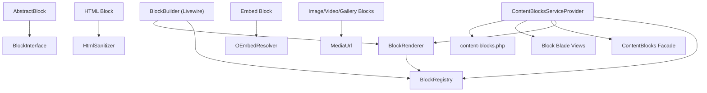
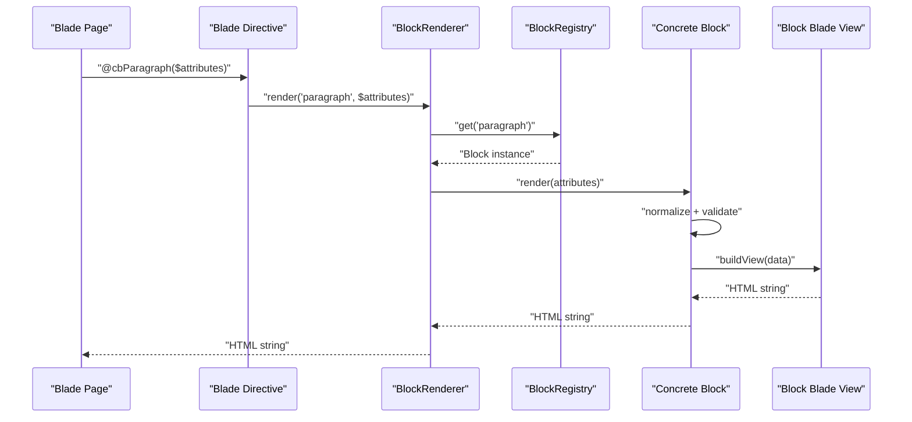
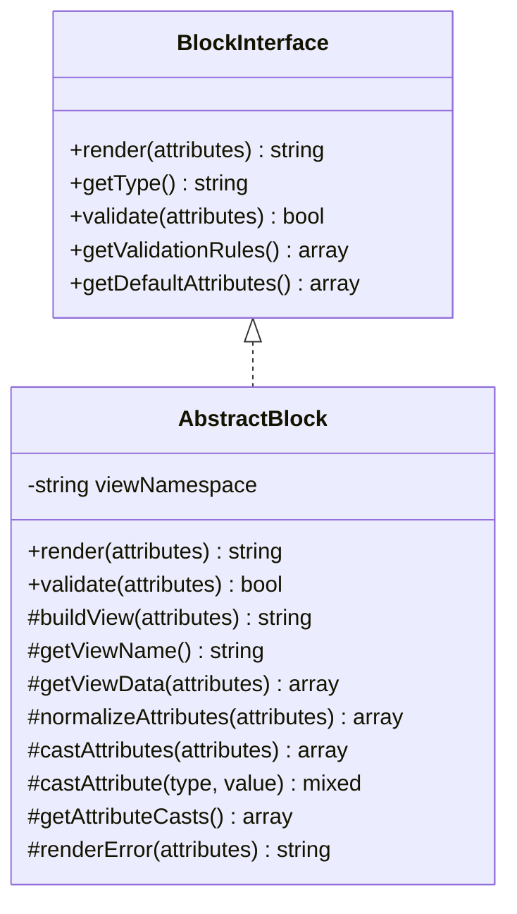
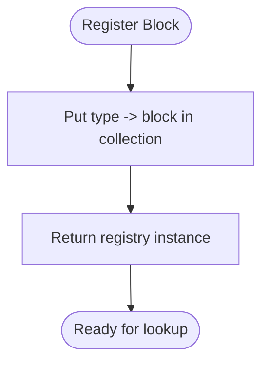
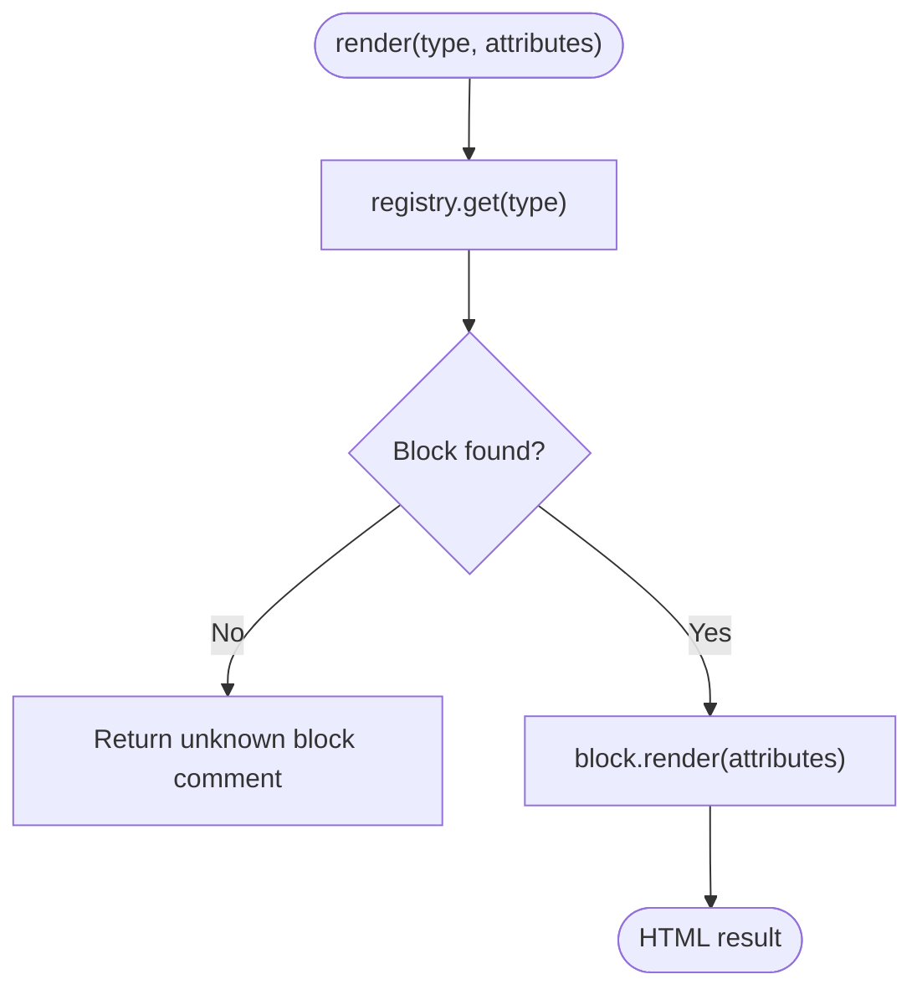
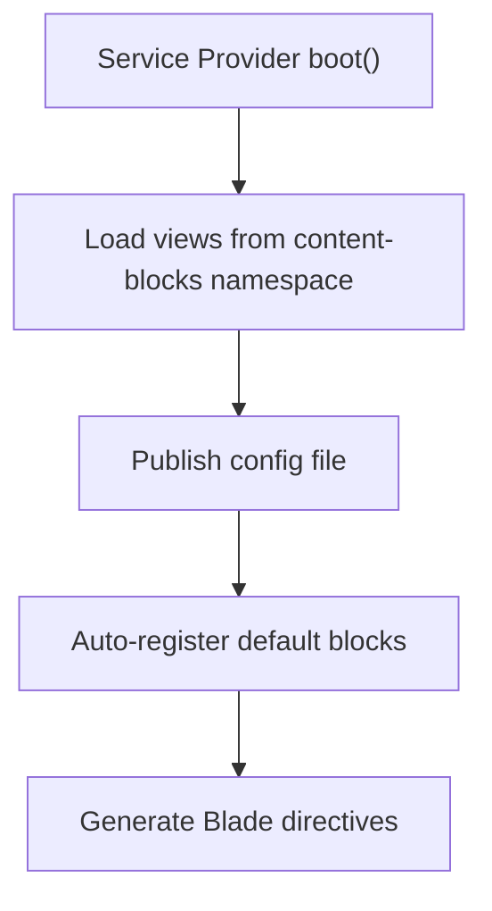
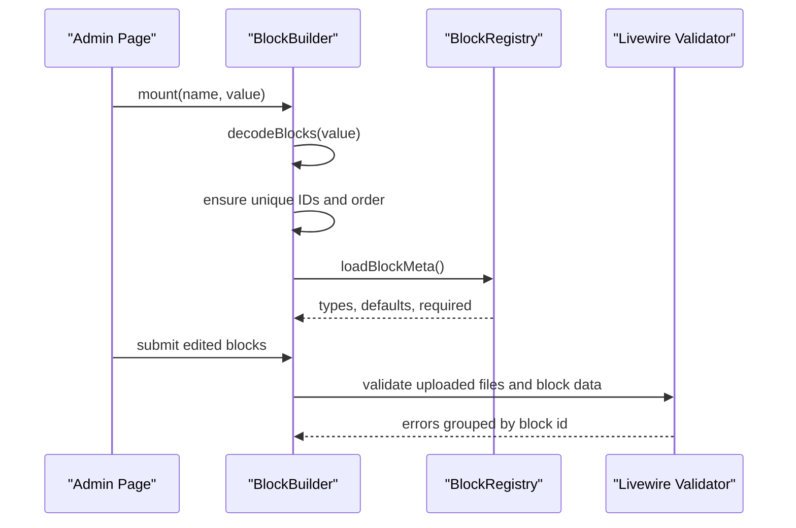
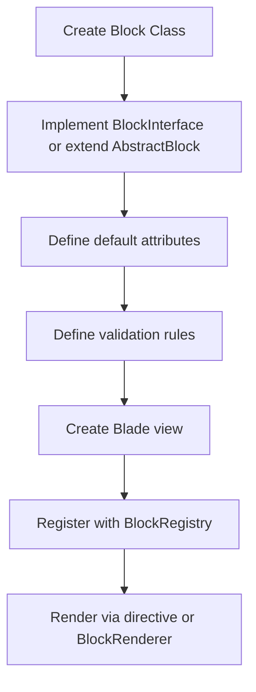
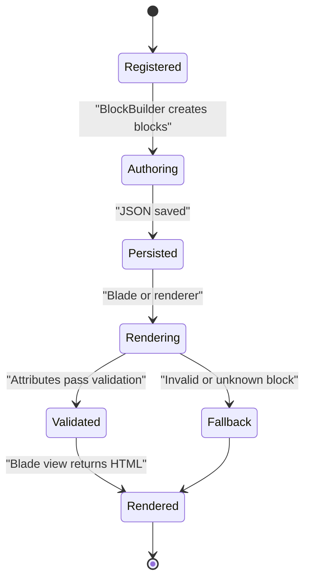
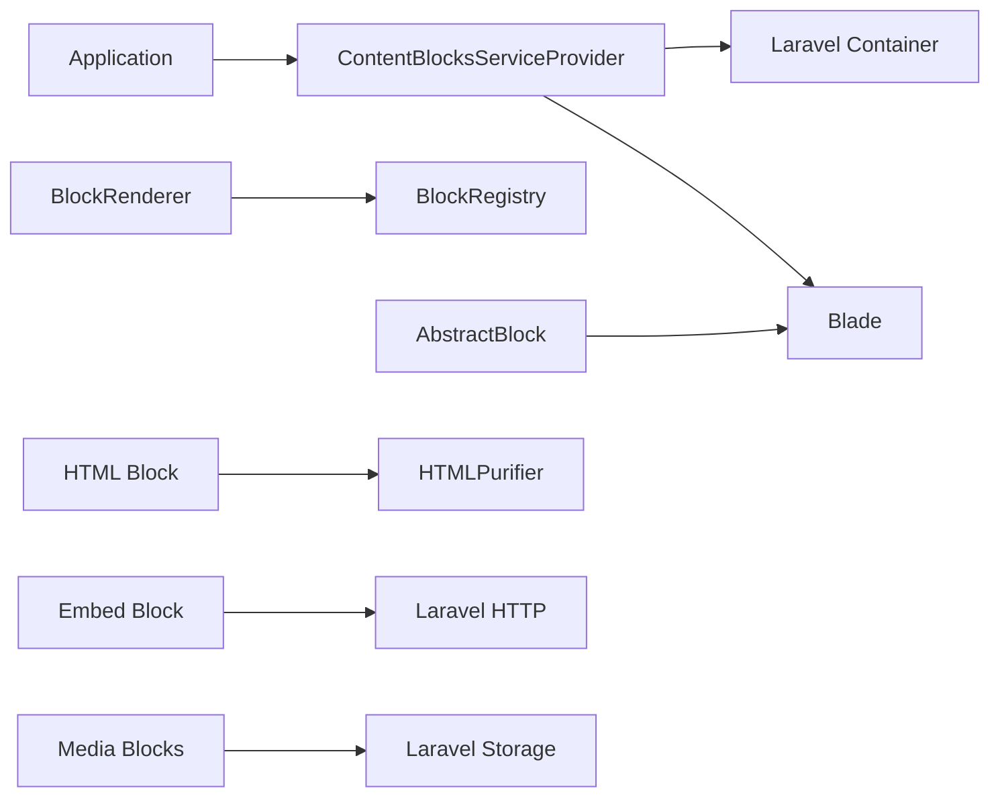

# Content Block System

<cite>
**Referenced Files in This Document**
- [ContentBlocksServiceProvider.php](file://packages/ContentBlocks/src/ContentBlocksServiceProvider.php)
- [BlockRegistry.php](file://packages/ContentBlocks/src/Services/BlockRegistry.php)
- [BlockRenderer.php](file://packages/ContentBlocks/src/Services/BlockRenderer.php)
- [AbstractBlock.php](file://packages/ContentBlocks/src/Services/AbstractBlock.php)
- [BlockInterface.php](file://packages/ContentBlocks/src/Contracts/BlockInterface.php)
- [ContentBlocks.php](file://packages/ContentBlocks/src/Facades/ContentBlocks.php)
- [content-blocks.php](file://packages/ContentBlocks/config/content-blocks.php)
- [BlockBuilder.php](file://app/Livewire/BlockBuilder.php)
- [MediaUrl.php](file://packages/ContentBlocks/src/Support/MediaUrl.php)
- [HtmlSanitizer.php](file://packages/ContentBlocks/src/Services/HtmlSanitizer.php)
- [OEmbedResolver.php](file://packages/ContentBlocks/src/Services/OEmbedResolver.php)
- [accordion.blade.php](file://packages/ContentBlocks/resources/views/accordion.blade.php)
- [carousel.blade.php](file://packages/ContentBlocks/resources/views/carousel.blade.php)
- [countdown.blade.php](file://packages/ContentBlocks/resources/views/countdown.blade.php)
- [columns.blade.php](file://packages/ContentBlocks/resources/views/columns.blade.php)
- [embed.blade.php](file://packages/ContentBlocks/resources/views/embed.blade.php)
- [form.blade.php](file://packages/ContentBlocks/resources/views/form.blade.php)
- [gallery.blade.php](file://packages/ContentBlocks/resources/views/gallery.blade.php)
- [heading.blade.php](file://packages/ContentBlocks/resources/views/heading.blade.php)
- [image.blade.php](file://packages/ContentBlocks/resources/views/image.blade.php)
- [list.blade.php](file://packages/ContentBlocks/resources/views/list.blade.php)
- [paragraph.blade.php](file://packages/ContentBlocks/resources/views/paragraph.blade.php)
- [poll.blade.php](file://packages/ContentBlocks/resources/views/poll.blade.php)
- [quote.blade.php](file://packages/ContentBlocks/resources/views/quote.blade.php)
- [table.blade.php](file://packages/ContentBlocks/resources/views/table.blade.php)
- [tabs.blade.php](file://packages/ContentBlocks/resources/views/tabs.blade.php)
- [video.blade.php](file://packages/ContentBlocks/resources/views/video.blade.php)
</cite>

## Table of Contents
1. Introduction
2. Project Structure
3. Core Components
4. Architecture Overview
5. Detailed Component Analysis
6. Dependency Analysis
7. Performance Considerations
8. Troubleshooting Guide
9. Conclusion

## Introduction
The Highblossom Content Block system is a Laravel package that provides an extensible content block registry and rendering pipeline. It ships with more than 20 pre-built block types, including accordion, carousel, countdown, columns, embed, form, gallery, heading, image, list, paragraph, poll, quote, table, tabs, and video blocks. Blocks are registered by type, validated through attribute rules, and rendered into Blade templates. The system integrates with Livewire for the admin builder interface, supports drag-and-drop-style composition through a structured JSON content model, and includes services for HTML sanitization, media URL resolution, and oEmbed provider support.

This document explains the block architecture pattern, registration process, lifecycle management, rendering pipeline, configuration options, styling customization, responsive behavior, custom block creation, storage format, migration strategies, performance considerations, and best practices.

## Project Structure
The Content Block system lives primarily under `packages/ContentBlocks`, with the admin integration in `app/Livewire`. The key areas are:

- Service Provider: registers services, auto-registers default blocks, publishes views and configuration, and defines Blade directives.
- Contracts and Base Classes: define the block contract and shared rendering/validation logic.
- Services: registry, renderer, HTML sanitizer, oEmbed resolver, and media URL helper.
- Blocks: one class per block type implementing the contract.
- Views: Blade templates for each block type.
- Configuration: directive prefix, view namespace, caching, debug mode, HTML sanitization, oEmbed providers, and form settings.
- Livewire Builder: interactive editor used to compose pages from blocks.

**Diagram sources**
- [ContentBlocksServiceProvider.php:23-199](file://packages/ContentBlocks/src/ContentBlocksServiceProvider.php#L23-L199)
- [BlockRegistry.php:12-66](file://packages/ContentBlocks/src/Services/BlockRegistry.php#L12-L66)
- [BlockRenderer.php:12-96](file://packages/ContentBlocks/src/Services/BlockRenderer.php#L12-L96)
- [AbstractBlock.php:12-162](file://packages/ContentBlocks/src/Services/AbstractBlock.php#L12-L162)
- [BlockInterface.php:12-36](file://packages/ContentBlocks/src/Contracts/BlockInterface.php#L12-L36)
- [ContentBlocks.php:12-29](file://packages/ContentBlocks/src/Facades/ContentBlocks.php#L12-L29)
- [content-blocks.php:1-140](file://packages/ContentBlocks/config/content-blocks.php#L1-L140)
- [BlockBuilder.php:1-200](file://app/Livewire/BlockBuilder.php#L1-L200)
- [HtmlSanitizer.php:12-124](file://packages/ContentBlocks/src/Services/HtmlSanitizer.php#L12-L124)
- [OEmbedResolver.php:12-146](file://packages/ContentBlocks/src/Services/OEmbedResolver.php#L12-L146)
- [MediaUrl.php:12-169](file://packages/ContentBlocks/src/Support/MediaUrl.php#L12-L169)

**Section sources**
- [ContentBlocksServiceProvider.php:23-199](file://packages/ContentBlocks/src/ContentBlocksServiceProvider.php#L23-L199)
- [content-blocks.php:1-140](file://packages/ContentBlocks/config/content-blocks.php#L1-L140)

## Core Components
The system is built around a small set of core components:

- **BlockInterface**: the contract every block must implement. It defines rendering, validation rules, defaults, and type identification.
- **AbstractBlock**: shared implementation for normalization, casting, validation, Blade view rendering, and safe error handling.
- **BlockRegistry**: container mapping string block types to concrete block instances.
- **BlockRenderer**: entry point for rendering blocks by type or array, including multi-block rendering and depth tracking.
- **ContentBlocks Facade**: convenient static access to registry operations and rendering.
- **Service Provider**: bootstraps singletons, loads views, publishes configuration, auto-registers default blocks, and defines Blade directives.
- **Configuration**: controls directive prefixes, view namespace, auto-registration, registry caching, debug mode, HTML sanitization, oEmbed providers, and form behavior.
- **BlockBuilder (Livewire)**: admin UI component for composing, editing, validating, and saving blocks as JSON.

These components together define the block architecture pattern: declare a block type, register it, validate its attributes, and render it through a Blade view.

**Section sources**
- [BlockInterface.php:12-36](file://packages/ContentBlocks/src/Contracts/BlockInterface.php#L12-L36)
- [AbstractBlock.php:12-162](file://packages/ContentBlocks/src/Services/AbstractBlock.php#L12-L162)
- [BlockRegistry.php:12-66](file://packages/ContentBlocks/src/Services/BlockRegistry.php#L12-L66)
- [BlockRenderer.php:12-96](file://packages/ContentBlocks/src/Services/BlockRenderer.php#L12-L96)
- [ContentBlocks.php:12-29](file://packages/ContentBlocks/src/Facades/ContentBlocks.php#L12-L29)
- [ContentBlocksServiceProvider.php:23-199](file://packages/ContentBlocks/src/ContentBlocksServiceProvider.php#L23-L199)
- [content-blocks.php:1-140](file://packages/ContentBlocks/config/content-blocks.php#L1-L140)
- [BlockBuilder.php:1-200](file://app/Livewire/BlockBuilder.php#L1-L200)

## Architecture Overview
The Content Block system follows a registry-driven rendering architecture:

1. **Registration Phase**: The service provider registers singleton services and auto-registers default block types into `BlockRegistry`.
2. **Directive Phase**: Blade directives are generated for each registered block type, plus a generic `@block` directive.
3. **Rendering Phase**: A page renders blocks either via Blade directives or programmatically through `BlockRenderer`.
4. **Validation Phase**: Each block normalizes and validates its attributes using rules defined in the block class.
5. **View Phase**: Validated data is passed to a Blade template in the `content-blocks` namespace.
6. **Fallback Phase**: Unknown or invalid blocks produce safe fallback output rather than failing the page.

**Diagram sources**
- [ContentBlocksServiceProvider.php:150-199](file://packages/ContentBlocks/src/ContentBlocksServiceProvider.php#L150-L199)
- [BlockRenderer.php:33-96](file://packages/ContentBlocks/src/Services/BlockRenderer.php#L33-L96)
- [AbstractBlock.php:24-78](file://packages/ContentBlocks/src/Services/AbstractBlock.php#L24-L78)

## Detailed Component Analysis

### Block Interface and Abstract Base
The block contract separates concerns between block identity, rendering, validation, defaults, and attribute casting. The abstract base class implements common behavior:

- Normalizes attributes by merging defaults and applying casts.
- Validates attributes against block-defined rules.
- Renders Blade views under a configurable view namespace.
- Provides safe error rendering controlled by debug mode.
- Supports attribute type casting for integers, floats, booleans, strings, and arrays.

**Diagram sources**
- [BlockInterface.php:12-36](file://packages/ContentBlocks/src/Contracts/BlockInterface.php#L12-L36)
- [AbstractBlock.php:12-162](file://packages/ContentBlocks/src/Services/AbstractBlock.php#L12-L162)

**Section sources**
- [BlockInterface.php:12-36](file://packages/ContentBlocks/src/Contracts/BlockInterface.php#L12-L36)
- [AbstractBlock.php:12-162](file://packages/ContentBlocks/src/Services/AbstractBlock.php#L12-L162)

### Block Registry
The registry stores block type-to-instance mappings and exposes methods to register, retrieve, check existence, list all entries, and list type names. It uses a Laravel Collection internally, making iteration and lookup straightforward.

Key behaviors:
- Registration is idempotent per type because later registrations overwrite earlier ones.
- Type discovery drives Blade directive generation.
- The facade proxies registry methods for convenient static access.

**Diagram sources**
- [BlockRegistry.php:12-66](file://packages/ContentBlocks/src/Services/BlockRegistry.php#L12-L66)
- [ContentBlocks.php:12-29](file://packages/ContentBlocks/src/Facades/ContentBlocks.php#L12-L29)

**Section sources**
- [BlockRegistry.php:12-66](file://packages/ContentBlocks/src/Services/BlockRegistry.php#L12-L66)
- [ContentBlocks.php:12-29](file://packages/ContentBlocks/src/Facades/ContentBlocks.php#L12-L29)

### Block Renderer
The renderer resolves blocks by type, delegates rendering to the block instance, and offers helpers for rendering many blocks and nested rendering with depth tracking. Unknown blocks are converted into safe comments.

Important details:
- `renderMany` iterates over an array of blocks and expects each item to have at least a `type` key.
- `renderWithDepth` increments a current depth counter and stops rendering when maximum nesting is reached.
- The renderer is stateful only while rendering; depth resets after each call.

**Diagram sources**
- [BlockRenderer.php:12-96](file://packages/ContentBlocks/src/Services/BlockRenderer.php#L12-L96)

**Section sources**
- [BlockRenderer.php:12-96](file://packages/ContentBlocks/src/Services/BlockRenderer.php#L12-L96)

### Service Provider and Blade Directives
The service provider performs four major responsibilities:

1. Register services as singletons: registry, renderer, sanitizer, oEmbed resolver, and each block class.
2. Load package views under the `content-blocks` namespace.
3. Publish configuration so applications can override behavior.
4. Auto-register default blocks and then generate Blade directives.

Directives include:
- One directive per block type, such as `@cbParagraph`, derived from the configured directive prefix.
- A generic `@block(type, attributes)` directive for dynamic rendering.

**Diagram sources**
- [ContentBlocksServiceProvider.php:37-118](file://packages/ContentBlocks/src/ContentBlocksServiceProvider.php#L37-L118)
- [ContentBlocksServiceProvider.php:150-199](file://packages/ContentBlocks/src/ContentBlocksServiceProvider.php#L150-L199)

**Section sources**
- [ContentBlocksServiceProvider.php:23-199](file://packages/ContentBlocks/src/ContentBlocksServiceProvider.php#L23-L199)

### Livewire BlockBuilder
The `BlockBuilder` Livewire component is the primary authoring surface for content blocks. Its responsibilities include:

- Mounting with a field name and existing block data, which may be an array or JSON string.
- Ensuring each block has a unique ID and sequential keys.
- Loading block metadata from the registry, including label, editability, defaults, and required fields.
- Supporting image and video uploads for editable block types.
- Grouping validation errors by block ID.
- Defining which block types are editable in the builder UI.

Editable types include most common blocks, but some complex blocks may be present in the registry without being editable in the builder until proper UI support exists.

**Diagram sources**
- [BlockBuilder.php:1-200](file://app/Livewire/BlockBuilder.php#L1-L200)

**Section sources**
- [BlockBuilder.php:1-200](file://app/Livewire/BlockBuilder.php#L1-L200)

### Content Storage Format
Blocks are stored as a JSON array of objects. Each object typically contains:

- `type`: the registered block type string.
- `id`: a unique identifier generated by the builder.
- `attributes`: a structure specific to the block type.

Examples of expected shapes:
- Paragraph: `{ type: "paragraph", id: "...", attributes: { text: "..." } }`
- Image: `{ type: "image", id: "...", attributes: { src: "...", alt: "..." } }`
- Columns: `{ type: "columns", id: "...", attributes: { columns: [...] } }`
- Form: `{ type: "form", id: "...", attributes: { fields: [...], submitText: "..." } }`

The builder accepts both arrays and JSON strings during mounting, and it ensures all blocks have IDs. Applications should persist this array as JSON in their content models.

**Section sources**
- [BlockBuilder.php:49-120](file://app/Livewire/BlockBuilder.php#L49-L120)

### Styling Customization and Responsive Behavior
Styling is primarily Blade-based. Each block renders a Blade view under the `content-blocks` namespace. Applications can customize styles by:

- Publishing the package views and overriding individual block templates.
- Using CSS classes inside block views or relying on application-wide styles.
- Adjusting configuration values that affect markup, such as allowed HTML tags, oEmbed dimensions, and form labels.

Responsive behavior depends on how individual block views are implemented. Because the rendering pipeline passes attributes directly to views, blocks can use Tailwind, Bootstrap, or custom CSS classes to achieve responsive layouts. For example:
- Gallery and image blocks can adapt to different screen sizes through CSS grid or flexbox.
- Carousel and tabs blocks can use JavaScript or CSS transitions.
- Columns and layout blocks can switch between stacked and side-by-side arrangements.

The configuration also influences rendering safety and output:
- `html.allowed_tags`, `html.allowed_attributes`, and `html.allowed_schemes` control sanitized HTML output.
- `oembed.max_width` and `oembed.max_height` influence embedded player sizing.
- `debug_mode` controls whether invalid blocks render empty output or HTML comments with diagnostics.

**Section sources**
- [content-blocks.php:10-140](file://packages/ContentBlocks/config/content-blocks.php#L10-L140)
- [AbstractBlock.php:60-78](file://packages/ContentBlocks/src/Services/AbstractBlock.php#L60-L78)
- [HtmlSanitizer.php:12-124](file://packages/ContentBlocks/src/Services/HtmlSanitizer.php#L12-L124)

### Extensibility Pattern and Custom Block Creation
To create a custom block:

1. Implement `BlockInterface` or extend `AbstractBlock`.
2. Define `getType()` to return a unique string identifier.
3. Provide `getDefaultAttributes()` with sensible defaults.
4. Define `getValidationRules()` describing accepted attributes.
5. Implement `render()` if not using the default Blade view behavior.
6. Create a Blade view under the `content-blocks` namespace matching the block’s view name.
7. Register the block with `BlockRegistry` during application bootstrap.
8. Optionally publish and override the default view to customize styling.

**Diagram sources**
- [BlockInterface.php:12-36](file://packages/ContentBlocks/src/Contracts/BlockInterface.php#L12-L36)
- [AbstractBlock.php:12-162](file://packages/ContentBlocks/src/Services/AbstractBlock.php#L12-L162)
- [ContentBlocksServiceProvider.php:89-149](file://packages/ContentBlocks/src/ContentBlocksServiceProvider.php#L89-L149)

**Section sources**
- [BlockInterface.php:12-36](file://packages/ContentBlocks/src/Contracts/BlockInterface.php#L12-L36)
- [AbstractBlock.php:12-162](file://packages/ContentBlocks/src/Services/AbstractBlock.php#L12-L162)
- [ContentBlocksServiceProvider.php:89-149](file://packages/ContentBlocks/src/ContentBlocksServiceProvider.php#L89-L149)

### Integration Into Existing Pages
Pages can integrate blocks in three main ways:

1. **Blade directives**: Use generated directives like `@cbParagraph` or `@cbImage`, passing attributes as PHP expressions.
2. **Generic directive**: Use `@block($type, $attributes)` for dynamic block selection.
3. **Programmatic rendering**: Call `BlockRenderer::render` or `BlockRenderer::renderMany` from controllers, services, or Blade components.

The facade provides static access to registry operations and rendering through `ContentBlocks::register`, `ContentBlocks::get`, `ContentBlocks::has`, `ContentBlocks::all`, `ContentBlocks::types`, and `ContentBlocks::render`.

**Section sources**
- [ContentBlocksServiceProvider.php:150-199](file://packages/ContentBlocks/src/ContentBlocksServiceProvider.php#L150-L199)
- [BlockRenderer.php:33-96](file://packages/ContentBlocks/src/Services/BlockRenderer.php#L33-L96)
- [ContentBlocks.php:12-29](file://packages/ContentBlocks/src/Facades/ContentBlocks.php#L12-L29)

### Lifecycle Management
The block lifecycle consists of:

1. **Bootstrap**: Service provider registers services and blocks.
2. **Authoring**: `BlockBuilder` constructs block arrays with IDs and attributes.
3. **Persistence**: Application saves the block array as JSON.
4. **Rendering**: Blade or code calls the renderer, which resolves the block type and invokes its render method.
5. **Validation**: Attributes are normalized and validated.
6. **View Rendering**: Blade templates render final HTML.
7. **Error Handling**: Invalid or missing blocks produce safe fallback output.

**Diagram sources**
- [ContentBlocksServiceProvider.php:23-199](file://packages/ContentBlocks/src/ContentBlocksServiceProvider.php#L23-L199)
- [BlockRenderer.php:33-96](file://packages/ContentBlocks/src/Services/BlockRenderer.php#L33-L96)
- [AbstractBlock.php:24-162](file://packages/ContentBlocks/src/Services/AbstractBlock.php#L24-L162)

**Section sources**
- [BlockRenderer.php:33-96](file://packages/ContentBlocks/src/Services/BlockRenderer.php#L33-L96)
- [AbstractBlock.php:24-162](file://packages/ContentBlocks/src/Services/AbstractBlock.php#L24-L162)

### Drag-and-Drop Interface Implementation
While the repository does not contain a dedicated JavaScript drag-and-drop library implementation in the provided paths, the `BlockBuilder` Livewire component provides the server-side foundation for a rich block authoring experience:

- Blocks are stored as ordered arrays with unique IDs.
- Editable block types are explicitly listed, controlling which blocks appear in the builder UI.
- Validation messages are grouped by block ID, enabling per-block feedback.
- File uploads for images and videos are supported through Livewire’s upload features.

A frontend drag-and-drop layer would typically reorder this array, add new blocks, remove blocks, and update attributes before submitting back to Livewire. The server-side shape remains stable because the builder normalizes IDs and keys.

**Section sources**
- [BlockBuilder.php:27-70](file://app/Livewire/BlockBuilder.php#L27-L70)
- [BlockBuilder.php:71-200](file://app/Livewire/BlockBuilder.php#L71-L200)

### Block Configuration Options
The configuration file exposes important runtime behavior:

| Option | Purpose | Typical Values |
|---|---|---|
| `directive_prefix` | Prefix for generated Blade directives | `"cb"` produces `@cbParagraph` |
| `view_namespace` | Blade namespace for block templates | `"content-blocks"` |
| `auto_register` | Whether default blocks are auto-registered | `true` or `false` |
| `cache_registry` | Whether to cache the block registry | `true` or `false` |
| `debug_mode` | Safe error output vs empty output for invalid blocks | `true` or `false` |
| `temp_cleanup` | Cleanup settings for orphaned temp uploads | Enabled/disabled with retention hours |
| `html.allowed_tags` | Allowed HTML tags for sanitizer | Comma-separated tag list |
| `html.allowed_attributes` | Allowed attributes for sanitizer | Comma-separated attribute list |
| `html.allowed_schemes` | Allowed URI schemes | `"http,https,mailto"` |
| `oembed.max_width` | Maximum width for oEmbed players | Integer pixel width |
| `oembed.max_height` | Maximum height for oEmbed players | Integer pixel height |
| `form.default_submit_text` | Default form button label | String |
| `form.enable_event_dispatch` | Enable content-block form events | Boolean |
| `form.event_name` | Event name for submitted forms | String |

**Section sources**
- [content-blocks.php:10-140](file://packages/ContentBlocks/config/content-blocks.php#L10-L140)

### Pre-Built Block Types
The service provider registers these block types:

- paragraph
- image
- heading
- quote
- code
- list
- cta
- video
- divider
- alert
- html
- embed
- accordion
- table
- gallery
- form
- columns
- tabs
- carousel
- countdown
- poll

Each block corresponds to a Blade view under `packages/ContentBlocks/resources/views`.

**Section sources**
- [ContentBlocksServiceProvider.php:89-149](file://packages/ContentBlocks/src/ContentBlocksServiceProvider.php#L89-L149)

## Dependency Analysis
The main dependencies are:

- Laravel IoC container for service registration and singletons.
- Blade for directives and view rendering.
- Livewire for the admin builder.
- HTMLPurifier for HTML sanitization.
- Laravel HTTP client for oEmbed resolution.
- Laravel Storage for media URL resolution.

**Diagram sources**
- [ContentBlocksServiceProvider.php:23-199](file://packages/ContentBlocks/src/ContentBlocksServiceProvider.php#L23-L199)
- [BlockRenderer.php:12-96](file://packages/ContentBlocks/src/Services/BlockRenderer.php#L12-L96)
- [AbstractBlock.php:12-162](file://packages/ContentBlocks/src/Services/AbstractBlock.php#L12-L162)
- [HtmlSanitizer.php:12-124](file://packages/ContentBlocks/src/Services/HtmlSanitizer.php#L12-L124)
- [OEmbedResolver.php:12-146](file://packages/ContentBlocks/src/Services/OEmbedResolver.php#L12-L146)
- [MediaUrl.php:12-169](file://packages/ContentBlocks/src/Support/MediaUrl.php#L12-L169)

**Section sources**
- [ContentBlocksServiceProvider.php:23-199](file://packages/ContentBlocks/src/ContentBlocksServiceProvider.php#L23-L199)
- [BlockRenderer.php:12-96](file://packages/ContentBlocks/src/Services/BlockRenderer.php#L12-L96)
- [AbstractBlock.php:12-162](file://packages/ContentBlocks/src/Services/AbstractBlock.php#L12-L162)
- [HtmlSanitizer.php:12-124](file://packages/ContentBlocks/src/Services/HtmlSanitizer.php#L12-L124)
- [OEmbedResolver.php:12-146](file://packages/ContentBlocks/src/Services/OEmbedResolver.php#L12-L146)
- [MediaUrl.php:12-169](file://packages/ContentBlocks/src/Support/MediaUrl.php#L12-L169)

## Performance Considerations
The system includes several performance-related features and considerations:

- **Singleton Services**: Block registry, renderer, sanitizer, oEmbed resolver, and block classes are registered as singletons to avoid repeated construction.
- **Blade Directive Generation**: Directives are generated once during boot based on registered block types.
- **Registry Caching**: Configuration supports `cache_registry` to enable caching of the block registry in production.
- **HTML Sanitizer Cache**: HTMLPurifier uses a serializer path under `storage/framework/cache/htmlpurifier` to improve repeated sanitization performance.
- **Maximum Nesting Depth**: The renderer limits nesting depth to prevent deeply recursive rendering.
- **oEmbed Timeout**: oEmbed requests use a timeout to avoid blocking page rendering.
- **Safe Fallbacks**: Unknown or invalid blocks return comments or empty strings instead of throwing exceptions.

Best practices:
- Enable registry caching in production.
- Keep block validation rules efficient.
- Avoid heavy computation in block rendering; move expensive work to services or jobs where appropriate.
- Use lazy loading for large media assets.
- Limit oEmbed provider patterns to trusted domains.
- Monitor storage disk usage for uploaded media and temporary files.

**Section sources**
- [ContentBlocksServiceProvider.php:37-88](file://packages/ContentBlocks/src/ContentBlocksServiceProvider.php#L37-L88)
- [content-blocks.php:29-140](file://packages/ContentBlocks/config/content-blocks.php#L29-L140)
- [BlockRenderer.php:12-96](file://packages/ContentBlocks/src/Services/BlockRenderer.php#L12-L96)
- [HtmlSanitizer.php:44-124](file://packages/ContentBlocks/src/Services/HtmlSanitizer.php#L44-L124)
- [OEmbedResolver.php:34-67](file://packages/ContentBlocks/src/Services/OEmbedResolver.php#L34-L67)

## Troubleshooting Guide

### Common Issues and Resolutions

| Issue | Symptoms | Resolution |
|---|---|---|
| Unknown block type | Output shows a comment indicating an unknown block type | Ensure the block type is registered with `BlockRegistry` before rendering |
| Invalid block attributes | Block renders empty or diagnostic comment | Check block validation rules and attribute types; enable `debug_mode` temporarily |
| Blade directive not found | Directive throws an error or renders nothing | Verify directive prefix configuration and that the block is auto-registered |
| HTML stripped unexpectedly | User content loses tags or attributes | Review `html.allowed_tags`, `html.allowed_attributes`, and `html.allowed_schemes` |
| Embedded media not displaying | Embed block fails to show content | Check network connectivity, oEmbed endpoint configuration, and provider patterns |
| Images or videos broken | Media URLs resolve incorrectly | Use `MediaUrl` to normalize persisted paths and verify storage disk configuration |
| Builder validation errors not visible | Errors do not appear next to specific blocks | Ensure block IDs exist and Livewire error grouping is enabled |

### Debugging Steps
1. Temporarily enable `debug_mode` to receive diagnostic comments for invalid blocks.
2. Inspect logs for validation failures and rendering errors.
3. Verify that `BlockRegistry::types()` includes the expected block types.
4. Confirm Blade directives are generated for each registered type.
5. Check published views if custom block templates are not applied.
6. Validate oEmbed provider endpoints and network access.
7. Normalize media references using `MediaUrl::asset` or `MediaUrl::path`.

**Section sources**
- [AbstractBlock.php:24-162](file://packages/ContentBlocks/src/Services/AbstractBlock.php#L24-L162)
- [BlockRenderer.php:60-96](file://packages/ContentBlocks/src/Services/BlockRenderer.php#L60-L96)
- [HtmlSanitizer.php:12-124](file://packages/ContentBlocks/src/Services/HtmlSanitizer.php#L12-L124)
- [OEmbedResolver.php:34-146](file://packages/ContentBlocks/src/Services/OEmbedResolver.php#L34-L146)
- [MediaUrl.php:12-169](file://packages/ContentBlocks/src/Support/MediaUrl.php#L12-L169)

## Migration Strategies
When changing block schemas or content formats:

1. **Backward Compatibility**: Preserve legacy attributes in block views and provide default values.
2. **Migration Scripts**: Write scripts to transform old JSON content into the new schema.
3. **Versioned Content Models**: Store a version field alongside block content to apply targeted migrations.
4. **Safe Rendering**: Keep invalid blocks rendering safely during transition periods.
5. **Validation Evolution**: Gradually tighten validation rules after data normalization.
6. **Storage Normalization**: Normalize media paths using `MediaUrl` to handle legacy absolute URLs and storage prefixes.

Recommended approach:
- Add a migration that updates content columns to a new JSON structure.
- Use a console command to iterate through records, convert old attributes, and save normalized blocks.
- Run tests against sample content to confirm rendering remains intact.
- Roll out gradually and monitor logs for validation warnings.

**Section sources**
- [BlockBuilder.php:99-120](file://app/Livewire/BlockBuilder.php#L99-L120)
- [MediaUrl.php:12-169](file://packages/ContentBlocks/src/Support/MediaUrl.php#L12-L169)
- [AbstractBlock.php:118-162](file://packages/ContentBlocks/src/Services/AbstractBlock.php#L118-L162)

## Best Practices for Block Development
- Always implement or extend `BlockInterface` or `AbstractBlock`.
- Provide meaningful default attributes so blocks render gracefully with minimal input.
- Define strict validation rules to prevent malformed content.
- Keep views focused on presentation; move business logic into services.
- Use attribute casting for predictable data types.
- Avoid direct database access in blocks; prefer services or repositories.
- Make views responsive using consistent CSS utilities or frameworks.
- Sanitize user-provided HTML through `HtmlSanitizer`.
- Resolve media URLs through `MediaUrl` to support local and remote storage drivers.
- Test blocks with empty, partial, and malformed attributes.
- Document block attributes and expected data shapes for editors and developers.
- Prefer registering blocks early in the application bootstrap cycle.

**Section sources**
- [BlockInterface.php:12-36](file://packages/ContentBlocks/src/Contracts/BlockInterface.php#L12-L36)
- [AbstractBlock.php:12-162](file://packages/ContentBlocks/src/Services/AbstractBlock.php#L12-L162)
- [HtmlSanitizer.php:12-124](file://packages/ContentBlocks/src/Services/HtmlSanitizer.php#L12-L124)
- [MediaUrl.php:12-169](file://packages/ContentBlocks/src/Support/MediaUrl.php#L12-L169)

## Conclusion
The Highblossom Content Block system provides a robust, extensible architecture for building rich page content in Laravel. Its registry-driven design, Blade-based rendering, Livewire-powered builder, and supporting services make it suitable for both simple content sections and complex interactive components. By following the interface contracts, validation patterns, and best practices outlined here, developers can create reliable, maintainable, and performant blocks that integrate cleanly into existing applications.