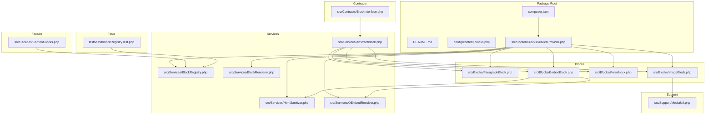
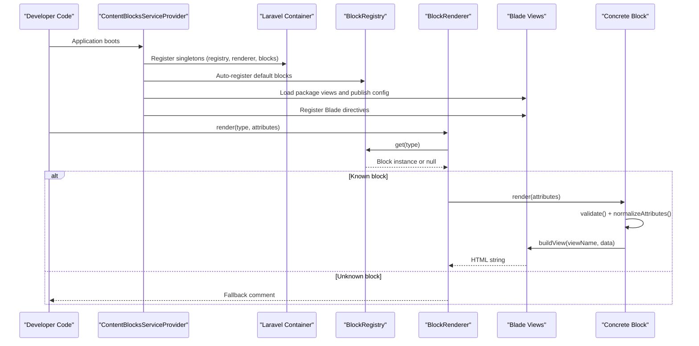
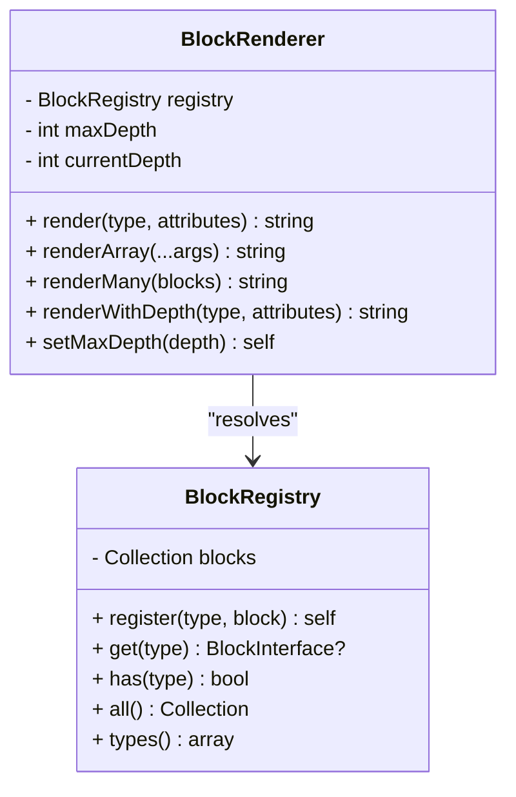
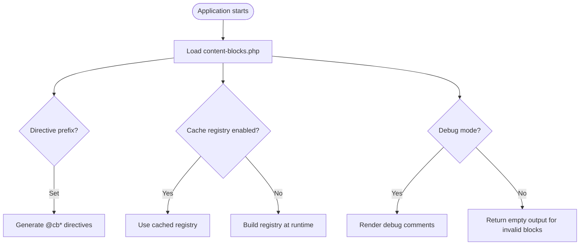
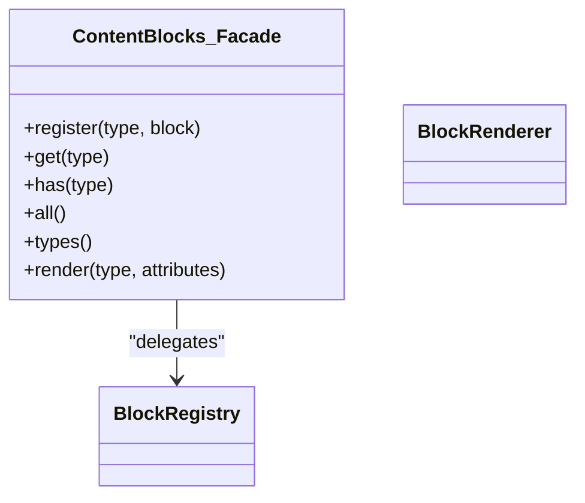
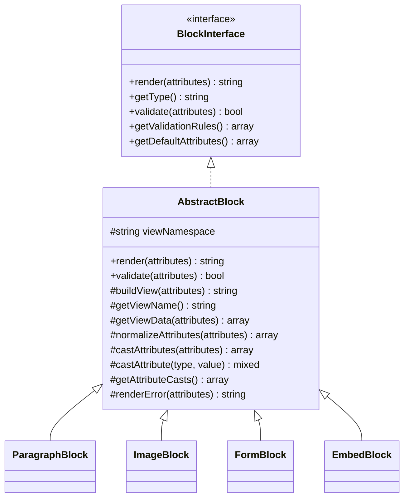
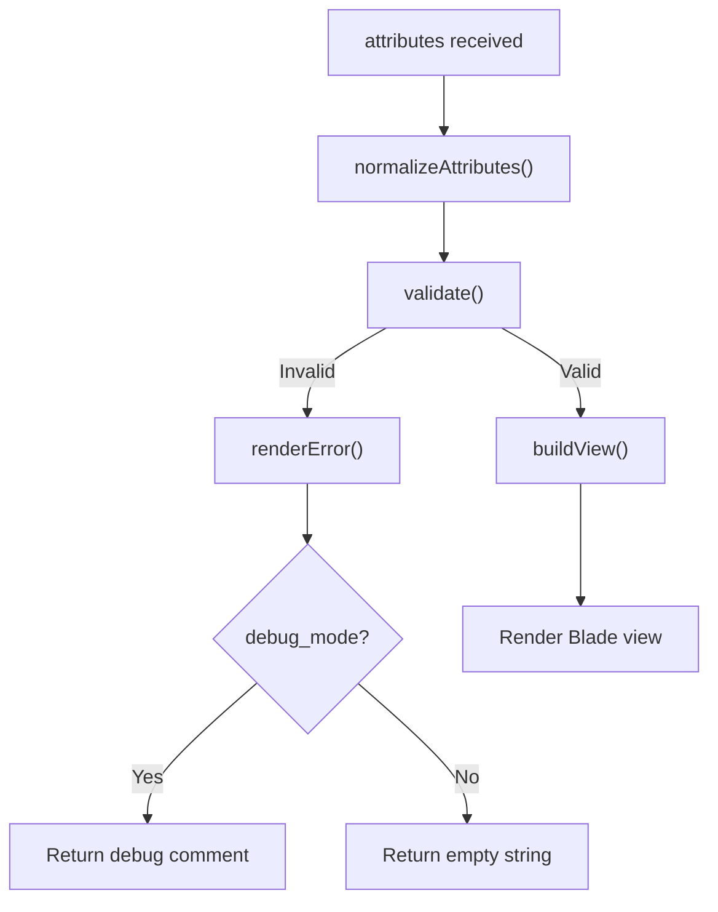
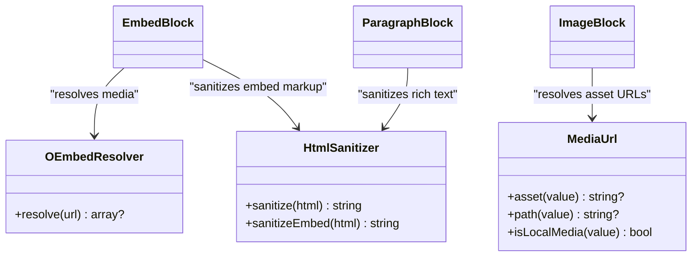
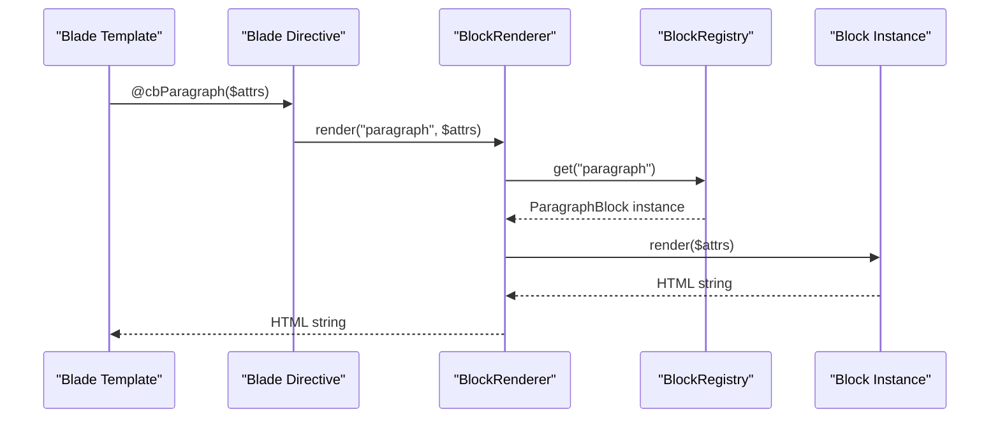
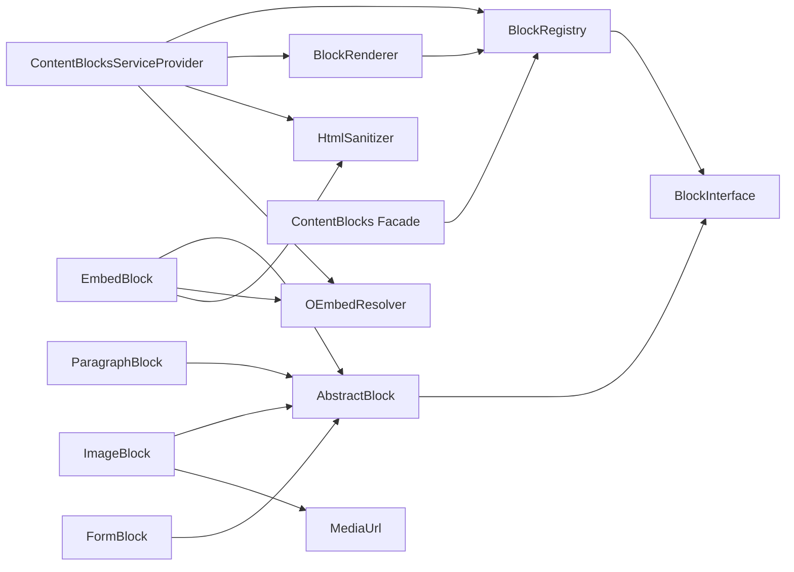

# Core Architecture & Registry

<cite>
**Referenced Files in This Document**
- [composer.json](file://packages/ContentBlocks/composer.json)
- [README.md](file://packages/ContentBlocks/README.md)
- [content-blocks.php](file://packages/ContentBlocks/config/content-blocks.php)
- [ContentBlocksServiceProvider.php](file://packages/ContentBlocks/src/ContentBlocksServiceProvider.php)
- [BlockRegistry.php](file://packages/ContentBlocks/src/Services/BlockRegistry.php)
- [BlockRenderer.php](file://packages/ContentBlocks/src/Services/BlockRenderer.php)
- [AbstractBlock.php](file://packages/ContentBlocks/src/Services/AbstractBlock.php)
- [BlockInterface.php](file://packages/ContentBlocks/src/Contracts/BlockInterface.php)
- [ContentBlocks.php](file://packages/ContentBlocks/src/Facades/ContentBlocks.php)
- [HtmlSanitizer.php](file://packages/ContentBlocks/src/Services/HtmlSanitizer.php)
- [OEmbedResolver.php](file://packages/ContentBlocks/src/Services/OEmbedResolver.php)
- [MediaUrl.php](file://packages/ContentBlocks/src/Support/MediaUrl.php)
- [ParagraphBlock.php](file://packages/ContentBlocks/src/Blocks/ParagraphBlock.php)
- [ImageBlock.php](file://packages/ContentBlocks/src/Blocks/ImageBlock.php)
- [FormBlock.php](file://packages/ContentBlocks/src/Blocks/FormBlock.php)
- [EmbedBlock.php](file://packages/ContentBlocks/src/Blocks/EmbedBlock.php)
- [BlockRegistryTest.php](file://packages/ContentBlocks/tests/Unit/BlockRegistryTest.php)
</cite>

## Table of Contents
1. [Introduction](#introduction)
2. [Project Structure](#project-structure)
3. [Core Components](#core-components)
4. [Architecture Overview](#architecture-overview)
5. [Detailed Component Analysis](#detailed-component-analysis)
6. [Dependency Analysis](#dependency-analysis)
7. [Performance Considerations](#performance-considerations)
8. [Troubleshooting Guide](#troubleshooting-guide)
9. [Conclusion](#conclusion)
10. [Appendices](#appendices)

## Introduction
The Highblossom Content Block system is a Laravel package that provides a typed, extensible content block rendering layer. It centers around a registry-driven architecture: blocks are declared as classes implementing a common contract, registered by type, and rendered through Blade directives or programmatic renderers. The package ships with default block types such as paragraph, image, embed, form, and others, while exposing configuration, facades, services, and extension points for custom integrations.

At runtime, the service provider registers core services, publishes configuration, auto-registers built-in blocks, and binds Blade directives to the renderer. Consumers interact with blocks either through Blade directives like `@cbParagraph` and `@block`, or through the `Highblossom\\ContentBlocks\\Facades\\ContentBlocks` facade and the underlying `BlockRegistry`.

## Project Structure
The package lives under `packages/ContentBlocks` and follows a clear separation between contracts, services, blocks, views, configuration, and tests:

**Diagram sources**
- [composer.json:1-31](file://packages/ContentBlocks/composer.json#L1-L31)
- [content-blocks.php:1-140](file://packages/ContentBlocks/config/content-blocks.php#L1-L140)
- [ContentBlocksServiceProvider.php:1-199](file://packages/ContentBlocks/src/ContentBlocksServiceProvider.php#L1-L199)
- [BlockInterface.php:1-36](file://packages/ContentBlocks/src/Contracts/BlockInterface.php#L1-L36)
- [BlockRegistry.php:1-66](file://packages/ContentBlocks/src/Services/BlockRegistry.php#L1-L66)
- [BlockRenderer.php:1-96](file://packages/ContentBlocks/src/Services/BlockRenderer.php#L1-L96)
- [AbstractBlock.php:1-162](file://packages/ContentBlocks/src/Services/AbstractBlock.php#L1-L162)
- [HtmlSanitizer.php:1-124](file://packages/ContentBlocks/src/Services/HtmlSanitizer.php#L1-L124)
- [OEmbedResolver.php:1-146](file://packages/ContentBlocks/src/Services/OEmbedResolver.php#L1-L146)
- [MediaUrl.php:1-169](file://packages/ContentBlocks/src/Support/MediaUrl.php#L1-L169)
- [ParagraphBlock.php:1-79](file://packages/ContentBlocks/src/Blocks/ParagraphBlock.php#L1-L79)
- [ImageBlock.php:1-97](file://packages/ContentBlocks/src/Blocks/ImageBlock.php#L1-L97)
- [FormBlock.php:1-64](file://packages/ContentBlocks/src/Blocks/FormBlock.php#L1-L64)
- [EmbedBlock.php:1-93](file://packages/ContentBlocks/src/Blocks/EmbedBlock.php#L1-L93)
- [ContentBlocks.php:1-29](file://packages/ContentBlocks/src/Facades/ContentBlocks.php#L1-L29)
- [BlockRegistryTest.php:1-62](file://packages/ContentBlocks/tests/Unit/BlockRegistryTest.php#L1-L62)

**Section sources**
- [composer.json:1-31](file://packages/ContentBlocks/composer.json#L1-L31)
- [content-blocks.php:1-140](file://packages/ContentBlocks/config/content-blocks.php#L1-L140)
- [ContentBlocksServiceProvider.php:1-199](file://packages/ContentBlocks/src/ContentBlocksServiceProvider.php#L1-L199)

## Core Components
This section summarizes the architectural building blocks and their responsibilities.

- Contract:
  - `BlockInterface`: Defines the block surface area: `render`, `getType`, `validate`, `getValidationRules`, and `getDefaultAttributes`.
- Base implementation:
  - `AbstractBlock`: Provides validation, attribute normalization, casting, view resolution, error rendering, and logging. Concrete blocks extend this class.
- Registry:
  - `BlockRegistry`: A lightweight collection keyed by string type that stores and retrieves block instances.
- Renderer:
  - `BlockRenderer`: Resolves blocks from the registry and renders them. Includes helpers for array-based arguments, batch rendering, and nesting depth protection.
- Facade:
  - `ContentBlocks`: Static facade over `BlockRegistry`, plus convenient access to `render`.
- Services:
  - `HtmlSanitizer`: HTMLPurifier-backed sanitization with separate config for regular content and embedded markup.
  - `OEmbedResolver`: Matches URLs against configured providers and fetches oEmbed metadata.
- Support:
  - `MediaUrl`: Normalizes legacy and modern media references into displayable URLs for the active public disk.
- Default blocks:
  - Examples include `ParagraphBlock`, `ImageBlock`, `FormBlock`, and `EmbedBlock`, each defining validation rules, defaults, casts, and optional attribute preprocessing.

**Section sources**
- [BlockInterface.php:1-36](file://packages/ContentBlocks/src/Contracts/BlockInterface.php#L1-L36)
- [AbstractBlock.php:1-162](file://packages/ContentBlocks/src/Services/AbstractBlock.php#L1-L162)
- [BlockRegistry.php:1-66](file://packages/ContentBlocks/src/Services/BlockRegistry.php#L1-L66)
- [BlockRenderer.php:1-96](file://packages/ContentBlocks/src/Services/BlockRenderer.php#L1-L96)
- [ContentBlocks.php:1-29](file://packages/ContentBlocks/src/Facades/ContentBlocks.php#L1-L29)
- [HtmlSanitizer.php:1-124](file://packages/ContentBlocks/src/Services/HtmlSanitizer.php#L1-L124)
- [OEmbedResolver.php:1-146](file://packages/ContentBlocks/src/Services/OEmbedResolver.php#L1-L146)
- [MediaUrl.php:1-169](file://packages/ContentBlocks/src/Support/MediaUrl.php#L1-L169)
- [ParagraphBlock.php:1-79](file://packages/ContentBlocks/src/Blocks/ParagraphBlock.php#L1-L79)
- [ImageBlock.php:1-97](file://packages/ContentBlocks/src/Blocks/ImageBlock.php#L1-L97)
- [FormBlock.php:1-64](file://packages/ContentBlocks/src/Blocks/FormBlock.php#L1-L64)
- [EmbedBlock.php:1-93](file://packages/ContentBlocks/src/Blocks/EmbedBlock.php#L1-L93)

## Architecture Overview
The Content Blocks system is a layered registry-and-renderer architecture. The lifecycle flows from registration through dependency injection, directive resolution, validation, attribute normalization, and Blade view rendering.

**Diagram sources**
- [ContentBlocksServiceProvider.php:1-199](file://packages/ContentBlocks/src/ContentBlocksServiceProvider.php#L1-L199)
- [BlockRegistry.php:1-66](file://packages/ContentBlocks/src/Services/BlockRegistry.php#L1-L66)
- [BlockRenderer.php:1-96](file://packages/ContentBlocks/src/Services/BlockRenderer.php#L1-L96)
- [AbstractBlock.php:1-162](file://packages/ContentBlocks/src/Services/AbstractBlock.php#L1-L162)

### Service Provider Responsibilities
The service provider performs several key tasks:
- Registers `BlockRegistry`, `BlockRenderer`, `HtmlSanitizer`, and `OEmbedResolver` as singletons.
- Registers all default block classes as singletons.
- Auto-registers default block types on the registry during boot.
- Loads package views under the `content-blocks` namespace.
- Publishes the configuration file.
- Registers Blade directives for each block type and a generic `@block` directive.

**Section sources**
- [ContentBlocksServiceProvider.php:1-199](file://packages/ContentBlocks/src/ContentBlocksServiceProvider.php#L1-L199)

## Detailed Component Analysis

### Block Registry Pattern
The registry is an in-memory collection mapping block type strings to fully constructed block instances. It exposes methods to register, retrieve, check existence, list all entries, and enumerate type names. The provider uses it to bind built-in blocks and to generate Blade directives dynamically.

**Diagram sources**
- [BlockRegistry.php:1-66](file://packages/ContentBlocks/src/Services/BlockRegistry.php#L1-L66)
- [BlockRenderer.php:1-96](file://packages/ContentBlocks/src/Services/BlockRenderer.php#L1-L96)

Key behaviors:
- Registration is additive; later registrations can overwrite earlier ones for the same type.
- Resolution returns `null` for unknown types, which the renderer converts into a fallback comment.
- The registry itself does not enforce caching; caching decisions are exposed through configuration.

**Section sources**
- [BlockRegistry.php:1-66](file://packages/ContentBlocks/src/Services/BlockRegistry.php#L1-L66)
- [BlockRenderer.php:1-96](file://packages/ContentBlocks/src/Services/BlockRenderer.php#L1-L96)
- [BlockRegistryTest.php:1-62](file://packages/ContentBlocks/tests/Unit/BlockRegistryTest.php#L1-L62)

### Service Provider Configuration
Configuration is published to `config/content-blocks.php` and controls:
- Directive prefix (`directive_prefix`).
- View namespace (`view_namespace`).
- Automatic default block registration (`auto_register`).
- Registry caching (`cache_registry`).
- Debug behavior for invalid blocks (`debug_mode`).
- Temporary upload cleanup settings.
- HTML sanitization policy.
- oEmbed provider endpoints and size limits.
- Form submission event configuration.

**Diagram sources**
- [content-blocks.php:1-140](file://packages/ContentBlocks/config/content-blocks.php#L1-L140)
- [ContentBlocksServiceProvider.php:1-199](file://packages/ContentBlocks/src/ContentBlocksServiceProvider.php#L1-L199)

**Section sources**
- [content-blocks.php:1-140](file://packages/ContentBlocks/config/content-blocks.php#L1-L140)
- [ContentBlocksServiceProvider.php:1-199](file://packages/ContentBlocks/src/ContentBlocksServiceProvider.php#L1-L199)

### Facade Interface and Dependency Injection
The facade exposes static access to the registry and renderer through Laravel’s container. It delegates calls to `BlockRegistry::class`, making it easy to programmatically register new blocks, query types, and render blocks directly from application code.

**Diagram sources**
- [ContentBlocks.php:1-29](file://packages/ContentBlocks/src/Facades/ContentBlocks.php#L1-L29)
- [BlockRegistry.php:1-66](file://packages/ContentBlocks/src/Services/BlockRegistry.php#L1-L66)

Usage patterns:
- Programmatic registration: `ContentBlocks::register('custom', $customBlock)`
- Rendering: `ContentBlocks::render('paragraph', ['content' => '...'])`

**Section sources**
- [ContentBlocks.php:1-29](file://packages/ContentBlocks/src/Facades/ContentBlocks.php#L1-L29)

### Contracts and Block Base Classes
The contract defines the minimal API every block must implement. The abstract base class implements most of the shared logic, including validation, attribute merging, casting, view resolution, and safe error handling.

**Diagram sources**
- [BlockInterface.php:1-36](file://packages/ContentBlocks/src/Contracts/BlockInterface.php#L1-L36)
- [AbstractBlock.php:1-162](file://packages/ContentBlocks/src/Services/AbstractBlock.php#L1-L162)
- [ParagraphBlock.php:1-79](file://packages/ContentBlocks/src/Blocks/ParagraphBlock.php#L1-L79)
- [ImageBlock.php:1-97](file://packages/ContentBlocks/src/Blocks/ImageBlock.php#L1-L97)
- [FormBlock.php:1-64](file://packages/ContentBlocks/src/Blocks/FormBlock.php#L1-L64)
- [EmbedBlock.php:1-93](file://packages/ContentBlocks/src/Blocks/EmbedBlock.php#L1-L93)

#### Validation and Attribute Lifecycle
For each block:
1. Attributes are normalized by merging defaults and applying type casts.
2. Validation rules defined by the block are applied using Laravel’s validator.
3. On failure, the base class logs warnings and returns either a debug comment or an empty string depending on configuration.
4. On success, the block builds a Blade view with computed view data.

**Diagram sources**
- [AbstractBlock.php:1-162](file://packages/ContentBlocks/src/Services/AbstractBlock.php#L1-L162)
- [content-blocks.php:1-140](file://packages/ContentBlocks/config/content-blocks.php#L1-L140)

**Section sources**
- [AbstractBlock.php:1-162](file://packages/ContentBlocks/src/Services/AbstractBlock.php#L1-L162)

### Service Layer Architecture
Beyond blocks, the package provides specialized services used by blocks:

- `HtmlSanitizer`: Wraps HTMLPurifier with configurable allowed tags, attributes, schemes, and serializer paths. It also maintains a separate sanitizer configuration for embed markup, allowing iframes from trusted providers while stripping scripts and unsafe attributes.
- `OEmbedResolver`: Matches URLs against configured provider patterns, resolves oEmbed endpoints, and returns structured metadata. Failures are logged and return null to keep rendering robust.
- `MediaUrl`: Centralizes URL/path normalization for images and other media assets stored under the public disk, supporting legacy absolute URLs and bundled root assets.

**Diagram sources**
- [HtmlSanitizer.php:1-124](file://packages/ContentBlocks/src/Services/HtmlSanitizer.php#L1-L124)
- [OEmbedResolver.php:1-146](file://packages/ContentBlocks/src/Services/OEmbedResolver.php#L1-L146)
- [MediaUrl.php:1-169](file://packages/ContentBlocks/src/Support/MediaUrl.php#L1-L169)
- [EmbedBlock.php:1-93](file://packages/ContentBlocks/src/Blocks/EmbedBlock.php#L1-L93)
- [ImageBlock.php:1-97](file://packages/ContentBlocks/src/Blocks/ImageBlock.php#L1-L97)
- [ParagraphBlock.php:1-79](file://packages/ContentBlocks/src/Blocks/ParagraphBlock.php#L1-L79)

**Section sources**
- [HtmlSanitizer.php:1-124](file://packages/ContentBlocks/src/Services/HtmlSanitizer.php#L1-L124)
- [OEmbedResolver.php:1-146](file://packages/ContentBlocks/src/Services/OEmbedResolver.php#L1-L146)
- [MediaUrl.php:1-169](file://packages/ContentBlocks/src/Support/MediaUrl.php#L1-L169)

### Block Discovery, Registration, and Resolution
Discovery and registration are primarily controlled by the service provider. Built-in blocks are registered automatically during boot. Additional blocks can be added by calling the facade or injecting the registry and invoking `register`.

Resolution occurs in two main paths:
- Blade directives: Each block type gets a generated directive like `@cbParagraph`; a generic `@block` directive accepts `(type, attributes)`.
- Programmatic rendering: `BlockRenderer::render` looks up the block via the registry and invokes its `render` method.

**Diagram sources**
- [ContentBlocksServiceProvider.php:1-199](file://packages/ContentBlocks/src/ContentBlocksServiceProvider.php#L1-L199)
- [BlockRenderer.php:1-96](file://packages/ContentBlocks/src/Services/BlockRenderer.php#L1-L96)
- [BlockRegistry.php:1-66](file://packages/ContentBlocks/src/Services/BlockRegistry.php#L1-L66)

**Section sources**
- [ContentBlocksServiceProvider.php:1-199](file://packages/ContentBlocks/src/ContentBlocksServiceProvider.php#L1-L199)
- [BlockRenderer.php:1-96](file://packages/ContentBlocks/src/Services/BlockRenderer.php#L1-L96)
- [BlockRegistry.php:1-66](file://packages/ContentBlocks/src/Services/BlockRegistry.php#L1-L66)

### Configuration Schema and Block Metadata
Configuration keys:
- `directive_prefix`: Blade directive prefix, defaulting to `cb`.
- `view_namespace`: Blade view namespace for block templates.
- `auto_register`: Whether to auto-register default blocks.
- `cache_registry`: Whether to cache the registry.
- `debug_mode`: Whether invalid blocks render debug comments instead of empty strings.
- `temp_cleanup`: Temporary upload cleanup behavior.
- `html`: HTMLPurifier policy for allowed tags, attributes, schemes, and cleanup behavior.
- `oembed`: Max dimensions and provider endpoint definitions.
- `form`: Submit label and event dispatch configuration.

Block metadata structure:
- Type identifier: Provided by `getType()`.
- Validation rules: Provided by `getValidationRules()`.
- Defaults: Provided by `getDefaultAttributes()`.
- Casts: Provided by `getAttributeCasts()` in the abstract base class.
- View name: Derived from the block class name unless overridden.

Examples of metadata:
- `ParagraphBlock`: Validates content length and class, casts content and class to strings, and sanitizes content through `HtmlSanitizer`.
- `ImageBlock`: Validates image fields and an optional images array with a maximum count, casts numeric and array fields, and resolves asset URLs through `MediaUrl`.
- `FormBlock`: Validates field schemas and submit configuration, casting fields to arrays.
- `EmbedBlock`: Validates URL and title, casts url and title, and enriches attributes with resolved oEmbed data and sanitized embed markup.

**Section sources**
- [content-blocks.php:1-140](file://packages/ContentBlocks/config/content-blocks.php#L1-L140)
- [ParagraphBlock.php:1-79](file://packages/ContentBlocks/src/Blocks/ParagraphBlock.php#L1-L79)
- [ImageBlock.php:1-97](file://packages/ContentBlocks/src/Blocks/ImageBlock.php#L1-L97)
- [FormBlock.php:1-64](file://packages/ContentBlocks/src/Blocks/FormBlock.php#L1-L64)
- [EmbedBlock.php:1-93](file://packages/ContentBlocks/src/Blocks/EmbedBlock.php#L1-L93)

### Extension Points and Custom Integrations
Extension points include:
- Adding custom blocks: Implement `BlockInterface` or extend `AbstractBlock`, then register the block with the registry or facade.
- Overriding views: Publish views under the configured `view_namespace` and replace individual block templates.
- Customizing sanitization: Adjust `content-blocks.html.*` configuration or inject a different sanitizer strategy where appropriate.
- Customizing oEmbed providers: Add or modify provider patterns and endpoints under `content-blocks.oembed.providers`.
- Customizing forms: Configure submit labels and events under `content-blocks.form`.

Example integration pattern:
- Create a block class extending `AbstractBlock`, define validation rules, defaults, casts, and optionally override `normalizeAttributes` or `getViewData`.
- Register the block in application bootstrap or a dedicated service provider by calling `ContentBlocks::register('my-type', $block)` or injecting `BlockRegistry` and invoking `register`.

**Section sources**
- [BlockInterface.php:1-36](file://packages/ContentBlocks/src/Contracts/BlockInterface.php#L1-L36)
- [AbstractBlock.php:1-162](file://packages/ContentBlocks/src/Services/AbstractBlock.php#L1-L162)
- [ContentBlocks.php:1-29](file://packages/ContentBlocks/src/Facades/ContentBlocks.php#L1-L29)
- [content-blocks.php:1-140](file://packages/ContentBlocks/config/content-blocks.php#L1-L140)

### Example Workflows

#### Block Registration
Registration happens automatically for built-in blocks. For custom blocks:
- Obtain the registry through the facade or dependency injection.
- Call `register` with a unique type string and a block instance.
- Optionally adjust the directive prefix in configuration so generated Blade directives match your naming convention.

**Section sources**
- [ContentBlocksServiceProvider.php:1-199](file://packages/ContentBlocks/src/ContentBlocksServiceProvider.php#L1-L199)
- [ContentBlocks.php:1-29](file://packages/ContentBlocks/src/Facades/ContentBlocks.php#L1-L29)

#### Custom Service Integration
Blocks may depend on external services:
- `ParagraphBlock` depends on `HtmlSanitizer` to sanitize rich text before rendering.
- `EmbedBlock` depends on `OEmbedResolver` and `HtmlSanitizer` to resolve and sanitize third-party embed markup.
- `ImageBlock` depends on `MediaUrl` to resolve storage paths into public URLs.

To integrate a custom service:
- Define the service and register it in the application container.
- Inject the service into your block constructor.
- Use the service during attribute normalization or view data preparation.

**Section sources**
- [ParagraphBlock.php:1-79](file://packages/ContentBlocks/src/Blocks/ParagraphBlock.php#L1-L79)
- [EmbedBlock.php:1-93](file://packages/ContentBlocks/src/Blocks/EmbedBlock.php#L1-L93)
- [ImageBlock.php:1-97](file://packages/ContentBlocks/src/Blocks/ImageBlock.php#L1-L97)
- [HtmlSanitizer.php:1-124](file://packages/ContentBlocks/src/Services/HtmlSanitizer.php#L1-L124)
- [OEmbedResolver.php:1-146](file://packages/ContentBlocks/src/Services/OEmbedResolver.php#L1-L146)
- [MediaUrl.php:1-169](file://packages/ContentBlocks/src/Support/MediaUrl.php#L1-L169)

#### Lifecycle Hooks
The base class provides consistent lifecycle hooks:
- `normalizeAttributes`: Called before validation; use to preprocess attributes.
- `validate`: Uses Laravel’s validator with rules from `getValidationRules`.
- `buildView`: Renders the Blade view with data from `getViewData`.
- `renderError`: Produces debug comments or empty output based on configuration.

Override these methods to customize behavior per block.

**Section sources**
- [AbstractBlock.php:1-162](file://packages/ContentBlocks/src/Services/AbstractBlock.php#L1-L162)

## Dependency Analysis
The package exhibits low coupling between blocks and high cohesion within the service layer:
- Blocks depend on the abstract base class and optional services.
- The renderer depends only on the registry.
- The facade depends only on the registry.
- The provider wires everything together and generates Blade directives.

**Diagram sources**
- [ContentBlocksServiceProvider.php:1-199](file://packages/ContentBlocks/src/ContentBlocksServiceProvider.php#L1-L199)
- [BlockRegistry.php:1-66](file://packages/ContentBlocks/src/Services/BlockRegistry.php#L1-L66)
- [BlockRenderer.php:1-96](file://packages/ContentBlocks/src/Services/BlockRenderer.php#L1-L96)
- [ContentBlocks.php:1-29](file://packages/ContentBlocks/src/Facades/ContentBlocks.php#L1-L29)
- [BlockInterface.php:1-36](file://packages/ContentBlocks/src/Contracts/BlockInterface.php#L1-L36)
- [AbstractBlock.php:1-162](file://packages/ContentBlocks/src/Services/AbstractBlock.php#L1-L162)
- [ParagraphBlock.php:1-79](file://packages/ContentBlocks/src/Blocks/ParagraphBlock.php#L1-L79)
- [ImageBlock.php:1-97](file://packages/ContentBlocks/src/Blocks/ImageBlock.php#L1-L97)
- [FormBlock.php:1-64](file://packages/ContentBlocks/src/Blocks/FormBlock.php#L1-L64)
- [EmbedBlock.php:1-93](file://packages/ContentBlocks/src/Blocks/EmbedBlock.php#L1-L93)
- [MediaUrl.php:1-169](file://packages/ContentBlocks/src/Support/MediaUrl.php#L1-L169)

**Section sources**
- [ContentBlocksServiceProvider.php:1-199](file://packages/ContentBlocks/src/ContentBlocksServiceProvider.php#L1-L199)
- [BlockRegistry.php:1-66](file://packages/ContentBlocks/src/Services/BlockRegistry.php#L1-L66)
- [BlockRenderer.php:1-96](file://packages/ContentBlocks/src/Services/BlockRenderer.php#L1-L96)
- [ContentBlocks.php:1-29](file://packages/ContentBlocks/src/Facades/ContentBlocks.php#L1-L29)
- [AbstractBlock.php:1-162](file://packages/ContentBlocks/src/Services/AbstractBlock.php#L1-L162)
- [ParagraphBlock.php:1-79](file://packages/ContentBlocks/src/Blocks/ParagraphBlock.php#L1-L79)
- [ImageBlock.php:1-97](file://packages/ContentBlocks/src/Blocks/ImageBlock.php#L1-L97)
- [FormBlock.php:1-64](file://packages/ContentBlocks/src/Blocks/FormBlock.php#L1-L64)
- [EmbedBlock.php:1-93](file://packages/ContentBlocks/src/Blocks/EmbedBlock.php#L1-L93)
- [MediaUrl.php:1-169](file://packages/ContentBlocks/src/Support/MediaUrl.php#L1-L169)

## Performance Considerations
The package includes several performance-related mechanisms:

- Singleton services: The provider registers the registry, renderer, sanitizer, resolver, and all default blocks as singletons, reducing object construction overhead across requests.
- Blade directive generation: Directives are generated once during provider boot based on registered block types, avoiding repeated reflection or discovery at runtime.
- Nesting depth limit: The renderer enforces a maximum nesting depth to prevent deeply nested block trees from causing excessive rendering work or stack pressure.
- Configuration-driven behavior:
  - `cache_registry`: Indicates intent to cache the registry for better performance in production.
  - `debug_mode`: Disables expensive debug comments in production when disabled.
  - HTML sanitization caching: HTMLPurifier uses a serializer path under the application storage directory to reduce repeated parsing costs.
- oEmbed resolution: Network requests are limited by a timeout and return null on failure, preventing slow responses from blocking rendering.
- Asset resolution: `MediaUrl` centralizes URL normalization and avoids repeated storage driver lookups by returning normalized values consistently.

Recommended practices:
- Enable `cache_registry` in production if you add blocks at deployment time rather than request time.
- Keep block payloads bounded; for example, `ImageBlock` caps the number of images.
- Prefer server-side attribute normalization in blocks to avoid repeated processing in views.
- Monitor HTMLPurifier serializer cache growth and ensure adequate storage permissions.
- Use `renderMany` to batch render collections efficiently, and prefer `renderWithDepth` when nesting is expected.

[No sources needed since this section provides general guidance]

## Troubleshooting Guide
Common issues and diagnostics:

- Unknown block type:
  - Symptom: Rendering produces a fallback comment containing the unknown type.
  - Cause: The block was not registered in the registry.
  - Action: Register the block through the facade or registry, and verify the type string matches the directive.

- Invalid block attributes:
  - Symptom: Rendering returns an empty string in production or a debug comment in development.
  - Cause: Validation rules failed for the block.
  - Action: Inspect logs for validation errors and correct the input payload.

- Sanitization removing content:
  - Symptom: Rich text or embed markup disappears after rendering.
  - Cause: HTMLPurifier policy disallowed certain tags or attributes.
  - Action: Review `content-blocks.html.allowed_tags`, `allowed_attributes`, and `allowed_schemes`, and adjust as needed.

- oEmbed failures:
  - Symptom: Embed blocks render without rich preview information.
  - Cause: oEmbed network request failed or no provider matched the URL.
  - Action: Check logs for oEmbed errors, validate provider patterns, and confirm endpoint availability.

- Media URLs incorrect:
  - Symptom: Images point to wrong hosts or fail to load.
  - Cause: Legacy storage paths or absolute URLs were not normalized correctly.
  - Action: Ensure media values are persisted as disk-relative paths and rely on `MediaUrl` for resolution.

**Section sources**
- [BlockRenderer.php:1-96](file://packages/ContentBlocks/src/Services/BlockRenderer.php#L1-L96)
- [AbstractBlock.php:1-162](file://packages/ContentBlocks/src/Services/AbstractBlock.php#L1-L162)
- [HtmlSanitizer.php:1-124](file://packages/ContentBlocks/src/Services/HtmlSanitizer.php#L1-L124)
- [OEmbedResolver.php:1-146](file://packages/ContentBlocks/src/Services/OEmbedResolver.php#L1-L146)
- [MediaUrl.php:1-169](file://packages/ContentBlocks/src/Support/MediaUrl.php#L1-L169)

## Conclusion
The Highblossom Content Block system provides a clean, extensible foundation for rendering structured content in Laravel applications. Its registry-driven design separates concerns between block definition, service configuration, and rendering. The facade and Blade directives offer simple entry points, while the contract and abstract base class provide predictable extension points for custom blocks and services. With configuration-driven behavior, singleton services, and defensive rendering, the system balances flexibility, safety, and performance.

[No sources needed since this section summarizes without analyzing specific files]

## Appendices

### Appendix A: Block Types and Responsibilities
- Paragraph: Text content with optional HTML sanitization.
- Image: Single image or gallery with validated fields and asset URL resolution.
- Form: Dynamic form schema with validated field definitions.
- Embed: oEmbed-powered media embedding with provider detection and markup sanitization.
- Other built-in blocks: Registered by the provider and available via Blade directives.

**Section sources**
- [ContentBlocksServiceProvider.php:1-199](file://packages/ContentBlocks/src/ContentBlocksServiceProvider.php#L1-L199)
- [ParagraphBlock.php:1-79](file://packages/ContentBlocks/src/Blocks/ParagraphBlock.php#L1-L79)
- [ImageBlock.php:1-97](file://packages/ContentBlocks/src/Blocks/ImageBlock.php#L1-L97)
- [FormBlock.php:1-64](file://packages/ContentBlocks/src/Blocks/FormBlock.php#L1-L64)
- [EmbedBlock.php:1-93](file://packages/ContentBlocks/src/Blocks/EmbedBlock.php#L1-L93)