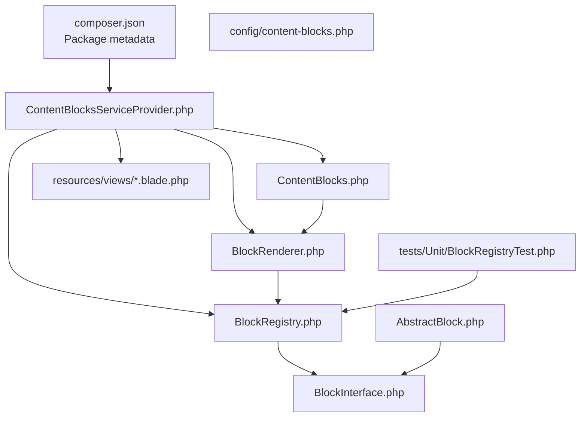
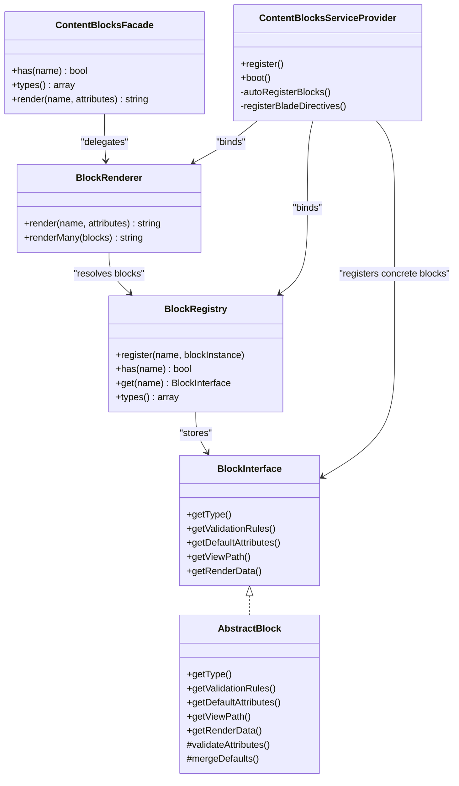
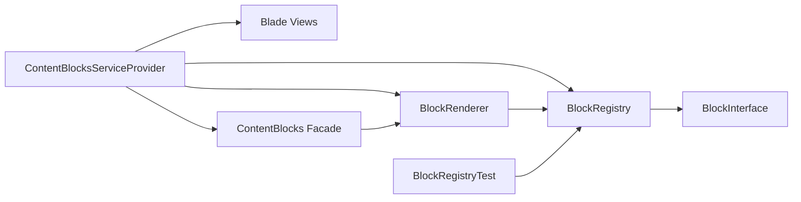

# Custom Block Development

<cite>
**Referenced Files in This Document**
- [composer.json](file://packages/ContentBlocks/composer.json)
- [README.md](file://packages/ContentBlocks/README.md)
- [content-blocks.php](file://packages/ContentBlocks/config/content-blocks.php)
- [ContentBlocksServiceProvider.php](file://packages/ContentBlocks/src/ContentBlocksServiceProvider.php)
- [BlockInterface.php](file://packages/ContentBlocks/src/Contracts/BlockInterface.php)
- [AbstractBlock.php](file://packages/ContentBlocks/src/Services/AbstractBlock.php)
- [BlockRegistry.php](file://packages/ContentBlocks/src/Services/BlockRegistry.php)
- [BlockRenderer.php](file://packages/ContentBlocks/src/Services/BlockRenderer.php)
- [ContentBlocks.php](file://packages/ContentBlocks/src/Facades/ContentBlocks.php)
- [MediaUrl.php](file://packages/ContentBlocks/src/Support/MediaUrl.php)
- [BlockRegistryTest.php](file://packages/ContentBlocks/tests/Unit/BlockRegistryTest.php)
</cite>

## Table of Contents
1. [Introduction](#introduction)
2. [Project Structure](#project-structure)
3. [Core Components](#core-components)
4. [Architecture Overview](#architecture-overview)
5. [Detailed Component Analysis](#detailed-component-analysis)
6. [Dependency Analysis](#dependency-analysis)
7. [Performance Considerations](#performance-considerations)
8. [Troubleshooting Guide](#troubleshooting-guide)
9. [Conclusion](#conclusion)
10. [Appendices](#appendices)

## Introduction
This document explains how to develop custom content blocks in the Highblossom system using the `highblossom/content-blocks` package. It covers the block contract, implementation base class, registration process, configuration schema, Blade directives, Livewire integration points, asset management, testing strategies, debugging techniques, deployment considerations, and advanced topics such as cross-block communication, data persistence, and performance optimization.

The package provides:
- A block interface and abstract base class for defining block behavior.
- A registry that maps block names to singleton block services.
- A renderer that resolves a block by name and renders its Blade template.
- Auto-generated Blade directives based on registered block types.
- A facade and service layer for rendering blocks programmatically.
- Configuration published through a Laravel service provider.

## Project Structure
The ContentBlocks package is a standalone Laravel library under `packages/ContentBlocks`. Its main responsibilities are split across contracts, services, built-in blocks, views, configuration, tests, and documentation.

**Diagram sources**
- [composer.json:1-31](file://packages/ContentBlocks/composer.json#L1-L31)
- [ContentBlocksServiceProvider.php:1-199](file://packages/ContentBlocks/src/ContentBlocksServiceProvider.php#L1-L199)
- [BlockRegistry.php](file://packages/ContentBlocks/src/Services/BlockRegistry.php)
- [BlockRenderer.php](file://packages/ContentBlocks/src/Services/BlockRenderer.php)
- [BlockInterface.php](file://packages/ContentBlocks/src/Contracts/BlockInterface.php)
- [AbstractBlock.php](file://packages/ContentBlocks/src/Services/AbstractBlock.php)
- [ContentBlocks.php](file://packages/ContentBlocks/src/Facades/ContentBlocks.php)
- [content-blocks.php](file://packages/ContentBlocks/config/content-blocks.php)
- [BlockRegistryTest.php](file://packages/ContentBlocks/tests/Unit/BlockRegistryTest.php)

**Section sources**
- [composer.json:1-31](file://packages/ContentBlocks/composer.json#L1-L31)
- [README.md:1-237](file://packages/ContentBlocks/README.md#L1-L237)

## Core Components
This section summarizes the building blocks you will use when creating custom content blocks.

### Block Contract and Abstract Implementation
- The block contract defines the required interface for every block type.
- The abstract base class implements shared logic, including attribute validation, default attributes, and helper utilities.
- Concrete block classes extend the abstract base class and implement the minimal set of methods needed to identify themselves and define their attributes.

Key concepts:
- Every block must declare a stable string identifier used during registration and rendering.
- Blocks define validation rules for their attributes using Laravel’s validator format.
- Blocks provide default values for optional attributes so templates can render safely.
- Blocks resolve their Blade view path and renderable data.

**Section sources**
- [BlockInterface.php](file://packages/ContentBlocks/src/Contracts/BlockInterface.php)
- [AbstractBlock.php](file://packages/ContentBlocks/src/Services/AbstractBlock.php)

### Block Registration
- The service provider registers all built-in blocks with the registry.
- Each block is registered as a singleton to improve performance.
- The registry exposes the complete list of available block types.

Registration flow:
1. The service provider binds the registry and renderer as singletons.
2. Built-in block classes are bound as singletons.
3. Each block is added to the registry under a human-friendly key.
4. Blade directives are generated dynamically from registered block types.

**Section sources**
- [ContentBlocksServiceProvider.php:1-199](file://packages/ContentBlocks/src/ContentBlocksServiceProvider.php#L1-L199)

### Block Rendering
- The renderer receives a block name and an attributes array.
- It looks up the corresponding block instance from the registry.
- It validates attributes against the block’s rules and applies defaults.
- It locates and renders the Blade view associated with the block.

Rendering options:
- Render a single block by name and attributes.
- Render multiple blocks at once by passing arrays of block definitions.

**Section sources**
- [BlockRenderer.php](file://packages/ContentBlocks/src/Services/BlockRenderer.php)

### Facade Usage
- The facade provides a static entry point to check whether a block type exists, list all registered types, and render blocks.
- Internally, it delegates to the renderer service.

**Section sources**
- [ContentBlocks.php](file://packages/ContentBlocks/src/Facades/ContentBlocks.php)

### Configuration Schema
- The package publishes a configuration file under `config/content-blocks.php`.
- The configuration controls things like directive prefixes and other package-level settings.
- Publishing is handled by the service provider.

Common customization:
- Change the Blade directive prefix.
- Add or override package-wide behavior through configuration keys.

**Section sources**
- [content-blocks.php](file://packages/ContentBlocks/config/content-blocks.php)
- [ContentBlocksServiceProvider.php:1-199](file://packages/ContentBlocks/src/ContentBlocksServiceProvider.php#L1-L199)

### Blade Directives
- For each registered block type, the service provider generates a directive using the configured prefix.
- A generic `@block` directive is also provided for dynamic rendering where both type and attributes are passed together.

Directive examples (conceptual):
- Use the auto-generated directive for a known block type.
- Use the generic directive when the block type is determined at runtime.

**Section sources**
- [ContentBlocksServiceProvider.php:1-199](file://packages/ContentBlocks/src/ContentBlocksServiceProvider.php#L1-L199)
- [README.md:1-237](file://packages/ContentBlocks/README.md#L1-L237)

## Architecture Overview
The ContentBlocks architecture separates concerns between definition, registration, rendering, and presentation.

**Diagram sources**
- [BlockInterface.php](file://packages/ContentBlocks/src/Contracts/BlockInterface.php)
- [AbstractBlock.php](file://packages/ContentBlocks/src/Services/AbstractBlock.php)
- [BlockRegistry.php](file://packages/ContentBlocks/src/Services/BlockRegistry.php)
- [BlockRenderer.php](file://packages/ContentBlocks/src/Services/BlockRenderer.php)
- [ContentBlocks.php](file://packages/ContentBlocks/src/Facades/ContentBlocks.php)
- [ContentBlocksServiceProvider.php:1-199](file://packages/ContentBlocks/src/ContentBlocksServiceProvider.php#L1-L199)

## Detailed Component Analysis

### Block Contract and Base Class
The contract defines the shape of a block, while the abstract class provides shared behavior. When implementing a custom block:
- Implement the contract or extend the abstract base class.
- Provide a stable block type identifier.
- Define validation rules for input attributes.
- Provide default attribute values.
- Return the Blade view path.
- Prepare render data for the template.

Complexity notes:
- Validation runs per block instance during rendering.
- Defaults are merged into user-supplied attributes before rendering.
- View resolution uses a consistent naming convention tied to the block type.

Best practices:
- Keep validation rules explicit and defensive.
- Never trust raw attributes; always rely on validated and defaulted data inside your template.
- Avoid heavy computation in getters; delegate expensive work to services if needed.

**Section sources**
- [BlockInterface.php](file://packages/ContentBlocks/src/Contracts/BlockInterface.php)
- [AbstractBlock.php](file://packages/ContentBlocks/src/Services/AbstractBlock.php)

### Block Registry
The registry is a central mapping from block names to block instances. It supports:
- Registering new blocks.
- Checking whether a block exists.
- Retrieving a block by name.
- Listing all registered block types.

Design characteristics:
- Registered blocks are typically singletons.
- The registry is lightweight and stateful only during application boot and request lifecycle.
- It enables dynamic directive generation and programmatic rendering.

Testing tip:
- Unit tests can assert the presence of expected block types and validate registry behavior.

**Section sources**
- [BlockRegistry.php](file://packages/ContentBlocks/src/Services/BlockRegistry.php)
- [BlockRegistryTest.php](file://packages/ContentBlocks/tests/Unit/BlockRegistryTest.php)

### Block Renderer
The renderer coordinates validation, default merging, and Blade rendering.

Processing flow:
1. Receive a block name and attributes.
2. Resolve the block instance from the registry.
3. Validate attributes using the block’s rules.
4. Merge default attributes.
5. Resolve the Blade view path.
6. Render the template with prepared data.

Error handling:
- Unregistered block names should fail early.
- Validation failures should prevent rendering unsafe or incomplete data.
- Template errors should be surfaced clearly during development.

**Section sources**
- [BlockRenderer.php](file://packages/ContentBlocks/src/Services/BlockRenderer.php)

### Service Provider and Blade Directives
The service provider wires everything together:
- Binds the registry and renderer as singletons.
- Registers built-in block classes as singletons.
- Auto-registers built-in blocks with the registry.
- Publishes the configuration file.
- Loads package Blade views.
- Generates Blade directives from registered block types.
- Adds a generic directive for dynamic rendering.

Directive generation:
- Directive names are derived from the block type and configurable prefix.
- The generic directive accepts a type expression and an attributes expression.

**Section sources**
- [ContentBlocksServiceProvider.php:1-199](file://packages/ContentBlocks/src/ContentBlocksServiceProvider.php#L1-L199)

### Facade
The facade exposes convenient static methods:
- Check whether a block type is registered.
- List all block types.
- Render a block by name and attributes.

It is intended for Blade and application code that prefers static access over dependency injection.

**Section sources**
- [ContentBlocks.php](file://packages/ContentBlocks/src/Facades/ContentBlocks.php)

### Configuration
The configuration file is published under `config/content-blocks.php`. Typical customization includes:
- Changing the directive prefix.
- Adding future extension points defined by the package.

Publish command reference:
- Use the vendor publish tag documented in the package README.

**Section sources**
- [content-blocks.php](file://packages/ContentBlocks/config/content-blocks.php)
- [README.md:1-237](file://packages/ContentBlocks/README.md#L1-L237)

### Media Utilities
The package includes media-related support utilities that can help blocks handle URLs safely.

Use cases:
- Resolving or normalizing media paths within block templates.
- Building relative or absolute URLs consistently.

**Section sources**
- [MediaUrl.php](file://packages/ContentBlocks/src/Support/MediaUrl.php)

## Dependency Analysis
The following diagram shows how the core components depend on each other.

**Diagram sources**
- [ContentBlocksServiceProvider.php:1-199](file://packages/ContentBlocks/src/ContentBlocksServiceProvider.php#L1-L199)
- [BlockRegistry.php](file://packages/ContentBlocks/src/Services/BlockRegistry.php)
- [BlockRenderer.php](file://packages/ContentBlocks/src/Services/BlockRenderer.php)
- [BlockInterface.php](file://packages/ContentBlocks/src/Contracts/BlockInterface.php)
- [ContentBlocks.php](file://packages/ContentBlocks/src/Facades/ContentBlocks.php)
- [BlockRegistryTest.php](file://packages/ContentBlocks/tests/Unit/BlockRegistryTest.php)

**Section sources**
- [ContentBlocksServiceProvider.php:1-199](file://packages/ContentBlocks/src/ContentBlocksServiceProvider.php#L1-L199)
- [BlockRegistryTest.php](file://packages/ContentBlocks/tests/Unit/BlockRegistryTest.php)

## Performance Considerations
- Blocks are registered as singletons. Reuse them across requests rather than instantiating them repeatedly.
- Avoid heavy computations inside block getters. Defer expensive operations to services or cache layers.
- Prefer small, focused Blade templates. Complex logic belongs in services or block helpers.
- Minimize database queries in templates; load related data in the block’s render data preparation step.
- Use the renderer’s batch rendering capability when displaying many blocks to reduce repeated setup overhead.

[No sources needed since this section provides general guidance]

## Troubleshooting Guide

### Common Issues and Fixes
- **Unknown block type**: Ensure the block is registered in the registry. If you created a custom block, register it in your application’s service provider or configure auto-registration.
- **Missing Blade view**: Confirm that the block returns the correct view path and that the view exists in the expected namespace.
- **Validation errors**: Review the block’s validation rules and ensure required attributes are present.
- **Directive not found**: Verify that the service provider has booted and that the block was registered before Blade directives were generated.
- **Configuration not applied**: Make sure the configuration file has been published and cleared caches after changes.

### Debugging Techniques
- Inspect the list of registered block types using the facade or registry.
- Log the rendered HTML temporarily to verify template output.
- Use Laravel’s debugging tools to inspect request context and view data.
- Write unit tests for block validation and rendering to catch regressions early.

**Section sources**
- [BlockRegistryTest.php](file://packages/ContentBlocks/tests/Unit/BlockRegistryTest.php)
- [ContentBlocksServiceProvider.php:1-199](file://packages/ContentBlocks/src/ContentBlocksServiceProvider.php#L1-L199)

## Conclusion
The Highblossom ContentBlocks package provides a clear, extensible foundation for building custom content blocks. By implementing the block contract or extending the abstract base class, registering your block, and defining validation rules and Blade templates, you can add simple text blocks to complex interactive components. Follow the best practices outlined here for maintainability, performance, and reliability.

[No sources needed since this section summarizes without analyzing specific files]

## Appendices

### Step-by-Step Tutorials

#### Tutorial 1: Simple Text Block
Goal: Create a block that renders plain text with optional styling.

Steps:
1. Create a block class that extends the abstract block base.
2. Implement the required methods:
   - Return a unique block type identifier.
   - Define validation rules for content and optional CSS class.
   - Provide default attribute values.
   - Return the Blade view path.
   - Return render data derived from validated attributes.
3. Create the Blade template for the block.
4. Register the block with the registry.
5. Render the block via Blade directive or the renderer.

Validation example reference:
- See the paragraph block usage pattern described in the package README.

**Section sources**
- [README.md:1-237](file://packages/ContentBlocks/README.md#L1-L237)

#### Tutorial 2: Image Block with Caption
Goal: Create a block that renders an image with optional caption and sizing attributes.

Steps:
1. Implement the block class with fields for source, alt text, caption, width, height, and CSS class.
2. Validate required and optional attributes.
3. Provide safe defaults for optional fields.
4. Build render data suitable for an image template.
5. Create the Blade template.
6. Register the block and test rendering.

Reference:
- The package README documents an image block and its attributes.

**Section sources**
- [README.md:1-237](file://packages/ContentBlocks/README.md#L1-L237)

#### Tutorial 3: Interactive Poll Block
Goal: Create a block that displays poll choices and handles submission through Livewire.

Steps:
1. Define the block attributes for poll title, choices, and display options.
2. Implement validation and defaults.
3. Prepare render data including choice identifiers and form structure.
4. Create a Blade template for the poll UI.
5. Integrate a Livewire component for interactivity:
   - Mount the Livewire component with poll data.
   - Handle vote submission and feedback.
6. Register the block and test end-to-end rendering and interaction.

Cross-block communication note:
- If multiple blocks need to share state, consider a shared service or event-based approach rather than tightly coupling blocks.

**Section sources**
- [AbstractBlock.php](file://packages/ContentBlocks/src/Services/AbstractBlock.php)
- [BlockRenderer.php](file://packages/ContentBlocks/src/Services/BlockRenderer.php)

#### Tutorial 4: Complex Layout Block Using Columns
Goal: Create a composite block that arranges child content in columns.

Steps:
1. Define attributes for column layout, spacing, and responsive behavior.
2. Validate nested content or child block references.
3. Render child blocks through the renderer if the block supports composition.
4. Create a responsive Blade template.
5. Register and test with various layouts.

Reference:
- The package README documents a columns block pattern.

**Section sources**
- [README.md:1-237](file://packages/ContentBlocks/README.md#L1-L237)

### Testing Strategies
- Use the testbench environment provided by the package’s development dependencies.
- Assert that custom blocks are registered and discoverable.
- Test attribute validation by passing valid and invalid inputs.
- Test template rendering by asserting rendered HTML fragments.
- Isolate external dependencies such as network calls or database writes.

**Section sources**
- [composer.json:1-31](file://packages/ContentBlocks/composer.json#L1-L31)
- [BlockRegistryTest.php](file://packages/ContentBlocks/tests/Unit/BlockRegistryTest.php)

### Deployment Considerations
- Ensure the package is autoloaded through your project’s composer configuration.
- Publish configuration and assets if required by your custom blocks.
- Clear Laravel caches after making changes to service providers, routes, or Blade views.
- Run tests in CI to validate block registration and rendering.
- Monitor Blade view compilation performance for large pages with many blocks.

**Section sources**
- [composer.json:1-31](file://packages/ContentBlocks/composer.json#L1-L31)
- [ContentBlocksServiceProvider.php:1-199](file://packages/ContentBlocks/src/ContentBlocksServiceProvider.php#L1-L199)