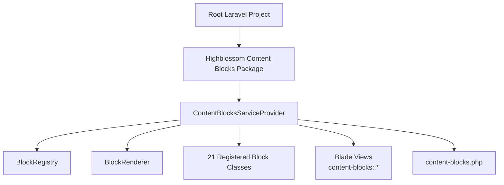
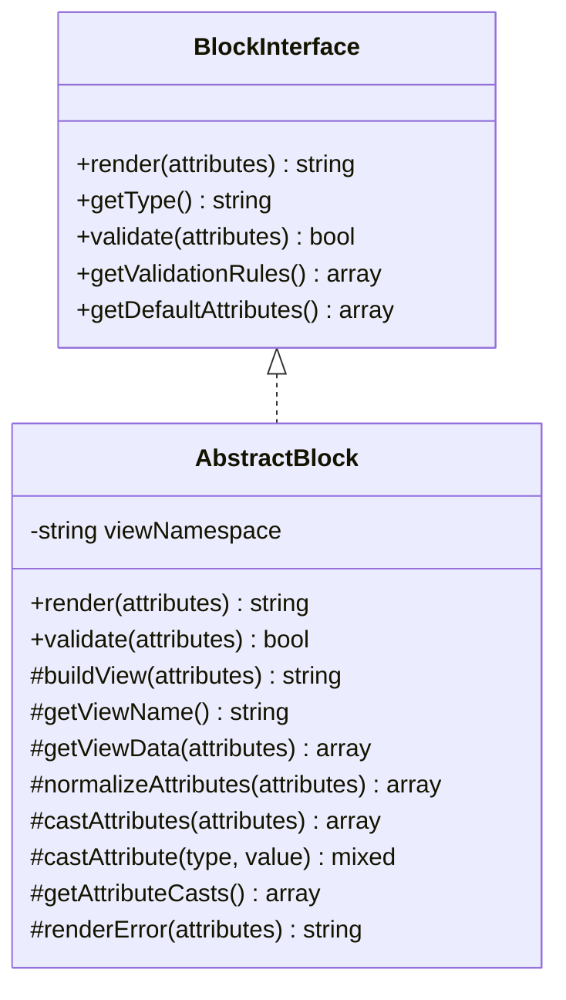
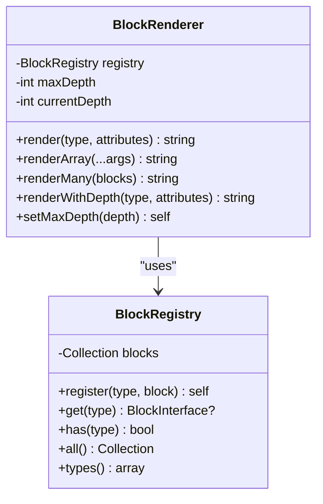
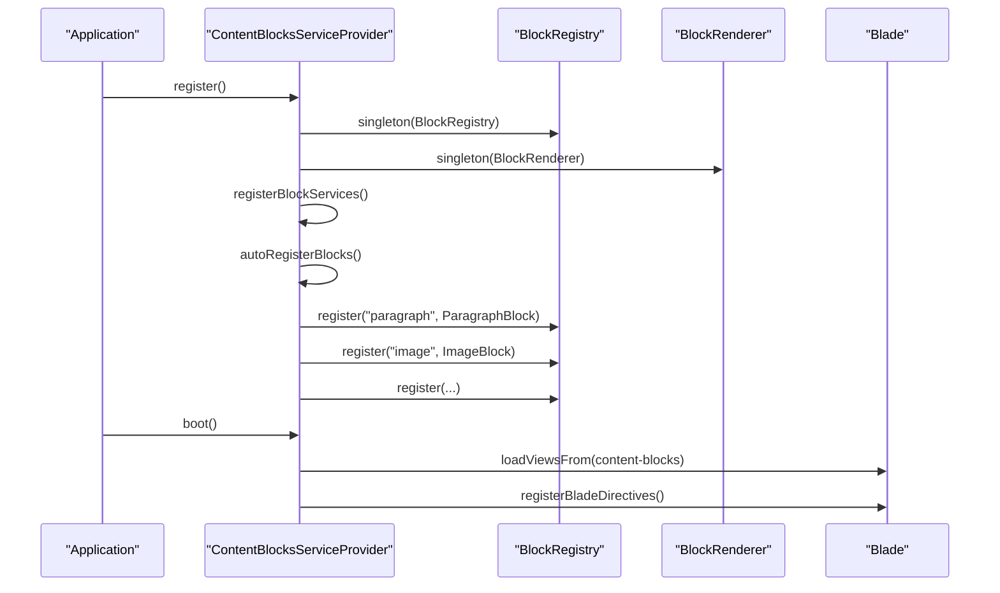
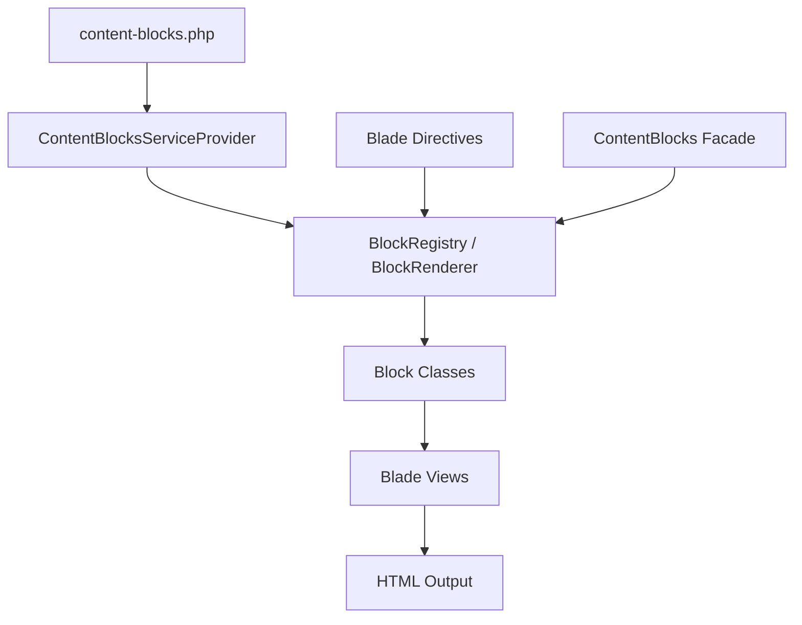
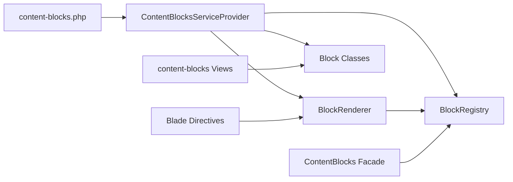

# Pre-built Block Types

<cite>
**Referenced Files in This Document**
- [composer.json](file://composer.json)
- [packages/ContentBlocks/composer.json](file://packages/ContentBlocks/composer.json)
- [packages/ContentBlocks/README.md](file://packages/ContentBlocks/README.md)
- [packages/ContentBlocks/config/content-blocks.php](file://packages/ContentBlocks/config/content-blocks.php)
- [packages/ContentBlocks/src/ContentBlocksServiceProvider.php](file://packages/ContentBlocks/src/ContentBlocksServiceProvider.php)
- [packages/ContentBlocks/src/Contracts/BlockInterface.php](file://packages/ContentBlocks/src/Contracts/BlockInterface.php)
- [packages/ContentBlocks/src/Services/AbstractBlock.php](file://packages/ContentBlocks/src/Services/AbstractBlock.php)
- [packages/ContentBlocks/src/Services/BlockRegistry.php](file://packages/ContentBlocks/src/Services/BlockRegistry.php)
- [packages/ContentBlocks/src/Services/BlockRenderer.php](file://packages/ContentBlocks/src/Services/BlockRenderer.php)
- [packages/ContentBlocks/src/Facades/ContentBlocks.php](file://packages/ContentBlocks/src/Facades/ContentBlocks.php)
- [packages/ContentBlocks/src/Services/HtmlSanitizer.php](file://packages/ContentBlocks/src/Services/HtmlSanitizer.php)
- [packages/ContentBlocks/src/Services/OEmbedResolver.php](file://packages/ContentBlocks/src/Services/OEmbedResolver.php)
- [packages/ContentBlocks/resources/views/accordion.blade.php](file://packages/ContentBlocks/resources/views/accordion.blade.php)
- [packages/ContentBlocks/resources/views/alert.blade.php](file://packages/ContentBlocks/resources/views/alert.blade.php)
- [packages/ContentBlocks/resources/views/carousel.blade.php](file://packages/ContentBlocks/resources/views/carousel.blade.php)
- [packages/ContentBlocks/resources/views/code.blade.php](file://packages/ContentBlocks/resources/views/code.blade.php)
- [packages/ContentBlocks/resources/views/columns.blade.php](file://packages/ContentBlocks/resources/views/columns.blade.php)
- [packages/ContentBlocks/resources/views/countdown.blade.php](file://packages/ContentBlocks/resources/views/countdown.blade.php)
- [packages/ContentBlocks/resources/views/cta.blade.php](file://packages/ContentBlocks/resources/views/cta.blade.php)
- [packages/ContentBlocks/resources/views/divider.blade.php](file://packages/ContentBlocks/resources/views/divider.blade.php)
- [packages/ContentBlocks/resources/views/embed.blade.php](file://packages/ContentBlocks/resources/views/embed.blade.php)
- [packages/ContentBlocks/resources/views/form.blade.php](file://packages/ContentBlocks/resources/views/form.blade.php)
- [packages/ContentBlocks/resources/views/gallery.blade.php](file://packages/ContentBlocks/resources/views/gallery.blade.php)
- [packages/ContentBlocks/resources/views/heading.blade.php](file://packages/ContentBlocks/resources/views/heading.blade.php)
- [packages/ContentBlocks/resources/views/html.blade.php](file://packages/ContentBlocks/resources/views/html.blade.php)
- [packages/ContentBlocks/resources/views/image.blade.php](file://packages/ContentBlocks/resources/views/image.blade.php)
- [packages/ContentBlocks/resources/views/list.blade.php](file://packages/ContentBlocks/resources/views/list.blade.php)
- [packages/ContentBlocks/resources/views/paragraph.blade.php](file://packages/ContentBlocks/resources/views/paragraph.blade.php)
- [packages/ContentBlocks/resources/views/poll.blade.php](file://packages/ContentBlocks/resources/views/poll.blade.php)
- [packages/ContentBlocks/resources/views/quote.blade.php](file://packages/ContentBlocks/resources/views/quote.blade.php)
- [packages/ContentBlocks/resources/views/table.blade.php](file://packages/ContentBlocks/resources/views/table.blade.php)
- [packages/ContentBlocks/resources/views/tabs.blade.php](file://packages/ContentBlocks/resources/views/tabs.blade.php)
- [packages/ContentBlocks/resources/views/video.blade.php](file://packages/ContentBlocks/resources/views/video.blade.php)
</cite>

## Table of Contents
1. [Introduction](#introduction)
2. [Project Structure](#project-structure)
3. [Core Components](#core-components)
4. [Architecture Overview](#architecture-overview)
5. [Pre-built Block Types](#pre-built-block-types)
6. [Dependency Analysis](#dependency-analysis)
7. [Performance Considerations](#performance-considerations)
8. [Troubleshooting Guide](#troubleshooting-guide)
9. [Conclusion](#conclusion)
10. [Appendices](#appendices)

## Introduction
This document describes the 21 pre-built content block types provided by the Highblossom Content Blocks system. Each block type is a registered Blade-rendered component with validation, default attributes, and optional type casting. The blocks are grouped into structural, media, content, interactive, and utility categories. For every block, this guide explains purpose, configuration parameters, Blade template structure, styling customization, common use cases, accessibility considerations, responsive behavior, and performance tips.

The system supports:
- Singleton block services for performance.
- Blade directives such as `@cbParagraph`, `@cbImage`, and a generic `@block` directive.
- A facade-based API for programmatic rendering.
- Automatic view resolution from the package’s Blade namespace.
- HTML sanitization and oEmbed resolution for advanced blocks.

## Project Structure
The Highblossom Content Blocks package is referenced by the root project through Composer, and it registers its service provider, views, configuration, and 21 block types automatically.

**Diagram sources**
- [composer.json:1-138](file://composer.json#L1-L138)
- [packages/ContentBlocks/composer.json:1-31](file://packages/ContentBlocks/composer.json#L1-L31)
- [packages/ContentBlocks/src/ContentBlocksServiceProvider.php:1-199](file://packages/ContentBlocks/src/ContentBlocksServiceProvider.php#L1-L199)

**Section sources**
- [composer.json:1-138](file://composer.json#L1-L138)
- [packages/ContentBlocks/composer.json:1-31](file://packages/ContentBlocks/composer.json#L1-L31)
- [packages/ContentBlocks/src/ContentBlocksServiceProvider.php:1-199](file://packages/ContentBlocks/src/ContentBlocksServiceProvider.php#L1-L199)

## Core Components
The Content Blocks system centers around a small set of core components that all block types extend or use.

### Interface and Base Class
- `BlockInterface` defines the contract for render, type identification, validation rules, and default attributes.
- `AbstractBlock` implements shared rendering logic, attribute normalization, type casting, view building, and error handling. It also provides logging for validation and rendering failures.

**Diagram sources**
- [packages/ContentBlocks/src/Contracts/BlockInterface.php:1-36](file://packages/ContentBlocks/src/Contracts/BlockInterface.php#L1-L36)
- [packages/ContentBlocks/src/Services/AbstractBlock.php:1-162](file://packages/ContentBlocks/src/Services/AbstractBlock.php#L1-L162)

### Registry and Renderer
- `BlockRegistry` stores registered block instances and exposes methods to get, check, list, and enumerate block types.
- `BlockRenderer` resolves a block by type and renders it. It also supports batch rendering and depth tracking to avoid excessive nesting.

**Diagram sources**
- [packages/ContentBlocks/src/Services/BlockRegistry.php:1-66](file://packages/ContentBlocks/src/Services/BlockRegistry.php#L1-L66)
- [packages/ContentBlocks/src/Services/BlockRenderer.php:1-96](file://packages/ContentBlocks/src/Services/BlockRenderer.php#L1-L96)

### Facade and Service Provider
- `ContentBlocks` facade delegates to `BlockRegistry`.
- `ContentBlocksServiceProvider` registers singleton services, auto-registers all 21 block types, loads Blade views, publishes configuration, and generates Blade directives.

**Diagram sources**
- [packages/ContentBlocks/src/ContentBlocksServiceProvider.php:1-199](file://packages/ContentBlocks/src/ContentBlocksServiceProvider.php#L1-L199)
- [packages/ContentBlocks/src/Facades/ContentBlocks.php:1-29](file://packages/ContentBlocks/src/Facades/ContentBlocks.php#L1-L29)

**Section sources**
- [packages/ContentBlocks/src/Contracts/BlockInterface.php:1-36](file://packages/ContentBlocks/src/Contracts/BlockInterface.php#L1-L36)
- [packages/ContentBlocks/src/Services/AbstractBlock.php:1-162](file://packages/ContentBlocks/src/Services/AbstractBlock.php#L1-L162)
- [packages/ContentBlocks/src/Services/BlockRegistry.php:1-66](file://packages/ContentBlocks/src/Services/BlockRegistry.php#L1-L66)
- [packages/ContentBlocks/src/Services/BlockRenderer.php:1-96](file://packages/ContentBlocks/src/Services/BlockRenderer.php#L1-L96)
- [packages/ContentBlocks/src/Facades/ContentBlocks.php:1-29](file://packages/ContentBlocks/src/Facades/ContentBlocks.php#L1-L29)
- [packages/ContentBlocks/src/ContentBlocksServiceProvider.php:1-199](file://packages/ContentBlocks/src/ContentBlocksServiceProvider.php#L1-L199)

## Architecture Overview
The architecture follows a layered approach:

1. **Configuration layer**: `content-blocks.php` controls directive prefix, view namespace, auto-registration, caching, debug mode, temp cleanup, HTML sanitizer settings, oEmbed providers, and form behavior.
2. **Service layer**: Singletons provide block registration, rendering, HTML sanitization, and oEmbed resolution.
3. **Block layer**: Each block implements `BlockInterface`, extends `AbstractBlock`, defines validation rules, defaults, casts, and optional view data.
4. **Presentation layer**: Blade templates under the `content-blocks` namespace render each block.
5. **Integration layer**: Blade directives (`@cb*`) and the `@block` directive expose rendering in templates; the facade exposes programmatic access.

**Diagram sources**
- [packages/ContentBlocks/config/content-blocks.php:1-140](file://packages/ContentBlocks/config/content-blocks.php#L1-L140)
- [packages/ContentBlocks/src/ContentBlocksServiceProvider.php:1-199](file://packages/ContentBlocks/src/ContentBlocksServiceProvider.php#L1-L199)

## Pre-built Block Types
Below are the 21 built-in block types. For each block:
- Purpose explains when to use it.
- Configuration lists required and optional parameters.
- Blade template structure describes what the view expects.
- Styling customization shows how to adjust appearance.
- Common use cases illustrate typical layouts.
- Accessibility covers important semantics and keyboard/screen-reader behavior.
- Responsive behavior describes layout on small screens.
- Performance tips address rendering and asset concerns.

### Structural Blocks

#### Columns Block
- Purpose: Split content into responsive columns.
- Configuration:
  - `columns`: Array of column items, each containing content and optional classes.
  - `gap`: Column gap spacing.
  - `class`: Container CSS class names.
- Blade template structure: Renders a container with multiple column sections based on the `columns` array.
- Styling customization: Use `class` and Tailwind-style utilities to control gaps, alignment, and widths.
- Common use cases: Two-column feature comparison, sidebar-like layouts, multi-column content sections.
- Accessibility: Ensure each column contains logical semantic elements; avoid relying only on visual ordering.
- Responsive behavior: Columns typically collapse to stacked single-column layout on narrow screens.
- Performance tips: Limit the number of nested blocks per column; prefer lightweight content in many columns.

**Section sources**
- [packages/ContentBlocks/src/ContentBlocksServiceProvider.php:1-199](file://packages/ContentBlocks/src/ContentBlocksServiceProvider.php#L1-L199)
- [packages/ContentBlocks/resources/views/columns.blade.php](file://packages/ContentBlocks/resources/views/columns.blade.php)

#### Tabs Block
- Purpose: Organize related content into tabbed panels.
- Configuration:
  - `tabs`: Array of tab entries with label and content.
  - `active_index`: Index of the initially active tab.
  - `class`: Container CSS class names.
- Blade template structure: Renders tab headers and corresponding content panels.
- Styling customization: Style headers and panels via `class`; apply theme utilities to highlight the active tab.
- Common use cases: FAQ sections, documentation tabs, feature groupings.
- Accessibility: Provide `tablist`, `tab`, and `tabpanel` semantics; ensure keyboard navigation between tabs.
- Responsive behavior: Tabs may stack vertically or convert to an accordion on small screens depending on implementation.
- Performance tips: Avoid heavy widgets inside inactive tabs; defer nonessential scripts where possible.

**Section sources**
- [packages/ContentBlocks/src/ContentBlocksServiceProvider.php:1-199](file://packages/ContentBlocks/src/ContentBlocksServiceProvider.php#L1-L199)
- [packages/ContentBlocks/resources/views/tabs.blade.php](file://packages/ContentBlocks/resources/views/tabs.blade.php)

#### Accordion Block
- Purpose: Show collapsible content sections to reduce page density.
- Configuration:
  - `items`: Array of accordion entries with title and body.
  - `allow_multiple`: Whether multiple panels can be open simultaneously.
  - `class`: Container CSS class names.
- Blade template structure: Renders trigger buttons and collapsible content regions.
- Styling customization: Style headings and expand/collapse states using `class`.
- Common use cases: Expandable policies, detailed specifications, help sections.
- Accessibility: Use `button` triggers with `aria-expanded`; associate panels with `aria-labelledby`.
- Responsive behavior: Panels expand full-width; keep panel content concise on mobile.
- Performance tips: Keep panel content light; avoid embedding large media directly in collapsed sections.

**Section sources**
- [packages/ContentBlocks/src/ContentBlocksServiceProvider.php:1-199](file://packages/ContentBlocks/src/ContentBlocksServiceProvider.php#L1-L199)
- [packages/ContentBlocks/resources/views/accordion.blade.php](file://packages/ContentBlocks/resources/views/accordion.blade.php)

### Media Blocks

#### Image Block
- Purpose: Display images with optional captions and sizing.
- Configuration:
  - `src`: Required image source URL.
  - `alt`: Optional alt text.
  - `caption`: Optional caption text.
  - `width`: Optional width in pixels.
  - `height`: Optional height in pixels.
  - `class`: Optional CSS class names.
- Blade template structure: Renders an image element, optionally wrapped with a caption container.
- Styling customization: Control dimensions and layout via `width`, `height`, and `class`.
- Common use cases: Product photos, hero images, illustrative figures.
- Accessibility: Always provide meaningful `alt` text; include captions for descriptive context.
- Responsive behavior: Images should scale within their container; consider aspect-ratio utilities.
- Performance tips: Use appropriately sized images; enable lazy loading if supported by the view.

**Section sources**
- [packages/ContentBlocks/README.md:1-200](file://packages/ContentBlocks/README.md#L1-L200)
- [packages/ContentBlocks/resources/views/image.blade.php](file://packages/ContentBlocks/resources/views/image.blade.php)

#### Video Block
- Purpose: Embed local or remote videos with playback controls.
- Configuration:
  - `src`: Required video source URL.
  - `type`: Optional MIME type.
  - `poster`: Optional poster image URL.
  - `autoplay`: Optional autoplay flag.
  - `controls`: Optional controls visibility.
  - `class`: Optional CSS class names.
- Blade template structure: Renders a `<video>` element with optional poster and controls.
- Styling customization: Apply `class` for container sizing and positioning.
- Common use cases: Promotional videos, tutorials, embedded media.
- Accessibility: Include captions or transcripts externally; provide controls for user choice.
- Responsive behavior: Videos should fit container width; consider aspect-ratio wrappers.
- Performance tips: Avoid autoplay unless necessary; preload strategically; compress video files.

**Section sources**
- [packages/ContentBlocks/README.md:1-200](file://packages/ContentBlocks/README.md#L1-L200)
- [packages/ContentBlocks/resources/views/video.blade.php](file://packages/ContentBlocks/resources/views/video.blade.php)

#### Gallery Block
- Purpose: Display a collection of images, often with navigation or lightbox behavior.
- Configuration:
  - `images`: Array of image entries with URLs and metadata.
  - `layout`: Grid or carousel layout option.
  - `class`: Container CSS class names.
- Blade template structure: Renders a grid or carousel of images with optional navigation controls.
- Styling customization: Adjust grid spacing, thumbnail sizes, and overlay styles via `class`.
- Common use cases: Portfolio galleries, photo showcases, before-and-after comparisons.
- Accessibility: Provide alt text for each image; ensure keyboard navigation between gallery items.
- Responsive behavior: Thumbnails reflow into fewer columns or a swipeable carousel on mobile.
- Performance tips: Lazy-load thumbnails; optimize image sizes; defer heavy lightbox scripts.

**Section sources**
- [packages/ContentBlocks/src/ContentBlocksServiceProvider.php:1-199](file://packages/ContentBlocks/src/ContentBlocksServiceProvider.php#L1-L199)
- [packages/ContentBlocks/resources/views/gallery.blade.php](file://packages/ContentBlocks/resources/views/gallery.blade.php)

### Content Blocks

#### Paragraph Block
- Purpose: Render standard prose content.
- Configuration:
  - `content`: Required paragraph text.
  - `class`: Optional CSS class names.
- Blade template structure: Renders a paragraph element with sanitized content.
- Styling customization: Use `class` to apply typography utilities.
- Common use cases: Body copy, explanatory text, article paragraphs.
- Accessibility: Maintain proper heading hierarchy before paragraphs; avoid inline formatting abuse.
- Responsive behavior: Text flows naturally; wrap long words if needed.
- Performance tips: Keep paragraphs concise; avoid excessive nested blocks inside content.

**Section sources**
- [packages/ContentBlocks/README.md:1-200](file://packages/ContentBlocks/README.md#L1-L200)
- [packages/ContentBlocks/resources/views/paragraph.blade.php](file://packages/ContentBlocks/resources/views/paragraph.blade.php)

#### Heading Block
- Purpose: Render semantic headings with controlled levels.
- Configuration:
  - `content`: Required heading text.
  - `level`: Required heading level (1–6).
  - `class`: Optional CSS class names.
- Blade template structure: Renders an appropriate `<h1>`–`<h6>` element.
- Styling customization: Use `class` for size and weight; rely on semantic level for hierarchy.
- Common use cases: Section titles, page headings, subheadings.
- Accessibility: Use one `<h1>` per page; maintain logical heading order.
- Responsive behavior: Headings scale with typography settings.
- Performance tips: Minimal overhead; focus on content clarity.

**Section sources**
- [packages/ContentBlocks/README.md:1-200](file://packages/ContentBlocks/README.md#L1-L200)
- [packages/ContentBlocks/resources/views/heading.blade.php](file://packages/ContentBlocks/resources/views/heading.blade.php)

#### List Block
- Purpose: Render ordered or unordered lists.
- Configuration:
  - `items`: Required array of list items.
  - `type`: Required list type (`ordered` or `unordered`).
  - `class`: Optional CSS class names.
- Blade template structure: Renders `<ol>` or `<ul>` with list item elements.
- Styling customization: Style lists via `class`; customize bullet or numbering styles.
- Common use cases: Feature lists, steps, requirements, menu items.
- Accessibility: Use semantic list markup; describe complex lists with surrounding context.
- Responsive behavior: Lists flow naturally; indent carefully on small screens.
- Performance tips: Avoid deeply nested lists; keep items concise.

**Section sources**
- [packages/ContentBlocks/README.md:1-200](file://packages/ContentBlocks/README.md#L1-L200)
- [packages/ContentBlocks/resources/views/list.blade.php](file://packages/ContentBlocks/resources/views/list.blade.php)

#### Quote Block
- Purpose: Highlight quotations or testimonials.
- Configuration:
  - `content`: Required quote text.
  - `author`: Optional author name.
  - `cite`: Optional citation URL.
  - `class`: Optional CSS class names.
- Blade template structure: Renders a blockquote element with optional attribution.
- Styling customization: Use `class` to style quotation marks, borders, and attribution.
- Common use cases: Testimonials, pull quotes, references.
- Accessibility: Use `<blockquote>` and cite link semantics; provide readable attribution.
- Responsive behavior: Quotes adapt to container width; avoid excessive indentation.
- Performance tips: Lightweight; focus on readability and contrast.

**Section sources**
- [packages/ContentBlocks/README.md:1-200](file://packages/ContentBlocks/README.md#L1-L200)
- [packages/ContentBlocks/resources/views/quote.blade.php](file://packages/ContentBlocks/resources/views/quote.blade.php)

### Interactive Blocks

#### Form Block
- Purpose: Collect user input and submit it according to configured behavior.
- Configuration:
  - `fields`: Array of form field definitions.
  - `action`: Submission endpoint or handler reference.
  - `submit_text`: Submit button label.
  - `class`: Container CSS class names.
- Blade template structure: Renders a form with dynamic fields and submission controls.
- Styling customization: Style inputs, labels, and containers via `class`.
- Common use cases: Contact forms, feedback forms, lead capture.
- Accessibility: Associate labels with inputs; provide validation messages; ensure keyboard navigability.
- Responsive behavior: Fields stack vertically on small screens; validate inline.
- Performance tips: Minimize client-side validation overhead; handle server-side validation securely.

**Section sources**
- [packages/ContentBlocks/config/content-blocks.php:1-140](file://packages/ContentBlocks/config/content-blocks.php#L1-L140)
- [packages/ContentBlocks/resources/views/form.blade.php](file://packages/ContentBlocks/resources/views/form.blade.php)

#### Poll Block
- Purpose: Allow users to vote on predefined options.
- Configuration:
  - `question`: Poll question text.
  - `options`: Array of poll choices.
  - `class`: Container CSS class names.
- Blade template structure: Renders question and selectable options with result visualization.
- Styling customization: Style option buttons and results via `class`.
- Common use cases: Surveys, quick feedback polls, event voting.
- Accessibility: Use radio inputs for single-choice polls; announce results clearly.
- Responsive behavior: Options stack on small screens; results scale proportionally.
- Performance tips: Defer polling scripts; cache results where appropriate.

**Section sources**
- [packages/ContentBlocks/src/ContentBlocksServiceProvider.php:1-199](file://packages/ContentBlocks/src/ContentBlocksServiceProvider.php#L1-L199)
- [packages/ContentBlocks/resources/views/poll.blade.php](file://packages/ContentBlocks/resources/views/poll.blade.php)

#### Countdown Block
- Purpose: Display a countdown timer toward a target date or event.
- Configuration:
  - `target_date`: Target timestamp or date string.
  - `label`: Optional label for the countdown.
  - `class`: Container CSS class names.
- Blade template structure: Renders time units and a live updating countdown display.
- Styling customization: Style time units and labels via `class`.
- Common use cases: Launch events, promotions, deadlines.
- Accessibility: Announce remaining time changes; avoid flashing animations.
- Responsive behavior: Time units wrap gracefully; keep labels concise.
- Performance tips: Avoid frequent DOM updates; throttle timer intervals.

**Section sources**
- [packages/ContentBlocks/src/ContentBlocksServiceProvider.php:1-199](file://packages/ContentBlocks/src/ContentBlocksServiceProvider.php#L1-L199)
- [packages/ContentBlocks/resources/views/countdown.blade.php](file://packages/ContentBlocks/resources/views/countdown.blade.php)

### Utility Blocks

#### Divider Block
- Purpose: Visually separate content sections.
- Configuration:
  - `class`: Optional CSS class names.
- Blade template structure: Renders a horizontal rule or styled separator.
- Styling customization: Adjust thickness, color, and spacing via `class`.
- Common use cases: Section breaks, card separators, content dividers.
- Accessibility: Use semantic divider elements; avoid decorative-only dividers without aria-hidden when appropriate.
- Responsive behavior: Full-width separator; adapts to container padding.
- Performance tips: Minimal cost; purely presentational.

**Section sources**
- [packages/ContentBlocks/src/ContentBlocksServiceProvider.php:1-199](file://packages/ContentBlocks/src/ContentBlocksServiceProvider.php#L1-L199)
- [packages/ContentBlocks/resources/views/divider.blade.php](file://packages/ContentBlocks/resources/views/divider.blade.php)

#### Code Block
- Purpose: Display code snippets with optional language hints.
- Configuration:
  - `content`: Required code content.
  - `language`: Optional programming language.
  - `class`: Optional CSS class names.
- Blade template structure: Renders a code block with syntax highlighting support.
- Styling customization: Style code font, background, and padding via `class`.
- Common use cases: Documentation, developer guides, technical notes.
- Accessibility: Provide accessible code descriptions; avoid relying solely on color for meaning.
- Responsive behavior: Enable horizontal scrolling for long lines; wrap when appropriate.
- Performance tips: Load syntax highlighters lazily; minimize large code blocks.

**Section sources**
- [packages/ContentBlocks/README.md:1-200](file://packages/ContentBlocks/README.md#L1-L200)
- [packages/ContentBlocks/resources/views/code.blade.php](file://packages/ContentBlocks/resources/views/code.blade.php)

#### Embed Block
- Purpose: Embed third-party content via oEmbed providers.
- Configuration:
  - `url`: Source URL for embeddable content.
  - `max_width`: Maximum embed width.
  - `class`: Container CSS class names.
- Blade template structure: Resolves oEmbed metadata and renders an iframe or provider-specific embed.
- Styling customization: Control embed dimensions and wrapper styles via `class` and `max_width`.
- Common use cases: Social posts, videos, articles from external platforms.
- Accessibility: Respect provider semantics; ensure focus management for embedded players.
- Responsive behavior: Embed scales within container; honor max width constraints.
- Performance tips: Cache oEmbed responses; defer loading until visible.

**Section sources**
- [packages/ContentBlocks/config/content-blocks.php:1-140](file://packages/ContentBlocks/config/content-blocks.php#L1-L140)
- [packages/ContentBlocks/resources/views/embed.blade.php](file://packages/ContentBlocks/resources/views/embed.blade.php)

#### Table Block
- Purpose: Present tabular data with headers and rows.
- Configuration:
  - `headers`: Array of column headers.
  - `rows`: Array of row arrays.
  - `class`: Container CSS class names.
- Blade template structure: Renders a table with header and body sections.
- Styling customization: Style cells, borders, and headers via `class`.
- Common use cases: Pricing tables, comparison matrices, data summaries.
- Accessibility: Use `<th>` and `<td>` correctly; provide captions for complex tables.
- Responsive behavior: Tables scroll horizontally or convert to cards on small screens.
- Performance tips: Avoid overly large datasets; paginate or virtualize if needed.

**Section sources**
- [packages/ContentBlocks/src/ContentBlocksServiceProvider.php:1-199](file://packages/ContentBlocks/src/ContentBlocksServiceProvider.php#L1-L199)
- [packages/ContentBlocks/resources/views/table.blade.php](file://packages/ContentBlocks/resources/views/table.blade.php)

#### Alert Block
- Purpose: Display contextual alerts or notifications.
- Configuration:
  - `message`: Alert message content.
  - `type`: Alert severity or style type.
  - `class`: Container CSS class names.
- Blade template structure: Renders an alert banner with semantic role and styling variant.
- Styling customization: Change colors and icons via `class` and type variants.
- Common use cases: Success messages, warnings, errors, informational notices.
- Accessibility: Use appropriate alert roles; announce critical alerts to screen readers.
- Responsive behavior: Alerts span full width; ensure readable line lengths.
- Performance tips: Lightweight; avoid animating frequently changing alerts.

**Section sources**
- [packages/ContentBlocks/src/ContentBlocksServiceProvider.php:1-199](file://packages/ContentBlocks/src/ContentBlocksServiceProvider.php#L1-L199)
- [packages/ContentBlocks/resources/views/alert.blade.php](file://packages/ContentBlocks/resources/views/alert.blade.php)

#### HTML Block
- Purpose: Render safe HTML content.
- Configuration:
  - `content`: HTML string to render.
  - `class`: Optional wrapper class names.
- Blade template structure: Sanitizes and outputs provided HTML safely.
- Styling customization: Style wrapper via `class`; sanitize allows configured tags and attributes.
- Common use cases: Rich text snippets, custom layouts, legacy content.
- Accessibility: Ensure generated HTML includes proper semantics and ARIA attributes.
- Responsive behavior: Depends on inner HTML structure; constrain with container styles.
- Performance tips: Sanitize on input; avoid embedding heavy scripts in untrusted HTML.

**Section sources**
- [packages/ContentBlocks/config/content-blocks.php:1-140](file://packages/ContentBlocks/config/content-blocks.php#L1-L140)
- [packages/ContentBlocks/resources/views/html.blade.php](file://packages/ContentBlocks/resources/views/html.blade.php)

#### CTA Block
- Purpose: Drive user action with a prominent call-to-action.
- Configuration:
  - `title`: CTA headline.
  - `description`: Optional supporting text.
  - `button_text`: Button label.
  - `button_url`: Destination URL.
  - `class`: Container CSS class names.
- Blade template structure: Renders headline, description, and a primary action button.
- Styling customization: Style headline, description, and button via `class`.
- Common use cases: Signup prompts, purchase actions, trial sign-ups.
- Accessibility: Ensure link/button has clear label and focus state.
- Responsive behavior: Button stacks below text on small screens; center alignment common.
- Performance tips: Lightweight; avoid unnecessary interactions.

**Section sources**
- [packages/ContentBlocks/README.md:1-200](file://packages/ContentBlocks/README.md#L1-L200)
- [packages/ContentBlocks/resources/views/cta.blade.php](file://packages/ContentBlocks/resources/views/cta.blade.php)

#### Carousel Block
- Purpose: Showcase rotating content slides with navigation.
- Configuration:
  - `slides`: Array of slide entries with content and metadata.
  - `autoplay`: Optional autoplay toggle.
  - `interval`: Slide transition interval.
  - `class`: Container CSS class names.
- Blade template structure: Renders slides with prev/next controls and optional indicators.
- Styling customization: Style slide containers, indicators, and transitions via `class`.
- Common use cases: Hero carousels, product showcases, announcements.
- Accessibility: Pause autoplay on interaction; provide keyboard controls for slides.
- Responsive behavior: Slides fill viewport width; indicators become minimal on mobile.
- Performance tips: Lazy-load slide media; avoid too many slides.

**Section sources**
- [packages/ContentBlocks/src/ContentBlocksServiceProvider.php:1-199](file://packages/ContentBlocks/src/ContentBlocksServiceProvider.php#L1-L199)
- [packages/ContentBlocks/resources/views/carousel.blade.php](file://packages/ContentBlocks/resources/views/carousel.blade.php)

## Dependency Analysis
The following diagram maps dependencies among core services, block registration, and Blade integration.

**Diagram sources**
- [packages/ContentBlocks/config/content-blocks.php:1-140](file://packages/ContentBlocks/config/content-blocks.php#L1-L140)
- [packages/ContentBlocks/src/ContentBlocksServiceProvider.php:1-199](file://packages/ContentBlocks/src/ContentBlocksServiceProvider.php#L1-L199)
- [packages/ContentBlocks/src/Services/BlockRegistry.php:1-66](file://packages/ContentBlocks/src/Services/BlockRegistry.php#L1-L66)
- [packages/ContentBlocks/src/Services/BlockRenderer.php:1-96](file://packages/ContentBlocks/src/Services/BlockRenderer.php#L1-L96)
- [packages/ContentBlocks/src/Facades/ContentBlocks.php:1-29](file://packages/ContentBlocks/src/Facades/ContentBlocks.php#L1-L29)

**Section sources**
- [packages/ContentBlocks/src/ContentBlocksServiceProvider.php:1-199](file://packages/ContentBlocks/src/ContentBlocksServiceProvider.php#L1-L199)
- [packages/ContentBlocks/src/Services/BlockRegistry.php:1-66](file://packages/ContentBlocks/src/Services/BlockRegistry.php#L1-L66)
- [packages/ContentBlocks/src/Services/BlockRenderer.php:1-96](file://packages/ContentBlocks/src/Services/BlockRenderer.php#L1-L96)
- [packages/ContentBlocks/src/Facades/ContentBlocks.php:1-29](file://packages/ContentBlocks/src/Facades/ContentBlocks.php#L1-L29)

## Performance Considerations
- Use singleton block services: All block classes are registered as singletons for reduced instantiation overhead.
- Prefer static content where possible: Avoid heavy JavaScript-heavy blocks on pages with many blocks.
- Cache oEmbed responses: The oEmbed resolver supports configurable providers; caching reduces network calls.
- Optimize media: Compress images and videos; use lazy loading; set explicit dimensions to prevent layout shifts.
- Limit nesting depth: The renderer tracks nesting depth to prevent excessive recursion.
- Disable debug mode in production: Invalid blocks render empty strings when debug mode is off, reducing noisy output.
- Configure HTML sanitization wisely: Restrict allowed tags and attributes to minimize processing overhead.
- Batch rendering: Use batch rendering APIs to render multiple blocks efficiently.

[No sources needed since this section provides general guidance]

## Troubleshooting Guide
Common issues and resolutions:

- Unknown block type rendered as comment:
  - Cause: Rendering an unregistered block type.
  - Resolution: Register the block type or verify the type string passed to the renderer.
- Validation failure produces no output:
  - Cause: Missing required attributes or invalid attribute values.
  - Resolution: Check validation rules and provide required parameters; enable debug mode to inspect errors.
- Blade directive not recognized:
  - Cause: Directive prefix mismatch or missing package registration.
  - Resolution: Verify directive prefix configuration and ensure the service provider is loaded.
- HTML block strips unexpected tags:
  - Cause: Sanitizer configuration restricts allowed tags and attributes.
  - Resolution: Adjust sanitizer settings to permit required tags safely.
- oEmbed fails to resolve:
  - Cause: Provider pattern or endpoint misconfiguration.
  - Resolution: Review oEmbed provider patterns and endpoints in configuration.

**Section sources**
- [packages/ContentBlocks/src/Services/AbstractBlock.php:1-162](file://packages/ContentBlocks/src/Services/AbstractBlock.php#L1-L162)
- [packages/ContentBlocks/src/Services/BlockRenderer.php:1-96](file://packages/ContentBlocks/src/Services/BlockRenderer.php#L1-L96)
- [packages/ContentBlocks/config/content-blocks.php:1-140](file://packages/ContentBlocks/config/content-blocks.php#L1-L140)

## Conclusion
The Highblossom Content Blocks system provides a robust, extensible foundation for building rich page content through 21 pre-built block types. Its architecture separates configuration, service registration, block logic, and Blade presentation while offering secure sanitization and flexible embedding. By following the configuration guidelines, accessibility recommendations, and performance tips in this document, you can compose reliable, accessible, and high-performing content layouts across devices.

[No sources needed since this section summarizes without analyzing specific files]

## Appendices

### Blade Directives and Usage Patterns
- Per-type directives: `@cbParagraph`, `@cbHeading`, `@cbImage`, `@cbQuote`, `@cbCode`, `@cbList`, `@cbCta`, `@cbVideo`.
- Generic directive: `@block(type, attributes)` for dynamic rendering.
- Facade usage: `ContentBlocks::render('type', $attributes)`.

**Section sources**
- [packages/ContentBlocks/README.md:1-200](file://packages/ContentBlocks/README.md#L1-L200)
- [packages/ContentBlocks/src/ContentBlocksServiceProvider.php:1-199](file://packages/ContentBlocks/src/ContentBlocksServiceProvider.php#L1-L199)
- [packages/ContentBlocks/src/Facades/ContentBlocks.php:1-29](file://packages/ContentBlocks/src/Facades/ContentBlocks.php#L1-L29)