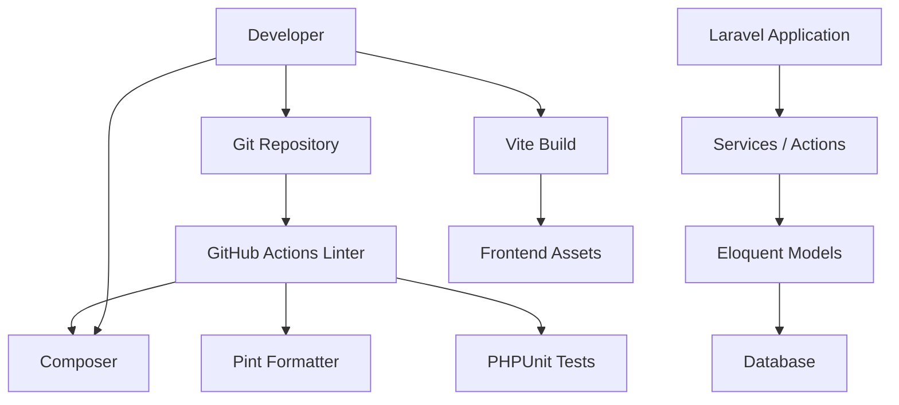
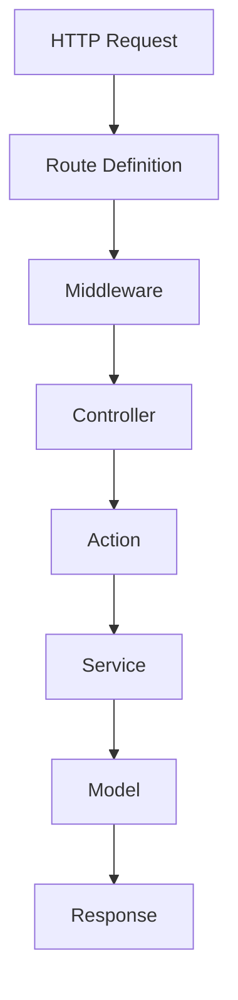
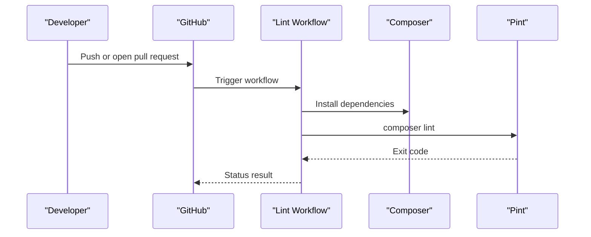
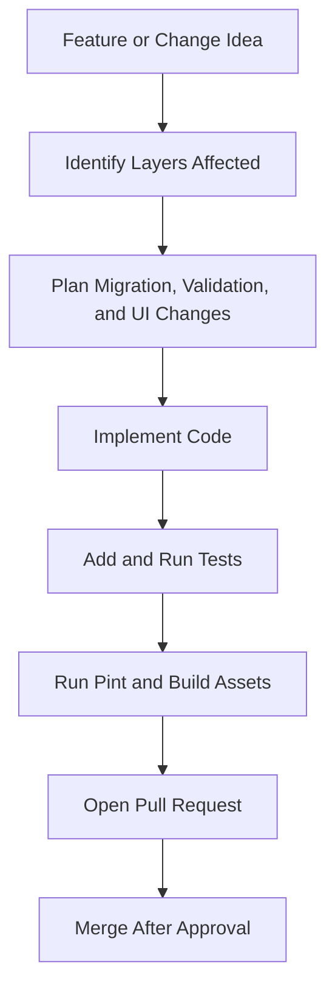
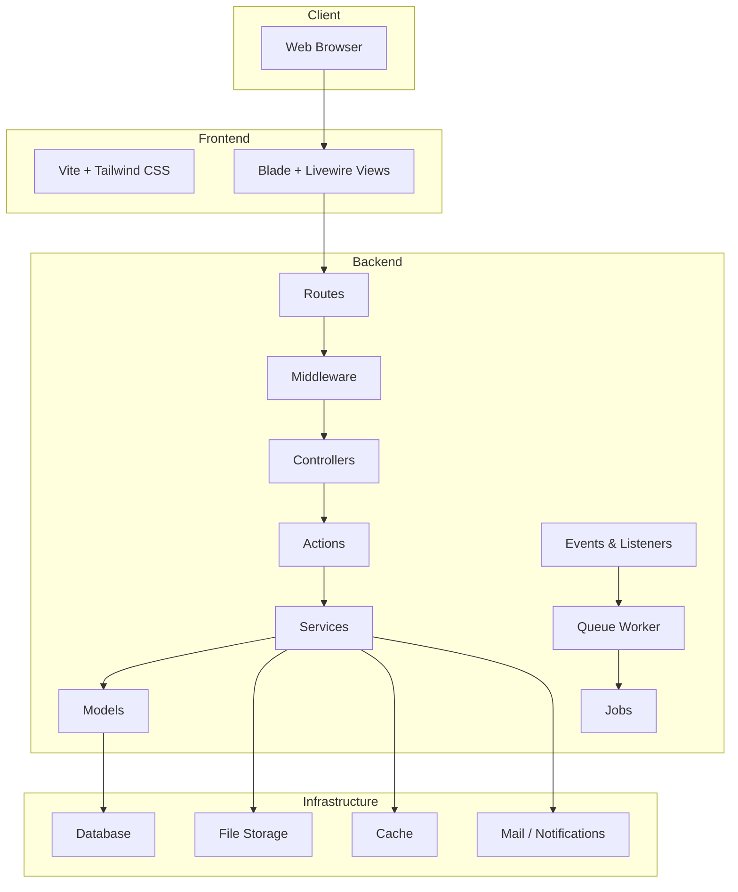

# Contributing Guidelines

<cite>
**Referenced Files in This Document**   
- [CONVENTIONS.md](file://CONVENTIONS.md)
- [DESIGN.md](file://DESIGN.md)
- [AGENTS.md](file://AGENTS.md)
- [CLAUDE.md](file://CLAUDE.md)
- [pint.json](file://pint.json)
- [composer.json](file://composer.json)
- [package.json](file://package.json)
- [.editorconfig](file://.editorconfig)
- [.gitignore](file://.gitignore)
- [.github/copilot-instructions.md](file://.github/copilot-instructions.md)
- [.github/workflows/lint.yml](file://.github/workflows/lint.yml)
- [Dockerfile](file://Dockerfile)
</cite>

## Table of Contents
1. [Introduction](#introduction)
2. [Project Structure](#project-structure)
3. [Core Contribution Rules](#core-contribution-rules)
4. [Coding Conventions](#coding-conventions)
5. [Code Formatting and Quality Tools](#code-formatting-and-quality-tools)
6. [Git Workflow and Pull Requests](#git-workflow-and-pull-requests)
7. [Testing Requirements](#testing-requirements)
8. [Documentation Standards](#documentation-standards)
9. [Adding Features, Refactoring, and Backward Compatibility](#adding-features-refactoring-and-backward-compatibility)
10. [Release Process and Versioning](#release-process-and-versioning)
11. [Community Guidelines and Support](#community-guidelines-and-support)
12. [Architecture Overview](#architecture-overview)
13. [Troubleshooting Guide](#troubleshooting-guide)
14. [Conclusion](#conclusion)

## Introduction
These contributing guidelines define how developers should work on the Houblossom project. They consolidate the project’s coding conventions, formatting rules, quality gates, workflow expectations, and architectural principles into one place so contributors can make safe, reviewable changes without guessing.

Houblossom is a Laravel 13 application using PHP 8.2 or later, Livewire, Vite, Tailwind CSS, Fortify authentication, Spatie Permissions, and a local `packages/ContentBlocks` package. The backend architecture follows a clear flow: **Route → Middleware → Controller → Service → Model**. Frontend assets are built with Vite and Tailwind, and the design system emphasizes high contrast, accessibility tokens, and consistent admin/site styling.

This document is not just style guidance; it is the baseline for what will be accepted during code review and automated checks.

## Project Structure
The repository follows standard Laravel conventions with additional feature-oriented directories:

| Area | Responsibility |
| --- | --- |
| `app/` | Application logic: controllers, actions, services, models, middleware, requests, resources, events, listeners, jobs, commands, providers, enums, rules, concerns, traits, and support helpers. |
| `routes/` | Web, API, admin, settings, and console route definitions. |
| `config/` | Environment-driven configuration files. |
| `database/` | Migrations, seeders, and factories. |
| `resources/` | Blade views, CSS, JavaScript, and component assets. |
| `public/` | Web entry point and compiled frontend assets. |
| `storage/` | Runtime storage, logs, cache, sessions, and framework caches. |
| `lang/lang/en/` | English language translations. |
| `packages/ContentBlocks/` | Local reusable content-blocks package with its own config, views, service provider, contracts, services, and tests. |
| `.github/` | GitHub Copilot instructions and CI workflows. |
| Root configuration files | Composer, NPM, Pint, EditorConfig, Dockerfile, and project documentation. |



**Diagram sources**
- [.github/workflows/lint.yml:1-50](file://.github/workflows/lint.yml#L1-L50)
- [composer.json:1-138](file://composer.json#L1-L138)
- [package.json:1-35](file://package.json#L1-L35)
- [Dockerfile:1-32](file://Dockerfile#L1-L32)

**Section sources**
- [CONVENTIONS.md:1-118](file://CONVENTIONS.md#L1-L118)
- [AGENTS.md:1-110](file://AGENTS.md#L1-L110)
- [CLAUDE.md:1-108](file://CLAUDE.md#L1-L108)

## Core Contribution Rules
Every contribution must respect these non-negotiable rules:

- Use PHP 8.2 or later and Laravel 13.
- Follow the documented flow: routes receive input, middleware handles cross-cutting concerns, controllers stay thin, business logic belongs in actions or services, and data access lives in models.
- Every PHP file must declare strict types after the opening tag.
- Docblocks are mandatory across most layers, including classes, methods, parameters, return types, and explicit throws where applicable.
- Run the formatter before committing: `vendor/bin/pint --parallel`.
- Run tests through the project script: `composer test`.
- Do not commit environment files, vendor dependencies, build output, local databases, editor state, or test configuration that is only for local development.
- Keep public-facing APIs, database schemas, permissions, roles, and user-visible behavior backward compatible unless the change is explicitly breaking and documented.

**Section sources**
- [CONVENTIONS.md:1-118](file://CONVENTIONS.md#L1-L118)
- [composer.json:1-138](file://composer.json#L1-L138)
- [.gitignore:1-78](file://.gitignore#L1-L78)

## Coding Conventions
### Backend Architecture
The application uses layered organization:

- **Routes** define endpoints under `routes/web.php`, `routes/api.php`, `routes/admin.php`, `routes/settings.php`, and `routes/console.php`.
- **Controllers** should remain thin and delegate validation, orchestration, and domain logic to higher layers.
- **Actions** encapsulate focused operations such as storing quotes, bookings, inspections, or sending notifications.
- **Services** contain reusable business logic, external integrations, media handling, SEO processing, and domain services.
- **Models** represent database entities and relationships.
- **Form Requests** validate HTTP input.
- **Livewire components** manage interactive UI state.
- **Events and Listeners** handle side effects like email delivery and session recording.
- **Jobs** run background work.
- **Commands** perform scheduled or manual maintenance tasks.
- **Middleware** handles cross-cutting request logic.
- **Providers** register services, routes, and bindings.

Complexity hotspots are tracked by the project’s analysis tools. Methods with high cyclomatic complexity should be reviewed carefully before modification.



**Diagram sources**
- [CONVENTIONS.md:1-118](file://CONVENTIONS.md#L1-L118)
- [AGENTS.md:1-110](file://AGENTS.md#L1-L110)

### Naming Patterns
- Classes use PascalCase.
- Methods and properties use camelCase.
- Constants use UPPER_SNAKE_CASE.
- Files follow PSR-4 autoloading mapped to `App\` in `app/`.
- Database tables and columns follow Laravel conventions.
- Translations live under `lang/lang/en/`.
- Blade views live under `resources/views`.
- Livewire components live under `app/Livewire`.
- Eloquent models live under `app/Models`.
- Services live under `app/Services`.
- Actions live under `app/Actions`.
- Commands live under `app/Console/Commands`.
- Enums live under `app/Enums`.
- Requests live under `app/Http/Requests`.
- Resources live under `app/Http/Resources`.
- Policies and related authorization logic should align with existing patterns in the repository.

### Docblock Requirements
Docblocks are required per layer:

| Layer | Class | Methods | Parameters | Return Type | Throws |
| --- | --- | --- | --- | --- | --- |
| Contracts and interfaces | Required | Required | Required | Required | Not required |
| Enums | Required | Required | Required | Required | Not required |
| Actions | Required | Required | Required | Required | Explicit |
| Services | Required | Required | Required | Required | Explicit |
| Models | Required | Required | Required | Required | Explicit |
| Controllers | Required | Required | Required | Required | Explicit |
| Form Requests | Required | Required | Required | Required | Not required |
| Livewire | Required | Required | Required | Required | Not required |
| Mail and notifications | Required | Required | Required | Required | Not required |
| Commands | Required | Required | Required | Required | Not required |
| Events and listeners | Required | Required | Required | Required | Not required |
| Providers and composers | Required | Required | Required | Required | Not required |

Use `@throws` only for explicit `throw` statements, `->firstOrFail()`, or `->findOrFail()` calls inside the method body. All PHP files must include `declare(strict_types=1)` after the opening tag.

The ContentBlocks package follows relaxed conventions: class and method descriptions only, without parameter, return, or throw annotations.

**Section sources**
- [CONVENTIONS.md:1-118](file://CONVENTIONS.md#L1-L118)

### Security and Validation
- Always validate user input through Form Requests or explicit validation rules.
- Avoid raw SQL queries; prefer Eloquent and query builders.
- Use Laravel security features: CSRF protection, Fortify rate limiting, file validation, authorization policies/gates, and permission checks.
- Treat uploaded media, paths, URLs, and external inputs as untrusted.
- Prefer strongly typed DTOs and enums where appropriate.

**Section sources**
- [AGENTS.md:1-110](file://AGENTS.md#L1-L110)

## Code Formatting and Quality Tools
### Pint (PHP Formatter)
Pint is configured with the Laravel preset and additional docblock rules:

- Vertical alignment for docblocks.
- Docblock separation enabled.
- Docblock summaries enabled.
- Trimming of unnecessary docblock content.
- No empty returns in docblocks.
- Scalar type hints in docblocks.
- Ordered nullable types with null last.
- Tag casing enforced.
- Inherited docblocks cleaned up.
- Self-reference return types normalized.
- Single-line variable spacing in docblocks.
- Variables without names handled.

Run formatting locally with:

```bash
vendor/bin/pint --parallel
```

Or through the Composer script:

```bash
composer lint
```

A check-only mode exists:

```bash
composer lint:check
```

### Editor Configuration
`.editorconfig` defines repository-wide formatting:

- UTF-8 encoding.
- Unix line endings.
- Four-space indentation for most files.
- Two-space indentation for YAML files.
- Four-space indentation for compose files.
- Trailing whitespace trimmed.
- Final newline inserted.
- Markdown files preserve trailing whitespace intentionally.

### Frontend Tooling
Frontend assets are built with Vite and Tailwind CSS. The NPM scripts are minimal:

| Script | Purpose |
| --- | --- |
| `npm run dev` | Start the Vite development server. |
| `npm run build` | Build production assets. |

Prettier and Blade/Tailwind plugins are available as dev dependencies.

**Section sources**
- [pint.json:1-22](file://pint.json#L1-L22)
- [.editorconfig:1-18](file://.editorconfig#L1-L18)
- [package.json:1-35](file://package.json#L1-L35)

## Git Workflow and Pull Requests
### Branch Strategy
The CI linter runs on push and pull requests targeting:

- `develop`
- `main`
- `master`
- `workos`

Contributors should create feature branches from the appropriate integration branch and open pull requests against the target branch used by the team. The repository does not enforce a single protected branch policy through the visible configuration, but `main` and `master` are both monitored by CI.

### Commit Expectations
- Make small, focused commits.
- Write clear commit messages describing what changed and why.
- Do not mix unrelated changes in one commit.
- Keep generated AI context files synchronized if they were updated manually, though most are auto-generated.

### Pull Request Checklist
Before requesting review, ensure:

- Code passes `composer lint:check`.
- All relevant tests pass via `composer test`.
- Frontend assets are rebuilt if styles or scripts changed.
- Docblocks are complete and accurate.
- Database migrations are forward-compatible and reversible when appropriate.
- Public APIs and user-visible behavior have been considered for backward compatibility.
- New routes, controllers, services, actions, models, views, translations, and permissions are documented in the PR description.
- Complexity hotspots are avoided or reduced rather than increased.

### Automated Checks
The GitHub Actions workflow installs dependencies, then runs the Composer lint script. It runs on pushes and pull requests to the listed branches.



**Diagram sources**
- [.github/workflows/lint.yml:1-50](file://.github/workflows/lint.yml#L1-L50)
- [composer.json:1-138](file://composer.json#L1-L138)

**Section sources**
- [.github/workflows/lint.yml:1-50](file://.github/workflows/lint.yml#L1-L50)
- [composer.json:1-138](file://composer.json#L1-L138)

## Testing Requirements
### Test Runner
Tests are executed through PHPUnit via Composer:

```bash
composer test
```

The test script performs three steps:

1. Clear Laravel configuration cache.
2. Run Pint in check mode.
3. Run all tests.

This means a passing `composer test` guarantees both formatting compliance and test execution.

### Where Tests Live
Test classes are autoloaded under the `Tests\` namespace according to `autoload-dev` in `composer.json`. The repository also ignores some testing artifacts at the root level, including `.phpunit.cache`, `.phpunit.result.cache`, `/tests`, and `/phpunit.xml`, which indicates local or tool-specific test configuration may exist outside committed state.

### What to Test
- Business logic in services and actions.
- Input validation through form requests.
- Database mutations through migrations and seeders.
- External integrations through mocks or fakes where appropriate.
- User-facing flows through functional or integration tests when feasible.
- Edge cases around permissions, media uploads, scheduling, and async jobs.

### Performance and Data Access
Avoid N+1 queries by using eager loading with `with()` where appropriate. Do not apply eager loading unnecessarily when data is already in memory or comes from cached settings.

**Section sources**
- [composer.json:1-138](file://composer.json#L1-L138)
- [.gitignore:1-78](file://.gitignore#L1-L78)
- [AGENTS.md:1-110](file://AGENTS.md#L1-L110)

## Documentation Standards
### Code Documentation
Docblocks are mandatory for most layers. When writing or updating code:

- Add or update class-level descriptions.
- Document every method.
- Document every parameter.
- Document every return value.
- Document explicit exceptions.
- Keep docblocks aligned with the current implementation.
- Regenerate or update AI-focused context files when structural analysis changes significantly.

### Product and Design Documentation
- `DESIGN.md` defines the visual system, tokens, typography, elevation, component behavior, and migration strategy between legacy styling and the active design language.
- `CONVENTIONS.md`, `AGENTS.md`, and `CLAUDE.md` capture architecture summaries, dependency lists, complexity hotspots, and tooling guidance. These files are auto-generated by Laravel Brain and should be regenerated after major structural changes.

### README and Project Context
There is no dedicated `README.md` in the referenced repository snapshot. Contributors should treat this contributing guide as the primary onboarding document and update it whenever contribution processes change.

**Section sources**
- [CONVENTIONS.md:1-118](file://CONVENTIONS.md#L1-L118)
- [DESIGN.md:1-200](file://DESIGN.md#L1-L200)
- [AGENTS.md:1-110](file://AGENTS.md#L1-L110)
- [CLAUDE.md:1-108](file://CLAUDE.md#L1-L108)

## Adding Features, Refactoring, and Backward Compatibility
### Adding New Features
1. Identify the correct layer: controller, action, service, model, Livewire component, view, route, command, event, listener, job, or resource.
2. Create migrations and seeders only if persistent state changes.
3. Add validation through Form Requests where input enters through HTTP.
4. Put business logic in services or actions.
5. Keep controllers thin.
6. Add translations under `lang/lang/en/`.
7. Update routes in the appropriate route file.
8. Add tests.
9. Run Pint, tests, and frontend builds.
10. Document the change in the pull request.

### Refactoring Existing Code
- Prefer small refactors over large rewrites.
- Reduce complexity in identified hotspots instead of adding more branching.
- Extract fat methods into focused actions or services.
- Preserve existing behavior until deprecation is planned.
- Update docblocks after refactoring.
- Run full quality checks before submitting.

### Backward Compatibility
- Do not remove or rename public APIs, routes, permissions, database columns, or user-visible labels without a deprecation path.
- Migrations should be additive where possible and reversible when practical.
- If breaking changes are necessary, document them clearly and coordinate with reviewers.
- Consider existing consumers of the app, including API clients, admin users, and automated jobs.



[No sources needed since this diagram shows conceptual workflow, not actual code structure]

**Section sources**
- [CONVENTIONS.md:1-118](file://CONVENTIONS.md#L1-L118)
- [AGENTS.md:1-110](file://AGENTS.md#L1-L110)
- [DESIGN.md:1-200](file://DESIGN.md#L1-L200)

## Release Process and Versioning
The repository snapshot does not include an explicit release manager, changelog template, version tag policy, or merge-gate automation beyond the lint workflow. Therefore, contributors should follow these conservative practices:

- Treat the repository as production-ready on protected branches.
- Coordinate releases through pull requests and reviews rather than direct pushes to protected branches.
- Keep migrations ordered and reversible where possible.
- Record important user-facing changes in pull request descriptions and any shared release notes maintained by the team.
- Rebuild frontend assets before deployment.
- Ensure Composer and NPM dependencies are pinned appropriately through `composer.lock` and `package-lock.json`.

The Docker image builds a multi-stage image with PHP 8.4 FPM, Nginx, Supervisor, and the compiled frontend assets. Deployment should rebuild assets and install dependencies in the same way as the CI workflow.

**Section sources**
- [.github/workflows/lint.yml:1-50](file://.github/workflows/lint.yml#L1-L50)
- [Dockerfile:1-32](file://Dockerfile#L1-L32)
- [composer.json:1-138](file://composer.json#L1-L138)
- [package.json:1-35](file://package.json#L1-L35)

## Community Guidelines and Support
### Communication Channels
There is no explicit community channel list in the repository snapshot. Contributors should use:

- Issues for bugs, feature requests, and questions.
- Pull requests for code changes.
- Pull request comments for code review discussion.
- Team-maintained communication channels for planning and coordination.

### Issue Reporting
When reporting issues, include:

- Steps to reproduce.
- Expected behavior.
- Actual behavior.
- Environment details: PHP version, Laravel version, database type, operating system, and browser.
- Relevant logs or error traces.
- Screenshots for UI problems.
- Whether the issue affects migrations, permissions, media uploads, or external integrations.

### Getting Help
- Read `CONVENTIONS.md`, `DESIGN.md`, `AGENTS.md`, and `CLAUDE.md` first.
- Check complexity hotspots and code smells reported by the analysis tools.
- Run local quality checks before asking for help.
- Ask specific questions about failing tests, formatting errors, routing, validation, or deployment.

### Code Review Standards
Reviewers should look for:

- Correct layering: routes, middleware, controllers, services, models.
- Complete and accurate docblocks.
- Proper validation and authorization.
- Clear naming and readable structure.
- Minimal complexity and no unnecessary duplication.
- Safe database changes.
- No leaked secrets, credentials, or environment variables.
- Passing automated checks.
- Backward compatibility considerations.

**Section sources**
- [CONVENTIONS.md:1-118](file://CONVENTIONS.md#L1-L118)
- [DESIGN.md:1-200](file://DESIGN.md#L1-L200)
- [AGENTS.md:1-110](file://AGENTS.md#L1-L110)
- [CLAUDE.md:1-108](file://CLAUDE.md#L1-L108)

## Architecture Overview
Houblossom is a Laravel application with strong separation between HTTP handling and business logic. The frontend uses Vite and Tailwind CSS, while the backend relies on Livewire for interactive components and Fortify for authentication.



**Diagram sources**
- [CONVENTIONS.md:1-118](file://CONVENTIONS.md#L1-L118)
- [AGENTS.md:1-110](file://AGENTS.md#L1-L110)
- [Dockerfile:1-32](file://Dockerfile#L1-L32)

## Troubleshooting Guide
### Pint Fails Locally
- Run `vendor/bin/pint --parallel` to fix formatting automatically.
- If only docblocks fail, verify that parameters, return types, and throws match the tiered requirements.
- Confirm `declare(strict_types=1)` is present.
- Use `composer lint:check` to see failures without modifying files.

### Tests Fail
- Run `composer test` to execute the full pipeline: config clear, lint check, and tests.
- If tests are missing, add them for new business logic or critical flows.
- If tests rely on local configuration, ensure `.env`, database, and caches are set up correctly.

### Frontend Build Fails
- Run `npm install` to install dependencies.
- Run `npm run build` to generate production assets.
- Check whether recent Tailwind, Alpine, or Vite changes affect the asset pipeline.

### Docker Build Fails
- The Dockerfile builds vendor dependencies, frontend assets, and a runtime PHP-FPM image.
- Ensure Node.js 22 is available for asset building.
- Ensure PHP extensions for MySQL/PgSQL, GD, intl, zip, opcache, pcntl, and exif are installed.
- Verify that `public/build` is produced by the asset stage.

### CI Lint Fails
- The workflow installs Composer and NPM dependencies, then runs `composer lint`.
- Fix formatting locally and push again.
- If Flux credentials are required, ensure they are configured in the CI environment.

**Section sources**
- [pint.json:1-22](file://pint.json#L1-L22)
- [composer.json:1-138](file://composer.json#L1-L138)
- [package.json:1-35](file://package.json#L1-L35)
- [.github/workflows/lint.yml:1-50](file://.github/workflows/lint.yml#L1-L50)
- [Dockerfile:1-32](file://Dockerfile#L1-L32)

## Conclusion
Contributing to Houblossom means writing clean, well-documented, and testable code that respects the established Laravel architecture. The most important habits are:

- Follow the route-to-model flow.
- Keep controllers thin and put logic in actions and services.
- Maintain complete docblocks.
- Run Pint and tests before submitting changes.
- Protect backward compatibility.
- Use pull requests for review and collaboration.
- Treat automated checks as part of the development process, not as an afterthought.

When in doubt, prioritize clarity, safety, and consistency over cleverness. The repository’s conventions, tools, and design system are designed to keep the application maintainable as it grows.