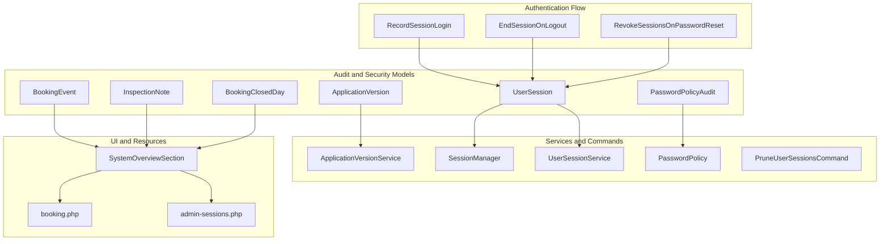
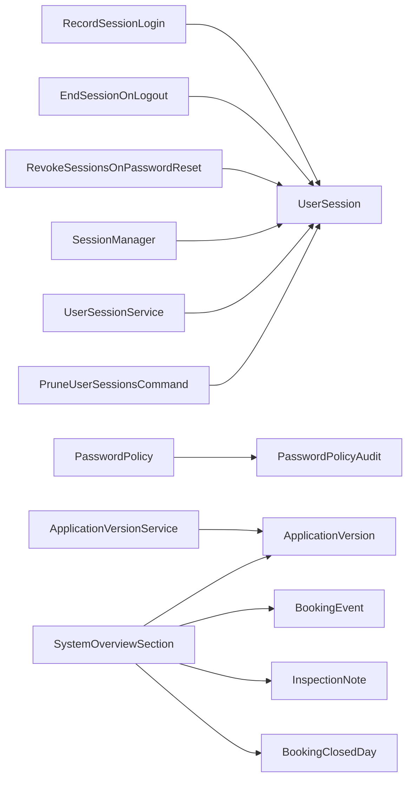

# Audit and System Entities

<cite>
**Referenced Files in This Document**
- [ApplicationVersion.php](file://app/app/Models/ApplicationVersion.php)
- [UserSession.php](file://app/app/Models/UserSession.php)
- [PasswordPolicyAudit.php](file://app/app/Models/PasswordPolicyAudit.php)
- [BookingEvent.php](file://app/app/Models/BookingEvent.php)
- [InspectionNote.php](file://app/app/Models/InspectionNote.php)
- [BookingClosedDay.php](file://app/app/Models/BookingClosedDay.php)
- [create_application_versions_table.php](file://database/database/migrations/2026_10_01_120000_create_application_versions_table.php)
- [create_user_sessions_table.php](file://database/database/migrations/2026_10_03_130000_create_user_sessions_table.php)
- [add_manage_user_sessions_permission.php](file://database/database/migrations/2026_10_03_140000_add_manage_user_sessions_permission.php)
- [create_password_policy_audits_table.php](file://database/database/migrations/2026_10_20_000000_create_password_policy_audits_table.php)
- [create_booking_events_table.php](file://database/database/migrations/2026_10_01_150000_create_booking_events_table.php)
- [add_previous_scheduled_at_to_booking_events_table.php](file://database/database/migrations/2026_10_01_150300_add_previous_scheduled_at_to_booking_events_table.php)
- [create_inspection_notes_table.php](file://database/database/migrations/2026_10_01_150100_create_inspection_notes_table.php)
- [create_booking_closed_days_table.php](file://database/database/migrations/2026_10_18_000001_create_booking_closed_days_table.php)
- [ApplicationVersionService.php](file://app/app/Services/ApplicationVersionService.php)
- [SessionManager.php](file://app/app/Services/SessionManager.php)
- [UserSessionService.php](file://app/app/Services/UserSessionService.php)
- [PasswordPolicy.php](file://app/app/Services/PasswordPolicy.php)
- [RecordSessionLogin.php](file://app/app/Listeners/RecordSessionLogin.php)
- [EndSessionOnLogout.php](file://app/app/Listeners/EndSessionOnLogout.php)
- [RevokeSessionsOnPasswordReset.php](file://app/app/Listeners/RevokeSessionsOnPasswordReset.php)
- [PruneUserSessionsCommand.php](file://app/app/Console/Commands/PruneUserSessionsCommand.php)
- [SystemOverviewSection.php](file://app/app/Livewire/SystemOverviewSection.php)
- [booking.php](file://lang/lang/en/booking.php)
- [admin-sessions.php](file://lang/lang/en/admin-sessions.php)
</cite>

## Table of Contents
1. [Introduction](#introduction)
2. [Project Structure](#project-structure)
3. [Core Components](#core-components)
4. [Architecture Overview](#architecture-overview)
5. [Detailed Component Analysis](#detailed-component-analysis)
6. [Dependency Analysis](#dependency-analysis)
7. [Performance Considerations](#performance-considerations)
8. [Troubleshooting Guide](#troubleshooting-guide)
9. [Conclusion](#conclusion)

## Introduction
This document describes Highblossom’s audit, security, and system management entities. It focuses on version tracking, session monitoring, password compliance auditing, booking lifecycle events, inspection notes, and scheduling exclusions. The goal is to help developers, administrators, and operators understand the data models, their relationships, indexing strategy, retention policies, and common query patterns for audit trails, session history, and system health metrics.

## Project Structure
The audit-related functionality spans Eloquent models, database migrations, services, event listeners, a console command, Livewire UI components, and language resources:

- Models define entity attributes, casts, timestamps, and optional scopes or relationships.
- Migrations define table schemas, indexes, constraints, and column defaults.
- Services encapsulate business logic for application versions, sessions, and password policy audits.
- Listeners react to authentication events to record session activity and enforce security.
- A console command prunes old user sessions.
- Livewire components render system overview information that may rely on these entities.
- Language files provide user-facing labels for booking, sessions, and admin interfaces.

**Diagram sources**
- [ApplicationVersion.php](file://app/app/Models/ApplicationVersion.php)
- [UserSession.php](file://app/app/Models/UserSession.php)
- [PasswordPolicyAudit.php](file://app/app/Models/PasswordPolicyAudit.php)
- [BookingEvent.php](file://app/app/Models/BookingEvent.php)
- [InspectionNote.php](file://app/app/Models/InspectionNote.php)
- [BookingClosedDay.php](file://app/app/Models/BookingClosedDay.php)
- [ApplicationVersionService.php](file://app/app/Services/ApplicationVersionService.php)
- [SessionManager.php](file://app/app/Services/SessionManager.php)
- [UserSessionService.php](file://app/app/Services/UserSessionService.php)
- [PasswordPolicy.php](file://app/app/Services/PasswordPolicy.php)
- [RecordSessionLogin.php](file://app/app/Listeners/RecordSessionLogin.php)
- [EndSessionOnLogout.php](file://app/app/Listeners/EndSessionOnLogout.php)
- [RevokeSessionsOnPasswordReset.php](file://app/app/Listeners/RevokeSessionsOnPasswordReset.php)
- [PruneUserSessionsCommand.php](file://app/app/Console/Commands/PruneUserSessionsCommand.php)
- [SystemOverviewSection.php](file://app/app/Livewire/SystemOverviewSection.php)
- [booking.php](file://lang/lang/en/booking.php)
- [admin-sessions.php](file://lang/lang/en/admin-sessions.php)

**Section sources**
- [ApplicationVersion.php](file://app/app/Models/ApplicationVersion.php)
- [UserSession.php](file://app/app/Models/UserSession.php)
- [PasswordPolicyAudit.php](file://app/app/Models/PasswordPolicyAudit.php)
- [BookingEvent.php](file://app/app/Models/BookingEvent.php)
- [InspectionNote.php](file://app/app/Models/InspectionNote.php)
- [BookingClosedDay.php](file://app/app/Models/BookingClosedDay.php)
- [ApplicationVersionService.php](file://app/app/Services/ApplicationVersionService.php)
- [SessionManager.php](file://app/app/Services/SessionManager.php)
- [UserSessionService.php](file://app/app/Services/UserSessionService.php)
- [PasswordPolicy.php](file://app/app/Services/PasswordPolicy.php)
- [RecordSessionLogin.php](file://app/app/Listeners/RecordSessionLogin.php)
- [EndSessionOnLogout.php](file://app/app/Listeners/EndSessionOnLogout.php)
- [RevokeSessionsOnPasswordReset.php](file://app/app/Listeners/RevokeSessionsOnPasswordReset.php)
- [PruneUserSessionsCommand.php](file://app/app/Console/Commands/PruneUserSessionsCommand.php)
- [SystemOverviewSection.php](file://app/app/Livewire/SystemOverviewSection.php)
- [booking.php](file://lang/lang/en/booking.php)
- [admin-sessions.php](file://lang/lang/en/admin-sessions.php)

## Core Components
This section summarizes each audit and system management entity, its purpose, key attributes, and how it fits into Highblossom’s operational model.

### ApplicationVersion
Tracks deployed application versions for deployment management and system health reporting. Typical responsibilities include recording version identifiers, environment metadata, deployment status, and timestamps.

- Purpose: Track deployments and support system overview dashboards.
- Key attributes (conceptual): version identifier, build or commit reference, environment, status, deployed at timestamp, created/updated timestamps.
- Primary consumers: ApplicationVersionService, SystemOverviewSection.

**Section sources**
- [ApplicationVersion.php](file://app/app/Models/ApplicationVersion.php)
- [create_application_versions_table.php](file://database/database/migrations/2026_10_01_120000_create_application_versions_table.php)
- [ApplicationVersionService.php](file://app/app/Services/ApplicationVersionService.php)
- [SystemOverviewSection.php](file://app/app/Livewire/SystemOverviewSection.php)

### UserSession
Records active and historical user login sessions for security auditing and session monitoring.

- Purpose: Monitor logins, track session lifecycle, and support revocation on sensitive actions such as password resets.
- Key attributes (conceptual): user identifier, session token or ID, IP address, user agent, device information, start time, end time, end reason, created/updated timestamps.
- Lifecycle: Created on login, ended on logout or after expiration, revoked during password reset.

**Section sources**
- [UserSession.php](file://app/app/Models/UserSession.php)
- [create_user_sessions_table.php](file://database/database/migrations/2026_10_03_130000_create_user_sessions_table.php)
- [add_manage_user_sessions_permission.php](file://database/database/migrations/2026_10_03_140000_add_manage_user_sessions_permission.php)
- [SessionManager.php](file://app/app/Services/SessionManager.php)
- [UserSessionService.php](file://app/app/Services/UserSessionService.php)
- [RecordSessionLogin.php](file://app/app/Listeners/RecordSessionLogin.php)
- [EndSessionOnLogout.php](file://app/app/Listeners/EndSessionOnLogout.php)
- [RevokeSessionsOnPasswordReset.php](file://app/app/Listeners/RevokeSessionsOnPasswordReset.php)
- [PruneUserSessionsCommand.php](file://app/app/Console/Commands/PruneUserSessionsCommand.php)
- [admin-sessions.php](file://lang/lang/en/admin-sessions.php)

### PasswordPolicyAudit
Audits password policy compliance attempts, failures, and successful updates.

- Purpose: Support password compliance reporting and security posture analysis.
- Key attributes (conceptual): user identifier, attempt result, applied rules summary, failure reasons, timestamp, created/updated timestamps.
- Consumers: PasswordPolicy service; used by admin dashboards for compliance metrics.

**Section sources**
- [PasswordPolicyAudit.php](file://app/app/Models/PasswordPolicyAudit.php)
- [create_password_policy_audits_table.php](file://database/database/migrations/2026_10_20_000000_create_password_policy_audits_table.php)
- [PasswordPolicy.php](file://app/app/Services/PasswordPolicy.php)

### BookingEvent
Captures changes in booking state and scheduling, enabling full lifecycle audit trails.

- Purpose: Provide an immutable sequence of booking transitions and rescheduling details.
- Key attributes (conceptual): booking identifier, event type, previous values snapshot, current values snapshot, actor or system context, timestamp, created/updated timestamps.
- Notable migration adds a field for previous scheduled date to support rescheduling audit.

**Section sources**
- [BookingEvent.php](file://app/app/Models/BookingEvent.php)
- [create_booking_events_table.php](file://database/database/migrations/2026_10_01_150000_create_booking_events_table.php)
- [add_previous_scheduled_at_to_booking_events_table.php](file://database/database/migrations/2026_10_01_150300_add_previous_scheduled_at_to_booking_events_table.php)
- [booking.php](file://lang/lang/en/booking.php)

### InspectionNote
Stores field inspection records associated with inspections.

- Purpose: Preserve detailed notes from field inspections, supporting quality assurance and post-inspection reviews.
- Key attributes (conceptual): inspection identifier, note content, author or staff context, timestamp, created/updated timestamps.

**Section sources**
- [InspectionNote.php](file://app/app/Models/InspectionNote.php)
- [create_inspection_notes_table.php](file://database/database/migrations/2026_10_01_150100_create_inspection_notes_table.php)

### BookingClosedDay
Defines dates when bookings are not available due to closures or exclusions.

- Purpose: Manage scheduling exclusions such as holidays, maintenance days, or company-wide closures.
- Key attributes (conceptual): date, reason or category, created/updated timestamps.

**Section sources**
- [BookingClosedDay.php](file://app/app/Models/BookingClosedDay.php)
- [create_booking_closed_days_table.php](file://database/database/migrations/2026_10_18_000001_create_booking_closed_days_table.php)

## Architecture Overview
The following diagram maps core audit entities to their primary consumers and producers.

```mermaid
classDiagram
    class ApplicationVersion {
        +version
        +environment
        +status
        +deployedAt
        +createdAt
        +updatedAt
    }

    class UserSession {
        +userId
        +sessionId
        +ipAddress
        +userAgent
        +deviceInfo
        +startedAt
        +endedAt
        +endReason
        +createdAt
        +updatedAt
    }

    class PasswordPolicyAudit {
        +userId
        +result
        +appliedRules
        +failureReasons
        +attemptedAt
        +createdAt
        +updatedAt
    }

    class BookingEvent {
        +bookingId
        +eventType
        +previousSnapshot
        +currentSnapshot
        +actorContext
        +occurredAt
        +createdAt
        +updatedAt
    }

    class InspectionNote {
        +inspectionId
        +noteContent
        +authorContext
        +createdAt
        +updatedAt
    }

    class BookingClosedDay {
        +date
        +reason
        +createdAt
        +updatedAt
    }

    class ApplicationVersionService
    class SessionManager
    class UserSessionService
    class PasswordPolicy
    class RecordSessionLogin
    class EndSessionOnLogout
    class RevokeSessionsOnPasswordReset
    class PruneUserSessionsCommand
    class SystemOverviewSection

    ApplicationVersionService --> ApplicationVersion : "records versions"
    RecordSessionLogin --> UserSession : "creates login"
    EndSessionOnLogout --> UserSession : "ends session"
    RevokeSessionsOnPasswordReset --> UserSession : "revokes sessions"
    SessionManager --> UserSession : "manages lifecycle"
    UserSessionService --> UserSession : "queries and reports"
    PasswordPolicy --> PasswordPolicyAudit : "audits policy attempts"
    SystemOverviewSection --> ApplicationVersion : "reads deployment info"
    SystemOverviewSection --> BookingEvent : "reads recent events"
    SystemOverviewSection --> InspectionNote : "reads inspection summaries"
    SystemOverviewSection --> BookingClosedDay : "reads closure calendar"
```

**Diagram sources**
- [ApplicationVersion.php](file://app/app/Models/ApplicationVersion.php)
- [UserSession.php](file://app/app/Models/UserSession.php)
- [PasswordPolicyAudit.php](file://app/app/Models/PasswordPolicyAudit.php)
- [BookingEvent.php](file://app/app/Models/BookingEvent.php)
- [InspectionNote.php](file://app/app/Models/InspectionNote.php)
- [BookingClosedDay.php](file://app/app/Models/BookingClosedDay.php)
- [ApplicationVersionService.php](file://app/app/Services/ApplicationVersionService.php)
- [SessionManager.php](file://app/app/Services/SessionManager.php)
- [UserSessionService.php](file://app/app/Services/UserSessionService.php)
- [PasswordPolicy.php](file://app/app/Services/PasswordPolicy.php)
- [RecordSessionLogin.php](file://app/app/Listeners/RecordSessionLogin.php)
- [EndSessionOnLogout.php](file://app/app/Listeners/EndSessionOnLogout.php)
- [RevokeSessionsOnPasswordReset.php](file://app/app/Listeners/RevokeSessionsOnPasswordReset.php)
- [PruneUserSessionsCommand.php](file://app/app/Console/Commands/PruneUserSessionsCommand.php)
- [SystemOverviewSection.php](file://app/app/Livewire/SystemOverviewSection.php)

## Detailed Component Analysis

### ApplicationVersion Entity
Purpose:
- Track deployed versions and environments.
- Provide reliable signals for system health and deployment dashboards.

Key concepts:
- Version identity and environment context.
- Deployment status and timing.
- Immutable historical record of deployments.

Typical queries:
- Latest deployed version per environment.
- Deployment timeline for rollback analysis.
- Count of deployments per period.

Indexing considerations:
- Index by environment and deployed-at to accelerate timeline queries.
- Composite index on environment and status if filtering by status is frequent.

Retention:
- Retain full deployment history indefinitely unless storage policy requires archival.

Operational notes:
- Update via ApplicationVersionService to ensure consistent schema usage.
- Display through SystemOverviewSection for visibility.

**Section sources**
- [ApplicationVersion.php](file://app/app/Models/ApplicationVersion.php)
- [create_application_versions_table.php](file://database/database/migrations/2026_10_01_120000_create_application_versions_table.php)
- [ApplicationVersionService.php](file://app/app/Services/ApplicationVersionService.php)
- [SystemOverviewSection.php](file://app/app/Livewire/SystemOverviewSection.php)

### UserSession Entity
Purpose:
- Monitor active and past sessions.
- Support security auditing and incident response.

Lifecycle:
- Login creates a session record.
- Logout ends the session with a reason.
- Password reset can revoke existing sessions.
- Periodic pruning removes expired records.

Security controls:
- Permission for managing user sessions exists in a dedicated migration.

Typical queries:
- Active sessions for a user.
- Sessions by IP, user agent, or device.
- Session counts over time for anomaly detection.

Indexing considerations:
- Index on user identifier for per-user session lookups.
- Index on started-at for time-range queries.
- Optional composite index on user identifier and ended-at for active-session scans.

Retention:
- Use PruneUserSessionsCommand to remove old sessions according to policy.

Operational notes:
- Listeners RecordSessionLogin, EndSessionOnLogout, and RevokeSessionsOnPasswordReset coordinate lifecycle events.
- Admin interface uses admin-sessions language resources for labels.

**Section sources**
- [UserSession.php](file://app/app/Models/UserSession.php)
- [create_user_sessions_table.php](file://database/database/migrations/2026_10_03_130000_create_user_sessions_table.php)
- [add_manage_user_sessions_permission.php](file://database/database/migrations/2026_10_03_140000_add_manage_user_sessions_permission.php)
- [SessionManager.php](file://app/app/Services/SessionManager.php)
- [UserSessionService.php](file://app/app/Services/UserSessionService.php)
- [RecordSessionLogin.php](file://app/app/Listeners/RecordSessionLogin.php)
- [EndSessionOnLogout.php](file://app/app/Listeners/EndSessionOnLogout.php)
- [RevokeSessionsOnPasswordReset.php](file://app/app/Listeners/RevokeSessionsOnPasswordReset.php)
- [PruneUserSessionsCommand.php](file://app/app/Console/Commands/PruneUserSessionsCommand.php)
- [admin-sessions.php](file://lang/lang/en/admin-sessions.php)

### PasswordPolicyAudit Entity
Purpose:
- Record password policy evaluation outcomes.
- Enable compliance reporting and remediation workflows.

Key concepts:
- Attempt outcome and applied rule set.
- Failure reasons for actionable feedback.
- Timestamped audit trail for compliance.

Typical queries:
- Failed attempts per user over time.
- Policy rule coverage across users.
- Compliance rate trends.

Indexing considerations:
- Index on user identifier and attempted-at.
- Index on result for success/failure aggregation.

Retention:
- Retain for compliance window; consider archival for long-term history.

Operational notes:
- PasswordPolicy service writes audit entries consistently.

**Section sources**
- [PasswordPolicyAudit.php](file://app/app/Models/PasswordPolicyAudit.php)
- [create_password_policy_audits_table.php](file://database/database/migrations/2026_10_20_000000_create_password_policy_audits_table.php)
- [PasswordPolicy.php](file://app/app/Services/PasswordPolicy.php)

### BookingEvent Entity
Purpose:
- Maintain an immutable timeline of booking state changes.
- Capture both previous and current snapshots for rescheduling and status transitions.

Key concepts:
- Event type describing the change.
- Previous and current value snapshots.
- Actor or system context for accountability.
- Additional field for previous scheduled date to support rescheduling audit.

Typical queries:
- Full event history for a booking.
- Reschedule events with before/after scheduled dates.
- Event frequency by type for operational insights.

Indexing considerations:
- Index on booking identifier.
- Index on occurred-at for chronological queries.
- Composite index on booking identifier and occurred-at for efficient timeline retrieval.

Operational notes:
- Booking language resources inform event labels and messages.

**Section sources**
- [BookingEvent.php](file://app/app/Models/BookingEvent.php)
- [create_booking_events_table.php](file://database/database/migrations/2026_10_01_150000_create_booking_events_table.php)
- [add_previous_scheduled_at_to_booking_events_table.php](file://database/database/migrations/2026_10_01_150300_add_previous_scheduled_at_to_booking_events_table.php)
- [booking.php](file://lang/lang/en/booking.php)

### InspectionNote Entity
Purpose:
- Store field inspection notes for quality assurance and review.

Key concepts:
- Association with an inspection.
- Note content and author context.
- Timestamped record creation.

Typical queries:
- Notes for a specific inspection.
- Recent notes for trending issues.
- Author-based note volume metrics.

Indexing considerations:
- Index on inspection identifier.
- Index on createdAt for recency queries.

**Section sources**
- [InspectionNote.php](file://app/app/Models/InspectionNote.php)
- [create_inspection_notes_table.php](file://database/database/migrations/2026_10_01_150100_create_inspection_notes_table.php)

### BookingClosedDay Entity
Purpose:
- Represent excluded booking dates for scheduling.

Key concepts:
- Date-based exclusion.
- Reason or category for planning context.
- Timestamped record.

Typical queries:
- Closed days within a date range.
- Closure reasons for calendar rendering.

Indexing considerations:
- Index on date for range scans.
- Optional composite index on date and reason if filtering by reason is frequent.

**Section sources**
- [BookingClosedDay.php](file://app/app/Models/BookingClosedDay.php)
- [create_booking_closed_days_table.php](file://database/database/migrations/2026_10_18_000001_create_booking_closed_days_table.php)

## Dependency Analysis
The audit subsystem has clear dependencies between models, services, listeners, and UI components.

**Diagram sources**
- [RecordSessionLogin.php](file://app/app/Listeners/RecordSessionLogin.php)
- [EndSessionOnLogout.php](file://app/app/Listeners/EndSessionOnLogout.php)
- [RevokeSessionsOnPasswordReset.php](file://app/app/Listeners/RevokeSessionsOnPasswordReset.php)
- [SessionManager.php](file://app/app/Services/SessionManager.php)
- [UserSessionService.php](file://app/app/Services/UserSessionService.php)
- [PruneUserSessionsCommand.php](file://app/app/Console/Commands/PruneUserSessionsCommand.php)
- [UserSession.php](file://app/app/Models/UserSession.php)
- [PasswordPolicy.php](file://app/app/Services/PasswordPolicy.php)
- [PasswordPolicyAudit.php](file://app/app/Models/PasswordPolicyAudit.php)
- [ApplicationVersionService.php](file://app/app/Services/ApplicationVersionService.php)
- [ApplicationVersion.php](file://app/app/Models/ApplicationVersion.php)
- [SystemOverviewSection.php](file://app/app/Livewire/SystemOverviewSection.php)
- [BookingEvent.php](file://app/app/Models/BookingEvent.php)
- [InspectionNote.php](file://app/app/Models/InspectionNote.php)
- [BookingClosedDay.php](file://app/app/Models/BookingClosedDay.php)

**Section sources**
- [RecordSessionLogin.php](file://app/app/Listeners/RecordSessionLogin.php)
- [EndSessionOnLogout.php](file://app/app/Listeners/EndSessionOnLogout.php)
- [RevokeSessionsOnPasswordReset.php](file://app/app/Listeners/RevokeSessionsOnPasswordReset.php)
- [SessionManager.php](file://app/app/Services/SessionManager.php)
- [UserSessionService.php](file://app/app/Services/UserSessionService.php)
- [PruneUserSessionsCommand.php](file://app/app/Console/Commands/PruneUserSessionsCommand.php)
- [PasswordPolicy.php](file://app/app/Services/PasswordPolicy.php)
- [ApplicationVersionService.php](file://app/app/Services/ApplicationVersionService.php)
- [SystemOverviewSection.php](file://app/app/Livewire/SystemOverviewSection.php)

## Performance Considerations
High-volume audit tables require careful indexing and retention strategies.

General recommendations:
- Prefer narrow composite indexes that match common filter predicates.
- Partition large tables by time ranges where supported by the database engine.
- Archive older audit rows to separate storage while preserving referential integrity.
- Avoid selecting large JSON/text blobs in high-frequency dashboard queries; materialize aggregates.
- Use read replicas for heavy analytics queries against audit tables.

Table-specific guidance:
- UserSession:
  - Index on userId and startedAt for active session queries.
  - Periodic pruning via PruneUserSessionsCommand.
- PasswordPolicyAudit:
  - Index on userId and attemptedAt for compliance trends.
  - Aggregate success/failure rates rather than scanning raw rows.
- BookingEvent:
  - Index on bookingId and occurredAt for timelines.
  - Materialize recent-event counts for system overview panels.
- InspectionNote:
  - Index on inspectionId for per-inspection retrieval.
  - Limit note text in list views; load full content on demand.
- BookingClosedDay:
  - Index on date for calendar queries.
  - Cache closed-day sets for date-range checks.

[No sources needed since this section provides general guidance]

## Troubleshooting Guide
Common operational issues and resolutions:

- Missing session records after login:
  - Verify RecordSessionLogin listener is registered and invoked.
  - Check UserSessionService and SessionManager for write errors.
  - Ensure database permissions allow inserting into user_sessions.

- Sessions not ending on logout:
  - Confirm EndSessionOnLogout listener is active.
  - Validate that endedAt and endReason are populated.
  - Inspect session pruning schedule to avoid premature deletion.

- Excessive password policy audit growth:
  - Review PasswordPolicy configuration for overly broad rule logging.
  - Implement retention jobs or partitioning for audit tables.

- Slow booking timeline queries:
  - Verify BookingEvent indexes on bookingId and occurredAt.
  - Add pagination and limit event payloads.
  - Precompute recent event counts for dashboards.

- Calendar shows incorrect closures:
  - Check BookingClosedDay entries for overlapping or conflicting dates.
  - Ensure queries filter by date range and reason correctly.

- Dashboard metrics missing:
  - Confirm SystemOverviewSection reads required entities.
  - Validate language resource keys for labels and messages.

**Section sources**
- [RecordSessionLogin.php](file://app/app/Listeners/RecordSessionLogin.php)
- [EndSessionOnLogout.php](file://app/app/Listeners/EndSessionOnLogout.php)
- [RevokeSessionsOnPasswordReset.php](file://app/app/Listeners/RevokeSessionsOnPasswordReset.php)
- [SessionManager.php](file://app/app/Services/SessionManager.php)
- [UserSessionService.php](file://app/app/Services/UserSessionService.php)
- [PasswordPolicy.php](file://app/app/Services/PasswordPolicy.php)
- [PruneUserSessionsCommand.php](file://app/app/Console/Commands/PruneUserSessionsCommand.php)
- [SystemOverviewSection.php](file://app/app/Livewire/SystemOverviewSection.php)
- [booking.php](file://lang/lang/en/booking.php)
- [admin-sessions.php](file://lang/lang/en/admin-sessions.php)

## Conclusion
Highblossom’s audit and system management entities form a cohesive layer for version control, session security, password compliance, booking lifecycle auditing, inspection documentation, and scheduling exclusions. By applying targeted indexing, thoughtful retention, and consistent service-layer operations, teams can maintain performant, secure, and auditable systems. The included diagrams, component mappings, and operational guidance should assist developers and operators in querying audit trails, analyzing session history, and monitoring system health effectively.