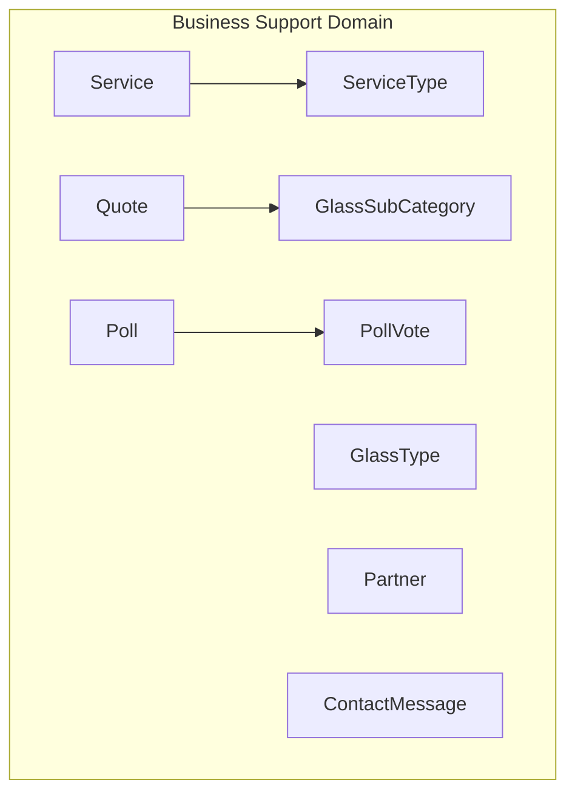
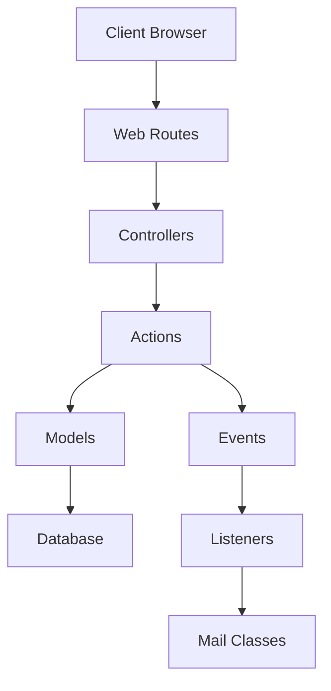
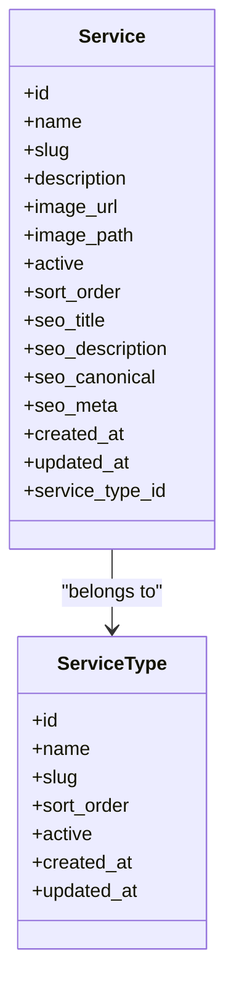
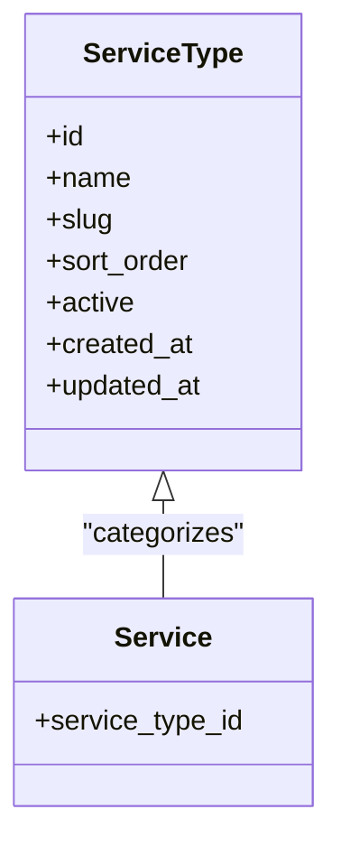
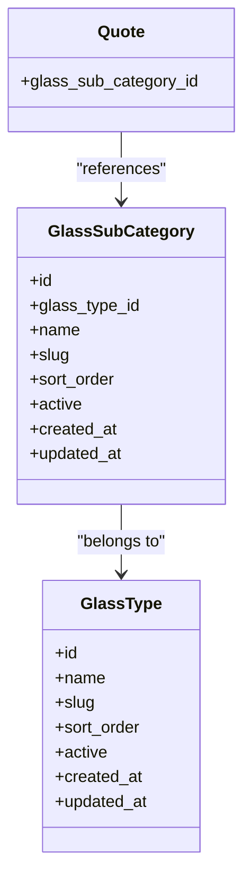
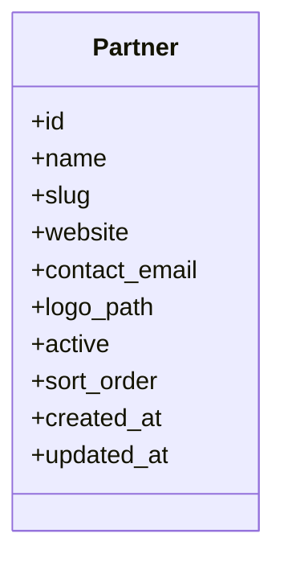
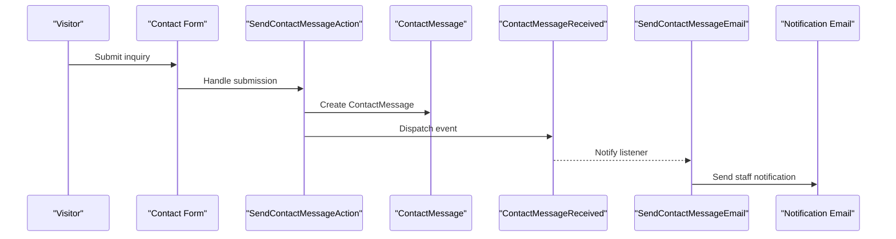
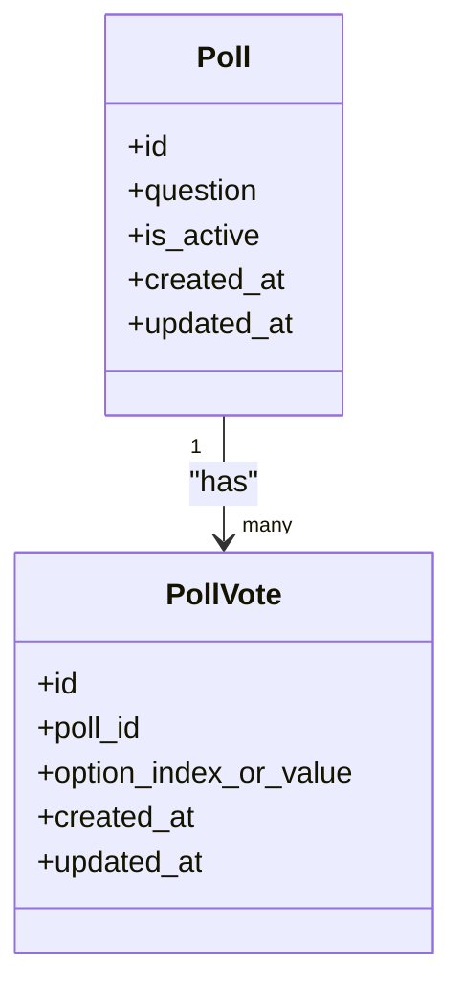
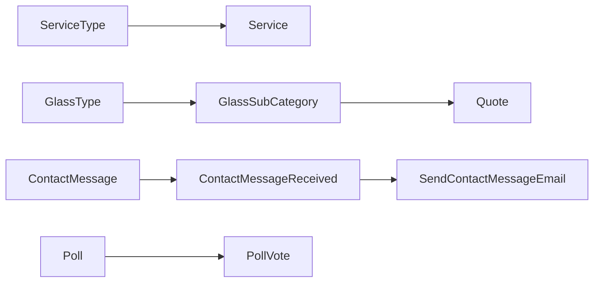

# Business Support Entities

<cite>
**Referenced Files in This Document**
- [Service.php](file://app/app/Models/Service.php)
- [ServiceType.php](file://app/app/Models/ServiceType.php)
- [GlassType.php](file://app/app/Models/GlassType.php)
- [GlassSubCategory.php](file://app/app/Models/GlassSubCategory.php)
- [Partner.php](file://app/app/Models/Partner.php)
- [ContactMessage.php](file://app/app/Models/ContactMessage.php)
- [Poll.php](file://app/app/Models/Poll.php)
- [PollVote.php](file://app/app/Models/PollVote.php)
- [CreateServicesTable.php](file://database/database/migrations/2026_04_17_110002_create_services_table.php)
- [AddSeoMetadataToServicesTable.php](file://database/database/migrations/2026_04_17_150000_add_seo_metadata_to_services_table.php)
- [AddImageUrlToServicesTable.php](file://database/database/migrations/2026_04_20_000000_add_image_url_to_services_table.php)
- [AddImagePathToServicesTable.php](file://database/database/migrations/2026_04_20_070000_add_image_path_to_services_table.php)
- [CreateGlassTypesTable.php](file://database/database/migrations/2026_04_20_080000_create_glass_types_table.php)
- [CreateServiceTypesTable.php](file://database/database/migrations/2026_04_20_080001_create_service_types_table.php)
- [CreateGlassSubCategoriesTable.php](file://database/database/migrations/2026_05_07_080000_create_glass_sub_categories_table.php)
- [AddGlassSubCategoryIdToQuotesTable.php](file://database/database/migrations/2026_05_07_080001_add_glass_sub_category_id_to_quotes_table.php)
- [CreatePartnersTable.php](file://database/database/migrations/2026_05_25_093322_create_partners_table.php)
- [CreateContactMessagesTable.php](file://database/database/migrations/2026_04_17_110005_create_contact_messages_table.php)
- [CreatePollsTable.php](file://database/database/migrations/2026_06_10_164000_create_polls_table.php)
- [CreatePollVotesTable.php](file://database/database/migrations/2026_06_10_164023_create_poll_votes_table.php)
- [AddUniqueConstraintsToPollVotesTable.php](file://database/database/migrations/2026_06_10_184301_add_unique_constraints_to_poll_votes_table.php)
- [AddIsActiveToPollsTable.php](file://database/database/migrations/2026_06_10_185220_add_is_active_to_polls_table.php)
- [ServiceSeeder.php](file://database/database/seeders/ServiceSeeder.php)
- [ServiceTypeSeeder.php](file://database/database/seeders/ServiceTypeSeeder.php)
- [GlassTypeSeeder.php](file://database/database/seeders/GlassTypeSeeder.php)
- [GlassSubCategorySeeder.php](file://database/database/seeders/GlassSubCategorySeeder.php)
- [SendContactMessageAction.php](file://app/app/Actions/SendContactMessage.php)
- [ContactMessageReceived.php](file://app/app/Events/ContactMessageReceived.php)
- [SendContactMessageEmailListener.php](file://app/app/Listeners/SendContactMessageEmail.php)
- [StoreQuoteAction.php](file://app/app/Actions/StoreQuoteAction.php)
- [QuoteService.php](file://app/app/Services/QuoteService.php)
- [QuoteSubmittedMail.php](file://app/app/Mail/QuoteSubmittedMail.php)
- [Quote.php](file://app/app/Models/Quote.php)
</cite>

## Table of Contents
1. [Introduction](#introduction)
2. [Project Structure](#project-structure)
3. [Core Components](#core-components)
4. [Architecture Overview](#architecture-overview)
5. [Detailed Component Analysis](#detailed-component-analysis)
6. [Dependency Analysis](#dependency-analysis)
7. [Performance Considerations](#performance-considerations)
8. [Troubleshooting Guide](#troubleshooting-guide)
9. [Conclusion](#conclusion)

## Introduction
This document describes Highblossom’s business support data model. It focuses on the entities that power service catalog management, material specifications, partner relationships, customer inquiries, and interactive engagement features such as polls. The goal is to help developers, product owners, and administrators understand how these entities represent real-world business concepts, how they relate to each other, and how they participate in key workflows like quote generation, service catalog display, and customer engagement.

The covered entities are:
- Service and ServiceType
- GlassType and GlassSubCategory
- Partner
- ContactMessage
- Poll and PollVote

These models work with related components such as quotes, emails, events, services, seeders, and migrations to deliver end-to-end functionality.

## Project Structure
The relevant business support entities live under the application’s model layer, with their database schema defined by migrations and their initial data provided by seeders. Supporting behavior is implemented through actions, services, events, listeners, and mail classes.

**Diagram sources**
- [Service.php](file://app/app/Models/Service.php)
- [ServiceType.php](file://app/app/Models/ServiceType.php)
- [GlassType.php](file://app/app/Models/GlassType.php)
- [GlassSubCategory.php](file://app/app/Models/GlassSubCategory.php)
- [Partner.php](file://app/app/Models/Partner.php)
- [ContactMessage.php](file://app/app/Models/ContactMessage.php)
- [Poll.php](file://app/app/Models/Poll.php)
- [PollVote.php](file://app/app/Models/PollVote.php)
- [Quote.php](file://app/app/Models/Quote.php)

**Section sources**
- [CreateServicesTable.php](file://database/database/migrations/2026_04_17_110002_create_services_table.php)
- [CreateServiceTypesTable.php](file://database/database/migrations/2026_04_20_080001_create_service_types_table.php)
- [CreateGlassTypesTable.php](file://database/database/migrations/2026_04_20_080000_create_glass_types_table.php)
- [CreateGlassSubCategoriesTable.php](file://database/database/migrations/2026_05_07_080000_create_glass_sub_categories_table.php)
- [CreatePartnersTable.php](file://database/database/migrations/2026_05_25_093322_create_partners_table.php)
- [CreateContactMessagesTable.php](file://database/database/migrations/2026_04_17_110005_create_contact_messages_table.php)
- [CreatePollsTable.php](file://database/database/migrations/2026_06_10_164000_create_polls_table.php)
- [CreatePollVotesTable.php](file://database/database/migrations/2026_06_10_164023_create_poll_votes_table.php)

## Core Components
This section summarizes the purpose and responsibilities of each entity.

- Service: Represents a service offering shown in the public catalog and administrative interfaces. It includes descriptive content, images, SEO metadata, ordering, and visibility controls.
- ServiceType: Categorizes services so the catalog can be grouped and filtered by type.
- GlassType: Describes glass material types used in quoting and service configuration.
- GlassSubCategory: Provides more granular material categorization beneath a glass type; linked to quotes for precise specification capture.
- Partner: Stores business partner information for vendor or collaboration records.
- ContactMessage: Captures inbound customer inquiries submitted via contact forms.
- Poll: Defines an interactive poll available to site visitors.
- PollVote: Records individual votes cast against a poll, with constraints to prevent duplicate voting.

**Section sources**
- [Service.php](file://app/app/Models/Service.php)
- [ServiceType.php](file://app/app/Models/ServiceType.php)
- [GlassType.php](file://app/app/Models/GlassType.php)
- [GlassSubCategory.php](file://app/app/Models/GlassSubCategory.php)
- [Partner.php](file://app/app/Models/Partner.php)
- [ContactMessage.php](file://app/app/Models/ContactMessage.php)
- [Poll.php](file://app/app/Models/Poll.php)
- [PollVote.php](file://app/app/Models/PollVote.php)

## Architecture Overview
The business support domain integrates with several system layers:

- Models define persistent data structures.
- Migrations define the database schema.
- Seeders provide initial catalog data.
- Actions orchestrate workflows such as sending contact messages and storing quotes.
- Events and listeners handle side effects like email notifications.
- Mail classes format outbound messages.
- Services encapsulate reusable business logic.

**Diagram sources**
- [SendContactMessageAction.php](file://app/app/Actions/SendContactMessage.php)
- [ContactMessageReceived.php](file://app/app/Events/ContactMessageReceived.php)
- [SendContactMessageEmailListener.php](file://app/app/Listeners/SendContactMessageEmail.php)
- [StoreQuoteAction.php](file://app/app/Actions/StoreQuoteAction.php)
- [QuoteService.php](file://app/app/Services/QuoteService.php)
- [QuoteSubmittedMail.php](file://app/app/Mail/QuoteSubmittedMail.php)

## Detailed Component Analysis

### Service Entity
The Service entity represents a publishable service offering. Its schema supports rich presentation and search optimization:

- Identifiers and basics: primary key, timestamps, and ordering fields.
- Display fields: name, slug, description, image URL, and persisted image path.
- Visibility and control: active flag and sort order.
- SEO fields: title, meta description, canonical URL, and structured metadata for search engines.

Relationships:
- Belongs to a ServiceType to enable grouping and filtering.

Key business rules:
- Services should have unique slugs within their type scope when exposed publicly.
- Images may be referenced by URL or stored path; both fields coexist during migration transitions.
- SEO metadata should be populated for important catalog pages to improve discoverability.

Integration points:
- Used by service catalogs and admin management screens.
- Referenced by service-related routes and resources.
- Influences SEO rendering through static route and injection mechanisms.

**Diagram sources**
- [Service.php](file://app/app/Models/Service.php)
- [ServiceType.php](file://app/app/Models/ServiceType.php)
- [CreateServicesTable.php](file://database/database/migrations/2026_04_17_110002_create_services_table.php)
- [AddSeoMetadataToServicesTable.php](file://database/database/migrations/2026_04_17_150000_add_seo_metadata_to_services_table.php)
- [AddImageUrlToServicesTable.php](file://database/database/migrations/2026_04_20_000000_add_image_url_to_services_table.php)
- [AddImagePathToServicesTable.php](file://database/database/migrations/2026_04_20_070000_add_image_path_to_services_table.php)
- [CreateServiceTypesTable.php](file://database/database/migrations/2026_04_20_080001_create_service_types_table.php)

**Section sources**
- [Service.php](file://app/app/Models/Service.php)
- [CreateServicesTable.php](file://database/database/migrations/2026_04_17_110002_create_services_table.php)
- [AddSeoMetadataToServicesTable.php](file://database/database/migrations/2026_04_17_150000_add_seo_metadata_to_services_table.php)
- [AddImageUrlToServicesTable.php](file://database/database/migrations/2026_04_20_000000_add_image_url_to_services_table.php)
- [AddImagePathToServicesTable.php](file://database/database/migrations/2026_04_20_070000_add_image_path_to_services_table.php)
- [CreateServiceTypesTable.php](file://database/database/migrations/2026_04_20_080001_create_service_types_table.php)
- [ServiceSeeder.php](file://database/database/seeders/ServiceSeeder.php)

### ServiceType Entity
The ServiceType entity groups services into categories such as installation, repair, inspection, or custom fabrication.

Responsibilities:
- Provide categorical labels and slugs for navigation and filtering.
- Control category visibility and ordering.

Relationships:
- One ServiceType has many Services.

Business rules:
- Slugs should remain stable to preserve URLs and links.
- Categories should be enabled selectively to avoid exposing incomplete sections.

**Diagram sources**
- [ServiceType.php](file://app/app/Models/ServiceType.php)
- [Service.php](file://app/app/Models/Service.php)
- [CreateServiceTypesTable.php](file://database/database/migrations/2026_04_20_080001_create_service_types_table.php)

**Section sources**
- [ServiceType.php](file://app/app/Models/ServiceType.php)
- [CreateServiceTypesTable.php](file://database/database/migrations/2026_04_20_080001_create_service_types_table.php)
- [ServiceTypeSeeder.php](file://database/database/seeders/ServiceTypeSeeder.php)

### GlassType and GlassSubCategory Entities
GlassType defines high-level material categories, while GlassSubCategory refines those categories into specific materials or configurations.

Responsibilities:
- GlassType: Standardize material families (for example, tempered, laminated, low-iron).
- GlassSubCategory: Provide detailed options under a parent glass type.

Relationships:
- A GlassSubCategory belongs to a GlassType.
- Quotes reference a GlassSubCategory to record the exact material selected during quotation.

Business rules:
- Subcategories must be valid only under their parent glass type.
- When selecting materials for quotes, users should choose from the most specific applicable subcategory.

**Diagram sources**
- [GlassType.php](file://app/app/Models/GlassType.php)
- [GlassSubCategory.php](file://app/app/Models/GlassSubCategory.php)
- [Quote.php](file://app/app/Models/Quote.php)
- [CreateGlassTypesTable.php](file://database/database/migrations/2026_04_20_080000_create_glass_types_table.php)
- [CreateGlassSubCategoriesTable.php](file://database/database/migrations/2026_05_07_080000_create_glass_sub_categories_table.php)
- [AddGlassSubCategoryIdToQuotesTable.php](file://database/database/migrations/2026_05_07_080001_add_glass_sub_category_id_to_quotes_table.php)

**Section sources**
- [GlassType.php](file://app/app/Models/GlassType.php)
- [GlassSubCategory.php](file://app/app/Models/GlassSubCategory.php)
- [CreateGlassTypesTable.php](file://database/database/migrations/2026_04_20_080000_create_glass_types_table.php)
- [CreateGlassSubCategoriesTable.php](file://database/database/migrations/2026_05_07_080000_create_glass_sub_categories_table.php)
- [AddGlassSubCategoryIdToQuotesTable.php](file://database/database/migrations/2026_05_07_080001_add_glass_sub_category_id_to_quotes_table.php)
- [GlassTypeSeeder.php](file://database/database/seeders/GlassTypeSeeder.php)
- [GlassSubCategorySeeder.php](file://database/database/seeders/GlassSubCategorySeeder.php)

### Partner Entity
The Partner entity stores business relationship data for vendors, collaborators, or affiliated companies.

Responsibilities:
- Record partner identity, contact details, website, and status.
- Support partner listing and profile views.

Business rules:
- Active partners should be visible in appropriate catalog or referral sections.
- Partner records should be kept up to date to ensure accurate referrals and communications.

**Diagram sources**
- [Partner.php](file://app/app/Models/Partner.php)
- [CreatePartnersTable.php](file://database/database/migrations/2026_05_25_093322_create_partners_table.php)

**Section sources**
- [Partner.php](file://app/app/Models/Partner.php)
- [CreatePartnersTable.php](file://database/database/migrations/2026_05_25_093322_create_partners_table.php)

### ContactMessage Entity
The ContactMessage entity captures customer inquiries submitted through the contact form.

Responsibilities:
- Persist inquiry content, sender details, and optional attachments.
- Trigger notification workflows for staff review and follow-up.

Workflow highlights:
- Submission creates a ContactMessage record.
- An event is dispatched when a message is received.
- A listener sends an email notification to staff.

**Diagram sources**
- [ContactMessage.php](file://app/app/Models/ContactMessage.php)
- [SendContactMessageAction.php](file://app/app/Actions/SendContactMessage.php)
- [ContactMessageReceived.php](file://app/app/Events/ContactMessageReceived.php)
- [SendContactMessageEmailListener.php](file://app/app/Listeners/SendContactMessageEmail.php)
- [CreateContactMessagesTable.php](file://database/database/migrations/2026_04_17_110005_create_contact_messages_table.php)

**Section sources**
- [ContactMessage.php](file://app/app/Models/ContactMessage.php)
- [SendContactMessageAction.php](file://app/app/Actions/SendContactMessage.php)
- [ContactMessageReceived.php](file://app/app/Events/ContactMessageReceived.php)
- [SendContactMessageEmailListener.php](file://app/app/Listeners/SendContactMessageEmail.php)
- [CreateContactMessagesTable.php](file://database/database/migrations/2026_04_17_110005_create_contact_messages_table.php)

### Poll and PollVote Entities
Polls enable interactive content where visitors can vote on questions or topics.

Responsibilities:
- Poll: Define the question, choices, and activation state.
- PollVote: Record individual votes with uniqueness constraints to prevent duplicate submissions.

Business rules:
- Only active polls should accept votes.
- Each voter should be constrained to one vote per poll option, depending on configuration.
- Votes contribute to aggregated results displayed to users.

**Diagram sources**
- [Poll.php](file://app/app/Models/Poll.php)
- [PollVote.php](file://app/app/Models/PollVote.php)
- [CreatePollsTable.php](file://database/database/migrations/2026_06_10_164000_create_polls_table.php)
- [CreatePollVotesTable.php](file://database/database/migrations/2026_06_10_164023_create_poll_votes_table.php)
- [AddUniqueConstraintsToPollVotesTable.php](file://database/database/migrations/2026_06_10_184301_add_unique_constraints_to_poll_votes_table.php)
- [AddIsActiveToPollsTable.php](file://database/database/migrations/2026_06_10_185220_add_is_active_to_polls_table.php)

**Section sources**
- [Poll.php](file://app/app/Models/Poll.php)
- [PollVote.php](file://app/app/Models/PollVote.php)
- [CreatePollsTable.php](file://database/database/migrations/2026_06_10_164000_create_polls_table.php)
- [CreatePollVotesTable.php](file://database/database/migrations/2026_06_10_164023_create_poll_votes_table.php)
- [AddUniqueConstraintsToPollVotesTable.php](file://database/database/migrations/2026_06_10_184301_add_unique_constraints_to_poll_votes_table.php)
- [AddIsActiveToPollsTable.php](file://database/database/migrations/2026_06_10_185220_add_is_active_to_polls_table.php)

## Dependency Analysis
The following diagram shows how the business support entities depend on each other and integrate with related systems.

**Diagram sources**
- [ServiceType.php](file://app/app/Models/ServiceType.php)
- [Service.php](file://app/app/Models/Service.php)
- [GlassType.php](file://app/app/Models/GlassType.php)
- [GlassSubCategory.php](file://app/app/Models/GlassSubCategory.php)
- [Quote.php](file://app/app/Models/Quote.php)
- [ContactMessage.php](file://app/app/Models/ContactMessage.php)
- [ContactMessageReceived.php](file://app/app/Events/ContactMessageReceived.php)
- [SendContactMessageEmailListener.php](file://app/app/Listeners/SendContactMessageEmail.php)
- [Poll.php](file://app/app/Models/Poll.php)
- [PollVote.php](file://app/app/Models/PollVote.php)

**Section sources**
- [Service.php](file://app/app/Models/Service.php)
- [ServiceType.php](file://app/app/Models/ServiceType.php)
- [GlassType.php](file://app/app/Models/GlassType.php)
- [GlassSubCategory.php](file://app/app/Models/GlassSubCategory.php)
- [Quote.php](file://app/app/Models/Quote.php)
- [ContactMessage.php](file://app/app/Models/ContactMessage.php)
- [ContactMessageReceived.php](file://app/app/Events/ContactMessageReceived.php)
- [SendContactMessageEmailListener.php](file://app/app/Listeners/SendContactMessageEmail.php)
- [Poll.php](file://app/app/Models/Poll.php)
- [PollVote.php](file://app/app/Models/PollVote.php)

## Performance Considerations
- Catalog queries for services should leverage indexes on slug, active flags, and sort order to speed up filtering and ordering.
- Image assets referenced by Service should be served through optimized storage backends and CDNs to reduce page load times.
- Poll vote operations should enforce uniqueness at the database level to avoid expensive conflict resolution in application code.
- Contact message handling should use background jobs for email delivery to keep user-facing requests fast.
- Material selection in quotes benefits from preloading GlassType and GlassSubCategory relationships to avoid N+1 queries when displaying options.

[No sources needed since this section provides general guidance]

## Troubleshooting Guide
Common issues and remediation steps:

- Missing SEO metadata on service pages:
  - Verify that SEO fields exist and are populated in the Service model.
  - Confirm that migrations adding SEO metadata ran successfully.
  - Check static route and SEO injection integration if titles or descriptions are not rendered.

- Service images not displaying:
  - Ensure both image URL and image path fields are maintained correctly during migration transitions.
  - Validate that uploaded assets are accessible through the configured filesystem.

- Duplicate poll votes:
  - Confirm that unique constraints on PollVote were applied by the corresponding migration.
  - Review application validation before persisting votes.

- Contact message notifications not sent:
  - Inspect whether the event is dispatched after creating the message.
  - Check the listener registration and mail configuration.
  - Review logs for failures in email delivery.

- Incorrect glass material selection in quotes:
  - Ensure quotes reference a valid GlassSubCategory ID.
  - Validate that the selected subcategory exists under the intended GlassType.

**Section sources**
- [AddSeoMetadataToServicesTable.php](file://database/database/migrations/2026_04_17_150000_add_seo_metadata_to_services_table.php)
- [AddImageUrlToServicesTable.php](file://database/database/migrations/2026_04_20_000000_add_image_url_to_services_table.php)
- [AddImagePathToServicesTable.php](file://database/database/migrations/2026_04_20_070000_add_image_path_to_services_table.php)
- [AddUniqueConstraintsToPollVotesTable.php](file://database/database/migrations/2026_06_10_184301_add_unique_constraints_to_poll_votes_table.php)
- [SendContactMessageAction.php](file://app/app/Actions/SendContactMessage.php)
- [ContactMessageReceived.php](file://app/app/Events/ContactMessageReceived.php)
- [SendContactMessageEmailListener.php](file://app/app/Listeners/SendContactMessageEmail.php)
- [AddGlassSubCategoryIdToQuotesTable.php](file://database/database/migrations/2026_05_07_080001_add_glass_sub_category_id_to_quotes_table.php)

## Conclusion
Highblossom’s business support entities provide a solid foundation for managing service offerings, material specifications, partner relationships, customer inquiries, and interactive engagement. The Service and ServiceType entities drive catalog presentation and SEO. GlassType and GlassSubCategory refine material definitions and integrate with quote workflows. ContactMessage enables customer communication with automated notifications. Poll and PollVote add engagement capabilities with controlled voting behavior. Together, these models support core business processes including quote generation, service catalog display, and customer engagement features.

[No sources needed since this section summarizes without analyzing specific files]