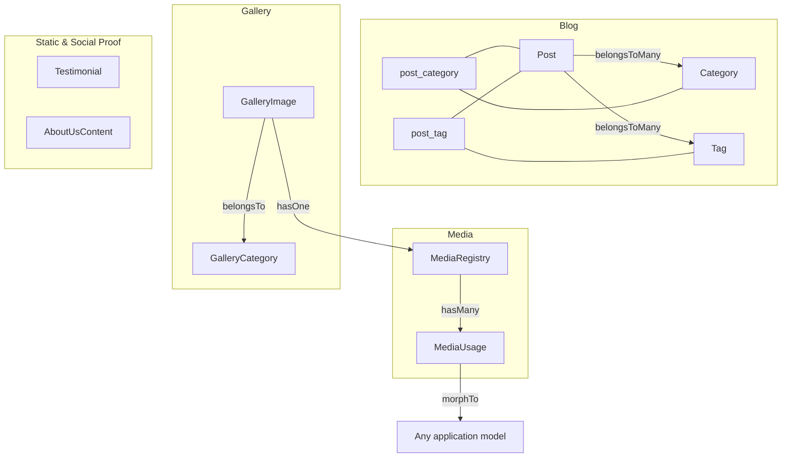
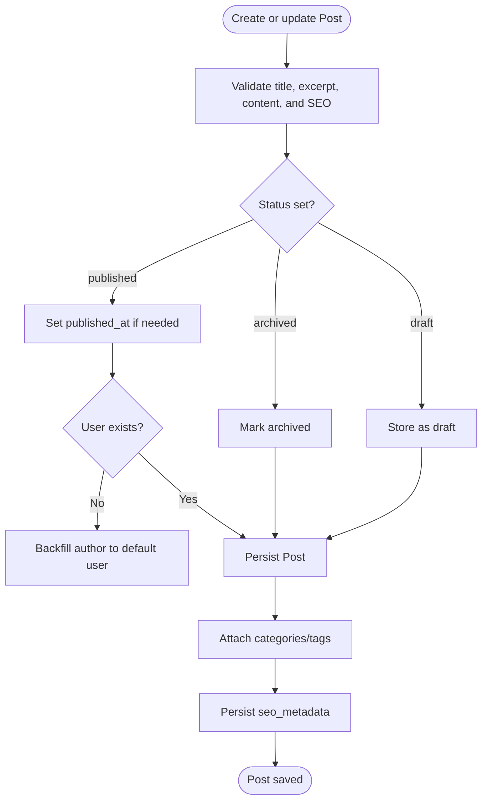
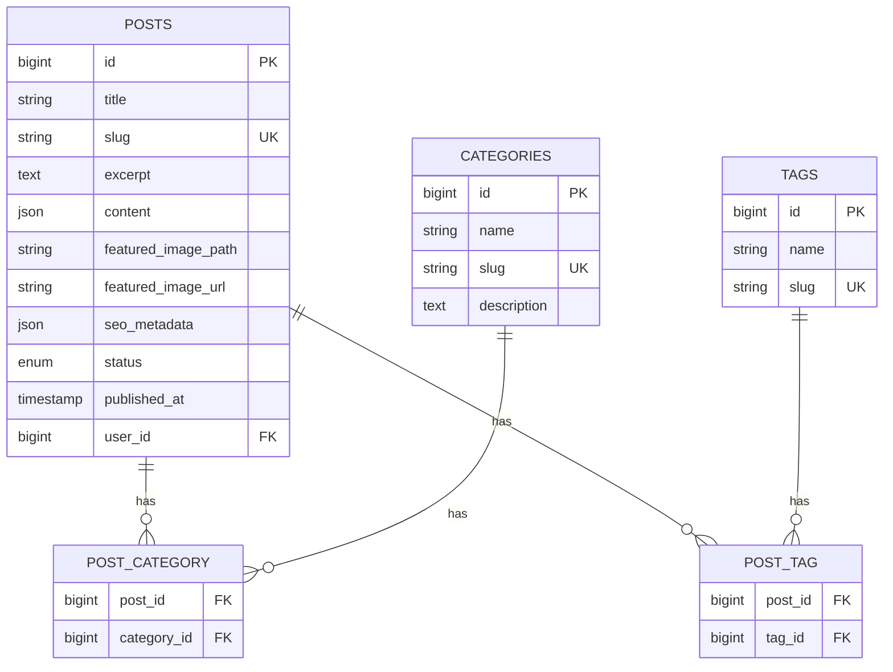
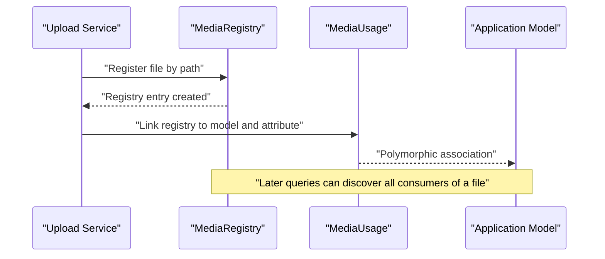
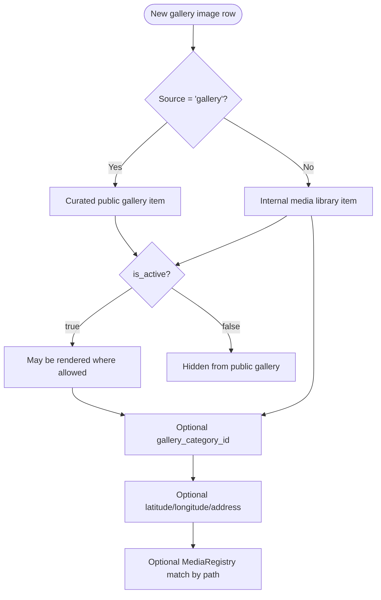
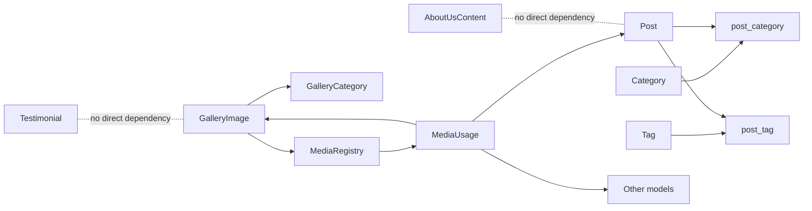

# Content Management Schema

<cite>
**Referenced Files in This Document**
- [Post.php](file://app/Models/Post.php)
- [Category.php](file://app/Models/Category.php)
- [Tag.php](file://app/Models/Tag.php)
- [MediaRegistry.php](file://app/Models/MediaRegistry.php)
- [MediaUsage.php](file://app/Models/MediaUsage.php)
- [GalleryImage.php](file://app/Models/GalleryImage.php)
- [GalleryCategory.php](file://app/Models/GalleryCategory.php)
- [Testimonial.php](file://app/Models/Testimonial.php)
- [AboutUsContent.php](file://app/Models/AboutUsContent.php)
- [2026_04_22_152122_create_posts_table.php](file://database/migrations/2026_04_22_152122_create_posts_table.php)
- [2026_05_12_083642_add_seo_metadata_to_posts_table.php](file://database/migrations/2026_05_12_083642_add_seo_metadata_to_posts_table.php)
- [2026_10_17_120000_add_author_and_relax_content_limits_to_posts_table.php](file://database/migrations/2026_10_17_120000_add_author_and_relax_content_limits_to_posts_table.php)
- [2026_10_17_150000_add_archived_status_to_posts_table.php](file://database/migrations/2026_10_17_150000_add_archived_status_to_posts_table.php)
- [2026_04_22_152130_create_categories_table.php](file://database/migrations/2026_04_22_152130_create_categories_table.php)
- [2026_04_22_152135_create_tags_table.php](file://database/migrations/2026_04_22_152135_create_tags_table.php)
- [2026_04_22_152139_create_post_category_table.php](file://database/migrations/2026_04_22_152139_create_post_category_table.php)
- [2026_04_22_152142_create_post_tag_table.php](file://database/migrations/2026_04_22_152142_create_post_tag_table.php)
- [2026_04_17_110003_create_gallery_images_table.php](file://database/migrations/2026_04_17_110003_create_gallery_images_table.php)
- [2026_04_20_083027_add_location_fields_to_gallery_images_table.php](file://database/migrations/2026_04_20_083027_add_location_fields_to_gallery_images_table.php)
- [2026_04_22_064623_create_gallery_categories_table.php](file://database/migrations/2026_04_22_064623_create_gallery_categories_table.php)
- [2026_04_22_064659_convert_gallery_category_to_foreign_key.php](file://database/migrations/2026_04_22_064659_convert_gallery_category_to_foreign_key.php)
- [2026_10_07_150000_add_source_to_gallery_images_table.php](file://database/migrations/2026_10_07_150000_add_source_to_gallery_images_table.php)
- [2026_04_22_093500_create_about_us_contents_table.php](file://database/migrations/2026_04_22_093500_create_about_us_contents_table.php)
- [2026_04_17_110001_create_testimonials_table.php](file://database/migrations/2026_04_17_110001_create_testimonials_table.php)
- [2026_04_21_090120_update_testimonials_columns_table.php](file://database/migrations/2026_04_21_090120_update_testimonials_columns_table.php)
- [2026_05_14_142832_create_media_registries_table.php](file://database/migrations/2026_05_14_142832_create_media_registries_table.php)
- [2026_05_14_142833_create_media_usages_table.php](file://database/migrations/2026_05_14_142833_create_media_usages_table.php)
</cite>

## Table of Contents
1. Introduction
2. Project Structure
3. Core Components
4. Architecture Overview
5. Detailed Component Analysis
6. Dependency Analysis
7. Performance Considerations
8. Troubleshooting Guide
9. Conclusion

## Introduction
This document describes Highblossom’s content management data model. It focuses on the entities used for blog content, media assets, gallery assets, customer testimonials, and static About Us page content. The schema supports:

- Blog posts with SEO metadata, authorship, publishing workflow, and archival status.
- Categories and tags that organize posts through many-to-many pivot tables.
- A centralized media registry and polymorphic usage tracker for uploaded files.
- Gallery images with optional location data, source tracking, and category grouping.
- Testimonials with ratings, visibility flags, and sort order.
- Static About Us content with mission/vision copy and active row selection.

The documentation maps Eloquent models to database migrations, explains relationships, and provides diagrams for content organization, media flow, and lifecycle management.

## Project Structure
The content management schema lives under two main areas:

- Models define entity behavior, relationships, scopes, and computed attributes.
- Migrations define table schemas, indexes, foreign keys, and column evolution.



**Diagram sources**
- [Post.php:1-274](file://app/Models/Post.php#L1-L274)
- [Category.php:1-46](file://app/Models/Category.php#L1-L46)
- [Tag.php:1-46](file://app/Models/Tag.php#L1-L46)
- [GalleryImage.php:1-169](file://app/Models/GalleryImage.php#L1-L169)
- [GalleryCategory.php:1-61](file://app/Models/GalleryCategory.php#L1-L61)
- [MediaRegistry.php:1-25](file://app/Models/MediaRegistry.php#L1-L25)
- [MediaUsage.php:1-34](file://app/Models/MediaUsage.php#L1-L34)

**Section sources**
- [Post.php:1-274](file://app/Models/Post.php#L1-L274)
- [Category.php:1-46](file://app/Models/Category.php#L1-L46)
- [Tag.php:1-46](file://app/Models/Tag.php#L1-L46)
- [MediaRegistry.php:1-25](file://app/Models/MediaRegistry.php#L1-L25)
- [MediaUsage.php:1-34](file://app/Models/MediaUsage.php#L1-L34)
- [GalleryImage.php:1-169](file://app/Models/GalleryImage.php#L1-L169)
- [GalleryCategory.php:1-61](file://app/Models/GalleryCategory.php#L1-L61)
- [Testimonial.php:1-52](file://app/Models/Testimonial.php#L1-L52)
- [AboutUsContent.php:1-55](file://app/Models/AboutUsContent.php#L1-L55)

## Core Components
This section summarizes each entity, its key responsibilities, and how it participates in the content model.

### Post
A blog article with rich content, SEO metadata, authorship, featured image references, and a publishing workflow including draft, published, and archived states. It also exposes scopes for published/draft/latest ordering, live/scheduled checks, and missing publish requirements.

Key points:
- Stores JSON content and an optional JSON `seo_metadata` block.
- Uses slugs for route binding and canonical URL generation.
- Belongs to a user as author.
- Many-to-many relationships with categories and tags.
- Supports scheduled publication and public visibility checks.

**Section sources**
- [Post.php:1-274](file://app/Models/Post.php#L1-L274)
- [2026_04_22_152122_create_posts_table.php:1-37](file://database/migrations/2026_04_22_152122_create_posts_table.php#L1-L37)
- [2026_05_12_083642_add_seo_metadata_to_posts_table.php:1-28](file://database/migrations/2026_05_12_083642_add_seo_metadata_to_posts_table.php#L1-L28)
- [2026_10_17_120000_add_author_and_relax_content_limits_to_posts_table.php:1-72](file://database/migrations/2026_10_17_120000_add_author_and_relax_content_limits_to_posts_table.php#L1-L72)
- [2026_10_17_150000_add_archived_status_to_posts_table.php:1-36](file://database/migrations/2026_10_17_150000_add_archived_status_to_posts_table.php#L1-L36)

### Category
A hierarchical-like label for grouping posts. Slugs are auto-generated from names, and categories link back to posts via the pivot table.

**Section sources**
- [Category.php:1-46](file://app/Models/Category.php#L1-L46)
- [2026_04_22_152130_create_categories_table.php:1-30](file://database/migrations/2026_04_22_152130_create_categories_table.php#L1-L30)

### Tag
A flat keyword tag for cross-cutting post classification. Like categories, tags auto-generate slugs and relate to posts through a pivot table.

**Section sources**
- [Tag.php:1-46](file://app/Models/Tag.php#L1-L46)
- [2026_04_22_152135_create_tags_table.php:1-29](file://database/migrations/2026_04_22_152135_create_tags_table.php#L1-L29)

### MediaRegistry
Central registry of uploaded files identified by path. It records original file name and size, and tracks all usages across the application.

**Section sources**
- [MediaRegistry.php:1-25](file://app/Models/MediaRegistry.php#L1-L25)
- [2026_05_14_142832_create_media_registries_table.php:1-30](file://database/migrations/2026_05_14_142832_create_media_registries_table.php#L1-L30)

### MediaUsage
Polymorphic pivot linking a single `MediaRegistry` entry to any application model and attribute. It enables auditing which models consume which uploaded files.

**Section sources**
- [MediaUsage.php:1-34](file://app/Models/MediaUsage.php#L1-L34)
- [2026_05_14_142833_create_media_usages_table.php:1-30](file://database/migrations/2026_05_14_142833_create_media_usages_table.php#L1-L30)

### GalleryImage
Represents an image asset that can belong to either:
- The curated public gallery.
- The internal media library used by content blocks.

It supports activity and featured flags, sort order, optional location fields, and a relation to `gallery_category_id`. It also links to `MediaRegistry` by matching its image path.

**Section sources**
- [GalleryImage.php:1-169](file://app/Models/GalleryImage.php#L1-L169)
- [2026_04_17_110003_create_gallery_images_table.php:1-28](file://database/migrations/2026_04_17_110003_create_gallery_images_table.php#L1-L28)
- [2026_04_20_083027_add_location_fields_to_gallery_images_table.php:1-30](file://database/migrations/2026_04_20_083027_add_location_fields_to_gallery_images_table.php#L1-L30)
- [2026_04_22_064659_convert_gallery_category_to_foreign_key.php:1-72](file://database/migrations/2026_04_22_064659_convert_gallery_category_to_foreign_key.php#L1-L72)
- [2026_10_07_150000_add_source_to_gallery_images_table.php:1-49](file://database/migrations/2026_10_07_150000_add_source_to_gallery_images_table.php#L1-L49)

### GalleryCategory
Organizes gallery images into named, sortable, and activable groups. Images reference a category through a nullable foreign key.

**Section sources**
- [GalleryCategory.php:1-61](file://app/Models/GalleryCategory.php#L1-L61)
- [2026_04_22_064623_create_gallery_categories_table.php:1-31](file://database/migrations/2026_04_22_064623_create_gallery_categories_table.php#L1-L31)

### Testimonial
Customer review record with name, role, rating, content, featured flag, published flag, and sort order.

**Section sources**
- [Testimonial.php:1-52](file://app/Models/Testimonial.php#L1-L52)
- [2026_04_17_110001_create_testimonials_table.php:1-27](file://database/migrations/2026_04_17_110001_create_testimonials_table.php#L1-L27)
- [2026_04_21_090120_update_testimonials_columns_table.php:1-34](file://database/migrations/2026_04_21_090120_update_testimonials_columns_table.php#L1-L34)

### AboutUsContent
Static page content with title, subtitle, body, hero image, mission, vision, and an active flag. An accessor selects the best active row with meaningful content.

**Section sources**
- [AboutUsContent.php:1-55](file://app/Models/AboutUsContent.php#L1-L55)
- [2026_04_22_093500_create_about_us_contents_table.php:1-28](file://database/migrations/2026_04_22_093500_create_about_us_contents_table.php#L1-L28)

## Architecture Overview
The content architecture separates three concerns:

1. **Content entities**: Posts, categories, tags, testimonials, and About Us content manage textual and structured content.
2. **Media entities**: `MediaRegistry` and `MediaUsage` provide a centralized audit trail for uploaded files.
3. **Gallery entities**: `GalleryImage` and `GalleryCategory` manage visual assets with optional location metadata and dual-source separation between the public gallery and internal library.

```mermaid
classDiagram
  class Post {
    +string title
    +string slug
    +array content
    +string excerpt
    +string featured_image_path
    +string featured_image_url
    +json seo_metadata
    +enum status
    +timestamp published_at
    +foreign user_id
    +categories()
    +tags()
    +author()
    +scopePublished()
    +scopeDraft()
    +scopeLatest()
  }

  class Category {
    +string name
    +string slug
    +text description
    +posts()
  }

  class Tag {
    +string name
    +string slug
    +posts()
  }

  class MediaRegistry {
    +string path
    +string original_name
    +unsignedBigInteger file_size
    +usages()
  }

  class MediaUsage {
    +foreign media_registry_id
    +string model_type
    +unsignedBigInteger model_id
    +string attribute
    +media()
    +model()
  }

  class GalleryImage {
    +string title
    +text description
    +string image_path
    +string source
    +foreign gallery_category_id
    +boolean is_featured
    +boolean is_active
    +integer sort_order
    +decimal latitude
    +decimal longitude
    +string location_address
    +category()
    +media()
  }

  class GalleryCategory {
    +string name
    +string slug
    +boolean is_active
    +integer sort_order
    +galleryImages()
  }

  class Testimonial {
    +string name
    +string role
    +integer rating
    +text content
    +boolean is_featured
    +boolean is_published
    +integer sort_order
  }

  class AboutUsContent {
    +string title
    +string subtitle
    +text body
    +string hero_image
    +text mission
    +text vision
    +boolean is_active
    +static active()
    +hasContent()
  }

  Post "many" -- "many" Category : "post_category"
  Post "many" -- "many" Tag : "post_tag"
  GalleryImage --> GalleryCategory : "belongsTo"
  GalleryImage --> MediaRegistry : "hasOne by path"
  MediaRegistry --> MediaUsage : "hasMany"
  MediaUsage --> Post : "Morph target"
  MediaUsage --> GalleryImage : "Morph target"
  MediaUsage --> "*": "Any model"
```

**Diagram sources**
- [Post.php:1-274](file://app/Models/Post.php#L1-L274)
- [Category.php:1-46](file://app/Models/Category.php#L1-L46)
- [Tag.php:1-46](file://app/Models/Tag.php#L1-L46)
- [MediaRegistry.php:1-25](file://app/Models/MediaRegistry.php#L1-L25)
- [MediaUsage.php:1-34](file://app/Models/MediaUsage.php#L1-L34)
- [GalleryImage.php:1-169](file://app/Models/GalleryImage.php#L1-L169)
- [GalleryCategory.php:1-61](file://app/Models/GalleryCategory.php#L1-L61)
- [Testimonial.php:1-52](file://app/Models/Testimonial.php#L1-L52)
- [AboutUsContent.php:1-55](file://app/Models/AboutUsContent.php#L1-L55)

## Detailed Component Analysis

### Post Entity
The Post entity models blog articles with:

- **Identity and routing**: Primary key, unique slug, title, excerpt, and JSON content.
- **Publishing workflow**: Enum status supporting draft, published, and archived. Published scope requires current time before or equal to `published_at`.
- **Authorship**: Nullable foreign key to a user, backfilled to a super admin or earliest user when added.
- **SEO**: JSON metadata with defaults derived from title, excerpt, and featured image URL.
- **Media**: Featured image stored as both path and URL; URL resolution falls back to path.
- **Relationships**: Many-to-many with Category and Tag, belongs-to User.



**Diagram sources**
- [Post.php:1-274](file://app/Models/Post.php#L1-L274)
- [2026_10_17_120000_add_author_and_relax_content_limits_to_posts_table.php:1-72](file://database/migrations/2026_10_17_120000_add_author_and_relax_content_limits_to_posts_table.php#L1-L72)
- [2026_10_17_150000_add_archived_status_to_posts_table.php:1-36](file://database/migrations/2026_10_17_150000_add_archived_status_to_posts_table.php#L1-L36)

**Section sources**
- [Post.php:1-274](file://app/Models/Post.php#L1-L274)
- [2026_04_22_152122_create_posts_table.php:1-37](file://database/migrations/2026_04_22_152122_create_posts_table.php#L1-L37)
- [2026_05_12_083642_add_seo_metadata_to_posts_table.php:1-28](file://database/migrations/2026_05_12_083642_add_seo_metadata_to_posts_table.php#L1-L28)
- [2026_10_17_120000_add_author_and_relax_content_limits_to_posts_table.php:1-72](file://database/migrations/2026_10_17_120000_add_author_and_relax_content_limits_to_posts_table.php#L1-L72)
- [2026_10_17_150000_add_archived_status_to_posts_table.php:1-36](file://database/migrations/2026_10_17_150000_add_archived_status_to_posts_table.php#L1-L36)

### Category and Tag Entities
Categories and Tags are lightweight classification entities. Both:

- Generate slugs automatically from names.
- Maintain many-to-many relationships with Post through pivot tables.
- Provide inverse relationships back to Post collections.



**Diagram sources**
- [2026_04_22_152122_create_posts_table.php:1-37](file://database/migrations/2026_04_22_152122_create_posts_table.php#L1-L37)
- [2026_04_22_152130_create_categories_table.php:1-30](file://database/migrations/2026_04_22_152130_create_categories_table.php#L1-L30)
- [2026_04_22_152135_create_tags_table.php:1-29](file://database/migrations/2026_04_22_152135_create_tags_table.php#L1-L29)
- [2026_04_22_152139_create_post_category_table.php:1-28](file://database/migrations/2026_04_22_152139_create_post_category_table.php#L1-L28)
- [2026_04_22_152142_create_post_tag_table.php:1-28](file://database/migrations/2026_04_22_152142_create_post_tag_table.php#L1-L28)
- [Category.php:1-46](file://app/Models/Category.php#L1-L46)
- [Tag.php:1-46](file://app/Models/Tag.php#L1-L46)

**Section sources**
- [Category.php:1-46](file://app/Models/Category.php#L1-L46)
- [Tag.php:1-46](file://app/Models/Tag.php#L1-L46)
- [2026_04_22_152130_create_categories_table.php:1-30](file://database/migrations/2026_04_22_152130_create_categories_table.php#L1-L30)
- [2026_04_22_152135_create_tags_table.php:1-29](file://database/migrations/2026_04_22_152135_create_tags_table.php#L1-L29)
- [2026_04_22_152139_create_post_category_table.php:1-28](file://database/migrations/2026_04_22_152139_create_post_category_table.php#L1-L28)
- [2026_04_22_152142_create_post_tag_table.php:1-28](file://database/migrations/2026_04_22_152142_create_post_tag_table.php#L1-L28)

### Media Registry and Usage
The media subsystem decouples physical file storage from application usage:

- `MediaRegistry.path` is unique and represents the persisted asset location.
- `MediaUsage` records which model and attribute use that file.
- The relationship is polymorphic so any model can be linked to a media file.
- Deleting a registry entry cascades to its usages.



**Diagram sources**
- [MediaRegistry.php:1-25](file://app/Models/MediaRegistry.php#L1-L25)
- [MediaUsage.php:1-34](file://app/Models/MediaUsage.php#L1-L34)
- [2026_05_14_142832_create_media_registries_table.php:1-30](file://database/migrations/2026_05_14_142832_create_media_registries_table.php#L1-L30)
- [2026_05_14_142833_create_media_usages_table.php:1-30](file://database/migrations/2026_05_14_142833_create_media_usages_table.php#L1-L30)

**Section sources**
- [MediaRegistry.php:1-25](file://app/Models/MediaRegistry.php#L1-L25)
- [MediaUsage.php:1-34](file://app/Models/MediaUsage.php#L1-L34)
- [2026_05_14_142832_create_media_registries_table.php:1-30](file://database/migrations/2026_05_14_142832_create_media_registries_table.php#L1-L30)
- [2026_05_14_142833_create_media_usages_table.php:1-30](file://database/migrations/2026_05_14_142833_create_media_usages_table.php#L1-L30)

### Gallery Image and Gallery Category
Gallery images support two surfaces:

- Public gallery entries curated through the admin interface.
- Internal library entries used by content blocks.

The `source` field distinguishes these surfaces. Only gallery rows should render publicly. Images may also include GPS coordinates and a human-readable address.



**Diagram sources**
- [GalleryImage.php:1-169](file://app/Models/GalleryImage.php#L1-L169)
- [2026_10_07_150000_add_source_to_gallery_images_table.php:1-49](file://database/migrations/2026_10_07_150000_add_source_to_gallery_images_table.php#L1-L49)
- [2026_04_20_083027_add_location_fields_to_gallery_images_table.php:1-30](file://database/migrations/2026_04_20_083027_add_location_fields_to_gallery_images_table.php#L1-L30)
- [2026_04_22_064659_convert_gallery_category_to_foreign_key.php:1-72](file://database/migrations/2026_04_22_064659_convert_gallery_category_to_foreign_key.php#L1-L72)

**Section sources**
- [GalleryImage.php:1-169](file://app/Models/GalleryImage.php#L1-L169)
- [GalleryCategory.php:1-61](file://app/Models/GalleryCategory.php#L1-L61)
- [2026_04_17_110003_create_gallery_images_table.php:1-28](file://database/migrations/2026_04_17_110003_create_gallery_images_table.php#L1-L28)
- [2026_04_20_083027_add_location_fields_to_gallery_images_table.php:1-30](file://database/migrations/2026_04_20_083027_add_location_fields_to_gallery_images_table.php#L1-L30)
- [2026_04_22_064623_create_gallery_categories_table.php:1-31](file://database/migrations/2026_04_22_064623_create_gallery_categories_table.php#L1-L31)
- [2026_04_22_064659_convert_gallery_category_to_foreign_key.php:1-72](file://database/migrations/2026_04_22_064659_convert_gallery_category_to_foreign_key.php#L1-L72)
- [2026_10_07_150000_add_source_to_gallery_images_table.php:1-49](file://database/migrations/2026_10_07_150000_add_source_to_gallery_images_table.php#L1-L49)

### Testimonial Entity
Testimonials store customer feedback with:

- Name and role.
- Numeric rating.
- Text content.
- Featured and published flags.
- Sort order for controlled display.

**Section sources**
- [Testimonial.php:1-52](file://app/Models/Testimonial.php#L1-L52)
- [2026_04_17_110001_create_testimonials_table.php:1-27](file://database/migrations/2026_04_17_110001_create_testimonials_table.php#L1-L27)
- [2026_04_21_090120_update_testimonials_columns_table.php:1-34](file://database/migrations/2026_04_21_090120_update_testimonials_columns_table.php#L1-L34)

### About Us Content Entity
About Us content is intentionally versioned:

- Multiple rows may exist.
- The active accessor prefers an active row with meaningful content.
- Fallback returns the most recently updated row if no content-bearing active row exists.

**Section sources**
- [AboutUsContent.php:1-55](file://app/Models/AboutUsContent.php#L1-L55)
- [2026_04_22_093500_create_about_us_contents_table.php:1-28](file://database/migrations/2026_04_22_093500_create_about_us_contents_table.php#L1-L28)

## Dependency Analysis
The schema exhibits clear layering:

- Content models (`Post`, `Category`, `Tag`) depend only on their own tables and pivot tables.
- Gallery models (`GalleryImage`, `GalleryCategory`) depend on one another and optionally on `MediaRegistry`.
- Media models are independent except for polymorphic references outward to any model.
- `Testimonial` and `AboutUsContent` are standalone content entities.



**Diagram sources**
- [Post.php:1-274](file://app/Models/Post.php#L1-L274)
- [Category.php:1-46](file://app/Models/Category.php#L1-L46)
- [Tag.php:1-46](file://app/Models/Tag.php#L1-L46)
- [GalleryImage.php:1-169](file://app/Models/GalleryImage.php#L1-L169)
- [GalleryCategory.php:1-61](file://app/Models/GalleryCategory.php#L1-L61)
- [MediaRegistry.php:1-25](file://app/Models/MediaRegistry.php#L1-L25)
- [MediaUsage.php:1-34](file://app/Models/MediaUsage.php#L1-L34)

**Section sources**
- [Post.php:1-274](file://app/Models/Post.php#L1-L274)
- [Category.php:1-46](file://app/Models/Category.php#L1-L46)
- [Tag.php:1-46](file://app/Models/Tag.php#L1-L46)
- [GalleryImage.php:1-169](file://app/Models/GalleryImage.php#L1-L169)
- [GalleryCategory.php:1-61](file://app/Models/GalleryCategory.php#L1-L61)
- [MediaRegistry.php:1-25](file://app/Models/MediaRegistry.php#L1-L25)
- [MediaUsage.php:1-34](file://app/Models/MediaUsage.php#L1-L34)

## Performance Considerations
- **Indexes**: The posts migration adds indexes on `status` and `published_at`, improving filtering and sorting for blog listing and publication logic.
- **JSON columns**: Post content and SEO metadata are JSON; keep query filters selective and avoid scanning large JSON blobs unnecessarily.
- **Polymorphic relations**: `MediaUsage` morphs to arbitrary models. When querying consumers of a file, scope by `model_type` where possible to reduce join cost.
- **Pivot tables**: Use eager loading for `categories` and `tags` on posts to avoid N+1 queries when rendering lists.
- **Gallery sorting**: `sort_order` is used with an ID tie-break; ensure reads apply the ordered scope consistently.
- **Source scoping**: Always filter gallery images by `source` when serving the public gallery to prevent internal library rows from leaking.

[No sources needed since this section provides general guidance]

## Troubleshooting Guide
Common issues and how the schema helps diagnose them:

- **Post not appearing on the site**: Check `status` is `published` and `published_at` is not in the future. Archived posts are excluded from public scopes.
- **Missing author**: If `user_id` is null, verify whether the author backfill ran; older posts without authors are assigned to a default user during migration.
- **SEO not rendering**: Confirm `seo_metadata` is populated; defaults fall back to title, excerpt, and featured image URL.
- **Media file orphaned**: Query `MediaUsage` by `media_registry_id` to find consumers. Deleting a registry entry removes usages due to cascade rules.
- **Gallery image visible unexpectedly**: Verify `source` is `library`; library rows should be inactive and excluded from public gallery queries.
- **Location data missing**: Check `latitude`, `longitude`, and `location_address`; these were added later and may be null for legacy images.
- **About Us blank page**: Prefer using the model’s active accessor rather than first-row selection; it prioritizes active rows with real content.

**Section sources**
- [Post.php:1-274](file://app/Models/Post.php#L1-L274)
- [2026_10_17_120000_add_author_and_relax_content_limits_to_posts_table.php:1-72](file://database/migrations/2026_10_17_120000_add_author_and_relax_content_limits_to_posts_table.php#L1-L72)
- [2026_10_17_150000_add_archived_status_to_posts_table.php:1-36](file://database/migrations/2026_10_17_150000_add_archived_status_to_posts_table.php#L1-L36)
- [MediaUsage.php:1-34](file://app/Models/MediaUsage.php#L1-L34)
- [2026_05_14_142833_create_media_usages_table.php:1-30](file://database/migrations/2026_05_14_142833_create_media_usages_table.php#L1-L30)
- [GalleryImage.php:1-169](file://app/Models/GalleryImage.php#L1-L169)
- [2026_10_07_150000_add_source_to_gallery_images_table.php:1-49](file://database/migrations/2026_10_07_150000_add_source_to_gallery_images_table.php#L1-L49)
- [2026_04_20_083027_add_location_fields_to_gallery_images_table.php:1-30](file://database/migrations/2026_04_20_083027_add_location_fields_to_gallery_images_table.php#L1-L30)
- [AboutUsContent.php:1-55](file://app/Models/AboutUsContent.php#L1-L55)

## Conclusion
Highblossom’s content management schema cleanly separates content, media, and presentation concerns:

- Posts carry rich content, SEO, authorship, and lifecycle state.
- Categories and tags provide flexible, many-to-many classification.
- MediaRegistry and MediaUsage centralize file ownership and usage tracking.
- GalleryImage and GalleryCategory organize visual assets with optional location data and source-based visibility control.
- Testimonials and AboutUsContent support social proof and static page content.

This design supports safe content retirement, auditable media usage, and scalable content organization while remaining readable for developers who extend the system.