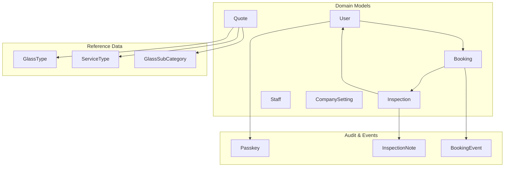
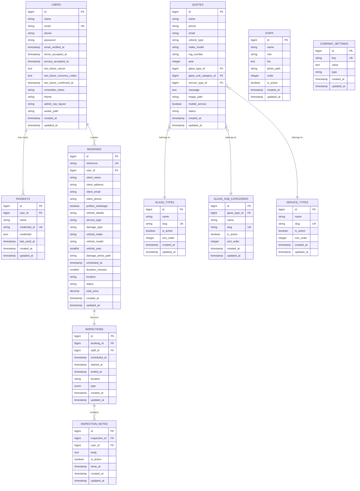
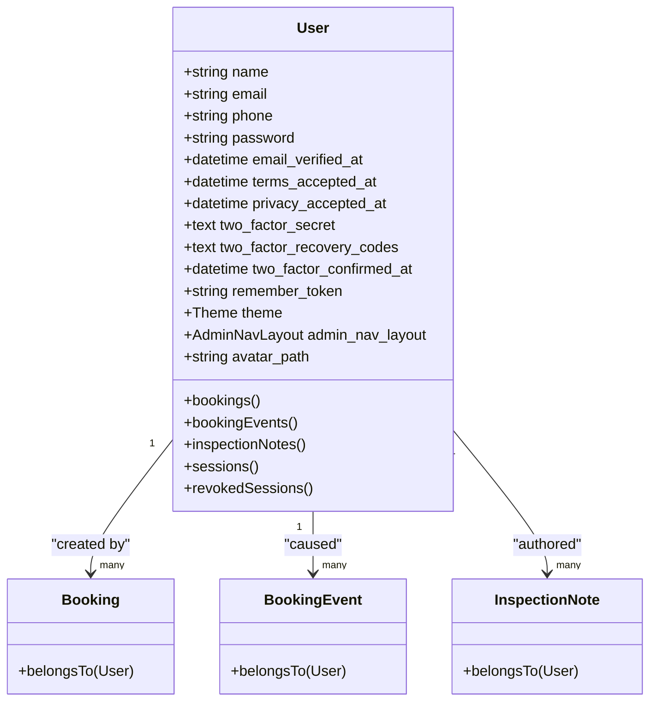
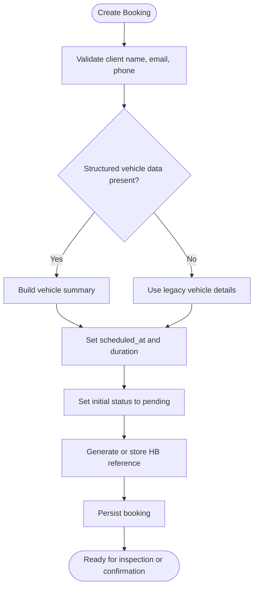
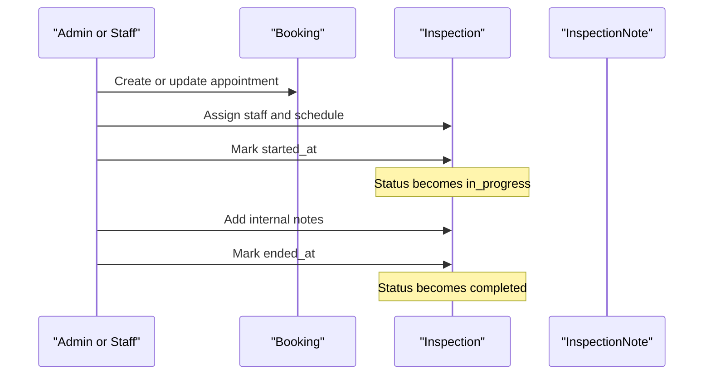
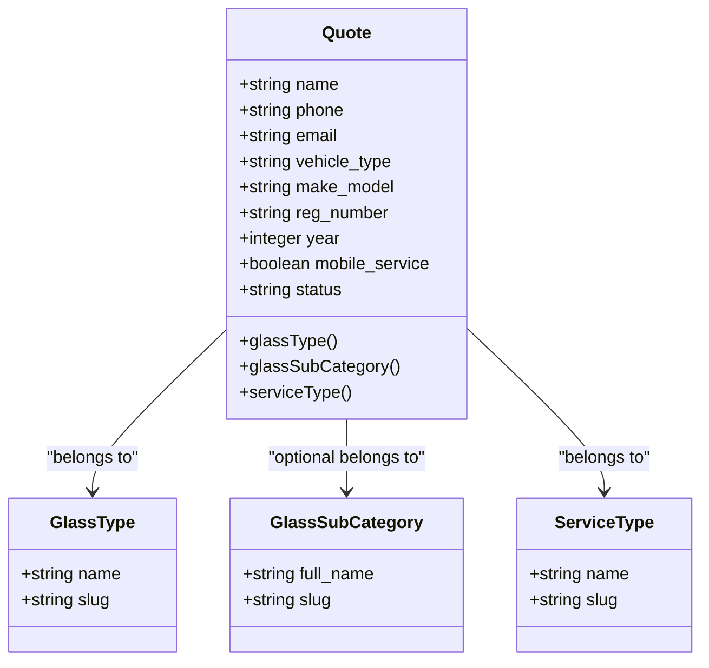
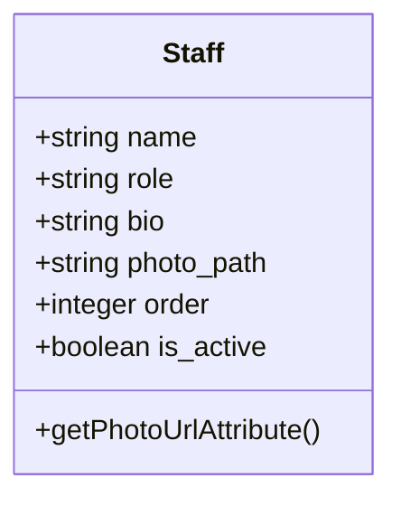
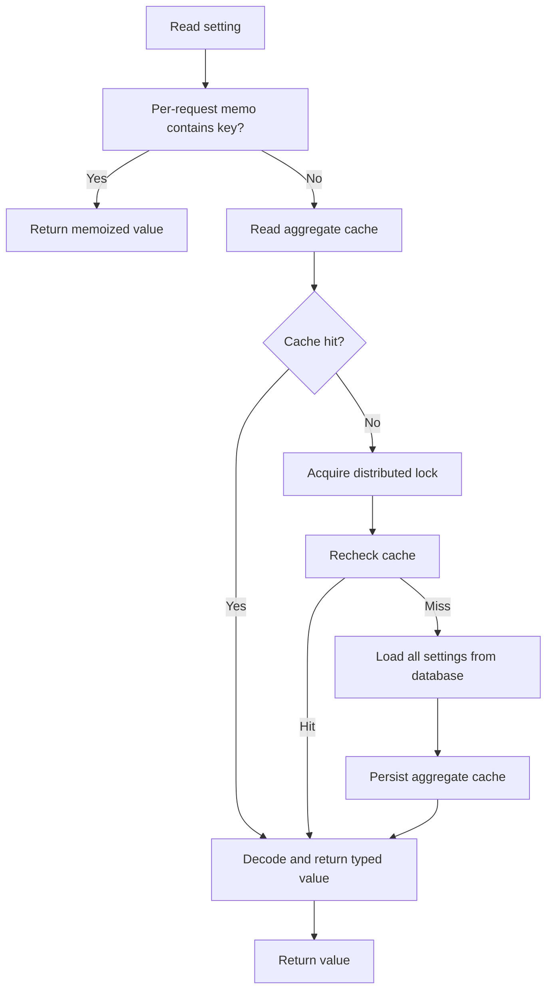
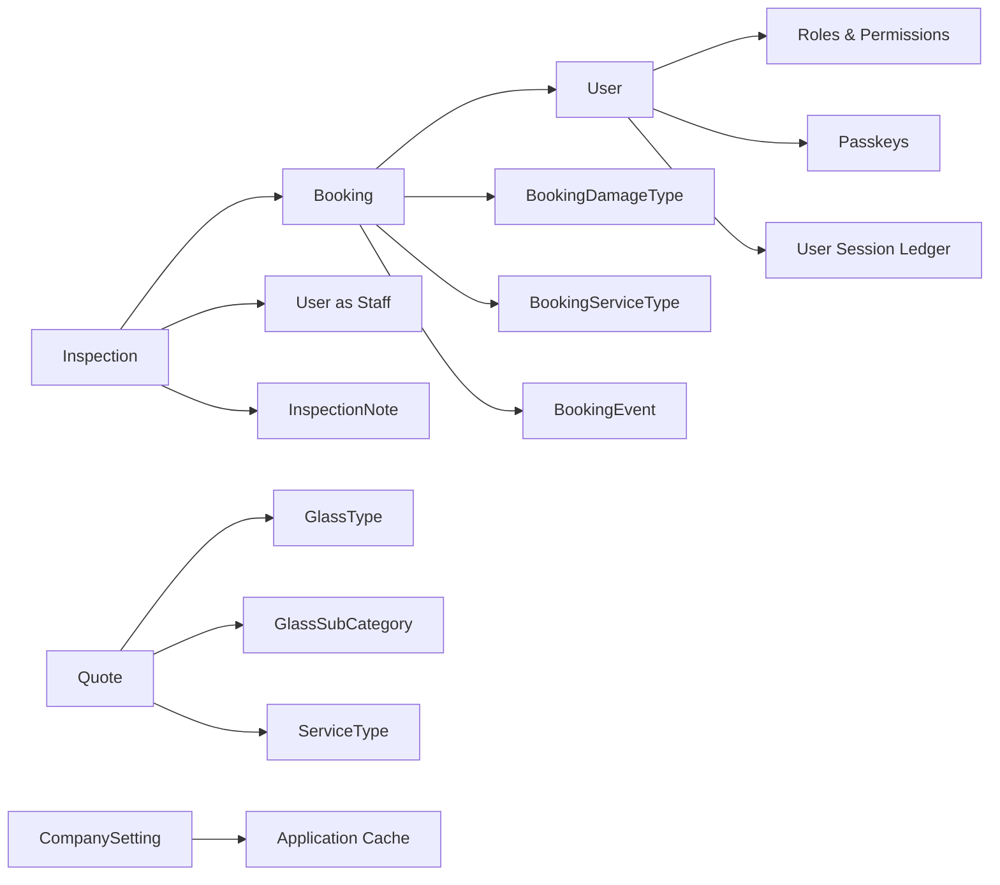

# Core Entities

<cite>
**Referenced Files in This Document**   
- [User.php](file://app/Models/User.php)
- [LoginMethod.php](file://app/Enums/LoginMethod.php)
- [Theme.php](file://app/Enums/Theme.php)
- [SessionEndReason.php](file://app/Enums/SessionEndReason.php)
- [Booking.php](file://app/Models/Booking.php)
- [BookingDamageType.php](file://app/Enums/BookingDamageType.php)
- [BookingServiceType.php](file://app/Enums/BookingServiceType.php)
- [Inspection.php](file://app/Models/Inspection.php)
- [Quote.php](file://app/Models/Quote.php)
- [Staff.php](file://app/Models/Staff.php)
- [CompanySetting.php](file://app/Models/CompanySetting.php)
- [0001_01_01_000000_create_users_table.php](file://database/migrations/0001_01_01_000000_create_users_table.php)
- [2025_08_14_170933_add_two_factor_columns_to_users_table.php](file://database/migrations/2025_08_14_170933_add_two_factor_columns_to_users_table.php)
- [2026_04_21_081253_add_theme_preference_to_users_table.php](file://database/migrations/2026_04_21_081253_add_theme_preference_to_users_table.php)
- [2026_05_26_000000_rename_theme_preference_to_theme_in_users_table.php](file://database/migrations/2026_05_26_000000_rename_theme_preference_to_theme_in_users_table.php)
- [2026_06_02_191250_add_consent_columns_to_users_table.php](file://database/migrations/2026_06_02_191250_add_consent_columns_to_users_table.php)
- [2026_06_08_113028_create_passkeys_table.php](file://database/migrations/2026_06_08_113028_create_passkeys_table.php)
- [2026_10_03_120000_add_phone_and_avatar_to_users_table.php](file://database/migrations/2026_10_03_120000_add_phone_and_avatar_to_users_table.php)
- [2026_10_24_000100_add_admin_nav_layout_to_users_table.php](file://database/migrations/2026_10_24_000100_add_admin_nav_layout_to_users_table.php)
- [2026_04_17_093356_create_bookings_table.php](file://database/migrations/2026_04_17_093356_create_bookings_table.php)
- [2026_07_07_000000_add_scheduled_fields_to_bookings_table.php](file://database/migrations/2026_07_07_000000_add_scheduled_fields_to_bookings_table.php)
- [2026_10_01_000000_replace_unique_index_on_bookings_scheduled_at.php](file://database/migrations/2026_10_01_000000_replace_unique_index_on_bookings_scheduled_at.php)
- [2026_10_18_000000_add_structured_fields_to_bookings_table.php](file://database/migrations/2026_10_18_000000_add_structured_fields_to_bookings_table.php)
- [2026_10_18_000002_add_prefers_whatsapp_to_bookings_table.php](file://database/migrations/2026_10_18_000002_add_prefers_whatsapp_to_bookings_table.php)
- [2026_10_18_000003_make_vehicle_details_nullable_on_bookings_table.php](file://database/migrations/2026_10_18_000003_make_vehicle_details_nullable_on_bookings_table.php)
- [2026_04_17_093358_create_inspections_table.php](file://database/migrations/2026_04_17_093358_create_inspections_table.php)
- [2026_07_09_194144_make_ended_at_nullable_on_inspections_table.php](file://database/migrations/2026_07_09_194144_make_ended_at_nullable_on_inspections_table.php)
- [2026_10_01_150100_create_inspection_notes_table.php](file://database/migrations/2026_10_01_150100_create_inspection_notes_table.php)
- [2026_10_01_150200_add_started_at_to_inspections_table.php](file://database/migrations/2026_10_01_150200_add_started_at_to_inspections_table.php)
- [2026_04_17_110000_create_company_settings_table.php](file://database/migrations/2026_04_17_110000_create_company_settings_table.php)
- [2026_05_25_102702_create_staff_table.php](file://database/migrations/2026_05_25_102702_create_staff_table.php)
- [2026_04_17_093357_create_staff_absences_table.php](file://database/migrations/2026_04_17_093357_create_staff_absences_table.php)
- [2026_04_20_080000_create_glass_types_table.php](file://database/migrations/2026_04_20_080000_create_glass_types_table.php)
- [2026_04_20_080001_create_service_types_table.php](file://database/migrations/2026_04_20_080001_create_service_types_table.php)
- [2026_04_20_080002_create_quotes_table.php](file://database/migrations/2026_04_20_080002_create_quotes_table.php)
- [2026_05_07_080000_create_glass_sub_categories_table.php](file://database/migrations/2026_05_07_080000_create_glass_sub_categories_table.php)
- [2026_05_07_080001_add_glass_sub_category_id_to_quotes_table.php](file://database/migrations/2026_05_07_080001_add_glass_sub_category_id_to_quotes_table.php)
</cite>

## Table of Contents
1. [Introduction](#introduction)
2. [Project Structure](#project-structure)
3. [Core Components](#core-components)
4. [Architecture Overview](#architecture-overview)
5. [Detailed Component Analysis](#detailed-component-analysis)
6. [Dependency Analysis](#dependency-analysis)
7. [Performance Considerations](#performance-considerations)
8. [Troubleshooting Guide](#troubleshooting-guide)
9. [Conclusion](#conclusion)

## Introduction
This document describes Highblossom’s core business data model. It focuses on six primary entities: User, Booking, Inspection, Quote, Staff, and CompanySetting. For each entity it explains the database schema, Eloquent model behavior, relationships, validation rules, domain enums, and common query patterns. It also provides entity relationship diagrams to show how customers, appointments, inspections, quotes, staff profiles, and application settings interact.

The documentation is intended for developers, product owners, and administrators who need to understand how customer bookings, glass inspection work, quote requests, authentication, and configuration are represented in the system.

## Project Structure
The data model lives primarily under `app/Models`, with supporting enumerations under `app/Enums`. Database definitions live under `database/migrations`. The models use Laravel conventions: fillable attributes, casts, Eloquent relations, computed attributes, and scopes where appropriate.

**Diagram sources**
- [User.php:65-141](file://app/Models/User.php#L65-L141)
- [Booking.php:85-134](file://app/Models/Booking.php#L85-L134)
- [Inspection.php:40-82](file://app/Models/Inspection.php#L40-L82)
- [Quote.php:39-76](file://app/Models/Quote.php#L39-L76)
- [2026_06_08_113028_create_passkeys_table.php:14-34](file://database/migrations/2026_06_08_113028_create_passkeys_table.php#L14-L34)
- [2026_10_01_150100_create_inspection_notes_table.php:18-42](file://database/migrations/2026_10_01_150100_create_inspection_notes_table.php#L18-L42)

**Section sources**
- [User.php:1-141](file://app/Models/User.php#L1-L141)
- [Booking.php:1-134](file://app/Models/Booking.php#L1-L134)
- [Inspection.php:1-82](file://app/Models/Inspection.php#L1-L82)
- [Quote.php:1-76](file://app/Models/Quote.php#L1-L76)
- [Staff.php:1-45](file://app/Models/Staff.php#L1-L45)
- [CompanySetting.php:1-196](file://app/Models/CompanySetting.php#L1-L196)

## Core Components
Highblossom organizes its data model around these core responsibilities:

- **User**: Authentication identity, passkeys, two-factor settings, theme preference, admin navigation layout, consent timestamps, phone number, avatar, and role-based access.
- **Booking**: Customer appointment record with client information, vehicle details, service type, damage type, scheduled slot, pricing, status, and structured booking metadata.
- **Inspection**: On-site or workshop operation linked to a booking, assigned to a staff member, with timestamps, location, type, and internal notes.
- **Quote**: Pre-booking glass quotation request with contact details, vehicle description, glass type, optional subcategory, service type, mobile-service flag, and workflow status.
- **Staff**: Team member profile used for presentation and ordering, independent from the authenticated user account model.
- **CompanySetting**: Application-wide key-value configuration with typed values, aggregate caching, and per-request memoization.

**Section sources**
- [User.php:16-35](file://app/Models/User.php#L16-L35)
- [Booking.php:16-37](file://app/Models/Booking.php#L16-L37)
- [Inspection.php:16-34](file://app/Models/Inspection.php#L16-L34)
- [Quote.php:14-26](file://app/Models/Quote.php#L14-L26)
- [Staff.php:12-27](file://app/Models/Staff.php#L12-L27)
- [CompanySetting.php:16-36](file://app/Models/CompanySetting.php#L16-L36)

## Architecture Overview
The core entities form a small but important operational graph. A customer creates a Booking; an Inspection records field operations for that Booking; Notes provide internal commentary on an Inspection; Quotes capture pre-sale glass requests and reference catalog entities such as GlassType, GlassSubCategory, and ServiceType.

**Diagram sources**
- [0001_01_01_000000_create_users_table.php:12-29](file://database/migrations/0001_01_01_000000_create_users_table.php#L12-L29)
- [2025_08_14_170933_add_two_factor_columns_to_users_table.php:16-27](file://database/migrations/2025_08_14_170933_add_two_factor_columns_to_users_table.php#L16-L27)
- [2026_04_21_081253_add_theme_preference_to_users_table.php:16-22](file://database/migrations/2026_04_21_081253_add_theme_preference_to_users_table.php#L16-L22)
- [2026_05_26_000000_rename_theme_preference_to_theme_in_users_table.php:16-22](file://database/migrations/2026_05_26_000000_rename_theme_preference_to_theme_in_users_table.php#L16-L22)
- [2026_06_02_191250_add_consent_columns_to_users_table.php:16-23](file://database/migrations/2026_06_02_191250_add_consent_columns_to_users_table.php#L16-L23)
- [2026_06_08_113028_create_passkeys_table.php:14-34](file://database/migrations/2026_06_08_113028_create_passkeys_table.php#L14-L34)
- [2026_10_03_120000_add_phone_and_avatar_to_users_table.php:16-23](file://database/migrations/2026_10_03_120000_add_phone_and_avatar_to_users_table.php#L16-L23)
- [2026_10_24_000100_add_admin_nav_layout_to_users_table.php:33-41](file://database/migrations/2026_10_24_000100_add_admin_nav_layout_to_users_table.php#L33-L41)
- [2026_04_17_093356_create_bookings_table.php:12-33](file://database/migrations/2026_04_17_093356_create_bookings_table.php#L12-L33)
- [2026_07_07_000000_add_scheduled_fields_to_bookings_table.php:16-23](file://database/migrations/2026_07_07_000000_add_scheduled_fields_to_bookings_table.php#L16-L23)
- [2026_10_01_000000_replace_unique_index_on_bookings_scheduled_at.php:29-41](file://database/migrations/2026_10_01_000000_replace_unique_index_on_bookings_scheduled_at.php#L29-L41)
- [2026_10_18_000000_add_structured_fields_to_bookings_table.php:43-68](file://database/migrations/2026_10_18_000000_add_structured_fields_to_bookings_table.php#L43-L68)
- [2026_10_18_000002_add_prefers_whatsapp_to_bookings_table.php:23-31](file://database/migrations/2026_10_18_000002_add_prefers_whatsapp_to_bookings_table.php#L23-L31)
- [2026_10_18_000003_make_vehicle_details_nullable_on_bookings_table.php:24-32](file://database/migrations/2026_10_18_000003_make_vehicle_details_nullable_on_bookings_table.php#L24-L32)
- [2026_04_17_093358_create_inspections_table.php:12-31](file://database/migrations/2026_04_17_093358_create_inspections_table.php#L12-L31)
- [2026_07_09_194144_make_ended_at_nullable_on_inspections_table.php:16-23](file://database/migrations/2026_07_09_194144_make_ended_at_nullable_on_inspections_table.php#L16-L23)
- [2026_10_01_150100_create_inspection_notes_table.php:18-42](file://database/migrations/2026_10_01_150100_create_inspection_notes_table.php#L18-L42)
- [2026_10_01_150200_add_started_at_to_inspections_table.php:24-32](file://database/migrations/2026_10_01_150200_add_started_at_to_inspections_table.php#L24-L32)
- [2026_04_20_080000_create_glass_types_table.php:10-23](file://database/migrations/2026_04_20_080000_create_glass_types_table.php#L10-L23)
- [2026_04_20_080001_create_service_types_table.php:10-23](file://database/migrations/2026_04_20_080001_create_service_types_table.php#L10-L23)
- [2026_04_20_080002_create_quotes_table.php:10-31](file://database/migrations/2026_04_20_080002_create_quotes_table.php#L10-L31)
- [2026_05_07_080000_create_glass_sub_categories_table.php:10-33](file://database/migrations/2026_05_07_080000_create_glass_sub_categories_table.php#L10-L33)
- [2026_05_07_080001_add_glass_sub_category_id_to_quotes_table.php:13-25](file://database/migrations/2026_05_07_080001_add_glass_sub_category_id_to_quotes_table.php#L13-L25)

## Detailed Component Analysis

### User Entity
The User entity represents both customer and staff identities. It supports email verification, password hashing, two-factor authentication, passkeys, roles, API tokens, themes, admin navigation preferences, consent tracking, phone number, and avatar storage.

#### Database Schema Summary
| Column | Type | Nullable | Constraints | Purpose |
|---|---|---:|---|---|
| `id` | auto-increment integer | No | Primary key | Identity |
| `name` | string | No | Required | Display name |
| `email` | string | No | Unique | Login and communication address |
| `phone` | string | Yes | None | Contact number |
| `password` | string | No | Required | Hashed password |
| `email_verified_at` | timestamp | Yes | None | Email verification time |
| `terms_accepted_at` | timestamp | Yes | None | Terms-of-service acceptance |
| `privacy_accepted_at` | timestamp | Yes | None | Privacy-policy acceptance |
| `two_factor_secret` | text | Yes | None | Two-factor secret |
| `two_factor_recovery_codes` | text | Yes | None | Recovery codes |
| `two_factor_confirmed_at` | timestamp | Yes | None | Two-factor confirmation time |
| `remember_token` | string | Yes | None | Remember-me token |
| `theme` | string | No | Default `auto` | UI theme preference |
| `admin_nav_layout` | string | Yes | None | Admin navigation choice |
| `avatar_path` | string | Yes | None | Avatar file path |
| `created_at` / `updated_at` | timestamp | No | Laravel timestamps | Lifecycle |

#### Model Behavior
- Fillable fields include name, username, email, phone, password, theme, admin_nav_layout, avatar_path, and consent timestamps.
- Hidden fields exclude password, two-factor secret, recovery codes, and remember token.
- Casts convert datetime columns, hash passwords, map theme to an enum, and map admin navigation layout to an enum.
- Username input is normalized before persistence so case-insensitive uniqueness remains consistent with the unique index.
- Accessors compute avatar URL and initials.
- Relations connect users to bookings, booking events, inspection notes, blog posts, and session ledger rows.

#### Validation Rules
- Email must be unique across all accounts.
- Password must be hashed by the framework.
- Theme values are constrained by the Theme enum.
- Admin navigation layout values are constrained by code-level casting and validation rules rather than a native database enum.
- Consent timestamps should be set when applicable to track legal compliance.

#### Common Query Patterns
- Find a user by email: `User::where('email', $email)->first()`
- Verify email presence: check whether `email_verified_at` is non-null.
- Check two-factor status: inspect `two_factor_secret` and `two_factor_confirmed_at`.
- Retrieve active sessions: join or filter through the session ledger relation.
- Filter admins: use role checks through the roles trait.

#### Relationships
- One-to-many bookings.
- One-to-many booking events.
- One-to-many inspection notes authored by the user.
- One-to-many session ledger entries.
- Many-to-many roles through the roles trait.

**Diagram sources**
- [User.php:16-141](file://app/Models/User.php#L16-L141)
- [Booking.php:105-118](file://app/Models/Booking.php#L105-L118)
- [2026_04_17_093356_create_bookings_table.php:12-33](file://database/migrations/2026_04_17_093356_create_bookings_table.php#L12-L33)

**Section sources**
- [User.php:16-141](file://app/Models/User.php#L16-L141)
- [0001_01_01_000000_create_users_table.php:12-29](file://database/migrations/0001_01_01_000000_create_users_table.php#L12-L29)
- [2025_08_14_170933_add_two_factor_columns_to_users_table.php:16-27](file://database/migrations/2025_08_14_170933_add_two_factor_columns_to_users_table.php#L16-L27)
- [2026_04_21_081253_add_theme_preference_to_users_table.php:16-22](file://database/migrations/2026_04_21_081253_add_theme_preference_to_users_table.php#L16-L22)
- [2026_05_26_000000_rename_theme_preference_to_theme_in_users_table.php:16-22](file://database/migrations/2026_05_26_000000_rename_theme_preference_to_theme_in_users_table.php#L16-L22)
- [2026_06_02_191250_add_consent_columns_to_users_table.php:16-23](file://database/migrations/2026_06_02_191250_add_consent_columns_to_users_table.php#L16-L23)
- [2026_06_08_113028_create_passkeys_table.php:14-34](file://database/migrations/2026_06_08_113028_create_passkeys_table.php#L14-L34)
- [2026_10_03_120000_add_phone_and_avatar_to_users_table.php:16-23](file://database/migrations/2026_10_03_120000_add_phone_and_avatar_to_users_table.php#L16-L23)
- [2026_10_24_000100_add_admin_nav_layout_to_users_table.php:33-41](file://database/migrations/2026_10_24_000100_add_admin_nav_layout_to_users_table.php#L33-L41)
- [Theme.php:7-15](file://app/Enums/Theme.php#L7-L15)
- [LoginMethod.php:7-31](file://app/Enums/LoginMethod.php#L7-L31)
- [SessionEndReason.php:7-35](file://app/Enums/SessionEndReason.php#L7-L35)

### Booking Entity
A Booking represents a customer appointment for glass-related services. It stores client contact information, vehicle information, service type, damage type, scheduling, pricing, status, and structured job metadata.

#### Database Schema Summary
| Column | Type | Nullable | Constraints | Purpose |
|---|---|---:|---|---|
| `id` | auto-increment integer | No | Primary key | Appointment identity |
| `reference` | string | Yes | Unique | Customer-facing booking identifier |
| `user_id` | foreign key | Yes | Null-on-delete | Optional authenticated customer |
| `client_name` | string | No | Required | Customer name |
| `client_address` | string | Yes | None | Client delivery or visit address |
| `client_email` | string | No | Indexed | Customer email |
| `client_phone` | string | No | Required | Phone contact |
| `prefers_whatsapp` | boolean | No | Default false | Preferred follow-up channel |
| `vehicle_details` | string | Yes | None | Legacy free-form vehicle text |
| `service_type` | string | Yes | Indexed | Enum-like service category |
| `damage_type` | string | Yes | None | Enum-like damage category |
| `vehicle_make` | string | Yes | None | Structured vehicle make |
| `vehicle_model` | string | Yes | None | Structured vehicle model |
| `vehicle_year` | smallint | Yes | None | Structured vehicle year |
| `damage_photo_path` | string | Yes | None | Photo of damage |
| `scheduled_at` | timestamp | Yes | Indexed | Appointments start time |
| `duration_minutes` | smallint | No | Default 60 | Job length snapshot |
| `location` | string | Yes | None | Visit or workshop location |
| `status` | enum | No | Default pending, indexed | Appointment lifecycle state |
| `total_price` | decimal | No | Default zero | Estimated or final price |
| `created_at` / `updated_at` | timestamp | No | Laravel timestamps | Lifecycle |

#### Model Behavior
- Scheduled times and prices are cast appropriately.
- Vehicle year and duration are integers.
- WhatsApp preference is a boolean.
- Service type and damage type are cast to domain enums.
- `endsAt` computes the appointment end from start plus duration.
- `durationMinutes` returns at least 15 minutes, falling back to 60 when unset.
- `displayReference` shows a stored reference or a generated `HB-` prefixed identifier.
- `vehicleSummary` builds a structured vehicle description or falls back to legacy text.
- Status helper identifies cancelled bookings.

#### Validation Rules
- Client name, email, and phone are required by the original table definition.
- Status must be one of pending, confirmed, cancelled, or completed.
- Service type and damage type should match their respective enum values.
- Vehicle details can now be empty because structured fields carry most vehicle data.
- Duration defaults to 60 minutes and has a minimum of 15 minutes in logic.
- Reference values are unique and human-readable.

#### Common Query Patterns
- Upcoming jobs: `Booking::whereNotNull('scheduled_at')->where('scheduled_at', '>', now())->orderBy('scheduled_at')`
- Cancelled bookings: `Booking::where('status', 'cancelled')`
- Dashboard lists: rely on the composite index on status and created_at.
- Structured vehicle queries: filter by `vehicle_make`, `vehicle_model`, or `vehicle_year`.
- Service-type filtering: use the `service_type` index.
- Customer lookup: query by `client_email` or `user_id`.

#### Relationships
- Belongs to User.
- Has one Inspection.
- Has many BookingEvent milestones.

**Diagram sources**
- [Booking.php:29-84](file://app/Models/Booking.php#L29-L84)
- [2026_10_18_000000_add_structured_fields_to_bookings_table.php:43-68](file://database/migrations/2026_10_18_000000_add_structured_fields_to_bookings_table.php#L43-L68)

**Section sources**
- [Booking.php:16-134](file://app/Models/Booking.php#L16-L134)
- [2026_04_17_093356_create_bookings_table.php:12-33](file://database/migrations/2026_04_17_093356_create_bookings_table.php#L12-L33)
- [2026_07_07_000000_add_scheduled_fields_to_bookings_table.php:16-23](file://database/migrations/2026_07_07_000000_add_scheduled_fields_to_bookings_table.php#L16-L23)
- [2026_10_01_000000_replace_unique_index_on_bookings_scheduled_at.php:29-41](file://database/migrations/2026_10_01_000000_replace_unique_index_on_bookings_scheduled_at.php#L29-L41)
- [2026_10_18_000000_add_structured_fields_to_bookings_table.php:43-68](file://database/migrations/2026_10_18_000000_add_structured_fields_to_bookings_table.php#L43-L68)
- [2026_10_18_000002_add_prefers_whatsapp_to_bookings_table.php:23-31](file://database/migrations/2026_10_18_000002_add_prefers_whatsapp_to_bookings_table.php#L23-L31)
- [2026_10_18_000003_make_vehicle_details_nullable_on_bookings_table.php:24-32](file://database/migrations/2026_10_18_000003_make_vehicle_details_nullable_on_bookings_table.php#L24-L32)
- [BookingDamageType.php:11-37](file://app/Enums/BookingDamageType.php#L11-L37)
- [BookingServiceType.php:11-64](file://app/Enums/BookingServiceType.php#L11-L64)

### Inspection Entity
An Inspection records an on-site or workshop operation tied to a Booking. It tracks scheduling, actual start and end times, location, operation type, and internal notes.

#### Database Schema Summary
| Column | Type | Nullable | Constraints | Purpose |
|---|---|---:|---|---|
| `id` | auto-increment integer | No | Primary key | Inspection identity |
| `booking_id` | foreign key | No | Cascade delete | Parent appointment |
| `staff_id` | foreign key | No | References users | Assigned technician or staff |
| `scheduled_at` | timestamp | No | Indexed | Planned start |
| `started_at` | timestamp | Yes | None | Actual start marker |
| `ended_at` | timestamp | Yes | Indexed | Completion marker |
| `location` | string | No | None | Visit or workshop location |
| `type` | enum | No | Indexed | Mobile or workshop |
| `created_at` / `updated_at` | timestamp | No | Laravel timestamps | Lifecycle |

#### Model Behavior
- Timestamps are cast to datetime objects.
- `booking` belongs to a Booking.
- `staff` belongs to a User used as a staff member.
- `notes` returns internal inspection notes ordered newest first.
- Computed status derives from timestamps: completed when ended, in progress when started, overdue if past scheduled time, otherwise scheduled.

#### Validation Rules
- Booking and staff references must exist.
- Type must be mobile or workshop.
- Status is derived, not directly persisted.
- Internal notes are separate from customer-visible booking events.

#### Common Query Patterns
- Available staff slots: filter inspections by staff, scheduled window, and completion state.
- In-progress inspections: `Inspection::whereNotNull('started_at')->whereNull('ended_at')`
- Completed inspections: `Inspection::whereNotNull('ended_at')`
- Overdue inspections: compare `scheduled_at` with current time when `started_at` is null.
- Notes retrieval: eager-load `notes` to avoid N+1 queries.

#### Relationships
- Belongs to Booking.
- Belongs to User as staff.
- Has many InspectionNote records.

**Diagram sources**
- [Inspection.php:16-82](file://app/Models/Inspection.php#L16-L82)
- [2026_04_17_093358_create_inspections_table.php:12-31](file://database/migrations/2026_04_17_093358_create_inspections_table.php#L12-L31)
- [2026_10_01_150100_create_inspection_notes_table.php:18-42](file://database/migrations/2026_10_01_150100_create_inspection_notes_table.php#L18-L42)

**Section sources**
- [Inspection.php:16-82](file://app/Models/Inspection.php#L16-L82)
- [2026_04_17_093358_create_inspections_table.php:12-31](file://database/migrations/2026_04_17_093358_create_inspections_table.php#L12-L31)
- [2026_07_09_194144_make_ended_at_nullable_on_inspections_table.php:16-23](file://database/migrations/2026_07_09_194144_make_ended_at_nullable_on_inspections_table.php#L16-L23)
- [2026_10_01_150100_create_inspection_notes_table.php:18-42](file://database/migrations/2026_10_01_150100_create_inspection_notes_table.php#L18-L42)
- [2026_10_01_150200_add_started_at_to_inspections_table.php:24-32](file://database/migrations/2026_10_01_150200_add_started_at_to_inspections_table.php#L24-L32)

### Quote Entity
A Quote captures a customer’s glass service inquiry before a formal booking. It includes contact details, vehicle information, selected glass type, optional glass subcategory, service type, optional image, mobile-service preference, and workflow status.

#### Database Schema Summary
| Column | Type | Nullable | Constraints | Purpose |
|---|---|---:|---|---|
| `id` | auto-increment integer | No | Primary key | Quote identity |
| `name` | string | No | Required | Customer name |
| `phone` | string | No | Required | Contact number |
| `email` | string | Yes | None | Optional email |
| `vehicle_type` | string | No | Required | Vehicle classification |
| `make_model` | string | Yes | None | Free-form vehicle description |
| `reg_number` | string | Yes | None | Registration number |
| `year` | integer | Yes | None | Vehicle year |
| `glass_type_id` | foreign key | No | Cascade delete | Selected glass type |
| `glass_sub_category_id` | foreign key | Yes | Set null on delete | Optional glass subcategory |
| `service_type_id` | foreign key | No | Cascade delete | Selected service type |
| `message` | text | Yes | None | Customer message |
| `image_path` | string | Yes | None | Optional uploaded image |
| `mobile_service` | boolean | No | Default false | Request mobile service |
| `status` | string | No | Default pending | Workflow state |
| `created_at` / `updated_at` | timestamp | No | Laravel timestamps | Lifecycle |

#### Model Behavior
- Year is cast to integer.
- Mobile service is a boolean.
- Scopes support pending and latest ordering.
- Relations connect to GlassType, GlassSubCategory, and ServiceType.
- Full glass description prefers the subcategory full name, falls back to glass type name, then unknown.

#### Validation Rules
- Name, phone, vehicle type, glass type, and service type are required by the base schema.
- Glass subcategory is optional.
- Status should reflect workflow stages such as pending, contacted, completed, or cancelled.

#### Common Query Patterns
- Pending quotes: `Quote::pending()->latest()`
- By glass type: `Quote::where('glass_type_id', $id)`
- By subcategory: `Quote::whereNotNull('glass_sub_category_id')->where('glass_sub_category_id', $subId)`
- By service type: `Quote::where('service_type_id', $id)`
- Recent quotes: `Quote::latest()`

#### Relationships
- Belongs to GlassType.
- Belongs to GlassSubCategory.
- Belongs to ServiceType.

**Diagram sources**
- [Quote.php:14-76](file://app/Models/Quote.php#L14-L76)
- [2026_04_20_080002_create_quotes_table.php:10-31](file://database/migrations/2026_04_20_080002_create_quotes_table.php#L10-L31)
- [2026_05_07_080001_add_glass_sub_category_id_to_quotes_table.php:13-25](file://database/migrations/2026_05_07_080001_add_glass_sub_category_id_to_quotes_table.php#L13-L25)

**Section sources**
- [Quote.php:14-76](file://app/Models/Quote.php#L14-L76)
- [2026_04_20_080000_create_glass_types_table.php:10-23](file://database/migrations/2026_04_20_080000_create_glass_types_table.php#L10-L23)
- [2026_04_20_080001_create_service_types_table.php:10-23](file://database/migrations/2026_04_20_080001_create_service_types_table.php#L10-L23)
- [2026_04_20_080002_create_quotes_table.php:10-31](file://database/migrations/2026_04_20_080002_create_quotes_table.php#L10-L31)
- [2026_05_07_080000_create_glass_sub_categories_table.php:10-33](file://database/migrations/2026_05_07_080000_create_glass_sub_categories_table.php#L10-L33)
- [2026_05_07_080001_add_glass_sub_category_id_to_quotes_table.php:13-25](file://database/migrations/2026_05_07_080001_add_glass_sub_category_id_to_quotes_table.php#L13-L25)

### Staff Entity
The Staff entity represents team member profiles shown in the application. It is distinct from the User authentication model and stores display-oriented data such as name, role, biography, photo, ordering, and active status.

#### Database Schema Summary
| Column | Type | Nullable | Constraints | Purpose |
|---|---|---:|---|---|
| `id` | auto-increment integer | No | Primary key | Profile identity |
| `name` | string | No | Required | Team member name |
| `role` | string | No | Required | Job title or role label |
| `bio` | text | Yes | None | Biography or description |
| `photo_path` | string | Yes | None | Image path |
| `order` | integer | No | Default 0 | Presentation order |
| `is_active` | boolean | No | Default true | Visibility flag |
| `created_at` / `updated_at` | timestamp | No | Laravel timestamps | Lifecycle |

#### Model Behavior
- Uses a shared sort-order concern with a custom column name `order`.
- Casts `is_active` to boolean and `order` to integer.
- Provides a photo accessor returning either the media asset URL or a placeholder.

#### Validation Rules
- Name and role are required.
- Active status controls visibility.
- Order determines presentation sequence.

#### Common Query Patterns
- Active team members: `Staff::where('is_active', true)->orderBy('order')`
- All profiles: `Staff::all()`
- Ordered listing: rely on the sort-order trait.

#### Relationships
- No direct Eloquent relationships to User are defined here.
- Availability for scheduling is modeled separately through StaffAbsence.

**Diagram sources**
- [Staff.php:12-45](file://app/Models/Staff.php#L12-L45)
- [2026_05_25_102702_create_staff_table.php:14-31](file://database/migrations/2026_05_25_102702_create_staff_table.php#L14-L31)

**Section sources**
- [Staff.php:12-45](file://app/Models/Staff.php#L12-L45)
- [2026_05_25_102702_create_staff_table.php:14-31](file://database/migrations/2026_05_25_102702_create_staff_table.php#L14-L31)
- [2026_04_17_093357_create_staff_absences_table.php:12-31](file://database/migrations/2026_04_17_093357_create_staff_absences_table.php#L12-L31)

### CompanySetting Entity
CompanySetting is a typed, cached key-value store for application configuration. It supports text, number, boolean, and JSON values, aggregates all settings into a single cache entry, and refreshes on writes.

#### Database Schema Summary
| Column | Type | Nullable | Constraints | Purpose |
|---|---|---:|---|---|
| `id` | auto-increment integer | No | Primary key | Setting row identity |
| `key` | string | No | Unique | Configuration identifier |
| `value` | text | Yes | None | Serialized or raw value |
| `type` | string | No | Default text | Value type hint |
| `created_at` / `updated_at` | timestamp | No | Laravel timestamps | Lifecycle |

#### Model Behavior
- Aggregate cache key is constant.
- Per-request memo prevents repeated parsing within a request.
- `get` retrieves a typed value with fallback default.
- `set` updates or creates a setting and triggers cache flush.
- `forget` clears cached settings.
- `flushCache` clears both global cache and per-request memo.
- `aggregate` reads from cache or rebuilds safely under a lock.
- `build` loads every row once and maps keys to value and type.

#### Validation Rules
- Keys must be unique.
- Types should be one of text, number, boolean, or json.
- Values are coerced according to their declared type.

#### Common Query Patterns
- Read a setting: `CompanySetting::get('key', $default)`
- Write a setting: `CompanySetting::set('key', $value, 'boolean')`
- Clear cache after administrative changes: `CompanySetting::flushCache()`

**Diagram sources**
- [CompanySetting.php:38-196](file://app/Models/CompanySetting.php#L38-L196)

**Section sources**
- [CompanySetting.php:16-196](file://app/Models/CompanySetting.php#L16-L196)
- [2026_04_17_110000_create_company_settings_table.php:10-23](file://database/migrations/2026_04_17_110000_create_company_settings_table.php#L10-L23)

## Dependency Analysis
The core entities depend on several supporting structures:

- User depends on roles, permissions, passkeys, two-factor authentication, and session tracking.
- Booking depends on User, BookingDamageType, BookingServiceType, and BookingEvent.
- Inspection depends on Booking, User (as staff), and InspectionNote.
- Quote depends on GlassType, GlassSubCategory, and ServiceType.
- CompanySetting depends on the application cache and container for safe concurrent rebuilds.

**Diagram sources**
- [User.php:16-141](file://app/Models/User.php#L16-L141)
- [Booking.php:16-134](file://app/Models/Booking.php#L16-L134)
- [Inspection.php:16-82](file://app/Models/Inspection.php#L16-L82)
- [Quote.php:14-76](file://app/Models/Quote.php#L14-L76)
- [CompanySetting.php:16-196](file://app/Models/CompanySetting.php#L16-L196)

**Section sources**
- [User.php:16-141](file://app/Models/User.php#L16-L141)
- [Booking.php:16-134](file://app/Models/Booking.php#L16-L134)
- [Inspection.php:16-82](file://app/Models/Inspection.php#L16-L82)
- [Quote.php:14-76](file://app/Models/Quote.php#L14-L76)
- [CompanySetting.php:16-196](file://app/Models/CompanySetting.php#L16-L196)

## Performance Considerations
- Bookings use a composite index on status and created_at for dashboard lists.
- Bookings have an index on service_type for filtering.
- Inspections use indexes on scheduled_at, ended_at, and staff_id for availability calculations.
- Inspections have an index on scheduled_at, ended_at, and staff_id for critical availability queries.
- Inspection notes are indexed by inspection_id and created_at for efficient note retrieval.
- Glass subcategories are indexed by glass_type_id, is_active, and sort_order, plus slug.
- Quotes are indexed by glass_sub_category_id for faster lookups.
- CompanySetting uses an aggregate cache with a lock-guarded cold rebuild to avoid thundering herds.

Recommendations:
- Avoid scanning unindexed free-text fields like `vehicle_details`; prefer structured columns where available.
- Eager-load Inspection notes when rendering inspection detail pages.
- Use scopes and indexed columns for status, service type, and glass category filters.
- Treat CompanySetting reads as cheap after warm cache; avoid frequent manual flushes outside administrative operations.

[No sources needed since this section provides general guidance]

## Troubleshooting Guide
Common issues and diagnostics:

- Booking slot conflicts:
  - The unique constraint on `scheduled_at` was replaced by a plain index because cancellation collisions were misleading. Concurrency control is expected to be handled by transactional gap locks in the booking workflow.
  - Check `scheduled_at`, `duration_minutes`, and `status` when diagnosing double-book symptoms.

- Inspection status confusion:
  - Status is derived from timestamps. An inspection without `ended_at` but with `started_at` is in progress. If `started_at` is null and the scheduled time has passed, it is overdue.
  - Ensure `started_at` is recorded when field work begins.

- Missing structured vehicle data:
  - `vehicle_details` is nullable after structured fields were added. Prefer querying `vehicle_make`, `vehicle_model`, and `vehicle_year` instead of parsing free text.

- Quote subcategory resolution:
  - When a quote lacks a subcategory, fall back to the parent glass type. If neither exists, the full description becomes unknown.

- CompanySetting cache staleness:
  - Writes automatically flush the aggregate cache. If values appear stale after programmatic updates, call the flush method explicitly or restart the process.

**Section sources**
- [2026_10_01_000000_replace_unique_index_on_bookings_scheduled_at.php:12-46](file://database/migrations/2026_10_01_000000_replace_unique_index_on_bookings_scheduled_at.php#L12-L46)
- [Inspection.php:60-82](file://app/Models/Inspection.php#L60-L82)
- [2026_10_18_000000_add_structured_fields_to_bookings_table.php:12-41](file://database/migrations/2026_10_18_000000_add_structured_fields_to_bookings_table.php#L12-L41)
- [2026_10_18_000003_make_vehicle_details_nullable_on_bookings_table.php:12-38](file://database/migrations/2026_10_18_000003_make_vehicle_details_nullable_on_bookings_table.php#L12-L38)
- [Quote.php:59-76](file://app/Models/Quote.php#L59-L76)
- [CompanySetting.php:38-196](file://app/Models/CompanySetting.php#L38-L196)

## Conclusion
Highblossom’s core data model centers on authenticated users, customer bookings, field inspections, quote requests, staff profiles, and application settings. The models combine strict database constraints with Eloquent behavior to enforce validation, derive useful state, and expose clean relationships. Enums standardize service types, damage categories, themes, login methods, and session end reasons. Indexes and caching strategies support practical performance needs for dashboards, scheduling, and configuration reads.

For future development:
- Keep structured fields in Booking rather than relying on free-form vehicle text.
- Maintain clear separation between customer-visible booking events and internal inspection notes.
- Extend Quote status handling consistently with existing scopes.
- Continue using CompanySetting for environment-driven configuration while preserving its cache guarantees.
- Audit new columns against the existing naming and indexing strategy to preserve query performance.

[No sources needed since this section summarizes without analyzing specific files]