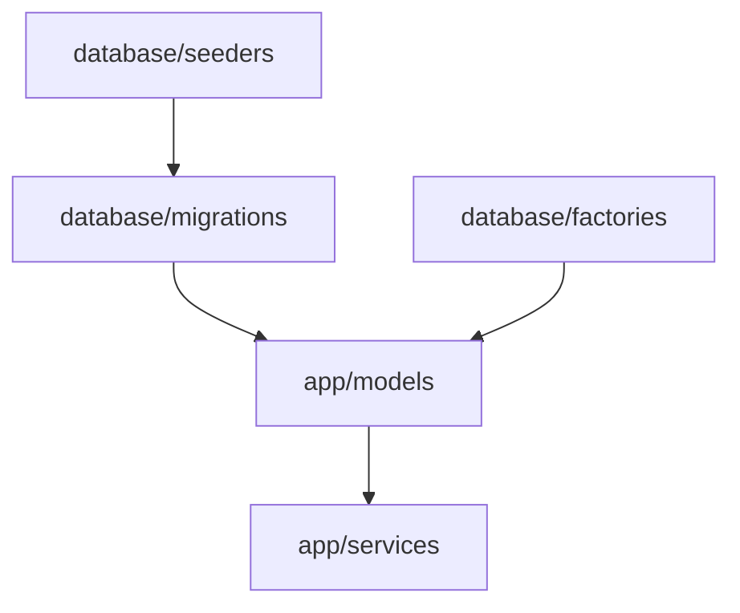
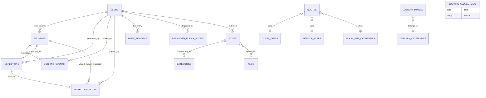
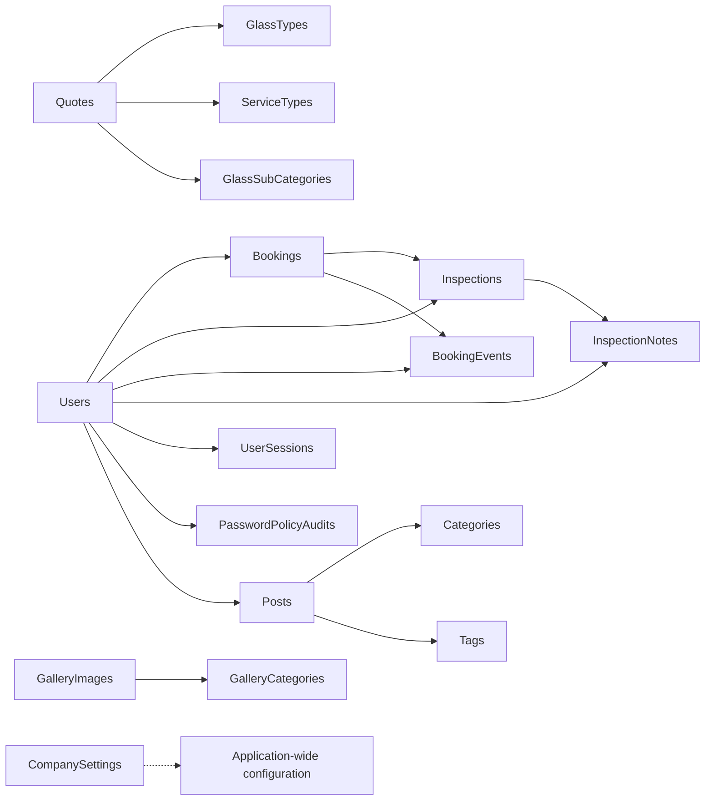
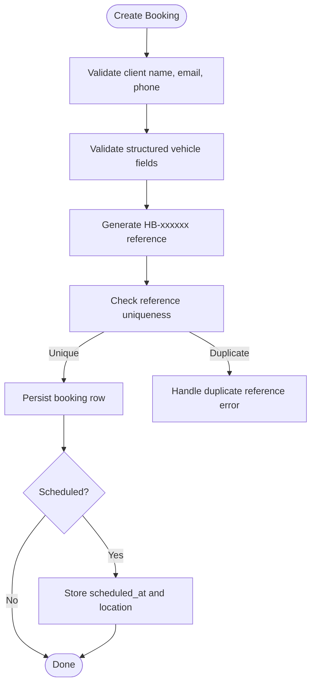
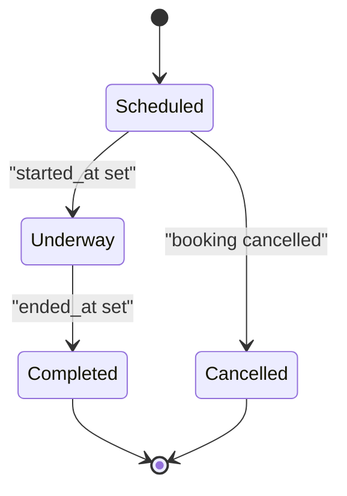
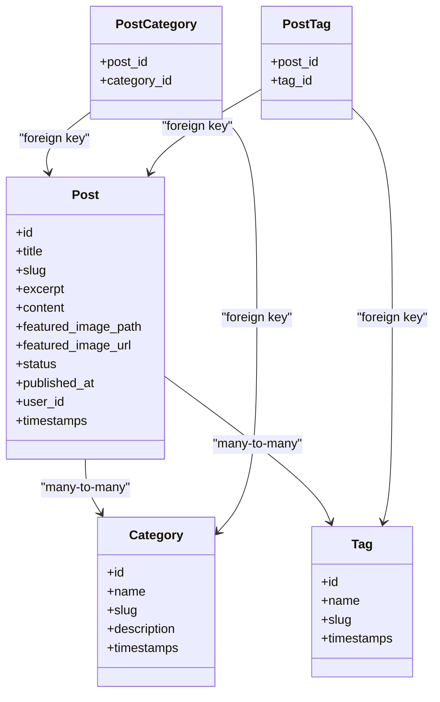
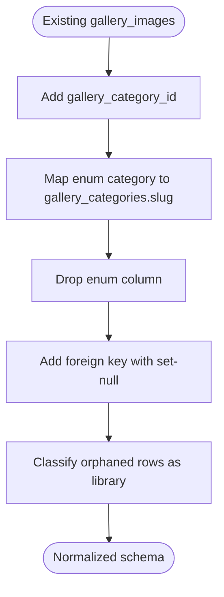
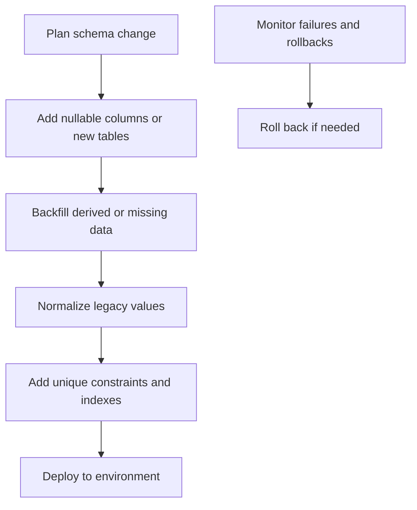

# Database Design

<cite>
**Referenced Files in This Document**
- [0001_01_01_000000_create_users_table.php](file://database/migrations/0001_01_01_000000_create_users_table.php)
- [2026_04_17_093356_create_bookings_table.php](file://database/migrations/2026_04_17_093356_create_bookings_table.php)
- [2026_04_17_093357_create_staff_absences_table.php](file://database/migrations/2026_04_17_093357_create_staff_absences_table.php)
- [2026_04_17_093358_create_inspections_table.php](file://database/migrations/2026_04_17_093358_create_inspections_table.php)
- [2026_04_17_110000_create_company_settings_table.php](file://database/migrations/2026_04_17_110000_create_company_settings_table.php)
- [2026_04_17_110001_create_testimonials_table.php](file://database/migrations/2026_04_17_110001_create_testimonials_table.php)
- [2026_04_17_110002_create_services_table.php](file://database/migrations/2026_04_17_110002_create_services_table.php)
- [2026_04_17_110003_create_gallery_images_table.php](file://database/migrations/2026_04_17_110003_create_gallery_images_table.php)
- [2026_04_17_110005_create_contact_messages_table.php](file://database/migrations/2026_04_17_110005_create_contact_messages_table.php)
- [2026_04_20_080000_create_glass_types_table.php](file://database/migrations/2026_04_20_080000_create_glass_types_table.php)
- [2026_04_20_080001_create_service_types_table.php](file://database/migrations/2026_04_20_080001_create_service_types_table.php)
- [2026_04_20_080002_create_quotes_table.php](file://database/migrations/2026_04_20_080002_create_quotes_table.php)
- [2026_04_20_083027_add_location_fields_to_gallery_images_table.php](file://database/migrations/2026_04_20_083027_add_location_fields_to_gallery_images_table.php)
- [2026_04_22_064623_create_gallery_categories_table.php](file://database/migrations/2026_04_22_064623_create_gallery_categories_table.php)
- [2026_04_22_064659_convert_gallery_category_to_foreign_key.php](file://database/migrations/2026_04_22_064659_convert_gallery_category_to_foreign_key.php)
- [2026_04_22_093500_create_about_us_contents_table.php](file://database/migrations/2026_04_22_093500_create_about_us_contents_table.php)
- [2026_04_22_152122_create_posts_table.php](file://database/migrations/2026_04_22_152122_create_posts_table.php)
- [2026_04_22_152130_create_categories_table.php](file://database/migrations/2026_04_22_152130_create_categories_table.php)
- [2026_04_22_152135_create_tags_table.php](file://database/migrations/2026_04_22_152135_create_tags_table.php)
- [2026_04_22_152139_create_post_category_table.php](file://database/migrations/2026_04_22_152139_create_post_category_table.php)
- [2026_04_22_152142_create_post_tag_table.php](file://database/migrations/2026_04_22_152142_create_post_tag_table.php)
- [2026_05_07_080000_create_glass_sub_categories_table.php](file://database/migrations/2026_05_07_080000_create_glass_sub_categories_table.php)
- [2026_05_07_080001_add_glass_sub_category_id_to_quotes_table.php](file://database/migrations/2026_05_07_080001_add_glass_sub_category_id_to_quotes_table.php)
- [2026_05_25_093322_create_partners_table.php](file://database/migrations/2026_05_25_093322_create_partners_table.php)
- [2026_05_25_102702_create_staff_table.php](file://database/migrations/2026_05_25_102702_create_staff_table.php)
- [2026_06_10_164000_create_polls_table.php](file://database/migrations/2026_06_10_164000_create_polls_table.php)
- [2026_06_10_164023_create_poll_votes_table.php](file://database/migrations/2026_06_10_164023_create_poll_votes_table.php)
- [2026_06_10_184301_add_unique_constraints_to_poll_votes_table.php](file://database/migrations/2026_06_10_184301_add_unique_constraints_to_poll_votes_table.php)
- [2026_07_07_000000_add_scheduled_fields_to_bookings_table.php](file://database/migrations/2026_07_07_000000_add_scheduled_fields_to_bookings_table.php)
- [2026_07_09_194144_make_ended_at_nullable_on_inspections_table.php](file://database/migrations/2026_07_09_194144_make_ended_at_nullable_on_inspections_table.php)
- [2026_10_01_150000_create_booking_events_table.php](file://database/migrations/2026_10_01_150000_create_booking_events_table.php)
- [2026_10_01_150100_create_inspection_notes_table.php](file://database/migrations/2026_10_01_150100_create_inspection_notes_table.php)
- [2026_10_01_150200_add_started_at_to_inspections_table.php](file://database/migrations/2026_10_01_150200_add_started_at_to_inspections_table.php)
- [2026_10_01_150300_add_previous_scheduled_at_to_booking_events_table.php](file://database/migrations/2026_10_01_150300_add_previous_scheduled_at_to_booking_events_table.php)
- [2026_10_07_150000_add_source_to_gallery_images_table.php](file://database/migrations/2026_10_07_150000_add_source_to_gallery_images_table.php)
- [2026_10_11_000000_normalise_persisted_media_paths.php](file://database/migrations/2026_10_11_000000_normalise_persisted_media_paths.php)
- [2026_10_17_120000_add_author_and_relax_content_limits_to_posts_table.php](file://database/migrations/2026_10_17_120000_add_author_and_relax_content_limits_to_posts_table.php)
- [2026_10_17_150000_add_archived_status_to_posts_table.php](file://database/migrations/2026_10_17_150000_add_archived_status_to_posts_table.php)
- [2026_10_18_000000_add_structured_fields_to_bookings_table.php](file://database/migrations/2026_10_18_000000_add_structured_fields_to_bookings_table.php)
- [2026_10_18_000001_create_booking_closed_days_table.php](file://database/migrations/2026_10_18_000001_create_booking_closed_days_table.php)
- [2026_10_18_000002_add_prefers_whatsapp_to_bookings_table.php](file://database/migrations/2026_10_18_000002_add_prefers_whatsapp_to_bookings_table.php)
- [2026_10_18_000003_make_vehicle_details_nullable_on_bookings_table.php](file://database/migrations/2026_10_18_000003_make_vehicle_details_nullable_on_bookings_table.php)
- [2026_10_19_000100_normalize_admin_sort_orders.php](file://database/migrations/2026_10_19_000100_normalize_admin sort orders.php)
- [2026_10_19_000200_add_sort_order_unique_indexes.php](file://database/migrations/2026_10_19_000200_add_sort_order_unique_indexes.php)
- [2026_10_20_000000_create_password_policy_audits_table.php](file://database/migrations/2026_10_20_000000_create_password_policy_audits_table.php)
- [2026_10_03_130000_create_user_sessions_table.php](file://database/migrations/2026_10_03_130000_create_user_sessions_table.php)
- [BookingFactory.php](file://database/factories/BookingFactory.php)
- [InspectionFactory.php](file://database/factories/InspectionFactory.php)
- [StaffFactory.php](file://database/factories/StaffFactory.php)
- [UserFactory.php](file://database/factories/UserFactory.php)
- [DatabaseSeeder.php](file://database/seeders/DatabaseSeeder.php)
</cite>

## Table of Contents
1. [Introduction](#introduction)
2. [Project Structure](#project-structure)
3. [Core Entities and Schema Overview](#core-entities-and-schema-overview)
4. [Architecture Overview](#architecture-overview)
5. [Detailed Entity Documentation](#detailed-entity-documentation)
6. [Indexing, Constraints, and Data Validation](#indexing-constraints-and-data-validation)
7. [Migration Strategy](#migration-strategy)
8. [Seeding and Factory Patterns](#seeding-and-factory-patterns)
9. [Data Lifecycle and Archival Policies](#data-lifecycle-and-archival-policies)
10. [Performance Tuning and Query Optimization](#performance-tuning-and-query-optimization)
11. [Backup, Retention, and Operational Considerations](#backup-retention-and-operational-considerations)
12. [Troubleshooting Guide](#troubleshooting-guide)
13. [Conclusion](#conclusion)

## Introduction
This document describes the Highblossom database schema from a data-model perspective. It focuses on the core business entities: Users, Bookings, Inspections, Quotes, Posts, GalleryImages, Staff, CompanySettings, and related tables such as BookingEvents, InspectionNotes, GlassTypes, ServiceTypes, GalleryCategories, and audit/session tables.

The documentation explains:
- Entity relationships and referential integrity.
- Primary keys, foreign keys, unique constraints, indexes, and enum-like validation rules.
- Migration evolution and backward-compatible schema changes.
- Seeding and factory strategies for test and production data.
- Data lifecycle, archival considerations, backup guidance, and performance tuning.
- Cascading operations and consistency patterns across the application’s data layer.

## Project Structure
The database design is expressed through Laravel migrations under `database/migrations`. Factories are under `database/factories`, and seeders are under `database/seeders`. The migration timestamps show an evolutionary history starting with authentication scaffolding and progressing through booking, inspection, content, media, permissions, and operational audit tables.

**Diagram sources**
- [0001_01_01_000000_create_users_table.php:1-49](file://database/migrations/0001_01_01_000000_create_users_table.php#L1-L49)
- [DatabaseSeeder.php](file://database/seeders/DatabaseSeeder.php)

**Section sources**
- [0001_01_01_000000_create_users_table.php:1-49](file://database/migrations/0001_01_01_000000_create_users_table.php#L1-L49)
- [DatabaseSeeder.php](file://database/seeders/DatabaseSeeder.php)

## Core Entities and Schema Overview
The core Highblossom domain centers around service bookings and inspections, supported by quotes, content management, media assets, staff information, and company settings.

Key entity groups:
- Identity and access: `users`, `user_sessions`, `password_policy_audits`.
- Operations: `bookings`, `inspections`, `booking_events`, `inspection_notes`, `booking_closed_days`.
- Sales and estimates: `quotes`, `glass_types`, `glass_sub_categories`, `service_types`.
- Content: `posts`, `categories`, `tags`, `post_category`, `post_tag`, `about_us_contents`.
- Media and presentation: `gallery_images`, `gallery_categories`, `services`, `testimonials`, `partners`.
- Configuration: `company_settings`.

**Diagram sources**
- [2026_04_17_093356_create_bookings_table.php:1-36](file://database/migrations/2026_04_17_093356_create_bookings_table.php#L1-L36)
- [2026_04_17_093358_create_inspections_table.php:1-35](file://database/migrations/2026_04_17_093358_create_inspections_table.php#L1-L35)
- [2026_10_01_150000_create_booking_events_table.php:1-44](file://database/migrations/2026_10_01_150000_create_booking_events_table.php#L1-L44)
- [2026_10_01_150100_create_inspection_notes_table.php:1-43](file://database/migrations/2026_10_01_150100_create_inspection_notes_table.php#L1-L43)
- [2026_04_20_080002_create_quotes_table.php:1-33](file://database/migrations/2026_04_20_080002_create_quotes_table.php#L1-L33)
- [2026_04_22_064623_create_gallery_categories_table.php:1-31](file://database/migrations/2026_04_22_064623_create_gallery_categories_table.php#L1-L31)
- [2026_04_22_152122_create_posts_table.php:1-37](file://database/migrations/2026_04_22_152122_create_posts_table.php#L1-L37)
- [2026_10_18_000001_create_booking_closed_days_table.php:1-39](file://database/migrations/2026_10_18_000001_create_booking_closed_days_table.php#L1-L39)

**Section sources**
- [2026_04_17_093356_create_bookings_table.php:1-36](file://database/migrations/2026_04_17_093356_create_bookings_table.php#L1-L36)
- [2026_04_17_093358_create_inspections_table.php:1-35](file://database/migrations/2026_04_17_093358_create_inspections_table.php#L1-L35)
- [2026_04_20_080002_create_quotes_table.php:1-33](file://database/migrations/2026_04_20_080002_create_quotes_table.php#L1-L33)
- [2026_04_22_152122_create_posts_table.php:1-37](file://database/migrations/2026_04_22_152122_create_posts_table.php#L1-L37)
- [2026_10_18_000001_create_booking_closed_days_table.php:1-39](file://database/migrations/2026_10_18_000001_create_booking_closed_days_table.php#L1-L39)

## Architecture Overview
Highblossom uses a relational model where:
- `users` is the identity root for authenticated users, session records, password policy audits, post authors, and inspection performers.
- `bookings` represent customer job requests; they may optionally link to a user but always contain client contact details.
- `inspections` represent scheduled or completed work events tied to a booking and a user acting as staff.
- `quotes` capture pre-job estimates linked to glass types, service types, and optional subcategories.
- `posts` form the blog/content system with categories, tags, optional authorship, and status including draft, published, and archived.
- `gallery_images` hold public gallery entries and, after later migrations, also reference library media through a source discriminator.
- `company_settings` stores key/value configuration.
- Operational tables include `booking_events`, `inspection_notes`, `booking_closed_days`, and `user_sessions`.

**Diagram sources**
- [0001_01_01_000000_create_users_table.php:1-49](file://database/migrations/0001_01_01_000000_create_users_table.php#L1-L49)
- [2026_04_17_093356_create_bookings_table.php:1-36](file://database/migrations/2026_04_17_093356_create_bookings_table.php#L1-L36)
- [2026_04_17_093358_create_inspections_table.php:1-35](file://database/migrations/2026_04_17_093358_create_inspections_table.php#L1-L35)
- [2026_04_20_080002_create_quotes_table.php:1-33](file://database/migrations/2026_04_20_080002_create_quotes_table.php#L1-L33)
- [2026_04_22_152122_create_posts_table.php:1-37](file://database/migrations/2026_04_22_152122_create_posts_table.php#L1-L37)
- [2026_10_01_150000_create_booking_events_table.php:1-44](file://database/migrations/2026_10_01_150000_create_booking_events_table.php#L1-L44)
- [2026_10_01_150100_create_inspection_notes_table.php:1-43](file://database/migrations/2026_10_01_150100_create_inspection_notes_table.php#L1-L43)
- [2026_10_03_130000_create_user_sessions_table.php:1-67](file://database/migrations/2026_10_03_130000_create_user_sessions_table.php#L1-L67)
- [2026_10_20_000000_create_password_policy_audits_table.php:1-32](file://database/migrations/2026_10_20_000000_create_password_policy_audits_table.php#L1-L32)

## Detailed Entity Documentation

### Users
The `users` table provides the primary identity record. It includes name, email, password, verification timestamp, remember token, and timestamps. Later migrations add phone, avatar, username, theme preference, consent columns, and admin navigation layout preferences.

Important characteristics:
- Primary key: auto-incrementing `id`.
- Email uniqueness constraint at creation.
- Optional relationship to bookings via nullable `user_id`.
- Relationships to sessions, audits, posts, and inspection performers.

Validation and integrity:
- Application-level validation enforces email format, password policies, and consent fields.
- Admin UI layout preference is stored as a nullable string to distinguish “not yet chosen” from a saved choice.

**Section sources**
- [0001_01_01_000000_create_users_table.php:1-49](file://database/migrations/0001_01_01_000000_create_users_table.php#L1-L49)
- [2026_10_03_120000_add_phone_and_avatar_to_users_table.php](file://database/migrations/2026_10_03_120000_add_phone_and_avatar_to_users_table.php)
- [2026_10_20_000100_add_username_to_users_table.php](file://database/migrations/2026_10_20_000100_add_username_to_users_table.php)
- [2026_06_02_191250_add_consent_columns_to_users_table.php](file://database/migrations/2026_06_02_191250_add_consent_columns_to_users_table.php)
- [2026_10_24_000100_add_admin_nav_layout_to_users_table.php:1-46](file://database/migrations/2026_10_24_000100_add_admin_nav_layout_to_users_table.php#L1-L46)

### Bookings
`bookings` represents customer job requests. Original fields include client name, email, phone, vehicle details, status, total price, and timestamps. Later migrations add scheduling fields, location, structured job fields, WhatsApp preference, and a unique booking reference.

Primary structure:
- `id`: primary key.
- `user_id`: optional owner.
- `client_name`, `client_email`, `client_phone`: customer contact.
- `vehicle_details`: free-form vehicle notes.
- `status`: enum-like string with values `pending`, `confirmed`, `cancelled`, `completed`.
- `total_price`: decimal currency value.
- `scheduled_at`, `location`: scheduling metadata.
- `service_type`, `damage_type`, `vehicle_make`, `vehicle_model`, `vehicle_year`, `damage_photo_path`, `duration_minutes`: structured job description.
- `reference`: unique booking identifier generated as `HB-` followed by a zero-padded numeric sequence.
- `prefers_whatsapp`: boolean communication preference.

Indexes:
- Composite index on `status` and `created_at` for dashboard lists.
- Index on `client_email`.
- Unique index on `reference`.
- Index on `service_type`.

Constraints:
- Foreign key to `users` with null-on-delete behavior.
- `vehicle_details` was made nullable so empty notes do not fail submission.

**Diagram sources**
- [2026_04_17_093356_create_bookings_table.php:1-36](file://database/migrations/2026_04_17_093356_create_bookings_table.php#L1-L36)
- [2026_07_07_000000_add_scheduled_fields_to_bookings_table.php:1-29](file://database/migrations/2026_07_07_000000_add_scheduled_fields_to_bookings_table.php#L1-L29)
- [2026_10_18_000000_add_structured_fields_to_bookings_table.php:1-74](file://database/migrations/2026_10_18_000000_add_structured_fields_to_bookings_table.php#L1-L74)
- [2026_10_18_000002_add_prefers_whatsapp_to_bookings_table.php:1-37](file://database/migrations/2026_10_18_000002_add_prefers_whatsapp_to_bookings_table.php#L1-L37)
- [2026_10_18_000003_make_vehicle_details_nullable_on_bookings_table.php:1-38](file://database/migrations/2026_10_18_000003_make_vehicle_details_nullable_on_bookings_table.php#L1-L38)

**Section sources**
- [2026_04_17_093356_create_bookings_table.php:1-36](file://database/migrations/2026_04_17_093356_create_bookings_table.php#L1-L36)
- [2026_07_07_000000_add_scheduled_fields_to_bookings_table.php:1-29](file://database/migrations/2026_07_07_000000_add_scheduled_fields_to_bookings_table.php#L1-L29)
- [2026_10_18_000000_add_structured_fields_to_bookings_table.php:1-74](file://database/migrations/2026_10_18_000000_add_structured_fields_to_bookings_table.php#L1-L74)
- [2026_10_18_000002_add_prefers_whatsapp_to_bookings_table.php:1-37](file://database/migrations/2026_10_18_000002_add_prefers_whatsapp_to_bookings_table.php#L1-L37)
- [2026_10_18_000003_make_vehicle_details_nullable_on_bookings_table.php:1-38](file://database/migrations/2026_10_18_000003_make_vehicle_details_nullable_on_bookings_table.php#L1-L38)

### Inspections
`inspections` represent scheduled or completed work events attached to a booking and performed by a user.

Structure:
- `id`: primary key.
- `booking_id`: required foreign key to `bookings`, cascade delete.
- `staff_id`: required foreign key to `users`.
- `scheduled_at`: indexed timestamp.
- `started_at`: nullable timestamp added later to indicate inspection start.
- `ended_at`: nullable timestamp indicating completion.
- `location`: work location.
- `type`: enum-like string `mobile` or `workshop`.
- Timestamps for created and updated.

Indexes:
- Composite index on `scheduled_at`, `ended_at`, `staff_id` for availability checks.
- Individual indexes on `scheduled_at` and `ended_at`.

Lifecycle:
- Nullable `ended_at` allows inspections to remain open.
- Nullable `started_at` supports distinguishing upcoming, underway, and completed states.

**Diagram sources**
- [2026_04_17_093358_create_inspections_table.php:1-35](file://database/migrations/2026_04_17_093358_create_inspections_table.php#L1-L35)
- [2026_07_09_194144_make_ended_at_nullable_on_inspections_table.php:1-28](file://database/migrations/2026_07_09_194144_make_ended_at_nullable_on_inspections_table.php#L1-L28)
- [2026_10_01_150200_add_started_at_to_inspections_table.php:1-37](file://database/migrations/2026_10_01_150200_add_started_at_to_inspections_table.php#L1-L37)

**Section sources**
- [2026_04_17_093358_create_inspections_table.php:1-35](file://database/migrations/2026_04_17_093358_create_inspections_table.php#L1-L35)
- [2026_07_09_194144_make_ended_at_nullable_on_inspections_table.php:1-28](file://database/migrations/2026_07_09_194144_make_ended_at_nullable_on_inspections_table.php#L1-L28)
- [2026_10_01_150200_add_started_at_to_inspections_table.php:1-37](file://database/migrations/2026_10_01_150200_add_started_at_to_inspections_table.php#L1-L37)

### Quotes
`quotes` capture pre-job estimates.

Structure:
- `id`: primary key.
- `name`, `phone`, `email`: customer contact.
- `vehicle_type`, `make_model`, `reg_number`, `year`: vehicle details.
- `glass_type_id`: required foreign key to `glass_types`, cascade delete.
- `service_type_id`: required foreign key to `service_types`, cascade delete.
- `glass_sub_category_id`: optional foreign key to `glass_sub_categories`, set-null delete.
- `message`: optional free-text request.
- `mobile_service`: boolean preference.
- `status`: string state machine with values such as `pending`, `contacted`, `completed`, `cancelled`.
- Timestamps.

Indexes:
- Index on `glass_sub_category_id`.

Relationships:
- Many-to-one with `glass_types` and `service_types`.
- Many-to-one with `glass_sub_categories`.

**Section sources**
- [2026_04_20_080002_create_quotes_table.php:1-33](file://database/migrations/2026_04_20_080002_create_quotes_table.php#L1-L33)
- [2026_05_07_080001_add_glass_sub_category_id_to_quotes_table.php:1-27](file://database/migrations/2026_05_07_080001_add_glass_sub_category_id_to_quotes_table.php#L1-L27)

### Posts, Categories, and Tags
`posts` provide the blog/content model.

Structure:
- `id`: primary key.
- `title`: widened to 255 characters.
- `slug`: unique slug.
- `excerpt`: nullable text.
- `content`: JSON block content.
- `featured_image_path`, `featured_image_url`: media references.
- `status`: enum-like string `draft`, `published`, `archived`.
- `published_at`: publish timestamp.
- `user_id`: optional author foreign key to `users`, null-on-delete.
- Timestamps.
- Indexes on `status` and `published_at`.

Many-to-many relationships:
- `categories` and `tags` connect through `post_category` and `post_tag` pivot tables.
- Both pivot tables use composite primary keys and cascade deletes.

**Diagram sources**
- [2026_04_22_152122_create_posts_table.php:1-37](file://database/migrations/2026_04_22_152122_create_posts_table.php#L1-L37)
- [2026_04_22_152130_create_categories_table.php:1-30](file://database/migrations/2026_04_22_152130_create_categories_table.php#L1-L30)
- [2026_04_22_152135_create_tags_table.php:1-29](file://database/migrations/2026_04_22_152135_create_tags_table.php#L1-L29)
- [2026_04_22_152139_create_post_category_table.php:1-28](file://database/migrations/2026_04_22_152139_create_post_category_table.php#L1-L28)
- [2026_04_22_152142_create_post_tag_table.php:1-28](file://database/migrations/2026_04_22_152142_create_post_tag_table.php#L1-L28)
- [2026_10_17_120000_add_author_and_relax_content_limits_to_posts_table.php:1-72](file://database/migrations/2026_10_17_120000_add_author_and_relax_content_limits_to_posts_table.php#L1-L72)
- [2026_10_17_150000_add_archived_status_to_posts_table.php:1-36](file://database/migrations/2026_10_17_150000_add_archived_status_to_posts_table.php#L1-L36)

**Section sources**
- [2026_04_22_152122_create_posts_table.php:1-37](file://database/migrations/2026_04_22_152122_create_posts_table.php#L1-L37)
- [2026_04_22_152130_create_categories_table.php:1-30](file://database/migrations/2026_04_22_152130_create_categories_table.php#L1-L30)
- [2026_04_22_152135_create_tags_table.php:1-29](file://database/migrations/2026_04_22_152135_create_tags_table.php#L1-L29)
- [2026_04_22_152139_create_post_category_table.php:1-28](file://database/migrations/2026_04_22_152139_create_post_category_table.php#L1-L28)
- [2026_04_22_152142_create_post_tag_table.php:1-28](file://database/migrations/2026_04_22_152142_create_post_tag_table.php#L1-L28)
- [2026_10_17_120000_add_author_and_relax_content_limits_to_posts_table.php:1-72](file://database/migrations/2026_10_17_120000_add_author_and_relax_content_limits_to_posts_table.php#L1-L72)
- [2026_10_17_150000_add_archived_status_to_posts_table.php:1-36](file://database/migrations/2026_10_17_150000_add_archived_status_to_posts_table.php#L1-L36)

### Gallery Images and Gallery Categories
`gallery_images` originally used an enum category column, then migrated to a proper `gallery_categories` relationship. A later migration added a `source` discriminator separating curated public gallery rows from internal media-library rows.

Structure:
- `id`: primary key.
- `title`, `description`, `image_path`.
- `gallery_category_id`: nullable foreign key to `gallery_categories`, set-null on delete.
- `is_featured`, `is_active`, `sort_order`.
- `latitude`, `longitude`, `location_address`: optional geolocation metadata.
- `source`: default `gallery`; library rows are marked `library` and deactivated.
- Timestamps.

Migrations:
- Enum `category` replaced by foreign key `gallery_category_id`.
- Existing enum values were mapped to matching category slugs.
- Rows without a category were classified as library assets.

**Diagram sources**
- [2026_04_17_110003_create_gallery_images_table.php:1-28](file://database/migrations/2026_04_17_110003_create_gallery_images_table.php#L1-L28)
- [2026_04_22_064623_create_gallery_categories_table.php:1-31](file://database/migrations/2026_04_22_064623_create_gallery_categories_table.php#L1-L31)
- [2026_04_22_064659_convert_gallery_category_to_foreign_key.php:1-72](file://database/migrations/2026_04_22_064659_convert_gallery_category_to_foreign_key.php#L1-L72)
- [2026_04_20_083027_add_location_fields_to_gallery_images_table.php:1-30](file://database/migrations/2026_04_20_083027_add_location_fields_to_gallery_images_table.php#L1-L30)
- [2026_10_07_150000_add_source_to_gallery_images_table.php:1-49](file://database/migrations/2026_10_07_150000_add_source_to_gallery_images_table.php#L1-L49)

**Section sources**
- [2026_04_17_110003_create_gallery_images_table.php:1-28](file://database/migrations/2026_04_17_110003_create_gallery_images_table.php#L1-L28)
- [2026_04_22_064623_create_gallery_categories_table.php:1-31](file://database/migrations/2026_04_22_064623_create_gallery_categories_table.php#L1-L31)
- [2026_04_22_064659_convert_gallery_category_to_foreign_key.php:1-72](file://database/migrations/2026_04_22_064659_convert_gallery_category_to_foreign_key.php#L1-L72)
- [2026_04_20_083027_add_location_fields_to_gallery_images_table.php:1-30](file://database/migrations/2026_04_20_083027_add_location_fields_to_gallery_images_table.php#L1-L30)
- [2026_10_07_150000_add_source_to_gallery_images_table.php:1-49](file://database/migrations/2026_10_07_150000_add_source_to_gallery_images_table.php#L1-L49)

### Staff and Staff Absences
`staff` is a presentation-oriented table describing people associated with the shop. It has no direct foreign key to `users`.

`staff_absences` tracks individual unavailability and links to `users`.

Staff table:
- `id`, `name`, `role`, `bio`, `photo_path`, `order`, `is_active`, timestamps.
- Unique index on `order` enforced by the sort-order migration.

Staff absence table:
- `id`, `staff_id` (foreign key to `users`), `starts_at`, `ends_at`, `reason`, timestamps.
- Composite index on `starts_at`, `ends_at`, `staff_id` for availability checks.
- Cascade delete when the referenced user is removed.

**Section sources**
- [2026_05_25_102702_create_staff_table.php:1-33](file://database/migrations/2026_05_25_102702_create_staff_table.php#L1-L33)
- [2026_04_17_093357_create_staff_absences_table.php:1-33](file://database/migrations/2026_04_17_093357_create_staff_absences_table.php#L1-L33)
- [2026_10_19_000200_add_sort_order_unique_indexes.php:1-72](file://database/migrations/2026_10_19_000200_add_sort_order_unique_indexes.php#L1-L72)

### Company Settings
`company_settings` stores key-value configuration.

Structure:
- `id`: primary key.
- `key`: unique setting key.
- `value`: nullable text payload.
- `type`: default `text`, supporting text, number, boolean, json.
- Timestamps.

Use cases:
- Site-wide defaults such as admin navigation layout.
- Typed configuration accessed by application services.

**Section sources**
- [2026_04_17_110000_create_company_settings_table.php:1-24](file://database/migrations/2026_04_17_110000_create_company_settings_table.php#L1-L24)

### Additional Supporting Entities
- `glass_types`: lookup for glass product types with slug and active flag.
- `service_types`: lookup for service categories with slug and active flag.
- `glass_sub_categories`: child of `glass_types`, with index on `glass_type_id`, `is_active`, `sort_order`.
- `testimonials`: customer feedback with rating, active flag, and sort order.
- `services`: website service catalog with slug, features JSON, active flag, and sort order.
- `contact_messages`: inbound contact submissions with read status.
- `about_us_contents`: static site content blocks.
- `partners`: partner listings with logo path and sort order.
- `polls` and `poll_votes`: engagement feature with IP-based and user-based vote uniqueness.
- `booking_closed_days`: shop-wide closures with unique dates.
- `user_sessions`: durable session lifecycle ledger.
- `password_policy_audits`: audit log of password policy changes.

**Section sources**
- [2026_04_20_080000_create_glass_types_table.php:1-25](file://database/migrations/2026_04_20_080000_create_glass_types_table.php#L1-L25)
- [2026_04_20_080001_create_service_types_table.php:1-25](file://database/migrations/2026_04_20_080001_create_service_types_table.php#L1-L25)
- [2026_05_07_080000_create_glass_sub_categories_table.php:1-35](file://database/migrations/2026_05_07_080000_create_glass_sub_categories_table.php#L1-L35)
- [2026_04_17_110001_create_testimonials_table.php:1-27](file://database/migrations/2026_04_17_110001_create_testimonials_table.php#L1-L27)
- [2026_04_17_110002_create_services_table.php:1-29](file://database/migrations/2026_04_17_110002_create_services_table.php#L1-L29)
- [2026_04_17_110005_create_contact_messages_table.php:1-27](file://database/migrations/2026_04_17_110005_create_contact_messages_table.php#L1-L27)
- [2026_04_22_093500_create_about_us_contents_table.php:1-28](file://database/migrations/2026_04_22_093500_create_about_us_contents_table.php#L1-L28)
- [2026_05_25_093322_create_partners_table.php:1-32](file://database/migrations/2026_05_25_093322_create_partners_table.php#L1-L32)
- [2026_06_10_164000_create_polls_table.php:1-31](file://database/migrations/2026_06_10_164000_create_polls_table.php#L1-L31)
- [2026_06_10_164023_create_poll_votes_table.php:1-31](file://database/migrations/2026_06_10_164023_create_poll_votes_table.php#L1-L31)
- [2026_06_10_184301_add_unique_constraints_to_poll_votes_table.php:1-33](file://database/migrations/2026_06_10_184301_add_unique_constraints_to_poll_votes_table.php#L1-L33)
- [2026_10_18_000001_create_booking_closed_days_table.php:1-39](file://database/migrations/2026_10_18_000001_create_booking_closed_days_table.php#L1-L39)
- [2026_10_03_130000_create_user_sessions_table.php:1-67](file://database/migrations/2026_10_03_130000_create_user_sessions_table.php#L1-L67)
- [2026_10_20_000000_create_password_policy_audits_table.php:1-32](file://database/migrations/2026_10_20_000000_create_password_policy_audits_table.php#L1-L32)

## Indexing, Constraints, and Data Validation

### Primary Keys and Foreign Keys
- Most tables use an auto-incrementing `id` as the primary key.
- Foreign keys are declared using Laravel’s constrained helper methods, with explicit delete behaviors:
  - `cascadeOnDelete` for strong ownership: `inspections.booking_id`, `booking_events.booking_id`, `inspection_notes.inspection_id`, `glass_types.glass_sub_categories`, `glass_types.quotes`, `service_types.quotes`.
  - `nullOnDelete` for optional associations: `bookings.user_id`, `booking_events.user_id`, `inspection_notes.user_id`, `password_policy_audits.user_id`, `user_sessions.user_id`.
  - `setNull` for soft decoupling: `gallery_images.gallery_category_id`, `quotes.glass_sub_category_id`.

### Unique Constraints
- `users.email`: unique email addresses.
- `posts.slug`: unique post URL slugs.
- `company_settings.key`: unique configuration keys.
- `gallery_categories.slug`, `glass_types.slug`, `service_types.slug`, `categories.slug`, `tags.slug`: unique natural identifiers.
- `booking_closed_days.date`: one closure per day.
- `bookings.reference`: unique booking reference generated during migration.
- `user_sessions.session_id`: one durable session record per framework session identifier.
- `poll_votes`: combined uniqueness for `poll_id` with `ip_address` and for `poll_id` with `user_id`.
- Sort-order unique indexes for ordered admin surfaces such as services, testimonials, gallery images, gallery categories, glass types, glass subcategories, service types, partners, and staff.

### Indexes
- Dashboard optimization: `bookings.status` + `created_at`.
- Availability checks: `inspections.scheduled_at`, `inspections.ended_at`, `inspections.staff_id` composite index; same pattern for `staff_absences`.
- Customer timeline queries: `booking_events.booking_id` + `happened_at` and `booking_events.type`.
- Inspection notes queries: `inspection_notes.inspection_id` + `created_at`.
- Poll votes: unique constraints double as query guards against duplicate voting.
- Session queries: indexes on `user_sessions.last_seen_at` and composite `(user_id, ended_at)` / `(user_id, last_seen_at)`.
- Audit logs: index on `password_policy_audits.created_at`.
- Glass subcategories: index on `glass_type_id`, `is_active`, `sort_order` and `slug`.

### Enum-like Validation Rules
Several columns act as enums through application validation rather than native database enums:
- `bookings.status`: `pending`, `confirmed`, `cancelled`, `completed`.
- `inspections.type`: `mobile`, `workshop`.
- `posts.status`: `draft`, `published`, `archived`.
- `quotes.status`: `pending`, `contacted`, `completed`, `cancelled`.
- `gallery_images.source`: `gallery`, `library`.
- `user_sessions.login_method`, `end_reason`, `device_type`, `platform`, `browser`, `browser_version`.
- `users.admin_nav_layout`: validated by application rules even though stored as a string.

**Section sources**
- [2026_04_17_093356_create_bookings_table.php:1-36](file://database/migrations/2026_04_17_093356_create_bookings_table.php#L1-L36)
- [2026_04_17_093358_create_inspections_table.php:1-35](file://database/migrations/2026_04_17_093358_create_inspections_table.php#L1-L35)
- [2026_04_20_080002_create_quotes_table.php:1-33](file://database/migrations/2026_04_20_080002_create_quotes_table.php#L1-L33)
- [2026_04_22_152122_create_posts_table.php:1-37](file://database/migrations/2026_04_22_152122_create_posts_table.php#L1-L37)
- [2026_04_22_064623_create_gallery_categories_table.php:1-31](file://database/migrations/2026_04_22_064623_create_gallery_categories_table.php#L1-L31)
- [2026_04_22_152130_create_categories_table.php:1-30](file://database/migrations/2026_04_22_152130_create_categories_table.php#L1-L30)
- [2026_04_22_152135_create_tags_table.php:1-29](file://database/migrations/2026_04_22_152135_create_tags_table.php#L1-L29)
- [2026_04_22_093500_create_about_us_contents_table.php:1-28](file://database/migrations/2026_04_22_093500_create_about_us_contents_table.php#L1-L28)
- [2026_05_07_080000_create_glass_sub_categories_table.php:1-35](file://database/migrations/2026_05_07_080000_create_glass_sub_categories_table.php#L1-L35)
- [2026_06_10_184301_add_unique_constraints_to_poll_votes_table.php:1-33](file://database/migrations/2026_06_10_184301_add_unique_constraints_to_poll_votes_table.php#L1-L33)
- [2026_10_01_150000_create_booking_events_table.php:1-44](file://database/migrations/2026_10_01_150000_create_booking_events_table.php#L1-L44)
- [2026_10_01_150100_create_inspection_notes_table.php:1-43](file://database/migrations/2026_10_01_150100_create_inspection_notes_table.php#L1-L43)
- [2026_10_03_130000_create_user_sessions_table.php:1-67](file://database/migrations/2026_10_03_130000_create_user_sessions_table.php#L1-L67)
- [2026_10_18_000000_add_structured_fields_to_bookings_table.php:1-74](file://database/migrations/2026_10_18_000000_add_structured_fields_to_bookings_table.php#L1-L74)
- [2026_10_19_000200_add_sort_order_unique_indexes.php:1-72](file://database/migrations/2026_10_19_000200_add_sort_order_unique_indexes.php#L1-L72)
- [2026_10_24_000100_add_admin_nav_layout_to_users_table.php:1-46](file://database/migrations/2026_10_24_000100_add_admin_nav_layout_to_users_table.php#L1-L46)

## Migration Strategy
The migration strategy emphasizes backward compatibility, safe data repair, and clear separation between schema changes and data normalization.

Key patterns:
- **Incremental field additions**: Scheduling fields, location, structured job fields, WhatsApp preference, and nullable vehicle details were added to existing `bookings` without breaking older rows.
- **Enum-to-relationship migration**: `gallery_images.category` enum was migrated to a real `gallery_categories` relationship with a data-mapping step and a foreign key.
- **Backfill migrations**: References, authors, and media paths are normalized through targeted data updates.
- **Two-phase ordering normalization**: A renumber migration computes dense ranks before a second migration adds unique constraints, avoiding violations caused by gaps or duplicates.
- **Idempotent guard clauses**: Sort-order unique index migration skips already present indexes.
- **Irreversible repairs with safe down behavior**: Media path normalization intentionally leaves `down()` as a no-op because absolute URLs cannot be reconstructed deterministically.

**Diagram sources**
- [2026_04_22_064659_convert_gallery_category_to_foreign_key.php:1-72](file://database/migrations/2026_04_22_064659_convert_gallery_category_to_foreign_key.php#L1-L72)
- [2026_10_18_000000_add_structured_fields_to_bookings_table.php:1-74](file://database/migrations/2026_10_18_000000_add_structured_fields_to_bookings_table.php#L1-L74)
- [2026_10_19_000100_normalize_admin_sort_orders.php:1-108](file://database/migrations/2026_10_19_000100_normalize_admin sort orders.php#L1-L108)
- [2026_10_19_000200_add_sort_order_unique_indexes.php:1-72](file://database/migrations/2026_10_19_000200_add_sort_order_unique_indexes.php#L1-L72)
- [2026_10_11_000000_normalise_persisted_media_paths.php:1-200](file://database/migrations/2026_10_11_000000_normalise_persisted_media_paths.php#L1-L200)

**Section sources**
- [2026_04_22_064659_convert_gallery_category_to_foreign_key.php:1-72](file://database/migrations/2026_04_22_064659_convert_gallery_category_to_foreign_key.php#L1-L72)
- [2026_10_18_000000_add_structured_fields_to_bookings_table.php:1-74](file://database/migrations/2026_10_18_000000_add_structured_fields_to_bookings_table.php#L1-L74)
- [2026_10_19_000100_normalize_admin_sort_orders.php:1-108](file://database/migrations/2026_10_19_000100_normalize_admin sort orders.php#L1-L108)
- [2026_10_19_000200_add_sort_order_unique_indexes.php:1-72](file://database/migrations/2026_10_19_000200_add_sort_order_unique_indexes.php#L1-L72)
- [2026_10_11_000000_normalise_persisted_media_paths.php:1-200](file://database/migrations/2026_10_11_000000_normalise_persisted_media_paths.php#L1-L200)

## Seeding and Factory Patterns

### Seeders
Seeders populate reference data and application bootstrap data. Typical targets include roles, permissions, company data, services, service types, gallery categories, glass types, glass subcategories, SEO routes, about-us content, and application version records.

Design principles:
- Use dedicated seeders for distinct domains instead of one monolithic seeder.
- Prefer deterministic data for reference tables such as glass types and service types.
- Keep production-sensitive data separate from development fixtures.

**Section sources**
- [DatabaseSeeder.php](file://database/seeders/DatabaseSeeder.php)

### Factories
Factories generate test data models for unit and feature tests. Provided factories include:
- `UserFactory`: creates users for authentication and authorization tests.
- `StaffFactory`: creates staff records for presentation-related tests.
- `BookingFactory`: creates bookings for scheduling and workflow tests.
- `InspectionFactory`: creates inspections for availability and status tests.
- Related factories exist for `BookingClosedDay`, `Partner`, and `StaffAbsence`.

Best practices implied by the presence of these factories:
- Tests should create minimal required associations.
- Factories should allow overriding attributes for specific scenarios.
- Test data should respect constraints such as unique emails and statuses.

**Section sources**
- [UserFactory.php](file://database/factories/UserFactory.php)
- [StaffFactory.php](file://database/factories/StaffFactory.php)
- [BookingFactory.php](file://database/factories/BookingFactory.php)
- [InspectionFactory.php](file://database/factories/InspectionFactory.php)

## Data Lifecycle and Archival Policies

### Bookings and Inspections
- Bookings begin as pending and progress through confirmed, completed, or cancelled states.
- Inspections track scheduling, start, and end times. Nullable timestamps allow ongoing work.
- Booking events record customer-visible milestones, including reschedule history through `previous_scheduled_at`.
- Inspection notes store internal administrative notes separate from customer-facing summaries.

Archival recommendations:
- Archive completed bookings and their related events after a retention period defined by business policy.
- Move historical inspection notes and booking events to cold storage while retaining summary fields for reporting.
- Preserve cancellation reasons and compliance-required fields longer than transient scheduling artifacts.

### Posts
- Posts support a three-state lifecycle: draft, published, archived.
- Archived posts remain in the database for reference without appearing as live content.

Recommendations:
- Use the `archived` status for retirement rather than deletion.
- Purge drafts older than a retention threshold after confirming they are not needed.
- Maintain an audit trail for deleted content if legal or compliance requirements apply.

### Media Paths
- Media references were normalized from absolute URLs to disk-relative paths to survive host changes and object-storage migrations.
- Rich-text HTML intentionally keeps absolute URLs because relative paths inside HTML would resolve incorrectly.

Recommendations:
- Treat media path normalization as a one-way operation unless a separate copy of original URLs is retained.
- Regularly reconcile `media_registries` with actual file storage to prevent orphaned uploads.

**Section sources**
- [2026_10_01_150000_create_booking_events_table.php:1-44](file://database/migrations/2026_10_01_150000_create_booking_events_table.php#L1-L44)
- [2026_10_01_150100_create_inspection_notes_table.php:1-43](file://database/migrations/2026_10_01_150100_create_inspection_notes_table.php#L1-L43)
- [2026_10_01_150300_add_previous_scheduled_at_to_booking_events_table.php:1-36](file://database/migrations/2026_10_01_150300_add_previous_scheduled_at_to_booking_events_table.php#L1-L36)
- [2026_10_17_150000_add_archived_status_to_posts_table.php:1-36](file://database/migrations/2026_10_17_150000_add_archived_status_to_posts_table.php#L1-L36)
- [2026_10_11_000000_normalise_persisted_media_paths.php:1-200](file://database/migrations/2026_10_11_000000_normalise_persisted_media_paths.php#L1-L200)

## Performance Tuning and Query Optimization

### Index Strategy
- Dashboard list queries benefit from composite indexes on `bookings.status` and `created_at`.
- Availability calculations depend on composite indexes covering scheduling windows and staff assignments.
- Public timeline queries rely on `booking_events.booking_id` plus `happened_at`.
- Session administration benefits from indexes on `last_seen_at` and user-scoped filters.
- Audit logs are indexed by creation time for recent-change queries.

### Query Patterns
- Avoid scanning full `posts.content` JSON for media references; prefer targeted updates during migrations.
- Use indexed fields such as `bookings.service_type`, `bookings.reference`, and `posts.published_at` for filtering.
- Prefer foreign-key joins over string-based lookups for glass types, service types, and categories.
- For gallery queries, filter by `gallery_images.source = 'gallery'` and `is_active` to exclude internal library assets.

### Storage and Normalization
- Structured booking fields reduce the need to parse free-form `vehicle_details`.
- Normalized media paths avoid stale absolute URLs and reduce host-dependent queries.
- Separate public gallery rows from library rows through the `source` discriminator.

**Section sources**
- [2026_04_17_093356_create_bookings_table.php:1-36](file://database/migrations/2026_04_17_093356_create_bookings_table.php#L1-L36)
- [2026_04_17_093358_create_inspections_table.php:1-35](file://database/migrations/2026_04_17_093358_create_inspections_table.php#L1-L35)
- [2026_10_01_150000_create_booking_events_table.php:1-44](file://database/migrations/2026_10_01_150000_create_booking_events_table.php#L1-L44)
- [2026_10_03_130000_create_user_sessions_table.php:1-67](file://database/migrations/2026_10_03_130000_create_user_sessions_table.php#L1-L67)
- [2026_10_11_000000_normalise_persisted_media_paths.php:1-200](file://database/migrations/2026_10_11_000000_normalise_persisted_media_paths.php#L1-L200)
- [2026_10_07_150000_add_source_to_gallery_images_table.php:1-49](file://database/migrations/2026_10_07_150000_add_source_to_gallery_images_table.php#L1-L49)

## Backup, Retention, and Operational Considerations

### Backup Scope
- Back up all relational tables representing business state: bookings, inspections, quotes, posts, gallery assets, user accounts, sessions, and audit logs.
- Include `company_settings` and reference data such as glass types, service types, and gallery categories.
- Coordinate database backups with file storage backups for uploaded media.

### Retention Policy Recommendations
- Retain completed bookings and inspection records according to legal and operational requirements.
- Keep booking event histories long enough to support customer inquiries and dispute resolution.
- Archive old inspection notes and session records rather than deleting them immediately.
- Apply differential retention for sensitive audit tables such as `password_policy_audits`.

### Consistency Patterns
- Use transactions for multi-row updates during migrations.
- Enforce referential integrity through foreign keys rather than application-only checks.
- Use unique constraints for idempotency, especially for poll votes and session identifiers.
- Treat enum-like string columns as application-enforced state machines; validate writes through application rules.

**Section sources**
- [2026_06_10_184301_add_unique_constraints_to_poll_votes_table.php:1-33](file://database/migrations/2026_06_10_184301_add_unique_constraints_to_poll_votes_table.php#L1-L33)
- [2026_10_03_130000_create_user_sessions_table.php:1-67](file://database/migrations/2026_10_03_130000_create_user_sessions_table.php#L1-L67)
- [2026_10_20_000000_create_password_policy_audits_table.php:1-32](file://database/migrations/2026_10_20_000000_create_password_policy_audits_table.php#L1-L32)

## Troubleshooting Guide

### Common Integrity Issues
- Duplicate poll votes: check unique constraints on `poll_id` + `ip_address` and `poll_id` + `user_id`.
- Missing gallery categories: rows that lost their enum mapping will have `gallery_category_id` set to null due to set-null behavior.
- Orphaned bookings: `bookings.user_id` is nullable; missing user association does not break the booking.
- Closed inspection timelines: nullable `ended_at` means inspections can remain open indefinitely.

### Diagnostic Queries
- Find open inspections: inspect rows where `ended_at` is null.
- Identify missing authors: query posts with null `user_id` after author backfills.
- Locate stale media URLs: scan `featured_image_url` and similar columns for absolute `/storage/%` paths that may still exist before normalization.
- Detect schedule conflicts: use composite indexes on inspection and absence scheduling windows.

### Recovery Actions
- Re-run sorting normalization before adding unique indexes if admin ordering becomes inconsistent.
- Repair gallery categories by remapping known slugs to category ids.
- Regenerate booking references only if the unique constraint fails due to corruption; otherwise rely on the automatic generation.
- Review `down()` methods carefully; some migrations are intentionally irreversible once deployed.

**Section sources**
- [2026_04_22_064659_convert_gallery_category_to_foreign_key.php:1-72](file://database/migrations/2026_04_22_064659_convert_gallery_category_to_foreign_key.php#L1-L72)
- [2026_07_09_194144_make_ended_at_nullable_on_inspections_table.php:1-28](file://database/migrations/2026_07_09_194144_make_ended_at_nullable_on_inspections_table.php#L1-L28)
- [2026_10_11_000000_normalise_persisted_media_paths.php:1-200](file://database/migrations/2026_10_11_000000_normalise_persisted_media_paths.php#L1-L200)
- [2026_10_17_120000_add_author_and_relax_content_limits_to_posts_table.php:1-72](file://database/migrations/2026_10_17_120000_add_author_and_relax_content_limits_to_posts_table.php#L1-L72)
- [2026_10_19_000100_normalize_admin_sort_orders.php:1-108](file://database/migrations/2026_10_19_000100_normalize_admin sort orders.php#L1-L108)

## Conclusion
The Highblossom database model evolves from basic authentication scaffolding into a robust operational schema centered on bookings, inspections, quotes, and content. The design balances strict referential integrity with practical flexibility: nullable foreign keys for optional relationships, enum-like strings validated by application code, and carefully staged migrations that normalize legacy data before enforcing new constraints.

For future work, consider:
- Formalizing archiving jobs for completed bookings, inspection notes, and session records.
- Adding database-level check constraints where the database engine supports them, reducing reliance on application-only validation.
- Monitoring index usage and query plans for high-volume booking and timeline queries.
- Maintaining a clear separation between mutable business data and immutable audit trails.