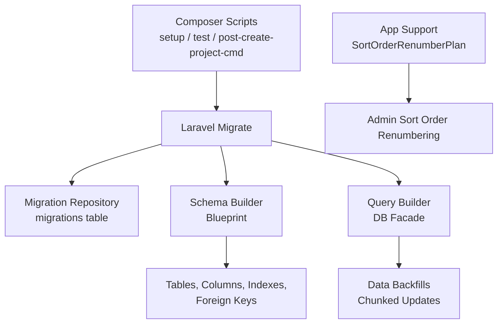
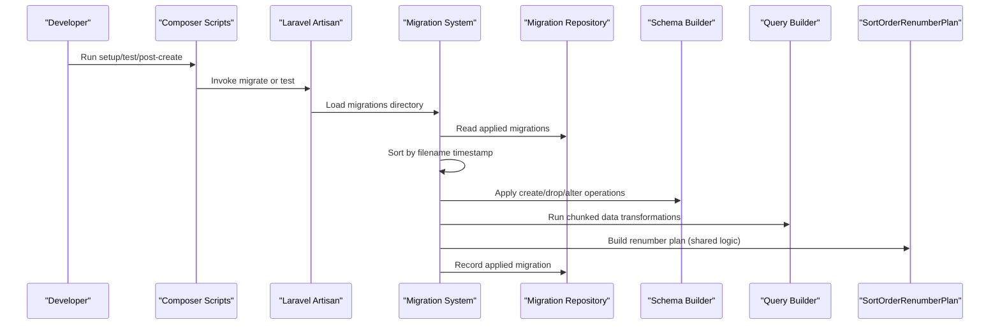
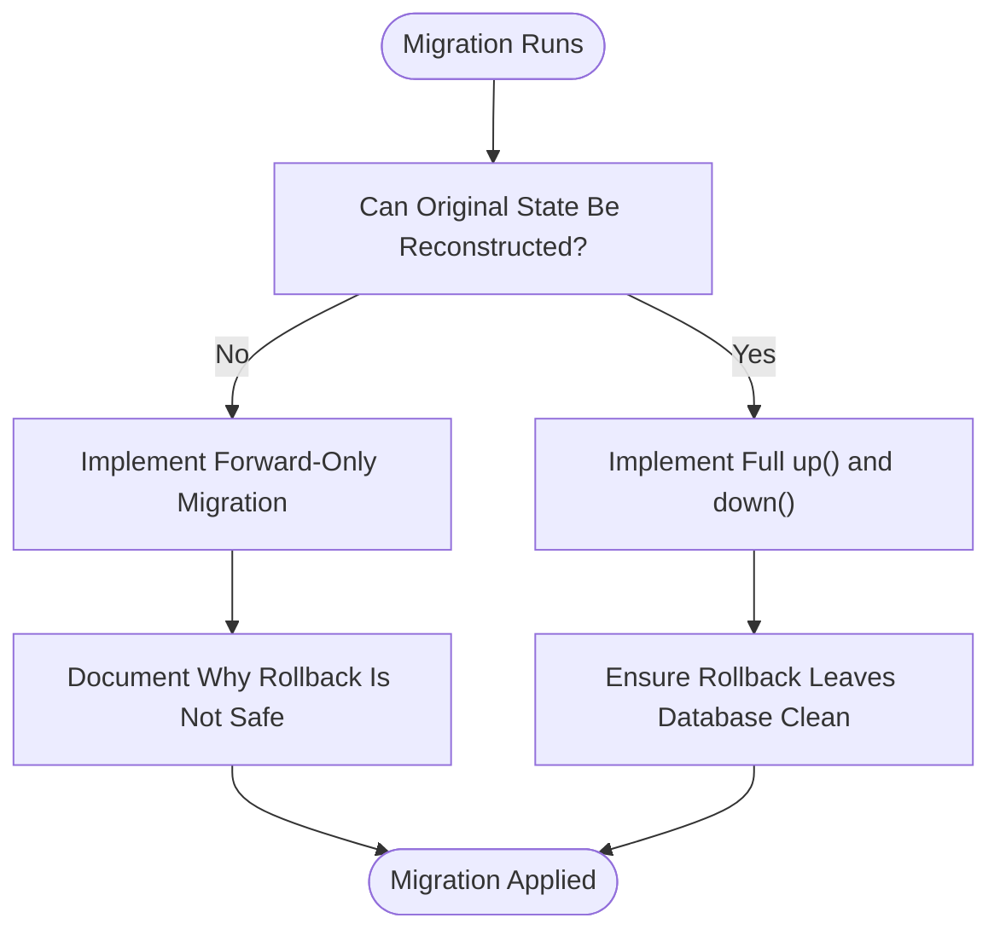
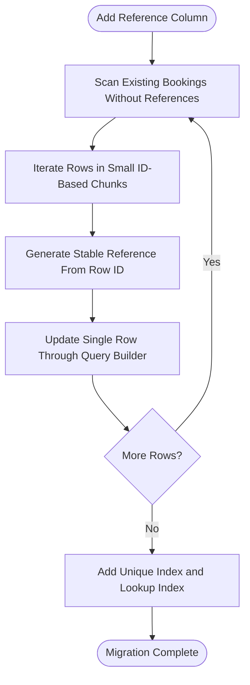
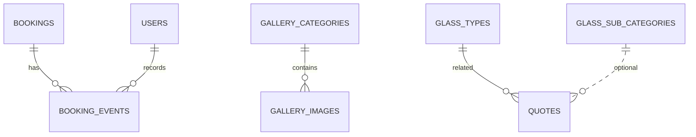
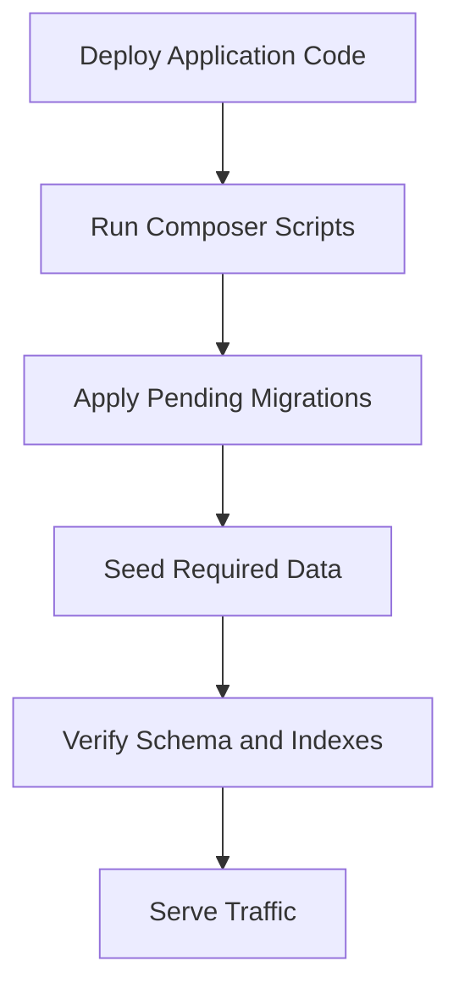
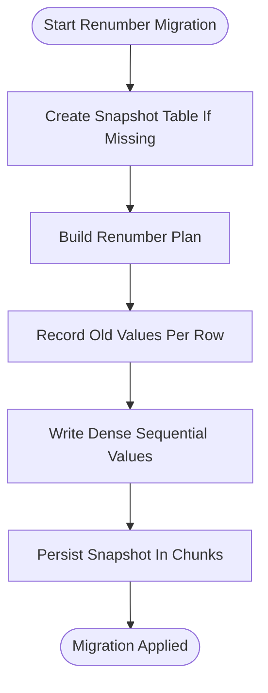
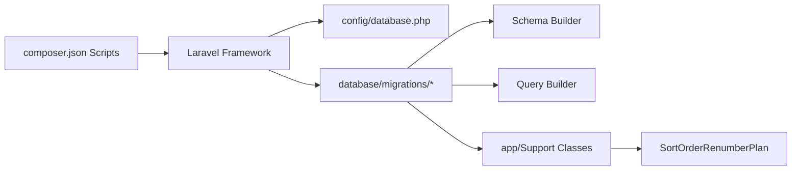

# Migration Strategy

<cite>
**Referenced Files in This Document**
- [composer.json](file://composer.json)
- [config/database.php](file://config/database.php)
- [database/migrations/0001_01_01_000000_create_users_table.php](file://database/migrations/0001_01_01_000000_create_users_table.php)
- [database/migrations/2026_04_22_064659_convert_gallery_category_to_foreign_key.php](file://database/migrations/2026_04_22_064659_convert_gallery_category_to_foreign_key.php)
- [database/migrations/2026_05_07_080001_add_glass_sub_category_id_to_quotes_table.php](file://database/migrations/2026_05_07_080001_add_glass_sub_category_id_to_quotes_table.php)
- [database/migrations/2026_06_10_184301_add_unique_constraints_to_poll_votes_table.php](file://database/migrations/2026_06_10_184301_add_unique_constraints_to_poll_votes_table.php)
- [database/migrations/2026_07_07_000001_add_unique_index_to_bookings_scheduled_at.php](file://database/migrations/2026_07_07_000001_add_unique_index_to_bookings_scheduled_at.php)
- [database/migrations/2026_10_01_000000_replace_unique_index_on_bookings_scheduled_at.php](file://database/migrations/2026_10_01_000000_replace_unique_index_on_bookings_scheduled_at.php)
- [database/migrations/2026_10_01_000001_close_saturday_working_hours.php](file://database/migrations/2026_10_01_000001_close_saturday_working_hours.php)
- [database/migrations/2026_10_01_150000_create_booking_events_table.php](file://database/migrations/2026_10_01_150000_create_booking_events_table.php)
- [database/migrations/2026_10_01_150300_add_previous_scheduled_at_to_booking_events_table.php](file://database/migrations/2026_10_01_150300_add_previous_scheduled_at_to_booking_events_table.php)
- [database/migrations/2026_10_11_000000_normalise_persisted_media_paths.php](file://database/migrations/2026_10_11_000000_normalise_persisted_media_paths.php)
- [database/migrations/2026_10_18_000000_add_structured_fields_to_bookings_table.php](file://database/migrations/2026_10_18_000000_add_structured_fields_to_bookings_table.php)
- [database/migrations/2026_10_18_000001_create_booking_closed_days_table.php](file://database/migrations/2026_10_18_000001_create_booking_closed_days_table.php)
- [database/migrations/2026_10_18_000003_make_vehicle_details_nullable_on_bookings_table.php](file://database/migrations/2026_10_18_000003_make_vehicle_details_nullable_on_bookings_table.php)
- [database/migrations/2026_10_19_000100_normalize_admin_sort_orders.php](file://database/migrations/2026_10_19_000100_normalize_admin sort_orders.php)
- [database/migrations/2026_10_19_000200_add_sort_order_unique_indexes.php](file://database/migrations/2026_10_19_000200_add_sort_order_unique_indexes.php)
- [app/Support/SortOrderRenumberPlan.php](file://app/Support/SortOrderRenumberPlan.php)
</cite>

## Table of Contents
1. [Introduction](#introduction)
2. [Project Structure](#project-structure)
3. [Core Components](#core-components)
4. [Architecture Overview](#architecture-overview)
5. [Detailed Component Analysis](#detailed-component-analysis)
6. [Dependency Analysis](#dependency-analysis)
7. [Performance Considerations](#performance-considerations)
8. [Troubleshooting Guide](#troubleshooting-guide)
9. [Conclusion](#conclusion)

## Introduction
This document explains Highblossom’s database migration strategy and conventions as implemented in the project. It covers naming, ordering, forward-only design, rollback behavior, data transformation migrations, constraints and indexes, environment configuration, testing assumptions, deployment procedures, conflict resolution, and branching coordination. The guidance is derived directly from the migration files, configuration, composer scripts, and supporting application code.

## Project Structure
Migrations live under `database/migrations` and follow Laravel’s timestamp-prefixed file naming convention. Supporting logic for complex migrations is placed under `app/Support`, while database configuration lives under `config/database.php`. Composer scripts orchestrate setup, development, and post-create tasks that include migrations.

**Diagram sources**
- [composer.json:60-120](file://composer.json#L60-L120)
- [config/database.php:1-184](file://config/database.php#L1-L184)
- [database/migrations/0001_01_01_000000_create_users_table.php:1-49](file://database/migrations/0001_01_01_000000_create_users_table.php#L1-L49)
- [database/migrations/2026_10_19_000100_normalize_admin_sort_orders.php:1-108](file://database/migrations/2026_10_19_000100_normalize_admin sort_orders.php#L1-L108)
- [app/Support/SortOrderRenumberPlan.php:1-101](file://app/Support/SortOrderRenumberPlan.php#L1-L101)

**Section sources**
- [composer.json:60-120](file://composer.json#L60-L120)
- [config/database.php:1-184](file://config/database.php#L1-L184)

## Core Components
- **Timestamp-based ordering**: Every migration filename begins with a UTC-like timestamp followed by an underscore and a descriptive action, ensuring deterministic execution order.
- **Forward-only preference**: Many migrations intentionally do not fully reverse their data changes, especially when original values are not retained or reconstruction would be unsafe.
- **Data transformation migrations**: Large backfills use chunked updates to avoid memory pressure and oversized database packets.
- **Constraint-first schema evolution**: Foreign keys, unique indexes, and composite constraints are added explicitly after data has been normalized.
- **Shared planning logic**: Complex renumbering logic is centralized in a support class so migrations and preview commands share the same definition.

**Section sources**
- [database/migrations/2026_10_11_000000_normalise_persisted_media_paths.php:1-200](file://database/migrations/2026_10_11_000000_normalise_persisted_media_paths.php#L1-L200)
- [database/migrations/2026_10_19_000100_normalize_admin_sort_orders.php:1-108](file://database/migrations/2026_10_19_000100_normalize_admin sort_orders.php#L1-L108)
- [database/migrations/2026_10_19_000200_add_sort_order_unique_indexes.php:1-72](file://database/migrations/2026_10_19_000200_add_sort_order_unique_indexes.php#L1-L72)
- [app/Support/SortOrderRenumberPlan.php:1-101](file://app/Support/SortOrderRenumberPlan.php#L1-L101)

## Architecture Overview
The migration system follows a layered flow:

1. Composer scripts trigger setup, tests, or post-create operations.
2. Post-create and setup scripts invoke migration commands.
3. Laravel loads the migration repository and executes unapplied migrations in filename order.
4. Each migration may change schema through the Schema builder or transform data through the DB facade.
5. Complex multi-step operations delegate shared rules to application support classes.

**Diagram sources**
- [composer.json:60-120](file://composer.json#L60-L120)
- [config/database.php:140-170](file://config/database.php#L140-L170)
- [database/migrations/2026_10_19_000100_normalize_admin_sort_orders.php:1-108](file://database/migrations/2026_10_19_000100_normalize_admin sort_orders.php#L1-L108)
- [app/Support/SortOrderRenumberPlan.php:1-101](file://app/Support/SortOrderRenumberPlan.php#L1-L101)

## Detailed Component Analysis

### Naming Conventions and Ordering
- Filenames start with a date-time stamp such as `YYYY_MM_DD_HHMMSS`.
- The timestamp ensures chronological ordering across branches and environments.
- The suffix describes the operation, for example:
  - `create_*_table.php`
  - `add_*_to_*_table.php`
  - `convert_*_to_foreign_key.php`
  - `normalize_*_sort_orders.php`
  - `add_*_unique_indexes.php`
  - `make_*_nullable_on_*_table.php`
- When several related changes belong together, they use the same date and increasing seconds or sub-suffixes, for example:
  - `2026_10_18_000000_add_structured_fields_to_bookings_table.php`
  - `2026_10_18_000001_create_booking_closed_days_table.php`
  - `2026_10_18_000003_make_vehicle_details_nullable_on_bookings_table.php`

This pattern makes it easy to identify which migrations are part of the same feature and preserves dependency order.

**Section sources**
- [database/migrations/0001_01_01_000000_create_users_table.php:1-49](file://database/migrations/0001_01_01_000000_create_users_table.php#L1-L49)
- [database/migrations/2026_10_18_000000_add_structured_fields_to_bookings_table.php:1-74](file://database/migrations/2026_10_18_000000_add_structured_fields_to_bookings_table.php#L1-L74)
- [database/migrations/2026_10_18_000001_create_booking_closed_days_table.php:1-39](file://database/migrations/2026_10_18_000001_create_booking_closed_days_table.php#L1-L39)
- [database/migrations/2026_10_18_000003_make_vehicle_details_nullable_on_bookings_table.php:1-38](file://database/migrations/2026_10_18_000003_make_vehicle_details_nullable_on_bookings_table.php#L1-L38)

### Forward-Only Migrations
Not every migration is reversible. Some data repairs are intentionally forward-only because the original state cannot be reconstructed safely.

Key examples:
- Media path normalization replaces absolute URLs with disk-relative paths and does not retain the original host. Its rollback is intentionally empty.
- Admin sort order renumbering records old values in a temporary snapshot table, but the primary intent is one-way normalization before enforcing uniqueness.
- Saturday working hours alignment mutates stored JSON configuration; its down method reverses the flag only when the setting exists.

**Diagram sources**
- [database/migrations/2026_10_11_000000_normalise_persisted_media_paths.php:1-200](file://database/migrations/2026_10_11_000000_normalise_persisted_media_paths.php#L1-L200)
- [database/migrations/2026_10_19_000100_normalize_admin_sort_orders.php:1-108](file://database/migrations/2026_10_19_000100_normalize_admin sort_orders.php#L1-L108)
- [database/migrations/2026_10_01_000001_close_saturday_working_hours.php:1-56](file://database/migrations/2026_10_01_000001_close_saturday_working_hours.php#L1-L56)

**Section sources**
- [database/migrations/2026_10_11_000000_normalise_persisted_media_paths.php:1-200](file://database/migrations/2026_10_11_000000_normalise_persisted_media_paths.php#L1-L200)
- [database/migrations/2026_10_19_000100_normalize_admin_sort_orders.php:1-108](file://database/migrations/2026_10_19_000100_normalize_admin sort_orders.php#L1-L108)
- [database/migrations/2026_10_01_000001_close_saturday_working_hours.php:1-56](file://database/migrations/2026_10_01_000001_close_saturday_working_hours.php#L1-L56)

### Rollback Procedures
Rollbacks vary by migration type:

| Migration Pattern | Rollback Behavior | Example File |
|---|---|---|
| Simple table creation | Drops created tables in reverse order | [0001_01_01_000000_create_users_table.php](file://database/migrations/0001_01_01_000000_create_users_table.php#L1-L49) |
| Column addition | Drops columns and indexes added by the migration | [2026_10_18_000000_add_structured_fields_to_bookings_table.php](file://database/migrations/2026_10_18_000000_add_structured_fields_to_bookings_table.php#L1-L74) |
| Constraint replacement | Drops new index and recreates previous constraint | [2026_10_01_000000_replace_unique_index_on_bookings_scheduled_at.php](file://database/migrations/2026_10_01_000000_replace_unique_index_on_bookings_scheduled_at.php#L1-L46) |
| Data repair without original values | Empty rollback or best-effort reversal | [2026_10_11_000000_normalise_persisted_media_paths.php](file://database/migrations/2026_10_11_000000_normalise_persisted_media_paths.php#L1-L200) |
| Snapshot-backed renumbering | Restores rows from snapshot table and drops snapshot | [2026_10_19_000100_normalize_admin_sort_orders.php](file://database/migrations/2026_10_19_000100_normalize_admin sort_orders.php#L1-L108) |
| Enum-to-foreign-key conversion | Drops foreign key, recreates enum column, migrates data back | [2026_04_22_064659_convert_gallery_category_to_foreign_key.php](file://database/migrations/2026_04_22_064659_convert_gallery_category_to_foreign_key.php#L1-L72) |

When a rollback depends on auxiliary state such as a snapshot table, the migration must check whether that state exists before attempting restoration.

**Section sources**
- [database/migrations/0001_01_01_000000_create_users_table.php:1-49](file://database/migrations/0001_01_01_000000_create_users_table.php#L1-L49)
- [database/migrations/2026_10_18_000000_add_structured_fields_to_bookings_table.php:1-74](file://database/migrations/2026_10_18_000000_add_structured_fields_to_bookings_table.php#L1-L74)
- [database/migrations/2026_10_01_000000_replace_unique_index_on_bookings_scheduled_at.php:1-L46](file://database/migrations/2026_10_01_000000_replace_unique_index_on_bookings_scheduled_at.php#L1-L46)
- [database/migrations/2026_10_11_000000_normalise_persisted_media_paths.php:1-L200](file://database/migrations/2026_10_11_000000_normalise_persisted_media_paths.php#L1-L200)
- [database/migrations/2026_10_19_000100_normalize_admin_sort_orders.php:1-L108](file://database/migrations/2026_10_19_000100_normalize_admin sort_orders.php#L1-L108)
- [database/migrations/2026_04_22_064659_convert_gallery_category_to_foreign_key.php:1-L72](file://database/migrations/2026_04_22_064659_convert_gallery_category_to_foreign_key.php#L1-L72)

### Data Transformation Migrations
The project uses explicit, chunked data transformations rather than ad hoc scripts inside migrations.

Common patterns:
- **Chunk-by-ID iteration**: Large datasets are processed with chunked queries to reduce memory usage and keep transaction payloads manageable.
- **Selective rewriting**: Only rows matching a condition are updated, avoiding unnecessary writes.
- **Idempotent helpers**: Conditional checks prevent failures when tables or columns do not exist yet.
- **Structured vs legacy fields**: New structured columns are introduced alongside legacy free-text columns during transition phases.

Example workflow for generating booking references:

**Diagram sources**
- [database/migrations/2026_10_18_000000_add_structured_fields_to_bookings_table.php:1-L74](file://database/migrations/2026_10_18_000000_add_structured_fields_to_bookings_table.php#L1-L74)

**Section sources**
- [database/migrations/2026_10_18_000000_add_structured_fields_to_bookings_table.php:1-L74](file://database/migrations/2026_10_18_000000_add_structured_fields_to_bookings_table.php#L1-L74)
- [database/migrations/2026_10_11_000000_normalise_persisted_media_paths.php:1-L200](file://database/migrations/2026_10_11_000000_normalise_persisted_media_paths.php#L1-L200)

### Foreign Key Constraints and Referential Integrity
Foreign keys are used to enforce relationships between parent and child tables. Typical behaviors observed:
- Nullable foreign keys are used when a relationship can be absent.
- `onDelete('set null')` preserves historical data when the referenced row is deleted.
- Non-null foreign keys use default cascade behavior where appropriate.
- Composite foreign keys or constrained pairs appear alongside indexes for query performance.

Examples:
- Gallery images reference categories with a nullable foreign key and `set null` deletion behavior.
- Booking events reference bookings with cascade delete and users with null-on-delete behavior.
- Quotes gain an optional glass subcategory foreign key with an explicit index.

**Diagram sources**
- [database/migrations/2026_10_01_150000_create_booking_events_table.php:1-L44](file://database/migrations/2026_10_01_150000_create_booking_events_table.php#L1-L44)
- [database/migrations/2026_04_22_064659_convert_gallery_category_to_foreign_key.php:1-L72](file://database/migrations/2026_04_22_064659_convert_gallery_category_to_foreign_key.php#L1-L72)
- [database/migrations/2026_05_07_080001_add_glass_sub_category_id_to_quotes_table.php:1-L27](file://database/migrations/2026_05_07_080001_add_glass_sub_category_id_to_quotes_table.php#L1-L27)

**Section sources**
- [database/migrations/2026_04_22_064659_convert_gallery_category_to_foreign_key.php:1-L72](file://database/migrations/2026_04_22_064659_convert_gallery_category_to_foreign_key.php#L1-L72)
- [database/migrations/2026_10_01_150000_create_booking_events_table.php:1-L44](file://database/migrations/2026_10_01_150000_create_booking_events_table.php#L1-L44)
- [database/migrations/2026_05_07_080001_add_glass_sub_category_id_to_quotes_table.php:1-L27](file://database/migrations/2026_05_07_080001_add_glass_sub_category_id_to_quotes_table.php#L1-L27)

### Indexes and Database-Level Validations
Indexes and constraints are added deliberately:
- **Unique indexes**: Prevent duplicate values at the database level, such as booking references and admin sort orders.
- **Composite unique indexes**: Enforce uniqueness within scopes, such as gallery image source plus sort order.
- **Lookup indexes**: Improve query performance for frequently filtered columns.
- **Partial-style constraints via composite keys**: Poll votes prevent duplicate voting by IP address and by user per poll.

The project also demonstrates replacing a unique constraint with a plain index when business logic handles duplication through locking instead of schema-level blocking.

**Section sources**
- [database/migrations/2026_10_18_000000_add_structured_fields_to_bookings_table.php:1-L74](file://database/migrations/2026_10_18_000000_add_structured_fields_to_bookings_table.php#L1-L74)
- [database/migrations/2026_10_19_000200_add_sort_order_unique_indexes.php:1-L72](file://database/migrations/2026_10_19_000200_add_sort_order_unique_indexes.php#L1-L72)
- [database/migrations/2026_06_10_184301_add_unique_constraints_to_poll_votes_table.php:1-L33](file://database/migrations/2026_06_10_184301_add_unique_constraints_to_poll_votes_table.php#L1-L33)
- [database/migrations/2026_10_01_000000_replace_unique_index_on_bookings_scheduled_at.php:1-L46](file://database/migrations/2026_10_01_000000_replace_unique_index_on_bookings_scheduled_at.php#L1-L46)

### Conditional Logic and Idempotency
Migrations frequently guard against missing tables, columns, or indexes:
- Before adding indexes, migrations check whether the table exists.
- Before dropping indexes, migrations verify the index exists.
- Before transforming JSON content blocks, migrations verify the column exists.
- Before applying media path normalization, migrations check whether the target column exists.
- For snapshot-backed rollbacks, migrations skip restoration if the snapshot table was never created.

This makes migrations safer to run multiple times and easier to integrate into automated pipelines.

**Section sources**
- [database/migrations/2026_10_19_000200_add_sort_order_unique_indexes.php:1-L72](file://database/migrations/2026_10_19_000200_add_sort_order_unique_indexes.php#L1-L72)
- [database/migrations/2026_10_11_000000_normalise_persisted_media_paths.php:1-L200](file://database/migrations/2026_10_11_000000_normalise_persisted_media_paths.php#L1-L200)
- [database/migrations/2026_10_19_000100_normalize_admin_sort_orders.php:1-L108](file://database/migrations/2026_10_19_000100_normalize_admin sort_orders.php#L1-L108)

### Environment Setup and Configuration
Database configuration is centralised:
- Default connection is MySQL unless overridden by environment variables.
- SQLite is configured with foreign key constraints enabled by default.
- Strict mode is enabled for MySQL and MariaDB.
- Migration repository settings define the tracking table and update behavior.

Environment-driven configuration allows local, CI, staging, and production environments to share migration code while connecting to different databases.

**Section sources**
- [config/database.php:1-L184](file://config/database.php#L1-L184)

### Testing Approaches for Migrations
The repository does not contain dedicated migration test files in the provided structure. However, the testing approach can be inferred from the migration design and composer scripts:
- Migrations should be idempotent where possible or guarded by existence checks.
- Rollbacks should leave the database in a clean state when full reversibility is intended.
- Data backfills should be tested with representative sample data rather than relying solely on seeders.
- The composer `test` script clears configuration and runs the test suite, implying migrations are expected to work in the configured test database.

Recommended practices based on existing migrations:
- Use small, focused migrations.
- Separate schema changes from large data repairs.
- Avoid side effects such as observers for bulk data repairs.
- Keep long-running data operations in chunks.

**Section sources**
- [composer.json:60-L120](file://composer.json#L60-L120)
- [database/migrations/2026_10_19_000100_normalize_admin_sort_orders.php:1-L108](file://database/migrations/2026_10_19_000100_normalize_admin sort_orders.php#L1-L108)

### Deployment Procedures
Deployment relies on Composer scripts and standard Laravel migration tooling:
- `composer setup` installs dependencies, generates the application key, forces migrations, installs frontend assets, and builds them.
- `post-create-project-cmd` creates the SQLite database file and runs migrations gracefully.
- Production deployments should apply migrations after code release and before serving traffic when schema changes affect requests.
- Long-running migrations should be monitored, especially those touching large tables.

**Diagram sources**
- [composer.json:60-L120](file://composer.json#L60-L120)

**Section sources**
- [composer.json:60-L120](file://composer.json#L60-L120)

### Complex Migration Examples

#### Structured Booking Fields and Backfill
This migration introduces structured job fields alongside the legacy `vehicle_details` field, generates stable booking references, and adds indexes. It documents why duration is stored as a snapshot and why the legacy column remains required during the transition.

**Section sources**
- [database/migrations/2026_10_18_000000_add_structured_fields_to_bookings_table.php:1-L74](file://database/migrations/2026_10_18_000000_add_structured_fields_to_bookings_table.php#L1-L74)

#### Normalizing Admin Sort Orders
This migration renames and densifies admin ordering columns using a shared planning class. It snapshots old values, avoids model observers for bulk updates, and prepares the schema for unique constraints.

**Diagram sources**
- [database/migrations/2026_10_19_000100_normalize_admin_sort_orders.php:1-L108](file://database/migrations/2026_10_19_000100_normalize_admin sort_orders.php#L1-L108)
- [app/Support/SortOrderRenumberPlan.php:1-L101](file://app/Support/SortOrderRenumberPlan.php#L1-L101)

**Section sources**
- [database/migrations/2026_10_19_000100_normalize_admin_sort_orders.php:1-L108](file://database/migrations/2026_10_19_000100_normalize_admin sort_orders.php#L1-L108)
- [app/Support/SortOrderRenumberPlan.php:1-L101](file://app/Support/SortOrderRenumberPlan.php#L1-L101)

#### Adding Unique Sort Order Indexes
This migration enforces database-level uniqueness for each admin ordering surface. It is idempotent and skips tables or indexes that already exist.

**Section sources**
- [database/migrations/2026_10_19_000200_add_sort_order_unique_indexes.php:1-L72](file://database/migrations/2026_10_19_000200_add_sort_order_unique_indexes.php#L1-L72)

#### Normalizing Persisted Media Paths
This migration converts absolute storage URLs to disk-relative paths for selected columns and nested block attributes. It is forward-only because the original host cannot be reliably reconstructed.

**Section sources**
- [database/migrations/2026_10_11_000000_normalise_persisted_media_paths.php:1-L200](file://database/migrations/2026_10_11_000000_normalise_persisted_media_paths.php#L1-L200)

#### Replacing a Unique Constraint With a Plain Index
This migration removes a unique constraint on scheduled booking times and replaces it with a normal index. Business logic now prevents double-booking through transactional locking instead of the database constraint.

**Section sources**
- [database/migrations/2026_10_01_000000_replace_unique_index_on_bookings_scheduled_at.php:1-L46](file://database/migrations/2026_10_01_000000_replace_unique_index_on_bookings_scheduled_at.php#L1-L46)
- [database/migrations/2026_07_07_000001_add_unique_index_to_bookings_scheduled_at.php:1-L30](file://database/migrations/2026_07_07_000001_add_unique_index_to_bookings_scheduled_at.php#L1-L30)

#### Converting an Enum Column to a Foreign Key
This migration migrates existing enum values to a relational foreign key column, drops the enum, and sets the foreign key to null on delete. Its rollback recreates the enum and attempts to restore values.

**Section sources**
- [database/migrations/2026_04_22_064659_convert_gallery_category_to_foreign_key.php:1-L72](file://database/migrations/2026_04_22_064659_convert_gallery_category_to_foreign_key.php#L1-L72)

### Migration Conflict Resolution
Because migrations are ordered by filename timestamp, conflicts usually arise when two developers add migrations with identical timestamps or when unrelated branches introduce conflicting changes. Recommended resolution steps:
1. Compare timestamps and filenames.
2. Adjust the newer migration timestamp so it runs after the older one.
3. If two migrations touch the same table or index, split the work so one migration performs data preparation and another applies the constraint.
4. Avoid editing already-applied migrations in production.
5. Prefer separate sequential migrations for dependent changes, as seen with the booking scheduling constraint history.

**Section sources**
- [database/migrations/2026_07_07_000001_add_unique_index_to_bookings_scheduled_at.php:1-L30](file://database/migrations/2026_07_07_000001_add_unique_index_to_bookings_scheduled_at.php#L1-L30)
- [database/migrations/2026_10_01_000000_replace_unique_index_on_bookings_scheduled_at.php:1-L46](file://database/migrations/2026_10_01_000000_replace_unique_index_on_bookings_scheduled_at.php#L1-L46)

### Branching Strategies and Development Coordination
- Use short-lived feature branches.
- Give each migration a clear, descriptive name.
- Keep related migrations grouped by timestamp.
- Coordinate changes that touch the same table or index.
- Prefer additive schema changes first, then cleanup migrations later.
- Use conditional checks so migrations survive partial runs or repeated executions where safe.
- Share complex logic through support classes rather than duplicating algorithms across migrations.

**Section sources**
- [app/Support/SortOrderRenumberPlan.php:1-L101](file://app/Support/SortOrderRenumberPlan.php#L1-L101)
- [database/migrations/2026_10_18_000000_add_structured_fields_to_bookings_table.php:1-L74](file://database/migrations/2026_10_18_000000_add_structured_fields_to_bookings_table.php#L1-L74)
- [database/migrations/2026_10_19_000200_add_sort_order_unique_indexes.php:1-L72](file://database/migrations/2026_10_19_000200_add_sort_order_unique_indexes.php#L1-L72)

## Dependency Analysis
The migration subsystem depends on:
- Laravel framework migration and schema components.
- Composer scripts for lifecycle automation.
- Environment variables for database connectivity.
- Application support classes for complex data plans.

**Diagram sources**
- [composer.json:60-L120](file://composer.json#L60-L120)
- [config/database.php:1-L184](file://config/database.php#L1-L184)
- [app/Support/SortOrderRenumberPlan.php:1-L101](file://app/Support/SortOrderRenumberPlan.php#L1-L101)

**Section sources**
- [composer.json:60-L120](file://composer.json#L60-L120)
- [config/database.php:1-L184](file://config/database.php#L1-L184)
- [app/Support/SortOrderRenumberPlan.php:1-L101](file://app/Support/SortOrderRenumberPlan.php#L1-L101)

## Performance Considerations
- Use chunked queries for large data transformations to avoid memory exhaustion.
- Prefer direct query-builder updates for bulk data repairs to avoid model observers.
- Add indexes after data is normalized to reduce write amplification.
- Split expensive operations across multiple migrations when they have distinct responsibilities.
- Monitor long-running migrations in production and consider running them outside peak traffic windows.

[No sources needed since this section provides general guidance]

## Troubleshooting Guide
Common issues and resolutions:
- **Migration fails because an index or table already exists**: Ensure the migration checks for existence before creating or dropping objects.
- **Rollback fails because snapshot data is missing**: Guard rollback logic against missing auxiliary tables.
- **Data migration stalls or exceeds packet limits**: Reduce chunk size or split the operation into smaller migrations.
- **Unique constraint violation after renumbering**: Ensure renumbering completes before adding unique indexes.
- **Media links break after environment change**: Run the media path normalization migration once to convert absolute URLs to disk-relative paths.

**Section sources**
- [database/migrations/2026_10_19_000100_normalize_admin_sort_orders.php:1-L108](file://database/migrations/2026_10_19_000100_normalize_admin sort_orders.php#L1-L108)
- [database/migrations/2026_10_19_000200_add_sort_order_unique_indexes.php:1-L72](file://database/migrations/2026_10_19_000200_add_sort_order_unique_indexes.php#L1-L72)
- [database/migrations/2026_10_11_000000_normalise_persisted_media_paths.php:1-L200](file://database/migrations/2026_10_11_000000_normalise_persisted_media_paths.php#L1-L200)

## Conclusion
Highblossom’s migration strategy emphasizes deterministic timestamp ordering, forward-safe data transformations, explicit constraints, and idempotent guards. Complex operations are supported by shared planning logic, and rollback behavior is documented explicitly when reversibility is limited. The approach balances safety, readability, and performance, making migrations suitable for both local development and production deployment.