# Seeders and Factories

<cite>
**Referenced Files in This Document**   
- [DatabaseSeeder.php](file://database/seeders/DatabaseSeeder.php)
- [CompanyDataSeeder.php](file://database/seeders/CompanyDataSeeder.php)
- [RolesAndPermissionsSeeder.php](file://database/seeders/RolesAndPermissionsSeeder.php)
- [ServiceTypeSeeder.php](file://database/seeders/ServiceTypeSeeder.php)
- [GalleryCategorySeeder.php](file://database/seeders/GalleryCategorySeeder.php)
- [GlassTypeSeeder.php](file://database/seeders/GlassTypeSeeder.php)
- [GlassSubCategorySeeder.php](file://database/seeders/GlassSubCategorySeeder.php)
- [AboutUsContentSeeder.php](file://database/seeders/AboutUsContentSeeder.php)
- [ApplicationVersionSeeder.php](file://database/seeders/ApplicationVersionSeeder.php)
- [SeoStaticRouteSeeder.php](file://database/seeders/SeoStaticRouteSeeder.php)
- [UserFactory.php](file://database/factories/UserFactory.php)
- [StaffFactory.php](file://database/factories/StaffFactory.php)
- [BookingFactory.php](file://database/factories/BookingFactory.php)
- [InspectionFactory.php](file://database/factories/InspectionFactory.php)
- [PartnerFactory.php](file://database/factories/PartnerFactory.php)
- [StaffAbsenceFactory.php](file://database/factories/StaffAbsenceFactory.php)
- [BookingClosedDayFactory.php](file://database/factories/BookingClosedDayFactory.php)
</cite>

## Table of Contents
1. [Introduction](#introduction)
2. [Project Structure](#project-structure)
3. [Core Components](#core-components)
4. [Architecture Overview](#architecture-overview)
5. [Detailed Component Analysis](#detailed-component-analysis)
6. [Dependency Analysis](#dependency-analysis)
7. [Performance Considerations](#performance-considerations)
8. [Troubleshooting Guide](#troubleshooting-guide)
9. [Conclusion](#conclusion)

## Introduction
This document explains Highblossom’s test data generation and database seeding strategy. It covers how the application initializes its database, how seeders organize domain-specific initial data, and how factories generate realistic model instances for tests and development.

The repository follows a clear separation between:
- **Initial application data**: business configuration, roles, permissions, services, galleries, SEO metadata, and version history.
- **Test data**: generated through Eloquent factories with state modifiers for different entity states.

Seeders are primarily idempotent where possible and use lookup keys such as slugs or route names to avoid duplicate records. Factories provide reusable blueprints for creating models, including relationships and state variations.

## Project Structure
Highblossom organizes data setup into two related directories:

| Area | Purpose | Examples |
|---|---|---|
| `database/seeders` | Orchestration and initial application data | Database orchestration, company settings, roles, services, gallery categories, SEO routes, version registry |
| `database/factories` | Reusable model builders for tests and development | User, booking, inspection, staff absence, partner, closed day |

```mermaid
graph TB
    Seeder["DatabaseSeeder"] --> Company["CompanyDataSeeder"]
    Seeder --> Roles["RolesAndPermissionsSeeder"]
    Seeder --> GalleryCategories["GalleryCategorySeeder"]
    Seeder --> AboutUs["AboutUsContentSeeder"]
    Seeder --> GlassTypes["GlassTypeSeeder"]
    Seeder --> ServiceTypes["ServiceTypeSeeder"]
    Seeder --> Services["ServiceSeeder"]
    Seeder --> SeoRoutes["SeoStaticRouteSeeder"]
    Seeder --> Versions["ApplicationVersionSeeder"]
    Factory["Eloquent Factories"] --> UserFactory["UserFactory"]
    Factory --> BookingFactory["BookingFactory"]
    Factory --> InspectionFactory["InspectionFactory"]
    Factory --> StaffFactory["StaffFactory"]
    Factory --> PartnerFactory["PartnerFactory"]
    Factory --> AbsenceFactory["StaffAbsenceFactory"]
    Factory --> ClosedDayFactory["BookingClosedDayFactory"]
```

**Diagram sources**
- [DatabaseSeeder.php:1-37](file://database/seeders/DatabaseSeeder.php#L1-L37)

**Section sources**
- [DatabaseSeeder.php:1-37](file://database/seeders/DatabaseSeeder.php#L1-L37)

## Core Components
The seeding system has three main responsibilities:

1. **Orchestration**: `DatabaseSeeder` defines the order in which domain seeders run.
2. **Domain seeders**: Each seeder owns one area of initial data, such as company settings, roles, service types, gallery categories, glass types, SEO static routes, and application versions.
3. **Factories**: Each factory encapsulates default attributes and optional state modifiers for a single model.

Key design observations:
- Seeders are called explicitly by `DatabaseSeeder`.
- Many seeders use `firstOrCreate`, `findOrCreate`, or create-only patterns so they can be re-run safely.
- Factories define defaults and state helpers rather than hard-coding every attribute at call sites.

**Section sources**
- [DatabaseSeeder.php:10-37](file://database/seeders/DatabaseSeeder.php#L10-L37)
- [UserFactory.php:1-78](file://database/factories/UserFactory.php#L1-L78)

## Architecture Overview
At runtime, Laravel executes the configured seeder class. In this project, that is `DatabaseSeeder`. It creates an initial admin user and then calls domain seeders in a defined order.

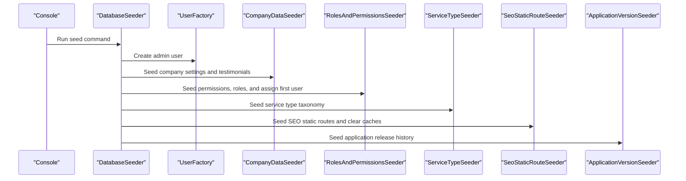

**Diagram sources**
- [DatabaseSeeder.php:10-37](file://database/seeders/DatabaseSeeder.php#L10-L37)
- [CompanyDataSeeder.php:1-106](file://database/seeders/CompanyDataSeeder.php#L1-L106)
- [RolesAndPermissionsSeeder.php:1-161](file://database/seeders/RolesAndPermissionsSeeder.php#L1-L161)
- [ServiceTypeSeeder.php:1-35](file://database/seeders/ServiceTypeSeeder.php#L1-L35)
- [SeoStaticRouteSeeder.php:1-98](file://database/seeders/SeoStaticRouteSeeder.php#L1-L98)
- [ApplicationVersionSeeder.php:1-140](file://database/seeders/ApplicationVersionSeeder.php#L1-L140)

## Detailed Component Analysis

### Database Seeder Orchestration
`DatabaseSeeder` is the entry point for application initialization. It:
- Creates an admin user using `UserFactory`.
- Calls domain seeders in a stable order.
- Leaves gallery image seeding commented out, indicating that gallery media may require additional assets or environment configuration before running.

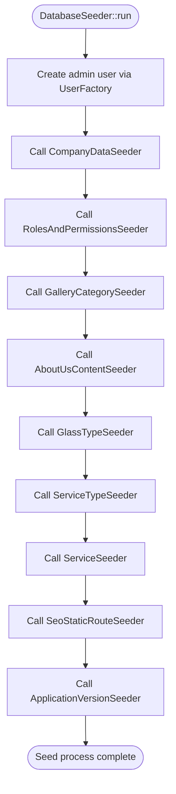

**Diagram sources**
- [DatabaseSeeder.php:10-37](file://database/seeders/DatabaseSeeder.php#L10-L37)

**Section sources**
- [DatabaseSeeder.php:10-37](file://database/seeders/DatabaseSeeder.php#L10-L37)

### Company Data Seeder
`CompanyDataSeeder` seeds foundational business configuration and marketing content:

- **Company settings**: Uses `CompanySetting::set` for each key, including company name, contact details, working hours, timezone, locale, formatting, capacity, and social links.
- **Environment-sensitive values**: API keys, logo paths, and favicon fields are intentionally left empty because they belong in environment configuration or gitignored storage.
- **Testimonials**: Inserts sample customer testimonials with ratings, featured flags, publication status, and sort order.

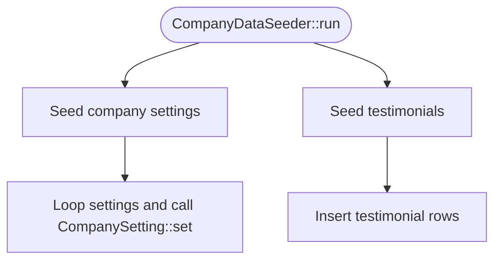

**Diagram sources**
- [CompanyDataSeeder.php:10-106](file://database/seeders/CompanyDataSeeder.php#L10-L106)

**Section sources**
- [CompanyDataSeeder.php:10-106](file://database/seeders/CompanyDataSeeder.php#L10-L106)

### Roles and Permissions Seeder
`RolesAndPermissionsSeeder` manages access control using Spatie Permissions:

- Clears permission cache.
- Defines permissions across blog, bookings, inspections, gallery, services, settings, SEO, content, communication, HR, access control, and system features.
- Creates roles: Super Admin, Admin, Staff, and User.
- Assigns all permissions to Super Admin and subsets to other roles.
- Assigns Super Admin to the first user in the database.

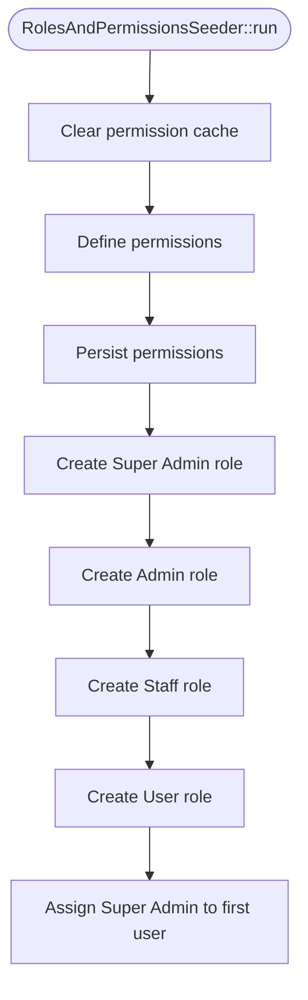

**Diagram sources**
- [RolesAndPermissionsSeeder.php:10-161](file://database/seeders/RolesAndPermissionsSeeder.php#L10-L161)

**Section sources**
- [RolesAndPermissionsSeeder.php:10-161](file://database/seeders/RolesAndPermissionsSeeder.php#L10-L161)

### Service Type Seeder
`ServiceTypeSeeder` seeds service classification options using slug-based uniqueness:

- Creates entries such as chip repair, full replacement, ADAS calibration, tinting, emergency board-up, fleet programs, architectural glazing, and warranty re-fit.
- Uses `firstOrCreate` keyed by slug, adding `is_active` when inserting new rows.

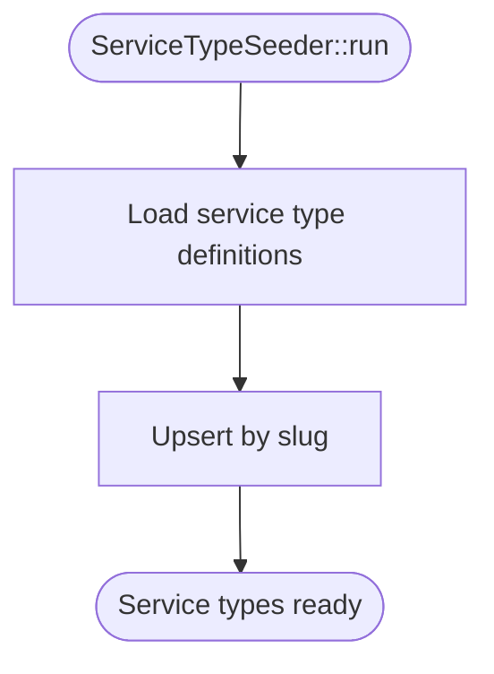

**Diagram sources**
- [ServiceTypeSeeder.php:10-35](file://database/seeders/ServiceTypeSeeder.php#L10-L35)

**Section sources**
- [ServiceTypeSeeder.php:10-35](file://database/seeders/ServiceTypeSeeder.php#L10-L35)

### Gallery Category Seeder
`GalleryCategorySeeder` provides basic gallery grouping:

- Automotive
- Heavy machinery
- Fleet
- Other

It uses slug-based upserts so repeated runs do not duplicate categories.

**Section sources**
- [GalleryCategorySeeder.php:10-46](file://database/seeders/GalleryCategorySeeder.php#L10-L46)

### Glass Type and Subcategory Seeders
`GlassTypeSeeder` seeds glass material and product types such as acrylic, laminated, toughened, windscreen, side window, rear window, and bus glass. It also uses slug-based upserts.

`GlassSubCategorySeeder` builds subcategories tied to existing glass types:

- Loads glass types by slug.
- Skips subcategories when their parent glass type slug is missing.
- Creates subcategories like windshield, door glass, window glass, rear glass, side mirror, sunroof, quarter glass, and specialty glass.

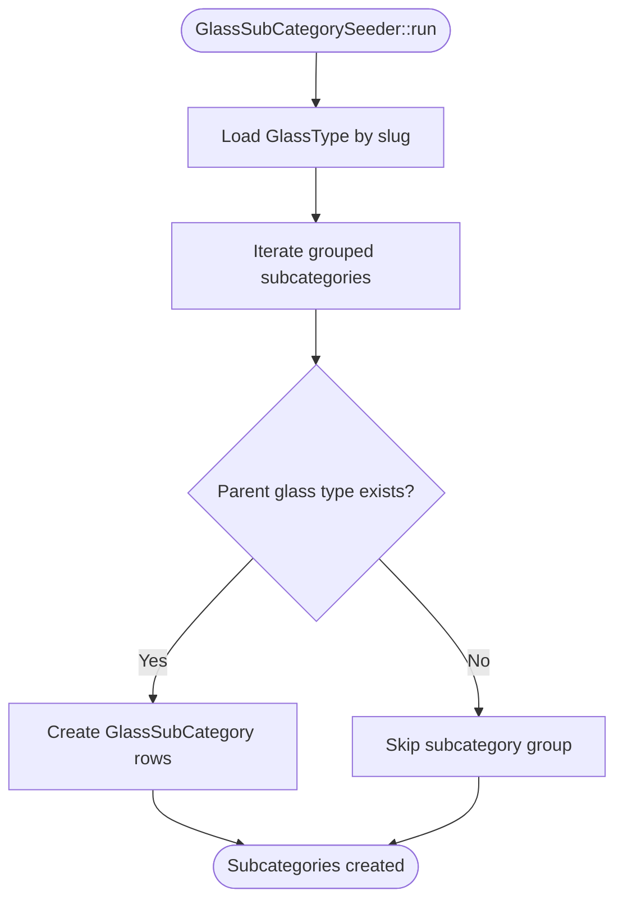

**Diagram sources**
- [GlassTypeSeeder.php:10-47](file://database/seeders/GlassTypeSeeder.php#L10-L47)
- [GlassSubCategorySeeder.php:10-105](file://database/seeders/GlassSubCategorySeeder.php#L10-L105)

**Section sources**
- [GlassTypeSeeder.php:10-47](file://database/seeders/GlassTypeSeeder.php#L10-L47)
- [GlassSubCategorySeeder.php:10-105](file://database/seeders/GlassSubCategorySeeder.php#L10-L105)

### About Us Content Seeder
`AboutUsContentSeeder` inserts a single about-us page record with title, subtitle, body, mission, vision, hero image placeholder, and active status.

**Section sources**
- [AboutUsContentSeeder.php:10-22](file://database/seeders/AboutUsContentSeeder.php#L10-L22)

### SEO Static Route Seeder
`SeoStaticRouteSeeder` seeds SEO metadata for core pages such as home, services, gallery, quote, contact, about-us, blog, terms, and privacy. It uses slug-like route names as unique keys and clears SEO sitemap and robots cache after seeding.

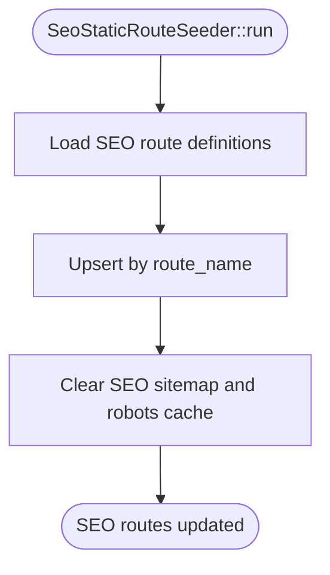

**Diagram sources**
- [SeoStaticRouteSeeder.php:10-98](file://database/seeders/SeoStaticRouteSeeder.php#L10-L98)

**Section sources**
- [SeoStaticRouteSeeder.php:10-98](file://database/seeders/SeoStaticRouteSeeder.php#L10-L98)

### Application Version Seeder
`ApplicationVersionSeeder` maintains a historical record of application releases starting from baseline version 1.2.0. Its documentation comments describe it as idempotent: existing versions are preserved, making it safe to rerun during deployments or migrations.

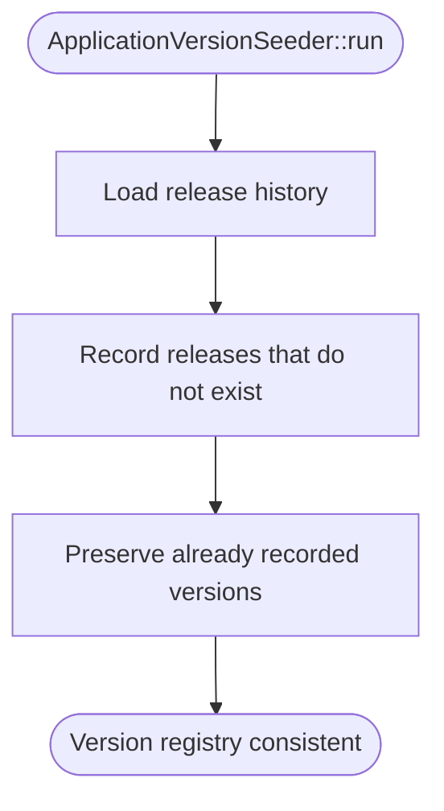

**Diagram sources**
- [ApplicationVersionSeeder.php:1-140](file://database/seeders/ApplicationVersionSeeder.php#L1-L140)

**Section sources**
- [ApplicationVersionSeeder.php:1-140](file://database/seeders/ApplicationVersionSeeder.php#L1-L140)

### Factories

#### User Factory
`UserFactory` defines default user attributes and several useful states:

- Default attributes include a fake name, email, username derived from the email, verified email timestamp, hashed password, remember token, and consent timestamps.
- State modifiers:
  - `unverified`: leaves the email unverified.
  - `withoutConsent`: removes consent acceptance timestamps.
  - `withTwoFactor`: adds encrypted two-factor secret, recovery codes, and confirmation timestamp.

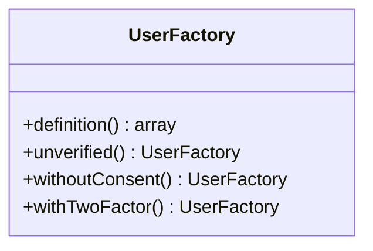

**Diagram sources**
- [UserFactory.php:10-78](file://database/factories/UserFactory.php#L10-L78)

**Section sources**
- [UserFactory.php:10-78](file://database/factories/UserFactory.php#L10-L78)

#### Booking Factory
`BookingFactory` generates realistic booking data:

- Client name, email, phone, vehicle details.
- Default status `pending`.
- Placeholder total price.
- Optional client address.

**Section sources**
- [BookingFactory.php:10-32](file://database/factories/BookingFactory.php#L10-L32)

#### Inspection Factory
`InspectionFactory` builds inspection records linked to related entities:

- Uses `Booking::factory()` to create a related booking.
- Uses `User::factory()` to assign a staff member.
- Sets a scheduled time in the future and an end time one hour later.
- Defaults location and type to workshop values.

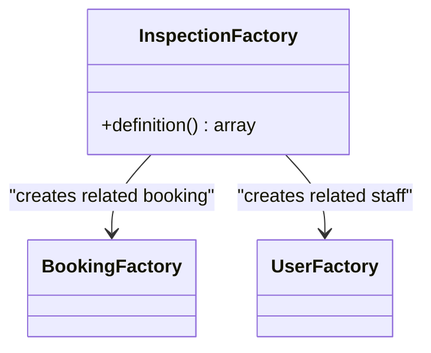

**Diagram sources**
- [InspectionFactory.php:10-35](file://database/factories/InspectionFactory.php#L10-L35)

**Section sources**
- [InspectionFactory.php:10-35](file://database/factories/InspectionFactory.php#L10-L35)

#### Staff Factory
`StaffFactory` currently defines no default attributes. It serves as a placeholder for future staff-related test data.

**Section sources**
- [StaffFactory.php:10-24](file://database/factories/StaffFactory.php#L10-L24)

#### Partner Factory
`PartnerFactory` currently defines no default attributes. It is a placeholder for partner-related test data.

**Section sources**
- [PartnerFactory.php:10-24](file://database/factories/PartnerFactory.php#L10-L24)

#### Staff Absence Factory
`StaffAbsenceFactory` generates absence records:

- Links to a staff member via `User::factory()`.
- Sets start and end times for the next day.
- Generates a random reason sentence.

**Section sources**
- [StaffAbsenceFactory.php:10-30](file://database/factories/StaffAbsenceFactory.php#L10-L30)

#### Booking Closed Day Factory
`BookingClosedDayFactory` generates days when bookings are unavailable:

- Random date within the next 1 to 30 days.
- Reason chosen from public holiday, stock take, or training day.

**Section sources**
- [BookingClosedDayFactory.php:10-29](file://database/factories/BookingClosedDayFactory.php#L10-L29)

## Dependency Analysis
The following diagram maps the most important dependencies between seeders and factories:

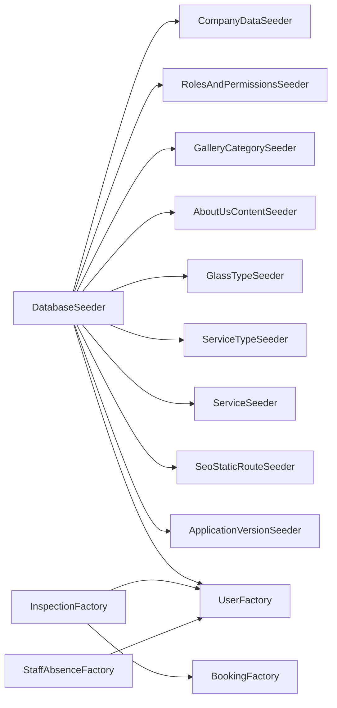

**Diagram sources**
- [DatabaseSeeder.php:10-37](file://database/seeders/DatabaseSeeder.php#L10-L37)
- [InspectionFactory.php:10-35](file://database/factories/InspectionFactory.php#L10-L35)
- [StaffAbsenceFactory.php:10-30](file://database/factories/StaffAbsenceFactory.php#L10-L30)

### Coupling and Cohesion
- **High cohesion per seeder**: Each seeder focuses on one domain, improving readability and maintainability.
- **Low coupling between seeders**: Most seeders do not depend on each other; they only depend on models and helper services.
- **Factory-to-model coupling**: Factories encapsulate model defaults and state logic, keeping test code clean.
- **External dependencies**: `RolesAndPermissionsSeeder` depends on Spatie Permission classes.

### Idempotency Strategy
- Slug-based upserts: `firstOrCreate` protects service types, gallery categories, and glass types.
- Route-name upserts: `SeoStaticRouteSeeder` protects SEO metadata.
- Cache invalidation: `SeoStaticRouteSeeder` clears SEO caches after seeding.
- Permission cache reset: `RolesAndPermissionsSeeder` clears cached permissions before rebuilding them.
- Version registry preservation: `ApplicationVersionSeeder` preserves existing release records.

**Section sources**
- [ServiceTypeSeeder.php:25-35](file://database/seeders/ServiceTypeSeeder.php#L25-L35)
- [GalleryCategorySeeder.php:30-46](file://database/seeders/GalleryCategorySeeder.php#L30-L46)
- [GlassTypeSeeder.php:33-47](file://database/seeders/GlassTypeSeeder.php#L33-L47)
- [SeoStaticRouteSeeder.php:80-98](file://database/seeders/SeoStaticRouteSeeder.php#L80-L98)
- [RolesAndPermissionsSeeder.php:18-28](file://database/seeders/RolesAndPermissionsSeeder.php#L18-L28)
- [ApplicationVersionSeeder.php:1-140](file://database/seeders/ApplicationVersionSeeder.php#L1-L140)

## Performance Considerations
- **Bulk data**: The current seeders mostly insert small reference datasets. Large bulk insertion should consider batched operations if needed.
- **Idempotency reduces rerun cost**: Slug-based upserts prevent unnecessary duplicate queries and database growth.
- **Cache clearing**: SEO route seeding clears specific caches instead of broad cache flushes, reducing collateral impact.
- **Factory-generated relationships**: Relationship factories can trigger multiple inserts; prefer targeted factories in tests to keep suites fast.
- **Model events**: The seeded user creation includes a commented-out import for skipping model events, suggesting awareness of event overhead during seeding.

[No sources needed since this section provides general guidance]

## Troubleshooting Guide

### Running Seeders Fails Because No Admin User Exists
`RolesAndPermissionsSeeder` assigns Super Admin to the first user. If the user table is empty, there is no user to assign the role to.

**Recommended approach:**
- Ensure `DatabaseSeeder` runs before role assignment-dependent operations.
- Use `php artisan db:seed` rather than running individual seeders out of order unless you have manually created the required user.

**Section sources**
- [DatabaseSeeder.php:10-37](file://database/seeders/DatabaseSeeder.php#L10-L37)
- [RolesAndPermissionsSeeder.php:145-161](file://database/seeders/RolesAndPermissionsSeeder.php#L145-L161)

### Duplicate Roles or Permissions After Rerunning Seeders
Although the seeder clears permission cache and uses find-or-create for permissions and roles, stale permission caches or custom application logic can still cause confusion.

**Recommended approach:**
- Always allow the seeder to clear the permission cache at startup.
- If issues persist, clear application cache and permission cache separately.

**Section sources**
- [RolesAndPermissionsSeeder.php:18-28](file://database/seeders/RolesAndPermissionsSeeder.php#L18-L28)

### Missing Gallery Images After Seeding
`DatabaseSeeder` contains a commented gallery seeder call, meaning gallery images are not automatically created by the default seed flow.

**Recommended approach:**
- If gallery seeding is enabled later, ensure placeholder images and storage directories exist.
- Validate environment configuration for any external assets referenced by gallery entries.

**Section sources**
- [DatabaseSeeder.php:24-35](file://database/seeders/DatabaseSeeder.php#L24-L35)

### Environment-Sensitive Values Are Empty
Company settings such as API keys, logos, and favicons are intentionally blank in the seeder because they belong in environment configuration or gitignored storage.

**Recommended approach:**
- Populate secrets through `.env` or secure configuration management.
- Upload logos and favicons through application UI or deployment scripts.

**Section sources**
- [CompanyDataSeeder.php:28-90](file://database/seeders/CompanyDataSeeder.php#L28-L90)

### Factory Relationships Do Not Resolve
Some factories reference other factories, such as `InspectionFactory` referencing `BookingFactory` and `UserFactory`.

**Recommended approach:**
- Ensure the related factories are registered with Laravel’s factory resolver.
- Avoid circular relationships between factories.
- Generate related entities explicitly in complex test scenarios.

**Section sources**
- [InspectionFactory.php:10-35](file://database/factories/InspectionFactory.php#L10-L35)
- [StaffAbsenceFactory.php:10-30](file://database/factories/StaffAbsenceFactory.php#L10-L30)

## Conclusion
Highblossom’s seeding and factory system emphasizes clarity, domain separation, and repeatability. `DatabaseSeeder` coordinates the initialization sequence, while specialized seeders manage business configuration, access control, catalog taxonomies, SEO metadata, and version history. Factories encapsulate realistic defaults and state variations for testing, including relationship building and environment-aware attributes.

For long-term maintainability:
- Keep seeders focused on one domain.
- Prefer slug-based or key-based upserts for reference data.
- Keep sensitive values out of seeders.
- Use factories for test data and state variations.
- Validate idempotency whenever seeders change.

[No sources needed since this section summarizes without analyzing specific files]