# Asset Compilation & Build Pipeline

<cite>
**Referenced Files in This Document**   
- [vite.config.js](file://vite.config.js)
- [package.json](file://package.json)
- [Dockerfile](file://Dockerfile)
- [docker-compose.yml](file://docker-compose.yml)
- [composer.json](file://composer.json)
- [resources/css/app.css](file://resources/css/app.css)
- [resources/js/app.js](file://resources/js/app.js)
- [resources/js/site-alpine.js](file://resources/js/site-alpine.js)
- [resources/js/auth-alpine.js](file://resources/js/auth-alpine.js)
- [resources/js/admin.js](file://resources/js/admin.js)
- [resources/css/admin.css](file://resources/css/admin.css)
- [resources/css/auth.css](file://resources/css/auth.css)
- [resources/js/site-booking.js](file://resources/js/site-booking.js)
- [public/index.php](file://public/index.php)
</cite>

## Table of Contents
1. [Introduction](#introduction)
2. [Project Structure](#project-structure)
3. [Core Components](#core-components)
4. [Architecture Overview](#architecture-overview)
5. [Detailed Component Analysis](#detailed-component-analysis)
6. [Dependency Analysis](#dependency-analysis)
7. [Performance Considerations](#performance-considerations)
8. [Troubleshooting Guide](#troubleshooting-guide)
9. [Conclusion](#conclusion)

## Introduction
This document explains how the Highblossom application compiles frontend assets using Vite, Tailwind CSS v4, Alpine.js, and Laravel integration. It covers the build pipeline, asset entry points, CSS processing, JavaScript bundling, development server behavior, Dockerized production builds, caching and versioning implications, plugin configuration, and operational troubleshooting.

The project is a modern Laravel application that uses Vite instead of legacy asset tooling such as Laravel Mix. Frontend assets are compiled into `public/build`, which is then copied into the production container image.

**Section sources**
- [package.json:1-35](file://package.json#L1-L35)
- [Dockerfile:10-28](file://Dockerfile#L10-L28)
- [public/index.php:1-20](file://public/index.php#L1-L20)

## Project Structure
The asset pipeline centers on four layers:

| Layer | Purpose | Primary Files |
|---|---|---|
| Configuration | Vite configuration, npm scripts, and package metadata | [vite.config.js](file://vite.config.js), [package.json](file://package.json) |
| CSS Sources | Tailwind theme tokens, design tokens, and scoped styles | [resources/css/app.css](file://resources/css/app.css), [resources/css/auth.css](file://resources/css/auth.css), [resources/css/admin.css](file://resources/css/admin.css) |
| JavaScript Entrypoints | Public site, auth screens, admin panel, and booking flow logic | [resources/js/app.js](file://resources/js/app.js), [resources/js/site-alpine.js](file://resources/js/site-alpine.js), [resources/js/auth-alpine.js](file://resources/js/auth-alpine.js), [resources/js/admin.js](file://resources/js/admin.js), [resources/js/site-booking.js](file://resources/js/site-booking.js) |
| Production Output | Compiled assets served by the web server | `public/build` (generated at build time) |

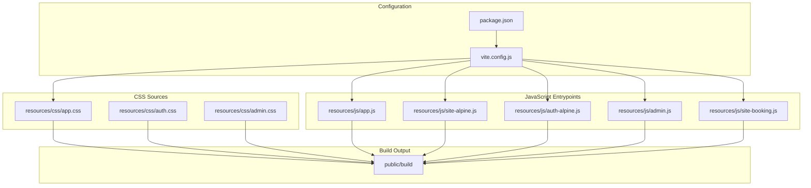

**Diagram sources**
- [vite.config.js:5-21](file://vite.config.js#L5-L21)
- [package.json:1-35](file://package.json#L1-L35)

**Section sources**
- [vite.config.js:5-21](file://vite.config.js#L5-L21)
- [package.json:1-35](file://package.json#L1-L35)

## Core Components
The build system is composed of these core pieces:

| Component | Role | Key Behavior |
|---|---|---|
| Vite | Modern frontend build tool | Bundles JavaScript, transforms CSS, provides a development server with hot module replacement |
| Laravel Vite Plugin | Bridges Laravel Blade views and Vite | Registers input entries and serves development assets |
| Tailwind CSS v4 via `@tailwindcss/vite` | Utility-first CSS compilation | Compiles Tailwind directives and custom theme tokens from CSS source files |
| Alpine.js | Lightweight reactive UI layer | Used for interactive components across public, auth, and admin areas |
| Livewire Flux CSS | Prebuilt component styles | Imported through the public site CSS bundle |
| Bootstrap 4 and jQuery | Legacy admin styling support | Included for compatibility with older admin layout patterns |
| Docker multi-stage build | Production asset packaging | Builds assets in a Node stage and copies them into the PHP runtime image |

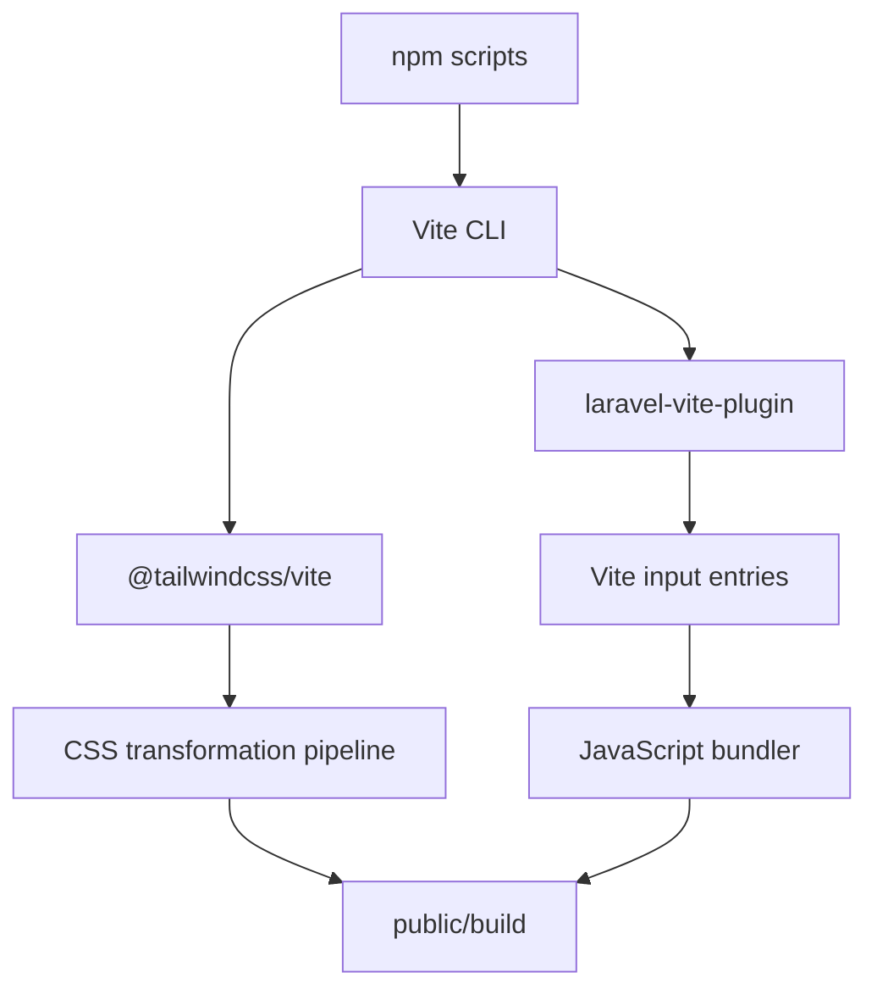

**Diagram sources**
- [package.json:5-12](file://package.json#L5-L12)
- [vite.config.js:5-21](file://vite.config.js#L5-L21)

**Section sources**
- [package.json:1-35](file://package.json#L1-L35)
- [vite.config.js:1-33](file://vite.config.js#L1-L33)

## Architecture Overview
The end-to-end asset architecture combines a developer-facing Vite dev server with a production-focused Docker build.

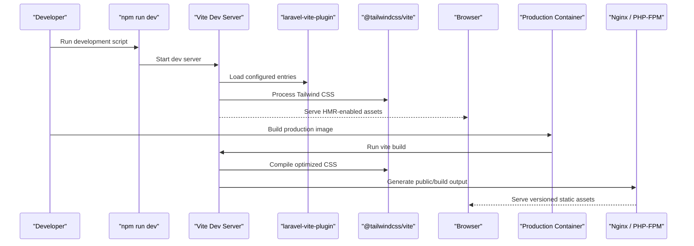

**Diagram sources**
- [package.json:5-12](file://package.json#L5-L12)
- [vite.config.js:5-21](file://vite.config.js#L5-L21)
- [Dockerfile:10-28](file://Dockerfile#L10-L28)

**Section sources**
- [vite.config.js:5-21](file://vite.config.js#L5-L21)
- [Dockerfile:10-28](file://Dockerfile#L10-L28)
- [docker-compose.yml:1-31](file://docker-compose.yml#L1-L31)

## Detailed Component Analysis

### Vite Configuration and Build Pipeline
Vite is configured through a single configuration file that declares all frontend entry points, enables the Laravel plugin, and registers Tailwind CSS.

Key behaviors:
- Input entries define separate bundles for the public site, authentication pages, and the admin panel.
- The Laravel plugin is enabled with `refresh: true`.
- Tailwind CSS is applied as a standalone plugin after the Laravel plugin.
- The development server enables CORS and ignores compiled Blade view files during watching.

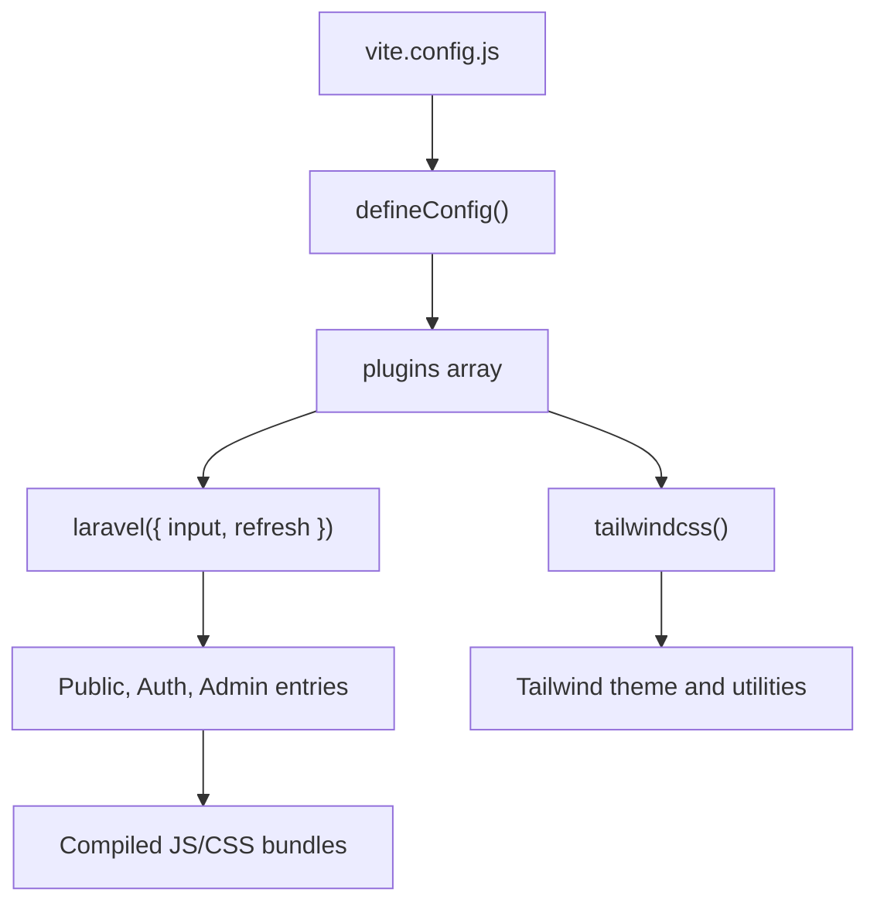

**Diagram sources**
- [vite.config.js:5-21](file://vite.config.js#L5-L21)

**Section sources**
- [vite.config.js:1-33](file://vite.config.js#L1-L33)

### CSS Compilation with Tailwind CSS Integration
The main public stylesheet imports Tailwind and Livewire Flux, defines custom variants, theme tokens, semantic colors, and design-system variables. It also contains scoped styles for the booking flow.

Important characteristics:
- Tailwind is imported through the Tailwind v4 import directive.
- Custom variants are declared for dark mode, sidebar state, and operating-system detection.
- A centralized `@theme` block defines typography, color palettes, spacing tokens, shadows, easings, and z-index extensions.
- Semantic token namespaces are used to separate public-site, admin, and legacy UI styles.
- Scoped `.booking-flow` variables isolate the booking wizard’s appearance from global theme changes.

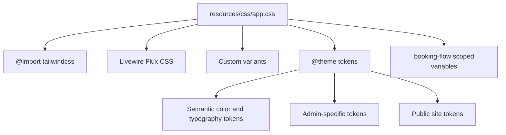

**Diagram sources**
- [resources/css/app.css:1-120](file://resources/css/app.css#L1-L120)

**Section sources**
- [resources/css/app.css:1-120](file://resources/css/app.css#L1-L120)

#### Authentication CSS Scope
Authentication styles use a deliberate unlayered scope under `.hb-ui` so they can override Tailwind utilities where needed. This is important because the two-factor challenge page must render reliably without relying on Tailwind utility precedence.

**Section sources**
- [resources/css/auth.css:1-40](file://resources/css/auth.css#L1-L40)

#### Admin Panel CSS
The admin stylesheet defines a premium dark theme, including root-level CSS variables, action buttons, and admin-specific visual rules. It is bundled separately from the public site to keep admin styles isolated.

**Section sources**
- [resources/css/admin.css:1-60](file://resources/css/admin.css#L1-L60)

### JavaScript Bundling with Alpine.js Components
JavaScript is split into purpose-driven entry points rather than one large monolithic bundle.

| Entry Point | Responsibility | Notable Details |
|---|---|---|
| `resources/js/app.js` | Public site helpers, passkey registration, password generator, delegated event handlers, scroll-linked parallax | Uses vanilla DOM APIs; avoids direct element binding when Livewire navigation replaces content |
| `resources/js/site-alpine.js` | Public Alpine components, image lightbox, blog search palette, Livewire-Alpine coordination | Defers component registrations until Livewire’s Alpine instance is ready |
| `resources/js/auth-alpine.js` | Single Alpine instance for authentication flows | Ensures the same-origin, version-pinned copy of Alpine is used |
| `resources/js/admin.js` | Admin Alpine components, focus traps, media picker, command palette, Passkeys integration | Implements its own focus-trap logic because `@alpinejs/focus` is not installed |
| `resources/js/site-booking.js` | Booking wizard state, calendar rendering, slot selection, draft persistence | Keeps availability decisions on the server while managing client-side UI state |

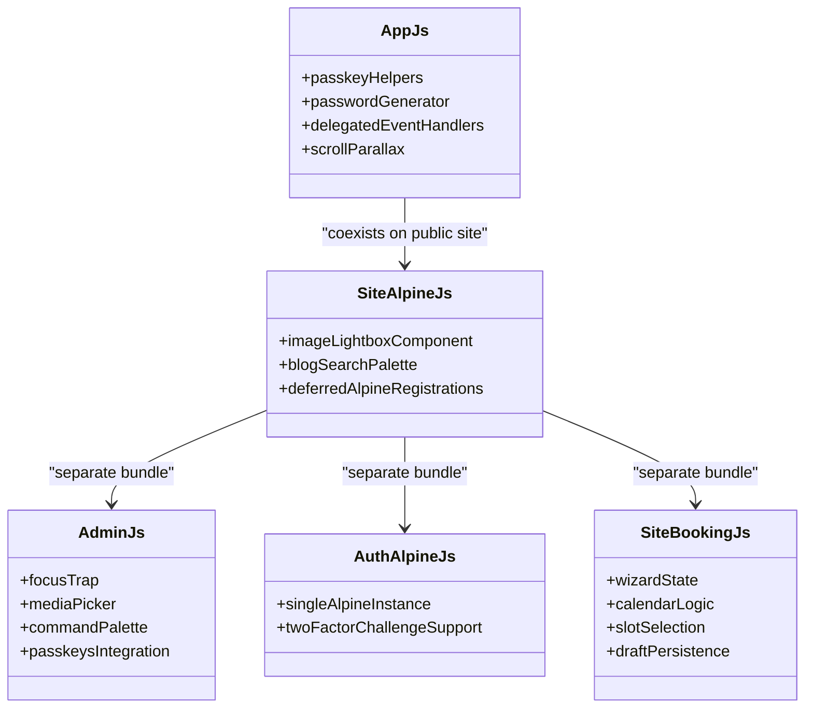

**Diagram sources**
- [resources/js/app.js:1-157](file://resources/js/app.js#L1-L157)
- [resources/js/site-alpine.js:1-60](file://resources/js/site-alpine.js#L1-L60)
- [resources/js/auth-alpine.js:1-16](file://resources/js/auth-alpine.js#L1-L16)
- [resources/js/admin.js:1-40](file://resources/js/admin.js#L1-L40)
- [resources/js/site-booking.js:1-40](file://resources/js/site-booking.js#L1-L40)

**Section sources**
- [resources/js/app.js:1-157](file://resources/js/app.js#L1-L157)
- [resources/js/site-alpine.js:1-60](file://resources/js/site-alpine.js#L1-L60)
- [resources/js/auth-alpine.js:1-16](file://resources/js/auth-alpine.js#L1-L16)
- [resources/js/admin.js:1-40](file://resources/js/admin.js#L1-L40)
- [resources/js/site-booking.js:1-40](file://resources/js/site-booking.js#L1-L40)

### Asset Versioning Strategy
The current repository does not include an explicit Vite plugin that injects hashed filenames or HTML tags. Instead, versioning is primarily achieved through the Docker build process:

- The production container builds assets with `npm run build`.
- The generated `public/build` directory is copied into the final image.
- Changing any asset triggers a new image build, effectively changing deployment artifacts.
- Browser cache busting therefore relies on container/image deployments rather than per-file hashes injected by Vite.

This means:
- Static assets benefit from immutable container images.
- Rollbacks should deploy a previous image rather than rely on URL-based cache invalidation.
- If fine-grained asset hashing is required later, a Vite plugin or framework-integrated asset manifest would be needed.

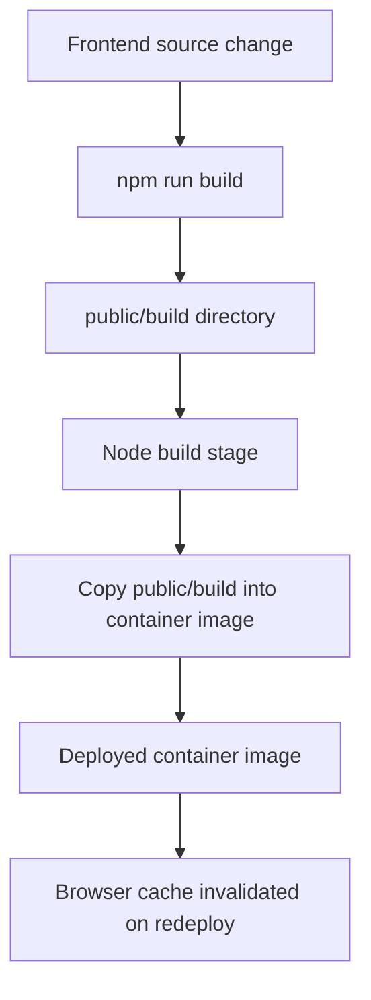

**Diagram sources**
- [package.json:5-12](file://package.json#L5-L12)
- [Dockerfile:10-28](file://Dockerfile#L10-L28)

**Section sources**
- [package.json:5-12](file://package.json#L5-L12)
- [Dockerfile:10-28](file://Dockerfile#L10-L28)

### Development Hot Reload Setup
The development workflow is coordinated through npm scripts and Composer:

- `npm run dev` starts Vite.
- `composer run dev` runs Laravel serve, queue listening, log streaming, and Vite concurrently.
- The Vite dev server has CORS enabled.
- Blade view compilation output is ignored during file watching to reduce unnecessary rebuilds.

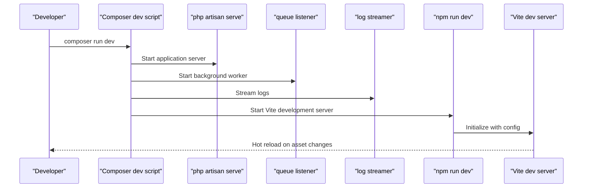

**Diagram sources**
- [package.json:5-12](file://package.json#L5-L12)
- [composer.json:65-86](file://composer.json#L65-L86)
- [vite.config.js:23-31](file://vite.config.js#L23-L31)

**Section sources**
- [package.json:5-12](file://package.json#L5-L12)
- [composer.json:65-86](file://composer.json#L65-L86)
- [vite.config.js:23-31](file://vite.config.js#L23-L31)

### Production Build Optimizations
The production build path is defined in the Dockerfile:

1. A Node-based stage installs dependencies with `npm ci`.
2. Assets are built using `npm run build`.
3. The resulting `public/build` directory is copied into the PHP runtime image.
4. The runtime image includes Nginx, PHP-FPM, supervisor, and required PHP extensions.

This approach ensures that:
- Asset compilation happens deterministically with locked dependencies.
- Production containers contain only compiled assets.
- No Node toolchain is required at runtime.

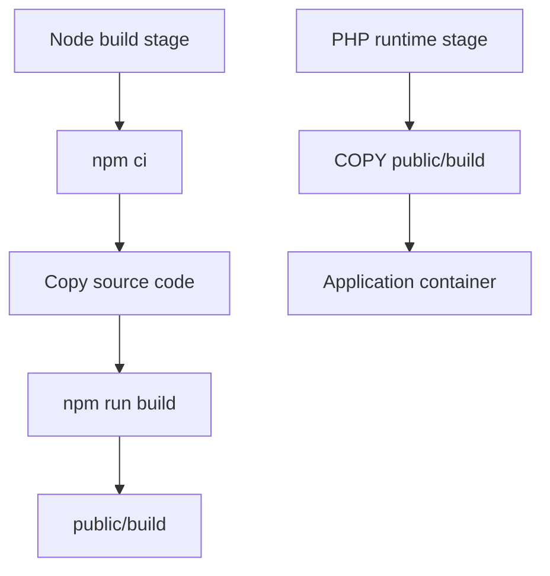

**Diagram sources**
- [Dockerfile:10-28](file://Dockerfile#L10-L28)

**Section sources**
- [Dockerfile:10-28](file://Dockerfile#L10-L28)

### Custom Vite Plugins and Transformation Pipelines
Currently, the build pipeline uses two primary plugins:

| Plugin | Purpose | Current Usage |
|---|---|---|
| `laravel-vite-plugin` | Integrates Vite with Laravel | Declares input entries and enables refresh |
| `@tailwindcss/vite` | Compiles Tailwind CSS v4 | Processes CSS imports and theme definitions |

There are no custom Vite plugins in this repository. Extensibility points include:
- Adding a plugin to generate asset manifests for hashed URLs.
- Injecting environment variables into the client bundle.
- Transforming Blade templates if template-level asset injection is needed outside the Laravel plugin.
- Adding optimization passes for specific third-party libraries.

**Section sources**
- [vite.config.js:1-33](file://vite.config.js#L1-L33)

### Integration Between Laravel Mix Alternatives and Modern Build Tools
This project has moved away from Laravel Mix entirely and uses Vite as the frontend build tool. The relevant integration points are:

- `laravel-vite-plugin` replaces Mix’s role in linking Blade views to frontend assets.
- `composer run setup` still triggers `npm install` and `npm run build`, keeping asset compilation part of the standard setup flow.
- The Composer post-update hook publishes Laravel assets, but the actual bundling is performed by Vite.

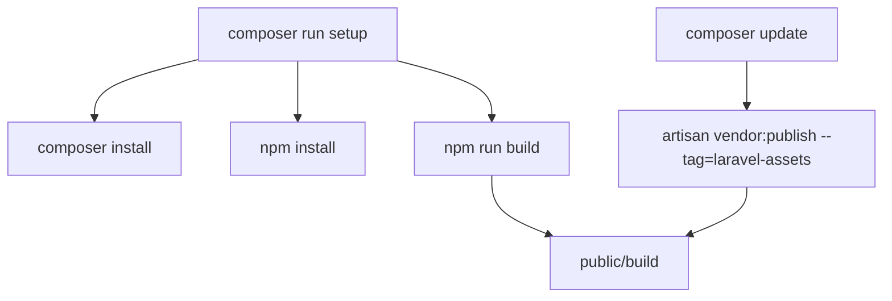

**Diagram sources**
- [composer.json:65-86](file://composer.json#L65-L86)

**Section sources**
- [composer.json:65-86](file://composer.json#L65-L86)
- [package.json:5-12](file://package.json#L5-L12)

## Dependency Analysis
The frontend dependency graph separates concerns by entry point and library type.

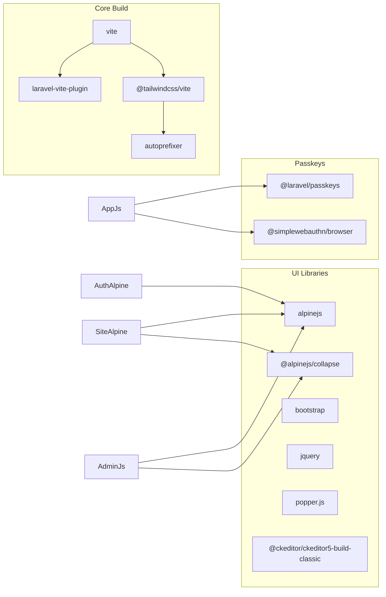

**Diagram sources**
- [package.json:13-35](file://package.json#L13-L35)
- [resources/js/site-alpine.js:1-10](file://resources/js/site-alpine.js#L1-L10)
- [resources/js/auth-alpine.js:1-16](file://resources/js/auth-alpine.js#L1-L16)
- [resources/js/admin.js:1-10](file://resources/js/admin.js#L1-L10)
- [resources/js/app.js:1-20](file://resources/js/app.js#L1-L20)

**Section sources**
- [package.json:13-35](file://package.json#L13-L35)
- [resources/js/site-alpine.js:1-10](file://resources/js/site-alpine.js#L1-L10)
- [resources/js/auth-alpine.js:1-16](file://resources/js/auth-alpine.js#L1-L16)
- [resources/js/admin.js:1-10](file://resources/js/admin.js#L1-L10)
- [resources/js/app.js:1-20](file://resources/js/app.js#L1-L20)

## Performance Considerations
Based on the current configuration and source structure, performance considerations include:

| Area | Current State | Recommendation |
|---|---|---|
| Bundle splitting | Separate entry points exist, but no explicit dynamic imports are visible | Split heavy features like CKEditor or large admin modules into lazy-loaded chunks |
| CSS size | Tailwind v4 processes full source files | Keep Tailwind usage scoped and avoid importing unused utility trees |
| Alpine instances | Multiple Alpine-related files manage initialization carefully | Avoid bootstrapping multiple Alpine instances on the same page |
| Event handling | Delegated listeners are used for Livewire navigation | Continue delegating events rather than binding directly to replaced elements |
| Asset versioning | Relies on container image changes | Consider adding asset hashing if partial asset updates are needed |
| Build speed | Uses `npm ci` and a single build step | Cache Node modules and build artifacts in CI pipelines |
| Watch performance | Blade view compilation output is ignored | Keep ignoring generated directories and avoid watching large unrelated folders |

[No sources needed since this section provides general guidance]

## Troubleshooting Guide

### Common Build Issues

| Symptom | Likely Cause | Resolution |
|---|---|---|
| `npm run build` fails with missing native dependencies | Optional native binaries are not installed for the current platform | Install optional dependencies such as `@tailwindcss/oxide-linux-x64-gnu` or `lightningcss-linux-x64-gnu` |
| Tailwind styles do not compile | Tailwind plugin not registered or CSS does not import Tailwind | Verify `@tailwindcss/vite` is present in `vite.config.js` and CSS files import Tailwind |
| Alpine components do not initialize | Multiple Alpine instances or Livewire-Alpine lifecycle mismatch | Ensure only one Alpine instance boots per page and defer component registrations until Livewire is ready |
| Password reveal toggle misbehaves on auth pages | Auth pages load vanilla JS without Alpine | Use `auth-alpine.js` only where needed and keep vanilla helpers independent |
| Admin modal focus escapes | Focus trap not installed or incorrectly bound | Confirm admin focus-trap logic is active and only one trap implementation exists |
| Dev server does not reflect Blade changes | Compiled Blade views are being watched | Keep Blade view outputs in the ignored watch list |
| Production assets are missing | `public/build` was not copied into the container image | Rebuild the Docker image so the Node build stage generates and copies assets |
| CORS errors in development | Vite dev server is accessed from a different origin | Enable CORS in the Vite server configuration |

**Section sources**
- [package.json:23-35](file://package.json#L23-L35)
- [vite.config.js:5-21](file://vite.config.js#L5-L21)
- [vite.config.js:23-31](file://vite.config.js#L23-L31)
- [resources/js/auth-alpine.js:1-16](file://resources/js/auth-alpine.js#L1-L16)
- [resources/js/admin.js:1-40](file://resources/js/admin.js#L1-L40)
- [Dockerfile:10-28](file://Dockerfile#L10-L28)

### Optimizing Build Times
Recommended steps:

1. **Use deterministic dependency installation**: Keep `package-lock.json` or equivalent lockfiles committed; the Dockerfile already uses `npm ci`.
2. **Avoid rebuilding everything unnecessarily**: In development, rely on Vite’s fast incremental compilation.
3. **Exclude irrelevant directories from watchers**: Continue ignoring generated Blade views and large storage directories.
4. **Split large dependencies**: Defer loading heavy libraries such as CKEditor until they are actually needed.
5. **Reuse Docker build caches**: Place dependency installation before copying the full source tree, as already done in the Dockerfile.
6. **Pin optional native dependencies**: Keep platform-specific optional dependencies aligned with the target build environment.

**Section sources**
- [Dockerfile:10-28](file://Dockerfile#L10-L28)
- [vite.config.js:23-31](file://vite.config.js#L23-L31)
- [package.json:13-35](file://package.json#L13-L35)

### Managing Frontend Dependencies
Current dependency categories:

| Category | Packages | Notes |
|---|---|---|
| Build tools | `vite`, `laravel-vite-plugin`, `@tailwindcss/vite`, `autoprefixer` | Core compilation pipeline |
| UI libraries | `alpinejs`, `@alpinejs/collapse`, `bootstrap`, `jquery`, `popper.js` | Client interactivity and legacy admin support |
| Rich text editor | `@ckeditor/ckeditor5-build-classic` | Large dependency best loaded lazily |
| Passkeys | `@laravel/passkeys`, `@simplewebauthn/browser` | Used in public and admin authentication flows |
| Formatting tools | `prettier`, `prettier-plugin-blade`, `prettier-plugin-tailwindcss` | Code formatting, not part of the runtime build |

When upgrading dependencies:
- Upgrade Tailwind and its Vite plugin together to maintain compatibility.
- Test Alpine component initialization after updating Alpine versions.
- Verify that Livewire and Flux CSS remain compatible with the updated Tailwind build.
- Pin or audit optional native dependencies when moving between platforms.

**Section sources**
- [package.json:13-35](file://package.json#L13-L35)

## Conclusion
Highblossom uses a clean Vite-based asset pipeline that separates public, authentication, and admin frontends into distinct entry points. Tailwind CSS v4 powers the design system, Alpine.js provides lightweight interactivity, and Docker multi-stage builds produce immutable production artifacts.

The most important operational facts are:

- Development uses Vite with hot reload and concurrent tooling orchestrated by Composer.
- CSS is processed through Tailwind v4 and centralized theme tokens.
- JavaScript is modularized by feature and user area.
- Production builds are containerized and cached through Docker layers.
- Asset versioning currently depends on deployment boundaries rather than per-file hashing.

Future improvements could include explicit asset hashing, lazy loading for large dependencies, and additional Vite plugins for environment injection or advanced optimization.

[No sources needed since this section summarizes without analyzing specific files]