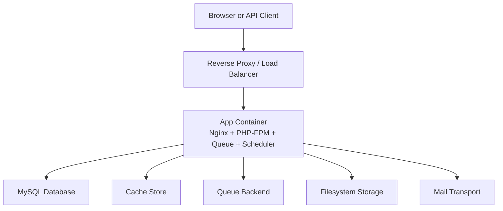
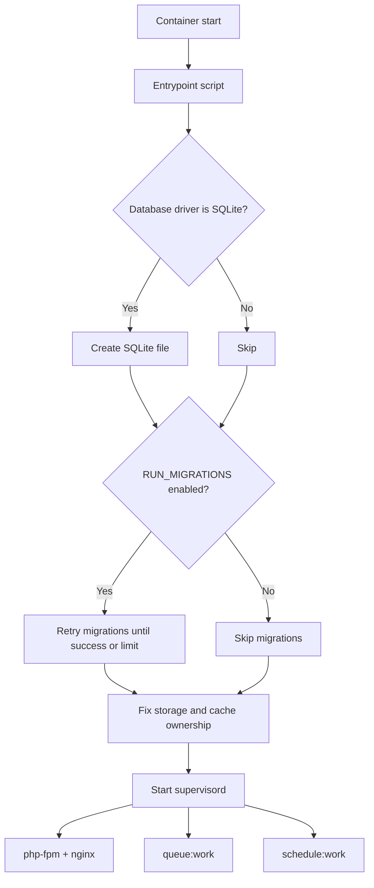
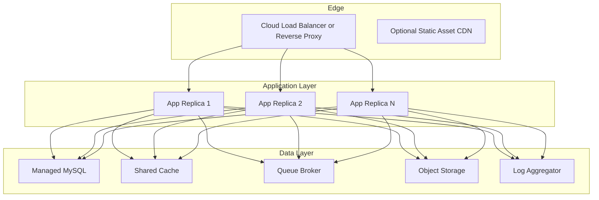
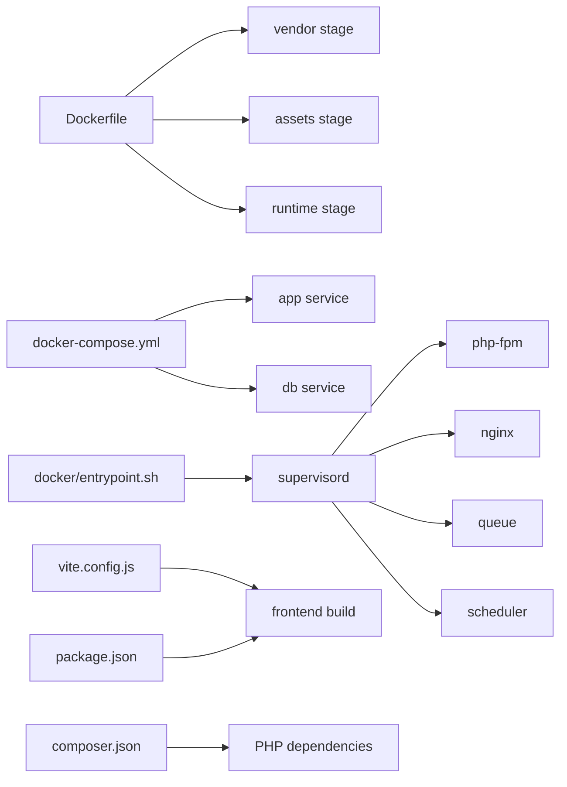

# Deployment & DevOps

<cite>
**Referenced Files in This Document**   
- [Dockerfile](file://Dockerfile)
- [docker-compose.yml](file://docker-compose.yml)
- [docker/entrypoint.sh](file://docker/entrypoint.sh)
- [docker/nginx.conf](file://docker/nginx.conf)
- [docker/supervisord.conf](file://docker/supervisord.conf)
- [vite.config.js](file://vite.config.js)
- [package.json](file://package.json)
- [composer.json](file://composer.json)
- [config/app.php](file://config/app.php)
- [config/database.php](file://config/database.php)
- [config/cache.php](file://config/cache.php)
- [config/session.php](file://config/session.php)
- [config/queue.php](file://config/queue.php)
- [config/filesystems.php](file://config/filesystems.php)
- [config/logging.php](file://config/logging.php)
- [config/mail.php](file://config/mail.php)
- [.github/workflows/lint.yml](file://.github/workflows/lint.yml)
</cite>

## Table of Contents
1. [Introduction](#introduction)
2. [Project Structure](#project-structure)
3. [Core Components](#core-components)
4. [Architecture Overview](#architecture-overview)
5. [Detailed Component Analysis](#detailed-component-analysis)
6. [Dependency Analysis](#dependency-analysis)
7. [Performance Considerations](#performance-considerations)
8. [Troubleshooting Guide](#troubleshooting-guide)
9. [Conclusion](#conclusion)
10. [Appendices](#appendices)

## Introduction
This document describes the deployment and DevOps model for the Houblossom application. It covers containerization with Docker, development environment setup, staging and production deployment strategies, environment variable management, asset compilation through Vite, database migration strategy, backup and disaster recovery guidance, monitoring considerations, scaling approaches, load balancing configuration, infrastructure provisioning patterns, CI/CD automation, rollback procedures, performance monitoring, and operational best practices.

The application is a Laravel-based web application that runs Nginx, PHP-FPM, queue workers, and the scheduler inside one container using `supervisord`. Frontend assets are built with Vite and Tailwind CSS v4. The repository includes a MySQL service in its local compose file and supports multiple database backends through Laravel configuration.

## Project Structure
At a high level, deployment-relevant files live in these areas:

- Container image definition: `Dockerfile`
- Local orchestration: `docker-compose.yml`
- Runtime processes: `docker/entrypoint.sh`, `docker/supervisord.conf`
- Web server configuration: `docker/nginx.conf`
- Asset build configuration: `vite.config.js`, `package.json`
- PHP dependencies and scripts: `composer.json`
- Application runtime configuration: `config/*.php`
- CI pipeline: `.github/workflows/lint.yml`

**Diagram sources**
- [docker/nginx.conf:1-20](file://docker/nginx.conf#L1-L20)
- [docker/supervisord.conf:1-66](file://docker/supervisord.conf#L1-L66)
- [docker-compose.yml:1-31](file://docker-compose.yml#L1-L31)
- [config/filesystems.php:1-109](file://config/filesystems.php#L1-L109)
- [config/queue.php:1-128](file://config/queue.php#L1-L128)
- [config/mail.php:1-123](file://config/mail.php#L1-L123)

**Section sources**
- [Dockerfile:1-32](file://Dockerfile#L1-L32)
- [docker-compose.yml:1-31](file://docker-compose.yml#L1-L31)
- [docker/entrypoint.sh:1-20](file://docker/entrypoint.sh#L1-L20)
- [docker/nginx.conf:1-20](file://docker/nginx.conf#L1-L20)
- [docker/supervisord.conf:1-66](file://docker/supervisord.conf#L1-L66)
- [vite.config.js:1-33](file://vite.config.js#L1-L33)
- [package.json:1-35](file://package.json#L1-L35)
- [composer.json:1-138](file://composer.json#L1-L138)

## Core Components

### Docker Image and Multi-stage Build
The image is built in three stages:

1. **Vendor stage**: Installs Composer dependencies without dev packages and optimizes the autoloader.
2. **Assets stage**: Runs Node tooling to install frontend dependencies and build assets.
3. **Runtime stage**: Uses PHP 8.4 FPM Alpine, installs Nginx and `supervisord`, adds required PHP extensions, copies application code and prebuilt assets, creates writable directories, exposes port `8080`, and starts the entrypoint.

Key characteristics:
- The final runtime image combines Nginx and PHP-FPM.
- Prebuilt Vite assets are copied into `/var/www/html/public/build`.
- Writable directories include `storage`, `bootstrap/cache`, and `database`.
- The process supervisor controls four main programs: `php-fpm`, `nginx`, `queue`, and `scheduler`.

**Section sources**
- [Dockerfile:1-32](file://Dockerfile#L1-L32)

### Container Orchestration with Docker Compose
The provided compose file defines two services:

- `app`: Builds the image, maps host port `APP_PORT` to container port `8080`, sets production-like environment variables, depends on the database, and runs migrations at startup.
- `db`: Runs MySQL 8.4 with a named volume for persistence.

Networking:
- `app` resolves `db` by service name.
- The database connection uses `DB_HOST=db`, `DB_PORT=3306`, and default credentials defined in the compose file.

Operational notes:
- In production, replace hardcoded values with secrets.
- For horizontal scaling, run multiple `app` replicas behind a reverse proxy while sharing a managed database and shared storage backend.

**Section sources**
- [docker-compose.yml:1-31](file://docker-compose.yml#L1-L31)

### Entry Point and Process Supervision
The entrypoint script:

- Sets flags for which components to run: web, queue, scheduler, and Reverb.
- Creates a SQLite database file when the configured driver is SQLite.
- Retries database migrations up to 20 times with a two-second delay, allowing time for the database container to become ready.
- Fixes ownership of `storage`, `bootstrap/cache`, and `database`.
- Starts `supervisord`.

Supervisor manages:
- `php-fpm`: FastCGI backend.
- `nginx`: HTTP server listening on port `8080`.
- `queue`: Long-running queue worker with retry and timeout settings.
- `scheduler`: Laravel scheduler worker.

**Diagram sources**
- [docker/entrypoint.sh:1-20](file://docker/entrypoint.sh#L1-L20)
- [docker/supervisord.conf:1-66](file://docker/supervisord.conf#L1-L66)

**Section sources**
- [docker/entrypoint.sh:1-20](file://docker/entrypoint.sh#L1-L20)
- [docker/supervisord.conf:1-66](file://docker/supervisord.conf#L1-L66)

### Nginx Configuration
Nginx:
- Listens on port `8080`.
- Serves static files from `/var/www/html/public`.
- Routes PHP requests to PHP-FPM on `127.0.0.1:9000`.
- Uses `try_files` to forward non-static requests to `index.php`.
- Restricts access to hidden files except well-known paths.
- Allows request bodies up to `64m`.

For production deployments, place this container behind a TLS-terminating reverse proxy such as Traefik, NGINX Plus, HAProxy, Cloudflare, or a cloud load balancer.

**Section sources**
- [docker/nginx.conf:1-20](file://docker/nginx.conf#L1-L20)

### Asset Compilation with Vite
Vite builds public site styles and JavaScript, authentication assets, and admin panel assets. The build produces output under `public/build`, which is copied into the production image.

Build inputs include:
- Public site CSS and JS entries.
- Authentication CSS and JS entries.
- Admin panel CSS and JS entries.
- Site-specific booking and Alpine scripts.

Recommended workflow:
- Development: run the Vite development server and use hot module replacement.
- Production: run `npm run build` during the image build so containers ship compiled assets.

**Section sources**
- [vite.config.js:1-33](file://vite.config.js#L1-L33)
- [package.json:1-35](file://package.json#L1-L35)

### PHP Application Configuration
The application reads most runtime behavior from environment variables:

- Environment, debug mode, URL, timezone, locale, encryption key, and maintenance mode are defined in `config/app.php`.
- Database connections support SQLite, MySQL/MariaDB, PostgreSQL, and SQL Server; Redis connections are also defined.
- Cache defaults to the database store and supports file, Memcached, Redis, DynamoDB, Octane, and failover stores.
- Sessions default to the database driver with configurable lifetime, cookie settings, secure transport, and domain.
- Queues default to the database driver and support sync, Beanstalkd, SQS, Redis, deferred, background, and failover configurations.
- Filesystem storage supports local public/private disks and S3-compatible object storage.
- Logging supports stack, single, daily, Slack, Papertrail, stderr, syslog, errorlog, and null channels.
- Mail supports SMTP, SES, Postmark, Resend, Sendmail, log, array, failover, and round-robin transports.

**Section sources**
- [config/app.php:1-126](file://config/app.php#L1-L126)
- [config/database.php:1-184](file://config/database.php#L1-L184)
- [config/cache.php:1-146](file://config/cache.php#L1-L146)
- [config/session.php:1-233](file://config/session.php#L1-L233)
- [config/queue.php:1-128](file://config/queue.php#L1-L128)
- [config/filesystems.php:1-109](file://config/filesystems.php#L1-L109)
- [config/logging.php:1-132](file://config/logging.php#L1-L132)
- [config/mail.php:1-123](file://config/mail.php#L1-L123)

## Architecture Overview

In this architecture:
- The app container is stateless.
- Database, cache, queue broker, and object storage are external and shared.
- Logs flow to an aggregator for centralized observability.
- Assets can be served directly from the application or from a CDN if precompiled and uploaded separately.

[No sources needed since this diagram shows conceptual deployment topology]

## Detailed Component Analysis

### Container Networking and Service Boundaries
- The container listens internally on port `8080`.
- The compose file maps the host port to `APP_PORT`, defaulting to `8080`.
- Internal communication between Nginx and PHP-FPM happens via loopback on port `9000`.
- The database is reached over the Docker network using the service name `db`.

Best practices:
- Do not expose port `9000` externally.
- Use a reverse proxy for TLS termination, rate limiting, and request inspection.
- Keep internal ports consistent across environments.

**Section sources**
- [docker/nginx.conf:1-20](file://docker/nginx.conf#L1-L20)
- [docker-compose.yml:1-31](file://docker-compose.yml#L1-L31)

### Development Environment Setup
Local development can use the provided scripts and tools:

- `composer setup` installs dependencies, generates the application key, runs migrations, installs Node dependencies, and builds assets.
- `composer dev` concurrently starts the PHP development server, queue listener, Pail log viewer, and Vite development server.
- Vite development server enables CORS and watches source files while ignoring compiled view caches.

Recommended steps:
1. Install PHP 8.2+ and Node.js.
2. Run `composer setup`.
3. Run `composer dev`.
4. Access the application through the PHP development server or your preferred local web server.
5. Configure `.env` variables for database, mail, cache, queue, and storage according to your local setup.

**Section sources**
- [composer.json:1-138](file://composer.json#L1-L138)
- [vite.config.js:1-33](file://vite.config.js#L1-L33)

### Staging and Production Deployment Strategies

#### Blue-Green Deployment
- Maintain two identical environments: active and idle.
- Deploy the new version to the idle environment.
- Run migrations and health checks.
- Switch traffic from active to idle.
- Roll back by switching traffic back if issues appear.

#### Canary Deployment
- Deploy the new version to a small subset of instances.
- Monitor errors, latency, and business metrics.
- Gradually increase traffic if stable.
- Roll back immediately if thresholds are breached.

#### Rolling Deployment
- Update replicas one at a time.
- Ensure zero-downtime by running queues and scheduler only after readiness probes pass.
- Drain old replicas before terminating them.

Operational requirements:
- Externalize stateful data: database, cache, queue broker, object storage.
- Prebuild assets and bake them into images.
- Run migrations safely before or during rolling updates depending on compatibility.

[No sources needed since this section provides general deployment strategy guidance]

### Environment Variable Management and Configuration Best Practices
Environment-driven configuration is central to the application:

- `APP_ENV`, `APP_DEBUG`, `APP_URL`, `APP_NAME`, `APP_KEY`, `APP_TIMEZONE`, `APP_LOCALE`, and maintenance settings control application behavior.
- Database configuration is driven by `DB_CONNECTION`, `DB_URL`, host/port/user/password, charset, collation, SSL options, and Redis connectivity.
- Cache, session, queue, filesystem, logging, and mail drivers are all environment-driven.

Best practices:
- Never commit secrets to source control.
- Use platform secret managers or encrypted environment files.
- Validate required variables at startup where possible.
- Separate per-environment variables rather than branching configuration files.
- Rotate `APP_KEY` carefully and populate `APP_PREVIOUS_KEYS` during rotation.
- Set `APP_DEBUG=false` in production.
- Prefer structured logs sent to stderr for containerized environments.

**Section sources**
- [config/app.php:1-126](file://config/app.php#L1-L126)
- [config/database.php:1-184](file://config/database.php#L1-L184)
- [config/cache.php:1-146](file://config/cache.php#L1-L146)
- [config/session.php:1-233](file://config/session.php#L1-L233)
- [config/queue.php:1-128](file://config/queue.php#L1-L128)
- [config/filesystems.php:1-109](file://config/filesystems.php#L1-L109)
- [config/logging.php:1-132](file://config/logging.php#L1-L132)
- [config/mail.php:1-123](file://config/mail.php#L1-L123)

### CI/CD Pipeline Setup and Automated Testing Integration
The repository includes a GitHub Actions linting pipeline:

- Triggers on push and pull requests to several branches.
- Checks out the code.
- Sets up PHP 8.4.
- Configures Composer credentials for Flux UI.
- Installs Composer and npm dependencies.
- Runs the Pint linter.

To extend the pipeline:
- Add a Composer test job running `composer test`.
- Add a Vite build job to validate asset compilation.
- Add integration tests against a temporary MySQL or PostgreSQL instance.
- Add security scanning for PHP and Node dependencies.
- Add deployment jobs gated by branch and environment protection rules.

**Section sources**
- [.github/workflows/lint.yml:1-50](file://.github/workflows/lint.yml#L1-L50)
- [composer.json:1-138](file://composer.json#L1-L138)
- [package.json:1-35](file://package.json#L1-L35)

### Deployment Automation
Recommended automation flow:

1. Push triggers CI.
2. CI runs linting, unit tests, and asset builds.
3. On merge to the deployment branch, deploy the image to a registry.
4. Update the target environment with the new image tag.
5. Run migrations safely.
6. Warm caches and clear configuration.
7. Verify health endpoints and smoke tests.
8. Promote the deployment or roll back automatically on failure.

Deployment targets:
- Kubernetes: use Deployments, Services, Ingress, ConfigMaps, Secrets, and PersistentVolumeClaims.
- ECS/EKS/GKE/AKS: use managed task definitions, cluster autoscaling, and load balancers.
- Traditional servers: use systemd or Docker Compose with a deployment script.

[No sources needed since this section provides general automation guidance]

### Database Migration Strategy
Migrations run at container startup when `RUN_MIGRATIONS=true`:

- The entrypoint retries migrations for up to 20 attempts with a two-second interval.
- This allows the database container to become available before migration completes.
- For production, consider separating migration execution from application startup to avoid blocking deployments.

Migration guidelines:
- Make migrations backward compatible when doing rolling updates.
- Avoid destructive schema changes in the same release as code changes that depend on them unless safe.
- Use idempotent operations where possible.
- Test migrations in staging first.
- Back up the database before major schema changes.

**Section sources**
- [docker/entrypoint.sh:1-20](file://docker/entrypoint.sh#L1-L20)
- [config/database.php:1-184](file://config/database.php#L1-L184)

### Backup and Disaster Recovery Procedures
Backups should cover:

- Relational database: scheduled logical or physical backups with retention policies.
- Object storage: bucket lifecycle and versioning policies.
- Configuration and secrets: encrypted backups from secret managers.
- Application logs: centralized retention and export capabilities.

Recovery procedures should define:

- RPO and RTO targets.
- Restore order: database, then cache and sessions, then application.
- Data validation after restore.
- DNS or routing update procedure.
- Communication plan for incidents.

[No sources needed since this section provides general backup and recovery guidance]

### Monitoring and Alerting Setup
Monitoring should cover:

- Application health endpoints.
- Error rates and exception traces.
- Request latency percentiles.
- Queue depth and processing latency.
- Database connection usage and slow queries.
- Cache hit ratios.
- Disk I/O and storage capacity.
- Memory and CPU utilization.
- Mail delivery status.

Recommended sources:
- Container logs to stderr for centralized collection.
- Structured application logs through Monolog channels.
- Metrics exporters for PHP-FPM, Nginx, and databases.
- Distributed tracing if cross-service calls are introduced.

Configuration references:
- Logging channels and levels are controlled through `config/logging.php`.
- Mail transport and failure modes are controlled through `config/mail.php`.

**Section sources**
- [config/logging.php:1-132](file://config/logging.php#L1-L132)
- [config/mail.php:1-123](file://config/mail.php#L1-L123)

### Scaling Considerations
Horizontal scaling applies to the stateless app replicas:

- Increase replica count based on CPU, memory, request rate, and queue backlog.
- Use a shared cache store such as Redis.
- Use a shared queue broker such as Redis or SQS.
- Use object storage for uploads instead of local disk.
- Tune queue worker concurrency, retry counts, and timeouts.
- Use graceful shutdowns to drain queued work before terminating instances.

Vertical scaling should be considered for the database layer through managed services with appropriate instance sizing and read replicas where supported.

**Section sources**
- [docker/supervisord.conf:1-66](file://docker/supervisord.conf#L1-L66)
- [config/queue.php:1-128](file://config/queue.php#L1-L128)
- [config/filesystems.php:1-109](file://config/filesystems.php#L1-L109)
- [config/cache.php:1-146](file://config/cache.php#L1-L146)

### Load Balancing Configuration
A reverse proxy or load balancer should:

- Terminate TLS.
- Forward requests to application containers on port `8080`.
- Enable sticky sessions only if necessary; prefer stateless sessions backed by Redis or database.
- Configure health checks against a lightweight endpoint.
- Apply rate limiting and request size limits.
- Support zero-downtime deployments by draining connections.

Internal application load balancing is handled by the orchestrator or platform (Kubernetes Services, ECS Service Discovery, cloud load balancers).

[No sources needed since this section provides general load balancing guidance]

### Infrastructure Provisioning Approaches
Infrastructure should be provisioned declaratively:

- Containers: Docker images built from the repository Dockerfile.
- Orchestration: Kubernetes manifests, Helm charts, Terraform modules, or cloud-native IaC templates.
- Databases: Managed relational databases with automated backups.
- Caching: Managed Redis or equivalent.
- Object storage: S3-compatible buckets with proper ACLs and lifecycle policies.
- Secrets: Encrypted secret stores integrated with the deployment platform.

[No sources needed since this section provides general provisioning guidance]

## Dependency Analysis

**Diagram sources**
- [Dockerfile:1-32](file://Dockerfile#L1-L32)
- [docker-compose.yml:1-31](file://docker-compose.yml#L1-L31)
- [docker/entrypoint.sh:1-20](file://docker/entrypoint.sh#L1-L20)
- [docker/supervisord.conf:1-66](file://docker/supervisord.conf#L1-L66)
- [vite.config.js:1-33](file://vite.config.js#L1-L33)
- [package.json:1-35](file://package.json#L1-L35)
- [composer.json:1-138](file://composer.json#L1-L138)

**Section sources**
- [Dockerfile:1-32](file://Dockerfile#L1-L32)
- [docker-compose.yml:1-31](file://docker-compose.yml#L1-L31)
- [docker/entrypoint.sh:1-20](file://docker/entrypoint.sh#L1-L20)
- [docker/supervisord.conf:1-66](file://docker/supervisord.conf#L1-L66)
- [vite.config.js:1-33](file://vite.config.js#L1-L33)
- [package.json:1-35](file://package.json#L1-L35)
- [composer.json:1-138](file://composer.json#L1-L138)

## Performance Considerations
- Use Redis for cache and sessions in production to reduce database load.
- Use an external queue broker for high-throughput job processing.
- Serve static assets from a CDN when possible.
- Enable PHP OPcache and tune it for production workloads.
- Optimize database queries and add appropriate indexes.
- Monitor queue backlog and adjust worker concurrency.
- Tune Nginx client body size and keepalive settings according to upload patterns.
- Profile PHP-FPM worker processes and memory usage.
- Review Vite bundle sizes and enable lazy loading where applicable.

[No sources needed since this section provides general performance guidance]

## Troubleshooting Guide

### Container Startup Failures
Symptoms:
- Container exits immediately.
- Migrations never complete.
- No HTTP responses on port `8080`.

Checks:
- Confirm database credentials and reachability.
- Inspect entrypoint logs for migration retry messages.
- Verify `RUN_WEB`, `RUN_QUEUE`, `RUN_SCHEDULER`, and `RUN_REVERB` flags.
- Ensure writable permissions for `storage`, `bootstrap/cache`, and `database`.

**Section sources**
- [docker/entrypoint.sh:1-20](file://docker/entrypoint.sh#L1-L20)
- [docker/supervisord.conf:1-66](file://docker/supervisord.conf#L1-L66)

### Web Requests Return 500 or Blank Pages
Checks:
- Verify `APP_DEBUG` is disabled in production but useful temporarily for debugging.
- Check PHP-FPM and Nginx logs.
- Confirm `APP_KEY` is set.
- Ensure Vite assets exist under `public/build`.

**Section sources**
- [config/app.php:1-126](file://config/app.php#L1-L126)
- [docker/nginx.conf:1-20](file://docker/nginx.conf#L1-L20)
- [Dockerfile:1-32](file://Dockerfile#L1-L32)

### Queue Jobs Not Processing
Checks:
- Confirm the queue worker program is running.
- Verify queue backend connectivity.
- Inspect failed jobs table or backend.
- Adjust retry and timeout settings.

**Section sources**
- [docker/supervisord.conf:1-66](file://docker/supervisord.conf#L1-L66)
- [config/queue.php:1-128](file://config/queue.php#L1-L128)

### File Uploads Missing or Not Visible
Checks:
- Determine whether the public disk is local or S3.
- For S3, verify bucket, region, credentials, and URL settings.
- For local storage, ensure symlink or path mapping is correct.
- Confirm object visibility and ACLs.

**Section sources**
- [config/filesystems.php:1-109](file://config/filesystems.php#L1-L109)

### Email Delivery Issues
Checks:
- Confirm mail transport configuration.
- Validate SMTP credentials or provider tokens.
- Check mail logs and bounce handling.
- Use failover or round-robin mailers for resilience.

**Section sources**
- [config/mail.php:1-123](file://config/mail.php#L1-L123)

### CI Linting Failures
Checks:
- Run `composer lint` locally.
- Ensure PHP version matches the CI configuration.
- Provide required Composer credentials for private packages.

**Section sources**
- [.github/workflows/lint.yml:1-50](file://.github/workflows/lint.yml#L1-L50)
- [composer.json:1-138](file://composer.json#L1-L138)

## Conclusion
Houblossom is designed for containerized deployment with a simple local compose setup and a production-ready multi-stage Docker image. Its architecture encourages statelessness, externalized stateful services, and environment-driven configuration. By extending the existing linting pipeline, adopting robust CI/CD practices, externalizing state, and implementing strong backup, monitoring, and scaling strategies, the application can be deployed reliably across staging and production environments.

[No sources needed since this section summarizes without analyzing specific files]

## Appendices

### Key Environment Variables Summary
- Application identity and runtime: `APP_NAME`, `APP_ENV`, `APP_DEBUG`, `APP_URL`, `APP_TIMEZONE`, `APP_LOCALE`, `APP_KEY`, `APP_PREVIOUS_KEYS`, maintenance settings.
- Database: `DB_CONNECTION`, `DB_URL`, `DB_HOST`, `DB_PORT`, `DB_DATABASE`, `DB_USERNAME`, `DB_PASSWORD`, charset/collation, SSL options, Redis connection details.
- Cache: `CACHE_STORE`, Redis or other cache store settings.
- Sessions: `SESSION_DRIVER`, lifetime, cookie settings, secure transport, domain/path.
- Queues: `QUEUE_CONNECTION`, backend-specific host/connection settings, retry and timeout configuration.
- Storage: `FILESYSTEM_DISK`, `PUBLIC_DISK_DRIVER`, S3 credentials, bucket, endpoint, and URL.
- Logging: `LOG_CHANNEL`, stack channels, Slack webhook, stderr formatter.
- Mail: `MAIL_MAILER`, SMTP or provider credentials, fallback transports.

**Section sources**
- [config/app.php:1-126](file://config/app.php#L1-L126)
- [config/database.php:1-184](file://config/database.php#L1-L184)
- [config/cache.php:1-146](file://config/cache.php#L1-L146)
- [config/session.php:1-233](file://config/session.php#L1-L233)
- [config/queue.php:1-128](file://config/queue.php#L1-L128)
- [config/filesystems.php:1-109](file://config/filesystems.php#L1-L109)
- [config/logging.php:1-132](file://config/logging.php#L1-L132)
- [config/mail.php:1-123](file://config/mail.php#L1-L123)